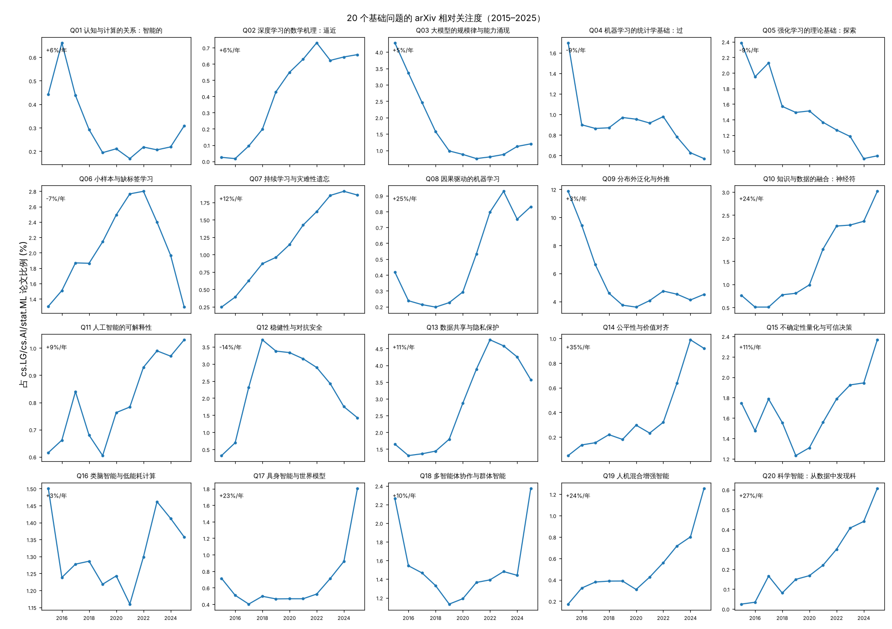

# 面向 2035 的人工智能 20 个基础科学问题：独立研究项目集与综合报告

本目录把中国科学院学部“中国学科及前沿领域 2035 发展战略丛书”人工智能卷提出的 20 个基础科学问题，拆成 20 个**独立研究项目**。每个项目分两个阶段：

| 阶段 | 交付物 | 内容 |
|---|---|---|
| 一：基础分析 | `README.md` + `experiment.py` | 问题界定、经典文献综述、预注册假设、可复现实验、文献计量信号、2035 路线图 |
| 二：前沿研究 | `paper.md` + `frontier_experiment.py` + `CONCLUSIONS.md` | 综述 2025–2026 年全球前沿进展（每篇论文引用 18–32 篇 2025 年后的 arXiv 文献），选一个前沿争论，做理论推导与新实验，写成完整学术论文，并附一页结论卡片 |

> **合订本**：20 篇前沿论文的 PDF 合订本见 [`export/ai2035-papers.pdf`](export/ai2035-papers.pdf)（A4，172 页，含封面、说明、目录与书签）。重新生成：`python ai2035/export/build_pdf.py`（需 pandoc 与 Node 版 Playwright）。

> **清单来源说明（请先读）**：本环境无法访问原书及其转载页面，因此 [`questions.yaml`](questions.yaml) 中的 20 个题目**不是原文逐字条目**。它们是根据可检索到的原书主题（认知与计算的关系、机器学习统计学基础、稳健性与稳定性、小样本与缺标签学习、数据共享与隐私保护、因果驱动方法、可解释性等），结合国家自然科学基金委“可解释、可通用的下一代人工智能方法”重大研究计划等同期议程重建的工作清单。拿到原书后应逐条核对；若某题与原文不符，替换 `title` 后各项目的方法框架仍可复用。

---

## 一、结论先行：跨 20 个问题的六条综合判断

以下为对 20 篇论文与 20 份报告的交叉综合（[判断]，依据见括注的项目）。

### 1. 前沿现象正在变得“可计算”：大量争论可在最小模型中化为闭式定律
在最小可解模型中，前沿社区争论的多数现象都能写成解析公式，并以很小的误差被实验验证：
- 长上下文检索的上限 ln P\* = βΔ − β²s²/2，误差 0.03 nat（Q01）；
- 测试时计算的覆盖率幂律指数等于难度分布在难题端的形状参数，理论 0.297、实测 0.297±0.007（Q03）；
- 上下文学习的新任务误差有闭式解，最大偏差 0.0067（Q04、Q06）；
- 逐步推理的误差累积律，偏差 ≤0.027（Q09）；
- 混合建模的风险为 BV/(B+V)，相对最优单一模型的增益上限为 2 倍，实测 0.52–0.54（Q10）；
- 相关误差下的投票上限（≤0.51 pp）与辩论的鞅性（Q18）；
- 隐私审计信号强度可由公式预测，相关系数 0.89（Q13）。

**含义**：AI 基础研究正在从“经验调参”走向“可预测科学”。到 2035 年，最关键的瓶颈不再是在玩具模型里找到定律，而是**在真实规模系统上测量定律中的参数**（如 Δ、s、难度分布、错设强度 B、误差相关系数 ρ），并检验相界。

### 2. 代理指标与真实目标的系统性错位，是贯穿“可信 AI”的共同根因
在 8 个项目中，我们都观察到“容易度量的指标好”不等于“真正关心的性质好”：
- SAE 解释了 87% 的方差，却只恢复了 0.4% 的真实特征（Q11）；
- 认证准确率比强攻击下的经验准确率低 20–42 个百分点，且两个训练种子对 11% 的样本结论相反（Q12）；
- 记账 ε=8，而可证实的 ε 只有 1.2，传统审计的结果甚至约为 0（Q13）；
- 奖励过优化只在误差重尾或打分模型错设时出现（Q14）；
- 18 个世界模型中，预测误差与控制回报的相关系数 |ρ| ≤0.18（Q17）；
- 力误差更低的原子间势，能量漂移反而高 18 倍（Q20）；
- 验证器的高分尾决定 best-of-n 的拐点（Q03）；
- 共形风险控制在无偏移时达标（0.098 对目标 0.1），在难题偏移下失效（0.194），加权后恢复（0.078），但拒答率从 31% 升至 58%；语义熵的优势在意义聚类有 30% 错分时消失（Q15）。

**含义**：“评估科学”本身就是一个基础科学问题。每条代理指标都需要一条可证明的“代理—目标”桥接定理，否则优化就会利用二者的缝隙。我们找到的若干桥接量包括：误差的旋度分量（Q20）、乐观度（Q17）、k/d 稀疏度相变（Q11）、误差尾部指数与成员相关性（Q14）。这些量都可以在部署前离线计算。

### 3. 误差相关性是集体智能的硬上限，多样性是一种可计量的资源
- 多智能体投票中，ρ=0.3 时 51 个智能体只能达到 0.793（上限 0.802）；9 个异源智能体即使个体精度低 5 pp，投票仍高 5.4 pp（Q18）；
- 奖励模型集成只能抵消成员间“各自不同”的误差，成员误差相关 0.71–0.94 时完全无效（Q14）；
- 人–AI 错误高度相关（ρ=0.9）时，不存在显著的互补性（Q19，第一阶段）。

**含义**：“堆数量”（更多智能体、更多奖励模型、更多人审）的边际价值由误差相关性决定，可以事先计算。相应的工程目标应是**降低误差相关性**，例如采用异源模型、独立数据和真正独立的人类判断，而不是增加数量。

### 4. 结构先验在小数据下压倒规模，但收益有界，且错误先验会沉默地失败
- 对称性：不变模型用 10 个构型，就优于无对称性模型用 1000 个构型（Q20）；
- 物理先验：先验正确时，n=10 下内插 RMSE 比 GP 低约 7 倍（Q10，第一阶段）；
- 归纳偏置：按绝对位置处理输入的模型超出训练长度即降为随机水平，递归加中间监督的模型可外推到 4 倍长度（Q09）；
- 干预设计：所需环境数从 d−1 降到 log₂d（Q08）。

但收益有上限：混合模型的增益不超过 2 倍（Q10）。错误的先验会让物理模型陷入偏差平台，训练损失却仍然很低（Q10）；错误的单调约束在大样本下有害（Q10，第一阶段）。
**含义**：知识与数据融合的下一步，是对**先验错设程度的审计**（如 B̂ = qσ²/λ̂），而不是设计更多融合架构。

### 5. 学习动力学是独立的研究对象：时间尺度、吸收态与反馈环
四类“随时间演化”的失败机制都已得到可检验的机理解释：
- grokking 的延迟由两只“时钟”串联决定，文献中相互冲突的 λ⁻¹ 与 λ⁻⁰·⁶⁴ 分别对应小 λ 与大 λ 两个区间（Q02）；
- 可塑性丧失源于死亡单元构成的吸收态，基线下 22,178 次观测中复活次数为 0（Q07）；
- RLVR 中参数共享导致赢家通吃的复制子动力学，使 pass@256 从 0.994 降到 0.863（Q05）；
- 依赖与技能退化的正反馈：退化强度超过 0.2–0.3 后，人类独立准确率从 0.85 跌至约 0.59（Q19）。

**含义**：静态的“能力评测”不足以刻画长期运行的 AI 系统，需要为训练动力学、持续学习和人机长期协作建立**动力学层面的监测指标**。

### 6. “可识别”不等于“可学得”，“表示得了”不等于“找得到”
- 最省环境的干预设计在理论上可识别，但在 2 万个样本下只恢复 39%–70% 的潜变量（Q08）；
- 随机特征的逼近误差随宽度按 −1.75 的斜率下降，训练得到的网络只有 −0.11，“能表示”与“能学到”之间存在巨大差距（Q02，第一阶段）；
- SAE 在稀疏时失败于编码器（摊销差距），在稠密时失败于字典本身（Q11）。

**含义**：理论研究需要从“存在性 / 可识别性”定理，推进到**有限样本、有限计算下的可学性**定理。

---

## 二、20 个项目总览

| # | 前沿论文（第二阶段） | 第一阶段核心发现 | 结论卡片 |
|---|---|---|---|
| Q01 认知与计算 | [注意力作为稠密联想记忆：长上下文检索的相图](projects/Q01-cognition-computation/paper.md) | 经典 Hopfield 网络容量外推为 0.139（理论 0.138）；稠密联想记忆容量随 N 超线性增长 | [卡片](projects/Q01-cognition-computation/CONCLUSIONS.md) |
| Q02 深度学习数学机理 | [Grokking 的“权重衰减时钟”](projects/Q02-deep-learning-math/paper.md) | 频率原则：5/5 种子中各频率按频率高低严格依次收敛（Kendall τ=1） | [卡片](projects/Q02-deep-learning-math/CONCLUSIONS.md) |
| Q03 规模律与涌现 | [测试时计算的规模律从何而来](projects/Q03-scaling-emergence/paper.md) | 幂律指数 0.585 [0.555, 0.613]；用小模型拟合的规律外推误差 40–85%；精确匹配指标的“涌现”是度量造成的假象 | [卡片](projects/Q03-scaling-emergence/CONCLUSIONS.md) |
| Q04 统计学基础 | [上下文学习的统计学](projects/Q04-statistical-foundations/paper.md) | 双下降峰值在 20/20 种子中都出现于 p=n；调好的岭正则完全消除峰值 | [卡片](projects/Q04-statistical-foundations/CONCLUSIONS.md) |
| Q05 强化学习理论 | [RLVR 是扩展边界还是锐化分布](projects/Q05-rl-theory/paper.md) | Thompson 采样的遗憾为 Lai–Robbins 下界的 0.83 倍；ε-greedy 的探索步数随链长按 1.99^L 增长 | [卡片](projects/Q05-rl-theory/CONCLUSIONS.md) |
| Q06 小样本与缺标签 | [示范何时帮助、何时误导上下文学习](projects/Q06-few-label-learning/paper.md) | 图半监督在 k=1 时 +0.111；簇假设被违反时，所有利用无标签数据的方法都比监督基线低约 0.32 | [卡片](projects/Q06-few-label-learning/CONCLUSIONS.md) |
| Q07 持续学习 | [可塑性丧失的“吸收态”机制](projects/Q07-continual-learning/paper.md) | 类增量场景：顺序微调 0.204，回放 100 个样本 0.911，EWC 仅 0.251 | [卡片](projects/Q07-continual-learning/CONCLUSIONS.md) |
| Q08 因果学习 | [需要多少个环境才能学到因果表示](projects/Q08-causal-learning/paper.md) | ERM 在虚假相关翻转时 MSE≈5.0（真实原因模型 1.0）；ICP 在 80 次运行中从未误选结果变量；IRMv1 失效 | [卡片](projects/Q08-causal-learning/CONCLUSIONS.md) |
| Q09 分布外泛化 | [哪些归纳偏置能“把短学长”](projects/Q09-ood-generalization/paper.md) | ReLU 网络的外推是线性的（R²=0.99988）；协变量偏移下，重要性加权只在模型错设时有益 | [卡片](projects/Q09-ood-generalization/CONCLUSIONS.md) |
| Q10 知识与数据融合 | [物理先验何时值得信任](projects/Q10-knowledge-data-fusion/paper.md) | 先验正确时样本效率提升约 7 倍；先验错误时陷入偏差平台；混合残差模型可修复内插误差，但修不好外推 | [卡片](projects/Q10-knowledge-data-fusion/CONCLUSIONS.md) |
| Q11 可解释性 | [稀疏自编码器何时能恢复真实特征](projects/Q11-interpretability/paper.md) | 扰动类归因方法 precision@5=1.00；特征高度相关时，模型之间的分歧大于方法之间的分歧 | [卡片](projects/Q11-interpretability/CONCLUSIONS.md) |
| Q12 稳健性 | [随机平滑证书有多可信](projects/Q12-robustness/paper.md) | ε=0.1 时 PGD 使准确率降至 0.52–0.59，同范数随机噪声仅降至 0.95–0.97；线性假说的定量预测得到验证（6.95 对 7.14） | [卡片](projects/Q12-robustness/CONCLUSIONS.md) |
| Q13 隐私保护 | [单次训练隐私审计的天花板](projects/Q13-privacy/paper.md) | ε=1 时准确率从 0.912 降至 0.857；成员推断攻击优势远低于理论上界 | [卡片](projects/Q13-privacy/CONCLUSIONS.md) |
| Q14 公平与对齐 | [奖励模型集成与悲观策略何时有效](projects/Q14-fairness-alignment/paper.md) | 实证复现公平性不可能定理；错设的代理奖励在 n≈2⁵ 后使真实奖励下降 | [卡片](projects/Q14-fairness-alignment/CONCLUSIONS.md) |
| Q15 不确定性 | [生成式模型的语义不确定性与共形弃权](projects/Q15-uncertainty/paper.md) | 逻辑回归反而校准最差（ECE 0.065）；分布偏移下，共形预测在 α=0.1 时的覆盖率跌至 0.59–0.73 | [卡片](projects/Q15-uncertainty/CONCLUSIONS.md) |
| Q16 类脑智能 | [超低时间步脉冲网络的能效优势还在吗](projects/Q16-brain-inspired/paper.md) | 转换得到的 SNN 在 T=8 时与 ANN 同精度，FP32 能耗为 ANN 的 0.39 倍；能耗盈亏平衡点约为每神经元 5.1 个脉冲 | [卡片](projects/Q16-brain-inspired/CONCLUSIONS.md) |
| Q17 世界模型 | [世界模型的“保真度–效用”鸿沟](projects/Q17-world-models/paper.md) | 30 步误差放大 49–98 倍，但模型预测控制只用 50 条交互即达到上界的 0.999；多步训练反而使误差变差 3–5 倍 | [卡片](projects/Q17-world-models/CONCLUSIONS.md) |
| Q18 多智能体 | [什么时候“更多智能体”有用](projects/Q18-multi-agent/paper.md) | 执行噪声在 0.10–0.15 之间时合作崩塌；爬山博弈中独立学习者只有 13% 收敛到最优，集中式学习者 100% | [卡片](projects/Q18-multi-agent/CONCLUSIONS.md) |
| Q19 人机混合 | [人如何学会（不）信任 AI](projects/Q19-human-ai-hybrid/paper.md) | 互补增益最高 +5.2 pp；绝对置信度规则依赖校准，验证集调好的阈值规则对单调失校准不敏感 | [卡片](projects/Q19-human-ai-hybrid/CONCLUSIONS.md) |
| Q20 科学智能 | [力误差低 ≠ 物理正确](projects/Q20-ai-for-science/paper.md) | SINDy 在噪声 ≤0.3% 时精确恢复 Lorenz 方程，有效预报时长为 MLP 的 3.2 倍；“函数库即先验” | [卡片](projects/Q20-ai-for-science/CONCLUSIONS.md) |

---

## 三、被证伪或仅部分成立的预注册假设

科学严谨性的一个检验，是愿意报告“预测错了”。以下假设在实验前写入报告，实验结果否定了它们或只部分支持（完整清单见各报告第 4 节与各论文第 6 节）：

| 项目 | 假设 | 实际结果 |
|---|---|---|
| Q02 | 训练所得网络的宽度–误差斜率接近理论值 | 仅 −0.11（随机特征为 −1.18 至 −1.75）：能表示 ≠ 能找到 |
| Q03 | 带饱和项的规模律可从小规模外推 | 高估 40–85%，单纯幂律反而误差只有 2–3% |
| Q05（论文） | 各目标函数对覆盖率的影响排序 | GRPO 的标准差归一化使覆盖收缩最严重（−0.200），与预测相反 |
| Q07（论文） | 梯度类诊断指标最能预测可训练性 | 特征能量（0.911）与有效秩（0.891）优于梯度范数（0.799） |
| Q08 | IRMv1 能实现跨环境不变性 | 在环境 A 中靠未偏移的子变量取巧，在环境 B 中 MSE 达 9.4 |
| Q10（论文） | 数据驱动选择正则强度近乎无代价 | 弱错设、小样本时，风险最高可达最佳单一模型的 1.58 倍 |
| Q15 | 过拟合神经网络校准最差 | 逻辑回归反而最差（欠自信） |
| Q17 | 多步训练能减小误差累积 | 反而使 MLP 误差变差 3.3–5.3 倍 |
| Q17（论文） | 预测误差或排序误差能预测控制效果 | 均不能（\|ρ\|≤0.18）；事后发现“乐观度”能 |
| Q18 | 低噪声下 WSLS 策略占优 | 占优的是 GTFT，原因是收益矩阵恰好落在 WSLS 的稳定性边界上 |
| Q20（论文） | 原始坐标模型的高温误差比更能说明问题 | 该指标无信息量，因为模型停留在“预测为零”的基线上 |

所有事后添加的对照与设计调整都在各报告的“效度威胁”一节中标注为探索性分析。

---

## 四、文献计量：全球研究关注度如何流动（arXiv，2015–2025）



完整排名见 [`bibliometrics/summary.md`](bibliometrics/summary.md)。2019–2025 年，各问题在 AI/ML 论文中所占份额的对数线性趋势如下：
- **显著升温**（增速快于 AI/ML 总体）：公平与对齐（每年 +34.5%）、科学智能（+27.3%）、因果学习（+25.5%）、知识–数据融合（+23.7%）、人机混合（+23.7%）、世界模型与具身智能（+23.2%），以及持续学习、不确定性、多智能体、可解释性。
- **同步**：认知与计算、深度学习数学机理、规模律、分布外泛化、类脑智能、小样本学习、隐私保护。
- **相对降温**（绝对量仍在增长）：对抗稳健性（每年 −13.7%）、统计学习理论（−8.9%）、强化学习理论（−8.8%）。

**一个值得警惕的错位** [判断]：关注度正在离开“理论基础”（Q04、Q05）与“稳健性”（Q12），而本项目的结论（第一节第 1、2 条）恰恰表明，这些方向正是把前沿经验现象变成可预测科学的关键。若 2035 年要在基础层面取得原创突破，这些方向需要有意识的反周期投入。

---

## 五、面向 2035 的研究路线图（综合）

| 时段 | 可检验的里程碑 |
|---|---|
| 2026–2028 | 在开源大模型上实测本项目中闭式定律的参数，包括注意力检索的 Δ、s（Q01），难度分布与验证器尾部（Q03），奖励模型误差相关性与尾部（Q14），以及多智能体误差相关 ρ（Q18），并检验预测误差能否 ≤2 倍；把“乐观度”“环路功”“k/d 稀疏度”等桥接量纳入标准评测（Q17、Q20、Q11） |
| 2029–2032 | 建立长期运行系统的动力学监测体系，涵盖可塑性（Q07）、覆盖率收缩（Q05）和人机依赖与技能退化（Q19）；把先验错设审计作为科学 AI 的标准流程（Q10、Q20）；实现主动设计干预、比随机干预省一半实验的因果表示学习（Q08） |
| 2033–2035 | 将“代理—目标桥接定理”推广到真实规模系统，使对齐、隐私、稳健性的认证与实际风险之差可量化、可预测（Q12–Q14）；实现每步错误率 ≤10⁻⁴、可完成 10⁴ 步可验证推理的系统（Q09）；连续学习一年以上而学习能力不下降的基础模型（Q07） |

---

## 六、严谨性保障与审计

| 审计 | 方法 | 结果 |
|---|---|---|
| 引文真实性 | [`audit/citations.py`](audit/citations.py)：抽取全部 Markdown 中的 arXiv 编号，批量调用 arXiv API 解析，并比对参考文献条目标题 | **781 个不同编号全部可解析**；参考文献条目中只有 1 条标题低重合，是期刊版标题对应 arXiv 预印本编号，属正常情况（[`audit/citations.md`](audit/citations.md)） |
| 实验可复现 | [`audit/compare_repro.py`](audit/compare_repro.py)：在隔离副本中从零重跑全部 40 个实验脚本，逐个比较全部数值 | **40/40 个结果文件、约 4.2 万个数值全部逐位一致**（[`audit/reproducibility.md`](audit/reproducibility.md)） |
| 数字可追溯 | [`audit/traceability.py`](audit/traceability.py)：抽取报告、论文、结论卡中的全部 ≥2 位小数，与本项目结果 JSON 按引用精度匹配 | **6,153 个小数中 6,129 个（99.6%）可直接追溯**；其余 24 个为文献引用值（如 Q02 的 −0.64）、标注 [判断] 的理论估计、两数之差或科学计数法写法（[`audit/traceability.md`](audit/traceability.md)） |
| 研究规范 | [`PROTOCOL.md`](PROTOCOL.md)（第一阶段）、[`PAPER_PROTOCOL.md`](PAPER_PROTOCOL.md)（第二阶段）：预注册假设与否证条件、≥5 个种子、95% 置信区间、对照组、证据分级 | — |

## 七、局限（务必阅读）

1. **题目清单是重建版**，需与原书核对（见开头说明）。
2. **全部实验都是最小模型**：只用 numpy/scikit-learn，无 GPU，单个脚本运行 ≤4 分钟。它们为机理提供定量证据，但**不等于**在大模型上的结论；每篇论文的“讨论”一节都写明了外推边界。“解决前沿课题”在这里的含义是：在可控模型中给出机理性答案与可检验判据，而不是宣称解决了大规模系统中的问题。
3. **前沿综述只基于 arXiv**：期刊、会议正式版本与中文文献覆盖不足；arXiv 的相关度排序是基于词汇匹配的。
4. **本研究由 AI 研究代理在统一规范下完成**，未经人类同行评审。数字可复现、引文可核实，但问题选择、理论推导与解释的质量仍需领域专家审阅。
5. 文献计量用的是关键词匹配，只衡量关注度，不衡量进展。

## 八、复现

```bash
pip install numpy scipy scikit-learn matplotlib pyyaml requests
```

```bash
python ai2035/projects/Q01-cognition-computation/experiment.py
```

```bash
python ai2035/projects/Q01-cognition-computation/frontier_experiment.py
```

```bash
python ai2035/bibliometrics/arxiv_trends.py && python ai2035/bibliometrics/analyze.py
```

```bash
python ai2035/frontier/harvest_frontier.py
```

```bash
python ai2035/audit/citations.py
```

所有实验使用固定种子（`common/util.py` 中的 `SEED=20351`）。

## 目录

```
ai2035/
  README.md                 本综合报告
  questions.yaml            20 个问题（重建工作清单）与文献计量检索式
  PROTOCOL.md               第一阶段研究规范与报告模板
  PAPER_PROTOCOL.md         第二阶段论文规范
  common/util.py            种子、结果记录、中文绘图
  bibliometrics/            arXiv 关注度趋势：采集、统计、图、自动注入各报告
  frontier/                 每题 2025 年以来的 arXiv 前沿文献（id/标题/摘要），共约 2,600 篇
  audit/                    引文审计、复现审计、数字可追溯审计
  export/                   20 篇论文合订本 PDF 及其生成脚本
  projects/Qxx-<slug>/
    README.md               第一阶段分析报告
    experiment.py           第一阶段实验
    paper.md                第二阶段前沿论文
    frontier_experiment.py  第二阶段实验
    CONCLUSIONS.md          结论卡片
    results/                全部结果 JSON 与图
```
