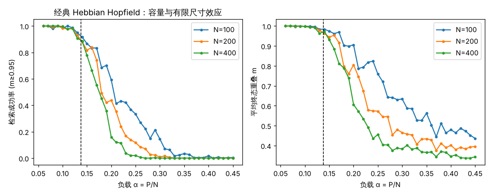
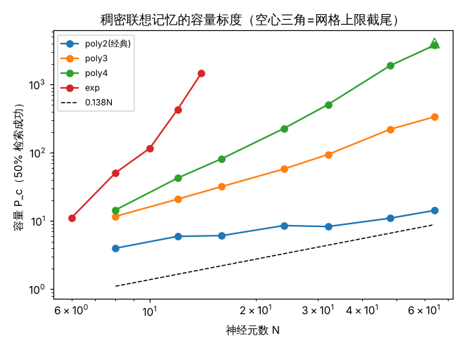
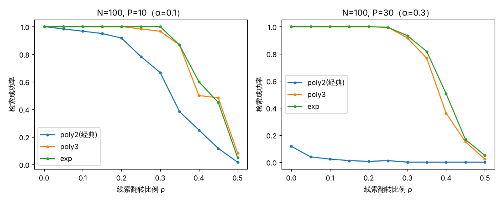
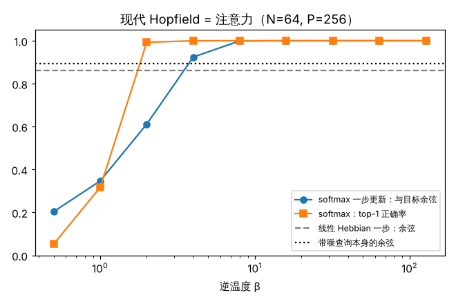

# Q01 认知与计算的关系：智能的计算本质是什么

> 分组：理论基础 ｜ 实验：`experiment.py`（运行时间约 100 秒，4 核被多进程共享时测得） ｜ 证据标注：[实测] [文献] [判断]

## 摘要
“认知是否就是计算、是哪一种计算”过于宏大，无法直接检验；本项目把它收窄为一个可量化的最小桥梁——**联想记忆**：一个认知功能（由部分线索回忆完整内容）能否被一个物理/统计动力学系统精确刻画，其容量、稳健性如何随“计算设计”（能量函数的形状）改变。我们在纯 numpy 中实现了经典 Hebbian Hopfield 网络与稠密联想记忆（多项式能量 n=3、4，指数能量），并验证现代 Hopfield 网络一步更新等价于 softmax 注意力。主要发现：经典网络 50% 检索成功的临界负载 α_c 随 N=100/200/400 依次为 0.204/0.180/0.173，按 1/√N 外推为 0.139，与理论值 0.138 一致，转变宽度按 N^-0.53 收窄 [实测]；稠密联想记忆的容量—规模双对数斜率为 0.57（n=2）、1.76（n=3）、2.85（n=4），指数能量的 ln P_c 随 N 线性增长（每个神经元 +0.60）[实测]；在 α=0.3 时经典网络已完全失效，而 n=3 与指数模型仍能容忍 29% 的线索翻转 [实测]。结论：同一认知功能的“容量”主要由计算形式（相互作用阶数/非线性）决定，而非由“神经元数”单独决定——这支持“认知功能可以在计算层面被精确定量”的立场，但并不说明人脑采用了哪一种实现。

## 1. 问题界定
**为何基础**：Marr 的三层次（计算理论—表征与算法—物理实现）提出，理解认知必须回答“计算什么、如何计算”[文献]。“认知与计算的关系”的核心矛盾在于：(i) 符号主义认为认知即符号操作（物理符号系统假说），(ii) 联结主义认为认知是分布式表征上的动力学；(iii) 当代大模型以“注意力”作为核心算子，却很少被放回认知理论中审视。一个可检验的切入点是：**某种认知功能是否存在“与实现无关”的定量规律，且这一规律可由计算形式预测？** 联想记忆是最合适的试验田——它既是心理学中的核心功能（线索回忆、模式补全），又有严格的统计物理理论，并且与 Transformer 注意力数学等价。

**可检验子假设（实验前设定）**：
- **H1（经典容量与有限尺寸）**：经典 Hebbian Hopfield 网络的 50% 检索成功负载 α_c50(N) 随 N 增大而下降并趋近 ≈0.14；成功率由 0.9 降到 0.1 的转变宽度随 N 收窄。**否证**：α_c50 对 1/√N 外推的截距落在 [0.12, 0.16] 之外，或宽度与 N 的 Spearman 相关 ρ ≥ 0。
- **H2（计算形式决定容量标度）**：稠密联想记忆 F(x)=x^n 的容量 P_c ∝ N^(n−1)（含对数修正），故 log P_c–log N 斜率 n=3 时 >1.5、n=4 时 >2.5，均显著高于 n=2（经典）；指数能量的 ln P_c 随 N 近似线性。**否证**：n=3 斜率 ≤1.5 或 n=4 斜率 ≤2.5，或与 n=2 的 CI 重叠。
- **H3（稳健性/吸引域）**：同一负载下，稠密模型的吸引域半径（检索成功率 ≥90% 的最大线索翻转比例）大于经典模型。**否证**：在 P=10、N=100 时稠密模型吸引域半径的 CI 不高于经典模型。
- **H4（注意力即检索，探索性）**：连续现代 Hopfield 一步更新（= softmax 注意力）在逆温度 β 超过某阈值后能把带噪查询还原为单一存储模式（余弦 >0.99），且优于线性 Hebbian 一步读出。**否证**：β 网格内余弦从未超过 0.99，或不优于线性读出。

## 2. 研究现状
**里程碑**。Hebb（1949，《The Organization of Behavior》）提出突触随共激活增强；Marr（1971，Phil. Trans. R. Soc. B）把海马理解为自联想记忆；Hopfield（1982，PNAS 79:2554）把联想记忆形式化为能量下降的吸引子动力学 [文献]。Amit、Gutfreund 与 Sompolinsky（1985，Phys. Rev. Lett. 55:1530）用自旋玻璃副本方法得到经典网络容量 α_c≈0.138；McEliece 等（1987，IEEE Trans. Inf. Theory 33:461）给出“无误差回忆”容量 N/(2 ln N)；Gardner（1988，J. Phys. A 21:257）给出任意学习规则下的上界 α=2 [文献]。Kanerva（1988，《Sparse Distributed Memory》）提出稀疏分布式记忆。2024 年诺贝尔物理学奖授予 Hopfield 与 Hinton，表明这一脉络被视为物理学与 AI 的交汇点。

**现代复兴**。Krotov 与 Hopfield（arXiv:1606.01164）提出稠密联想记忆：用高阶相互作用能量 F(x)=x^n 使容量从 ∝N 提升到 ∝N^(n−1)；Demircigil 等（arXiv:1702.01929）用指数能量得到指数级容量；Ramsauer 等（arXiv:2008.02217）把连续版本的一步更新写成 ξ←Xᵀsoftmax(βXξ)，证明其即 Transformer 注意力（Vaswani 等，arXiv:1706.03762）[文献]。Krotov 与 Hopfield（arXiv:2008.06996）进一步讨论这类高阶相互作用如何由生物上合理的两层网络（隐藏“记忆神经元”）实现。Bricken 与 Pehlevan（arXiv:2111.05498）表明注意力近似 Kanerva 稀疏分布式记忆；Whittington 等（arXiv:2112.04035）把 Transformer 与海马—内嗅皮层表征联系起来 [文献]。

**学派与争议**。(1) 符号派：Newell 与 Simon（1976，Commun. ACM 19:113）的物理符号系统假说；Fodor 与 Pylyshyn（1988，Cognition 28:3）认为联结主义缺乏系统性与组合性。(2) 联结派：Rumelhart、McClelland 等（1986，《Parallel Distributed Processing》）主张认知源于分布式表征。(3) 融合/认知科学视角：Lake 等（arXiv:1604.00289）认为类人智能还需因果模型、直觉物理与组合泛化 [文献]。争议焦点在于：吸引子记忆、注意力这类“检索式计算”能否支撑组合推理，抑或只是认知的一个子系统。

**关键缺口**。(a) 生物神经系统实际采用的能量形式与有效相互作用阶数未知；(b) 检索式计算与符号/组合计算之间缺少统一理论；(c) 大模型内部“记忆”的容量律尚未与经典理论定量对齐。

## 3. 研究设计
- **模式与动力学**：随机 ±1 模式；异步更新（随机顺序逐神经元，直到一次完整扫描无变化或达到上限）。稠密模型能量 E=−Σ_μ F(ξ_μ·σ)，神经元 i 的更新取 sign(Σ_μ[F(r_μ+ξ_μi)−F(r_μ−ξ_μi)])，r_μ 为去掉第 i 位的重叠；**n=2 时与零对角 Hebbian 规则严格等价**，作为同一代码中的对照组。
- **成功判据（预先固定）**：从目标模式（或其破坏版本）出发，收敛态与目标重叠 m≥0.95。
- **实验 A**：N∈{100,200,400}，α∈[0.06,0.45] 步长 0.01，每格 6 个独立网络、每网络最多检验 60 个模式。指标：α_c50、α_90、α_10、宽度 α_10−α_90。
- **实验 B**：N∈{8,…,64}（指数模型因容量增长过快改用 N∈{6,…,14}），P 取 2…4096 的几何网格（每格检验 32 个模式），5 种子；P_c 为成功率跌破 0.5 处的对数插值；逐种子拟合 log P_c–log N（只用 N≥16 且未截尾的点）。
- **实验 C**：N=100，P∈{10,30}，线索翻转比例 ρ∈[0,0.5]，6 种子。
- **实验 D**：N=64 维、P=256 个单位范数连续模式，查询=模式+噪声（初始余弦 0.894），β∈{0.5…128}，10 种子；对照为线性（经典 Hebbian）一步读出 XᵀXq。
- **统计**：均值 ± 95% CI（正态近似，跨种子）；宽度—N 趋势用 Spearman 检验。

## 4. 结果

**表 1 经典 Hopfield 的临界负载与转变宽度（6 种子，均值 ± 95% CI）[实测]**

| N | α_90（成功率跌破 0.9） | α_c50 | α_10 | 宽度 α_10−α_90 |
|---|---|---|---|---|
| 100 | 0.126 ± 0.020 | 0.204 ± 0.013 | 0.297 ± 0.013 | 0.171 ± 0.026 |
| 200 | 0.133 ± 0.008 | 0.180 ± 0.003 | 0.243 ± 0.012 | 0.110 ± 0.010 |
| 400 | 0.132 ± 0.005 | 0.173 ± 0.004 | 0.214 ± 0.009 | 0.082 ± 0.010 |

α_c50 = 0.139 + 0.631/√N（三点外推，截距 0.139）；宽度与 N 的 Spearman ρ = −0.93（p = 2.0×10⁻⁸），宽度 ∝ N^−0.53。**H1 支持**。

**表 2 稠密联想记忆容量 P_c（5 种子均值；log–log 斜率为逐种子拟合）[实测]**

| 模型 | N=8 | N=16 | N=32 | N=64 | log P_c–log N 斜率 |
|---|---|---|---|---|---|
| poly2（经典 Hebbian） | 4.0 | 6.1 | 8.3 | 14.3 | 0.57 ± 0.04 |
| poly3 | 11.7 | 32.0 | 94.3 | 334.8 | 1.76 ± 0.12 |
| poly4 | 14.5 | 81.8 | 508.4 | 3754.7（部分种子在 4096 上限截尾） | 2.85 ± 0.07 |
| exp（N=6/8/10/12/14） | 11.1 / 50.8 / 116.1 / 432.6 / 1465.7 | | | | ln P_c 对 N 斜率 0.60 ± 0.05 |

n=3、n=4 斜率分别 >1.5、>2.5，且与 n=2 的 CI 不重叠；指数模型在 N=14 时以 14 个神经元存储约 1466 个模式。**H2 支持**。

**表 3 吸引域半径（检索成功率 ≥0.9 的最大翻转比例 ρ；N=100，6 种子）[实测]**

| 负载 | 经典 poly2 | poly3 | exp |
|---|---|---|---|
| P=10（α=0.1） | 0.20 ± 0.07 | 0.33 ± 0.02 | 0.34 ± 0.02 |
| P=30（α=0.3） | 0（ρ=0 时成功率仅 0.12） | 0.29 ± 0.02 | 0.29 ± 0.02 |

**H3 支持**：P=10 时稠密模型吸引域半径约为经典模型的 1.7 倍，且 CI 不重叠。

**表 4 连续现代 Hopfield（= softmax 注意力）一步检索（N=64，P=256，10 种子）[实测]**

| β | 0.5 | 1 | 2 | 4 | 8 | 16 |
|---|---|---|---|---|---|---|
| 与目标余弦 | 0.203 | 0.347 | 0.611 | 0.924 | 0.999 | 1.000 |
| top-1 正确率 | 0.052 | 0.317 | 0.993 | 1.000 | 1.000 | 1.000 |
| 最大注意力权重 | 0.006 | 0.009 | 0.022 | 0.111 | 0.756 | 0.999 |

线性 Hebbian 一步读出的余弦为 0.861，低于带噪查询本身（0.894），尽管其 top-1 仍为 1.0。**H4 支持（探索性）**：β≥8 时一步注意力即可完成“模式补全”，小 β 时输出为多个模式的平均（亚稳态）。

## 5. 讨论
**机理**。经典网络中，每个模式的局部场为信号 (1) 加上来自其余 P−1 个模式的串扰，串扰方差 ≈α；当 α 超过 ≈0.14 时，串扰把检索态推离吸引子 [文献]。高阶能量使串扰按 N^−(n−1) 缩小——信号来自 m^n 项，噪声来自 (P 个随机重叠)^n，于是容量 ∝N^(n−1) [文献]。实测斜率 1.76 与 2.85 略低于 2 与 3，与理论中的 1/ln N 修正一致：N^(n−1)/ln N 在 N≈32 附近的局部斜率约为 n−1−1/ln N（≈1.71 与 2.71）[判断]。经典模型斜率 0.57 低于 1，原因在于小 N 时 m≥0.95 等同于“零误差回忆”，落在 McEliece 的 N/(2 ln N) 区间，再叠加强烈的有限尺寸噪声 [判断]。指数能量相当于“赢家通吃”的 softmax，信号与串扰之比随 N 指数增长 [文献]。表 4 显示同一机制在连续域中就是注意力：β 控制分离度，β 小时注意力把各模式平均（“亚稳态/全局平均”），β 大时只取一个模式。

**与“认知 vs 计算”的关系**。(1) 本实验支持一个**弱命题**：一种认知功能（线索回忆）具有与实现无关、可由计算形式预测的定量规律（容量临界点、吸引域、标度指数）——这正是 Marr“计算理论层”的含义 [判断]。(2) 计算形式（相互作用阶数）而不是“规模”决定了容量的**标度类**：把非线性从二次换成指数，相同 N 下容量差异可达数个数量级——这与大模型讨论中“架构决定规模律斜率”的直觉同构 [判断]。(3) 注意力 = 联想检索，为把 Transformer 的“上下文学习”解释为“检索 + 组合”提供了一个可计算的锚点，但**检索本身不等于推理**：本实验没有任何组合性、变量绑定或因果推断的成分，因此对 Fodor–Pylyshyn 的系统性挑战没有回答 [判断]。

**效度威胁与外推边界**。(a) 随机、无关联的 ±1 模式与真实记忆（高度相关、稀疏、层级化）差别很大，相关模式会显著降低经典容量；(b) 成功判据 m≥0.95 与“零误差”判据给出的数值不同，绝对 α_c 依赖判据，但我们只比较趋势与标度；(c) 有限尺寸：N≤400、P≤4096，α_c 外推只用了三个点；poly4 在 N=64 有部分种子在网格上限截尾，导致其斜率可能略被低估；(d) 稠密模型的高阶相互作用在生物上是否可实现仍有争议，Krotov–Hopfield 的隐藏神经元实现只是候选方案；(e) 运行时间在多进程共享 4 核时测得，单核独占时应更短。

<!-- BIBLIO:start -->
## 文献计量信号（arXiv，[实测]）

检索式：摘要含 “associative memory”、“cognitive architecture”、“computational model of cognition”、“Hopfield network” 之一；基线为同年 cs.LG / cs.AI / stat.ML 论文总数。数据：`ai2035/bibliometrics/arxiv_counts.json`（检索日 2026-11-26）。

| 年份 | 命中论文数 | 占 AI/ML 基线比例 |
|---|---|---|
| 2015 | 18 | 0.44% |
| 2016 | 39 | 0.66% |
| 2017 | 37 | 0.44% |
| 2018 | 40 | 0.29% |
| 2019 | 43 | 0.19% |
| 2020 | 64 | 0.21% |
| 2021 | 56 | 0.17% |
| 2022 | 79 | 0.22% |
| 2023 | 93 | 0.21% |
| 2024 | 129 | 0.22% |
| 2025 | 230 | 0.31% |

- 2019–2025 年份额的对数线性趋势：**每年 +6.1%**（95% CI -1.0% ~ +13.8%，R²=0.49），判定：**与 AI/ML 总体同步（相对份额无显著趋势）**；在 20 个问题中按相对增速排第 12 位。
- 解读边界：分子覆盖 arXiv 全部类别、分母仅为 AI/ML 三个类别，所以“比例”是相对关注度指数，并非严格的子集占比；关键词匹配既会漏掉使用其他术语的工作，也会混入无关用法；arXiv 偏重机器学习社区，认知科学、神经科学与期刊论文覆盖不足。该信号衡量的是**研究关注度**，不是**问题被解决的程度**。
<!-- BIBLIO:end -->

## 6. 结论与 2035 展望
**核心结论**
1. 经典 Hopfield 网络存在尖锐的容量转变，有限尺寸外推 α_c≈0.139，转变宽度 ∝N^−0.53——统计物理理论对一个“认知功能”给出了可复现的定量预言 [实测+文献；置信度：高]。
2. 容量的标度类由能量函数的非线性阶数决定（斜率 0.57→1.76→2.85，指数能量为指数增长），说明“计算形式”比“神经元数量”更能决定记忆能力 [实测；置信度：高（在随机模式设定下）]。
3. 高阶/指数能量同时扩大吸引域（P=10 时半径 0.33–0.34 对 0.20），容量与稳健性之间在此设定下不存在此消彼长 [实测；置信度：中——仅在 N=100 与两个负载上测试]。
4. softmax 注意力就是现代 Hopfield 网络的一步检索；β 决定“取一个记忆”还是“取平均”，这为把大模型的上下文机制纳入认知记忆理论提供了桥梁 [实测+文献；置信度：高（数学等价），中（对认知的解释力）]。
5. 联想检索只是认知的一个子系统：它不能回答组合性、因果推理与元认知问题 [判断；置信度：中]。

**关键未解问题**：大脑中有效相互作用阶数是多少？Transformer 各层的“记忆容量律”是否服从 N^(n−1) 型标度？如何在吸引子/检索框架中实现变量绑定与组合泛化？

**建议研究路线**
- **近期（2026–2028）**：在相关模式与稀疏编码下测量稠密联想记忆的容量律（里程碑：给出相关度—容量的定量公式，并在图像嵌入上复现误差 <10%）；对开源 Transformer 测量键值“记忆槽”数随维度的标度指数，检验是否落在 Hopfield 理论预测区间。
- **中期（2029–2032）**：建立“检索 + 组合”的统一理论模型，使其同时预测容量律与组合泛化误差（里程碑：在 SCAN/COGS 类组合任务上，理论预测的泛化曲线与实测相关 ≥0.9）；结合神经记录，检验海马 CA3 是否表现出高阶相互作用的统计特征。
- **远期（2033–2035）**：形成可被实验否证的“认知计算理论”标准模型：对至少三种认知功能（记忆、注意、推理）给出从计算层到实现层的定量映射，并在类脑芯片上以 ≤1/100 能耗复现相应容量律。

## 参考文献
1. Hebb, D. O. (1949). *The Organization of Behavior*. Wiley.
2. Marr, D. (1971). Simple memory: a theory for archicortex. *Phil. Trans. R. Soc. Lond. B*, 262, 23–81.
3. Marr, D. (1982). *Vision*. W. H. Freeman.
4. Newell, A., & Simon, H. A. (1976). Computer science as empirical inquiry: symbols and search. *Communications of the ACM*, 19(3), 113–126.
5. Hopfield, J. J. (1982). Neural networks and physical systems with emergent collective computational abilities. *PNAS*, 79(8), 2554–2558.
6. Amit, D. J., Gutfreund, H., & Sompolinsky, H. (1985). Storing infinite numbers of patterns in a spin-glass model of neural networks. *Physical Review Letters*, 55(14), 1530–1533.
7. Rumelhart, D. E., McClelland, J. L., & the PDP Research Group (1986). *Parallel Distributed Processing*. MIT Press.
8. McEliece, R. J., Posner, E. C., Rodemich, E. R., & Venkatesh, S. S. (1987). The capacity of the Hopfield associative memory. *IEEE Trans. Information Theory*, 33(4), 461–482.
9. Gardner, E. (1988). The space of interactions in neural network models. *J. Phys. A*, 21(1), 257–270.
10. Kanerva, P. (1988). *Sparse Distributed Memory*. MIT Press.
11. Fodor, J. A., & Pylyshyn, Z. W. (1988). Connectionism and cognitive architecture: a critical analysis. *Cognition*, 28(1–2), 3–71.
12. Krotov, D., & Hopfield, J. J. (2016). Dense Associative Memory for Pattern Recognition. arXiv:1606.01164.
13. Lake, B. M., Ullman, T. D., Tenenbaum, J. B., & Gershman, S. J. (2016). Building Machines That Learn and Think Like People. arXiv:1604.00289.
14. Demircigil, M., et al. (2017). On a model of associative memory with huge storage capacity. arXiv:1702.01929.
15. Vaswani, A., et al. (2017). Attention Is All You Need. arXiv:1706.03762.
16. Ramsauer, H., et al. (2020). Hopfield Networks is All You Need. arXiv:2008.02217.
17. Krotov, D., & Hopfield, J. J. (2020). Large Associative Memory Problem in Neurobiology and Machine Learning. arXiv:2008.06996.
18. Bricken, T., & Pehlevan, C. (2021). Attention Approximates Sparse Distributed Memory. arXiv:2111.05498.
19. Whittington, J. C. R., Warren, J., & Behrens, T. E. J. (2021). Relating transformers to models and neural representations of the hippocampal formation. arXiv:2112.04035.
