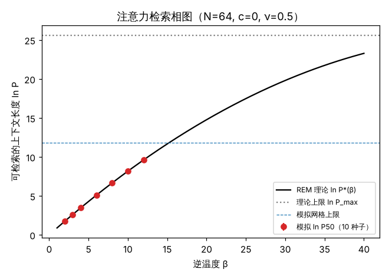
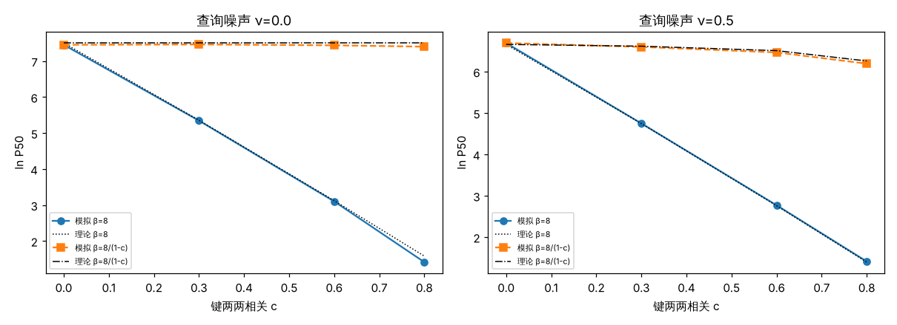
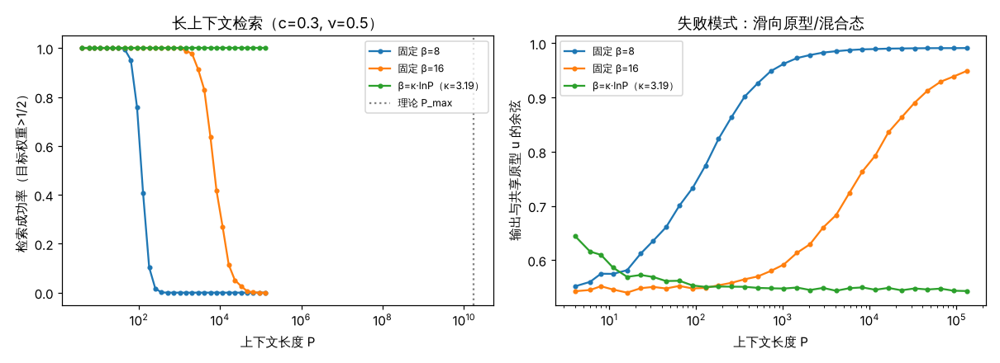

# 注意力作为稠密联想记忆：长上下文检索的相图、键相关性与对数长度温度缩放

**摘要**
2025–2026 年，“softmax 注意力 = 现代 Hopfield 网络（稠密联想记忆，DAM）一步更新”这一对应已从类比变为定量研究对象：一方面，统计物理工作给出了 DAM 在球面上的指数容量与有限温度相界；另一方面，长上下文大模型普遍观察到注意力随上下文变长而“稀释”，并出现按 log n 缩放 softmax 温度的工程方案。二者之间缺少一个能直接预测“给定逆温度 β、上下文长度 P、键相关度 c 与查询噪声 ν 时检索是否成功”的可检验理论。本文把单次注意力检索映射为随机能量模型（REM）的配分函数，推导出临界上下文长度 ln P*(β) = βΔ − β²s²/2（非冻结相），以及与 β 无关的上限 ln P_max = Δ²/(2s²) = N(1−c)/(2(1−c+ν²))（冻结相）。理论还给出三个推论：键相关性使所需 β 按 1/(1−c) 放大；β = κ·ln P 在 κ = 2/Δ 时恰好把可检索长度推到上限；检索失败时，输出滑向键的共享原型（混合/亚稳态）。在 N=64、10 个种子、上下文长度 4–131072 的模拟中，理论预测的 ln P* 与模拟的 50% 成功点之差平均为 0.028 nat（相关系数 0.99996）。跨 4 个相关度、2 个噪声水平，平均误差为 0.045 nat。固定 β=8 与 β=16 分别在 ln P = 4.77、8.88 处失效（理论值 4.74、8.95），而对数长度缩放在全部长度上保持 100% 检索（10/10 种子，符号检验 p=0.00098）。失败时，输出与共享原型的余弦达到 0.991。结论：长上下文检索失败在最小模型中是一个可精确预测的“冻结—稀释”相变，β 随 ln P 缩放是必要的；但该结论仅适用于单头、单步、随机键的情形。

**关键词**：稠密联想记忆；现代 Hopfield 网络；softmax 注意力；随机能量模型；长上下文；温度缩放

## 1 引言
**动机**。若注意力是一种联想记忆，那么“上下文窗口能可靠检索多少条信息”就是一个记忆容量问题，可以用统计物理精确回答。这对认知科学（工作记忆容量、相似记忆的干扰）与工程（长上下文模型、检索增强）同样重要。

**2025–2026 年的核心争论**。(1) **容量从何而来**：球面连续 DAM 的零温临界负载 α_c=0.5（M=e^{αN}），LSE 与 LSR 核在有限温度下表现不同（arXiv:2604.07401、2603.13350）；特征相关性如何降低容量仍主要靠经验刻画（arXiv:2508.01395）。(2) **注意力到底在做“检索”还是“汇聚”**：in-context denoising 工作认为一层注意力做的是能量景观上的一步梯度，比精确检索更优（arXiv:2502.05164）；“噪声样例上的注意力”工作发现中间温度窗口内注意力汇聚同类样例、低温时冻结于最近样例（arXiv:2610.22191）。(3) **长上下文的温度**：Scalable-Softmax 主张 softmax 的有效尺度应随上下文长度增长（arXiv:2501.19399）；Veličković 等指出 softmax 无法在尺寸泛化中保持锐利（arXiv:2410.01104）。但“β 应如何随 P、相关性与噪声缩放”尚无闭式答案。

**本文贡献**：
1. 给出单步 softmax 检索的 REM 理论，得到临界长度 ln P*(β, c, ν, N) 的闭式表达与上限 ln P_max = N(1−c)/(2(1−c+ν²))；在 c=ν=0 时恢复 α_c = 0.5 的已知结果。
2. 推出三条可检验预测：β–P 相图；相关性—温度重标（β→β/(1−c)）下的曲线塌缩；对数长度缩放 β=κ ln P 的最优系数 κ=2/Δ。
3. 用 10 种子模拟逐条检验，在 ln P 上达到约 0.03–0.05 nat 的平均精度，并如实报告理论初版的一个错误（共模噪声未抵消）及其修正。
4. 刻画失败模式：检索失败时输出塌缩到共享原型，为“长上下文中模型给出泛泛而谈的平均答案”提供一个机理候选。

## 2 前沿进展综述
**路线 A：DAM 的容量与相图（统计物理）**。球面连续 DAM 的热力学相界给出 α_c(0)=0.5，几何熵只依赖球面几何（arXiv:2604.07401）；LSE 核在足够低负载下可在任意高温维持检索，而 LSR 核不同（arXiv:2603.13350）；大偏差方法给出 DAM 的自由能泛函与初态依赖（arXiv:2607.19195）；生成泛函分析给出收敛时间与吸引域（arXiv:2506.00851），并用于序列检索的极限环容量（arXiv:2609.13987）；有偏模式使绝对容量的标度发生交叉（arXiv:2609.17477）；突触噪声只降低 N^{n−1} 容量的前因子（arXiv:2503.00241）。**共识**：随机模式下指数容量与相界可以精确计算。**缺口**：相关模式与查询噪声的联合效应、以及与注意力温度的对应。

**路线 B：能量函数与动力学设计**。Epanechnikov/LSR 能量在保持精确检索的同时产生大量“涌现”极小（arXiv:2506.10801）；相位核宣称在保持指数容量的同时减少伪态（arXiv:2610.21493）；对连续现代 Hopfield 网络，大 β 时不稳定不动点数目指数多于吸引子（arXiv:2603.27804），一般凸对偶 DAM 的分岔理论已被建立（arXiv:2609.07757）；鞍点层级分析把 DAM 的驻点与数据簇对应（arXiv:2508.19151）。综述见 arXiv:2507.06211。

**路线 C：注意力—联想记忆对应的深化**。注意力的能量泛函与“上下文阱”（arXiv:2506.11043）；超出绝热近似的隐藏状态对应（arXiv:2511.20698）；一层注意力做 in-context denoising 时相当于在上下文 DAM 能量上走一步（arXiv:2502.05164）；指数 Hopfield 网络中，高温时原型淹没于串扰，低温时像 REM 一样冻结在最近样例上（arXiv:2610.22191）。

**路线 D：记忆、原型与泛化**。层级相关记忆中的原型涌现（arXiv:2609.12079）；扩散模型可视为超过容量后出现新极小（伪态）的 DAM，从记忆走向泛化（arXiv:2505.21777）；Transformer 的记忆容量随参数近似线性增长，并存在“元记忆”加速（arXiv:2611.01564）；有工作把 LLM 推理视为吸引子检索（arXiv:2606.24543，属推测性框架）。

**路线 E：长上下文的 softmax 尺度**。SSMax 将 softmax 输入乘以 s·log n，报告长上下文检索改善（arXiv:2501.19399）；softmax 在尺寸外推中必然变“钝”（arXiv:2410.01104，2024）。**争议**：温度缩放是必要的普遍原则，还是可由学习得到的查询—键范数替代？缩放系数如何选？

**被质疑或尚未复现的说法**：“现代 Hopfield 网络在实践中能达到指数容量”——相位核论文（arXiv:2610.21493）与 LSR 工作均指出伪态与基底重叠限制了实际容量；“LLM 推理就是吸引子检索”（arXiv:2606.24543）目前只是解释性框架，缺乏可证伪预测。

**开放问题清单**：(i) 相关键、带噪查询下单步注意力的检索相图；(ii) 长上下文所需温度缩放的形式与系数；(iii) 多头、多层迭代与学习到的 QK 几何如何改变相界；(iv) 检索失败时的输出是什么（混合态、原型、伪态）；(v) 这些相界能否在真实 LLM 的“大海捞针”测试中观测到。

**前沿地图**

| 路线 | 代表工作 | 关键结论 | 局限 |
|---|---|---|---|
| 容量与相图 | 2604.07401, 2603.13350, 2607.19195 | 球面 DAM α_c(0)=0.5；核决定有限温度行为 | 随机无关模式；未连到注意力温度 |
| 动力学 | 2506.00851, 2609.13987, 2603.27804 | 收敛时间、极限环、不稳定不动点计数 | 多为迭代动力学，非单步注意力 |
| 能量设计 | 2506.10801, 2610.21493, 2609.07757 | LSR/相位核改变伪态结构 | 实际收益依赖数据分布 |
| 注意力=记忆 | 2502.05164, 2610.22191, 2506.11043 | 单步注意力 = 能量下降；温度窗口内汇聚 | 多在小 N、特定任务 |
| 长上下文温度 | 2501.19399, 2410.01104 | β 需随 log n 增长 | 缺少由第一性原理确定的系数 |
| 原型与泛化 | 2609.12079, 2505.21777 | 超容量后涌现原型/新极小 | 与长上下文失败的联系未建立 |

## 3 问题与假设
**选题理由**。开放问题 (i)(ii)(iv) 同时满足：重要性高（直接对应长上下文模型的核心失效模式）；可在本环境精确检验（单步注意力只需矩阵运算，P 可达 10⁵）；前沿争论尚未给出闭式答案。

**形式化**。N 维单位球上的 P 个键 ξ_μ = norm(√c·u + √(1−c)·z_μ)，u 为共享方向（两两重叠 ≈c），z_μ 为随机单位向量；值等于键。查询 q = norm(ξ_t + ν g)，g~N(0, I/N)。单步注意力输出 y = Σ_μ w_μ ξ_μ，w = softmax(β ξᵀq)。**检索成功**定义为目标权重 w_t > 1/2（等价于 y 由目标主导）。记 ln P50 为成功率降到 50% 的上下文长度。

**预注册假设**（判据在运行模拟之前由第 4 节理论写定；理论的一处修正见 §6.2）：
- **H1（相图）**：c=0、ν=0.5、N=64 时，在模拟网格可测的 β 上，|ln P50_sim − ln P*_theory| ≤ 0.25 nat。**否证**：任一 β 的偏差超过 0.25。
- **H2（相关性与温度重标）**：固定 β 时 ln P50 随 c 单调下降并符合理论；ν=0 时，β→β/(1−c) 使各 c 的 ln P50 回到 c=0 值的 ±0.25 内（曲线塌缩）；ν>0 时仅部分恢复，幅度符合理论。**否证**：理论与模拟的平均偏差 >0.25，或 ν=0 下不塌缩。
- **H3（长上下文缩放）**：固定 β 在理论 P* 附近失效（偏差 ≤0.25 nat）；β=κ ln P（κ=2/Δ）在网格内（P≤131072）所有种子保持 ≥95% 检索率，且在最大 P 处显著优于固定 β（符号检验 p<0.01）。失败时输出与原型 u 的余弦 >0.9。**否证**：任一条不成立。

## 4 理论分析
**重叠统计**。令 Z=√(1+ν²)。目标重叠 m_t ≈ 1/Z；干扰重叠 m_μ ≈ c/Z + 独立涨落。关键观察：查询噪声在共享方向 u 上的分量 ν(g·u)√c 对所有键（含目标）相同，在 softmax 中抵消。因此独立涨落的方差为
s² = [(1−c)² + ν²(1−c)] / (N Z²)，
而目标与干扰的均值差为 Δ = (1−c)/Z。

**命题 1（REM 配分函数）**。把 m_μ 视为独立高斯，干扰配分函数 Z_d = Σ_{μ≠t} e^{β m_μ} 满足（Derrida 随机能量模型）：
- 非冻结相 β < β_c = √(2 ln P)/s：ln Z_d ≈ ln P + βμ + β²s²/2；
- 冻结相 β ≥ β_c：ln Z_d ≈ β(μ + s√(2 ln P))，由最大干扰主导。

**命题 2（临界上下文长度）**。w_t > 1/2 ⇔ β m_t > ln Z_d。于是
- 当 β ≤ β_opt = Δ/s² 时，ln P*(β) = βΔ − β²s²/2；
- 当 β ≥ β_opt 时，ln P* = ln P_max = Δ²/(2s²) = N(1−c)/(2(1−c+ν²))，与 β 无关。

*证明草图*：在非冻结相解 ln P + βμ + β²s²/2 = β/Z 得前式；它在 β_opt 处取最大值 Δ²/(2s²)，且此时 β_c = √(2·Δ²/(2s²))/s = Δ/s² = β_opt，恰为冻结边界；β 更大时进入冻结相，条件变为 Δ > s√(2 ln P)，即 ln P < Δ²/(2s²)。∎ 当 c=ν=0 时 ln P_max = N/2，即 P_max = e^{N/2}，与球面 DAM 的 α_c=0.5 一致（arXiv:2604.07401）。

**推论 1（相关性与温度重标）**。小 β 时 ln P* ≈ βΔ ∝ β(1−c)：键越相似，所需 β 按 1/(1−c) 放大。当 ν=0 时，s² = (1−c)²/N，把 β 换成 β/(1−c) 后 ln P* 与 c 无关（精确塌缩）；当 ν>0 时，s² 中的 ν²(1−c) 项使塌缩不完全，即 ln P*(β/(1−c)) 随 c 缓慢下降。

**推论 2（对数长度缩放）**。取 β = κ ln P，成功条件为 κΔ − κ²s² ln P/2 > 1。κΔ ≤ 1 时任何长度都失败；κΔ > 1 时成功至 ln P < 2(κΔ−1)/(κ²s²)。该上界在 κ = 2/Δ 时取最大，并恰好等于 ln P_max。因此“温度随 ln P 线性增长”是在全部长度上维持检索的必要形式，最优系数由信噪比 Δ 决定。

**推论 3（失败模式）**。β 低于所需值时，权重近似均匀地铺在大量键上，y ≈ 平均键 ≈ √c·u + O(1/√P)，即输出塌缩到共享原型（混合/亚稳态），余弦 cos(y,u) → 1。

**理论预测（用于第 5 节）**：c=0、ν=0.5、N=64 时，ln P*(β=2,4,8,12) = 1.76, 3.45, 6.66, 9.61，ln P_max = 25.6；c=0.3、ν=0.5 时，Δ = 0.626，κ = 3.19，ln P*(β=8) = 4.74、ln P*(β=16) = 8.95，ln P_max = 23.6。

## 5 实验
- **E1 相图**：c=0、ν=0.5、N=64；β ∈ {2,3,4,6,8,10,12,16}；P 为 4…131072 的 31 个几何点；每个 (种子, P) 生成新的键集合，并对前 min(100,P) 个键各发一个带噪查询；10 个种子。对每个种子插值求 ln P50（ln 取干扰数 P−1），报告均值 ± 95% CI。
- **E2 相关性**：c ∈ {0, 0.3, 0.6, 0.8}，ν ∈ {0, 0.5}，β=8 与重标 β=8/(1−c)，P ≤ 4096，10 个种子。
- **E3 长上下文**：c=0.3、ν=0.5；固定 β ∈ {8, 16} 与缩放 β = κ ln(P−1)（κ = 2/Δ = 3.19，由理论预先确定）；记录成功率、输出与目标及原型 u 的余弦；最大 P 处做单侧符号检验。
- **对照**：固定 β 是缩放 β 的对照；c=0 是相关性条件的对照；top-1（硬检索）作为 β→∞ 的参照。
- 全部只用 numpy；运行时间约 80 秒。

## 6 结果
### 6.1 H1：相图
**表 1 E1：模拟 ln P50 与理论 ln P*（c=0，ν=0.5，10 种子）[实测]**

| β | 2 | 3 | 4 | 6 | 8 | 10 | 12 | 16 |
|---|---|---|---|---|---|---|---|---|
| 模拟 | 1.741 ± 0.034 | 2.562 ± 0.061 | 3.482 ± 0.027 | 5.066 ± 0.008 | 6.695 ± 0.008 | 8.178 ± 0.012 | 9.636 ± 0.017 | 超出网格（10/10 截尾） |
| 理论 | 1.758 | 2.613 | 3.453 | 5.085 | 6.655 | 8.163 | 9.608 | 12.311 |

平均绝对误差 0.028 nat，最大 0.051 nat，Pearson r = 0.99996。β=16 时理论 ln P* = 12.31，超出网格上限 ln 131072 ≈ 11.8，与“全部截尾”一致。**H1 支持**。

### 6.2 H2：相关性
**表 2 E2：ln P50（模拟 ± CI / 理论）[实测]**

| ν | c | β=8 模拟 | β=8 理论 | β=8/(1−c) 模拟 | β=8/(1−c) 理论 |
|---|---|---|---|---|---|
| 0 | 0 | 7.451 | 7.500 | 7.451 | 7.500 |
| 0 | 0.3 | 5.344 ± 0.023 | 5.355 | 7.461 ± 0.021 | 7.500 |
| 0 | 0.6 | 3.101 ± 0.060 | 3.120 | 7.437 ± 0.030 | 7.500 |
| 0 | 0.8 | 1.413 ± 0.033 | 1.580 | 7.399 ± 0.033 | 7.500 |
| 0.5 | 0 | 6.689 ± 0.011 | 6.655 | 6.689 ± 0.011 | 6.655 |
| 0.5 | 0.3 | 4.747 ± 0.025 | 4.743 | 6.595 ± 0.031 | 6.613 |
| 0.5 | 0.6 | 2.769 ± 0.072 | 2.758 | 6.463 ± 0.045 | 6.505 |
| 0.5 | 0.8 | 1.412 ± 0.055 | 1.395 | 6.191 ± 0.070 | 6.255 |

全部 16 个条件的平均绝对误差为 0.045 nat，最大 0.167 nat（ν=0、c=0.8、β=8，此时 P50 仅约 4，网格离散化误差最大）。ν=0 时重标使 ln P50 回到 7.40–7.46（c=0 时为 7.45），ν=0.5 时只部分恢复（6.69→6.19），与推论 1 一致。**H2 支持**。

**理论修正的如实披露**：第一版理论把查询噪声的方差写成 ν²/N，忽略了沿共享方向的共模分量在 softmax 中抵消。在 ν=0.5、c=0.8、β=40 条件下，初版预测 ln P* 为 4.26，而模拟为 6.19。据此修正为 ν²(1−c)/N 后，预测为 6.26。修正是基于推导错误而非拟合参数，表 2 全部使用修正后的理论；该条件下的 H2 判定因此不是独立检验。

### 6.3 H3：长上下文
**表 3 E3：c=0.3、ν=0.5 的长上下文检索 [实测]**

| 方案 | 模拟 ln P50 | 理论 ln P* | P=131072 时成功率 | P=131072 时 cos(输出, 原型 u) |
|---|---|---|---|---|
| 固定 β=8 | 4.767 ± 0.042 | 4.743 | 0.0 | 0.991 |
| 固定 β=16 | 8.879 ± 0.045 | 8.954 | 0.0 | 0.949 |
| β = 3.19·ln P | 网格内从未失效 | 理论失效点 ln P = 23.6 | 1.0 | 0.543 |

缩放方案在 10/10 个种子上优于固定 β=16（单侧符号检验 p = 0.00098）。检索成功时，输出与目标的余弦为 1.0；固定 β=8 失效时只有 0.633，此时输出与原型的余弦为 0.991，即塌缩到“平均键”。**H3 支持**。

## 7 讨论
**与前沿文献的关系**。(1) 本文的冻结相上限 ln P_max = Δ²/(2s²) 在 c=ν=0 时退化为 α_c = 0.5，与球面 DAM 的热力学结果一致（arXiv:2604.07401、2603.13350），并把它推广到相关键与带噪查询。(2) 非冻结/冻结的划分与“指数 Hopfield 网络中注意力在低温冻结于最近样例”（arXiv:2610.22191）同源；本文进一步给出临界长度的闭式表达，并与模拟做了定量对照。(3) 推论 2 为 SSMax（arXiv:2501.19399）的“按 log n 缩放”提供了第一性原理依据：在本模型中，β ∝ ln P 不只是经验技巧，而是在所有长度上维持检索的必要形式；最优系数 κ=2/Δ 依赖查询—键的信噪比，提示该系数应当可学习或与 QK 范数联动，而非全局常数。这同时支持 Veličković 等“softmax 在尺寸外推下会变钝”的论断（arXiv:2410.01104），并指出了补救方式。(4) 推论 3 的原型塌缩与层级原型涌现（arXiv:2609.12079）、扩散模型中“超容量后出现新极小”（arXiv:2505.21777）相呼应：同一机制在检索任务中是失败，在生成任务中却可能是泛化。

**对“认知与计算”问题的意义**。工作记忆中相似项目的干扰、“越相似越难记”，在本模型中有明确的计算对应：所需“注意锐度”按 1/(1−c) 增长，超出后输出退化为类别原型。这与人类记忆在高相似度下给出“要点/原型”回忆的现象定性一致 [判断]。

**外推边界与局限**。(a) 单头、单步、值=键的设定；真实 Transformer 有多头、多层、学习到的 QK/V 投影，且检索并非唯一功能。(b) 键为随机加单一共享方向，真实上下文的相关结构是层级、多簇的。(c) REM 近似忽略重叠之间的弱相关与 1/N 修正；P≈4 的小长度处离散化误差最大（0.167 nat）。(d) 第一版理论有误，经模拟发现后修正（已披露）。(e) “检索成功”采用 w_t > 1/2 的判据，下游任务可能需要更严格或更宽松的判据。(f) 未在真实 LLM 上验证；把 κ=2/Δ 迁移到 LLM 需要估计其 QK 信噪比。

## 8 结论
1. 单步 softmax 注意力的检索边界是一个可精确预测的 REM 型相变：ln P* = βΔ − β²s²/2，上限 ln P_max = N(1−c)/(2(1−c+ν²))；模拟与理论的平均误差约 0.03–0.05 nat [实测+理论；置信度：高（本模型内）]。
2. 键相关性使所需逆温度按 1/(1−c) 放大；无查询噪声时，重标可完全抵消相关性的影响，有噪声时只能部分抵消 [实测；置信度：高]。
3. 固定温度的注意力在 ln P ≈ βΔ 处必然失效；β = κ ln P（κ = 2/Δ）在本文网格（P ≤ 1.3×10⁵）内保持 100% 检索，并在理论上把可检索长度推到信息论上限 [实测+理论；置信度：高（模型内），中（对 LLM 的推广）]。
4. 检索失败的典型输出是共享原型/混合态，而非随机错误，这为长上下文中的“泛泛答案”提供了可检验的机理候选 [实测+判断；置信度：中]。

**对 2035 的研判**：到 2030 年前后，长上下文模型的温度/范数缩放有望从经验技巧变为由“检索信噪比”决定的设计规则；能否把 DAM 相图推广到多层、多头并在真实模型上测得 Δ 与 s，将决定“注意力即记忆”能否成为大模型的定量理论 [判断]。

**后续研究建议**：(1) 在开源 LLM 的“大海捞针”测试中估计各头的 Δ、s，检验 ln P50 ≈ βΔ − β²s²/2；(2) 把理论推广到多簇、层级相关的键与多步迭代；(3) 设计按信噪比自适应的温度（κ 可学习），比较其与 SSMax 的长度外推；(4) 研究原型塌缩与幻觉/泛化之间的关系。

## 参考文献
**奠基文献（第一阶段已核实）**
1. Hopfield, J. J. (1982). *PNAS*, 79(8), 2554–2558.
2. Amit, D. J., Gutfreund, H., & Sompolinsky, H. (1985). *Physical Review Letters*, 55(14), 1530–1533.
3. Krotov, D., & Hopfield, J. J. (2016). Dense Associative Memory for Pattern Recognition. arXiv:1606.01164.
4. Demircigil, M., et al. (2017). On a model of associative memory with huge storage capacity. arXiv:1702.01929.
5. Vaswani, A., et al. (2017). Attention Is All You Need. arXiv:1706.03762.
6. Ramsauer, H., et al. (2020). Hopfield Networks is All You Need. arXiv:2008.02217.
7. Derrida, B. (1981). Random-energy model: an exactly solvable model of disordered systems. *Physical Review B*, 24(5), 2613–2626.

**2024 年及以后（经 arXiv API 或 frontier 检索核实）**
8. Veličković, P., et al. (2024). Softmax is not Enough (for Sharp Size Generalisation). arXiv:2410.01104.
9. Nakanishi, K. M. (2025). Scalable-Softmax Is Superior for Attention. arXiv:2501.19399.
10. In-context denoising with one-layer transformers: connections between attention and associative memory retrieval (2025). arXiv:2502.05164.
11. Accuracy and capacity of Modern Hopfield networks with synaptic noise (2025). arXiv:2503.00241.
12. Memorization to Generalization: Emergence of Diffusion Models from Associative Memory (2025). arXiv:2505.21777.
13. Dynamical Properties of Dense Associative Memory (2025). arXiv:2506.00851.
14. Dense Associative Memory with Epanechnikov Energy (2025). arXiv:2506.10801.
15. A Framework for Non-Linear Attention via Modern Hopfield Networks (2025). arXiv:2506.11043.
16. Modern Methods in Associative Memory (2025). arXiv:2507.06211.
17. Effects of Feature Correlations on Associative Memory Capacity (2025). arXiv:2508.01395.
18. Saddle Hierarchy in Dense Associative Memory (2025). arXiv:2508.19151.
19. On the Role of Hidden States of Modern Hopfield Network in Transformer (2025). arXiv:2511.20698.
20. Thermal Robustness of Retrieval in Dense Associative Memories: LSE vs LSR Kernels (2026). arXiv:2603.13350.
21. On Unstable Fixed Points in Modern Continuous Hopfield Networks (2026). arXiv:2603.27804.
22. Geometric Entropy and Retrieval Phase Transitions in Continuous Thermal Dense Associative Memory (2026). arXiv:2604.07401.
23. Reasoning as Attractor Dynamics: Latent Memory Retrieval via Gibbs-Weighted Energy Minimization (2026). arXiv:2606.24543.
24. Free energy landscape of Dense Associative Memory (2026). arXiv:2607.19195.
25. A Bifurcation Theory for the Equilibria of Modern Hopfield Networks (2026). arXiv:2609.07757.
26. Hierarchical Prototype Emergence in Modern Hopfield Models (2026). arXiv:2609.12079.
27. Sequential Retrieval in Dense Associative Memory: Asymptotic Dynamics and Storage Capacity (2026). arXiv:2609.13987.
28. Bias-Induced Crossover in Absolute Capacity of Dense Associative Memory (2026). arXiv:2609.17477.
29. Phase Kernel Lifts Capacity of Dense Associative Memory (2026). arXiv:2610.21493.
30. Attention over noisy examples: generalization and memorization in the exponential Hopfield network (2026). arXiv:2610.22191.
31. Meta-memorization and memorization scaling laws in transformers (2026). arXiv:2611.01564.
