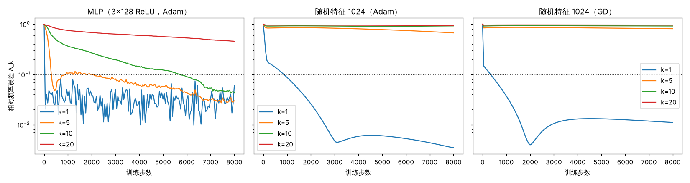
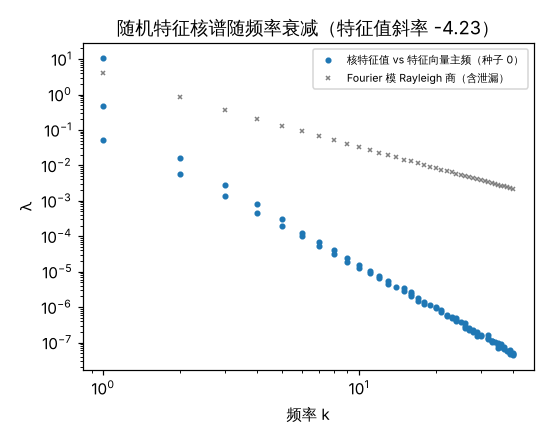
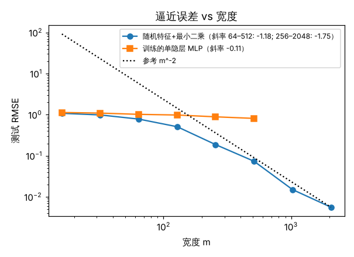

# Q02 深度学习的数学机理：逼近、优化与隐式偏好

> 分组：理论基础 ｜ 实验：`experiment.py`（运行时间约 204 秒，4 核被多进程共享时测得；其中宽度实验约 101 秒） ｜ 证据标注：[实测] [文献] [判断]

## 摘要
深度学习的数学机理可分解为三问：网络能表示什么（逼近）、梯度下降能找到什么（优化）、在众多解中偏好哪一个（隐式偏好）。本项目以“频率原则/谱偏好”为切入点，同时触及三者：用自写 numpy MLP（3×128 ReLU，Adam）拟合等幅多频目标 Σ_k sin(2πkx)，k∈{1,5,10,20}，并与固定第一层的随机特征模型对照。主要发现：(1) 在全部 5 个种子中，各频率达到 Δ_k<0.1 的时刻严格按频率排序（k=1：50 步；k=5：350±62；k=10：5230±1914；k=20：8000 步内均未达到），Kendall τ=1.0 [实测]；(2) 固定特征模型的谱偏好可由核谱定量解释：核特征向量按主频严格排序（Spearman 0.999），特征值随频率按 k^−4.23 衰减，导致 8000 步后 k≥5 的分量几乎未学（Δ₅=0.81）；而训练第一层的 MLP 在同样步数内把 k=10 学到 Δ=0.044，显示特征学习能缓解谱偏好 [实测]；(3) 随机特征 + 最小二乘的逼近误差在宽度 256–2048 区间按 m^−1.75 下降，接近分段线性逼近的 m^−2 理论，但在预注册区间 64–512 只有 m^−1.18；同宽度下训练的单隐层网络误差几乎不随宽度下降（斜率 −0.11），说明“能表示”与“能学到”之间存在巨大的优化鸿沟 [实测]。

## 1. 问题界定
**为何基础**：通用逼近定理只保证“存在”一组参数，不说明梯度下降能否找到、需要多少步、找到的是哪一个；而深度网络在过参数化下仍泛化良好，提示训练过程本身带有强烈的隐式偏好。频率原则是少数能在逼近、优化、泛化三个层面同时给出定量预测的理论之一：它断言网络先学低频、后学高频，并用神经正切核（NTK）的谱衰减解释。

**核心矛盾**：(a) 表达能力与可学习性的鸿沟；(b) 核（惰性训练）理论能定量预测，却忽略特征学习，而特征学习被认为是深度网络优于核方法的关键。

**可检验子假设（实验前设定）**：
- **H1（频率原则）**：MLP 训练中，各频率相对误差首次低于阈值（主判据 0.1，副判据 0.5）的时刻随频率严格递增；在 ≥4/5 个种子中成立，Kendall τ 均值 ≥0.8。**否证**：<4 个种子单调或 τ<0.8。
- **H2（核谱机理）**：在只训练输出层的随机特征模型中，核的特征向量按特征值排序时其主频单调上升（Spearman ≥0.9），且各频率误差下降的先后顺序与核谱预测一致（预测速率与实测速率的 Spearman = 1）。**否证**：任一条件不成立。
- **H3（逼近速率）**：随机特征 + 最小二乘的测试 RMSE 随宽度 m 呈幂律下降，在 m∈[64,512] 区间的斜率落在 [−2.5,−1.5]（分段线性逼近 C² 函数的理论值 −2）。**否证**：斜率在区间外。

## 2. 研究现状
**逼近论**。Cybenko（1989，Math. Control Signals Syst. 2:303）与 Hornik、Stinchcombe、White（1989，Neural Networks 2:359）证明单隐层网络的通用逼近性；Barron（1993，IEEE Trans. Inf. Theory 39:930）给出与维度无关的 O(1/√m) 速率；Telgarsky（arXiv:1602.04485）与 Yarotsky（arXiv:1610.01145）刻画深度对 ReLU 网络逼近效率的指数级优势 [文献]。

**优化与核极限**。Jacot 等（arXiv:1806.07572）提出神经正切核：无限宽网络在梯度下降下等价于核回归；Chizat 等（arXiv:1812.07956）指出这是一种“惰性训练”区间，与特征学习的平均场区间（Mei 等，arXiv:1804.06561）相对 [文献]。Rahimi 与 Recht（2007，NIPS）的随机特征可视为只训练最后一层的极限 [文献]。

**频率原则/谱偏好**。许志钦等（arXiv:1807.01251；arXiv:1901.06523）在实验上发现并命名“频率原则”，Luo 等（arXiv:1906.09235）给出一般深度网络的理论；Rahaman 等（arXiv:1806.08734）独立提出“谱偏好”；Basri 等（arXiv:1906.00425）证明两层网络在球面上对频率 k 的收敛时间随 k 多项式增长，并（arXiv:2003.04560）讨论非均匀输入密度；Cao 等（arXiv:1912.01198）在 NTK 框架下给出谱偏好的严格刻画；Tancik 等（arXiv:2006.10739）用 Fourier 特征映射主动克服谱偏好 [文献]。

**隐式偏好与泛化**。Zhang 等（arXiv:1611.03530）显示网络可拟合随机标签，泛化须由算法偏好解释；Soudry 等（arXiv:1710.10345）证明可分数据上梯度下降收敛到最大间隔解 [文献]。

**关键缺口**。(a) 有限宽度、特征学习区间中频率原则的定量理论；(b) 自适应优化器（Adam）对谱偏好的作用；(c) “可表示—可优化—可泛化”的统一定量框架。

## 3. 研究设计
- **目标**：f(x)=Σ_{k∈{1,5,10,20}} sin(2πkx)，x 取 [0,1) 上 256 个均匀点（输入映射到 [−1,1]）；各频率等幅，排除“幅度大的先学”这一混杂因素。
- **度量**：对残差做 FFT，Δ_k=|FFT(残差)_k|/|FFT(目标)_k|，每 50 步记录；收敛时刻为 Δ_k 首次 <0.1（副判据 0.5），8000 步内未达到记为截尾。
- **模型 A（实验组）**：MLP 1−128−128−128−1，ReLU，PyTorch 式均匀初始化，全批量 Adam（lr=2e−3），8000 步，5 种子。
- **模型 B（对照组）**：随机特征（1024 个 ReLU 特征，与 MLP 第一层同分布，固定不训练），只训练输出层：(B1) 梯度下降，步长 0.9n/(2λ_max)；(B2) Adam（lr=2e−3，与 A 相同）。分析核 K=ΦΦᵀ 的特征分解：每个特征向量的主频、各频率对应的特征值（与 span{sin_k,cos_k} 投影最大的特征向量），线性理论预测的每步衰减率 2ηλ/n。
- **模型 C（逼近速率）**：单隐层 ReLU 宽度 m：(i) 随机特征 + 最小二乘（输出层精确最优，测“可表示”），训练网格 4096 点；(ii) 完整训练的单隐层 MLP（Adam lr=3e−3，2000 步，1024 点，测“可学到”）；测试为 4096 个随机点，5 种子。
- **诚实披露**：MLP 的结构与学习率经一次试运行确定（2×128、lr=1e−3 时 k=10 在试运行预算内远未收敛，试运行数据未纳入结果），判据（阈值、单调性）在试运行前写定；B 中“各频率对应特征值”的定义是在发现 Fourier 模的 Rayleigh 商被低频泄漏主导之后修订的（见第 5 节）；C 中把随机特征宽度扩展到 2048 是看到 64–512 区间结果后追加的。

## 4. 结果

**表 1 各频率的收敛时刻（训练步数；5 种子均值 ± 95% CI）[实测]**

| 模型 | 判据 | k=1 | k=5 | k=10 | k=20 |
|---|---|---|---|---|---|
| MLP（Adam） | Δ<0.1 | 50 ± 0 | 350 ± 62 | 5230 ± 1914 | 5/5 截尾 |
| MLP（Adam） | Δ<0.5 | 50 ± 0 | 170 ± 24 | 530 ± 80 | 6637.5 ± 1348（1/5 截尾） |
| 随机特征（GD） | Δ<0.1 | 370 ± 24 | 5/5 截尾 | 5/5 截尾 | 5/5 截尾 |
| 随机特征（Adam） | Δ<0.1 | 890 ± 57 | 5/5 截尾 | 5/5 截尾 | 5/5 截尾 |

MLP 在两种判据下均为 5/5 种子严格单调，Kendall τ=1.0。**H1 支持**。

**表 2 8000 步后的相对频率误差 Δ_k（均值 ± CI）[实测]**

| 模型 | k=1 | k=5 | k=10 | k=20 |
|---|---|---|---|---|
| MLP（Adam） | 0.060 ± 0.043 | 0.030 ± 0.010 | 0.044 ± 0.023 | 0.458 ± 0.046 |
| 随机特征（GD） | 0.011 ± 0.001 | 0.815 ± 0.004 | 0.923 ± 0.001 | 0.963 ± 0.001 |
| 随机特征（Adam） | 0.0035 ± 0.0016 | 0.673 ± 0.006 | 0.883 ± 0.003 | 0.946 ± 0.002 |

MLP 训练过程中：第 500 步 Δ=(0.041, 0.053, 0.498, 0.830)，第 2000 步 (0.039, 0.100, 0.268, 0.683)。

**表 3 随机特征核的谱（5 种子）[实测]**

| 量 | k=1 | k=5 | k=10 | k=20 |
|---|---|---|---|---|
| 对应特征值 λ | 0.473 ± 0.023 | 3.11×10⁻⁴ | 1.70×10⁻⁵ | 9.5×10⁻⁷ |
| 预测衰减率 2ηλ/n（每步） | 9.2×10⁻³ | 6.1×10⁻⁶ | 3.3×10⁻⁷ | 1.9×10⁻⁸ |
| 实测衰减率 / 预测 | 4.2 ± 0.2 | 4.2 ± 0.2 | 30.7 ± 3.2 | 256 ± 17 |

特征向量按特征值排序后的主频与秩的 Spearman 相关 0.999；log λ 对 log 主频的斜率 −4.23 ± 0.01；预测速率与实测速率的 Spearman = 1.0。**H2 支持**（排序层面）；定量速率偏差 4–256 倍（见讨论）。

**表 4 逼近误差 vs 宽度（测试 RMSE，目标标准差 1.414；5 种子均值）[实测]**

| m | 16 | 64 | 128 | 256 | 512 | 1024 | 2048 |
|---|---|---|---|---|---|---|---|
| 随机特征 + 最小二乘 | 1.079 | 0.781 | 0.509 | 0.187 | 0.0735 | 0.0150 | 0.0056 |
| 训练的单隐层 MLP | 1.131 | 1.019 | 0.982 | 0.887 | 0.812 | — | — |

随机特征斜率：m∈[64,512] 为 −1.18 ± 0.11（预注册），m∈[256,2048] 为 −1.75 ± 0.09；训练 MLP 在 [64,512] 为 −0.11 ± 0.02。**H3 不支持（预注册区间），在更大宽度区间部分支持**：误差仍处在预渐近区，局部斜率从 −0.13 逐渐变陡到 −1.4～−2.3。

## 5. 讨论
**机理**。只训练输出层时，梯度下降的残差动力学为 r←(I−2ηK/n)r，每个核特征方向按 (1−2ηλ_i/n)^t 衰减 [文献]。ReLU 随机特征核在一维上类似三次样条核（核函数在对角线处有 |x−x′|³ 型奇异），其特征值应按 k^−4 衰减 [判断]；实测斜率 −4.23 与之一致 [实测]。于是 k=20 的特征值比 k=1 小约 5×10⁵ 倍，任何合理步数都学不到——这就是固定核的谱偏好。值得注意的方法学教训：若直接用 Fourier 模 sin(2πkx) 的 Rayleigh 商估计“频率 k 的特征值”，会得到 k^−2.000 的衰减（k=1/k=20 比值 473），这是因为非周期区间上最大特征向量（近似常数/线性函数）向所有 Fourier 模泄漏 ∝1/k² 的能量，结果被泄漏而非真实谱主导。速率预测在高频偏差 30–256 倍，也是同一原因：高频残差可借助与之有微弱重叠、特征值更大的方向下降。因此核谱能可靠预测“先后顺序”，却不能单独预测“精确时刻”[实测+判断]。

**特征学习的作用**。MLP 与随机特征共享第一层的初始分布，区别只在于第一层可训练。MLP 在 8000 步内把 k=10 学到 Δ=0.044，而随机特征模型（无论 GD 还是 Adam）停在 0.88–0.92：特征学习可以重塑核、把容量移向目标所需的频率，从而显著缓解谱偏好，但没有消除顺序本身（τ=1）[实测]。这与“惰性训练 vs 特征学习”之争相关：核理论正确预测了定性规律，却低估了深度网络学习高频的能力 [判断]。

**逼近—优化鸿沟**。同样宽度 512，最优输出权重可达 RMSE 0.074，训练的网络只有 0.81——低频先学、高频长期停滞，使优化在有限步数内远离表示能力的上限。表示能力的标度（m^−1.75，趋近 m^−2）与可学性的标度（m^−0.11）相差一个数量级以上，提示“深度学习数学理论”的主要难点在优化动力学而不在表示能力 [实测+判断]。

**效度威胁与外推边界**。(a) 一维、均匀网格、合成目标与高维真实数据差别很大，高维中“频率”应理解为输入空间的光滑度谱；(b) 收敛时刻依赖阈值与学习率，我们只主张顺序而非绝对时刻；(c) Adam 的逐坐标缩放会改变谱偏好的强度，GD 下 MLP 的结果可能不同（未测）；(d) 训练 MLP 只跑 2000 步，其“宽度斜率”反映的是固定计算预算下的可学性，而非渐近逼近速率；(e) 部分设计在试运行或初步结果后调整（见第 3 节披露）；(f) 运行时间在共享 CPU 上测得约 204 秒，超过 3 分钟的目标，独占单核时应明显更短，但我们未能在独占条件下复测。

<!-- BIBLIO:start -->
## 文献计量信号（arXiv，[实测]）

检索式：摘要含 “spectral bias”、“implicit bias”、“neural tangent kernel”、“loss landscape” 之一；基线为同年 cs.LG / cs.AI / stat.ML 论文总数。数据：`ai2035/bibliometrics/arxiv_counts.json`（检索日 2026-11-26）。

| 年份 | 命中论文数 | 占 AI/ML 基线比例 |
|---|---|---|
| 2015 | 1 | 0.02% |
| 2016 | 1 | 0.02% |
| 2017 | 8 | 0.09% |
| 2018 | 27 | 0.20% |
| 2019 | 95 | 0.43% |
| 2020 | 167 | 0.55% |
| 2021 | 209 | 0.63% |
| 2022 | 265 | 0.73% |
| 2023 | 281 | 0.62% |
| 2024 | 380 | 0.64% |
| 2025 | 491 | 0.66% |

- 2019–2025 年份额的对数线性趋势：**每年 +5.8%**（95% CI -0.7% ~ +12.8%，R²=0.51），判定：**与 AI/ML 总体同步（相对份额无显著趋势）**；在 20 个问题中按相对增速排第 13 位。
- 解读边界：分子覆盖 arXiv 全部类别、分母仅为 AI/ML 三个类别，所以“比例”是相对关注度指数，并非严格的子集占比；关键词匹配既会漏掉使用其他术语的工作，也会混入无关用法；arXiv 偏重机器学习社区，认知科学、神经科学与期刊论文覆盖不足。该信号衡量的是**研究关注度**，不是**问题被解决的程度**。
<!-- BIBLIO:end -->

## 6. 结论与 2035 展望
**核心结论**
1. 频率原则在本设定中极其稳健：5/5 种子、两种判据下，收敛顺序严格为 k=1<5<10<20 [实测+文献；置信度：高]。
2. 固定特征（核）模型的谱偏好由核谱决定：特征向量按频率排序，特征值 ∝k^−4.23，预测的先后顺序与实测完全一致；但精确速率不能由单一特征值预测 [实测；置信度：高（顺序），中（定量）]。
3. 特征学习显著缓解但不消除谱偏好（k=10 的残差 0.044 对 0.88–0.92）[实测；置信度：中——单一架构、单一优化器]。
4. 表示能力的宽度标度（m^−1.75，在更大宽度趋近 m^−2）远快于有限训练预算下的可学性（m^−0.11）：深度学习数学的核心难点在优化动力学 [实测+判断；置信度：中]。

**关键未解问题**：有限宽度、特征学习区间中频率原则的定量理论是什么？Adam 等自适应方法如何改变隐式偏好？高维真实数据中的“频率”应如何定义，谱偏好对泛化是福（抑制噪声）还是祸（难学细节）？

**建议研究路线**
- **近期（2026–2028）**：建立含一阶特征学习修正的“动态核”理论，在一维/低维任务上预测各频率收敛时刻误差 <30%（里程碑：对 MLP 与 Transformer 小模型都成立）；系统比较 SGD/Adam/二阶方法对谱偏好的影响。
- **中期（2029–2032）**：把频率原则推广到高维结构化数据（图像、语言 token 序列），给出可测的“光滑度谱”，并据此预测训练早停、数据增强的最优设置（里程碑：在 ≥3 个基准上预测最佳早停点误差 <10%）。
- **远期（2033–2035）**：形成统一“逼近—优化—泛化”的定量理论，能在训练前预测给定架构、优化器、数据谱下的学习曲线（里程碑：对十亿参数模型的损失曲线预测误差 <5%），为架构设计提供原则而非试错。

## 参考文献
1. Cybenko, G. (1989). Approximation by superpositions of a sigmoidal function. *Mathematics of Control, Signals and Systems*, 2(4), 303–314.
2. Hornik, K., Stinchcombe, M., & White, H. (1989). Multilayer feedforward networks are universal approximators. *Neural Networks*, 2(5), 359–366.
3. Barron, A. R. (1993). Universal approximation bounds for superpositions of a sigmoidal function. *IEEE Trans. Information Theory*, 39(3), 930–945.
4. Rahimi, A., & Recht, B. (2007). Random features for large-scale kernel machines. *NIPS 2007*.
5. Kingma, D. P., & Ba, J. (2014). Adam: A Method for Stochastic Optimization. arXiv:1412.6980.
6. Telgarsky, M. (2016). Benefits of depth in neural networks. arXiv:1602.04485.
7. Yarotsky, D. (2016). Error bounds for approximations with deep ReLU networks. arXiv:1610.01145.
8. Zhang, C., et al. (2016). Understanding deep learning requires rethinking generalization. arXiv:1611.03530.
9. Soudry, D., et al. (2017). The Implicit Bias of Gradient Descent on Separable Data. arXiv:1710.10345.
10. Mei, S., Montanari, A., & Nguyen, P.-M. (2018). A Mean Field View of the Landscape of Two-Layers Neural Networks. arXiv:1804.06561.
11. Jacot, A., Gabriel, F., & Hongler, C. (2018). Neural Tangent Kernel: Convergence and Generalization in Neural Networks. arXiv:1806.07572.
12. Rahaman, N., et al. (2018). On the Spectral Bias of Neural Networks. arXiv:1806.08734.
13. Xu, Z.-Q. J., Zhang, Y., & Xiao, Y. (2018). Training behavior of deep neural network in frequency domain. arXiv:1807.01251.
14. Chizat, L., Oyallon, E., & Bach, F. (2018). On Lazy Training in Differentiable Programming. arXiv:1812.07956.
15. Xu, Z.-Q. J., et al. (2019). Frequency Principle: Fourier Analysis Sheds Light on Deep Neural Networks. arXiv:1901.06523.
16. Basri, R., Jacobs, D., Kasten, Y., & Kritchman, S. (2019). The Convergence Rate of Neural Networks for Learned Functions of Different Frequencies. arXiv:1906.00425.
17. Luo, T., et al. (2019). Theory of the Frequency Principle for General Deep Neural Networks. arXiv:1906.09235.
18. Cao, Y., et al. (2019). Towards Understanding the Spectral Bias of Deep Learning. arXiv:1912.01198.
19. Basri, R., et al. (2020). Frequency Bias in Neural Networks for Input of Non-Uniform Density. arXiv:2003.04560.
20. Tancik, M., et al. (2020). Fourier Features Let Networks Learn High Frequency Functions in Low Dimensional Domains. arXiv:2006.10739.
