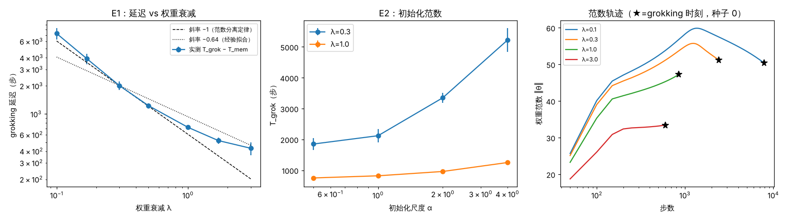
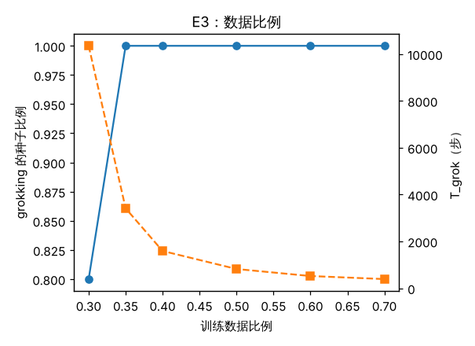

# Grokking 的“权重衰减时钟”：延迟定律的指数取决于所处区间

**摘要**
Grokking（训练集早已拟合、测试准确率很久之后才突然上升）是检验深度学习“优化—泛化”理论的标准试验场。2025–2026 年的争论集中在延迟的定量规律上。范数分离定律从第一性原理给出 T_grok − T_mem = Θ((ηλ)⁻¹·log(范数比))，预测延迟对权重衰减 λ 的指数为 −1；对 384 个配置的经验拟合却得到 T_grok ∝ λ^−0.64；因果干预研究则认为 grokking 发生在近乎恒定的“临界范数”处。本文用完全可控的数值实验检验这三种说法：一个精确可解的线性模型（过参数化岭回归 + GD），以及在模加法 (a+b) mod 31 上用 AdamW 训练的二次激活两层网络（每组 5 个种子）。线性模型中延迟定律是精确的：λ 指数为 −1.0006，理论与模拟的最大相对误差为 0.4%。在非线性网络中，延迟的 λ 指数随所处区间而变：小 λ（0.1–0.5）时为 −1.11 ± 0.07，与范数分离定律一致；大 λ（0.5–3）时为 −0.60 ± 0.06，与经验拟合的 −0.64 一致；两者差异显著（配对 t = −8.4，p = 0.001）；全局拟合给出的 −0.84 只是两个区间的混合。T_grok 随初始化尺度的对数线性增长（R² = 0.91），ηλ×斜率为 0.71–1.47，与“范数时钟”预测的 1 同量级但不恒定。临界范数在改变初始化时近似守恒（变异系数 2.8%），在改变 λ 时不守恒（变异系数 14%，与 λ 的 Spearman 相关为 −0.68）。训练数据比例从 0.7 降到 0.3 时，T_grok 从 390 步增至 10350 步（f≥0.35 上拟合的指数为 −3.03）。结论：“权重衰减时钟”与“梯度/特征学习时钟”串联决定延迟，单一幂律指数不是普适常数；临界范数只是条件性守恒量。

**关键词**：grokking；权重衰减；延迟泛化；范数分离；特征学习；隐式偏好

## 1 引言
**动机**。第一阶段（README）表明，“能表示”与“能学到”之间存在巨大鸿沟，隐式偏好由优化动力学决定。Grokking 把这一鸿沟放大成一个可测的时间差：网络先找到“记忆解”，很久以后才在正则化驱动下转向“泛化解”。延迟由什么决定，是区分“范数/正则主导”与“表征/特征学习主导”两类理论的关键证据。

**2025–2026 年的核心争论**。(1) **范数是否是原因**：范数分离延迟定律（arXiv:2603.13331）与“权重范数设定 grokking 时间尺度”的因果干预研究（arXiv:2606.13753）认为是；“grokking 超越欧氏范数”指出任何性质 P 的小正则（ℓ1、核范数）都可诱导 grokking（arXiv:2506.05718）；也有工作发现无正则时 grokking 被数值稳定性（softmax 崩溃）阻止（arXiv:2501.04697）。(2) **定量规律**：经验拟合 T_grok ∝ H^−0.27·D^−2.04·η^−0.50·λ^−0.64（arXiv:2609.10657）与 1/(ηλ) 的理论预测不一致；线性模型中可精确求解的“权重衰减时钟”（arXiv:2607.23967、2601.19791）。(3) **其他解释**：玻璃弛豫（arXiv:2505.11411）、亚稳相的噪声逃逸（arXiv:2606.17120）、奇异学习理论的盆地选择（arXiv:2603.01192）、维度相变（arXiv:2604.04655）、秩压缩（arXiv:2610.35112）、低损失区域错位（arXiv:2610.00620）、记忆与泛化时间尺度的竞争（arXiv:2605.09724）。

**本文贡献**：
1. 一个“两时钟”串联模型：延迟 = 梯度/特征学习时间 + 权重衰减时钟 ln(范数比)/(ηλ)。由此预测 λ 的局部指数从 −1（小 λ）连续变到 0（大 λ），从而统一 −1 与 −0.64 两种说法。
2. 线性可解模型中对延迟定律的精确验证（误差 0.4%）。
3. 非线性网络中对三条可证伪预测（区间依赖的 λ 指数、初始化尺度的对数定律、临界范数守恒）的 5 种子检验。
4. 指出临界范数只在固定 λ 时守恒，对“范数是原因”的因果叙事提出限定条件。

## 2 前沿进展综述
**路线 A：范数/正则驱动理论**。范数分离延迟定律给出 T_grok − T_mem = Θ(γ_eff⁻¹ log(‖θ_mem‖²/‖θ_post‖²))，AdamW 的 γ_eff ≥ ηλ（arXiv:2603.13331）；对范数做钳制干预后发现，grokking 在临界范数 W_c 处发生，跨种子与学习率的变异系数为 1–2%（arXiv:2606.13753）；线性模型中“grokking 子空间”上只有权重衰减作恢复力，给出精确的离散弛豫律（arXiv:2607.23967）；岭回归中 grokking 可被证明，并可通过超参数放大或消除（arXiv:2601.19791）；一般性质 P 的小正则均可诱导 grokking（arXiv:2506.05718）；Weightwatcher/HTSR 视角下还存在晚期的“反 grokking”泛化崩溃（arXiv:2602.02859、2506.04434）。

**路线 B：表征与特征学习**。grokking 与常规学习使用相同特征、只是编码不同（arXiv:2502.01739）；ReLU MLP 在 grokking 前就已形成近二值的方波输入权重与相位关系（arXiv:2603.23784）；层归一化位置和读出尺度等归纳偏好调制 grokking 速度（arXiv:2602.06702）；嵌入层的作用（arXiv:2505.15624）；表征几何可作为控制信号（arXiv:2607.11666）；“两种学习速度”的表征—读出分解同时解释 grokking 与双下降（arXiv:2605.27078）；秩压缩跟随而非驱动 grokking（arXiv:2610.35112）。奠基工作包括：惰性→丰富转变（arXiv:2310.06110）、电路效率（arXiv:2309.02390）、进度度量（arXiv:2301.05217）、早晚期隐式偏好二分（arXiv:2311.18817）、Omnigrok（arXiv:2210.01117）。

**路线 C：统计物理与动力学**。计算玻璃弛豫（arXiv:2505.11411）；亚稳相的噪声驱动逃逸（arXiv:2606.17120）；维度相变与自组织临界（arXiv:2604.04655）；SLT 盆地选择（arXiv:2603.01192）。

**路线 D：经验标度与条件性**。384 配置的经验标度（arXiv:2609.10657）；1.2 万参数模型中 grokking 是条件性且脆弱的，受训练集覆盖率门控（arXiv:2607.05104）；低于临界数据阈值时 grokking 不可见，可借助知识蒸馏（arXiv:2511.04760）；grokking 的统计解释与分布偏移（arXiv:2502.01774）；模型规模的门槛（arXiv:2605.09724）。

**优化器**：Muon 加速 grokking（arXiv:2504.16041），有效成分是正交化（arXiv:2607.20512）；均衡梯度下降（arXiv:2510.04930）。

**被反驳或尚未复现的说法**：“秩压缩驱动 grokking”被 arXiv:2610.35112 反驳（压缩发生在起始之后）；“grokking 总会发生”被对称保持划分下的稳定反 grokking 反例挑战（arXiv:2610.00620）；“临界范数普适”与“grokking 无固定范数”的观察相互矛盾（arXiv:2606.13753 试图调和）。

**开放问题清单**：(i) 延迟对 λ、η、初始化、数据量的定量依赖是否存在普适指数；(ii) 范数是原因还是伴随量；(iii) 特征学习时间与正则时间如何组合；(iv) grokking 的数据阈值；(v) 这些规律能否迁移到 LLM 预训练（arXiv:2506.21551 讨论了 LLM 预训练中的 grokking 监测）。

**前沿地图**

| 路线 | 代表工作 | 关键结论 | 局限 |
|---|---|---|---|
| 范数/正则 | 2603.13331, 2606.13753, 2607.23967, 2601.19791 | 延迟 ∝ 1/(ηλ)·log 范数比；临界范数 | 多为上界或线性模型 |
| 表征/特征学习 | 2502.01739, 2603.23784, 2605.27078, 2610.35112 | 特征早已存在，grokking 是编码/读出转变 | 难给出定量时间律 |
| 统计物理 | 2505.11411, 2606.17120, 2604.04655 | 玻璃弛豫、亚稳逃逸、临界性 | 可证伪预测少 |
| 经验标度 | 2609.10657, 2607.05104, 2511.04760 | λ^−0.64、D^−2.04；数据门控 | 拟合形式单一幂律 |
| 优化器 | 2504.16041, 2607.20512, 2510.04930 | 正交化/均衡加速 grokking | 机理仍有争议 |

## 3 问题与假设
**选题理由**。开放问题 (i)(ii)(iii) 中的理论预测（−1）与经验拟合（−0.64）直接冲突，而在小模型上做 λ、α、数据比例的系统扫描，正好可以在本环境中以多种子精确检验，故选之。

**形式化**。数据为模加法 (a+b) mod 31 的全部 961 对，按比例 f 随机划分训练/测试集。模型：x = [onehot(a), onehot(b)] → (xW₁)² → W₂（隐层 128，Gromov 式二次激活），交叉熵损失，全批量 AdamW（η = 3×10⁻³，β = (0.9, 0.98)，解耦权重衰减 λ）。初始化为标准初始化乘以 α。T_mem = 训练准确率首次 ≥0.99 的步数，T_grok = 测试准确率首次 ≥0.95 的步数（每 50 步评估），延迟 = T_grok − T_mem。

**预注册假设**：
- **H1（区间依赖的 λ 指数）**：小 λ 区间（0.1–0.5）延迟的 log–log 斜率 95% CI 覆盖 −1；大 λ 区间（0.5–3）斜率显著更浅（配对 t 检验 p<0.01）。**否证**：小 λ 斜率 CI 不含 −1，或两区间斜率无显著差异。（若全局单一幂律成立，则两区间斜率应相同。）
- **H2（初始化尺度的对数定律）**：T_grok 与 ln α 线性（逐种子 R² ≥ 0.8），且 ηλ×斜率在 [0.5, 2] 内（范数时钟预测 ≈1）。**否证**：R² < 0.8 或 ηλ×斜率越出区间。
- **H3（临界范数守恒）**：grokking 时刻的权重范数，在改变 α 时与在改变 λ 时，跨条件的变异系数均 <5%（arXiv:2606.13753 的论断）。**否证**：任一变异系数 ≥5%。
- **H0（线性模型中的精确定律）**：线性模型中延迟与理论的最大相对误差 <2%，λ 指数在 −1 ± 0.05 内。

## 4 理论分析
**命题 1（线性模型中的权重衰减时钟，精确）**。设过参数化线性回归（n<d），GD 带权重衰减：w ← w − η(Xᵀ(Xw−y) + λw)。行空间分量以 O(1) 速率收敛到岭解 w_λ；零空间分量 a = (I−P)w₀ 只受权重衰减作用，按 r = (1−ηλ)^t 衰减。于是
‖w_t − w*‖² − ‖w_λ − w*‖² ≈ r²‖a‖² + 2r·a·b，其中 b = (I−P)(w_λ − w*)。
令其等于阈值 ε，可解出 r，进而 T_grok = ln r / ln(1−ηλ) ≈ ln(‖a‖/√ε)/(ηλ)。因此 λ 指数为 −1；初始化尺度 α 每增加 e 倍，延迟增加 1/(ηλ)。

**命题 2（两时钟串联模型，非线性网络）**。设记忆完成后，网络需要 (i) 一段与 λ 弱相关的“特征学习时间” T_f（由梯度驱动，形成泛化电路），以及 (ii) 记忆分量的范数从 N_mem 衰减到泛化解的范数尺度 N_gen 所需的“权重衰减时钟” ln(N_mem/N_gen)/(γ_eff)，γ_eff ≈ ηλ。若两者串联，则
Δ(λ) ≈ T_f + ln R/(ηλ)，局部指数 d ln Δ / d ln λ = −[ln R/(ηλ)] / Δ ∈ (−1, 0)。
**预测**：小 λ 时时钟项主导，指数 → −1；大 λ 时 T_f 主导，指数 → 0。在一个跨越两区间的 λ 窗口里做单一幂律拟合，会得到 −1 与 0 之间的“中间指数”（如 −0.64）。初始化尺度 α 只改变 N_mem，故 ∂T_grok/∂ ln α ≈ q/(ηλ)，q 为范数对 α 的有效标度（≈1）。

**推论（临界范数）**。若 grokking 发生在 N_mem 衰减到某固定 N_gen 时，grokking 时刻的总范数应近似守恒；但 N_gen 本身是在 λ 作用下由“数据损失 + λ‖θ‖²”的平衡决定的，λ 越大，平衡范数越小。因此预测：固定 λ 时范数守恒，跨 λ 时范数随 λ 单调下降。这一推论在实验前已写出，H3 作为对文献论断的直接检验仍按原样预注册。

## 5 实验
- **E0 线性模型**：d=400、n=100、η=0.2，λ ∈ {0.005, 0.01, 0.02}，α ∈ {1, 2, 4, 8}，5 种子；阈值 ε=0.05。
- **E1 λ 扫描**：λ ∈ {0.1, 0.17, 0.3, 0.5, 1, 1.7, 3}，α=1，f=0.5，5 种子，最多 15000 步。
- **E2 α 扫描**：α ∈ {0.5, 1, 2, 4}，λ ∈ {0.3, 1}，5 种子（α=1 复用 E1 的同种子运行）。
- **E3 数据比例**：f ∈ {0.3, 0.35, 0.4, 0.5, 0.6, 0.7}，λ=1，5 种子，最多 12000 步。
- **统计**：逐种子拟合斜率后报告均值 ± 95% CI；区间斜率差用配对 t 检验；范数守恒用变异系数（CV）。
- **运行时间**：墙钟 264 秒（与其他进程共享 CPU），进程 CPU 时间 224 秒（<4 分钟）。为满足时间预算，相对首轮运行删去了 f=0.25 条件，并复用了 E1/E2 的重复配置（已在代码中注明）。

## 6 结果
**表 1 E0：线性模型（5 种子）[实测]**

| λ | α=1 模拟 / 理论 | α=8 模拟 / 理论 |
|---|---|---|
| 0.005 | 2410 / 2407 | 4488 / 4486 |
| 0.01 | 1205 / 1203 | 2244 / 2242 |
| 0.02 | 603 / 601 | 1123 / 1120 |

最大相对误差 0.41%；α=4 时 λ 指数为 −1.0006。α 每翻倍，延迟增加约 ln2/(ηλ)（λ=0.01、α 从 1 到 2 时实测 1205→1551 步）。**H0 支持**。

**表 2 E1：延迟与权重衰减（α=1，f=0.5，5 种子，均值 ± CI）[实测]**

| λ | 0.1 | 0.17 | 0.3 | 0.5 | 1.0 | 1.7 | 3.0 |
|---|---|---|---|---|---|---|---|
| T_grok | 7390 ± 1013 | 4010 ± 507 | 2120 ± 220 | 1330 ± 80 | 820 ± 39 | 620 ± 39 | 580 ± 66 |
| 延迟 T_grok−T_mem | 7290 | 3910 | 2020 | 1230 | 720 | 520 | 430 |
| ηλ × 延迟 | 2.19 ± 0.30 | 1.99 ± 0.26 | 1.82 ± 0.20 | 1.85 ± 0.12 | 2.16 ± 0.12 | 2.65 ± 0.20 | 3.87 ± 0.60 |
| grokking 时范数 | 50.8 | 51.1 | 51.8 | 52.6 | 46.7 | 41.2 | 33.3 |

延迟的 log–log 斜率：小 λ 区间 −1.11 ± 0.07，大 λ 区间 −0.60 ± 0.06，全局 −0.84 ± 0.01；区间差异的配对 t = −8.39，p = 0.0011。小 λ 时 ηλ×延迟近似常数（1.8–2.2），即“时钟项”主导；大 λ 时该量上升到 3.87，说明 λ 无关的时间项开始主导。**H1 支持**。

**表 3 E2：初始化尺度（T_grok，均值 ± CI）[实测]**

| λ | α=0.5 | α=1 | α=2 | α=4 | 斜率 ∂T/∂ln α | R² | ηλ×斜率 |
|---|---|---|---|---|---|---|---|
| 0.3 | 1850 ± 189 | 2120 ± 220 | 3350 ± 164 | 5220 ± 385 | 1636 ± 204 | 0.91 ± 0.02 | 1.47 ± 0.18 |
| 1.0 | 750 ± 31 | 820 ± 39 | 960 ± 37 | 1250 ± 31 | 237 ± 16 | 0.91 ± 0.04 | 0.71 ± 0.05 |

**H2 支持**（R² = 0.91 ≥ 0.8，ηλ×斜率均在 [0.5, 2] 内），但 ηλ×斜率随 λ 变化（1.47 对 0.71），说明 γ_eff 并不严格等于 ηλ（与 arXiv:2603.13331 的 γ_eff ≥ ηλ 一致），且 α 对曲线的影响是非线性的：α ≤ 1 时影响很小。

**表 4 临界范数（grokking 时刻的 ‖θ‖）[实测]**

| 比较 | 变异系数 | 说明 |
|---|---|---|
| 改变 α（λ=1，4 个 α） | 2.8% | 46.1–49.5，近似守恒 |
| 改变 λ（E1，7 个 λ） | 14.2% | 从 52.6 降到 33.3；与 λ 的 Spearman ρ = −0.68 |
| 全部运行 | 10.3% | 均值 48.0 |

**H3 部分支持**：在固定 λ 下，跨初始化的范数守恒（2.8%，与 arXiv:2606.13753 报告的 1–2% 同量级）；跨 λ 时不守恒，符合第 4 节推论。

**表 5 E3：训练数据比例（λ=1，α=1）[实测]**

| f | 0.3 | 0.35 | 0.4 | 0.5 | 0.6 | 0.7 |
|---|---|---|---|---|---|---|
| grokking 种子数 | 4/5（12000 步内） | 5/5 | 5/5 | 5/5 | 5/5 | 5/5 |
| T_grok | 10350 ± 1796 | 3410 ± 371 | 1590 ± 95 | 820 ± 39 | 520 ± 39 | 390 ± 20 |

在全部种子都 grok 的条件（f ≥ 0.35）上，T_grok ∝ f^−3.03；越接近数据阈值，T_grok 增长越快，与“数据门控/临界阈值”（arXiv:2607.05104、2511.04760）的图景一致。经验拟合（arXiv:2609.10657）的 D^−2.04 介于其间，可能同样是不同区间的平均。

## 7 讨论
**与前沿文献的关系**。(1) **调和 −1 与 −0.64**：两者在本模型中都成立，只是适用于不同 λ 区间。范数分离定律（arXiv:2603.13331）描述的是时钟主导区，经验拟合（arXiv:2609.10657）的 −0.64 与本文大 λ 区间的 −0.60 一致，反映了 λ 无关的“特征学习时间”开始主导。因此，把 grokking 时间写成单一幂律乘积在原则上是不准确的；应采用两时钟串联形式 Δ ≈ T_f + ln R/(ηλ)。(2) **临界范数是条件性守恒量**：本文复现了“固定 λ 时跨条件守恒”的观察（CV 2.8%），但跨 λ 时范数随 λ 下降，说明临界范数不是普适常数，而是“数据损失 + λ‖θ‖² 平衡”的结果。这对“范数是原因”的叙事施加了限定：范数决定的是“时钟走多久”，而“走到哪里停”由 λ 与数据共同决定。(3) **与表征理论的兼容性**：T_f 的存在与“特征在 grokking 前已形成、grokking 是读出/编码转变”（arXiv:2603.23784、2605.27078）一致；两时钟模型把范数理论与表征理论视为串联而非竞争关系。(4) **数据阈值**：f 接近阈值时 T_grok 急剧增大（局部指数约 −3），与数据门控的条件性 grokking（arXiv:2607.05104）一致。

**外推边界与局限**。(a) 模型很小（二次激活两层 MLP，p=31），而 Transformer、softmax 输出与真实数据可能有不同的 T_f；(b) 只用 AdamW 一种优化器，Muon 等正交化优化器会改变 γ_eff（arXiv:2607.20512）；(c) λ 只覆盖 1.5 个数量级，区间划分（以 0.5 为界）是预先固定的，但两个区间各只有 4 个点；(d) 对两时钟模型只检验了定性预测（指数区间、ηλ×延迟的行为），没有独立测量 T_f；(e) 为满足运行时间预算删去了 f=0.25 条件。

## 8 结论
1. 线性模型中，“权重衰减时钟”定律是精确的（误差 0.4%，λ 指数 −1.0006）[实测+理论；置信度：高]。
2. 非线性网络中，延迟的 λ 指数依赖区间：小 λ 时为 −1.11（时钟主导），大 λ 时为 −0.60（特征学习时间主导）；单一幂律指数是两区间的混合。这调和了范数分离定律与经验拟合之间的冲突 [实测；置信度：中——单一小模型]。
3. 初始化尺度按对数延长 grokking（R² 0.91），斜率与 1/(ηλ) 同量级但不恒定 [实测；置信度：中]。
4. 临界范数只在固定 λ 下近似守恒（CV 2.8%），跨 λ 不守恒（CV 14%）：范数是延迟的“时钟”，而不是普适的“开关” [实测；置信度：中]。

**对 2035 的研判**：grokking 研究将从“现象学 + 单一幂律拟合”走向“多时间尺度动力学理论”，并用于预测大模型预训练与后训练中的延迟泛化（以及反 grokking 风险）；正则化与优化器的设计将显式地以“缩短时钟、保留特征学习”为目标 [判断]。

**后续研究建议**：(1) 独立测量 T_f（例如用傅里叶特征的形成时间），定量检验两时钟模型；(2) 在小 Transformer 与 Muon 优化器上重复 λ 区间分析；(3) 把延迟律推广到数据比例与模型宽度，检验“区间混合”是否同样解释 D^−2.04 与 H^−0.27；(4) 在 LLM 预训练中寻找对应的范数时钟信号。

## 参考文献
**奠基文献（经 arXiv API 核实）**
1. Power, A., Burda, Y., Edwards, H., et al. (2022). Grokking: Generalization Beyond Overfitting on Small Algorithmic Datasets. arXiv:2201.02177.
2. Liu, Z., Kitouni, O., Nolte, N., et al. (2022). Towards Understanding Grokking: An Effective Theory of Representation Learning. arXiv:2205.10343.
3. Liu, Z., Michaud, E. J., & Tegmark, M. (2022). Omnigrok: Grokking Beyond Algorithmic Data. arXiv:2210.01117.
4. Gromov, A. (2023). Grokking modular arithmetic. arXiv:2301.02679.
5. Nanda, N., Chan, L., Lieberum, T., et al. (2023). Progress measures for grokking via mechanistic interpretability. arXiv:2301.05217.
6. Varma, V., Shah, R., Kenton, Z., et al. (2023). Explaining grokking through circuit efficiency. arXiv:2309.02390.
7. Kumar, T., Bordelon, B., Gershman, S. J., et al. (2023). Grokking as the Transition from Lazy to Rich Training Dynamics. arXiv:2310.06110.
8. Levi, N., Beck, A., & Bar-Sinai, Y. (2023). Grokking in Linear Estimators – A Solvable Model that Groks without Understanding. arXiv:2310.16441.
9. Lyu, K., Jin, J., Li, Z., et al. (2023). Dichotomy of Early and Late Phase Implicit Biases Can Provably Induce Grokking. arXiv:2311.18817.
10. Loshchilov, I., & Hutter, F. (2017). Decoupled Weight Decay Regularization. *ICLR 2019*.

**2025 年以后**
11. Grokking at the Edge of Numerical Stability (2025). arXiv:2501.04697.
12. Grokking vs. Learning: Same Features, Different Encodings (2025). arXiv:2502.01739.
13. Grokking Explained: A Statistical Phenomenon (2025). arXiv:2502.01774.
14. Beyond Progress Measures: Theoretical Insights into the Mechanism of Grokking (2025). arXiv:2504.03162.
15. Muon Optimizer Accelerates Grokking (2025). arXiv:2504.16041.
16. Is Grokking a Computational Glass Relaxation? (2025). arXiv:2505.11411.
17. Mechanistic Insights into Grokking from the Embedding Layer (2025). arXiv:2505.15624.
18. Grokking and Generalization Collapse: Insights from HTSR theory (2025). arXiv:2506.04434.
19. Grokking Beyond the Euclidean Norm of Model Parameters (2025). arXiv:2506.05718.
20. Grokking in LLM Pretraining? Monitor Memorization-to-Generalization without Test (2025). arXiv:2506.21551.
21. Egalitarian Gradient Descent: A Simple Approach to Accelerated Grokking (2025). arXiv:2510.04930.
22. When Data Falls Short: Grokking Below the Critical Threshold (2025). arXiv:2511.04760.
23. To Grok Grokking: Provable Grokking in Ridge Regression (2026). arXiv:2601.19791.
24. Late-Stage Generalization Collapse in Grokking: Detecting anti-grokking with Weightwatcher (2026). arXiv:2602.02859.
25. Explaining Grokking in Transformers through the Lens of Inductive Bias (2026). arXiv:2602.06702.
26. A Basin-Selection Perspective on Grokking via Singular Learning Theory (2026). arXiv:2603.01192.
27. The Norm-Separation Delay Law of Grokking: A First-Principles Theory of Delayed Generalization (2026). arXiv:2603.13331.
28. Latent Algorithmic Structure Precedes Grokking: A Mechanistic Study of ReLU MLPs on Modular Arithmetic (2026). arXiv:2603.23784.
29. Grokking as Dimensional Phase Transition in Neural Networks (2026). arXiv:2604.04655.
30. How Large Must a Model Be to Grok? A competition between memorisation and generalisation timescales (2026). arXiv:2605.09724.
31. Two Speeds of Learning: A Representation-Readout Decomposition of Grokking and Double Descent (2026). arXiv:2605.27078.
32. The Weight Norm Sets the Grokking Timescale: A Causal Delay Law (2026). arXiv:2606.13753.
33. Noise-Driven Escape from Metastable Phases explains Grokking in Deep Neural Networks (2026). arXiv:2606.17120.
34. Grokking Is Conditional and Fragile: A Fully-Tractable, Multi-Seed Study at 12K Parameters (2026). arXiv:2607.05104.
35. How to Tame Grokking: Representation Geometry as a Control Signal (2026). arXiv:2607.11666.
36. The Active Ingredient in Muon's Grokking (2026). arXiv:2607.20512.
37. Grokking on the Weight-Decay Clock: A Rate Hierarchy from Softly Broken Symmetries (2026). arXiv:2607.23967.
38. Quantifying the Memorization-to-Generalization Transition: Scaling Laws and Phase Structure in Grokking (2026). arXiv:2609.10657.
39. Misalignment of Low-Loss Regions Causes Grokking (2026). arXiv:2610.00620.
40. Subspace Crystallization in Grokking: Rank Compression Tracks the Phase Transition (2026). arXiv:2610.35112.
