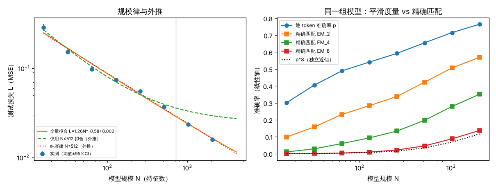

# Q03 大模型的规模律与能力涌现

> 分组：理论基础 ｜ 实验：`experiment.py`（运行时间约 16 秒） ｜ 证据标注：[实测] [文献] [判断]

## 摘要
规模律（损失随参数量呈幂律下降）与“涌现”（某些能力在某个规模突然出现）是大模型时代两条最具影响力、也最具争议的经验规律。本项目在可完全控制的教师—学生任务上训练了 8 个规模（特征数 N=16…2048，跨 2.1 个数量级）的随机特征模型，每个规模 5 个种子，同时记录连续损失、逐 token 准确率和 k-token 精确匹配。主要发现：(1) 测试损失服从 L=1.26·N^−0.585+0.0018，指数 b 的自助法 95% CI 为 [0.555, 0.613]，对数空间 R²=0.991 [实测]；(2) 但**外推是脆弱的**：用 N≤512 拟合带饱和项的规模律，预测 N=2048 的损失高估 85%（±24%），而纯幂律只高估 3%——原因是局部斜率先放缓（0.39）后回升（0.64），饱和项把“中途放缓”误读为“接近下界” [实测]；(3) 同一组模型上，8-token 精确匹配在 N≤128 时 <1%、到 N=2048 升至 13.7%，其“陡峭度”显著高于平滑上升的逐 token 准确率（0.361 vs 0.223，配对 t=8.32，p=0.0011），且精确匹配与各 token 准确率之积相差不超过 0.021——“涌现”可由非线性度量完整解释 [实测]。

## 1. 问题界定
**为何基础**：规模律决定了“继续加算力是否值得”，涌现决定了“能否预知新能力何时出现”。若规模律可靠，研发可以先小后大、按图索骥；若涌现是真实的相变，则能力（包括危险能力）不可预测。两者共同构成大模型科学的基础认识论问题：**智能能力随资源的变化是否可预测？**

**核心矛盾**：Kaplan 等与 Hoffmann 等报告跨 7 个数量级的平滑幂律 [文献]，而 Wei 等报告了大量“小模型接近随机、超过阈值后陡升”的任务 [文献]；Schaeffer 等则认为后者源自不连续/非线性度量 [文献]。同时，“幂律 + 不可约损失”的函数形式本身并无第一性原理保证，外推误差鲜有系统报告。

**可检验子假设（实验前设定）**：
- **H1（规模律存在）**：测试损失可被 L(N)=aN^−b+c 拟合，b 的 95% 自助法 CI 不含 0，对数空间 R²≥0.95。**否证**：b 的 CI 含 0 或 R²<0.95。
- **H2（可外推性）**：只用 N≤512（6 个规模）拟合的 aN^−b+c，对 N=1024、2048 的损失预测相对误差 ≤20%。**否证**：任一目标规模平均相对误差 >20%。（对照：纯幂律 aN^−b）
- **H3（涌现 = 度量假象）**：(a) 8-token 精确匹配 EM₈ 的陡峭度指数显著大于逐 token 准确率 p（配对 t 检验 p<0.05）；(b) EM_k 与 Π_j p_j 的最大绝对偏差 ≤0.03；(c) 经由逐 token 错误率外推 EM₈ 比直接外推 EM₈ 更准确。**否证**：(a)(b)(c) 分别不成立。

## 2. 研究现状
**规模律的经验发现**。Hestness 等（arXiv:1712.00409）在翻译、语言模型、图像、语音上发现泛化误差随数据量呈幂律；Rosenfeld 等（arXiv:1909.12673）提出联合依赖模型与数据规模的函数形式；Kaplan 等（arXiv:2001.08361）在语言模型上给出损失对参数量、数据量与计算量的幂律；Hoffmann 等（Chinchilla，arXiv:2203.15556）修正了计算最优配比，Besiroglu 等（arXiv:2404.10102）的复现指出其原始拟合存在问题，说明拟合细节会改变结论 [文献]。GPT-4 技术报告（arXiv:2303.08774）声称用 ≤1/1000 计算量的模型预测了最终损失 [文献]。

**规模律的理论解释**。Sharma 与 Kaplan（arXiv:2004.10802）把指数与数据流形内在维数联系起来；Bahri 等（arXiv:2102.06701）区分方差受限与分辨率受限四种区间；Maloney 等（arXiv:2210.16859）在随机特征模型中证明幂律指数由数据/特征谱的幂律衰减决定；Michaud 等（arXiv:2303.13506）的“量子化模型”把平滑幂律解释为大量离散技能按频率幂律分布后的叠加；Caballero 等（arXiv:2210.14891）提出“折断的规模律”，强调单一幂律无法刻画拐点 [文献]。

**涌现之争**。Ganguli 等（arXiv:2202.07785）指出“损失可预测、具体能力不可预测”的二重性；BIG-bench（arXiv:2206.04615）记录了大量阶跃式任务；Wei 等（arXiv:2206.07682）系统定义了“涌现能力”；Schaeffer 等（arXiv:2304.15004）证明更换为连续度量后多数涌现消失；Du 等（arXiv:2403.15796）从预训练损失角度认为涌现对应损失低于某阈值 [文献]。

**关键缺口**。(a) 缺乏对外推误差的预注册检验与不确定度报告；(b) 平滑损失与离散能力之间的映射机制尚未统一；(c) 何时出现“折断”/拐点，目前无法事前预测。

## 3. 研究设计
- **任务（教师）**：x~N(0,I₈)；固定随机教师网络 y=W₂ᵀtanh(W₁ᵀx+b₁)（64 隐元）输出 K=8 个量，各自标准化为单位方差，并按教师分布的分位数离散为 C=10 个等概率桶（“token”，随机猜测准确率 0.1）。
- **模型（学生）**：随机 ReLU 特征 φ(x)=ReLU(Wx+b) 的线性读出，宽度 N∈{16,32,…,2048}；岭回归（相对岭 1e−4）一次性求解。同一种子下各规模的特征为嵌套子集，只改变规模这一个变量。训练 12000、测试 4000 样本，5 个种子（重抽数据与特征）。
- **度量**：L=测试 MSE（对连续输出；常数预测时 L≈1）；p=预测值落入正确桶的比例；EM_k=前 k 个 token 全对的比例，k∈{1,2,4,8}。
- **陡峭度指数**：把度量在 8 个规模上归一化到 [0,1]，取相邻两规模（一次翻倍）之间的最大增幅；若度量对 log N 线性则约为 1/7≈0.14，越大越“阶跃”。
- **拟合**：在 log L 上最小二乘拟合 aN^−b+c（多起点）；对种子做 300 次自助重采样得 CI。
- **设计说明（诚实披露）**：任务难度经过一次试运行校准——初版（16 维输入、更强非线性）在最大规模下逐 token 准确率仍很低、EM₈ 几乎为 0，无法观察任何趋势（试运行数据未纳入结果），故改为 8 维输入；H1–H3 的判据在试运行之前已写定，试运行只用于确定难度。H3(c) 中“错误率用纯幂律外推”的变体是在看到 H2 结果后追加的探索性分析。

## 4. 结果

**表 1 各规模的度量（5 种子均值 ± 95% CI）[实测]**

| N | L（MSE） | 逐 token 准确率 p | EM₂ | EM₄ | EM₈ |
|---|---|---|---|---|---|
| 16 | 0.2886 ± 0.0240 | 0.302 ± 0.014 | 0.099 | 0.010 | 0.000 |
| 32 | 0.1526 ± 0.0073 | 0.405 ± 0.007 | 0.158 | 0.029 | 0.001 |
| 64 | 0.0977 ± 0.0026 | 0.489 ± 0.004 | 0.232 | 0.060 | 0.004 |
| 128 | 0.0748 ± 0.0013 | 0.541 ± 0.002 | 0.284 | 0.093 | 0.010 |
| 256 | 0.0555 ± 0.0019 | 0.592 ± 0.006 | 0.338 | 0.134 | 0.022 |
| 512 | 0.0369 ± 0.0011 | 0.655 ± 0.002 | 0.422 | 0.197 | 0.046 |
| 1024 | 0.0236 ± 0.0006 | 0.715 ± 0.003 | 0.507 | 0.279 | 0.088 |
| 2048 | 0.0159 ± 0.0007 | 0.765 ± 0.006 | 0.569 | 0.351 | 0.137 |

**H1 支持**：全量拟合 L=1.26·N^−0.585+0.0018；b 的自助法 CI [0.555, 0.613]，逐种子 b=0.592±0.028；c 的 CI [≈0, 0.0043]；对数空间 R²=0.991。但相邻规模的局部斜率依次为 0.92、0.64、0.39、0.43、0.59、0.64、0.57——并非常数。

**表 2 外推检验：用 N≤512 拟合，预测更大规模（相对误差，5 种子均值 ± 95% CI）[实测]**

| 函数形式 | N=1024 | N=2048 |
|---|---|---|
| aN^−b + c（预注册） | +40.1% ± 11.7% | +85.2% ± 23.9% |
| aN^−b（对照） | +1.7% ± 4.1% | +3.0% ± 9.2% |

**H2 不支持**（对预注册形式）：饱和规模律把 N=64–256 处的斜率放缓解释为接近不可约损失，从而严重高估大模型损失；更简单的纯幂律反而外推良好。

**表 3 陡峭度指数（越大越“阶跃”；5 种子均值 ± 95% CI）[实测]**

| 度量 | p | −log L | EM₁ | EM₂ | EM₄ | EM₈ |
|---|---|---|---|---|---|---|
| 陡峭度 | 0.223 ± 0.011 | 0.219 ± 0.010 | 0.212 ± 0.021 | 0.196 ± 0.017 | 0.252 ± 0.022 | 0.361 ± 0.032 |

- **H3(a) 支持**：EM₈ 对 p 的配对 t=8.32，p=0.0011；陡峭度随 k 增大而上升（k≥4 起明显）。
- **H3(b) 支持**：|EM_k − Π_j p_j| 的最大值为 0.007（k=2）、0.016（k=4）、0.021（k=8），独立近似略低估精确匹配，说明各 token 的正确性呈弱正相关。
- **H3(c) 不支持**：在 N=1024/2048，真实 EM₈ 为 0.088/0.137；经由 token 错误率（饱和律）外推得 0.052/0.077，（纯幂律，探索性）得 0.055/0.085，直接在 log N 上线性外推得 0.062/0.081；平均绝对误差分别为 0.036/0.060、0.032/0.052、0.025/0.057——三者都低估，且无一明显更优。

## 5. 讨论
**机理**。随机特征模型中，损失由“特征谱能否覆盖教师函数谱”决定：教师在不同方向上的能量呈谱衰减，每增加一倍特征就多解析一部分谱，于是产生近似幂律；若教师谱本身不是严格幂律，局部斜率就会起伏——这正是 Maloney 等与 Bahri 等理论的预言 [文献+判断]。本实验中局部斜率在中段降到 0.39 后又回升到 0.64，类似 Caballero 等描述的“折断”[判断]。**外推失败的教训**是：更灵活的函数形式（带饱和项）在只有 6 个点时会把局部波动当作结构；纯幂律碰巧更好，但这不保证在别处成立——外推可信度应以多种形式的预测分歧来度量，而不是只报告一条拟合曲线 [判断]。

**涌现**。逐 token 准确率每翻倍一次大约平稳提升 0.05–0.10，而 EM₈ 因为约等于 p⁸，在 p 从 0.30 升到 0.59 的大部分区间都接近 0，到 p≈0.7 以后才“抬头”。同一组模型、同一个底层能力，换一个度量就从“平滑”变“涌现”——这与 Schaeffer 等的结论一致 [实测+文献]。但 H3(c) 的失败提醒我们：即便知道涌现来自度量，**涌现点的时间预测仍受底层规模律外推误差的支配**，误差会被 k 次方放大 [判断]。因此“涌现是假象”并不等于“涌现可预测”。

**效度威胁与外推边界**。(a) 学生是随机特征 + 岭回归（凸、无特征学习），而大模型的特征学习、优化动态与数据重复都可能改变规模律形状；(b) 规模只有 2.1 个数量级、8 个点，外推结论只适用于“短程外推（2–4 倍）”；(c) 数据量固定为 12000，N=2048 时 N/n≈0.17，方差项开始抬头，可能是后段斜率变化的部分原因；(d) token 是对连续输出的分桶，各 token 共享输入特征，与语言模型中自回归、相互依赖的 token 不同（自回归错误会累积，可能使涌现更陡）；(e) 陡峭度指数依赖规模网格的分辨率，仅用于同网格内比较。

<!-- BIBLIO:start -->
## 文献计量信号（arXiv，[实测]）

检索式：摘要含 “scaling law”、“scaling laws”、“emergent abilities”、“emergent ability” 之一；基线为同年 cs.LG / cs.AI / stat.ML 论文总数。数据：`ai2035/bibliometrics/arxiv_counts.json`（检索日 2026-11-26）。

| 年份 | 命中论文数 | 占 AI/ML 基线比例 |
|---|---|---|
| 2015 | 174 | 4.28% |
| 2016 | 198 | 3.36% |
| 2017 | 208 | 2.46% |
| 2018 | 215 | 1.57% |
| 2019 | 218 | 0.98% |
| 2020 | 267 | 0.88% |
| 2021 | 249 | 0.75% |
| 2022 | 291 | 0.80% |
| 2023 | 395 | 0.87% |
| 2024 | 662 | 1.12% |
| 2025 | 896 | 1.20% |

- 2019–2025 年份额的对数线性趋势：**每年 +4.5%**（95% CI -3.1% ~ +12.8%，R²=0.31），判定：**与 AI/ML 总体同步（相对份额无显著趋势）**；在 20 个问题中按相对增速排第 14 位。
- 解读边界：分子覆盖 arXiv 全部类别、分母仅为 AI/ML 三个类别，所以“比例”是相对关注度指数，并非严格的子集占比；关键词匹配既会漏掉使用其他术语的工作，也会混入无关用法；arXiv 偏重机器学习社区，认知科学、神经科学与期刊论文覆盖不足。该信号衡量的是**研究关注度**，不是**问题被解决的程度**。
<!-- BIBLIO:end -->

## 6. 结论与 2035 展望
**核心结论**
1. 在可控任务上，损失对模型规模呈稳定的近似幂律（b≈0.59，CI [0.555, 0.613]）[实测；置信度：高（本设定内）]。
2. 规模律的**函数形式选择**主导外推误差：带饱和项的形式外推 4 倍规模时高估 85%，纯幂律仅 3%；局部斜率并不恒定 [实测；置信度：高（本设定内），中（对大模型的推广）]。
3. “涌现”可以完全由非线性度量（多 token 精确匹配 ≈ p^k）产生，而底层逐 token 能力是平滑的 [实测+文献；置信度：高]。
4. 知道涌现来自度量并不足以准确预测涌现点：底层外推误差被 k 次方放大 [实测；置信度：中]。
5. 大模型规模律的可靠性应以“多函数形式 + 预注册外推 + 不确定度”来评估，而非单一曲线拟合 [判断；置信度：中]。

**关键未解问题**：规模律指数由什么决定（数据谱、任务组合结构、架构）？“折断”能否事前预测？离散能力与连续损失之间是否存在普适映射？

**建议研究路线**
- **近期（2026–2028）**：建立公开的“预注册外推基准”，要求对每个规模律报告在 4×、16× 规模上的预测区间与事后误差（里程碑：主流模型族的 16× 外推损失误差 <5%，且 90% 预测区间覆盖率达到名义水平）。
- **中期（2029–2032）**：从数据谱与任务结构推导规模律指数（里程碑：在 ≥5 个模态上，理论预测指数与实测相差 <0.05）；建立“能力—损失映射”理论，使下游任务的涌现点可由损失曲线提前 10× 规模预测。
- **远期（2033–2035）**：形成包含特征学习的规模律第一性原理理论，能预言拐点/折断的位置（里程碑：在训练前预测拐点位置的误差 <2×规模），并作为能力评估与安全治理中“危险能力提前预警”的标准工具。

## 参考文献
1. Hestness, J., et al. (2017). Deep Learning Scaling is Predictable, Empirically. arXiv:1712.00409.
2. Rosenfeld, J. S., et al. (2019). A Constructive Prediction of the Generalization Error Across Scales. arXiv:1909.12673.
3. Kaplan, J., et al. (2020). Scaling Laws for Neural Language Models. arXiv:2001.08361.
4. Sharma, U., & Kaplan, J. (2020). A Neural Scaling Law from the Dimension of the Data Manifold. arXiv:2004.10802.
5. Bahri, Y., et al. (2021). Explaining Neural Scaling Laws. arXiv:2102.06701.
6. Ganguli, D., et al. (2022). Predictability and Surprise in Large Generative Models. arXiv:2202.07785.
7. Hoffmann, J., et al. (2022). Training Compute-Optimal Large Language Models. arXiv:2203.15556.
8. Srivastava, A., et al. (2022). Beyond the Imitation Game: Quantifying and extrapolating the capabilities of language models. arXiv:2206.04615.
9. Wei, J., et al. (2022). Emergent Abilities of Large Language Models. arXiv:2206.07682.
10. Caballero, E., et al. (2022). Broken Neural Scaling Laws. arXiv:2210.14891.
11. Maloney, A., Roberts, D. A., & Sully, J. (2022). A Solvable Model of Neural Scaling Laws. arXiv:2210.16859.
12. OpenAI (2023). GPT-4 Technical Report. arXiv:2303.08774.
13. Michaud, E. J., et al. (2023). The Quantization Model of Neural Scaling. arXiv:2303.13506.
14. Schaeffer, R., Miranda, B., & Koyejo, S. (2023). Are Emergent Abilities of Large Language Models a Mirage? arXiv:2304.15004.
15. Du, Z., et al. (2024). Understanding Emergent Abilities of Language Models from the Loss Perspective. arXiv:2403.15796.
16. Besiroglu, T., et al. (2024). Chinchilla Scaling: A replication attempt. arXiv:2404.10102.
