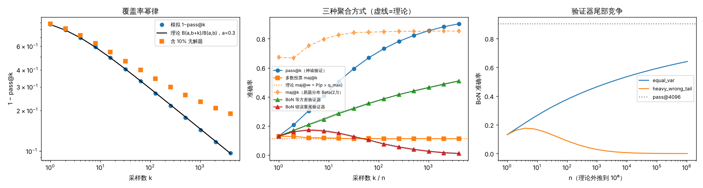

# 测试时计算的规模律从何而来：难度分布决定覆盖率幂律，聚合方式决定天花板与“奖励黑客”拐点

**摘要**
2025–2026 年，“测试时计算（test-time compute）规模律”成为继预训练规模律之后的第二条主线：重复采样的覆盖率（pass@k）在多个模型上呈近似幂律，多数投票与带验证器的 Best-of-n（BoN）则被广泛用于把覆盖率兑现为准确率。但三个问题仍有争议：幂律指数由什么决定，能否从少量样本外推；多数投票为何常常饱和，甚至让复杂提示策略“越采越差”；不完美验证器下 BoN 能否持续受益，还是会出现奖励黑客式退化。本文在一个最小但完全可解的模型中统一回答这三个问题。模型设定为：每道题有单次成功率 p（服从 Beta 分布）和一组错误答案概率，验证器分数在正确与错误样本上服从不同的高斯分布。理论推导得到：(1) 1−pass@k = B(a,b+k)/B(a,b) ∝ k^−a，指数只由 p→0 处的密度决定；(2) 多数投票的极限是 maj@∞ = P(p > q_max)，当多数题目的“最强错误答案”比正确答案更可能时，多采样反而降低准确率；(3) BoN 的精确准确率为一维积分，当错误样本分数的方差大于正确样本时，准确率在有限 n* 处达到峰值后趋于 0。在 2000 道题 × 4096 次采样 × 5 个种子的模拟中：pass@k 与理论的最大偏差为 0.0025，拟合指数 0.297±0.007（理论 0.297）；只用每题 32 个样本做 Beta-二项极大似然外推到 k=4096，误差为 0.0046，而朴素幂律外推的误差为 0.029；多数投票的极限与理论天花板相差 0.0003；在难题分布下准确率从 0.128 降到 0.111；重尾验证器的峰值位置（n=4）与理论在 5/5 个种子上完全一致，n=4096 时准确率跌至 0.0097。结论：测试时规模律是“难度分布 × 聚合器”的可计算函数，而非模型的固有属性。

**关键词**：测试时计算；重复采样；pass@k；多数投票；Best-of-n；验证器；规模律

## 1 引言
**动机**。推理模型（o1/R1 类）的兴起使“推理时多花算力”成为与“训练时多花算力”并列的能力来源（arXiv:2501.12948，综述 arXiv:2501.02497）。若测试时规模律可预测，就能在部署前决定采样多少次、用何种聚合方式；若不可预测，大规模推理预算可能被浪费，甚至产生负收益。

**2025–2026 年的核心争论**。(1) **幂律从何而来**：Large Language Monkeys 报告覆盖率随采样数近似幂律增长（arXiv:2407.21787）；Schaeffer 等认为这是单题成功率分布的重尾所致（arXiv:2502.17578）；也有工作直接对下游准确率拟合幂律（arXiv:2512.08894）。(2) **聚合是否可扩展**：多数投票下，复杂提示策略随采样数增加反而落后于简单思维链（arXiv:2505.10981），“多数并不总对”促使学习式聚合（arXiv:2509.06870）；理论上，自洽性需要 Θ(1/Δ²) 个样本，而 BoN 只需 Θ(1/Δ)（arXiv:2506.05295）。(3) **验证器不完美时会怎样**：重采样的极限受验证器假阳性限制（arXiv:2411.17501）；ROC 几何决定 BoN 与拒绝采样的实例级准确率，且高算力表现无法从低算力外推（arXiv:2507.12399）；“尾部竞争”用极值理论解释 BoN 的单调增益与奖励黑客式退化（arXiv:2610.19362）；还有工作报告了测试时计算的逆向缩放（arXiv:2507.14417）。

**本文贡献**：
1. 一个统一模型：给出 pass@k、maj@k、BoN@n 三者在同一难度分布下的闭式或一维积分表达。
2. 三条可检验预测：覆盖率指数 = Beta 形状参数 a，且可由少量样本外推；多数投票天花板 = P(p > q_max)，并给出逆向缩放条件；验证器方差不对称时 BoN 存在可预测的峰值 n*。
3. 大规模模拟逐条验证（5 种子、2000 题、4096 样本），并比较两种外推方法的误差。
4. 讨论这些结论与前沿论断（幂律普适性、聚合器选择、验证器扩展）之间的关系与边界。

## 2 前沿进展综述
**路线 A：重复采样与覆盖率规模律**。重复采样使覆盖率随 k 近似幂律增长（arXiv:2407.21787，2024）；幂律指数源自单题成功率分布在 0 附近的密度（arXiv:2502.17578）；下游准确率的对数可直接对训练预算做幂律拟合，并可纳入重复采样的推理计算（arXiv:2512.08894）；有技术笔记从局部逼近与特征覆盖解释规模律指数（arXiv:2610.27789）。**共识**：覆盖率增长“看起来”是幂律。**争议**：是普适规律还是分布的副产品？能否从小 k 外推？

**路线 B：聚合与选择**。自洽性/多数投票（Wang 等，arXiv:2203.11171）是最常用的无验证器聚合；概率论分析指出复杂提示在多数投票下的优势会随采样数消失（arXiv:2505.10981）；学习式聚合可以恢复“少数但正确”的答案（arXiv:2509.06870）；Bradley–Terry 式成对比较可替代点式评判（arXiv:2605.15177）；多智能体辩论作为测试时扩展只在特定条件下有效（arXiv:2505.22960）；原生并行思考被提出用以突破顺序推理的瓶颈（arXiv:2509.04475）；o1 类模型更长的思维链并不稳定地提高准确率，并行扩展的覆盖率更好（arXiv:2502.12215）。

**路线 C：验证器与搜索**。用验证器训练做数学题（arXiv:2110.14168）；计算最优的测试时扩展可以胜过扩大参数（arXiv:2408.03314，2024）；把价值函数加回 RL 以服务测试时验证（arXiv:2505.04842）；用工具增强小模型的验证能力（arXiv:2504.04718）；扩展验证器数量（arXiv:2502.20379）；价值引导搜索（arXiv:2505.17373）、高效树搜索（arXiv:2502.13575）、自适应并行 MCTS（arXiv:2604.00510）。**理论**：ROC 几何决定 BoN 与拒绝采样（arXiv:2507.12399）；尾部竞争给出三种渐近区间（arXiv:2610.19362）；重采样存在由假阳性决定的上限（arXiv:2411.17501）；从验证集输出统计预测 BoN 增益（arXiv:2606.02981）。

**路线 D：自适应分配与失败模式**。按题目分配算力（arXiv:2602.01070、2604.14853、2512.00466）；逆向缩放（arXiv:2507.14417）；RL 训练会影响可用于测试时采样的多样性（多色目标，arXiv:2509.25424；“新技能还是更锐利的原语”，arXiv:2602.08281）。

**被反驳或尚未复现的说法**：“更长的思维链必然带来更好的测试时扩展”（被 arXiv:2502.12215、2507.14417 质疑）；“BoN 在算力趋于无穷时收敛到 pass@k”只在验证器的正确尾部占优时成立（arXiv:2610.19362）；“小规模采样的表现可以外推到大规模”——arXiv:2507.12399 认为一般不可能。本文表明：若已知或能估计难度分布，覆盖率是可以外推的。

**开放问题清单**：(i) 覆盖率指数的来源与外推方法；(ii) 多数投票天花板与逆向缩放的判据；(iii) 验证器尾部性质与最优 n；(iv) 按题目分配算力的最优策略；(v) RL 后训练如何改变难度分布进而改变测试时规模律（与 Q05 相连）。

**前沿地图**

| 路线 | 代表工作 | 关键结论 | 局限 |
|---|---|---|---|
| 覆盖率规模律 | 2407.21787, 2502.17578, 2512.08894 | pass@k 近似幂律；源自单题成功率的重尾 | 外推方法与误差缺乏系统比较 |
| 无验证器聚合 | 2505.10981, 2509.06870, 2506.05295 | 多数投票饱和；自洽性样本复杂度 Θ(1/Δ²) | 天花板与逆向缩放条件缺少统一表达 |
| 验证器 BoN | 2507.12399, 2610.19362, 2411.17501 | ROC/尾部决定极限，可能出现奖励黑客 | 与难度分布的耦合未量化 |
| 搜索与价值 | 2408.03314, 2505.04842, 2505.17373 | 计算最优分配优于扩参 | 依赖具体任务与验证器 |
| 自适应分配 | 2602.01070, 2604.14853, 2512.00466 | 按题分配算力 | 需要难度估计 |
| 失败模式 | 2507.14417, 2502.12215 | 逆向缩放、更长 CoT 无益 | 机理多为描述性 |

## 3 问题与假设
**选题理由**。开放问题 (i)(ii)(iii) 是测试时计算投资决策的核心；在“题目 × 样本”的伯努利/分类模型中可以精确推导并用大样本模拟检验，正好适合本环境。

**形式化**。题目 i 有单次正确概率 p_i ~ Beta(a,b)（主实验 a=0.3、b=2；对照为“易题”Beta(2,1)，以及含 10% 无解题 p=0 的混合）；错误答案在 M=4 个类别上的概率为 (1−p_i)·Dirichlet(0.5)，最强错误答案的概率记为 q_max,i。验证器给正确样本打分 ~N(1,1)，给错误样本打分 ~N(0,σ0²)，σ0 ∈ {1（等方差，AUC 0.760），1.6（错误重尾，AUC 0.702）}。指标：pass@k（Chen 等无偏估计）、maj@k（并列平分）、BoN@n。

**预注册假设**：
- **H1（覆盖率幂律与外推）**：(a) 模拟 pass@k 与 1−B(a,b+k)/B(a,b) 的最大偏差 <0.01；(b) k∈[32,4096] 上拟合的指数与 a=0.3 相差 <10%；(c) 只用每题 32 个样本时，Beta-二项极大似然外推到 k=4096 的绝对误差小于朴素幂律外推误差的一半。**否证**：任一条不成立。
- **H2（多数投票天花板与逆向缩放）**：(a) maj@4096 与 P(p>q_max) 相差 <0.02；(b) 在 p<q_max 的题目子集上，maj@4096 < maj@1（= 子集平均 p）；(c) 难题分布下聚合 maj@k 随 k 不增。**否证**：任一条不成立。
- **H3（验证器尾部竞争）**：(a) 两种验证器下，BoN 的精确积分与模拟相差 <0.02；(b) σ0>σ1 时 BoN 非单调，模拟峰值位置与理论峰值位置（在 2 的幂网格上）在 ≥4/5 个种子上一致，且 n=4096 时准确率低于 n=1；(c) 等方差时 BoN 单调上升，但在 n=4096 时仍远低于 pass@4096（差距 >0.2）。**否证**：任一条不成立。

## 4 理论分析
**命题 1（覆盖率）**。pass@k = 1 − E[(1−p)^k]。若 p ~ Beta(a,b)，则
E[(1−p)^k] = B(a, b+k)/B(a,b) = Γ(a+b)Γ(b+k) / (Γ(b)Γ(a+b+k)) ~ [Γ(a+b)/Γ(b)]·k^−a（k→∞）。
因此 1−pass@k 是指数为 a 的幂律，且 a 只取决于密度在 p→0 处的行为 f(p) ∝ p^{a−1}。若有比例为 u 的无解题，则 1−pass@k → u，在有限 k 窗口上拟合的“指数”会被向下偏置。*推论*：用少量样本估计 (a,b)（Beta-二项似然），再代入闭式，即可外推；而在小 k 上直接拟合幂律，会因为渐近区尚未到达而产生偏差。

**命题 2（多数投票）**。对固定题目，由大数定律，k→∞ 时多数票收敛到概率最大的答案，因此 maj@∞ = P(p > q_max)；而 maj@1 = E[p]。在“正确 vs 最强错误”的二元竞争中，收敛速度由 Chernoff 指数 k(√p − √q_max)² 决定，故 p ≈ q_max 的题目收敛极慢。*推论（逆向缩放判据）*：当 P(p > q_max) < E[p] 时，多采样会降低整体准确率；在 p<q_max 的子集上，准确率从平均 p 单调降到 0。易题分布下 P(p > q_max) > E[p]，准确率上升并饱和于该天花板，且天花板严格低于 pass@∞。

**命题 3（BoN 的尾部竞争）**。设正确样本分数密度为 f1、分布函数为 F1，错误样本分布函数为 F0。BoN 选中正确样本的概率为
A(n) = ∫ n·p·f1(s)·[p F1(s) + (1−p) F0(s)]^{n−1} ds。
极值论证：n 个样本中，正确样本最大分数约为 μ1 + σ1√(2 ln(np))，错误样本约为 μ0 + σ0√(2 ln(n(1−p)))。σ0 = σ1 时，两者之差趋于 μ1−μ0 > 0，Gumbel 涨落尺度 ∝ 1/√(ln n)，因此 A(n) → 1，但只以对数速度逼近。σ0 > σ1 时，错误样本最大值以更快的 (σ0−σ1)√(2 ln n) 超越正确样本，A(n) → 0：A(n) 在有限 n* 处取峰值，即“奖励黑客”。这与尾部竞争理论一致（arXiv:2610.19362），本文给出了与难度分布耦合后的整体曲线。

## 5 实验
- 每个种子生成 2000 道题、每题 4096 个样本（答案类别 + 验证器分数，两种验证器共享样本流）；5 个种子（重抽题目与样本）。k、n ∈ {1, 2, 4, …, 4096}。
- pass@k 使用全部 4096 个样本的无偏估计；maj@k 和 BoN@n 使用前 k 个样本（BoN 用累计最大值高效计算）。
- 理论：pass@k 用 Beta 函数闭式；maj@∞ 逐题计算 1[p>q_max]；BoN 用 4001 点网格做数值积分，逐题计算后取平均。
- 外推对照：仅用每题前 32 个样本，(i) Beta-二项极大似然估计 (â, b̂) 后代入闭式；(ii) 在 k=2…32 上拟合 log(1−pass@k) 对 log k 的直线。
- 统计：均值 ± 95% CI（跨种子）；峰值位置逐种子比较。运行时间约 88 秒。

## 6 结果
**表 1 H1：覆盖率 [实测]**

| 量 | 模拟 | 理论 |
|---|---|---|
| pass@k 最大绝对偏差（k=1…4096） | 0.0025 | — |
| k∈[32,4096] 上的拟合指数 | 0.297 ± 0.007 | 0.297（同窗口），0.3（渐近） |
| 含 10% 无解题时的拟合指数 | 0.186 ± 0.002 | 被天花板向下偏置；pass@4096 = 0.81 |
| pass@4096 | 0.903 ± 0.004 | — |
| Beta-二项外推（32 样本→4096） | 0.904 ± 0.007（绝对误差 0.0046 ± 0.0030；â = 0.302 ± 0.012） | — |
| 朴素幂律外推 | 0.874 ± 0.007（绝对误差 0.029 ± 0.005） | — |

**H1 支持**（a、b、c 均成立；Beta-二项外推的误差约为朴素外推的 1/6）。

**表 2 H2：多数投票 [实测]**

| 分布 | maj@1 | maj@4096 | 理论天花板 P(p>q_max) | pass@4096 |
|---|---|---|---|---|
| 难题 Beta(0.3,2) | 0.128 ± 0.012 | 0.111 ± 0.009 | 0.112 ± 0.009 | 0.903 |
| 易题 Beta(2,1) | 0.671 ± 0.007 | 0.852 ± 0.007 | 0.852 ± 0.007 | 1.000 |

难题分布中，88.8% 的题目满足 p<q_max；这一子集的 maj@1（平均 p）为 0.076，maj@4096 降到 0.0012；p>q_max 子集为 0.987。难题分布下 maj@k 的峰值出现在 k=1，此后不增。天花板与 maj@4096 的差为 0.0003 ± 0.0007。**H2 支持**：多数投票把准确率推向 P(p>q_max)，难题分布下表现为逆向缩放；即使在易题分布下，它也远低于 pass@4096（0.852 对 1.000）。

**表 3 H3：验证器 BoN [实测]**

| 验证器 | n=1 | 峰值（模拟 / 理论位置） | n=4096 模拟 | 理论与模拟最大偏差 | 理论外推 n=2²⁰ |
|---|---|---|---|---|---|
| 等方差（AUC 0.760） | 0.128 | 单调上升（峰值在网格端点 4096，5/5） | 0.509 ± 0.010（理论 0.511） | 0.0071 | 0.640 |
| 错误重尾 σ0=1.6（AUC 0.702） | 0.128 | n=4（5/5 种子模拟与理论一致），峰值 0.171 ± 0.009 | 0.0097 ± 0.0012 | 0.0058 | 0.00007 |

**H3 支持**：重尾验证器下准确率从峰值下降 0.161 ± 0.010，n=4096 时远低于 n=1；等方差验证器在 n=4096 时（0.509）仍比 pass@4096（0.903）低 0.39，按理论到 n≈10⁶ 也只有 0.640。

## 7 讨论
**与前沿文献的关系**。(1) 支持 Schaeffer 等（arXiv:2502.17578）：覆盖率幂律的指数就是难度分布在 p→0 处的形状参数，且本文进一步表明，“先估计分布，再用闭式外推”比直接拟合幂律准确约 6 倍。这部分挑战了“高算力表现不可由低算力预测”的悲观论断（arXiv:2507.12399）：对 pass@k（神谕验证），只要难度分布可估计就可以外推；但对不完美验证器下的 BoN，本文同样发现峰值位置与退化程度强烈依赖尾部参数，一旦尾部未知就无法外推，这与该文的结论一致。(2) 命题 2 给出了“复杂提示在多数投票下落后”（arXiv:2505.10981）和“多数并不总对”（arXiv:2509.06870）的统一判据：关键量是 P(p>q_max) − E[p]。一个让 E[p] 提高、却同时制造强错误吸引子的策略，在大 k 下会输给 q_max 更分散的策略。(3) 命题 3 与尾部竞争（arXiv:2610.19362）一致，并说明奖励黑客式退化在验证器 AUC 尚可（0.70）时就会发生，因此验证器评估应报告尾部（高分区）的校准，而不只是 AUC。(4) 对自适应分配（arXiv:2602.01070、2604.14853）的启示：最优的每题采样数取决于该题的 p 与验证器尾部；对 p<q_max 且没有验证器的题目，额外采样有害。

**外推边界与局限**。(a) 样本被假设为条件独立；真实 LLM 的样本在同一题内相关（共享错误推理），会降低有效样本数并可能抬高 q_max。(b) 难度分布取 Beta；真实分布可能是多峰的（存在大量 p=0 的题目，见 10% 无解题对照）。(c) 验证器分数假设为与题目无关的高斯分布；真实奖励模型的偏差与题目相关，尾部可能更重。(d) 只研究了并行采样，未涉及顺序推理（更长思维链）与树搜索。(e) 结论是“若模型满足这些统计假设，则……”，不能直接替代在真实模型上的测量。

## 8 结论
1. 覆盖率幂律的指数等于难度分布在 p→0 处的形状参数（模拟 0.297 对理论 0.297），无解题会使拟合指数向下偏置 [实测+理论；置信度：高（模型内）]。
2. 先用少量样本估计难度分布再外推，比直接拟合幂律准确约 6 倍（误差 0.0046 对 0.029）[实测；置信度：中——依赖 Beta 假设]。
3. 多数投票的极限是 P(p>q_max)（误差 0.0003），当多数题目的最强错误答案更可能时，多采样会降低准确率（0.128→0.111）[实测+理论；置信度：高]。
4. 不完美验证器的 BoN 由尾部竞争决定：错误样本分数尾部更重时存在峰值 n*（此处 n=4），之后准确率趋于 0；等方差时 BoN 只以对数速度逼近覆盖率 [实测+理论；置信度：高（模型内），中（对真实奖励模型）]。

**对 2035 的研判**：测试时计算会像预训练一样进入“可预测投资”阶段，但前提是对每个任务估计难度分布与验证器尾部，并据此选择聚合器和采样数；“无脑加采样”的边际收益会被多数投票天花板与奖励黑客限制 [判断]。

**后续研究建议**：(1) 在开源推理模型上测量单题 p 与 q_max 的联合分布，检验命题 2 的逆向缩放判据；(2) 估计真实奖励模型在高分区的正误尾部，预测 BoN 峰值 n*；(3) 发展同时利用难度估计与验证器尾部信息的自适应算力分配；(4) 研究 RL 后训练如何改变 p 的分布形状参数 a（与 Q05 联动）。

## 参考文献
**奠基与 2024 年文献（经 arXiv API 核实）**
1. Cobbe, K., et al. (2021). Training Verifiers to Solve Math Word Problems. arXiv:2110.14168.
2. Wang, X., et al. (2022). Self-Consistency Improves Chain of Thought Reasoning in Language Models. arXiv:2203.11171.
3. Kaplan, J., et al. (2020). Scaling Laws for Neural Language Models. arXiv:2001.08361.
4. Schaeffer, R., Miranda, B., & Koyejo, S. (2023). Are Emergent Abilities of Large Language Models a Mirage? arXiv:2304.15004.
5. Brown, B., et al. (2024). Large Language Monkeys: Scaling Inference Compute with Repeated Sampling. arXiv:2407.21787.
6. Snell, C., et al. (2024). Scaling LLM Test-Time Compute Optimally can be More Effective than Scaling Model Parameters. arXiv:2408.03314.
7. Stroebl, B., Kapoor, S., & Narayanan, A. (2024). The Limits of Inference Scaling Through Resampling. arXiv:2411.17501.

**2025 年以后**
8. A Survey of Test-Time Compute: From Intuitive Inference to Deliberate Reasoning (2025). arXiv:2501.02497.
9. DeepSeek-AI (2025). DeepSeek-R1: Incentivizing Reasoning Capability in LLMs via Reinforcement Learning. arXiv:2501.12948.
10. Revisiting the Test-Time Scaling of o1-like Models: Do they Truly Possess Test-Time Scaling Capabilities? (2025). arXiv:2502.12215.
11. ETS: Efficient Tree Search for Inference-Time Scaling (2025). arXiv:2502.13575.
12. Schaeffer, R., Kazdan, J., Hughes, J., et al. (2025). How Do Large Language Monkeys Get Their Power (Laws)? arXiv:2502.17578.
13. Multi-Agent Verification: Scaling Test-Time Compute with Multiple Verifiers (2025). arXiv:2502.20379.
14. T1: Tool-integrated Verification for Test-time Compute Scaling in Small Language Models (2025). arXiv:2504.04718.
15. Putting the Value Back in RL: Better Test-Time Scaling by Unifying LLM Reasoners With Verifiers (2025). arXiv:2505.04842.
16. Rethinking the Role of Prompting Strategies in LLM Test-Time Scaling: A Perspective of Probability Theory (2025). arXiv:2505.10981.
17. Value-Guided Search for Efficient Chain-of-Thought Reasoning (2025). arXiv:2505.17373.
18. Revisiting Multi-Agent Debate as Test-Time Scaling: A Systematic Study of Conditional Effectiveness (2025). arXiv:2505.22960.
19. Sample Complexity and Representation Ability of Test-time Scaling Paradigms (2025). arXiv:2506.05295.
20. ROC-n-reroll: How verifier imperfection affects test-time scaling (2025). arXiv:2507.12399.
21. Inverse Scaling in Test-Time Compute (2025). arXiv:2507.14417.
22. ParaThinker: Native Parallel Thinking as a New Paradigm to Scale LLM Test-time Compute (2025). arXiv:2509.04475.
23. The Majority is not always right: RL training for solution aggregation (2025). arXiv:2509.06870.
24. Polychromic Objectives for Reinforcement Learning (2025). arXiv:2509.25424.
25. SCALE: Selective Resource Allocation for Overcoming Performance Bottlenecks in Mathematical Test-time Scaling (2025). arXiv:2512.00466.
26. Revisiting the Scaling Properties of Downstream Metrics in Large Language Model Training (2025). arXiv:2512.08894.
27. What If We Allocate Test-Time Compute Adaptively? (2026). arXiv:2602.01070.
28. New Skills or Sharper Primitives? A Probabilistic Perspective on the Emergence of Reasoning in RLVR (2026). arXiv:2602.08281.
29. Adaptive Parallel Monte Carlo Tree Search for Efficient Test-time Compute Scaling (2026). arXiv:2604.00510.
30. Adaptive Test-Time Compute Allocation for Reasoning LLMs via Constrained Policy Optimization (2026). arXiv:2604.14853.
31. OpenDeepThink: Parallel Reasoning via Bradley-Terry Aggregation (2026). arXiv:2605.15177.
32. Predicting Inference-Time Scaling Gains from Labeled Validation-Set Output Statistics (2026). arXiv:2606.02981.
33. Tail Competition Explains Scaling in Best-of-N Sampling for Verifiable Problems (2026). arXiv:2610.19362.
34. Foundations of the Scaling Law (2026). arXiv:2610.27789.
