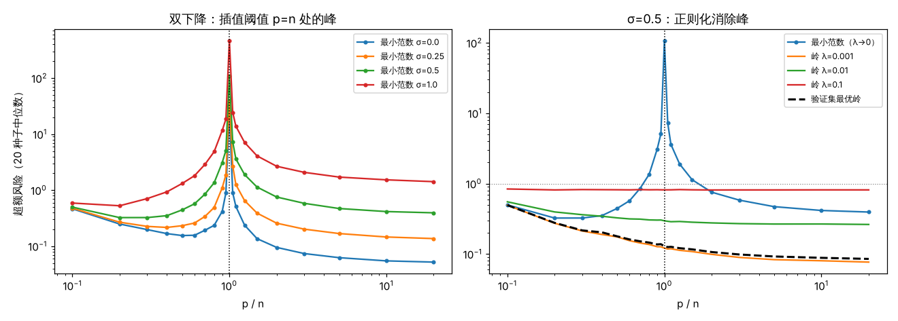
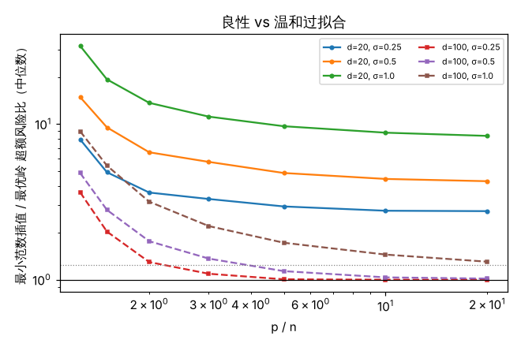

# Q04 机器学习的统计学基础：过参数化下的泛化

> 分组：理论基础 ｜ 实验：`experiment.py`（运行时间约 63 秒） ｜ 证据标注：[实测] [文献] [判断]

## 摘要
经典统计学习理论预言：模型越复杂、越接近完美拟合训练数据，泛化越差；而现代深度网络的参数量远超样本量、训练误差为零，却泛化良好。本项目用随机 ReLU 特征 + 最小范数最小二乘这一可精确求解的模型，在 n=200、p/n 从 0.1 到 20、4 个标签噪声水平、20 个种子下系统测量测试误差。主要发现：(1) 最小范数估计在全部 20 个种子、全部噪声水平下都在插值阈值 p=n 处出现尖峰（d=20 时，σ=1 的中位超额风险达 469，而零模型仅为 1），峰高随噪声上升（Spearman ρ=0.60，p=3.5×10⁻⁹）[实测]；(2) 验证集选择的岭正则化完全消除尖峰，其误差随 p 单调不增 [实测]；(3) 过参数化插值是否“良性”取决于输入维度：d=20 时插值器在 p=20n 的超额风险是最优岭的 1.5–9.1 倍（“温和过拟合”），d=100 时仅为 1.00–1.02 倍（σ≤0.5，近乎良性）[实测]。结论：“过参数化不伤泛化”不是普适定律，而是由隐式正则化强度与噪声水平共同决定的条件性现象。

## 1. 问题界定
**为何基础**：泛化理论是机器学习可信性的数学根基。VC 维/Rademacher 复杂度等一致收敛界在 p≫n 时变得空洞（vacuous），Zhang 等发现网络可以完美拟合随机标签 [文献]——这意味着“为何能泛化”需要新的统计学解释。核心矛盾：**插值（训练误差为 0）与泛化在经典理论中互斥，在现代实践中却共存**。

**可检验子假设（判据在最终运行前写定）**：
- **H1（双下降）**：最小范数估计的测试误差在 p/n∈[0.9,1.1] 出现峰值（≥90% 的种子），峰高随标签噪声 σ 单调上升（Spearman ρ>0，p<0.05）。附 **H1b**：过参数化区（p/n≥2）的最优误差低于欠参数化区（p/n<0.9）的最优误差（Wilcoxon 检验）。**否证**：峰位于区间外或 ρ≤0；H1b 中过参数化不更优。
- **H2（正则化消除峰）**：验证集最优岭的测试误差随 p 单调不增（相邻 p 之间的最大平均增幅不显著大于 0）。**否证**：存在显著增幅。
- **H3（良性过拟合）**：在 p=20n 时，最小范数插值器的超额风险不超过最优岭的 1.25 倍。**否证**：比值 >1.25。

## 2. 研究现状
**经典框架**。Vapnik（1998，《Statistical Learning Theory》，Wiley）的 VC 理论与 Bartlett 与 Mendelson（2002，JMLR 3:463）的 Rademacher 复杂度给出“复杂度—样本量”权衡；Geman、Bienenstock 与 Doursat（1992，Neural Computation 4:1）将其表述为偏差—方差困境 [文献]。

**现代现象**。Zhang 等（arXiv:1611.03530）证明标准网络能记住随机标签，否定了“容量小所以泛化”的解释；Advani 与 Saxe（arXiv:1710.03667）、Spigler 等（arXiv:1810.09665）在高维动力学与“阻塞相变”中观察到 p≈n 处的误差峰；Belkin 等（arXiv:1812.11118）提出“双下降”统一图景；Nakkiran 等（arXiv:1912.02292）在深度网络中观察到模型、样本、训练轮次三种双下降 [文献]。

**精确理论**。Hastie 等（arXiv:1903.08560）与 Mei 与 Montanari（arXiv:1908.05355）分别对线性与随机特征回归给出比例渐近下的精确风险曲线；Bartlett 等（arXiv:1906.11300）给出线性回归“良性过拟合”的充要条件——协方差谱需有足够大的“有效秩”尾部来吸收噪声；Muthukumar 等（arXiv:1903.09139）讨论“无害插值”；Liang 与 Rakhlin（arXiv:1808.00387）证明高维下核“无岭”回归的隐式正则化可以泛化；Nakkiran 等（arXiv:2003.01897）证明最优正则化可消除双下降；Mallinar 等（arXiv:2207.06569）提出“良性/温和/灾难性”三分法，指出固定维度下核插值通常是“温和”的；Dar 等（arXiv:2109.02355）给出综述。另一路线是 PAC-Bayes 等非空洞界（Dziugaite 与 Roy，arXiv:1703.11008）[文献]。

**争议与缺口**。(a) 线性/核模型中的结论能否迁移到有特征学习的深度网络；(b) 良性过拟合需要的高维条件在真实数据中是否满足；(c) 缺少能在有限样本下给出紧致、可计算、对深网有效的泛化界。

## 3. 研究设计
- **数据**：x~N(0,I_d)，n=200 训练、500 验证、2000 测试；教师 f(x)=u·x+0.5·tanh(2v·x)（标准化到单位方差，故零预测器的超额风险为 1）；y=f(x)+σε，σ∈{0, 0.25, 0.5, 1}。
- **模型**：随机 ReLU 特征 φ(x)=ReLU(Wx/√d)/√p，p/n∈{0.1,…,0.95, 1, 1.05, …, 20}（20 个值），同一种子内特征嵌套。
- **估计器**：最小范数最小二乘（SVD 伪逆）；固定岭 λ∈{1e−3,1e−2,1e−1}；验证集上从 13 个 λ（1e−6…1e2）中选优的“最优岭”（对照组）。
- **指标**：超额风险 E[(f̂−f)²]（对无噪声 f）、训练误差、系数范数。20 个种子（重抽数据、特征、噪声），报告均值 ± 95% CI；因插值阈值附近误差重尾，图中用中位数。
- **维度对照**：主实验 d=20（n/d=10）；d=100（n/d=2）为高维对照。
- **诚实披露**：(1) 初版教师 sin(1.5u·x)+0.5v·x 在 n=200 时几乎不可学（最优超额风险 ≥0.6），试运行后换为当前教师；(2) d=100 对照是在看到 d=20 呈“温和过拟合”后追加的，属探索性分析；H1–H3 的判据在两次改动前已写定。

## 4. 结果

**表 1 插值阈值处的峰（20 种子）[实测]**

| d | σ | 峰位于 p/n∈[0.9,1.1] 的种子比例 | p=n 处超额风险中位数 | p=n 处均值 ± CI | 最优岭 @p=n | 固定岭 λ=1e−3 @p=n |
|---|---|---|---|---|---|---|
| 20 | 0 | 1.0 | 24.6 | 124.6 ± 141.4 | 0.069 ± 0.003 | 0.076 ± 0.004 |
| 20 | 0.25 | 1.0 | 38.4 | 526.5 ± 838.4 | 0.087 ± 0.004 | 0.088 ± 0.005 |
| 20 | 0.5 | 1.0 | 107.9 | 1311.9 ± 2132.8 | 0.128 ± 0.008 | 0.120 ± 0.007 |
| 20 | 1.0 | 1.0 | 469.1 | 4033.3 ± 6502.0 | 0.209 ± 0.016 | 0.242 ± 0.016 |
| 100 | 0.5 | 1.0 | 176.2 | 1006.6 ± 690.6 | 0.542 ± 0.023 | 0.521 ± 0.022 |

峰高随 σ 上升：d=20 时 Spearman ρ=0.60（p=3.5×10⁻⁹），d=100 时 ρ=0.35（p=0.0013）。即使 σ=0 也有峰——模型设定误差（教师不在随机特征张成的空间内）扮演了“噪声”角色。**H1 支持**。

**表 2 过参数化 vs 欠参数化的最优误差（均值 ± CI）[实测]**

| d | σ | 欠参数化最优（p/n<0.9） | 过参数化最优（p/n≥2） | 过参数化更优的种子比例 | Wilcoxon p |
|---|---|---|---|---|---|
| 20 | 0 | 0.154 ± 0.012 | 0.053 ± 0.001 | 1.0 | 1.9×10⁻⁶ |
| 20 | 0.25 | 0.212 ± 0.015 | 0.140 ± 0.007 | 1.0 | 1.9×10⁻⁶ |
| 20 | 0.5 | 0.311 ± 0.024 | 0.400 ± 0.024 | 0.1 | 3.6×10⁻⁵ |
| 20 | 1.0 | 0.515 ± 0.041 | 1.440 ± 0.091 | 0.0 | 1.9×10⁻⁶ |
| 100 | 0.5 | 0.931 ± 0.034 | 0.242 ± 0.015 | 1.0 | 1.9×10⁻⁶ |
| 100 | 1.0 | 1.047 ± 0.033 | 0.628 ± 0.037 | 1.0 | 1.9×10⁻⁶ |

**H1b 部分支持**：低噪声或高维时“第二次下降”优于经典最优点；d=20 且 σ≥0.5 时，插值器不如经典最优点。

**H2 支持**：在两个维度、四个噪声水平下，最优岭曲线相邻 p 之间的最大平均增幅均 ≤0（例如 d=20、σ=0.5 时为 −0.0002 ± 0.0022），即单调不增；仅 λ=1e−3 的固定岭已把 p=n 处的中位误差从 108 降到约 0.12（表 1）。最小范数解的系数范数在 p=n 处爆炸（见 `results/coef_norm_d20.png`），这是峰的直接成因。

**表 3 良性过拟合检验：p=20n 时（训练误差均为 0）[实测]**

| d | σ | 最小范数插值器 | 最优岭 | 比值（插值/最优岭） | 插值器超额风险 / σ² |
|---|---|---|---|---|---|
| 20 | 0 | 0.053 ± 0.001 | 0.035 ± 0.001 | 1.53 ± 0.05 | — |
| 20 | 0.25 | 0.140 ± 0.007 | 0.050 ± 0.002 | 2.80 ± 0.15 | 2.24 ± 0.12 |
| 20 | 0.5 | 0.400 ± 0.024 | 0.086 ± 0.006 | 4.72 ± 0.41 | 1.60 ± 0.10 |
| 20 | 1.0 | 1.440 ± 0.091 | 0.164 ± 0.015 | 9.12 ± 1.03 | 1.44 ± 0.09 |
| 100 | 0 | 0.109 ± 0.005 | 0.109 ± 0.005 | 0.9985 ± 0.0001 | — |
| 100 | 0.25 | 0.144 ± 0.008 | 0.144 ± 0.008 | 0.9993 ± 0.0001 | 2.31 ± 0.13 |
| 100 | 0.5 | 0.242 ± 0.015 | 0.238 ± 0.014 | 1.016 ± 0.008 | 0.97 ± 0.06 |
| 100 | 1.0 | 0.628 ± 0.037 | 0.468 ± 0.026 | 1.34 ± 0.04 | 0.63 ± 0.04 |

**H3 在 d=20 时不支持（温和过拟合），在 d=100、σ≤0.5 时支持（近乎良性），σ=1 时仍不支持。**

## 5. 讨论
**机理**。p≈n 时随机特征矩阵最小奇异值趋近 0，最小范数解必须用巨大的系数去“穿过”每个带噪标签，方差项发散；p≫n 时满足插值的解很多，最小范数选择把噪声分摊到大量特征方向上，单个方向的影响被稀释，故误差第二次下降 [文献+实测]。最优岭通过显式收缩取代这种“稀释”，因此没有峰 [文献]。

**为何维度决定良性与否**。ReLU 随机特征核可分解为“低阶多项式部分 + 近似单位阵的高阶部分”；高阶部分在高维（d 大、n/d 小）时近似一个等效岭，提供隐式正则化——这正是 Liang 与 Rakhlin 的“无岭也能泛化”机制，也对应 Bartlett 等“尾部有效秩大”的条件 [文献]。d=20、n=200 时该隐式岭太弱，插值器会把相当一部分噪声“记”进预测函数，其超额风险与 σ² 同量级（比值 1.4–2.2），即 Mallinar 等所说的“温和过拟合”[实测+文献]；d=100 时隐式岭接近最优，插值几乎无代价，但在 σ=1 的高噪声下仍有 34% 的损失 [实测]。

**对“统计学基础”的含义**。(1) 一致收敛型界无法解释表 3 中 d=20 与 d=100 的差异——两者参数量、训练误差完全相同，泛化却截然不同；有效的理论必须依赖**数据分布 × 算法隐式偏好**，而非假设类的容量 [判断]。(2) “大模型过参数化所以泛化好”的说法需要附加条件：隐式正则化的强度要与噪声水平相匹配 [判断]。

**效度威胁与外推边界**。(a) 随机特征模型没有特征学习，深度网络的隐式偏好（如 SGD、早停）还会额外正则化；(b) 高斯输入与单指标型教师过于理想；(c) n=200 较小，p=n 附近的均值受极端种子支配（因此同时报告中位数）；(d) d=100 对照是事后追加的探索性分析，需要独立重复；(e) “最优岭”用验证集挑选，实际中验证集本身也消耗样本。

<!-- BIBLIO:start -->
## 文献计量信号（arXiv，[实测]）

检索式：摘要含 “double descent”、“benign overfitting”、“overparameterized”、“generalization bound” 之一；基线为同年 cs.LG / cs.AI / stat.ML 论文总数。数据：`ai2035/bibliometrics/arxiv_counts.json`（检索日 2026-11-26）。

| 年份 | 命中论文数 | 占 AI/ML 基线比例 |
|---|---|---|
| 2015 | 69 | 1.70% |
| 2016 | 53 | 0.90% |
| 2017 | 73 | 0.86% |
| 2018 | 119 | 0.87% |
| 2019 | 215 | 0.97% |
| 2020 | 290 | 0.95% |
| 2021 | 304 | 0.92% |
| 2022 | 355 | 0.98% |
| 2023 | 353 | 0.78% |
| 2024 | 370 | 0.63% |
| 2025 | 425 | 0.57% |

- 2019–2025 年份额的对数线性趋势：**每年 -8.9%**（95% CI -13.6% ~ -3.8%，R²=0.80），判定：**相对降温（增速显著慢于 AI/ML 总体，绝对量仍可能增长）**；在 20 个问题中按相对增速排第 19 位。
- 解读边界：分子覆盖 arXiv 全部类别、分母仅为 AI/ML 三个类别，所以“比例”是相对关注度指数，并非严格的子集占比；关键词匹配既会漏掉使用其他术语的工作，也会混入无关用法；arXiv 偏重机器学习社区，认知科学、神经科学与期刊论文覆盖不足。该信号衡量的是**研究关注度**，不是**问题被解决的程度**。
<!-- BIBLIO:end -->

## 6. 结论与 2035 展望
**核心结论**
1. 最小范数估计的双下降峰稳定出现在 p=n（100% 种子），峰高随标签噪声与模型设定误差上升 [实测+文献；置信度：高]。
2. 最优正则化使测试误差对 p 单调不增，双下降峰是“无正则插值”的产物而非过参数化的必然代价 [实测+文献；置信度：高]。
3. 良性过拟合是条件性的：同样的插值器在 d=20 时是温和过拟合（误差为最优岭的 1.5–9.1 倍），在 d=100 时近乎良性（≈1.0 倍，σ≤0.5）[实测；置信度：中——两个维度、单一教师]。
4. 解释现代泛化需要“分布 + 算法”依赖的理论，容量型界无法区分上述情形 [判断；置信度：中]。

**关键未解问题**：深度网络中特征学习如何改变有效核谱与隐式正则化？能否从训练数据本身估计“隐式岭”的强度，从而事前判断插值是否良性？对大模型，噪声与记忆（例如隐私数据的记忆）之间的定量关系是什么？

**建议研究路线**
- **近期（2026–2028）**：建立“隐式正则强度”的可计算估计量，并在核/随机特征模型上验证其能预测良性/温和/灾难性三种情形（里程碑：分类准确率 ≥90%）；在中型网络上系统测量标签噪声—插值—测试误差的三维相图。
- **中期（2029–2032）**：发展包含特征学习的精确渐近理论（例如两层网络在比例极限下的风险公式），并在真实数据集上与实测误差偏差 <10%；给出对 10 亿参数模型非空洞、可计算的泛化界。
- **远期（2033–2035）**：形成面向大模型的“数据 × 算法 × 架构”泛化理论，可在训练前预测给定数据噪声与模型规模下的泛化误差与记忆风险（里程碑：对新任务的预测误差 <20%），并纳入可信 AI 的评估标准。

## 参考文献
1. Geman, S., Bienenstock, E., & Doursat, R. (1992). Neural networks and the bias/variance dilemma. *Neural Computation*, 4(1), 1–58.
2. Vapnik, V. N. (1998). *Statistical Learning Theory*. Wiley.
3. Bartlett, P. L., & Mendelson, S. (2002). Rademacher and Gaussian complexities: risk bounds and structural results. *JMLR*, 3, 463–482.
4. Rahimi, A., & Recht, B. (2007). Random features for large-scale kernel machines. *NIPS 2007*.
5. Zhang, C., et al. (2016). Understanding deep learning requires rethinking generalization. arXiv:1611.03530.
6. Dziugaite, G. K., & Roy, D. M. (2017). Computing Nonvacuous Generalization Bounds for Deep (Stochastic) Neural Networks with Many More Parameters than Training Data. arXiv:1703.11008.
7. Advani, M. S., & Saxe, A. M. (2017). High-dimensional dynamics of generalization error in neural networks. arXiv:1710.03667.
8. Liang, T., & Rakhlin, A. (2018). Just Interpolate: Kernel "Ridgeless" Regression Can Generalize. arXiv:1808.00387.
9. Spigler, S., et al. (2018). A jamming transition from under- to over-parametrization affects loss landscape and generalization. arXiv:1810.09665.
10. Belkin, M., Hsu, D., Ma, S., & Mandal, S. (2018). Reconciling modern machine learning practice and the bias-variance trade-off. arXiv:1812.11118.
11. Hastie, T., Montanari, A., Rosset, S., & Tibshirani, R. J. (2019). Surprises in High-Dimensional Ridgeless Least Squares Interpolation. arXiv:1903.08560.
12. Muthukumar, V., et al. (2019). Harmless interpolation of noisy data in regression. arXiv:1903.09139.
13. Bartlett, P. L., Long, P. M., Lugosi, G., & Tsigler, A. (2019). Benign Overfitting in Linear Regression. arXiv:1906.11300.
14. Mei, S., & Montanari, A. (2019). The generalization error of random features regression: Precise asymptotics and double descent curve. arXiv:1908.05355.
15. Nakkiran, P., et al. (2019). Deep Double Descent: Where Bigger Models and More Data Hurt. arXiv:1912.02292.
16. Nakkiran, P., Venkat, P., Kakade, S., & Ma, T. (2020). Optimal Regularization Can Mitigate Double Descent. arXiv:2003.01897.
17. Dar, Y., Muthukumar, V., & Baraniuk, R. G. (2021). A Farewell to the Bias-Variance Tradeoff? An Overview of the Theory of Overparameterized Machine Learning. arXiv:2109.02355.
18. Mallinar, N., et al. (2022). Benign, Tempered, or Catastrophic: A Taxonomy of Overfitting. arXiv:2207.06569.
