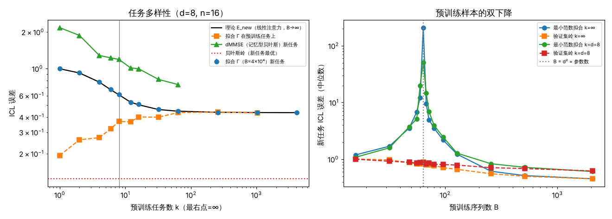

# 上下文学习的统计学：任务多样性、预训练样本双下降与“记忆型”贝叶斯的代价

**摘要**
上下文学习（ICL）把“学习”从参数更新搬进了前向计算，它的泛化同样需要统计学解释。2025–2026 年，线性注意力上的可解模型成为主战场：预训练—测试任务的对齐度被证明决定 ICL 误差，低秩任务结构会诱导相变，预训练样本数接近参数数时出现插值奇点（Landau 理论），而“记忆型”与“泛化型”贝叶斯预测器被用来解释模型在不同任务多样性下学到的不同策略。本文在同一个最小模型中定量检验三条相互关联的论断。模型为单层线性注意力 ŷ = x_qᵀΓh，h = (1/n)Σ y_i x_i；其上的上下文线性回归预训练任务池含 k 个任务。理论部分推导出无限预训练序列时的最优解 Γ* = S·C⁻¹（S 为任务二阶矩）和新任务误差的闭式表达，并证明：(i) k<d 时，新任务误差不低于子空间下界 (1−k/d)+σ²；(ii) k>d 时，相对 k=∞ 的超额误差 ∝ 1/k；(iii) 有限预训练序列 B 时，最小范数拟合在 B = d² 处发生插值奇点。在 d=8、n=16、σ=0.25、10 个种子的模拟中，闭式理论与蒙特卡洛误差的最大偏差为 0.0067；k≥2d 时超额误差的双对数斜率，理论为 −1.13，模拟为 −0.95；预训练任务与新任务之间的误差差距从 k=1 的 0.81 缩小到 k=64 的 0.012。记忆型贝叶斯预测器（dMMSE）在预训练任务上接近噪声下限（0.062），但在新任务上误差高达 0.74–2.17，比零预测器（1.06）还差，直到 k=64 才低于它。最小范数拟合的误差峰出现在 B=64=d²（中位数 209，k=∞），验证集选岭可把它降到 0.90。结论：ICL 的泛化服从经典统计学的两条定律——“任务数相对维度”的覆盖定律与“样本数相对参数数”的插值定律；同时，线性注意力即使在 k=∞ 时（0.435）也远逊于贝叶斯岭（0.124），这说明“ICL = 贝叶斯最优推断”的说法需要附加结构条件。

**关键词**：上下文学习；线性注意力；任务多样性；双下降；贝叶斯预测器；统计学习理论

## 1 引言
**动机**。第一阶段（README）表明，过参数化下的泛化取决于“数据 × 算法”的隐式偏好。ICL 是这一问题在大模型中的新形态：模型在预训练中见过有限个“任务”，却要在推理时从少量示例中学会新任务。何时能泛化到新任务？需要多少任务、多少预训练序列？学到的是贝叶斯最优，还是“记住任务”？

**2025–2026 年的核心争论**。(1) **任务多样性阈值**：Raventós 等发现 Transformer 在任务数超过阈值后从“离散先验贝叶斯（dMMSE）”转向“岭回归”（arXiv:2306.15063）；2025 年的工作改用任务分布的“多样性/对齐度”来刻画（arXiv:2506.05574、2509.26551、2606.06814），并用理性分析解释策略切换（arXiv:2506.17859）。(2) **线性注意力能否刻画 Transformer**：线性注意力的渐近理论（arXiv:2405.11751）已扩展到低秩任务（arXiv:2510.04548）、非线性教师（arXiv:2610.10761）和随机 Transformer（arXiv:2509.15152），但也有工作指出线性与二次注意力的 ICL 行为不同（arXiv:2602.17171）。(3) **预训练样本的插值奇点**：Landau 理论把 ICL 误差在“预训练样本数 ≈ 可学参数数”时的奇点解释为淬火无序系统的临界现象（arXiv:2608.28059）。

**本文贡献**：
1. 在一个最小可解模型中，同时给出任务多样性 k 和预训练序列数 B 的效应：无限 B 下的闭式新任务误差与子空间下界、k>d 时的 1/k 超额定律，以及 B=d² 处的插值奇点。
2. 用三类预测器（线性注意力、记忆型 dMMSE、贝叶斯岭）做对照，量化“记忆任务”在新任务上的代价。
3. 10 种子模拟逐条检验，并报告理论与模拟的偏差。
4. 讨论这些结果对“ICL 是贝叶斯推断”与“任务多样性阈值”两种叙事的支持与挑战。

## 2 前沿进展综述
**路线 A：线性注意力的可解理论**。线性注意力的梯度下降动力学存在两个不动点，损失呈单次骤降（arXiv:2501.16265）；高维极限下低秩任务的预测分布与相变被精确刻画，有限预训练数据的涨落起隐式正则作用（arXiv:2510.04548）；对任意预训练—测试任务协方差失配给出精确误差，并提出对齐度度量（arXiv:2509.26551）；非线性单指标教师下，线性注意力只提取线性 Hermite 分量，其余部分等效为噪声（arXiv:2610.10761）；随机 Transformer 等价于有限阶 Hermite 多项式模型（arXiv:2509.15152）；Landau 理论解释预训练样本的插值奇点（arXiv:2608.28059）；softmax 注意力在大提示极限下趋于线性算子（arXiv:2512.11784）。**共识**：线性注意力 ICL ≈ 一步（预条件）梯度下降（arXiv:2212.07677、2306.00297、2306.09927）。

**路线 B：任务多样性与分布外泛化**。用低维子空间并集刻画 ICL 的 OOD 泛化：若预训练任务来自子空间并集，可泛化到所有角度偏移（arXiv:2505.14808）；任务多样性增加时，Transformer 从只在预训练分布内做 ICL 的专用解，转变为可泛化到整个任务空间的解（arXiv:2506.05574）；低维子空间视角下的训练任务多样性效应（arXiv:2606.06814）；需要多少预训练任务（arXiv:2310.08391，2023）。

**路线 C：贝叶斯与理性分析**。记忆型（离散先验）与泛化型（真实先验）贝叶斯预测器可统一解释不同 ICL 策略，策略切换由复杂度—拟合的权衡决定（arXiv:2506.17859）；ICL 中的延迟泛化与认知不确定性（arXiv:2604.12434）；动力系统中 ICL 呈现与 OOD 的权衡和二次双下降（arXiv:2602.18679）。

**路线 D：Transformer 泛化理论**。两层 Transformer 在标签翻转噪声下的良性/有害过拟合界（arXiv:2502.12508）；GD 的隐式正则在实例层面优于显式岭（arXiv:2509.17251）；基于经验 NTK 的非渐近泛化理论（arXiv:2605.01172）；高斯混合分类 ICL 的经验标度（arXiv:2604.25858）。

**争议与未复现**：(a) “ICL 实现贝叶斯最优推断”——在线性注意力（一步 GD）中只在特定 n/d 比下近似成立；(b) “存在尖锐的任务多样性阈值”——在线性注意力中，对新任务的误差是平滑交叉，而非尖锐相变（本文结果）；尖锐转变可能需要能表示 dMMSE 的非线性架构；(c) 线性注意力能否代表 softmax Transformer（arXiv:2602.17171 给出差异）。

**开放问题清单**：(i) 任务多样性与预训练样本数的联合相图；(ii) 记忆型策略在新任务上的代价；(iii) 线性注意力与贝叶斯最优之间的差距从何而来；(iv) 何种架构/训练会发生 dMMSE→岭的尖锐转变；(v) 理论能否预测真实 LLM 的 ICL 误差。

**前沿地图**

| 路线 | 代表工作 | 关键结论 | 局限 |
|---|---|---|---|
| 线性注意力可解理论 | 2405.11751, 2510.04548, 2509.26551, 2608.28059 | 精确误差、对齐度、低秩相变、插值奇点 | 线性注意力≠softmax |
| 非线性扩展 | 2610.10761, 2509.15152, 2512.11784 | 非线性等效为噪声；等价多项式模型 | 仍为单层 |
| 任务多样性 | 2306.15063, 2506.05574, 2505.14808, 2606.06814 | 从专用解到通用解的转变 | “阈值”的定义不统一 |
| 贝叶斯/理性分析 | 2506.17859, 2604.12434 | 记忆型 vs 泛化型贝叶斯 | 规范性解释，未给出代价 |
| 泛化界 | 2502.12508, 2509.17251, 2605.01172 | 良性/有害过拟合；隐式正则 | 与 ICL 的联系间接 |

## 3 问题与假设
**选题理由**。开放问题 (i)(ii)(iii) 直接延续第一阶段的双下降与良性过拟合主题；线性注意力 ICL 对 Γ 是线性的，可精确求解与大规模模拟，适合本环境。

**形式化**。x ~ N(0,I_d)，任务 w ~ N(0,I/d)，y = wᵀx + ε，ε ~ N(0,σ²)；每条序列有 n 个上下文示例和 1 个查询。线性注意力预测 ŷ_q = x_qᵀΓh，h = (1/n)Σ_i y_i x_i。预训练任务池为 {w_1,…,w_k}（k=∞ 表示每条序列新抽任务），Γ 用 B 条预训练序列做最小二乘（或岭）拟合。指标：新任务误差 E_new（任务来自先验）、预训练任务误差 E_in。参数 d=8、n=16、σ=0.25，零预测器误差 1+σ² = 1.0625。

**预注册假设**：
- **H1（闭式理论）**：对所有 k，闭式 E_new(Γ*) 与 B=4×10⁴ 拟合的 Γ 的蒙特卡洛误差之差 <0.02。
- **H2（任务多样性）**：(a) k<d 时 E_new ≥ (1−k/d)+σ²；(b) k ≥ 2d 时超额误差 E_new(k)−E_new(∞) 的双对数斜率落在 [−1.3, −0.7]；(c) k ≥ 8d 时 |E_new − E_in| < 0.02。
- **H3（记忆型贝叶斯的代价）**：dMMSE 在预训练任务上优于线性注意力，但在 k ≤ 64 的所有新任务条件下都劣于线性注意力，且 k ≤ d 时劣于零预测器。
- **H4（预训练样本双下降）**：最小范数拟合的新任务误差峰位于 B ∈ [56,72]（d²=64 附近）的种子比例 ≥80%（k=∞ 与 k=d 两种条件）；验证集选岭使 B=64 处误差显著下降（Wilcoxon p<0.01），且中位曲线的最大回升 <0.1。

## 4 理论分析
**引理 1（充分统计量的矩）**。对固定 w，h = (1/n)Σ x_i(x_iᵀw + ε_i)，由高斯四阶矩 E[xxᵀwwᵀxxᵀ] = ‖w‖²I + 2wwᵀ，得
E[h] = w，E[hhᵀ] = (1+1/n)wwᵀ + ((‖w‖² + σ²)/n)I。

**命题 1（无限预训练序列时的最优 Γ）**。预训练任务池的二阶矩记为 S = (1/k)Σ_j w_j w_jᵀ。损失 E(Γh − w)²（查询各向同性）是 Γ 的二次型，最优解为
Γ* = E[whᵀ]·E[hhᵀ]⁻¹ = S·C⁻¹，C = (1+1/n)S + ((tr S + σ²)/n)I。
新任务误差：E_new(Γ) = 1 − 2tr(Γ)/d + tr(Γ C_new Γᵀ) + σ²，C_new = (1+1/n)I/d + ((1+σ²)/n)I。k→∞ 时 S→I/d，Γ* 退化为标量 1/[(1+1/n) + d(1+σ²)/n]，即最优步长的一步梯度下降。

**推论 1（子空间下界，k<d）**。S 的秩为 k，故 Γ* 的列空间位于任务子空间 U 内，新任务中 w 在 U^⊥ 上的分量无法被预测：E_new ≥ E‖P_{U^⊥}w‖² + σ² = (1−k/d)+σ²。这就是线性注意力中的“记忆任务子空间”。

**推论 2（1/k 超额定律，k>d）**。记 S = I/d + Δ，‖Δ‖ = O(√(d/k)/d)（Marchenko–Pastur）。E_new(Γ*(S)) 在 S = I/d 处取极小（Γ*(I/d) 是新任务的最优线性注意力），一阶项消失，故超额误差 ≈ 二次型 ∝ E‖Δ‖_F² ∝ d/k，即超额误差 ∝ k⁻¹。

**命题 2（预训练样本的插值奇点）**。Γ 的拟合是 d² 维特征 vec(x_q hᵀ) 上的线性回归。由第一阶段的双下降机理，B = d² 时最小范数解的方差项发散，误差峰位于 B = d²，与 Landau 理论描述的“样本数≈参数数”奇点一致（arXiv:2608.28059）；适当的岭正则消除奇点。

**推论 3（三类预测器的排序）**。新任务上，贝叶斯岭（后验均值）是全体估计量中的最优者；线性注意力只是 h 的线性函数（一步 GD），在 n/d = 2 时远离最优。dMMSE 的后验集中在离新任务最近的预训练任务上，当 k 远小于 d 维空间的覆盖数时，其预测近似为一个“随机错误的任务”，误差可超过零预测器。

## 5 实验
- **E1**：k ∈ {1,2,4,6,8,12,16,32,64,256,1024,∞}，每个 k 10 个种子（重抽任务池）。理论 Γ* 用命题 1 计算；拟合 Γ 用 B = 4×10⁴ 条序列做最小二乘；蒙特卡洛评估用 2×10⁴ 条新序列（dMMSE 用 4000 条，只评估 k ≤ 64）；贝叶斯岭用 3 个种子。
- **E2**：B ∈ {16,…,2048}（在 64 附近加密），k ∈ {∞, 8}，10 个种子；最小范数（伪逆）与验证集（B 条新序列）上 13 个 λ 中选优的岭。
- 统计：均值 ± 95% CI；E2 报告中位数（插值点附近误差重尾），并做配对 Wilcoxon 检验。运行时间约 96 秒（CPU 约 66 秒）。

## 6 结果
**表 1 E1：任务多样性（10 种子；新任务误差为蒙特卡洛均值 ± CI）[实测]**

| k | 理论 E_new | 拟合 Γ 的 E_new | 拟合 Γ 的 E_in | E_new − E_in | dMMSE 新任务 | dMMSE 预训练任务 |
|---|---|---|---|---|---|---|
| 1 | 0.997 | 1.004 ± 0.008 | 0.194 ± 0.061 | 0.810 ± 0.060 | 2.171 ± 0.492 | 0.062 |
| 2 | 0.921 | 0.923 ± 0.007 | 0.260 ± 0.034 | 0.662 ± 0.032 | 1.874 ± 0.190 | 0.062 |
| 4 | 0.775 | 0.776 ± 0.008 | 0.271 ± 0.023 | 0.506 ± 0.026 | 1.284 ± 0.069 | 0.061 |
| 8 | 0.609 | 0.613 ± 0.019 | 0.369 ± 0.034 | 0.245 ± 0.045 | 1.190 ± 0.072 | 0.063 |
| 16 | 0.504 | 0.510 ± 0.016 | 0.401 ± 0.028 | 0.109 ± 0.026 | 0.997 ± 0.052 | 0.062 |
| 64 | 0.447 | 0.448 ± 0.003 | 0.436 ± 0.014 | 0.012 ± 0.014 | 0.739 ± 0.012 | 0.063 |
| 256 | 0.438 | 0.436 ± 0.002 | 0.439 ± 0.009 | −0.003 ± 0.008 | — | — |
| ∞ | 0.435 | 0.435 ± 0.002 | — | — | — | — |

贝叶斯岭（新任务最优）：0.124 ± 0.002。

- **H1 支持**：理论与蒙特卡洛的最大偏差为 0.0067。
- **H2 支持**：(a) k=4 时子空间下界为 0.5625，实测 0.776；k=6 时下界为 0.3125，实测 0.673（均满足下界）。(b) k ≥ 2d 时超额误差的双对数斜率，理论为 −1.13，模拟为 −0.95。(c) k=64 时差距为 0.012，k=256 时为 −0.003。
- **H3 支持**：dMMSE 在预训练任务上误差为 0.061–0.063（接近噪声下限 σ²=0.0625），但在新任务上为 2.17（k=1）至 0.74（k=64），始终劣于线性注意力；k ≤ 8 时（1.19–2.17）也劣于零预测器（1.0625）。

**表 2 E2：预训练序列数 B 的双下降（新任务误差中位数，10 种子）[实测]**

| 条件 | B=16 | B=48 | B=60 | B=64 | B=68 | B=96 | B=256 | B=2048 | 峰位于 [56,72] 的种子数 | 验证集岭中位曲线最大回升 |
|---|---|---|---|---|---|---|---|---|---|---|
| k=∞ 最小范数 | 1.195 | 3.556 | 12.251 | 208.84 | 9.567 | 2.183 | 0.616 | 0.453 | 10/10 | — |
| k=∞ 验证集岭 | 1.012 | 0.874 | 0.825 | 0.902 | 0.804 | 0.713 | 0.556 | 0.453 | — | 0.077 |
| k=8 最小范数 | 1.085 | 3.734 | 19.861 | 50.509 | 14.808 | 2.469 | 0.835 | 0.609 | 10/10 | — |
| k=8 验证集岭 | 1.002 | 0.885 | 0.882 | 0.880 | 0.837 | 0.808 | 0.711 | 0.623 | — | 0.024 |

B=64 时，最小范数与验证集岭的配对 Wilcoxon 检验在两种条件下均为 p = 0.002。**H4 支持**；但 k=∞ 时验证集岭在 B=64 仍有 0.077 的小回升（验证集只有 B 条序列，λ 选择有噪声）。

## 7 讨论
**与前沿文献的关系**。(1) 命题 2 与 Landau 理论（arXiv:2608.28059）一致：奇点出现在“预训练样本数 = 可学参数数（d²）”处，属于经典插值奇点，而非 ICL 特有现象；这也连接了第一阶段的双下降结论。(2) 推论 1–2 给出了线性注意力中“任务多样性”效应的完整图景：k<d 时是秩约束下的子空间记忆，k>d 时是 1/k 的平滑收敛。这与“从专用解到通用解”的经验转变（arXiv:2506.05574）方向一致，但在线性注意力中没有尖锐阈值。因此，Raventós 等观察到的尖锐 dMMSE→岭转变（arXiv:2306.15063）需要能表示 dMMSE 的非线性机制，线性注意力本身无法给出 [判断]。(3) H3 为理性分析（arXiv:2506.17859）补上了“代价”一项：记忆型贝叶斯在预训练分布内几乎最优（0.062），在分布外则比什么都不做还差（k≤8 时 1.19–2.17），说明“ICL 策略是否泛化”主要由预训练任务覆盖度决定，与对齐度理论（arXiv:2509.26551）一致。(4) 线性注意力在 k=∞ 时（0.435）与贝叶斯岭（0.124）的巨大差距表明，“ICL = 贝叶斯最优”至少需要多层/预条件化（arXiv:2306.00297）或 softmax 非线性；单层线性注意力只等价于一步 GD。

**外推边界与局限**。(a) 单层线性注意力，d=8、n=16 的小尺度；(b) 任务为各向同性高斯线性回归，真实 ICL 任务高度结构化（低秩、层级）；(c) 未训练真正的 softmax Transformer，dMMSE→岭的尖锐转变未在本文模型中复现；(d) E2 中验证集岭的回升说明，在“样本≈参数”附近，正则化强度的选择本身也很困难；(e) 推论 2 的 1/k 定律是二阶展开的结果，在 k ≈ d 附近不适用。

## 8 结论
1. 线性注意力 ICL 的新任务误差有精确闭式（与模拟偏差 ≤0.0067），且服从两条经典统计定律：任务数相对维度的覆盖定律（k<d 时存在子空间下界，k>d 时超额误差 ∝1/k，实测斜率 −0.95）[实测+理论；置信度：高（模型内）]。
2. 预训练序列数 B = d² 处存在插值奇点（误差中位数 209，10/10 种子），选岭可基本消除；“ICL 的双下降”是经典双下降在 Γ 参数空间中的再现 [实测+文献；置信度：高]。
3. 记忆型贝叶斯策略在分布内几乎最优（0.062），在新任务上却可比零预测器更差（k≤8 时 1.19–2.17）：ICL 能否泛化主要取决于预训练任务对任务空间的覆盖 [实测；置信度：高（模型内）]。
4. 单层线性注意力远非贝叶斯最优（0.435 对 0.124），“ICL 即贝叶斯推断”需要更强的架构条件 [实测；置信度：中——依赖 n/d 比]。

**对 2035 的研判**：大模型的 ICL 能力将被当作统计估计问题来工程化：通过度量预训练任务对目标任务空间的覆盖度，以及“样本—参数”比，来预测上下文泛化误差。尖锐的“任务多样性相变”是否存在、出现在何处，将成为区分线性理论与真实 Transformer 的关键实验 [判断]。

**后续研究建议**：(1) 在多层 softmax Transformer 上复现 E1/E2，检验尖锐 dMMSE→岭转变的条件；(2) 把子空间下界推广到低秩/层级任务分布，并与对齐度度量结合；(3) 测量真实 LLM 的“任务覆盖度”与 ICL 误差的关系；(4) 研究多层线性注意力（预条件 GD）与贝叶斯岭之间差距的闭合速度。

## 参考文献
**奠基与 2024 年以前文献（经 arXiv API 核实）**
1. Belkin, M., et al. (2018). Reconciling modern machine learning practice and the bias-variance trade-off. arXiv:1812.11118.
2. Hastie, T., Montanari, A., Rosset, S., & Tibshirani, R. J. (2019). Surprises in High-Dimensional Ridgeless Least Squares Interpolation. arXiv:1903.08560.
3. Garg, S., Tsipras, D., Liang, P., et al. (2022). What Can Transformers Learn In-Context? A Case Study of Simple Function Classes. arXiv:2208.01066.
4. Akyürek, E., Schuurmans, D., Andreas, J., et al. (2022). What learning algorithm is in-context learning? Investigations with linear models. arXiv:2211.15661.
5. von Oswald, J., et al. (2022). Transformers learn in-context by gradient descent. arXiv:2212.07677.
6. Ahn, K., Cheng, X., Daneshmand, H., et al. (2023). Transformers learn to implement preconditioned gradient descent for in-context learning. arXiv:2306.00297.
7. Zhang, R., Frei, S., & Bartlett, P. L. (2023). Trained Transformers Learn Linear Models In-Context. arXiv:2306.09927.
8. Raventós, A., Paul, M., Chen, F., et al. (2023). Pretraining task diversity and the emergence of non-Bayesian in-context learning for regression. arXiv:2306.15063.
9. Wu, J., et al. (2023). How Many Pretraining Tasks Are Needed for In-Context Learning of Linear Regression? arXiv:2310.08391.
10. Lu, Y. M., Letey, M. I., Zavatone-Veth, J. A., et al. (2024). Asymptotic theory of in-context learning by linear attention. arXiv:2405.11751.

**2025 年以后**
11. Training Dynamics of In-Context Learning in Linear Attention (2025). arXiv:2501.16265.
12. Understanding Generalization in Transformers: Error Bounds and Training Dynamics Under Benign and Harmful Overfitting (2025). arXiv:2502.12508.
13. Out-of-Distribution Generalization of In-Context Learning: A Low-Dimensional Subspace Perspective (2025). arXiv:2505.14808.
14. When can in-context learning generalize out of task distribution? (2025). arXiv:2506.05574.
15. In-Context Learning Strategies Emerge Rationally (2025). arXiv:2506.17859.
16. Asymptotic Study of In-context Learning with Random Transformers through Equivalent Models (2025). arXiv:2509.15152.
17. Risk Comparisons in Linear Regression: Implicit Regularization Dominates Explicit Regularization (2025). arXiv:2509.17251.
18. Pretrain-Test Task Alignment Governs Generalization in In-Context Learning (2025). arXiv:2509.26551.
19. Learning Linear Regression with Low-Rank Tasks in-Context (2025). arXiv:2510.04548.
20. Softmax as Linear Attention in the Large-Prompt Regime: a Measure-based Perspective (2025). arXiv:2512.11784.
21. In-Context Learning in Linear vs. Quadratic Attention Models: An Empirical Study on Regression Tasks (2026). arXiv:2602.17171.
22. Transformers for dynamical systems learn transfer operators in-context (2026). arXiv:2602.18679.
23. A Bayesian Perspective on the Role of Epistemic Uncertainty for Delayed Generalization in In-Context Learning (2026). arXiv:2604.12434.
24. Investigation into In-Context Learning Capabilities of Transformers (2026). arXiv:2604.25858.
25. A Theory of Generalization in Deep Learning (2026). arXiv:2605.01172.
26. The Effect of Training Task Diversity on In-Context Learning through the Lens of Low-Dimensional Subspaces (2026). arXiv:2606.06814.
27. Landau theory of quenched criticality in linear in-context learning (2026). arXiv:2608.28059.
28. What can linear attention learn from nonlinear teachers in-context? (2026). arXiv:2610.10761.
