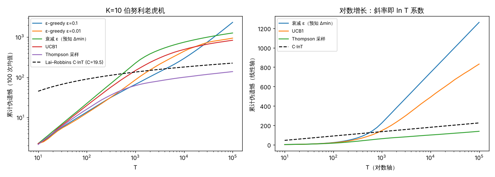
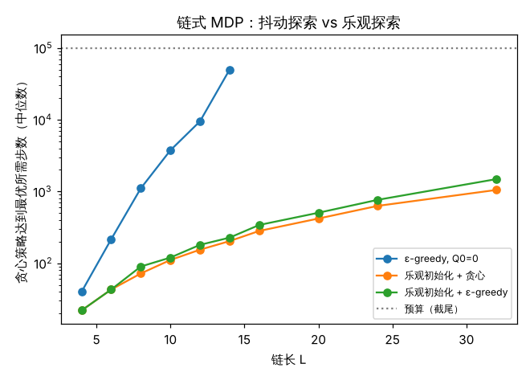

# Q05 强化学习的理论基础：探索与样本复杂度

> 分组：理论基础 ｜ 实验：`experiment.py`（运行时间约 20 秒） ｜ 证据标注：[实测] [文献] [判断]

## 摘要
强化学习与监督学习的根本区别在于数据由智能体自己的行为产生，因此“如何探索”直接决定样本复杂度。本项目用两个最小模型检验探索理论的两条核心结论。(1) K=10 伯努利多臂老虎机、T=10⁵、每算法 100 次运行：固定 ε-greedy 的遗憾线性增长（ε=0.1 时后期每步遗憾 0.02250，恰为强制探索下界 εΣΔ/K=0.0225），UCB1、Thompson 采样、衰减 ε 均为对数增长；Thompson 采样的 ln T 系数为 Lai–Robbins 常数 C=19.5 的 0.83 倍，而 UCB1 为 7.9 倍，T=10⁵ 时遗憾 138.5 对 831.8 [实测]。(2) 长度 L 的链式 MDP：ε-greedy Q 学习找到最优策略的步数按 1.99^L 指数增长（L≥16 基本超出 10⁵ 步预算），乐观初始化只需 ∝L^1.9 步（L=32 时中位 1050 步）[实测]。结论：探索的“方向性”（乐观或后验采样）而非“随机性”，决定了样本复杂度是多项式还是指数——这是强化学习样本效率问题的理论核心，也是大模型时代 RL（如 RLHF、推理 RL）仍未解决的瓶颈。

## 1. 问题界定
**为何基础**：强化学习的样本复杂度决定了它能否走出模拟器、进入真实世界（机器人、医疗、科学实验）。监督学习的泛化理论只需刻画“给定数据”的误差，而 RL 还必须刻画“数据如何被收集”。核心矛盾是**探索—利用权衡**：利用当前最优估计会错过更好的选项；随机探索在长时程、稀疏奖励问题中代价指数级增长。

**可检验子假设（实验前设定）**：
- **H1（遗憾增长阶）**：固定 ε-greedy 的后期（T∈[10⁴,10⁵]）每步遗憾不低于强制探索下界 εΣΔ/K 的 0.8 倍（线性遗憾）；UCB1、Thompson、衰减 ε 的后期双对数斜率 γ<0.5（次线性，与对数增长相容）。**否证**：固定 ε 的后期每步遗憾 <0.8×下界，或任一“对数型”算法 γ≥0.5。
- **H2（Lai–Robbins 下界）**：Thompson 采样遗憾对 ln T 的斜率 b 落在 [0.7, 1.5]×C；UCB1 的 b>1.5×C（常数不最优）。**否证**：TS 的 b/C 落在区间外，或 UCB1 的 b/C≤1.5。
- **H3（深度探索）**：链式 MDP 中，ε-greedy 达到最优贪心策略的中位步数随 L 指数增长（log 步数对 L 线性拟合的 R² 高于对 log L 的拟合，底数 ≥1.5）；乐观初始化为多项式增长（log–log 拟合 R² 更高，次数 ≤3）。**否证**：上述 R² 比较或底数/次数条件不成立。

## 2. 研究现状
**老虎机理论**。Thompson（1933，Biometrika 25:285）提出后验采样；Robbins（1952，Bull. AMS 58:527）形式化序贯设计问题；Lai 与 Robbins（1985，Adv. Appl. Math. 6:4）证明任何一致好策略的遗憾满足 liminf R(T)/ln T ≥ Σ_i Δ_i/kl(μ_i,μ*)；Auer、Cesa-Bianchi 与 Fischer（2002，Machine Learning 47:235）给出 UCB1 与 ε_n-greedy 的有限时间对数界；Garivier 与 Cappé（arXiv:1102.2490）的 KL-UCB 与 Kaufmann 等（arXiv:1205.4217）、Agrawal 与 Goyal（arXiv:1111.1797）对 Thompson 采样的分析证明这些算法渐近达到 Lai–Robbins 常数 [文献]。综述见 Bubeck 与 Cesa-Bianchi（arXiv:1204.5721）、Russo 等（arXiv:1707.02038）以及 Lattimore 与 Szepesvári（2020，《Bandit Algorithms》，Cambridge University Press）。

**MDP 的样本复杂度**。Watkins 与 Dayan（1992，Machine Learning 8:279）证明 Q 学习收敛；Kearns 与 Singh（2002，Machine Learning 49:209）的 E³ 与 Brafman 与 Tennenholtz（2002，JMLR 3:213）的 R-max 首次给出多项式样本复杂度，其核心正是“面对不确定性时乐观”；Strehl 与 Littman（2008，J. Comput. Syst. Sci. 74:1309）用 RiverSwim 等链式环境展示抖动探索的失败；Jaksch、Ortner 与 Auer（2010，JMLR 11:1563）的 UCRL2 给出遗憾界；Azar 等（arXiv:1703.05449）得到极小极大最优遗憾；Jin 等（arXiv:1807.03765）证明带 UCB 奖励的无模型 Q 学习样本高效；Osband 等（arXiv:1402.0635、1607.00215）提出随机化价值函数与后验采样 RL，并论证其优于乐观法 [文献]。

**函数逼近与深度 RL**。Jiang 等（arXiv:1610.09512）的 Bellman 秩、Du 等（arXiv:1910.03016）的下界（好的表征不足以保证样本高效）与 Foster 等（arXiv:2112.13487）的决策—估计系数，构成“何时可学”的理论框架 [文献]。实践中，DQN（Mnih 等，2015，Nature 518:529）与 AlphaGo（Silver 等，2016，Nature 529:484）依赖海量样本或完美模拟器；Bootstrapped DQN（arXiv:1602.04621）、伪计数（arXiv:1606.01868）、RND（arXiv:1810.12894）、Go-Explore（arXiv:1901.10995）试图把深度探索带入深度 RL；RLHF（Ouyang 等，arXiv:2203.02155）则在大模型上回避了探索问题——它从强预训练策略出发，只做局部改进 [文献]。

**关键缺口**。(a) 函数逼近下样本高效探索的可计算算法与理论仍有很大鸿沟；(b) 理论最优算法在深度 RL 中难以实现（置信集/后验难以维护）；(c) 大模型 RL 中“探索”的含义（在推理链空间中）尚无理论刻画。

## 3. 研究设计
**实验 A（老虎机）**：μ=[0.7,0.6,0.55,0.5,0.5,0.45,0.4,0.4,0.35,0.3]（Δ_min=0.1，ΣΔ=2.25），C=Σ Δ_i/kl(μ_i,μ*)=19.54。算法：ε-greedy（ε=0.1、0.01）、衰减 ε_t=min(1, K/(Δ_min²t))（Auer 等的形式，需预知 Δ_min）、UCB1、Thompson（Beta(1,1)）。每算法 100 次独立运行（向量化）。指标：伪遗憾 R(T)=ΣΔ_{a_t}；在 T∈[10³,10⁵] 上拟合 R=a+b ln T 与双对数斜率 γ；后期每步遗憾 (R(10⁵)−R(10⁴))/9×10⁴。TS 与 UCB1 用 Welch t 检验与 Cohen d 比较。
**实验 B（链式 MDP）**：状态 0…L−1，起点 0；“右”前进一格，在末端再“右”得奖励 1 并回到起点；“左”回到起点、奖励 0（无奖励诱饵，故 ε-greedy 在首次成功前等价于带重置的随机游走）。表格 Q 学习 α=0.5、γ=0.99，三种探索：ε-greedy（ε=0.1，Q₀=0）；乐观初始化 Q₀=1/(1−γ)+贪心；乐观+ε-greedy。指标：首次到达终点步数；贪心策略首次在所有状态都选“右”的步数（预算 10⁵ 步，未达到记为截尾）。L∈{4,…,32}，每个 L 10 个种子；若连续两个 L 全部截尾则跳过更长的链。对中位数分别做 log 步数–L 与 log 步数–log L 的线性拟合。

## 4. 结果

**表 1 老虎机遗憾（100 次运行，均值 ± 95% CI）[实测]**

| 算法 | R(10⁴) | R(10⁵) | ln T 斜率 b（逐运行） | b/C | 后期每步遗憾 | 后期 γ（10⁴–10⁵） |
|---|---|---|---|---|---|---|
| ε-greedy ε=0.1 | 293.2 ± 19.1 | 2317.8 ± 19.7 | 389.5 ± 2.3 | 19.9 | 0.02250 | 0.898 |
| ε-greedy ε=0.01 | 442.6 ± 97.1 | 940.7 ± 220.2 | 201.7 ± 56.8 | 10.3 | 0.0055 ± 0.0017 | 0.327 |
| 衰减 ε（预知 Δ_min） | 744.3 ± 2.2 | 1262.0 ± 3.1 | 225.3 ± 0.7 | 11.5 | 0.0058 | 0.229 |
| UCB1 | 490.4 ± 7.7 | 831.8 ± 12.4 | 153.5 ± 2.8 | 7.86 | 0.0038 | 0.229 |
| Thompson 采样 | 100.3 ± 5.3 | 138.5 ± 5.4 | 16.2 ± 1.2 | 0.83 | 0.00042 | 0.140 |

- **H1 支持**：ε=0.1 的后期每步遗憾 0.02250 与强制探索下界 0.0225 一致；ε=0.01 为 0.0055，高于其下界 0.00225——26% 的运行（R(10⁵)>1000）长期锁定在次优臂上，说明小 ε 的线性遗憾来自“探索不足导致的锁定”而不仅是强制探索。三种对数型算法的后期 γ 为 0.14–0.23。
- **H2 支持**：TS 的 b/C=0.83，UCB1 为 7.86；TS 与 UCB1 的 R(10⁵) 差异 t=−100.4、p=3.5×10⁻¹²⁹、Cohen d=−14.2。

**表 2 链式 MDP：贪心策略达到最优所需步数（10 种子中位数）[实测]**

| L | 4 | 8 | 12 | 14 | 16 | 20 | 24 | 32 |
|---|---|---|---|---|---|---|---|---|
| ε-greedy（Q₀=0） | 40 | 1106.5 | 9511.5 | 49969.5 | 截尾（9/10 未完成） | 截尾（10/10） | 截尾 | 未运行 |
| 乐观 + 贪心 | 22 | 72 | 154.5 | 203.5 | 282 | 420 | 630 | 1050 |
| 乐观 + ε-greedy | 22 | 90 | 180.5 | 227.5 | 341.5 | 505.5 | 765 | 1485.5 |

| 方法 | 指数拟合底数（R²） | 多项式拟合次数（R²） |
|---|---|---|
| ε-greedy（L=4…14，6 点） | 1.99（0.992） | 5.51（0.982） |
| 乐观 + 贪心（L=4…32） | 1.14（0.924） | 1.89（0.9986） |
| 乐观 + ε-greedy | 1.15（0.927） | 2.02（0.997） |

首次到达终点的步数呈同样模式：ε-greedy 底数 1.92，乐观方法次数 2.08–2.14。**H3 支持**：ε-greedy 的底数 ≈2，与“带重置随机游走需约 2^L 步”的理论一致；乐观方法为近二次多项式。

## 5. 讨论
**机理**。老虎机中，固定 ε 在每一步都以概率 ε 均匀拉臂，产生不可消除的 εΣΔ/K 每步遗憾；UCB1 的置信宽度 √(2ln t/n) 只依赖计数、不利用伯努利方差结构，因此对接近 0.5 的均值过度探索，常数远离下界；Thompson 采样按后验概率分配试验，次优臂 i 的试验数自然地 ≈ln T/kl(μ_i,μ*)，从而逼近 Lai–Robbins 常数 [文献+实测]。TS 的 b/C=0.83<1 并不违反下界：下界是渐近的（liminf），有限 T 下 ln T 斜率仍在向 C 爬升，这一点从后期 γ>0 也能看出 [判断]。链式 MDP 中，ε-greedy 在获得第一个奖励前没有任何方向性信息，需要连续 L 次“碰巧向右”；乐观初始化把“未访问”当作“可能很好”，使智能体系统地把每个状态—动作试到其价值降到真实水平为止，总代价 ∝|S|·|A|·(穿越时间) ≈ L²，与 R-max/E³ 的多项式界一致 [文献+实测]。

**对大模型时代的启示**。RLHF 与推理型 RL 之所以有效，很大程度上是因为预训练策略已经把“找到第一个奖励”的指数难题消解掉了；一旦任务需要在预训练分布之外长程探索（新科学实验、真实机器人），本实验所示的指数墙会重新出现 [判断]。同时，乐观/后验采样在表格情形下的优势，在深度网络中需要可靠的不确定性估计才能兑现——这与 Q15（不确定性量化）直接相连 [判断]。

**效度威胁与外推边界**。(a) 老虎机实例固定为一个（K=10，Δ_min=0.1），常数比值依赖实例；UCB1 的劣势在均值接近 0 或 1 时会改变；(b) T=10⁵ 尚未进入严格渐近区；(c) 链式 MDP 是确定性、无诱饵奖励的最简版本，带小奖励诱饵（RiverSwim 式）时 ε-greedy 只会更差；(d) ε-greedy 只有 6 个未截尾长度，指数与多项式拟合的 R² 差异不大（0.992 对 0.982），但拟合次数 5.5 且随 L 增大的趋势、底数 ≈2 与随机游走理论一致，结论主要依赖这一机理一致性；(e) 表格设定没有泛化，函数逼近下乐观法可能失效（Du 等的下界）。

<!-- BIBLIO:start -->
## 文献计量信号（arXiv，[实测]）

检索式：摘要含 “regret bound”、“sample complexity of reinforcement learning”、“exploration-exploitation”、“multi-armed bandit” 之一；基线为同年 cs.LG / cs.AI / stat.ML 论文总数。数据：`ai2035/bibliometrics/arxiv_counts.json`（检索日 2026-11-26）。

| 年份 | 命中论文数 | 占 AI/ML 基线比例 |
|---|---|---|
| 2015 | 97 | 2.39% |
| 2016 | 115 | 1.95% |
| 2017 | 180 | 2.13% |
| 2018 | 215 | 1.57% |
| 2019 | 331 | 1.49% |
| 2020 | 460 | 1.51% |
| 2021 | 454 | 1.37% |
| 2022 | 460 | 1.27% |
| 2023 | 535 | 1.18% |
| 2024 | 532 | 0.90% |
| 2025 | 699 | 0.94% |

- 2019–2025 年份额的对数线性趋势：**每年 -8.8%**（95% CI -12.0% ~ -5.5%，R²=0.90），判定：**相对降温（增速显著慢于 AI/ML 总体，绝对量仍可能增长）**；在 20 个问题中按相对增速排第 18 位。
- 解读边界：分子覆盖 arXiv 全部类别、分母仅为 AI/ML 三个类别，所以“比例”是相对关注度指数，并非严格的子集占比；关键词匹配既会漏掉使用其他术语的工作，也会混入无关用法；arXiv 偏重机器学习社区，认知科学、神经科学与期刊论文覆盖不足。该信号衡量的是**研究关注度**，不是**问题被解决的程度**。
<!-- BIBLIO:end -->

## 6. 结论与 2035 展望
**核心结论**
1. 固定比例的随机探索导致线性遗憾（ε=0.1 时每步遗憾 0.02250 = εΣΔ/K），小 ε 还会因锁定而额外受损 [实测；置信度：高]。
2. Thompson 采样在有限时间内即接近 Lai–Robbins 常数（b/C=0.83），UCB1 虽为对数遗憾，常数却大 7.9 倍：“对数阶”不等于“好” [实测+文献；置信度：高（本实例），中（跨实例）]。
3. 长时程稀疏奖励下，无方向随机探索的样本复杂度随时程指数增长（底数 ≈2），乐观探索为多项式（≈L²）[实测+文献；置信度：高（表格设定）]。
4. 深度 RL 与大模型 RL 的核心理论瓶颈是在函数逼近下实现“方向性探索”所需的可靠不确定性估计 [判断；置信度：中]。

**关键未解问题**：函数逼近下何种结构（Bellman 秩、DEC 等）对应可计算的样本高效算法？大模型推理链空间中的“探索”如何定义与度量？预训练先验在多大程度上可以替代探索？

**建议研究路线**
- **近期（2026–2028）**：在可控“推理链 MDP”（如带验证器的数学/代码任务）上测量预训练强度与探索样本复杂度的定量关系（里程碑：给出“先验质量—样本数”的经验律，并在 ≥3 个任务族上复现）；把后验采样/乐观奖励移植到大模型 RL 中，并在困难稀疏奖励任务上取得 ≥10 倍的样本效率提升。
- **中期（2029–2032）**：发展函数逼近下计算高效、理论可证的深度探索算法（里程碑：在已知 Bellman 秩/DEC 有界的环境族中，算法的样本复杂度与下界相差不超过对数因子，并在 Atari 难探索游戏子集上验证）。
- **远期（2033–2035）**：建立面向真实世界（机器人、科学实验）的“安全且样本高效”的探索理论与系统，在真实物理系统上以 ≤10⁴ 次交互学会长时程任务，并给出探索风险的可证明上界。

## 参考文献
1. Thompson, W. R. (1933). On the likelihood that one unknown probability exceeds another in view of the evidence of two samples. *Biometrika*, 25(3–4), 285–294.
2. Robbins, H. (1952). Some aspects of the sequential design of experiments. *Bulletin of the AMS*, 58(5), 527–535.
3. Lai, T. L., & Robbins, H. (1985). Asymptotically efficient adaptive allocation rules. *Advances in Applied Mathematics*, 6(1), 4–22.
4. Watkins, C. J. C. H., & Dayan, P. (1992). Q-learning. *Machine Learning*, 8, 279–292.
5. Auer, P., Cesa-Bianchi, N., & Fischer, P. (2002). Finite-time analysis of the multiarmed bandit problem. *Machine Learning*, 47, 235–256.
6. Kearns, M., & Singh, S. (2002). Near-optimal reinforcement learning in polynomial time. *Machine Learning*, 49, 209–232.
7. Brafman, R. I., & Tennenholtz, M. (2002). R-max – a general polynomial time algorithm for near-optimal reinforcement learning. *JMLR*, 3, 213–231.
8. Strehl, A. L., & Littman, M. L. (2008). An analysis of model-based interval estimation for Markov decision processes. *Journal of Computer and System Sciences*, 74(8), 1309–1331.
9. Jaksch, T., Ortner, R., & Auer, P. (2010). Near-optimal regret bounds for reinforcement learning. *JMLR*, 11, 1563–1600.
10. Garivier, A., & Cappé, O. (2011). The KL-UCB Algorithm for Bounded Stochastic Bandits and Beyond. arXiv:1102.2490.
11. Agrawal, S., & Goyal, N. (2011). Analysis of Thompson Sampling for the multi-armed bandit problem. arXiv:1111.1797.
12. Bubeck, S., & Cesa-Bianchi, N. (2012). Regret Analysis of Stochastic and Nonstochastic Multi-armed Bandit Problems. arXiv:1204.5721.
13. Kaufmann, E., Korda, N., & Munos, R. (2012). Thompson Sampling: An Asymptotically Optimal Finite Time Analysis. arXiv:1205.4217.
14. Osband, I., Van Roy, B., & Wen, Z. (2014). Generalization and Exploration via Randomized Value Functions. arXiv:1402.0635.
15. Mnih, V., et al. (2015). Human-level control through deep reinforcement learning. *Nature*, 518, 529–533.
16. Silver, D., et al. (2016). Mastering the game of Go with deep neural networks and tree search. *Nature*, 529, 484–489.
17. Osband, I., et al. (2016). Deep Exploration via Bootstrapped DQN. arXiv:1602.04621.
18. Bellemare, M. G., et al. (2016). Unifying Count-Based Exploration and Intrinsic Motivation. arXiv:1606.01868.
19. Osband, I., & Van Roy, B. (2016). Why is Posterior Sampling Better than Optimism for Reinforcement Learning? arXiv:1607.00215.
20. Jiang, N., et al. (2016). Contextual Decision Processes with Low Bellman Rank are PAC-Learnable. arXiv:1610.09512.
21. Russo, D., et al. (2017). A Tutorial on Thompson Sampling. arXiv:1707.02038.
22. Azar, M. G., Osband, I., & Munos, R. (2017). Minimax Regret Bounds for Reinforcement Learning. arXiv:1703.05449.
23. Jin, C., Allen-Zhu, Z., Bubeck, S., & Jordan, M. I. (2018). Is Q-learning Provably Efficient? arXiv:1807.03765.
24. Burda, Y., et al. (2018). Exploration by Random Network Distillation. arXiv:1810.12894.
25. Ecoffet, A., et al. (2019). Go-Explore: a New Approach for Hard-Exploration Problems. arXiv:1901.10995.
26. Du, S. S., Kakade, S. M., Wang, R., & Yang, L. F. (2019). Is a Good Representation Sufficient for Sample Efficient Reinforcement Learning? arXiv:1910.03016.
27. Foster, D. J., Kakade, S. M., Qian, J., & Rakhlin, A. (2021). The Statistical Complexity of Interactive Decision Making. arXiv:2112.13487.
28. Lattimore, T., & Szepesvári, C. (2020). *Bandit Algorithms*. Cambridge University Press.
29. Ouyang, L., et al. (2022). Training language models to follow instructions with human feedback. arXiv:2203.02155.
