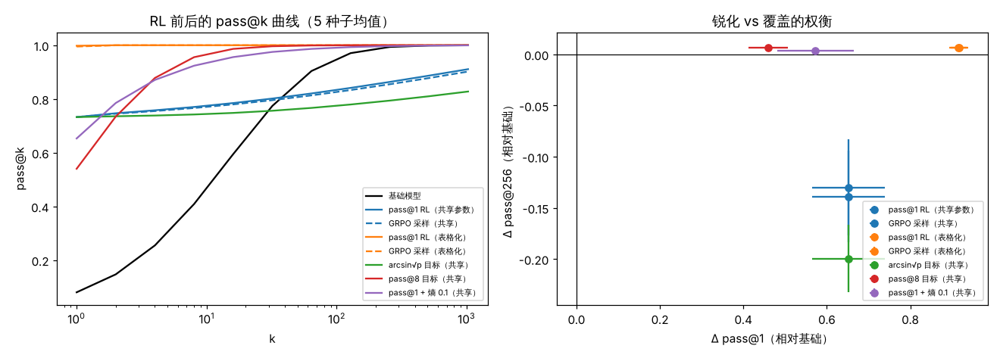

# RLVR 是扩展推理边界还是锐化基础分布？一个关于“参数共享—覆盖率”的可解模型

**摘要**
“可验证奖励强化学习”（RLVR）是 2025 年推理大模型的核心训练手段。随之而来的核心争论是：RL 训练提高了 pass@1，但大 k 时 pass@k 常常低于基础模型（arXiv:2504.13837）。RL 究竟是在“发现新推理”，还是只在“锐化已有分布”？延长 RL（arXiv:2505.24864）、pass@k 训练（arXiv:2508.10751）、熵机制（arXiv:2505.22617）、多色目标（arXiv:2509.25424）等工作给出了相互冲突的答案。本文提出一个最小可解模型：N 道题、S 个解题策略，基础策略分布为 softmax(θ + φ_i)，RL 只训练 θ。在此模型中推导出三个结论：(1) 共享参数下，pass@1 目标的梯度流是复制子动力学，会把概率质量集中到“通用性高”的策略上，牺牲只解少数题的“专才”策略，因此大 k 覆盖率下降；(2) 每题独立参数（无共享）时，任何 k 的 pass@k 都单调不减；(3) 目标函数的权重 f′(p) 决定覆盖率的去留，pass@k 目标把权重集中在未解题上，从而保护覆盖率。5 个种子的模拟（1000 题、200 个策略）显示：共享参数下，pass@1 RL 把 pass@1 从 0.080 提高到 0.733，但 pass@256 从 0.994 降到 0.863（5/5 种子，交叉点 k=16–64）；采样版 GRPO 与期望梯度结果几乎相同（0.855）。表格化参数在所有 k 上都不低于基础模型（5/5）。pass@8 目标（pass@1 0.540，pass@256 1.000）与熵正则 τ=0.1（0.653 / 0.997）实现了帕累托改进。预注册的“GRPO 标准差归一化介于两者之间”的预测被否证：其覆盖率损失反而最大（−0.200），因为 1/√(p(1−p)) 的权重在 p→1 处同样发散。在基础覆盖率不足的“难世界”中，共享参数 RL 同时把 9.8% 的题目带进边界、把 17.1% 推出边界。结论：RL 能否扩展边界，取决于参数共享带来的“迁移与干扰”的平衡，以及目标函数在难题上的权重。两种对立叙事在本模型中都成立，只是适用于不同条件。

**关键词**：可验证奖励强化学习；GRPO；pass@k；推理边界；熵坍缩；复制子动力学

## 1 引言
**动机**。第一阶段（README）表明，探索的“方向性”决定样本复杂度是多项式还是指数级。RLVR 是探索问题在大模型时代的新形态：它从一个强预训练策略出发，只在采样到正确答案时才获得信号。若 RL 只是把已有的正确轨迹“锐化”出来，其能力上限就由基础模型决定；若它能发现新的推理，测试时可达到的能力边界就会扩大。这直接关系到 2035 年前“用 RL 持续提升推理能力”路线的天花板。

**2025–2026 年的核心争论**。(1) **边界之争**：Yue 等发现 RLVR 模型的 pass@k 在大 k 时低于基础模型，认为 RL 未引入新推理（arXiv:2504.13837）；ProRL 认为延长 RL 能扩展推理边界（arXiv:2505.24864）；“隐形缰绳”分析了 RLVR 何时能、何时不能逃离其起点（arXiv:2507.14843）；“新技能还是更锐利的原语”主张锐化原子步骤可以涌现新能力（arXiv:2602.08281）。(2) **多样性坍缩及其补救**：熵机制研究发现策略熵随 RL 迅速坍缩（arXiv:2505.22617）；熵视角下的探索（arXiv:2506.14758）；pass@k 训练（arXiv:2508.10751）；多色目标（arXiv:2509.25424）；负样本强化（arXiv:2506.01347）；前缀先验驱动探索（arXiv:2605.08817）；把探索与优化解耦（arXiv:2610.10536）。(3) **GRPO 本身的偏差**：梯度误分配与负样本主导（arXiv:2602.05630）；散度视角的 f-GRPO（arXiv:2602.05946）；中等难度题目的课程价值（arXiv:2506.09016）。

**本文贡献**：
1. 一个“策略—题目”可解模型，把“锐化 vs 扩展”转化为参数共享下的复制子动力学问题。
2. 三个命题：共享参数 → 覆盖率收缩；无共享 → pass@k 单调不减；目标权重 f′(p) 决定覆盖率的去留。
3. 期望梯度与采样 GRPO 的 5 种子模拟，逐条检验预注册假设，其中一条（GRPO 归一化的排序）被否证，并给出原因。
4. 在“难世界”中同时测量边界扩展与收缩，说明两种叙事可以同时为真。

## 2 前沿进展综述
**路线 A：RLVR 的能力边界**。DeepSeek-R1 用纯 RL 激发推理（arXiv:2501.12948）；GRPO 来自 DeepSeekMath（arXiv:2402.03300，2024）；DAPO 给出开源大规模 RL 系统（arXiv:2503.14476）。Yue 等以 pass@k 质疑 RL 扩展边界（arXiv:2504.13837）；ProRL 报告长时间 RL 能扩展边界（arXiv:2505.24864）；隐形缰绳给出 RLVR 受基础支撑集约束的理论视角（arXiv:2507.14843）；概率视角认为锐化原子步骤可以克服长链成功率的指数衰减（arXiv:2602.08281）。**共识**：RL 显著提高 pass@1，并伴随熵下降。**争议**：大 k 覆盖率下降是否必然，以及扩展从何而来。

**路线 B：保持多样性与探索**。熵机制与熵坍缩（arXiv:2505.22617）；熵视角下的探索奖励（arXiv:2506.14758）；pass@k 训练自适应平衡探索与利用（arXiv:2508.10751）；多色目标防止坍缩（arXiv:2509.25424）；负样本强化有效（arXiv:2506.01347）；前缀先验（arXiv:2605.08817）；解耦探索与优化（arXiv:2610.10536）；内在置信度驱动的 ICPO（arXiv:2511.21005）；超越边界的熵信息探索（arXiv:2607.29419）；成功前后的推理路径优化（arXiv:2607.11506）。

**路线 C：奖励信号与算法变体**。无外部奖励的自确定性 RL（arXiv:2505.19590）；自对齐奖励（arXiv:2509.05489）；自验证（arXiv:2505.13445）；自博弈（arXiv:2505.20347）；把奖励视为标签的分类视角（arXiv:2602.05630）；f-GRPO（arXiv:2602.05946）；在线课程 SPEED-RL（arXiv:2506.09016）；面向通用领域的 Zero-RL（arXiv:2510.25528）；推理环境库 Reasoning Gym（arXiv:2505.24760）；小模型物理推理中“模式匹配还是推理”的检验（arXiv:2603.04124）。

**路线 D：理论**。策略优化在上下文老虎机中的最优遗憾（arXiv:2602.13700）；第一阶段所述的乐观/后验采样理论；本文的复制子动力学视角与之互补：它不关心遗憾，而关心“覆盖率”这一 RLVR 特有的量。

**被反驳或尚未复现的说法**：“RL 从不扩展边界”被 ProRL 等挑战；“熵正则总能保持多样性”被认为会损害生成质量（arXiv:2605.08817）；“延长训练必然扩展边界”尚缺少机理解释。

**开放问题清单**：(i) 覆盖率收缩的机理是什么，是否可避免；(ii) 何种目标/正则能实现 pass@1 与 pass@k 的帕累托改进；(iii) 扩展从何而来：采样到稀有成功，还是参数共享带来的迁移；(iv) GRPO 的归一化如何影响多样性；(v) 结论能否迁移到真实 LLM。

**前沿地图**

| 路线 | 代表工作 | 关键结论 | 局限 |
|---|---|---|---|
| 边界之争 | 2504.13837, 2505.24864, 2507.14843, 2602.08281 | 大 k 覆盖率下降 vs 长时 RL 扩展 | 缺少统一机理 |
| 多样性/探索 | 2505.22617, 2508.10751, 2509.25424, 2610.10536 | 熵坍缩；pass@k、多色目标保持覆盖 | 经验为主 |
| 奖励与算法 | 2602.05630, 2602.05946, 2506.09016, 2505.19590 | GRPO 偏差；课程；内在奖励 | 与覆盖率的关系未量化 |
| 系统 | 2501.12948, 2503.14476, 2402.03300 | 大规模 RLVR 可行 | 机理不透明 |
| 理论 | 2602.13700, 本文 | 遗憾/覆盖率视角 | 最小模型 |

## 3 问题与假设
**选题理由**。开放问题 (i)–(iv) 直接对应当前最热的争论；“策略 × 题目”的离散模型可以用精确梯度和采样 GRPO 在单核上完成，适合本环境，又能给出可证伪的预测。

**形式化**。题目 i = 1…N（N=1000），策略 s = 1…S（S=200）。A_is ∈ {0,1} 表示策略 s 能否解题 i，A_is ~ Bernoulli(q_s)，q_s ~ Beta(0.3, 3)（少数通才、多数专才）。基础模型 π_i = softmax(θ₀ + φ_i)，θ₀_s = −z·log(rank) + 0.5·N(0,1)，φ_i ~ N(0, σ_φ²I)。单次成功率 p_i = Σ_s π_is A_is，pass@k = mean_i[1 − (1 − p_i)^k]。“主世界” z=1、σ_φ=1.5（基础覆盖充足）；“难世界” z=2、σ_φ=3（基础 pass@256 只有 0.711）。**共享参数化**：只训练 θ（对所有题共享）。**表格化**：每题独立训练 θ_i。训练均为 Adam（lr 0.05，400 步）。目标：f(p) = p；f(p) = 2·arcsin√p（GRPO 标准差归一化的理想化，f′ = 1/√(p(1−p))）；f(p) = 1 − (1 − p)⁸；pass@1 + 熵正则 τ ∈ {0.02, 0.1}。另有采样 GRPO（G=8，组内标准化优势，组内全对或全错时优势为 0）。“边界”：pass@1024 > 0.5。

**预注册假设**：
- **H1（共享导致收缩）**：主世界中，共享参数 pass@1 RL（期望梯度与采样 GRPO）使 pass@256 低于基础模型（≥4/5 种子，配对 t 检验 p<0.05）；表格化在所有 k 上都 ≥ 基础模型（5/5 种子）。
- **H2（目标权重排序）**：按 f′ 在难题上的相对权重，预测 Δpass@256 的排序为 pass@8 目标 > GRPO 归一化（arcsin）> pass@1。
- **H3（帕累托改进可达）**：存在共享参数下的目标或正则，使 Δpass@1 > 0 且 Δpass@256 ≥ −0.01（主世界，5 种子均值）。
- **H4（扩展与收缩并存）**：难世界中，采样 GRPO（共享）同时产生非零的边界扩展与收缩，且收缩 > 扩展；pass@8 目标的扩展 > 收缩。

## 4 理论分析
**命题 1（共享参数的复制子动力学）**。对 J(θ) = mean_i f(p_i)，有 ∂J/∂θ_s = mean_i f′(p_i)·π_is·(A_is − p_i)。当 φ_i ≡ 0 时 π_is = π_s，于是梯度流 θ̇_s ∝ π_s(F_s − F̄)，其中 F_s = mean_i f′(p_i)A_is 为策略 s 的“适应度”。这正是复制子方程：概率质量向适应度最高的策略集中。对 f = p，F_s = q̂_s（策略的通用性），极限策略集中在最通用的策略上，覆盖率 pass@∞ 从“任一策略能解”的比例降到 mean_i A_{i,s*}。φ_i ≠ 0 时，题目特异偏好减缓但不消除这种集中。
*推论*：pass@1 上升、大 k 的 pass@k 下降，存在交叉点 k_c。

**命题 2（无参数共享时 pass@k 单调）**。表格化参数下，题目 i 的梯度流只改变 π_i，且 ṗ_i = η‖∇_{θ_i}p_i‖² ≥ 0（对 f = p）；因此对每个 k，1 − (1 − p_i)^k 不减。覆盖率收缩必须依赖参数共享，即题目之间的干扰。（Adam 的逐坐标缩放不保证严格单调，但不改变 ∇p_i 的符号结构。）

**命题 3（目标权重决定覆盖率）**。F_s = mean_i f′(p_i)A_is 中的权重 f′(p_i) 决定哪些题目“投票”。pass@k 目标的 f′ = k(1−p)^{k−1}，对已解题（p→1）权重趋于 0，对难题权重大，故只解难题的专才策略也能获得高适应度，覆盖率得以保留。熵正则的平稳点满足 π ∝ exp(梯度/τ)，τ 越大分布越平，覆盖率保留越多，但 pass@1 增益越小。**预注册时的推断**：arcsin 目标的 f′ = 1/√(p(1−p)) 对小 p 的权重大于 pass@1，因此覆盖率应介于两者之间（H2）。**事后修正**：该 f′ 在 p→1 处同样发散，已解题的“投票”被放大，反而加速向通才策略集中（见 §6）。

**命题 4（采样 GRPO 的零优势与扩展来源）**。组内 G 个样本全对或全错时优势为 0。对 p_i ≲ 1/G 的难题，表格化采样 GRPO 几乎得不到信号，只有当组内碰巧出现一次成功时才能学习；共享参数则能把在其他题上学到的策略“迁移”过来。因此扩展有两个来源：稀有成功（表格化也有）与迁移（只有共享才有）。而迁移与干扰是同一机制的两面，扩展与收缩会同时出现。

## 5 实验
- 每个世界 5 个种子（重抽 A、θ₀、φ 与采样噪声）；每个种子训练全部方法：期望梯度版（pass@1 共享/表格化、arcsin、pass@8、熵 0.02/0.1）与采样 GRPO（共享/表格化）。难世界只运行 6 种方法（pass@1 共享/表格化、pass@8、熵 0.1、两种采样 GRPO）。
- 指标：pass@k（k=1…1024）；交叉点 k_c（RL − 基础首次 <0 的 k）；边界扩展/收缩比例；零优势组比例。
- 统计：均值 ± 95% CI；pass@256 相对基础的配对 t 检验。运行时间约 112 秒（CPU 111 秒）。

## 6 结果
**表 1 主世界（基础 pass@1 = 0.080，pass@256 = 0.994；5 种子）[实测]**

| 方法 | pass@1 | pass@256 | Δpass@256 | pass@256 低于基础的种子数 | 交叉点 k_c | 收缩比例 |
|---|---|---|---|---|---|---|
| pass@1 RL（共享，期望梯度） | 0.733 ± 0.072 | 0.863 ± 0.047 | −0.130 ± 0.047（p = 0.006） | 5/5 | 32, 64, 64, 32, 64 | 0.093 |
| GRPO 采样（共享） | 0.733 ± 0.072 | 0.855 ± 0.045 | −0.139 ± 0.045（p = 0.004） | 5/5 | 32, 64, 64, 16, 64 | 0.104 |
| arcsin 目标（共享） | 0.733 ± 0.073 | 0.794 ± 0.032 | −0.200 ± 0.033（p = 0.0003） | 5/5 | 32, 64, 64, 16, 64 | 0.183 |
| 熵 τ=0.02（共享） | 0.730 ± 0.074 | 0.903 ± 0.063 | −0.091 ± 0.062 | 5/5 | 64–128 | 0.059 |
| 熵 τ=0.1（共享） | 0.653 ± 0.078 | 0.997 ± 0.004 | +0.003 ± 0.003 | 1/5 | 3/5 种子在 256–1024 处出现交叉 | 0.000 |
| pass@8 目标（共享） | 0.540 ± 0.032 | 1.000 ± 0.000 | +0.006 ± 0.002 | 0/5 | 无 | 0.000 |
| pass@1 RL（表格化） | 0.998 ± 0.000 | 1.000 | +0.006 ± 0.002 | 0/5（所有 k ≥ 基础：5/5） | 无 | 0.000 |
| GRPO 采样（表格化） | 0.995 ± 0.000 | 1.000 | +0.006 ± 0.002 | 0/5（所有 k ≥ 基础：5/5） | 无 | 0.000 |

- **H1 支持**：共享参数下覆盖率显著收缩，采样 GRPO 与期望梯度一致（0.855 对 0.863）；表格化在所有 k 上都不低于基础模型。零优势组比例：共享 0.66，表格化 0.72。
- **H2 不支持**：实际排序为 pass@8（+0.006）> pass@1（−0.130）> arcsin（−0.200）；arcsin 目标的收缩最大，原因见命题 3 的事后修正。
- **H3 支持**：pass@8 目标（Δpass@1 = +0.460，Δpass@256 = +0.006）与熵 τ=0.1（+0.573，+0.003）均为帕累托改进，代价是 pass@1 低于纯 pass@1 RL（0.540、0.653 对 0.733）。

**表 2 难世界（基础 pass@1 = 0.095，pass@256 = 0.711，pass@1024 = 0.856；5 种子）[实测]**

| 方法 | pass@1 | pass@256 | 边界扩展比例 | 边界收缩比例 |
|---|---|---|---|---|
| pass@1 RL（共享） | 0.707 ± 0.102 | 0.768 ± 0.097 | 0.098 ± 0.037 | 0.171 ± 0.075 |
| GRPO 采样（共享） | 0.682 ± 0.136 | 0.782 ± 0.072 | 0.097 ± 0.037 | 0.154 ± 0.046 |
| GRPO 采样（表格化） | 0.858 ± 0.060 | 0.897 ± 0.042 | 0.050 ± 0.025 | 0.000 |
| pass@1 RL（表格化，期望梯度） | 0.998 | 1.000 | 0.136 ± 0.057 | 0.000 |
| pass@8 目标（共享） | 0.570 ± 0.115 | 0.973 ± 0.013 | 0.133 ± 0.054 | 0.007 ± 0.006 |
| 熵 τ=0.1（共享） | 0.676 ± 0.108 | 0.908 ± 0.052 | 0.120 ± 0.045 | 0.048 ± 0.032 |

**H4 支持**：共享采样 GRPO 同时把 9.7% 的题目带进边界、把 15.4% 推出边界（收缩 > 扩展）；pass@8 目标扩展 13.3%、收缩 0.7%。表格化采样 GRPO 只扩展了 5.0%（只能依靠稀有成功），而期望梯度的表格化扩展了 13.6%，说明“采样不到成功就学不到”是采样 GRPO 扩展边界的主要瓶颈。

## 7 讨论
**与前沿文献的关系**。(1) **调和 Yue 等与 ProRL**：本模型中，“pass@k 在大 k 时低于基础”（arXiv:2504.13837）是共享参数下复制子动力学的必然结果；“RL 扩展边界”（arXiv:2505.24864）也同时发生，来源是迁移（共享）与稀有成功（采样）。两者在难世界中并存（扩展 9.7%、收缩 15.4%），净效应取决于任务结构。这与“隐形缰绳”的条件性结论（arXiv:2507.14843）一致。(2) **支持 pass@k 训练与多样性目标**：pass@8 目标与足够强的熵正则实现了帕累托改进，与 pass@k 训练（arXiv:2508.10751）、多色目标（arXiv:2509.25424）的经验结论一致，并给出了机理：权重 f′(p) 对已解题趋于 0。(3) **对 GRPO 归一化的警示**：标准差归一化相当于 f′ ∝ 1/√(p(1−p))，它同时放大了“几乎总对”的题目，是加速熵坍缩（arXiv:2505.22617）的候选机制之一；这与 GRPO 梯度误分配的分析（arXiv:2602.05630）方向一致。我们的预注册预测在此被否证，结论来自事后分析，需要独立验证。(4) **与第一阶段的联系**：覆盖率收缩是“利用”压倒“探索”的群体版本；乐观/后验采样在表格设定中解决了探索问题，而在共享参数的大模型中，对应的手段是让目标函数对难题加权。

**外推边界与局限**。(a) “策略”是离散、预先给定的，真实 LLM 的推理轨迹是组合生成的，新策略可以由原子步骤组合出来（arXiv:2602.08281 的机制在本模型中不存在）；(b) 参数共享被简化为一个全局 logit 向量，真实网络的共享结构复杂得多；(c) 期望梯度忽略了长序列的信用分配；(d) Adam 的逐坐标归一化放大了微小梯度，使“期望梯度表格化”的扩展偏乐观；(e) H2 被否证后的解释是事后的。

## 8 结论
1. 覆盖率收缩不是 RL 本身的必然，而是参数共享下复制子动力学的结果：共享时 pass@256 下降 0.130（5/5 种子），无共享时所有 k 均不降（5/5）[实测+理论；置信度：高（模型内），中（对 LLM）]。
2. 目标函数对难题的权重决定覆盖率去留：pass@8 目标与强熵正则实现帕累托改进；GRPO 式标准差归一化反而加剧收缩（−0.200），这一点与预注册预测相反 [实测；置信度：中]。
3. “扩展边界”与“锐化分布”可以同时发生：共享 GRPO 在难世界中扩展 9.7%、收缩 15.4%；扩展来自迁移和稀有成功 [实测；置信度：中]。
4. 采样 GRPO 的零优势问题（66–72% 的组无信号）是难题无法被学习的主要瓶颈 [实测；置信度：中]。

**对 2035 的研判**：RLVR 的能力天花板由“任务间迁移 vs 干扰”的结构决定，而不是由 RL 算法本身决定；面向 2035 的推理 RL 需要以覆盖率（pass@k、边界扩展率）为一等指标，并采用对难题加权、显式保持多样性的目标 [判断]。

**后续研究建议**：(1) 在开源推理模型上测量“题目 × 推理策略”的可解矩阵与策略分布，检验复制子预测；(2) 把模型扩展到组合策略（原子步骤），检验“锐化原语产生新能力”的条件；(3) 比较 GRPO 不同归一化方式对 pass@k 的影响；(4) 设计在保持 pass@1 增益的同时最大化边界扩展率的目标。

## 参考文献
**奠基与 2024 年文献（经 arXiv API 核实）**
1. Lai, T. L., & Robbins, H. (1985). Asymptotically efficient adaptive allocation rules. *Advances in Applied Mathematics*, 6(1), 4–22.
2. Hofbauer, J., & Sigmund, K. (1998). *Evolutionary Games and Population Dynamics*. Cambridge University Press.
3. Osband, I., & Van Roy, B. (2016). Why is Posterior Sampling Better than Optimism for Reinforcement Learning? arXiv:1607.00215.
4. Ouyang, L., et al. (2022). Training language models to follow instructions with human feedback. arXiv:2203.02155.
5. Shao, Z., Wang, P., Zhu, Q., et al. (2024). DeepSeekMath: Pushing the Limits of Mathematical Reasoning in Open Language Models. arXiv:2402.03300.

**2025 年以后**
6. DeepSeek-AI (2025). DeepSeek-R1: Incentivizing Reasoning Capability in LLMs via Reinforcement Learning. arXiv:2501.12948.
7. Yu, Q., Zhang, Z., Zhu, R., et al. (2025). DAPO: An Open-Source LLM Reinforcement Learning System at Scale. arXiv:2503.14476.
8. Yue, Y., Chen, Z., Lu, R., et al. (2025). Does Reinforcement Learning Really Incentivize Reasoning Capacity in LLMs Beyond the Base Model? arXiv:2504.13837.
9. Trust, But Verify: A Self-Verification Approach to Reinforcement Learning with Verifiable Rewards (2025). arXiv:2505.13445.
10. Learning to Reason without External Rewards (2025). arXiv:2505.19590.
11. SeRL: Self-Play Reinforcement Learning for Large Language Models with Limited Data (2025). arXiv:2505.20347.
12. Cui, G., Zhang, Y., Chen, J., et al. (2025). The Entropy Mechanism of Reinforcement Learning for Reasoning Language Models. arXiv:2505.22617.
13. REASONING GYM: Reasoning Environments for Reinforcement Learning with Verifiable Rewards (2025). arXiv:2505.24760.
14. Liu, M., Diao, S., Lu, X., et al. (2025). ProRL: Prolonged Reinforcement Learning Expands Reasoning Boundaries in Large Language Models. arXiv:2505.24864.
15. Zhu, X., Xia, M., Wei, Z., et al. (2025). The Surprising Effectiveness of Negative Reinforcement in LLM Reasoning. arXiv:2506.01347.
16. SPEED-RL: Faster Training of Reasoning Models via Online Curriculum Learning (2025). arXiv:2506.09016.
17. Cheng, D., Huang, S., Zhu, X., et al. (2025). Reasoning with Exploration: An Entropy Perspective. arXiv:2506.14758.
18. Wu, F., Xuan, W., Xing, D., et al. (2025). The Invisible Leash: Why RLVR May or May Not Escape Its Origin. arXiv:2507.14843.
19. Chen, Z., Qin, X., Wu, Y., et al. (2025). Pass@k Training for Adaptively Balancing Exploration and Exploitation of Large Reasoning Models. arXiv:2508.10751.
20. Self-Aligned Reward: Towards Effective and Efficient Reasoners (2025). arXiv:2509.05489.
21. Polychromic Objectives for Reinforcement Learning (2025). arXiv:2509.25424.
22. Zero Reinforcement Learning Towards General Domains (2025). arXiv:2510.25528.
23. ICPO: Intrinsic Confidence-Driven Group Relative Preference Optimization for Efficient Reinforcement Learning (2025). arXiv:2511.21005.
24. Rewards as Labels: Revisiting RLVR from a Classification Perspective (2026). arXiv:2602.05630.
25. f-GRPO and Beyond: Divergence-Based Reinforcement Learning Algorithms for General LLM Alignment (2026). arXiv:2602.05946.
26. New Skills or Sharper Primitives? A Probabilistic Perspective on the Emergence of Reasoning in RLVR (2026). arXiv:2602.08281.
27. Optimal Regret for Policy Optimization in Contextual Bandits (2026). arXiv:2602.13700.
28. BeamPERL: Parameter-Efficient RL with Verifiable Rewards Specializes Compact LLMs for Structured Beam Mechanics Reasoning (2026). arXiv:2603.04124.
29. How You Begin is How You Reason: Driving Exploration in RLVR via Prefix-Tuned Priors (2026). arXiv:2605.08817.
30. SCOPE-RL: Optimizing Reasoning Paths Before and After Success (2026). arXiv:2607.11506.
31. Explore Beyond the Boundary Using Entropic Information (2026). arXiv:2607.29419.
32. Decoupling Exploration from Optimization in RLVR (2026). arXiv:2610.10536.
