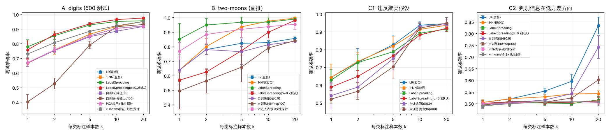
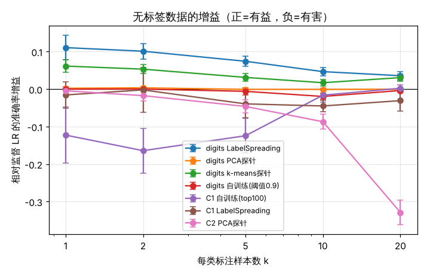

# Q06 小样本与缺标签学习

> 分组：学习范式 ｜ 实验：`experiment.py`（运行时间约 43 秒） ｜ 证据标注：[实测] [文献] [判断]

## 摘要
无标签数据何时能替代标签、何时反而有害，是“小样本学习”的核心科学问题。我们在 sklearn digits、two-moons 以及两个人为构造的“假设被违反”的数据集上，比较了监督基线、图半监督（LabelSpreading）、自训练和“无监督表示 + 线性探针”，每类标注数 k∈{1,2,5,10,20}，10 个种子。[实测] 在 digits 上图半监督在 k=1 时比逻辑回归高 0.111（95% CI ±0.033），增益随 k 增大单调缩小到 0.036；但在“簇结构与标签无关”的构造数据上，所有利用无标签数据的方法都显著变差，k=20 时 PCA 探针比监督基线低 0.329、LabelSpreading 低 0.318。自训练在 digits 上从未显著优于基线，激进版本在 k=1 时下降 0.266。结论：无标签数据的价值完全取决于“数据分布的结构与标签函数是否对齐”这一不可从无标签数据本身验证的假设。

## 1. 问题界定
大模型时代的“小样本能力”看似由预训练解决，但其本质仍是一个古老问题：**边缘分布 p(x) 的信息能否以及在什么条件下降低学习 p(y|x) 所需的标签数？** 这是基础问题，因为：(i) 若 p(x) 与 p(y|x) 无关联，任何无标签数据都不可能有帮助——这是信息论意义上的下界（Ben-David 等 2008 指出在无分布假设时无标签数据无法证明有益）[文献]；(ii) 现实中的半监督/自监督方法都隐含了“聚类假设”“流形假设”或“低维表示假设”，这些假设无法从无标签数据本身检验。

核心矛盾：利用无标签数据越激进，收益越大，但当假设被违反时损失也越大。预注册的可检验子假设：
- **H1（收益随标签预算递减）**：在满足聚类假设的 digits 上，图半监督在 k≤5 时比监督 LR 至少高 0.05（配对 t 检验 p<0.05），且 k=20 的增益小于 k=1 的增益。*否证*：k≤5 时增益 <0.05 或不显著，或增益不随 k 递减。
- **H2（假设被违反时有害）**：在构造的“聚类假设被违反”（C1）与“判别信息位于低方差方向”（C2）数据上，至少一种利用无标签数据的方法在某个 k 上显著劣于监督基线（p<0.05）。*否证*：所有方法在所有 k 上都不显著劣于基线。
- **H3（置信度型方法最脆弱）**：自训练（以模型自身置信度为伪标签依据）在 digits 上的收益不稳定，不会在所有 k 上显著优于基线；激进版本在极少标签时有害。*否证*：自训练在所有 k 上显著优于基线。

## 2. 研究现状
**经典阶段。** 自训练可追溯到 Scudder（1965）和 Yarowsky（1995, ACL）的词义消歧 [文献]。图方法以 Zhu & Ghahramani（2002, CMU 技术报告）的标签传播和 Zhou 等（2004, NIPS，“Learning with Local and Global Consistency”）的 Label Spreading 为代表，其理论依据是聚类/流形假设：决策边界应穿过低密度区 [文献]。Chapelle、Schölkopf、Zien 编的《Semi-Supervised Learning》（MIT Press, 2006）系统总结了这些假设 [文献]。Singh、Nowak、Zhu（2008, NIPS，“Unlabeled data: Now it helps, now it doesn't”）从有限样本角度证明：仅当簇间可分程度相对于样本量足够大时，无标签数据才有可证明的收益 [文献]。

**深度学习阶段。** 一致性正则与伪标签结合产生了 Mean Teacher（arXiv:1703.01780）、MixMatch（1905.02249）、UDA（1904.12848）、FixMatch（2001.07685）等方法；Noisy Student（1911.04252）把自训练扩展到 ImageNet 规模 [文献]。Oliver 等（1804.09170）则指出这些方法对超参数和类分布失配非常敏感，在某些现实设定下甚至不如强监督基线——这正是“无标签数据可能有害”的实证警示 [文献]。Wei 等（2010.03622）在“扩展性”假设下给出自训练的理论保证，其假设本质上仍是“同类样本在数据流形上连通” [文献]。

**表示学习/元学习阶段。** 小样本学习一方面走元学习路线（Matching Networks 1606.04080、MAML 1703.03400、Prototypical Networks 1703.05175），另一方面走“先自监督预训练、再少量标签微调或线性探针”的路线：SimCLR（2002.05709）、Chen 等（2006.10029）表明大规模自监督模型是强半监督学习器，CLIP（2103.00020）的线性探针与 GPT-3（2005.14165）的上下文小样本学习把这一路线推向极致 [文献]。Kumar 等（2202.10054）则显示微调会扭曲预训练特征，线性探针在分布外更稳健 [文献]。

**未解决的缺口。** (1) 没有一般方法能在部署前判断“我的无标签数据/预训练表示是否与目标标签对齐”；(2) 预训练表示带来的小样本能力在多大程度上是“表示与下游标签对齐”的幸运，而非普适机制，缺乏可控实验；(3) 失败模式（确认偏差、错误伪标签的自我强化）缺乏可预测理论。

## 3. 研究设计
- **数据**：A. digits（1797 张 8×8 图，10 类），每个种子随机留出 500 张为测试集，其余 1297 张为样本池（含标注与未标注）；B. two-moons（n=1000，噪声 0.1，直推式：在未标注点上评估）；C1. 两个沿 x1 分离的高斯团（中心 ±3，标准差 0.6），标签由 x2 符号决定——决策边界穿过高密度区，簇结构与标签正交；C2. d=20，19 个高方差噪声维（标准差 3），标签仅由一个低方差维决定（±1 + N(0,0.3²)）。C1/C2 样本池 1000、测试 500。
- **方法**（参数运行前固定）：LR（C=1）与 1-NN 监督基线；LabelSpreading（kNN 图 k=7，α=0.99 按 Zhou 等 2004；另报告 sklearn 默认 α=0.2）；自训练（LR 基学习器；阈值 0.9 与每轮加入置信度最高 100 个两种）；无监督表示 + LR 线性探针：digits/C2 用 PCA（digits 30 维、C2 5 维）与 k-means（100 中心，“三角”编码，Coates 等 2011 思路），moons 用二维谱嵌入。
- **统计**：每个 k、10 个种子（种子决定划分与标注样本），报告均值 ± 95% CI（正态近似），对“方法 − LR”的差值做配对 t 检验。
- **为何能检验假设**：A/B 满足聚类假设（同类样本形成连通高密度区），C1/C2 精确违反它，二者对比能分离“方法本身的好坏”与“假设是否成立”。

## 4. 结果

**表 1 digits 测试准确率（均值 ± 95% CI，10 种子）** [实测]

| k/类 | LR(监督) | 1-NN | LabelSpreading | 自训练(阈值0.9) | 自训练(top100) | PCA 探针 | k-means 探针 |
|---|---|---|---|---|---|---|---|
| 1 | 0.668±0.025 | 0.666±0.024 | **0.779±0.047** | 0.668±0.025 | 0.403±0.049 | 0.670±0.024 | 0.730±0.026 |
| 2 | 0.753±0.016 | 0.757±0.029 | **0.854±0.025** | 0.753±0.016 | 0.527±0.038 | 0.757±0.018 | 0.807±0.018 |
| 5 | 0.854±0.012 | 0.865±0.013 | **0.928±0.011** | 0.848±0.017 | 0.790±0.026 | 0.853±0.015 | 0.885±0.007 |
| 10 | 0.905±0.012 | 0.918±0.014 | **0.951±0.015** | 0.885±0.011 | 0.916±0.011 | 0.904±0.012 | 0.922±0.011 |
| 20 | 0.921±0.011 | 0.951±0.009 | **0.957±0.006** | 0.917±0.011 | 0.931±0.010 | 0.921±0.010 | 0.952±0.006 |

LabelSpreading 相对 LR 的增益：k=1 为 +0.111±0.033（p=9.3e-05），k=2 +0.101±0.021，k=5 +0.074±0.014，k=10 +0.047±0.011，k=20 +0.036±0.011（均 p<0.001）。k-means 探针增益 +0.061（k=1）到 +0.017（k=10），均显著；PCA 探针在所有 k 上与 LR 无显著差异（如 k=1 为 +0.002，p=0.32）——线性降维不改变线性可分性，几乎不提供“表示先验”。

**表 2 two-moons（直推式）准确率** [实测]

| k/类 | LR | 1-NN | LabelSpreading α=0.99 | LabelSpreading α=0.2 | 自训练(top100) | 谱嵌入探针 |
|---|---|---|---|---|---|---|
| 1 | 0.638±0.097 | 0.638±0.097 | **0.851±0.108** | 0.569±0.009 | 0.494±0.125 | 0.768±0.062 |
| 2 | 0.779±0.034 | 0.800±0.054 | **0.949±0.044** | 0.624±0.020 | 0.564±0.084 | 0.883±0.060 |
| 5 | 0.822±0.022 | 0.936±0.037 | **0.967±0.035** | 0.771±0.031 | 0.658±0.103 | 0.919±0.055 |
| 20 | 0.857±0.010 | 0.996±0.002 | 0.989±0.009 | 0.981±0.008 | 0.841±0.009 | 0.954±0.035 |

**表 3 “假设被违反”时相对 LR 的准确率变化（均值 ± 95% CI，括号为配对 p）** [实测]

| 数据 | k/类 | LR 准确率 | LabelSpreading | 自训练(阈值0.9) | 自训练(top100) | PCA 探针 | k-means 探针 |
|---|---|---|---|---|---|---|---|
| C1 簇⊥标签 | 1 | 0.643 | −0.016±0.035 (0.41) | −0.103±0.060 (0.0085) | −0.123±0.074 (0.01) | – | – |
| C1 | 2 | 0.729 | −0.002±0.060 (0.94) | −0.141±0.051 (0.00041) | −0.164±0.060 (0.00044) | – | – |
| C1 | 10 | 0.937 | −0.045±0.015 (0.00023) | −0.006±0.013 (0.37) | −0.016±0.018 (0.11) | – | – |
| C2 低方差信号 | 5 | 0.554 | −0.051±0.008 | −0.038±0.009 | −0.047±0.009 | −0.046±0.018 | −0.046±0.012 |
| C2 | 20 | 0.834 | −0.318±0.043 (1.4e-07) | −0.092±0.023 | −0.232±0.031 | −0.329±0.032 (9.6e-09) | −0.325±0.033 |

**逐条回应假设：**
- **H1：支持。** digits 上 LabelSpreading 在 k≤5 时增益 0.074–0.111，全部 p<0.001；k=20 增益（0.036）小于 k=1（0.111）。two-moons 上增益更大（k=1 为 +0.213±0.068），但此时 1-NN 在 k≥10 也能达到 0.975，说明无标签数据的价值集中在“极少标签”区间。
- **H2：支持。** C2 中所有用到无标签结构的方法都显著劣于 LR，且差距随 k 增大而扩大（k=20 时 PCA 探针 0.505 对 LR 0.834）——更多标签无法挽救一个丢掉了判别方向的表示。C1 中自训练在 k≤5 显著有害（−0.078 至 −0.164）；LabelSpreading（α=0.99）的有害效应较小，仅在 k=10 显著（−0.045，p=0.00023）。
- **H3：支持。** 阈值 0.9 的自训练在 digits 上从未显著优于基线（k=10 时反而 −0.020，p=0.00096）；top100 版本在 k=1 时下降 0.266，在 moons 上 k=1–5 均显著有害。

## 5. 讨论
**机理。** 图半监督的增益来自“标签沿高密度路径传播”：digits 中同一数字的样本在像素空间形成连通的 kNN 子图，一个标签即可覆盖整个子图；这也解释了为何增益随 k 增大而消失——当标签已覆盖每个子图后，额外的结构信息是冗余的 [判断]。C1 中簇的边界（x1≈0）恰好与真实边界（x2=0）正交，传播会沿着簇内连通性把错误标签扩散到另一半；自训练则把初始分类器的错误以高置信度“固化”（确认偏差）。C2 揭示了“表示先验”的同一逻辑：PCA/k-means 按方差/距离组织数据，而判别信号恰好在低方差方向，表示学习把它当噪声丢弃 [实测+判断]。这与 Singh 等（2008）“簇可分时才有益”及 Oliver 等（2018）的经验警示一致 [文献]。

**超参数脆弱性。** sklearn 默认 α=0.2 时，moons 上 LabelSpreading 在 k=1–5 反而劣于 LR（k=2：0.624 对 0.779）；诊断发现传播衰减过快，迭代在远端节点获得非零标签前即因收敛阈值停止。改用 Zhou 等推荐的 α=0.99 后增益恢复。这是在看到首次结果后发现的**实现层面问题**（并非针对测试集调参），我们同时报告两个版本；它本身印证了 Oliver 等关于半监督方法对超参数敏感的结论 [实测]。另外，初版 C2 的 PCA 维数（min(30,d)=20）等于输入维数、不构成降维，属设计缺陷，已改为 5 维后重跑。

**效度威胁与外推边界。** (1) 数据小且低维（64 维），“预训练表示”仅用 PCA/k-means/谱嵌入作代理，远弱于现代自监督表示；我们的结论是关于**机理**（对齐假设决定成败），不是关于现代方法的绝对性能。(2) C1/C2 是刻意构造的反例，证明了“可能有害”，不说明现实中有害的频率。(3) 10 个种子，正态近似 CI 在 k=1 时偏乐观（分布有偏）。(4) LabelSpreading 用直推后的归纳预测（kNN 插值）评估 digits 测试集，与严格归纳式略有差别。

<!-- BIBLIO:start -->
## 文献计量信号（arXiv，[实测]）

检索式：摘要含 “few-shot learning”、“semi-supervised learning”、“label propagation”、“self-training” 之一；基线为同年 cs.LG / cs.AI / stat.ML 论文总数。数据：`ai2035/bibliometrics/arxiv_counts.json`（检索日 2026-11-26）。

| 年份 | 命中论文数 | 占 AI/ML 基线比例 |
|---|---|---|
| 2015 | 53 | 1.30% |
| 2016 | 89 | 1.51% |
| 2017 | 158 | 1.87% |
| 2018 | 255 | 1.86% |
| 2019 | 475 | 2.14% |
| 2020 | 758 | 2.49% |
| 2021 | 918 | 2.77% |
| 2022 | 1,015 | 2.80% |
| 2023 | 1,083 | 2.40% |
| 2024 | 1,162 | 1.97% |
| 2025 | 966 | 1.29% |

- 2019–2025 年份额的对数线性趋势：**每年 -7.3%**（95% CI -17.1% ~ +3.7%，R²=0.38），判定：**与 AI/ML 总体同步（相对份额无显著趋势）**；在 20 个问题中按相对增速排第 17 位。
- 解读边界：分子覆盖 arXiv 全部类别、分母仅为 AI/ML 三个类别，所以“比例”是相对关注度指数，并非严格的子集占比；关键词匹配既会漏掉使用其他术语的工作，也会混入无关用法；arXiv 偏重机器学习社区，认知科学、神经科学与期刊论文覆盖不足。该信号衡量的是**研究关注度**，不是**问题被解决的程度**。
<!-- BIBLIO:end -->

## 6. 结论与 2035 展望
**核心结论**
1. 在满足聚类假设的数据上，图半监督能以 1 个标签/类把准确率提高约 0.11，收益随标签增加单调递减。[实测，置信度：高]
2. 当数据结构与标签函数不对齐时，利用无标签数据（传播、自训练、无监督表示）会显著有害，且这种伤害无法用更多标签弥补（C2 中 k=20 时 PCA 探针差 0.329）。[实测，置信度：高（对构造数据）]
3. 以自身置信度为依据的自训练最不稳定：在 digits 上从未显著有益，激进版本在 k=1 时下降 0.266。[实测，置信度：中——依赖基学习器的校准程度]
4. 大模型的“小样本能力”应理解为预训练分布与下游标签之间的**对齐**，而不是一种无条件的学习能力；对齐失败时它会以同样的机理失效。[判断，置信度：中]

**关键未解问题**：能否在只有少量标签时**检验**对齐假设（例如用少量标签估计表示的“标签可分性”并给出置信区间）；能否给出“何时停止信任无标签数据”的安全切换机制，使半监督方法在最坏情况下不劣于监督基线。

**建议研究路线**
- 近期（2026–2028）：建立含“对齐被系统性破坏”控制组的小样本基准；里程碑——任一半监督/预训练方法在该基准上报告“最坏情况相对监督基线的退化”，并开发出退化 ≤1 个百分点的安全半监督算法。
- 中期（2029–2032）：发展可从少量标签估计“表示-标签对齐度”的统计量，并证明其与半监督增益的相关性；里程碑——该统计量对增益符号的预测准确率 ≥90%（跨 ≥20 个数据集）。
- 远期（2033–2035）：形成小样本学习的“对齐理论”，统一半监督、自监督与上下文学习；里程碑——给出在实际基础模型上可验证的、依赖对齐度的样本复杂度界，其预测与实测标签需求的误差在 2 倍以内。

## 参考文献
1. Scudder, H. (1965). Probability of error of some adaptive pattern-recognition machines. *IEEE Trans. Information Theory*, 11(3).
2. Yarowsky, D. (1995). Unsupervised word sense disambiguation rivaling supervised methods. *ACL 1995*.
3. Zhu, X., & Ghahramani, Z. (2002). Learning from labeled and unlabeled data with label propagation. CMU Technical Report CMU-CALD-02-107.
4. Zhou, D., Bousquet, O., Lal, T. N., Weston, J., & Schölkopf, B. (2004). Learning with local and global consistency. *NIPS 2003 (proc. 2004)*.
5. Chapelle, O., Schölkopf, B., & Zien, A. (Eds.) (2006). *Semi-Supervised Learning*. MIT Press.
6. Singh, A., Nowak, R., & Zhu, X. (2008). Unlabeled data: Now it helps, now it doesn't. *NIPS 2008*.
7. Ben-David, S., Lu, T., & Pál, D. (2008). Does unlabeled data provably help? Worst-case analysis of the sample complexity of semi-supervised learning. *COLT 2008*.
8. Coates, A., Lee, H., & Ng, A. Y. (2011). An analysis of single-layer networks in unsupervised feature learning. *AISTATS 2011*.
9. Vinyals, O. et al. (2016). Matching Networks for One Shot Learning. arXiv:1606.04080.
10. Finn, C., Abbeel, P., & Levine, S. (2017). Model-Agnostic Meta-Learning for Fast Adaptation of Deep Networks. arXiv:1703.03400.
11. Snell, J., Swersky, K., & Zemel, R. (2017). Prototypical Networks for Few-shot Learning. arXiv:1703.05175.
12. Tarvainen, A., & Valpola, H. (2017). Mean teachers are better role models. arXiv:1703.01780.
13. Oliver, A. et al. (2018). Realistic Evaluation of Deep Semi-Supervised Learning Algorithms. arXiv:1804.09170.
14. Berthelot, D. et al. (2019). MixMatch: A Holistic Approach to Semi-Supervised Learning. arXiv:1905.02249.
15. Xie, Q. et al. (2019). Unsupervised Data Augmentation for Consistency Training. arXiv:1904.12848.
16. Xie, Q. et al. (2019). Self-training with Noisy Student improves ImageNet classification. arXiv:1911.04252.
17. Sohn, K. et al. (2020). FixMatch: Simplifying Semi-Supervised Learning with Consistency and Confidence. arXiv:2001.07685.
18. Chen, T. et al. (2020). A Simple Framework for Contrastive Learning of Visual Representations. arXiv:2002.05709.
19. Chen, T. et al. (2020). Big Self-Supervised Models are Strong Semi-Supervised Learners. arXiv:2006.10029.
20. Brown, T. B. et al. (2020). Language Models are Few-Shot Learners. arXiv:2005.14165.
21. Wei, C. et al. (2020). Theoretical Analysis of Self-Training with Deep Networks on Unlabeled Data. arXiv:2010.03622.
22. Radford, A. et al. (2021). Learning Transferable Visual Models From Natural Language Supervision. arXiv:2103.00020.
23. Kumar, A. et al. (2022). Fine-Tuning can Distort Pretrained Features and Underperform Out-of-Distribution. arXiv:2202.10054.
