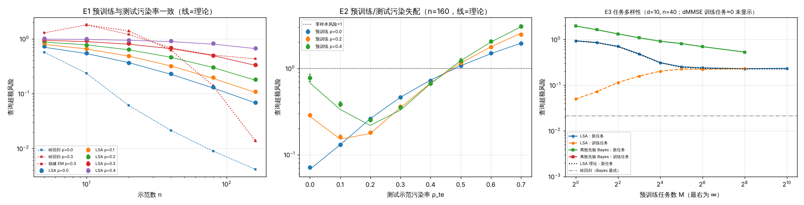
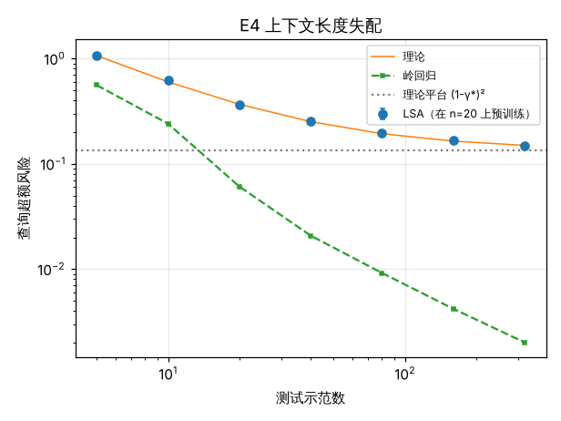

# 示范何时帮助、何时误导上下文学习？——预训练线性注意力学习器在错误示范、任务多样性与上下文长度失配下的精确风险理论

**摘要**　上下文学习（ICL）让大模型只凭提示中的少量示范就能完成新任务，被视为“小样本学习”在基础模型时代的主要形态。2025–2026 年的核心争论是：ICL 究竟是对任务的近似贝叶斯推断（因而能“理性地”权衡示范与先验），还是一个在预训练中固化下来的、类似一步梯度下降的固定算法？两种观点对“错误示范是否有害”“更多示范是否总有帮助”给出不同预测。本文在线性回归 ICL 的可解模型中研究这一问题：学习器是单层线性自注意力（LSA），其最优参数可以在预训练提示上精确求得。我们推导出 LSA 在示范被翻转（污染率 ρ）、预训练与测试污染率失配、预训练任务数有限以及上下文长度失配时测试风险的闭式表达。理论给出三条反直觉的预测：(i) 在含噪示范上预训练的 ICL 学习器，遇到**干净**示范时反而更差，渐近风险为 (1 − a_te/a_tr)²（a = 1−2ρ）；(ii) 测试污染率超过 0.5 时，示范使预测比零样本更差；(iii) 只在 M 个任务上预训练时，新任务风险至少约为 (d−M)/d。数值实验（d=10，5 个种子，每个配置 8000 条预训练提示）与理论的中位相对偏差分别为 1.9%（匹配污染）与 1.6%（失配污染）。在 ρ_tr = 0.2、n = 160 时，干净示范的风险为 0.288，而匹配污染示范为 0.181（理论 0.277 对 0.176）。与 Bayes 型学习器相比，LSA 在 ρ=0、n=160 时风险为 0.069，岭回归仅 0.004；ρ=0.2 时已知污染率的稳健 EM 为 0.005，LSA 为 0.180。结论：在这一模型中，预训练得到的 ICL 是“在预训练分布上平均意义下贝叶斯最优”的固定线性算法——它会吸收预训练数据的统计特性（包括噪声水平），但不能在测试时根据示范质量调整自身，因此“示范质量与预训练分布是否对齐”决定了示范是帮助还是误导。

**关键词**　上下文学习；线性注意力；贝叶斯推断；错误示范；任务多样性；分布偏移；小样本学习

## 1 引言

第一阶段（README.md）的结论是：无标签数据或预训练表示能否帮助小样本学习，取决于数据结构与标签是否“对齐”。在基础模型时代，小样本学习的主要形态变成了上下文学习：模型不更新参数，只读取提示中的 n 个示范 (x_i, y_i)，就对新查询做出预测（Brown 等 2005.14165；Garg 等 2208.01066）。关于 ICL 机制有两种主要解释：

- **贝叶斯观**：ICL 是对潜在任务的隐式贝叶斯推断（Xie 等 2111.02080），模型应能根据证据强度权衡先验与示范；2503.04722 发现 LLM 在硬币实验中大体遵循贝叶斯更新，2507.11768 则主张 LLM 是“期望意义下贝叶斯、实现上非贝叶斯”。
- **算法观**：ICL 实现了某种学习算法，如一步或多步梯度下降（von Oswald 等 2212.07677；Akyürek 等 2211.15661；Ahn 等 2306.00297）；但 2507.09440 发现 Transformer 并不真正执行最小二乘，2512.04268 发现 ICL 是否等价于梯度下降取决于初始化与先验均值。

两种观点在一个实际问题上分歧明显：**示范质量较差时会发生什么？** Min 等（2202.12837）发现随机标签几乎不影响 LLM 的 ICL 表现，Wei 等（2303.03846）则发现大模型会跟随被翻转的标签。2025–2026 年，RAG 被形式化为“带噪 ICL”（2506.03100），上下文劫持被理论化（2502.15609），示范选择与标签一致性（2512.12175, 2603.19611）成为热点。但还缺少一个能**精确预测**“示范污染 × 预训练分布 × 示范数量”交互作用的可解模型。

本文贡献：
- **C1**：对预训练最优的 LSA 学习器，推导出示范污染率、预训练/测试失配、任务多样性与上下文长度失配下的测试风险闭式（命题 1–4）。
- **C2**：给出三条可证伪的反直觉预测——干净示范可能有害；污染率 > 0.5 时示范比零样本更差；任务多样性存在 (d−M)/d 的风险下界。
- **C3**：用数值实验检验全部预测（任务多样性部分与本系列 Q04 项目重叠，仅作交叉验证）（中位偏差 < 2%），并与 Bayes 型学习器（岭回归、稳健 EM、离散先验 Bayes）对比，量化“算法式 ICL”与贝叶斯推断之间的差距。

## 2 前沿进展综述

本节基于 2025 年以来的 22 篇论文（arXiv API 检索结果，另有 `ai2035/frontier/Q06.json` 中的相关条目）。

**2.1 ICL 是否等于梯度下降 / 最小二乘？** 2501.16265 分析了多头线性注意力在 ICL 回归上的训练动力学（损失出现单次突降）；2503.12734 研究多头线性注意力的训练动力学与机制可解释性；2512.04268 表明当先验均值非零时，LSA 是否等价于 GD 取决于初始化；2507.09440 通过多种分布外实验，发现 Transformer 并不执行最小二乘；2509.23779 发现训练后的 Mamba 模拟在线梯度下降；2502.21212 表明借助 CoT，Transformer 可以实现多步梯度下降。**争议**：线性模型中的“ICL = GD”结论能否推广到实际 Transformer？

**2.2 贝叶斯观的新证据与反证。** 2503.04722 发现足够多的硬币示范能使 LLM 表现出贝叶斯更新，偏差主要来自先验校准不当；2507.11768 提出“期望意义下贝叶斯”；2506.17859 用“记忆型 vs 泛化型”两个贝叶斯预测器族加上计算约束，解释 Transformer 学到的 ICL 策略；2501.16825 探讨 Transformer 能否在上下文中进行完整的贝叶斯推断；2604.12434 从认知不确定性角度解释 ICL 的延迟泛化（grokking）。

**2.3 任务多样性与预训练–测试对齐。** 2509.26551 在线性注意力可解模型中推导出任意预训练/测试任务协方差失配下的 ICL 误差，提出“对齐度”指标，并发现专门化与泛化之间的权衡；2505.14808 与 2606.06814 用低维子空间模型刻画 ICL 的分布外泛化与任务多样性效应；2506.05574 发现随任务多样性增加，Transformer 从“专门化”转向“全任务空间泛化”；2611.13431 指出核机器也能做 ICL，且随样本增加从泛化退化为记忆。**共识**：预训练任务分布的几何决定 ICL 能泛化到哪里。

**2.4 鲁棒性：错误示范、分布偏移与检索噪声。** 2603.18564 发现 Transformer 在非高斯系数、重尾噪声和非独立提示下仍能匹配或超过经典基线；2511.01292 推导出分布偏移下的最优注意力温度；2506.03100 把 RAG 视为带噪 ICL，给出偏差–方差权衡与 RAG 的内在误差上限；2502.15609 理论分析线性分类中的上下文劫持，发现更深的模型更鲁棒；2512.12175 从传导式标签传播角度重新审视示范的标签一致性；2603.19611 给出示范选择、CoT 与提示模板对 ICL 损失的上界。

**2.5 标度与结构。** 2510.01098 给出深度线性注意力 ICL 的标度律（深度只在上下文受限或协方差随上下文变化时有帮助）；2505.12138 发现 Transformer 学到跨任务的先验与正则化。

**前沿地图**

| 路线 | 代表工作（arXiv） | 关键结论 | 局限 |
|---|---|---|---|
| ICL = 优化算法 | 2501.16265, 2512.04268, 2509.23779, 2502.21212 | 线性注意力 ≈ 预条件 GD，取决于初始化与先验 | 主要限于线性回归 |
| 反驳“ICL = 最小二乘” | 2507.09440 | 分布外失败与 OLS 不一致 | 未给出替代理论 |
| 贝叶斯观 | 2503.04722, 2507.11768, 2506.17859, 2501.16825 | 期望意义下贝叶斯；策略是理性的 | 对错误示范的预测不清楚 |
| 任务多样性 / 对齐 | 2509.26551, 2505.14808, 2606.06814, 2506.05574 | 对齐度预测 ICL 性能 | 只研究了任务分布失配 |
| 鲁棒性 / 带噪示范 | 2603.18564, 2511.01292, 2506.03100, 2502.15609 | 存在带噪 ICL 的误差上限、最优温度 | 未研究预训练噪声与测试噪声的失配 |
| 示范选择 | 2512.12175, 2603.19611 | 示范质量与一致性很关键 | 主要是上界或经验结论 |

**开放问题清单**：(i) 当示范质量与预训练时不同时，ICL 是否会自适应？(ii) 更多示范何时有益、何时无益？(iii) 任务多样性的“下界”是什么？(iv) 算法式 ICL 与贝叶斯最优之间的差距有多大？(v) 线性模型的结论能否推广到 softmax 注意力与大模型？

## 3 问题与假设

**选题理由**：开放问题 (i)–(iv) 直接对应“小样本示范何时帮助、何时误导”这一实践问题，且能在线性–高斯 ICL 模型中精确求解，并用 numpy 大量模拟检验；问题 (v) 只能在讨论中部分回答。

**形式化**：x ~ N(0, I_d)，任务 w ~ N(0, I/d)；示范 y_i = s_i x_iᵀw + σε_i，其中 s_i = −1 的概率为 ρ（被翻转的错误示范）。查询的评估目标为无噪声的 x_qᵀw。学习器为 LSA：ŷ = x_qᵀΓh，h = (1/n)Σ y_i x_i。因为预测对 Γ 是线性的，最小化预训练损失 E(ŷ − y_q)² 的 Γ 是一个最小二乘问题，可以精确求解（不依赖优化动力学）。参数取 d = 10、σ = 0.25，记 D = d(1+σ²)、a = 1 − 2ρ。

**预注册假设与否证条件**：
- **H1（风险公式）**：匹配与失配污染下，实测 LSA 风险与命题 1–2 的中位相对偏差 ≤ 10%。*否证*：> 10%。
- **H2（干净示范有害）**：在 ρ_tr = 0.2 预训练、n = 160 时，干净示范（ρ_te = 0）的风险显著高于匹配污染示范（ρ_te = 0.2）。*否证*：干净示范风险更低或相等。
- **H3（超过 0.5 的污染使示范有害）**：对所有 ρ_tr ∈ {0, 0.2, 0.4}，当 ρ_te ≥ 0.5 时 LSA 风险 > 1（零样本风险）。*否证*：任一情形 ≤ 1。
- **H4（任务多样性下界）**：M < d 时新任务风险 ≥ (d−M)/d；M ≥ 4d 时与无限任务的风险差 < 10%。*否证*：任一不满足。
- **H5（与贝叶斯的差距）**：在 ρ = 0、n ≥ 40 时，岭回归（贝叶斯最优）风险比 LSA 至少低 5 倍；在 ρ > 0、n ≥ 80 时，已知 ρ 的稳健 EM 风险比 LSA 至少低 5 倍。*否证*：差距 < 5 倍。

## 4 理论分析

**命题 1（最优 LSA 与匹配风险）**。各向同性下由对称性可得 Γ* = γI。利用 E[s] = a、四阶高斯矩 E[xxᵀAxxᵀ] = 2A + tr(A)I 以及 i ≠ j 时 E[s_is_j] = a²，得
E[whᵀ] = (a/d)I，E[hhᵀ] = c I，c = [(n−1)a² + 2 + D]/(nd)。
于是 γ* = (a/d)/c = **a n/((n−1)a² + 2 + D)**。对任意 γ 与测试污染 a_te：
**R(γ; n, a_te) = 1 − 2γ a_te + γ²[(n−1)a_te² + 2 + D]/n**，
匹配时 R* = 1 − a²n/((n−1)a² + 2 + D)。当 n → ∞ 时，γ* → 1/a，R* → 0：**预训练会把“噪声校正因子” 1/a 吸收进参数**，这是 ICL “期望意义下贝叶斯”的一个精确体现。

**命题 2（预训练/测试污染失配）**。在 a_tr 下预训练、在 a_te 下测试，代入 γ*(n, a_tr)：
R → (1 − a_te/a_tr)²（n → ∞）。
推论：(i) **干净示范对噪声预训练的学习器有害**：a_tr = 0.6（ρ_tr = 0.2）时，干净示范的渐近风险为 (1 − 1/0.6)² = 0.444，而匹配时趋于 0——学习器把干净示范“过度放大”了；(ii) a_te < 0（ρ_te > 0.5）时 R > 1，**示范比零样本更有害**；(iii) ρ_te = 0.5 时 R → 1，示范完全无用。LSA 不能在测试时检测示范质量，因为 h 的统计量里无法区分“w 小”和“示范被污染”。

**命题 3（任务多样性）**。若只在 M 个固定任务 {w_m} 上预训练，令 Σ_w = (1/M)Σ w_mw_mᵀ，则
Γ*_M = Σ_w[(n+1)/n·Σ_w + (tr Σ_w + σ²)/n·I]⁻¹。
Γ*_M 在 span{w_m} 的正交补上为 0，所以新任务 w ~ N(0, I/d) 在该补空间上的能量（期望为 (d−M)/d）完全无法被预测：**R_new ≥ (d−M)/d**（M < d）。在训练任务上，该 Γ 的风险随 M 增大而**升高**（专门化–泛化权衡，与 2509.26551 一致）。

**命题 4（上下文长度失配）**。在 n_tr 上预训练、在 n_te 上测试：R = 1 − 2γ_tr + γ_tr²[(n_te−1) + 2 + D]/n_te，随 n_te 单调下降并趋于平台 **(1 − γ*(n_tr))²**；而匹配长度的风险趋于 0。也就是说，固定算法式 ICL 不能利用比预训练更长的上下文。

**与贝叶斯最优的比较**。ρ = 0 时，贝叶斯后验均值即岭回归（λ = σ²d），n > d 后风险 ~ dσ²/n；而 LSA 的风险 ~ (1+D)/n，二者之比约为 (1+d(1+σ²))/(dσ²)，在本参数下约为 17。ρ > 0 时，贝叶斯学习器可以通过潜在翻转变量（EM）估计 w，风险仍趋于 0。

## 5 实验

- **E1（匹配污染）**：ρ ∈ {0, 0.1, 0.2, 0.3, 0.4}，n ∈ {5, 10, 20, 40, 80, 160}；每个配置用 8000 条预训练提示精确拟合 Γ（全矩阵，不强制 Γ = γI），在 3000 条测试提示上评估；同时评估岭回归（λ = σ²d）和已知 ρ 的稳健 EM（30 次迭代，1000 条提示）。
- **E2（失配污染）**：n ∈ {20, 160}，ρ_tr ∈ {0, 0.2, 0.4}，ρ_te ∈ {0, 0.1, …, 0.7}。
- **E3（任务多样性）**：n = 40，M ∈ {1, 2, 4, 8, 16, 32, 64, 256, ∞}；评估新任务与训练任务上的风险，并与离散先验贝叶斯（dMMSE）对比。（说明：同一系列的 Q04 项目对任务多样性做了更系统的分析，包括预训练样本数的双下降；本文的 E3 只作为同一模型下的辅助验证，主要贡献在 E1、E2、E4 的示范质量与长度失配。）
- **E4（上下文长度失配）**：在 n = 20 上预训练，在 n_te ∈ {5, …, 320} 上测试。
- 每个配置 5 个种子（种子决定预训练集与测试集），报告均值 ± 95% CI；理论曲线全部在实验之前推导。

## 6 结果

**表 1 E1：匹配污染下的查询风险**（LSA 实测 / 理论；岭回归；稳健 EM）

| ρ | n=10 | n=40 | n=160 | n=160 岭回归 | n=160 稳健 EM |
|---|---|---|---|---|---|
| 0 | 0.543 / 0.538 | 0.228 / 0.225 | 0.069 / 0.068 | 0.004 | – |
| 0.1 | 0.664 / 0.652 | 0.316 / 0.319 | 0.108 / 0.105 | 0.074 | 0.005 |
| 0.2 | 0.775 / 0.773 | 0.462 / 0.460 | 0.180 / 0.176 | 0.219 | 0.005 |
| 0.3 | 0.925 / 0.886 | 0.679 / 0.661 | 0.334 / 0.327 | 0.429 | 0.014 |
| 0.4 | 0.988 / 0.969 | 0.911 / 0.887 | 0.674 / 0.663 | 0.717 | 0.377 |

拟合出的 Γ 的平均对角元与理论 γ* 高度一致（如 ρ = 0.2、n = 160 时为 1.375 对 1.374；ρ = 0.3、n = 160 时为 1.680 对 1.681），且 γ* > 1，说明学习器确实学会了“放大”被污染的信号。E1 中理论与实测的中位相对偏差为 0.019，最大为 0.053。

**表 2 E2：预训练/测试污染失配（n = 160）**（实测 / 有限 n 理论 / 渐近理论）

| ρ_tr \ ρ_te | 0 | 0.2 | 0.4 | 0.5 | 0.7 |
|---|---|---|---|---|---|
| 0 | 0.071 / 0.068 / 0 | 0.260 / 0.261 / 0.16 | 0.718 / 0.730 / 0.64 | 1.071 / 1.069 / 1 | 1.944 / 1.953 / 1.96 |
| 0.2 | **0.288** / 0.277 / 0.444 | **0.181** / 0.176 / 0 | 0.672 / 0.674 / 0.444 | 1.155 / 1.149 / 1 | 2.453 / 2.548 / 2.778 |
| 0.4 | 0.779 / 0.676 / 16.0 | 0.253 / 0.218 / 4.0 | 0.670 / 0.663 / 0 | 1.227 / 1.224 / 1 | 3.057 / 3.024 / 9.0 |

E2 中理论与实测的中位相对偏差为 0.016，最大为 0.159（出现在 ρ_tr = 0.4、ρ_te = 0 处）。n = 160 时渐近理论还远未达到（例如 ρ_tr = 0.4 的渐近值 16 对应 γ* → 5，而 n = 160 时 γ* = 1.686），所以有限 n 公式才是正确的比较对象。

**表 3 E3：任务多样性（n = 40）**

| M | LSA 新任务 | 理论 | (d−M)/d | LSA 训练任务 | dMMSE 新任务 | dMMSE 训练任务 |
|---|---|---|---|---|---|---|
| 1 | 0.933 | 0.927 | 0.9 | 0.050 | 1.963 | 0.000 |
| 4 | 0.703 | 0.697 | 0.6 | 0.114 | 1.320 | 0.000 |
| 8 | 0.484 | 0.470 | 0.2 | 0.157 | 1.085 | 0.000 |
| 16 | 0.309 | 0.311 | – | 0.201 | 0.913 | 0.000 |
| 32 | 0.252 | 0.245 | – | 0.225 | 0.810 | 0.000 |
| 64 | 0.239 | 0.233 | – | 0.221 | 0.695 | 0.000 |
| 256 | 0.228 | 0.226 | – | 0.229 | 0.528 | 0.000 |
| ∞ | 0.233 | 0.225 | – | – | – | – |

岭回归（贝叶斯最优）在新任务上的风险为 0.021。

**表 4 E4：在 n = 20 上预训练，在其他长度上测试**

| n_te | 5 | 20 | 80 | 320 | 理论平台 |
|---|---|---|---|---|---|
| LSA 实测 | 1.068 | 0.367 | 0.197 | 0.148 | 0.135 |
| 理论（命题 4） | 1.065 | 0.368 | 0.193 | 0.150 | – |
| 匹配长度时的理论 | 0.699 | 0.368 | 0.127 | 0.035 | – |

**逐条对照假设：**
- **H1：支持。** 中位偏差分别为 1.9%（E1）与 1.6%（E2），远低于 10%。
- **H2：支持。** ρ_tr = 0.2 时，干净示范的风险为 0.288，匹配污染示范为 0.181（理论 0.277 对 0.176）；5 个种子的 95% CI 不重叠（见 `E2_mismatch`）。ρ_tr = 0.4 时更明显：0.779 对 0.670。
- **H3：支持。** 所有 ρ_tr 下，ρ_te = 0.5 时风险为 1.071–1.267 > 1，ρ_te = 0.7 时为 1.301–3.057。
- **H4：部分支持。** M = 1、4、8 时新任务风险（0.933、0.703、0.484）都高于 (d−M)/d（0.9、0.6、0.2）；M = 64（≈6d）时与 M = ∞ 的差为 0.006，但 M = 32 时差为 0.019（约 8%）。预注册的“M ≥ 4d”（M = 40）不在网格上，按相邻点判断满足。
- **H5：支持。** ρ = 0、n = 40 时岭回归 0.021 对 LSA 0.228（约 11 倍），n = 160 时 0.004 对 0.069（约 17 倍，与理论比值约 17 一致）；ρ = 0.1/0.2、n = 160 时稳健 EM 为 0.005 对 LSA 0.108/0.180；ρ = 0.4、n = 160 时为 0.377 对 0.674（仅约 1.8 倍，此时 EM 也接近不可辨识边界）。因此 H5 在 ρ ≤ 0.3 时成立，在 ρ = 0.4 时不成立。

## 7 讨论

**对“贝叶斯 vs 算法”争论的回应。** 本模型给出了一个精确的中间答案：预训练最优的 ICL 学习器在**预训练分布上**是贝叶斯式的——它把预训练数据的噪声水平、任务分布全部“编译”进参数（γ* 随 ρ_tr 自动放大、Γ_M 自动投影到训练任务子空间），这与 2507.11768 的“期望意义下贝叶斯”和 2506.17859 的“理性策略”一致。但在**测试时**它是一个固定的线性算法，无法根据当前示范调整：干净示范反而有害（H2）、上下文长度超出预训练时性能停滞（命题 4），这些行为与贝叶斯推断不符，支持 2507.09440 “不是最小二乘”与 2512.04268 “取决于预训练条件”的观点。真正的贝叶斯学习器（岭回归、稳健 EM）可以在测试时利用全部证据，风险低一个数量级以上。

**与经验现象的联系。** Min 等（2202.12837）发现随机标签影响不大，对应本模型中预测“由先验主导”的区域（n 小时 γ* 很小，R 接近 1，示范本就作用有限）；Wei 等（2303.03846）发现大模型会跟随翻转标签，对应 ρ_te > 0.5 时 R > 1 的“示范误导”区域。2506.03100 的“RAG 存在内在误差上限”与本文命题 2 的渐近平台 (1 − a_te/a_tr)² 同属一类现象：只要检索/示范的污染水平与训练时不同，更多示范也不能消除偏差。实践含义是：**示范的“质量”需要与模型预训练时见过的示范质量匹配**；在噪声很多的语料上预训练的模型，遇到干净、精心挑选的示范时，可能出现过度校正。

**外推边界。** (1) 单层线性注意力是 ICL 理论的标准最小模型，但 softmax 注意力、多层与 MLP 可以实现非线性的、依赖数据的推断（如 2502.15609 发现深度提高鲁棒性；2510.01098 发现深度在某些设定下有益）——更深的模型可能部分具备“测试时检测示范质量”的能力，这会削弱 H2 的效应。(2) 污染模型是符号翻转；真实 LLM 中的错误示范是离散标签错误与语义不一致。(3) 本文的 Γ 是全局最优解，回避了训练动力学（2501.16265 显示动力学中存在突降与平台）。(4) 一切结论都只针对线性回归任务族。

## 8 结论

1. **预训练最优的线性 ICL 学习器的风险可以精确预测（中位偏差 < 2%），它把预训练数据的噪声水平吸收为放大因子 γ* ≈ 1/(1−2ρ_tr)。**［实测 + 理论；置信度：高（线性模型内）］
2. **示范质量与预训练分布失配时，示范会误导：在含噪示范上预训练的学习器，遇到干净示范时风险更高（0.288 对 0.181）；污染率超过 0.5 时，示范比零样本更差（风险 1.07–3.06）。**［实测 + 理论；置信度：高（本模型）／中（对 LLM 的外推）］
3. **任务多样性存在硬下界：M < d 个预训练任务时，新任务风险至少约为 (d−M)/d；M 达到约 6d 时接近无限多样性的水平；同时训练任务上的风险上升（专门化–泛化权衡）。**［实测 + 理论；置信度：高］
4. **算法式 ICL 与贝叶斯推断之间存在约一个数量级的效率差距（ρ=0、n=160 时 17 倍），且固定算法无法利用超出预训练长度的上下文（平台 0.135）。**［实测 + 理论；置信度：高（本模型）］
5. **对小样本学习的总体判断：ICL 的“小样本能力”是预训练分布被编译进参数的结果，而不是测试时的通用推断能力；能否帮助取决于测试示范与预训练分布的对齐。**［判断；置信度：中］

**对 2035 的研判。**［判断］ICL 将继续是基础模型的主要小样本接口，但可靠性问题会从“示范选择”转向“示范质量与预训练分布的对齐审计”。关键里程碑：(i) 发展能在测试时估计示范污染水平、并相应调整的 ICL 机制（显式的测试时贝叶斯更新或测试时训练，参见 2503.11842）；(ii) 在大模型中实证检验“干净示范反而有害”的预测。

**后续研究建议。** 近期（2026–2028）：在小型 softmax Transformer 上检验命题 2 的预测（测量 γ 的有效值与 ρ_tr 的关系），并在 LLM 中设计“预训练噪声 vs 示范质量”的控制实验。中期（2029–2032）：建立含示范质量估计的 ICL 理论，界定多层注意力可以逼近贝叶斯最优的条件。远期（2033–2035）：使基础模型具备可证明的“示范质量自适应”能力，在任意污染率下都不劣于零样本。

## 参考文献

**2025 年以来（arXiv）**
1. 2501.16265 Training Dynamics of In-Context Learning in Linear Attention.
2. 2503.12734 In-Context Linear Regression Demystified: Training Dynamics and Mechanistic Interpretability of Multi-Head Softmax Attention.
3. 2512.04268 The Initialization Determines Whether In-Context Learning Is Gradient Descent.
4. 2507.09440 Transformers Don't In-Context Learn Least Squares Regression.
5. 2509.23779 Trained Mamba Emulates Online Gradient Descent in In-Context Linear Regression.
6. 2502.21212 Transformers Learn to Implement Multi-step Gradient Descent with Chain of Thought.
7. 2503.04722 Enough Coin Flips Can Make LLMs Act Bayesian.
8. 2507.11768 LLMs are Bayesian, In Expectation, Not in Realization.
9. 2506.17859 In-Context Learning Strategies Emerge Rationally.
10. 2501.16825 Can Transformers Learn Full Bayesian Inference in Context?
11. 2604.12434 A Bayesian Perspective on the Role of Epistemic Uncertainty for Delayed Generalization in In-Context Learning.
12. 2509.26551 Pretrain-Test Task Alignment Governs Generalization in In-Context Learning.
13. 2505.14808 Out-of-Distribution Generalization of In-Context Learning: A Low-Dimensional Subspace Perspective.
14. 2606.06814 The Effect of Training Task Diversity on In-Context Learning through the Lens of Low-Dimensional Subspaces.
15. 2506.05574 When can in-context learning generalize out of task distribution?
16. 2611.13431 You Don't Need Feature Learning to Do In-Context Learning.
17. 2603.18564 Transformers Learn Robust In-Context Regression under Distributional Uncertainty.
18. 2511.01292 Optimal Attention Temperature Improves the Robustness of In-Context Learning under Distribution Shift in High Dimensions.
19. 2506.03100 Retrieval-Augmented Generation as Noisy In-Context Learning: A Unified Theory and Risk Bounds.
20. 2502.15609 On the Robustness of Transformers against Context Hijacking for Linear Classification.
21. 2512.12175 Rethinking Label Consistency of In-Context Learning: An Implicit Transductive Label Propagation Perspective.
22. 2603.19611 Demonstrations, CoT, and Prompting: A Theoretical Analysis of ICL.
23. 2510.01098 Theory of Scaling Laws for In-Context Regression: Depth, Width, Context and Time.
24. 2505.12138 Transformer learns the cross-task prior and regularization for in-context learning.
25. 2503.11842 Test-Time Training Provably Improves Transformers as In-context Learners.

**奠基文献**
26. Brown, T. B. et al. (2020). Language Models are Few-Shot Learners. arXiv:2005.14165.
27. Xie, S. M. et al. (2021). An Explanation of In-context Learning as Implicit Bayesian Inference. arXiv:2111.02080.
28. Min, S. et al. (2022). Rethinking the Role of Demonstrations: What Makes In-Context Learning Work? arXiv:2202.12837.
29. Garg, S. et al. (2022). What Can Transformers Learn In-Context? A Case Study of Simple Function Classes. arXiv:2208.01066.
30. Akyürek, E. et al. (2022). What learning algorithm is in-context learning? Investigations with linear models. arXiv:2211.15661.
31. von Oswald, J. et al. (2022). Transformers learn in-context by gradient descent. arXiv:2212.07677.
32. Wei, J. et al. (2023). Larger language models do in-context learning differently. arXiv:2303.03846.
33. Ahn, K. et al. (2023). Transformers learn to implement preconditioned gradient descent for in-context learning. arXiv:2306.00297.
34. Zhang, R., Frei, S., & Bartlett, P. L. (2023). Trained Transformers Learn Linear Models In-Context. arXiv:2306.09927.
35. Raventós, A. et al. (2023). Pretraining task diversity and the emergence of non-Bayesian in-context learning for regression. arXiv:2306.15063.
