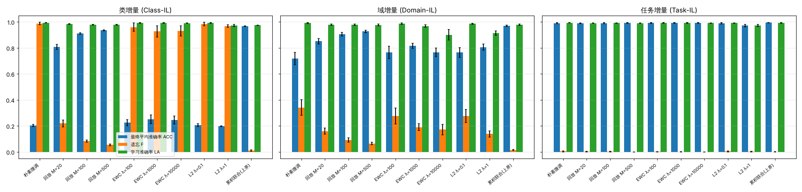
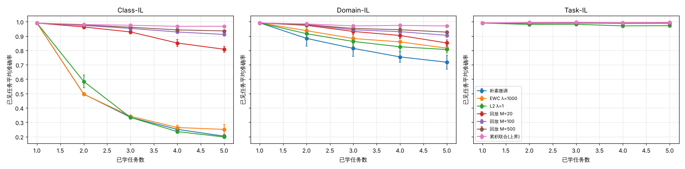
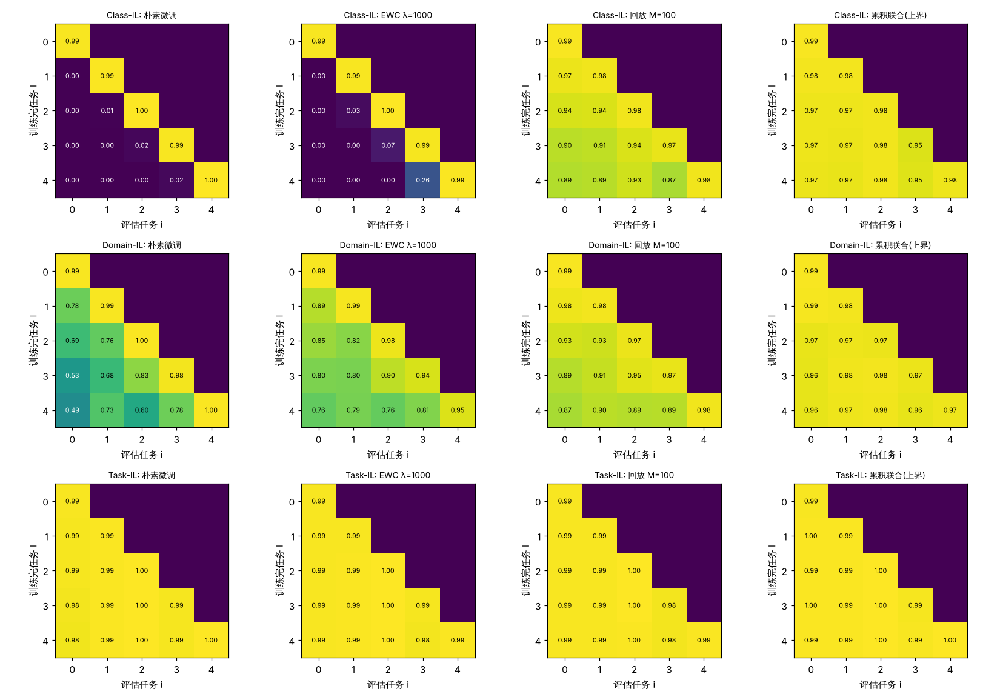

# Q07 持续学习与灾难性遗忘

> 分组：学习范式 ｜ 实验：`experiment.py`（运行时间约 127 秒） ｜ 证据标注：[实测] [文献] [判断]

## 摘要
人脑能终身学习而不明显遗忘，而用梯度下降顺序训练的神经网络会“灾难性遗忘”。我们在 Split-digits（5 个任务 × 2 类）上用自写 numpy MLP 比较了顺序微调、经验回放（缓冲区 20/100/500）、EWC（λ=1e2/1e3/1e4）、L2 拉回旧权重、累积联合训练五类方法，在类增量、域增量、任务增量三种场景下各跑 10 个种子。[实测] 类增量场景中顺序微调的最终平均准确率仅 0.204（遗忘 0.987），回放 20 个样本（每类 2 个）即升到 0.808，回放 500 个达 0.936，与联合训练上界 0.968 相差 0.032；EWC 最好也只有 0.251，比 M=100 的回放低 0.661。结论：遗忘的严重程度首先由“任务身份是否可得”决定；在没有任务身份的类增量设置中，参数正则化类方法几乎无效，少量真实旧数据是目前最可靠的手段。

## 1. 问题界定
灾难性遗忘（McCloskey & Cohen 1989；French 1999）是连接主义学习的基础性缺陷：共享参数的分布式表示在新数据的梯度下被覆盖 [文献]。它是“基础”问题，因为它触及**稳定性–可塑性困境**：任何能快速吸收新知识的系统都必须修改已有参数，而修改参数就可能破坏旧功能。2035 年的智能体需要在开放环境中长期部署，持续学习能力直接决定其能否摆脱“定期全量重训”。

预注册的可检验子假设（场景定义见第 3 节）：
- **H1（遗忘依赖场景）**：类增量中顺序微调的最终平均准确率 ACC ≤ 0.30、遗忘 F ≥ 0.70；任务增量中顺序微调的 F < 0.20。*否证*：类增量 ACC > 0.30 或任务增量 F ≥ 0.20。
- **H2（回放的样本效率）**：回放的 ACC 随缓冲区容量单调上升；M=20（每类 2 个样本）即显著优于顺序微调（p<0.05）；M=500 与联合训练上界的差距 < 0.05。*否证*：非单调、M=20 不显著或 M=500 差距 ≥ 0.05。
- **H3（正则化在类增量中失效）**：在类增量中，EWC 与 L2 在所有预设 λ 下相对顺序微调的 ACC 增益 < 0.10，且显著低于 M=100 的回放。*否证*：任一 λ 下增益 ≥ 0.10。

## 2. 研究现状
**现象与早期解释。** McCloskey & Cohen（1989, *Psychology of Learning and Motivation*）和 Ratcliff（1990, *Psychological Review*）首先报告了连接主义网络的灾难性干扰；French（1999, *Trends in Cognitive Sciences*）将其归因于分布式表示的重叠 [文献]。Goodfellow 等（arXiv:1312.6211）在现代网络上系统复现了该现象 [文献]。

**三大方法流派。** (1) **正则化**：EWC（Kirkpatrick 等，1612.00796）用 Fisher 信息加权的二次惩罚保护重要参数；SI（Zenke 等，1703.04200）在线估计参数重要性；Progress & Compress（Schwarz 等，1805.06370）提出在线 EWC；LwF（Li & Hoiem，1606.09282）用知识蒸馏约束输出 [文献]。(2) **回放/记忆**：iCaRL（Rebuffi 等，1611.07725）、GEM（Lopez-Paz & Ranzato，1706.08840）、经验回放（Rolnick 等，1811.11682）；Chaudhry 等（1902.10486）发现即使“极小”情景记忆也非常有效 [文献]。(3) **结构/参数隔离**（为每个任务分配子网络），参见综述 Parisi 等（1802.07569）、De Lange 等（1909.08383）、Wang 等（2302.00487）[文献]。

**评估争议。** van de Ven & Tolias（1904.07734）指出不同论文混用三种场景导致结论不可比：任务增量（测试时给出任务身份）、域增量（无需识别任务、输出空间共享）、类增量（必须在所有已见类中区分）；在 split MNIST 的类增量设置下 EWC、SI 等正则化方法几乎与顺序微调持平，而回放方法有效 [文献]。Ramasesh 等（2007.07400）显示遗忘主要发生在靠近输出的高层表示 [文献]。在大模型时代，Luo 等（2308.08747）报告 LLM 持续微调中同样存在遗忘 [文献]。

**未解决的缺口。** (1) 无回放的类增量学习仍没有可靠解法；(2) 稳定性–可塑性权衡缺乏定量理论（给定容量与任务相似度，最小遗忘是多少）；(3) 大模型的“遗忘”与小网络是否同一机制，证据零散。

## 3. 研究设计
- **数据与任务**：sklearn digits（1797 张，像素/16），每个种子 70/30 分层划分；10 个类按种子随机排列后两两分组成 5 个任务。
- **三种场景**：类增量（单一 10 路输出头，在已见类中 argmax）；域增量（共享 2 路输出头，预测“该样本是本任务的第一类还是第二类”，无任务身份）；任务增量（按任务掩码的 2 路输出头，测试时给出任务身份）。
- **模型与训练**：自写 numpy MLP 64-128-10（ReLU，He 初始化），SGD 学习率 0.05，批量 32，每个任务 30 个 epoch；所有超参数在运行前固定，正则强度按预设网格全部报告。
- **方法**：顺序微调；经验回放（类均衡缓冲区，总容量 M∈{20,100,500}，每个批次拼接等量回放样本）；EWC（每个任务结束后计算对角经验 Fisher，各任务独立二次惩罚，λ∈{1e2,1e3,1e4}）；L2 拉回上一任务结束时的权重（λ∈{0.1,1}）；累积联合训练（每个阶段在所有已见数据上训练，作为上界）。二次惩罚采用**近端（隐式）更新**实现，因为显式梯度步在 λ=1e4 时数值发散（见第 5 节）。
- **指标**：R[l,i] 为学完任务 l 后在任务 i 上的测试准确率。ACC = 最终各任务平均准确率；遗忘 F = 各旧任务历史最好准确率与最终准确率之差的平均；BWT = 最终准确率与刚学完时准确率之差的平均；LA（学习准确率）= 刚学完各任务时的平均准确率，衡量可塑性。
- **统计**：10 个种子（类顺序、划分、初始化均随种子变化），均值 ± 95% CI，方法间对 ACC 做配对 t 检验。

## 4. 结果

**表 1 三种场景下的最终平均准确率 ACC 与遗忘 F（均值 ± 95% CI，10 种子）** [实测]

| 方法 | 类增量 ACC | 类增量 F | 域增量 ACC | 域增量 F | 域增量 LA | 任务增量 ACC |
|---|---|---|---|---|---|---|
| 顺序微调 | 0.204±0.008 | 0.987±0.010 | 0.718±0.047 | 0.342±0.061 | 0.991±0.003 | 0.991±0.005 |
| 回放 M=20 | 0.808±0.020 | 0.219±0.026 | 0.852±0.021 | 0.160±0.024 | 0.979±0.005 | 0.989±0.003 |
| 回放 M=100 | 0.911±0.006 | 0.084±0.008 | 0.905±0.015 | 0.093±0.016 | 0.978±0.005 | 0.991±0.004 |
| 回放 M=500 | 0.936±0.004 | 0.055±0.007 | 0.927±0.009 | 0.065±0.010 | 0.977±0.006 | 0.993±0.002 |
| EWC λ=1e2 | 0.225±0.025 | 0.960±0.031 | 0.765±0.047 | 0.277±0.062 | 0.987±0.005 | 0.992±0.003 |
| EWC λ=1e3 | 0.251±0.034 | 0.927±0.044 | 0.816±0.019 | 0.190±0.026 | 0.968±0.010 | 0.992±0.003 |
| EWC λ=1e4 | 0.247±0.031 | 0.930±0.039 | 0.765±0.034 | 0.172±0.041 | 0.901±0.040 | 0.991±0.003 |
| L2 λ=0.1 | 0.205±0.011 | 0.984±0.013 | 0.765±0.038 | 0.276±0.049 | 0.986±0.004 | 0.990±0.004 |
| L2 λ=1 | 0.198±0.004 | 0.968±0.011 | 0.806±0.023 | 0.138±0.023 | 0.914±0.016 | 0.972±0.009 |
| 累积联合（上界） | 0.968±0.003 | 0.010±0.005 | 0.970±0.006 | 0.015±0.005 | 0.979±0.006 | 0.995±0.002 |

**表 2 关键配对比较（ACC 差值，均值 ± 95% CI）** [实测]

| 场景 | 比较 | 差值 | 配对 p |
|---|---|---|---|
| 类增量 | EWC λ=1e3 − 顺序微调 | +0.047±0.034 | 0.025 |
| 类增量 | 回放 M=100 − EWC λ=1e3 | +0.661±0.034 | 2.9e-11 |
| 类增量 | 回放 M=20 − EWC λ=1e4 | +0.561±0.032 | 6.4e-11 |
| 类增量 | 联合上界 − 回放 M=500 | +0.032±0.005 | 3.6e-07 |
| 域增量 | EWC λ=1e3 − 顺序微调 | +0.098±0.041 | 0.0011 |
| 域增量 | 回放 M=100 − EWC λ=1e3 | +0.089±0.017 | 2.6e-06 |
| 任务增量 | 回放 M=100 − EWC λ=1e3 | −0.001±0.002 | 0.26 |

**逐条回应假设：**
- **H1：支持。** 类增量顺序微调 ACC=0.204、F=0.987——学完第 5 个任务后旧任务几乎全部归零，只剩最新任务（准确率矩阵见图）；任务增量 F=0.004，几乎没有遗忘。域增量居中（ACC 0.718，F 0.342）。
- **H2：支持。** 类增量下回放 ACC 随 M 单调上升（0.808 → 0.911 → 0.936）；M=20 相对顺序微调提升约 0.60（p=4.9e-12）；M=500 与上界差 0.032（< 0.05）。
- **H3：支持。** 类增量下 EWC 的最大增益为 +0.047（λ=1e3，p=0.025），L2 无显著增益（λ=0.1 时 p=0.49）；均远低于回放。值得注意的是，在域增量中 EWC 与 L2 的作用明显（+0.098），但以可塑性为代价：λ=1e4 的 EWC 学习准确率 LA 降至 0.901，L2 λ=1 降至 0.914。

## 5. 讨论
**机理解释。** 类增量的困难不在于“参数被覆盖”这一表层现象，而在于**决策需要跨任务比较**：学习新任务时，旧类别的输出单元从未与新类别同时出现在损失中，交叉熵会持续抬高新类 logit、压低所有其他 logit，导致旧类样本也被判为新类。EWC 只约束“对旧任务损失重要的参数”，但旧任务损失（只涉及当时已见的类）对“新类 logit 不应过大”这一约束根本不敏感——Fisher 信息里不包含尚未出现的类的信息 [判断，与 van de Ven & Tolias 2019 的分析一致]。回放让新旧类别同时出现在损失中，直接修复了这一比较缺失；这解释了为何每类仅 2 个样本就能挽回约 0.60 的准确率 [实测+判断]。任务增量几乎不遗忘，说明在本任务规模下，表示层的漂移本身并不严重，主要问题在输出层的跨任务校准；域增量处于两者之间，正则化在这里能部分保护共享头，但会以学习准确率下降为代价，呈现典型的稳定性–可塑性权衡 [实测]。

**与文献的一致与分歧。** 结果在方向上复现了 van de Ven & Tolias（2019）在 split MNIST 上的模式和 Chaudhry 等（2019）“极小记忆即有效”的结论 [文献]。我们的任务增量准确率（约 0.99）高于他们报告的顺序微调水平，原因是 digits 两类任务极易区分，形成**天花板效应**——这也意味着本实验无法区分任务增量中各方法的优劣。

**实现层面的偏差（如实报告）。** (1) 初版用显式梯度步实现二次惩罚，λ=1e4 的 EWC 发散（学习率 × λ × Fisher > 2）；改用近端更新后重跑，这是数值稳定性修正，不是调参。(2) 初版只有类增量与任务增量；因任务增量出现天花板，补充了域增量场景，所有方法与超参数保持不变。

**效度威胁与外推边界。** (1) 网络极小（单隐层 128 单元）、数据低维，任务间相似度高；大模型参数冗余度高得多，遗忘机制可能不同。(2) 未实现 iCaRL、GEM、LwF、生成式回放等方法，正则化只覆盖 EWC/L2；“正则化无效”仅针对本设置中的这两种。(3) 回放缓冲区按类均衡选择，在真实流式数据中类别边界可能未知。(4) EWC 使用经验 Fisher 而非真实 Fisher；λ 网格为三点，可能未覆盖最优值，但 λ=1e3→1e4 时 ACC 已饱和（0.251→0.247），可塑性却在下降，扩大网格不太可能改变结论 [判断]。

<!-- BIBLIO:start -->
## 文献计量信号（arXiv，[实测]）

检索式：摘要含 “catastrophic forgetting”、“continual learning”、“lifelong learning” 之一；基线为同年 cs.LG / cs.AI / stat.ML 论文总数。数据：`ai2035/bibliometrics/arxiv_counts.json`（检索日 2026-11-26）。

| 年份 | 命中论文数 | 占 AI/ML 基线比例 |
|---|---|---|
| 2015 | 10 | 0.25% |
| 2016 | 23 | 0.39% |
| 2017 | 53 | 0.63% |
| 2018 | 119 | 0.87% |
| 2019 | 213 | 0.96% |
| 2020 | 348 | 1.14% |
| 2021 | 473 | 1.42% |
| 2022 | 587 | 1.62% |
| 2023 | 836 | 1.85% |
| 2024 | 1,128 | 1.91% |
| 2025 | 1,385 | 1.86% |

- 2019–2025 年份额的对数线性趋势：**每年 +12.4%**（95% CI +7.1% ~ +17.8%，R²=0.89），判定：**相对升温（增速显著快于 AI/ML 总体）**；在 20 个问题中按相对增速排第 7 位。
- 解读边界：分子覆盖 arXiv 全部类别、分母仅为 AI/ML 三个类别，所以“比例”是相对关注度指数，并非严格的子集占比；关键词匹配既会漏掉使用其他术语的工作，也会混入无关用法；arXiv 偏重机器学习社区，认知科学、神经科学与期刊论文覆盖不足。该信号衡量的是**研究关注度**，不是**问题被解决的程度**。
<!-- BIBLIO:end -->

## 6. 结论与 2035 展望
**核心结论**
1. 灾难性遗忘的严重程度首先取决于场景：同一网络、同一数据，类增量下 ACC 0.204，任务增量下 0.991。评估持续学习必须明确场景。[实测，置信度：高]
2. 少量真实旧样本是最有效的手段：每类 2 个样本即可把类增量 ACC 从 0.204 提到 0.808，缓冲区 500 时距上界仅 0.032。[实测，置信度：高]
3. 基于参数重要性的正则化（EWC、L2）在类增量中几乎无效（最大 +0.047），在域增量中有效但会牺牲可塑性。[实测，置信度：高（本设置）／中（对其他正则化方法的推广）]
4. 类增量的核心困难是“跨任务决策校准”而非“参数覆盖”，这提示无回放持续学习需要的是关于**未来类别的先验结构**，而不仅是保护旧参数。[判断，置信度：中]

**关键未解问题**：无回放（隐私或存储受限）时，类增量能否逼近联合训练；稳定性–可塑性的定量极限；大模型的持续学习（知识编辑、持续预训练）与小网络遗忘是否同源。

**建议研究路线**
- 近期（2026–2028）：建立统一三场景的持续学习协议，并要求报告学习准确率 LA 与遗忘 F 的帕累托前沿；里程碑——无回放方法在 Split CIFAR-100 类增量上达到联合训练 80% 的准确率。
- 中期（2029–2032）：发展基于任务相似度与模型容量的遗忘理论；里程碑——理论能在 ±5 个百分点内预测给定方法在新任务序列上的遗忘量。
- 远期（2033–2035）：实现可在部署中持续学习数月而无需全量重训的基础模型；里程碑——在 ≥100 个顺序任务的流式基准上，最终性能不低于周期性全量重训的 95%，且计算成本低一个数量级。

## 参考文献
1. McCloskey, M., & Cohen, N. J. (1989). Catastrophic interference in connectionist networks: The sequential learning problem. *Psychology of Learning and Motivation*, 24, 109–165.
2. Ratcliff, R. (1990). Connectionist models of recognition memory: Constraints imposed by learning and forgetting functions. *Psychological Review*, 97(2), 285–308.
3. French, R. M. (1999). Catastrophic forgetting in connectionist networks. *Trends in Cognitive Sciences*, 3(4), 128–135.
4. Goodfellow, I. J. et al. (2013). An Empirical Investigation of Catastrophic Forgetting in Gradient-Based Neural Networks. arXiv:1312.6211.
5. Kirkpatrick, J. et al. (2016). Overcoming catastrophic forgetting in neural networks. arXiv:1612.00796（*PNAS* 2017）.
6. Li, Z., & Hoiem, D. (2016). Learning without Forgetting. arXiv:1606.09282.
7. Rebuffi, S.-A. et al. (2016). iCaRL: Incremental Classifier and Representation Learning. arXiv:1611.07725.
8. Zenke, F., Poole, B., & Ganguli, S. (2017). Continual Learning Through Synaptic Intelligence. arXiv:1703.04200.
9. Lopez-Paz, D., & Ranzato, M. (2017). Gradient Episodic Memory for Continual Learning. arXiv:1706.08840.
10. Parisi, G. I. et al. (2018). Continual Lifelong Learning with Neural Networks: A Review. arXiv:1802.07569.
11. Schwarz, J. et al. (2018). Progress & Compress: A scalable framework for continual learning. arXiv:1805.06370.
12. Rolnick, D. et al. (2018). Experience Replay for Continual Learning. arXiv:1811.11682.
13. Chaudhry, A. et al. (2019). On Tiny Episodic Memories in Continual Learning. arXiv:1902.10486.
14. van de Ven, G. M., & Tolias, A. S. (2019). Three scenarios for continual learning. arXiv:1904.07734.
15. De Lange, M. et al. (2019). A continual learning survey: Defying forgetting in classification tasks. arXiv:1909.08383.
16. Ramasesh, V. V., Dyer, E., & Raghu, M. (2020). Anatomy of Catastrophic Forgetting: Hidden Representations and Task Semantics. arXiv:2007.07400.
17. Wang, L. et al. (2023). A Comprehensive Survey of Continual Learning: Theory, Method and Application. arXiv:2302.00487.
18. Luo, Y. et al. (2023). An Empirical Study of Catastrophic Forgetting in Large Language Models During Continual Fine-tuning. arXiv:2308.08747.
