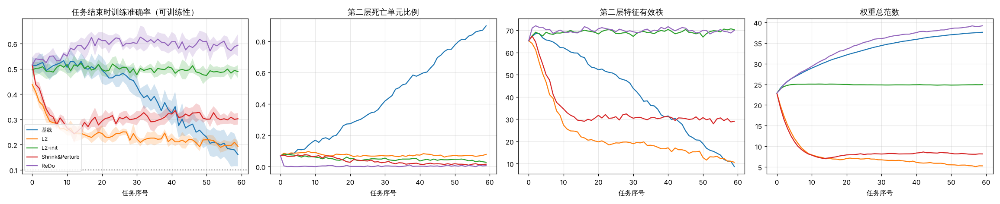
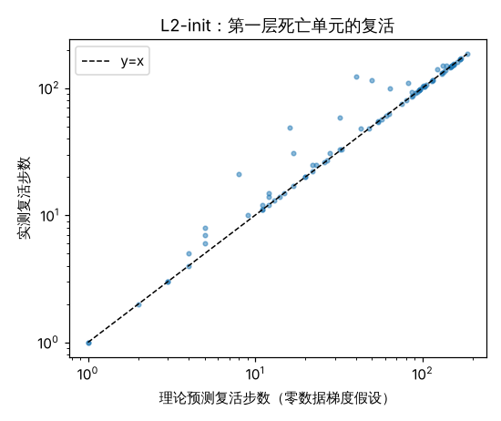

# 可塑性丧失的“吸收态”机制：死亡单元何时永远不再复活、哪些补救能让它们复活，以及哪些诊断指标真正预测可训练性

**摘要**　持续学习除了灾难性遗忘之外，还有第二种失败：网络在长时间、非平稳的训练后逐渐失去学习新东西的能力（可塑性丧失）。2025–2026 年这一方向迅速升温，但对其机制与诊断存在明显分歧：有人把它归因于死亡 / 休眠单元，有人归因于特征秩或 Hessian 谱的坍缩、权重范数增长，还有工作用反例证明“秩类诊断无法预测可训练性”，主张改用梯度类指标。本文在一个最小但完整的设定上检验这些说法：64-128-128-10 的 ReLU MLP，在固定的 300 张 digits 图像上连续学习 60 个随机标签记忆任务（Adam），比较基线、L2、L2-init、Shrink&Perturb 与 ReDo。理论上我们证明：输入支撑集固定时，第一层死亡单元在无正则化（或纯 L2）的训练下是**吸收态**；L2-init 让死亡单元沿确定轨迹 θ₀ + (1−ηλ)^t(θ_d − θ₀) 返回，复活步数可以按单元闭式预测。实验结果：(1) 基线的可训练性从前 10 个任务的 0.516 降到后 10 个任务的 0.196（p=2.6e-4），第二层死亡比例升到 0.898；(2) 基线与 L2 下第一层死亡单元的复活率恰为 0（分别观察了 6386 与 15792 个“死亡单元×任务”），与命题 1 完全一致；(3) L2-init 下 86 个可观测复活事件的预测步数与实测步数的 Spearman 相关为 0.976，绝对误差中位数为 0 步；(4) ReDo（后 10 个任务 0.592）与 L2-init（0.488）维持了可塑性，Shrink&Perturb 只部分维持（0.305），本设定下 λ=1 的 L2 反而使第一层 80% 的单元死亡（0.204）；(5) 在所有方法与任务汇总后，预测可训练性最强的是第二层特征能量（Spearman 0.911）与有效秩（0.891），初始梯度范数次之（0.799），权重范数的相关方向在不同方法间反转。结论：可塑性丧失至少部分源于一个可证明的吸收态；补救方法的关键在于能否为参数提供离开吸收态的力；诊断指标的有效性依赖于失败机制，任何单一指标都不能普遍预测可训练性。

**关键词**　持续学习；可塑性丧失；死亡单元；L2-init；ReDo；Shrink-and-Perturb；诊断指标

## 1 引言

第一阶段（README.md）研究的是灾难性遗忘——学新忘旧。可塑性丧失是另一面：网络学得越久，越难学新东西。Dohare 等（arXiv:2306.13812，后发表于 *Nature* 2024）在长任务序列中系统展示了这一现象，并提出持续反向传播（按效用重置单元）；Lyle 等（2303.01486）与 Abbas 等（2303.07507）分析了其成因；Sokar 等（2302.12902）提出“休眠神经元”与 ReDo 重置；Kumar 等（2308.11958）提出把参数拉回初始化的 L2-init；Ash & Adams（1910.08475）提出 Shrink-and-Perturb。2025–2026 年的争论主要有三点：

1. **机制**：死亡 / 饱和单元（2510.00304, 2509.22562）、谱坍缩（2509.22335, 2608.18319）、动力学等距的丧失（2606.09762）、旧任务最优点变成新任务的坏局部最优（2603.21173），哪个才是主因？
2. **诊断**：2605.09044 构造反例，证明表示秩与 NTK 秩可能无法预测可训练性，提出“优化就绪度”；2505.24061 主张“测梯度，而非测激活”；2610.09621 发现训练历史并不比当前状态更能预测未来学习。
3. **补救与规模**：经验回放（2503.20018）、权重级重置（2508.00212）、自适应线性化（2505.09486）、渐变环境（2602.09234）都被报告有效；2606.24752 发现 LLM 中同样存在可塑性丧失，其出现时间随模型规模亚线性推迟。

本文贡献：
- **C1（理论）**：证明在输入支撑集固定时，第一层死亡单元在无正则或纯 L2 训练下是吸收态（命题 1）；给出 L2-init 下复活步数的闭式（命题 2）；说明 Shrink&Perturb 与 ReDo 如何离开吸收态。
- **C2（检验机制）**：在 60 个任务 × 5 种方法 × 5 个种子上检验命题 1–2，复活率与复活时间的预测都精确成立。
- **C3（检验诊断）**：比较 6 个诊断指标对下一任务可训练性的预测力，在方法内与跨方法两个层面检验“秩无用 / 梯度更好”的论断。

## 2 前沿进展综述

本节基于 25 篇 2025 年以来的论文（`ai2035/frontier/Q07.json` 与 arXiv API 检索）。

**2.1 机制理论。** 2510.00304 从动力系统角度把可塑性丧失定义为参数空间中困住梯度轨迹的稳定流形，指出两种机制：激活饱和导致的冻结单元，以及表示冗余导致的克隆单元流形；并指出静态设定中有利于泛化的低秩、简单性偏好会导致可塑性丧失。2509.22335 发现可塑性丧失之前出现 Hessian 谱坍缩，并推导出线性化 ReLU 网络成功训练的 ε-秩条件；2608.18319 把原因归于权重奇异值的各向异性增长，提出 SingularClip；2606.09762 把可塑性与经验 NTK 和动力学等距联系起来；2604.01913 在 RL 中归因于 NTK Gram 矩阵的秩坍缩和梯度幅度的 Θ(1/k) 衰减；2603.21173 提出“以优化为中心”的假说：旧任务的最优点成为新任务的坏局部最优；2603.04703 在矩阵补全中发现深度带来的低秩偏好反而避免了可塑性丧失。

**2.2 诊断之争。** 2605.09044 用反例证明表示秩和 NTK 秩可能无法预测可训练性，提出结合梯度强度与可靠性的“优化就绪度”；2505.24061 认为在复杂架构中，基于激活的休眠比例失去统计功效，应改用梯度统计；2610.09621 发现训练历史并不比当前状态更能预测未来学习（增益 −21.4%）；2603.04580 发现遗忘与有效秩坍缩高度相关；2602.06586 发现强制特征各向同性反而有害。**争议**：秩类与激活类指标是否可靠？

**2.3 补救方法。** 重置类：2508.00212 比较重置单元与重置权重，发现权重级重置适用范围更广；2605.06834 提出基于归因的单元效用；2607.24996 提出按效用部分拉回初始化（校准部分重置）；2603.20860 在迁移学习前重置饱和权重。架构与激活类：2509.22562 和 2505.09486 通过激活函数设计和自适应线性化保持可塑性；2507.10637（RDBP）把 ReLUDown 与逐层减小的反向传播结合。数据类：2503.20018 认为经验回放配合 Transformer 可以消除可塑性丧失；2602.09234 发现环境渐变时可塑性丧失大幅减轻。RL 中的 churn 减少（2506.00592）也被证明有效。

**2.4 规模与新领域。** 2606.24752 在 5M–314M 参数的 GPT 式模型上观察到可塑性丧失，其出现时间随规模亚线性推迟，在平稳多语训练中也存在；2603.07787 研究 ViT 中的可塑性丧失；2610.36309 把 PPO 中的可塑性丧失与探索联系起来。

**前沿地图**

| 路线 | 代表工作（arXiv） | 关键结论 | 局限 |
|---|---|---|---|
| 动力系统 / 吸收流形 | 2510.00304, 2603.21173 | 冻结单元、克隆流形会困住梯度 | 难以给出可检验的定量预测 |
| 谱 / 秩坍缩 | 2509.22335, 2608.18319, 2606.09762, 2604.01913 | 曲率与秩坍缩先于可塑性丧失 | 因果方向有争议 |
| 诊断之争 | 2605.09044, 2505.24061, 2610.09621 | 秩与激活指标可能失效 | 反例多为构造性的 |
| 重置类补救 | 2508.00212, 2605.06834, 2607.24996 | 重置低效用单元 / 权重有效 | 效用度量的选择各不相同 |
| 架构 / 激活补救 | 2509.22562, 2505.09486, 2507.10637 | 激活形状是主要杠杆 | 机制解释有限 |
| 数据 / 环境补救 | 2503.20018, 2602.09234 | 回放与渐变缓解丧失 | 适用条件不清 |
| 规模 | 2606.24752, 2603.07787 | LLM 也会丧失可塑性，规模只能推迟 | 计算昂贵，难以分析 |

**开放问题清单**：(i) 哪些机制是“不可逆”的（吸收态），哪些可以自行恢复？(ii) 各补救方法如何离开吸收态？能否定量预测？(iii) 哪类诊断指标在什么条件下能预测可训练性？(iv) 规模能否消除可塑性丧失？

## 3 问题与假设

**选题理由**：问题 (i)–(iii) 是“诊断与补救”之争的核心，可以在小型 MLP 中被严格分析和大量重复实验；问题 (iv) 需要大模型，只在讨论中涉及。

**设定**：每个种子从 digits 中固定抽取 300 张图像（像素/16），这使输入支撑集固定，命题 1 可以严格成立。每个任务给这 300 张图重新随机分配 10 类标签；网络 64-128-128-10 ReLU，He 初始化，Adam（lr=1e-3），批量 30，每任务 20 个 epoch（200 步），共 60 个任务，5 个种子。**可训练性**定义为任务结束时的训练准确率（随机标签记忆是可塑性研究的标准压力测试）。方法（超参数在实验前固定，未调参）：基线；L2（解耦权重衰减 θ ← θ − ηλθ，λ=1）；L2-init（θ ← θ − ηλ(θ − θ₀)，λ=1）；Shrink&Perturb（任务边界 θ ← 0.8θ + 0.1·初始化尺度·噪声）；ReDo（任务边界重置在全部 300 个输入上激活都为 0 的单元：入权重重新初始化，出权重置 0，Adam 状态清零）。

**预注册假设与否证条件**：
- **H1（存在可塑性丧失）**：基线后 10 个任务的平均可训练性比前 10 个任务低 ≥ 0.2，且第二层死亡比例升到 ≥ 0.5。*否证*：任一不满足。
- **H2（命题 1：吸收态）**：基线与 L2 下，第一层死亡单元的跨任务复活率 < 1%；L2-init、Shrink&Perturb、ReDo 下 > 1%。*否证*：任一不满足。
- **H3（命题 2：复活时间）**：L2-init 下，按命题 2 预测的复活步数与实测步数的 Spearman 相关 ≥ 0.9。*否证*：< 0.9。
- **H4（补救）**：L2-init、Shrink&Perturb、ReDo 的后 10 个任务可训练性不低于“新初始化网络”（即第 0 个任务的平均准确率 0.515）减去 0.05。*否证*：任一方法低于 0.465。
- **H5（诊断）**：在所有方法与任务汇总后，梯度类指标（任务开始时的梯度范数）对可训练性的 |Spearman| 大于有效秩、死亡比例和权重范数。*否证*：任一其他指标更高。

## 4 理论分析

**命题 1（死亡单元的吸收态）**。设第一层单元 j 的预激活为 z_j(x) = w_jᵀx + b_j，若对训练集中所有输入 z_j(x) ≤ 0，则该单元在所有输入上的输出和梯度都为 0（ReLU 在 0 处取导数 0）。由于每个任务使用同一组输入（只改变标签），以后任一小批量对 (w_j, b_j) 的梯度都恒为 0。对于 SGD，参数不再变化；对于 Adam，一阶矩 m 按 β₁^k 衰减，二阶矩 v 按 β₂^k 衰减，残余更新的总和有界且趋于 0（本文实验中复活率恰为 0）。所以**死亡集合只增不减**。纯 L2（θ ← (1−ηλ)θ）使 (w_j, b_j) → 0，预激活 → 0⁻ 但始终 ≤ 0，**同样不能复活**，还会因为持续收缩把更多单元推向死亡。第二层的输入是第一层的输出，会随训练变化，所以第二层死亡单元不是严格的吸收态。∎

**命题 2（L2-init 下的确定性复活）**。L2-init 的更新为 θ ← θ − η∇L − ηλ(θ − θ₀)。死亡单元的 ∇L = 0，所以 θ_t = θ₀ + c^t(θ_d − θ₀)，c = 1 − ηλ。对每个输入 x_i，记 A_i = θ₀ᵀx̃_i、B_i = (θ_d − θ₀)ᵀx̃_i（x̃ = (x,1)），则 z_i(t) = A_i + c^tB_i。因为 θ_d 死亡，A_i + B_i ≤ 0；只有 A_i > 0 的输入（即初始化时该单元对其有激活）能使 z_i 变正，需要 B_i < 0 且 c^t < A_i/(−B_i)。于是
**t* = min_{i: A_i>0} ⌈ln(A_i/(−B_i)) / ln c⌉**，
即复活时间 ∝ 1/(ηλ) 乘以一个由初始化边际决定的对数因子。若初始化时该单元对所有输入都不激活，则永远不会复活。∎

**推论（补救的分类）**。Shrink&Perturb 在任务边界注入噪声，使死亡单元以正概率离开吸收态，但收缩 0.8 会同时缩小所有活跃单元的尺度，降低学习速度；ReDo 直接重置死亡单元（复活概率接近 1）；L2-init 以确定的速度返回初始化。三者都能离开吸收态，而基线与纯 L2 不能——这给出了一个比“经验有效 / 无效”更锐利的分类。

**关于诊断指标的预测（定性）**。如果可塑性丧失主要由死亡单元驱动，那么在同一方法内部，死亡比例与特征有效秩应高度相关地预测可训练性；但在不同方法之间，失败机制不同（例如 L2 是通过收缩，而不是第二层死亡），某个指标可能失效甚至反号。这与 2605.09044 的观点一致：没有与机制无关的通用诊断。

## 5 实验

- 每个任务开始时（任务边界干预之后、训练之前）记录：第一 / 第二层死亡比例（在全部 300 个输入上激活为 0 的单元比例）、第二层特征有效秩（奇异值熵的指数）、权重总范数、在新标签上的初始梯度范数、第二层特征能量（均方激活）；任务结束时记录训练准确率。
- 复活率 = 上一任务开始时死亡、本任务开始时存活的单元数 / 上一任务开始时死亡单元总数。
- L2-init 下，对每个任务开始时死亡的第一层单元，按命题 2 计算预测复活步数，并在训练中逐步监测实际复活时刻。
- 统计：5 个种子，均值 ± 95% CI；配对 t 检验（前 10 vs 后 10 个任务；方法 vs 基线）；诊断指标用 Spearman 相关（汇总 5 方法 × 5 种子 × 60 任务 = 1500 个点，以及各方法内部）。
- 运行时间 172 秒（4 核共享环境、单线程）。**与原设计的偏差**：复活预测最初用逐步循环搜索，耗时过长，改为命题 2 的闭式解（数学上等价）。

## 6 结果

**表 1 可训练性与内部状态**（`summary`；均值 ± 95% CI）

| 方法 | 前 10 任务准确率 | 后 10 任务准确率 | 后 10 − 基线（p） | 末任务第一层死亡 | 末任务第二层死亡 | 末任务有效秩 | 末任务权重范数 |
|---|---|---|---|---|---|---|---|
| 基线 | 0.516 ± 0.020 | 0.196 ± 0.050 | – | 0.259 | 0.898 | 8.6 | 37.6 |
| L2 | 0.328 ± 0.006 | 0.204 ± 0.003 | +0.008（0.78） | 0.802 | 0.078 | 10.6 | 5.3 |
| L2-init | 0.501 ± 0.009 | 0.488 ± 0.008 | +0.292（3.5e-4） | 0.045 | 0.028 | 70.3 | 24.9 |
| Shrink&Perturb | 0.360 ± 0.005 | 0.305 ± 0.015 | +0.108（0.018） | 0.042 | 0.016 | 29.1 | 8.2 |
| ReDo | 0.538 ± 0.008 | 0.592 ± 0.010 | +0.395（1.9e-4） | 0.0 | 0.006 | 70.0 | 39.2 |

新初始化网络的参考值（第 0 个任务的平均准确率）为 0.515。初始时第二层有效秩为 65.3、权重范数为 22.9。基线的下降为 0.319 ± 0.051（p=2.6e-4）；ReDo 在后期反而更好（下降 −0.053，p=0.0012）。

**表 2 复活率**（`revival_rate_layer1/2`）

| 方法 | 第一层复活率（死亡单元×任务数） | 第二层复活率（死亡单元×任务数） |
|---|---|---|
| 基线 | **0.0**（6386） | 0.060（16337） |
| L2 | **0.0**（15792） | 0.090（2793） |
| L2-init | 0.029（1612） | 0.269（1887） |
| Shrink&Perturb | 0.397（1202） | 0.258（1380） |
| ReDo | 0.935（31） | 0.952（165） |

**L2-init 复活时间预测**（`l2init_revival_prediction`）：共跟踪 1641 个“任务开始时死亡的第一层单元”；预测在本任务 200 步内复活的有 87 个，实测复活 86 个；在这 86 对中，预测与实测步数的 Spearman 相关为 0.976，绝对误差中位数为 0 步（预测中位数 62 步，实测中位数 77.5 步；66% 的单元实测复活时间 ≤ 预测时间）。

**表 3 诊断指标与可训练性的 Spearman 相关**（`diagnostics_spearman`）

| 指标 | 所有方法汇总（1500 点） | 仅基线 | L2 内部 | L2-init 内部 | S&P 内部 | ReDo 内部 |
|---|---|---|---|---|---|---|
| 第二层特征能量 | **0.911** | 0.778 | – | – | – | – |
| 第二层有效秩 | 0.891 | **0.924** | 0.687 | 0.141 | 0.246 | 0.180 |
| 初始梯度范数 | 0.799 | 0.604 | 0.279 | 0.035 | 0.367 | 0.300 |
| 第一层死亡比例 | −0.710 | −0.762 | – | – | – | – |
| 第二层死亡比例 | −0.487 | **−0.924** | 0.038 | 0.007 | −0.175 | −0.023 |
| 权重范数 | 0.665 | **−0.860** | 0.740 | 0.141 | 0.605 | 0.363 |

（“–”表示该指标未按方法单独计算。）

**逐条对照假设：**
- **H1：支持。** 下降 0.319，末任务第二层死亡比例 0.898。
- **H2：支持。** 基线与 L2 的第一层复活率都恰为 0（共 22178 个“死亡单元×任务”）；三种补救方法分别为 0.029、0.397、0.935。第二层不是严格吸收态（基线复活率 0.060），与命题 1 的适用范围一致。
- **H3：支持。** Spearman 0.976，中位误差 0 步。少数单元实测比预测晚，原因是 Adam 一阶矩的残余更新与第二层反向信号在单元死亡前后留下的动量（命题 2 假设数据梯度恰为 0）。
- **H4：部分支持。** L2-init（0.488）与 ReDo（0.592）满足；Shrink&Perturb（0.305）不满足——每个任务都收缩 0.8 使网络始终处于“小权重、学得慢”的状态（前 10 个任务就只有 0.360）。
- **H5：不支持。** 汇总后最强的预测指标是特征能量（0.911）与有效秩（0.891），初始梯度范数排第三（0.799）。只在基线内部，死亡比例与有效秩并列最强（|0.924|）。权重范数的相关在基线内为负（−0.860），汇总后为正（0.665）——一个典型的辛普森悖论：L2 与 S&P 用小范数换来了较低的可训练性。

## 7 讨论

**机制：吸收态是真实且可证明的。** 命题 1 的预测（复活率恰为 0）在 22178 次观测中零例外，说明在固定输入支撑集上，第一层死亡是**不可逆**的——这为 2510.00304 的“稳定流形困住梯度轨迹”提供了一个最简单、可精确检验的实例。第二层死亡在基线中占主导（0.898），它虽然不是严格吸收态（复活率 6%），却是可训练性下降的主要相关因素（基线内 Spearman −0.924）。

**补救方法的统一理解。** 有效的补救都提供了“离开吸收态的力”：ReDo 直接重置（复活率 0.935），L2-init 提供确定的回复力（复活时间可精确预测），S&P 提供随机扰动。纯 L2 提供的是“朝向原点”的力，而原点对 ReLU 单元来说恰好是死亡边界——命题 1 解释了为什么 L2 不能复活单元，甚至会大规模制造第一层死亡（0.802）。这与 Kumar 等（2308.11958）观察到 L2-init 优于 L2 一致，并给出了原因：**正则化的目标点比正则化本身更重要**。我们的 L2 强度（λ=1）未经调参，较小的 λ 可能表现更好；但命题 1 说明，任何强度的纯 L2 都无法复活已死亡的单元。

**诊断之争。** 我们的结果部分支持、部分反驳 2605.09044 和 2505.24061：(a) 在“死亡单元驱动”的基线中，秩与死亡比例都是极好的预测指标（|ρ| ≈ 0.92），并不像反例所示那样失效；(b) 但一旦失败机制改变（L2 的收缩、S&P 的尺度缩小），这些指标在方法内部的预测力大幅下降（0.0–0.7），权重范数甚至反号；(c) 梯度范数并没有更好（汇总 0.799）。合理的结论是：**诊断指标是特定机制的“症状”**，跨机制的可塑性预测需要直接测量“学习能力”本身（例如 2605.09044 的单步优化收益，或短时探测训练，2610.09621）。

**外推边界。** (1) 固定输入支撑集是命题 1 严格成立的前提；输入分布变化时（如排列任务），第一层死亡单元可能因新输入而复活，吸收态退化为“亚稳态”。(2) 网络很小（两层隐藏层），随机标签任务是最极端的压力测试；在有结构的任务和大模型中，死亡单元不一定是主导机制（2606.24752 在 LLM 中观察到的可塑性丧失可能涉及其他机制）。(3) 各方法的超参数未调，比较的是“预设配置”而非各方法的最佳表现。(4) 只用了 Adam；SGD 下命题 1 是精确的，在 Adam 下则依赖矩估计的衰减。

## 8 结论

1. **在固定输入支撑集上，死亡 ReLU 单元是不可逆的吸收态：基线与 L2 下，在 22178 次观测中复活率恰为 0。**［理论 + 实测；置信度：高］
2. **补救方法的本质是提供离开吸收态的力；L2-init 下的复活时间可以按单元精确预测（Spearman 0.976，中位误差 0 步）。纯 L2 把参数推向死亡边界，不能复活单元。**［理论 + 实测；置信度：高］
3. **按单元重置（ReDo）与拉回初始化（L2-init）维持了可塑性（后 10 个任务 0.592 / 0.488，基线 0.196）；固定比例的收缩–扰动只能部分维持（0.305）。**［实测；置信度：中——超参数未调］
4. **没有与机制无关的通用诊断指标：在死亡单元驱动的失败中，秩与死亡比例都是极好的预测指标（|ρ| ≈ 0.92）；跨机制时它们会减弱，权重范数甚至反号；梯度范数也不占优。**［实测；置信度：中］

**对 2035 的研判。**［判断］长期部署、持续学习的 AI 系统（包括持续预训练的 LLM 与长期运行的智能体）必须同时处理遗忘与可塑性丧失。可以预期，“可塑性维护”会像学习率调度一样成为训练系统的标准组件，形式可能是按效用的部分重置或向参考点的回复力。科学上的关键里程碑是：在至少一个十亿参数级模型中识别出可塑性丧失的主导机制（死亡单元、谱坍缩还是优化陷阱），并给出像命题 2 那样可定量检验的预测。

**后续研究建议。** 近期（2026–2028）：把吸收态分析推广到输入分布变化（亚稳态）与归一化层，并在 Transformer 的 MLP 块中测量第一层死亡单元的复活率。中期（2029–2032）：建立“机制 → 指标”的对应表，开发能自动识别当前机制的诊断器；在持续预训练的 LLM 中检验 L2-init 类回复力。远期（2033–2035）：实现连续训练一年以上而可训练性不下降的基础模型，并用可塑性基准（如随机标签探测）进行持续认证。

## 参考文献

**2025 年以来（arXiv）**
1. 2510.00304 Barriers for Learning in an Evolving World: Mathematical Understanding of Loss of Plasticity.
2. 2509.22335 Spectral Collapse Drives Loss of Plasticity in Deep Continual Learning.
3. 2608.18319 SingularClip: Preventing Spectral Collapse to Maintain Plasticity in Continual and Reinforcement Learning.
4. 2606.09762 Preserving Plasticity in Continual Learning via Dynamical Isometry.
5. 2604.01913 The Rank and Gradient Lost in Non-stationarity: Sample Weight Decay for Mitigating Plasticity Loss in Reinforcement Learning.
6. 2603.21173 Rethinking Plasticity in Deep Reinforcement Learning.
7. 2603.04703 Implicit Bias and Loss of Plasticity in Matrix Completion: Depth Promotes Low-Rankness.
8. 2605.09044 Predicting Plasticity in Deep Continual Learning: A Theoretical Perspective.
9. 2505.24061 Measure gradients, not activations! Enhancing neuronal activity in deep reinforcement learning.
10. 2610.09621 When does a network's training history predict its future learning better than its current state? Evidence from a response probe and a forecasting screen.
11. 2603.04580 Why Do Neural Networks Forget: A Study of Collapse in Continual Learning.
12. 2602.06586 Degradation of Feature Space in Continual Learning.
13. 2508.00212 Reinitializing weights vs units for maintaining plasticity in neural networks.
14. 2605.06834 Attribution-Based Neuron Utility for Plasticity Restoration in Deep Networks.
15. 2607.24996 Calibrated Partial Resets: Preventing Policy Collapse in Continual Reinforcement Learning.
16. 2603.20860 Restoring Neural Network Plasticity for Faster Transfer Learning.
17. 2509.22562 Activation Function Design Sustains Plasticity in Continual Learning.
18. 2505.09486 Preserving Plasticity in Continual Learning with Adaptive Linearity Injection.
19. 2507.10637 A Simple Baseline for Stable and Plastic Neural Networks.
20. 2503.20018 Experience Replay Addresses Loss of Plasticity in Continual Learning.
21. 2602.09234 Do Neural Networks Lose Plasticity in a Gradually Changing World?
22. 2506.00592 Mitigating Plasticity Loss in Continual Reinforcement Learning by Reducing Churn.
23. 2606.24752 Can Scale Save Us From Plasticity Loss in Large Language Models?
24. 2603.07787 Vision Transformers that Never Stop Learning.
25. 2610.36309 Bridging Exploration and Loss of Plasticity in On-Policy Reinforcement Learning.

**奠基文献**
26. Kingma, D. P., & Ba, J. (2014). Adam: A Method for Stochastic Optimization. arXiv:1412.6980.
27. Ash, J. T., & Adams, R. P. (2019). On Warm-Starting Neural Network Training. arXiv:1910.08475.
28. Nikishin, E. et al. (2022). The Primacy Bias in Deep Reinforcement Learning. arXiv:2205.07802.
29. Sokar, G. et al. (2023). The Dormant Neuron Phenomenon in Deep Reinforcement Learning. arXiv:2302.12902.
30. Lyle, C. et al. (2023). Understanding plasticity in neural networks. arXiv:2303.01486.
31. Abbas, Z. et al. (2023). Loss of Plasticity in Continual Deep Reinforcement Learning. arXiv:2303.07507.
32. Dohare, S. et al. (2023). Maintaining Plasticity in Deep Continual Learning. arXiv:2306.13812（*Nature* 2024 发表版题为 “Loss of plasticity in deep continual learning”）.
33. Kumar, S. et al. (2023). Maintaining Plasticity in Continual Learning via Regenerative Regularization. arXiv:2308.11958.
