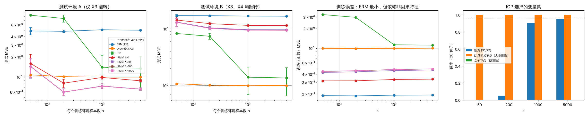
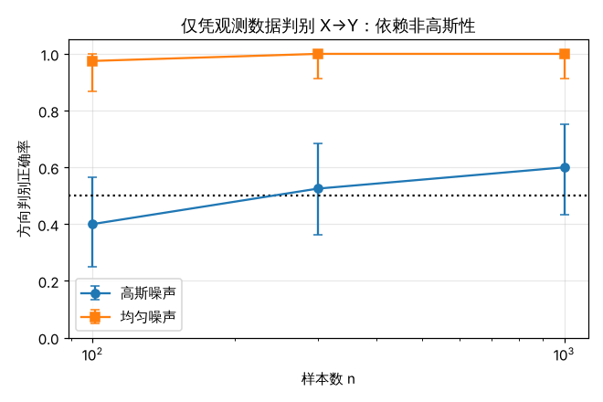

# Q08 因果驱动的机器学习

> 分组：学习范式 ｜ 实验：`experiment.py`（运行时间约 32 秒） ｜ 证据标注：[实测] [文献] [判断]

## 摘要
统计学习拟合相关性，而相关性在环境变化时会失效；因果学习希望找到跨环境不变的机制。我们在一个多环境线性结构因果模型（SCM）中比较了汇总 ERM、只用真实原因的 Oracle、不变因果预测 ICP（Peters 等 2016）和线性 IRMv1（Arjovsky 等 2019），并用两个小实验检验“仅凭观测数据能识别多少因果结构”。[实测] 当一个“结果变量”与标签的关系在测试环境翻转时，ERM 的测试 MSE 约为 5.0（Oracle 1.0），且不随样本量下降；ICP 在全部 80 次运行中从未把任何结果变量误选为原因，n≥1000 时以 0.90–0.95 的频率恰好选出真实原因集；IRMv1 在只翻转一个结果变量的环境中 MSE 低至 0.663，但当另一个结果变量也被干预时升至 9.438。观测数据方面，线性高斯下链、叉、反向链的最大似然在 1e-12 量级内完全相同；非高斯（均匀）噪声下方向判别正确率达 1.0。结论：因果不变性能带来真正的分布外稳健性，但它要么依赖足够多样的环境与样本，要么依赖额外的分布假设——没有“免费的因果”。

## 1. 问题界定
机器学习的独立同分布假设在部署时普遍失效。Pearl 的因果阶梯指出，仅从观测相关性无法回答干预与反事实问题 [文献]。“因果驱动学习”的基础问题是：**在什么信息条件下，学习器能从数据中区分稳定的因果机制与不稳定的伪相关，并利用它在新环境中泛化？** 核心矛盾是：伪相关特征（例如 Y 的结果变量）在训练分布中往往比原因**更有预测力**，ERM 会理性地利用它们；而区分二者需要额外信息（多环境/干预、或分布假设）。

预注册的可检验子假设：
- **H1（ERM 依赖伪相关）**：汇总 ERM 对结果变量 X3 的系数显著非零，在 X3 关系翻转的测试环境中 MSE ≥ 3 倍 Oracle，且该差距不随每环境样本量 n 增大而缩小。*否证*：n=5000 时 ERM 的 MSE < 3 倍 Oracle。
- **H2（ICP 的保守正确性）**：ICP 在所有 n 下把结果变量（X3、X4）误判为原因的频率 ≤ 0.05（其理论覆盖保证）；n≥1000 时恰好选出 {X1,X2} 的频率 ≥ 0.8；小样本时退化为空集（不做因果断言）。*否证*：误判率 > 0.05，或 n≥1000 时恢复率 < 0.8。
- **H3（IRMv1 是否实现不变性）**：λ≥10 的 IRMv1 在两个测试环境中的 MSE 都在 Oracle 的 1.5 倍以内。*否证*：任一测试环境中超过 1.5 倍。
- **H4（观测数据的可识别性边界）**：线性高斯 SCM 中，链/叉/反向链在 PC 式条件独立检验和最大似然下不可区分，对撞结构可识别；两变量方向判别在高斯噪声下与随机猜测无显著差异，在非高斯噪声下 n=1000 时正确率 ≥ 0.9。*否证*：高斯情形显著优于随机，或非高斯情形 < 0.9。

## 2. 研究现状
**因果推断的理论基础。** Pearl（*Causality*, 2000/2009, CUP）的结构因果模型与 do-演算、Spirtes, Glymour & Scheines（*Causation, Prediction, and Search*, 2000, MIT Press）的 PC 算法确立了“观测数据最多识别到 Markov 等价类”的结论 [文献]。在此之外获得可识别性需要额外假设：Shimizu 等（2006, *JMLR*，LiNGAM）利用非高斯噪声，Hoyer 等（2008, NIPS）利用非线性加性噪声 [文献]。连续优化结构学习 NOTEARS（Zheng 等，1803.01422）使因果发现可微，但 Reisach 等（2102.13647）指出模拟基准中变量方差的排序泄露了因果序，许多方法的“成功”可能来自这一伪影 [文献]。

**不变性与分布外泛化。** Peters, Bühlmann & Meinshausen（1501.01332）提出 ICP：真实原因集合使 Y 的条件分布跨环境不变，通过检验不变性得到带置信保证的原因集；Heinze-Deml 等（1706.08576）推广到非线性 [文献]。Rothenhäusler 等（1801.06229）的锚回归在 ERM 与因果解之间插值 [文献]。Arjovsky 等（1907.02893）提出 IRM，把不变性写成可微惩罚；REx（Krueger 等，2003.00688）惩罚跨环境风险方差；GroupDRO（Sagawa 等，1911.08731）优化最差组 [文献]。

**争议。** Rosenfeld 等（2010.05761）证明线性 IRM 在环境数少于伪特征维数时可能失败，非线性情形下可能只在训练环境附近“看起来不变”；Kamath 等（2101.01134）给出 IRMv1 惩罚不能刻画不变性的反例；Gulrajani & Lopez-Paz（2007.01434）在 DomainBed 上发现精心调参的 ERM 与各种领域泛化方法难分高下 [文献]。Geirhos 等（2004.07780）把深度网络对伪相关的依赖概括为“捷径学习” [文献]。Schölkopf 等（2102.11107）和 Kaddour 等（2206.15475）综述了因果表示学习这一新方向：如何从高维原始数据中学到可作因果推理的变量 [文献]。

**关键缺口。** (1) 现实中“环境”往往未标注、数量少、干预未知；(2) 高维感知数据中的因果变量本身需要学习；(3) 不变性方法的统计功效与环境多样性之间缺乏定量理论。

## 3. 研究设计
**Part 1：多环境 SCM。** X1~N(μ_e, s_e²)、X2~N(0, s_e²)（Y 的原因，环境改变其分布）；Y = 1.0·X1 + 0.5·X2 + N(0,1)（不变机制，不可约 MSE=1）；X3 = c_e·Y + N(0,0.5²)（结果变量，相关强度随环境变化）；X4 = d_e·Y + X2 + N(0,τ_e²)（结果变量）；X5~N(0,1)（无关）。训练环境 e1：(μ,s,c,τ)=(0,1,1,0.3)，e2：(1,1.5,2,1.0)，d=1。测试环境 A：(−1,2,−1,0.3,d=1)，仅 X3 翻转；测试环境 B：同 A 但 d=−1，两个结果变量都被干预。每个训练环境 n∈{50,200,1000,5000}，测试 5000 个样本，20 个种子。
- **方法**：ERM（汇总 OLS）；Oracle（只用 X1、X2 的 OLS）；ICP（枚举全部 32 个子集，汇总 OLS 残差做跨环境均值 F 检验与方差 Levene 检验，Bonferroni 合并，α=0.05，取接受集合的交集，再在交集上做 OLS；交集为空时预测训练均值）；线性 IRMv1（Σ_e R_e + λ Σ_e (∂R_e(v·f)/∂v|_{v=1})²，以 ERM 解为初值用 L-BFGS 优化，λ∈{1,10,100,1000} 全部报告）。
- **统计**：均值 ± 95% CI，与 Oracle 的配对 Wilcoxon 检验；ICP 选择集合的频率。

**Part 2：可识别性。** (a) 三变量线性高斯链 X→Y→Z、叉 X←Y→Z、反向链、对撞 X→Y←Z（边权 0.8，n=1000，50 个种子）；用 Fisher-z 检验 X⊥Z 与 X⊥Z|Y（α=0.01）输出 PC 式结论，并计算 4 个候选 DAG 的最大对数似然。(b) 两变量 X→Y（y=0.8x+0.6e，噪声单位方差），双向回归后用 HSIC（高斯核、中位数带宽）度量“残差与回归元”的依赖，取依赖较小者为因果方向；高斯 vs 均匀噪声，n∈{100,300,1000}，每格 40 次，二项检验对照 0.5。

## 4. 结果

**表 1 测试 MSE（均值 ± 95% CI，20 种子；不可约误差 = 1）** [实测]

| n/环境 | 方法 | 测试环境 A（仅 X3 翻转） | 测试环境 B（X3、X4 翻转） | X3 系数 | X4 系数 |
|---|---|---|---|---|---|
| 50 | ERM | 4.861±0.612 | 17.136±0.752 | 0.299 | 0.372 |
| 50 | Oracle | 1.080±0.029 | 1.072±0.030 | 0 | 0 |
| 50 | ICP | 8.320±0.188 | 8.293±0.219 | 0 | 0 |
| 50 | IRMv1 λ=1000 | 1.442±0.461 | 13.058±2.278 | 0.094 | 0.534 |
| 200 | ERM | 4.793±0.215 | 17.065±0.512 | 0.297 | 0.368 |
| 200 | ICP | 7.439±0.920 | 7.403±0.916 | 0 | 0 |
| 200 | IRMv1 λ=1000 | 0.600±0.070 | 10.206±0.688 | 0.071 | 0.518 |
| 1000 | ERM | 5.058±0.105 | 16.855±0.200 | 0.307 | 0.348 |
| 1000 | Oracle | 1.000±0.008 | 0.993±0.009 | 0 | 0 |
| 1000 | ICP | 1.403±0.698（中位数 1.008） | 1.401±0.708（中位数 0.988） | 0 | 0 |
| 1000 | IRMv1 λ=1000 | 0.733±0.058 | 9.475±0.306 | 0.095 | 0.468 |
| 5000 | ERM | 4.977±0.068 | 16.721±0.100 | 0.303 | 0.354 |
| 5000 | Oracle | 1.000±0.010 | 1.000±0.009 | 0 | 0 |
| 5000 | ICP | 1.348±0.683（中位数 1.000） | 1.360±0.704（中位数 1.004） | 0 | 0 |
| 5000 | IRMv1 λ=1 | 0.882±0.042 | 11.526±0.141 | 0.122 | 0.487 |
| 5000 | IRMv1 λ=1000 | 0.663±0.030 | 9.438±0.149 | 0.085 | 0.483 |

训练（汇总）MSE 在 n=5000 时：ERM 0.193，IRMv1 λ=1000 0.484，ICP 1.118，Oracle 1.003——训练误差的排序与测试误差几乎完全相反。

**表 2 ICP 选择的变量集频率（20 种子）** [实测]

| n/环境 | 恰为 {X1,X2} | ⊆真实原因（无假阳性） | 空集 | 含结果变量 X3/X4 |
|---|---|---|---|---|
| 50 | 0.0 | 1.0 | 1.0 | 0.0 |
| 200 | 0.05 | 1.0 | 0.7 | 0.0 |
| 1000 | 0.9 | 1.0 | 0.05 | 0.0 |
| 5000 | 0.95 | 1.0 | 0.05 | 0.0 |

**表 3 观测数据的可识别性** [实测]

| 实验 | 结果 |
|---|---|
| PC 式检验，链/叉/反向链数据（各 50 次） | 50/50 输出“X—Y—Z 不可定向”的等价类 |
| PC 式检验，对撞数据 | 50/50 正确输出 X→Y←Z |
| 链/叉/反向链三者间最大对数似然差 | 最大绝对值 9.09e-13（数值精度内完全相同） |
| 链数据上对撞模型的对数似然差 | 平均 −113.5 |
| 方向判别，高斯噪声 n=100/300/1000 | 正确率 0.4 / 0.525 / 0.6（n=1000 时 95% CI 0.433–0.751，p=0.27） |
| 方向判别，均匀噪声 n=100/300/1000 | 0.975 / 1.0 / 1.0（n=1000 时 CI 下限 0.912） |

**逐条回应假设：**
- **H1：支持。** ERM 对 X3 系数约 0.30，测试环境 A 中 MSE 在 n=50 时为 4.861、n=5000 时为 4.977——约 5 倍 Oracle，样本量增加 100 倍丝毫没有改善：这是偏差而非方差。
- **H2：支持。** 结果变量的误选频率在所有 n 下均为 0；n=1000/5000 时恰好恢复 {X1,X2} 的频率为 0.9/0.95；n≤200 时多为空集，导致其 MSE（约 7.4–8.3）甚至差于 ERM——ICP 以“拒绝作答”换取正确性。n≥1000 时 ICP 的中位 MSE 与 Oracle 相同，均值被 1 次空集运行拉高。
- **H3：不支持。** IRMv1 在测试环境 A 中 MSE 甚至低于 Oracle（n=5000 时 0.663），因为它保留了 X4（系数 0.483），而 X4 的机制在环境 A 中未变；一旦 X4 也被干预（环境 B），MSE 升至 9.438。λ 从 10 增大到 1000 几乎不改变解。
- **H4：支持。** 线性高斯下三种非对撞结构在似然上完全等价，检验也只能给出等价类；非高斯噪声使方向可识别。

## 5. 讨论
**机理解释。** ERM 的目标是训练分布上的最优预测，结果变量 X3、X4 携带关于 Y 的“事后信息”，比原因更有预测力（训练 MSE 0.193 对 1.003），因此 ERM 的选择在统计上完全理性，但它押注于一个会变的机制。ICP 利用“原因集合下残差分布跨环境不变”这一可检验含义，任何包含结果变量的集合都会因 c_e、τ_e 的变化而被拒绝 [实测]。IRMv1 失败的原因在于它的惩罚只是不变性的一个**必要条件**（对标量乘子的梯度为零），在只有两个训练环境、两个结果变量时，存在大量满足惩罚却并非因果的解；它找到的解恰好对 X4 的训练期变化“看起来不变”，但这种不变不能外推到 X4 机制被干预的情形。这与 Rosenfeld 等、Kamath 等的理论反例一致 [文献+实测]。环境 A 中 IRMv1 优于 Oracle 也说明：**因果预测器只在“任意干预非 Y 变量”的最坏情况意义下最优**，在特定偏移下，非因果特征可能更好；选择因果模型本质上是选择对哪类偏移稳健 [判断]。

**观测数据的边界。** Part 2 复现了教科书结论：线性高斯下 Markov 等价类内的模型在似然上不可区分（差值 9.09e-13 属于浮点误差），只有对撞结构留下可检验的条件独立“指纹”。非高斯性带来可识别性，但这是**额外假设**而非免费午餐：若真实噪声接近高斯，同一方法退化为随机猜测（n=1000 时 0.6，不显著）[实测]。

**设计偏差（如实报告）。** 原设计只有测试环境 A；看到 IRMv1 在 A 中优于 Oracle 后，我们加入了测试环境 B 以区分“利用未偏移特征的幸运”与“真正的不变性”。训练数据、方法和超参数均未改变。

**效度威胁与外推边界。** (1) 全部为低维线性高斯 SCM，变量已给定；真实问题中因果变量需从像素/文本中学习，ICP 的子集枚举不可扩展（指数复杂度）。(2) 环境数仅 2 个；IRM 在更多环境下可能表现更好，本结论只适用于“环境少”的情形，而这恰是现实常态 [判断]。(3) ICP 的检验假设高斯残差和线性模型；模型错设时 ICP 可能拒绝所有集合。(4) Part 2(b) 的 HSIC 判别只是 LiNGAM/ANM 思想的简化实现，未处理混杂与测量误差。

<!-- BIBLIO:start -->
## 文献计量信号（arXiv，[实测]）

检索式：摘要含 “invariant risk minimization”、“causal representation learning”、“spurious correlation”、“causal discovery” 之一；基线为同年 cs.LG / cs.AI / stat.ML 论文总数。数据：`ai2035/bibliometrics/arxiv_counts.json`（检索日 2026-11-26）。

| 年份 | 命中论文数 | 占 AI/ML 基线比例 |
|---|---|---|
| 2015 | 17 | 0.42% |
| 2016 | 14 | 0.24% |
| 2017 | 18 | 0.21% |
| 2018 | 27 | 0.20% |
| 2019 | 50 | 0.23% |
| 2020 | 89 | 0.29% |
| 2021 | 177 | 0.53% |
| 2022 | 289 | 0.80% |
| 2023 | 419 | 0.93% |
| 2024 | 444 | 0.75% |
| 2025 | 620 | 0.83% |

- 2019–2025 年份额的对数线性趋势：**每年 +25.5%**（95% CI +8.8% ~ +44.7%，R²=0.77），判定：**相对升温（增速显著快于 AI/ML 总体）**；在 20 个问题中按相对增速排第 3 位。
- 解读边界：分子覆盖 arXiv 全部类别、分母仅为 AI/ML 三个类别，所以“比例”是相对关注度指数，并非严格的子集占比；关键词匹配既会漏掉使用其他术语的工作，也会混入无关用法；arXiv 偏重机器学习社区，认知科学、神经科学与期刊论文覆盖不足。该信号衡量的是**研究关注度**，不是**问题被解决的程度**。
<!-- BIBLIO:end -->

## 6. 结论与 2035 展望
**核心结论**
1. 当伪相关机制在部署时变化，ERM 的误差约为因果预测器的 5 倍，且无法通过增加数据消除。[实测，置信度：高（机理层面）]
2. 基于假设检验的不变性方法（ICP）能以可控的错误率找到原因，但需要足够的样本与环境异质性；在信息不足时它会拒绝作答而不是给出错误答案。[实测，置信度：高]
3. 可微的不变性惩罚（IRMv1）在环境少时不能保证不变性：本实验中在一种偏移下优于因果模型，在另一种偏移下差约 9 倍。[实测+文献，置信度：中高]
4. 仅凭观测数据，因果方向在线性高斯情形下不可识别；可识别性总要以额外假设（非高斯、非线性、干预）为代价。[实测+文献，置信度：高]

**关键未解问题**：从高维原始数据中学到可干预的因果变量（因果表示学习）的可识别条件；环境未标注时如何自动发现“环境”；如何量化“我的训练环境多样性足以支撑哪些分布外承诺”。

**建议研究路线**
- 近期（2026–2028）：构建带**已知真实因果图**和可控干预的高维基准（如合成渲染场景），把“环境多样性”作为自变量；里程碑——报告不变性方法分布外性能随环境数变化的标度曲线。
- 中期（2029–2032）：发展带置信保证的因果表示学习，把 ICP 式检验推广到学到的表示上；里程碑——在高维基准上以 ≥90% 的频率恢复真实因果变量，且假阳性率 ≤5%。
- 远期（2033–2035）：使基础模型能主动设计干预（实验）来消解 Markov 等价类；里程碑——在模拟科学发现环境中，智能体以少于穷举一半的干预次数识别出完整因果图。

## 参考文献
1. Pearl, J. (2009). *Causality: Models, Reasoning, and Inference* (2nd ed.). Cambridge University Press.
2. Spirtes, P., Glymour, C., & Scheines, R. (2000). *Causation, Prediction, and Search* (2nd ed.). MIT Press.
3. Shimizu, S., Hoyer, P. O., Hyvärinen, A., & Kerminen, A. (2006). A linear non-Gaussian acyclic model for causal discovery. *JMLR*, 7, 2003–2030.
4. Hoyer, P. O., Janzing, D., Mooij, J., Peters, J., & Schölkopf, B. (2008). Nonlinear causal discovery with additive noise models. *NIPS 2008*.
5. Peters, J., Bühlmann, P., & Meinshausen, N. (2015). Causal inference using invariant prediction: identification and confidence intervals. arXiv:1501.01332（*JRSS-B* 2016）.
6. Heinze-Deml, C., Peters, J., & Meinshausen, N. (2017). Invariant Causal Prediction for Nonlinear Models. arXiv:1706.08576.
7. Rothenhäusler, D. et al. (2018). Anchor regression: heterogeneous data meets causality. arXiv:1801.06229.
8. Zheng, X. et al. (2018). DAGs with NO TEARS: Continuous Optimization for Structure Learning. arXiv:1803.01422.
9. Arjovsky, M., Bottou, L., Gulrajani, I., & Lopez-Paz, D. (2019). Invariant Risk Minimization. arXiv:1907.02893.
10. Sagawa, S. et al. (2019). Distributionally Robust Neural Networks for Group Shifts. arXiv:1911.08731.
11. Krueger, D. et al. (2020). Out-of-Distribution Generalization via Risk Extrapolation (REx). arXiv:2003.00688.
12. Geirhos, R. et al. (2020). Shortcut Learning in Deep Neural Networks. arXiv:2004.07780.
13. Gulrajani, I., & Lopez-Paz, D. (2020). In Search of Lost Domain Generalization. arXiv:2007.01434.
14. Rosenfeld, E., Ravikumar, P., & Risteski, A. (2020). The Risks of Invariant Risk Minimization. arXiv:2010.05761.
15. Kamath, P. et al. (2021). Does Invariant Risk Minimization Capture Invariance? arXiv:2101.01134.
16. Schölkopf, B. et al. (2021). Towards Causal Representation Learning. arXiv:2102.11107.
17. Reisach, A. G., Seiler, C., & Weichwald, S. (2021). Beware of the Simulated DAG! Causal Discovery Benchmarks May Be Easy To Game. arXiv:2102.13647.
18. Kaddour, J. et al. (2022). Causal Machine Learning: A Survey and Open Problems. arXiv:2206.15475.
