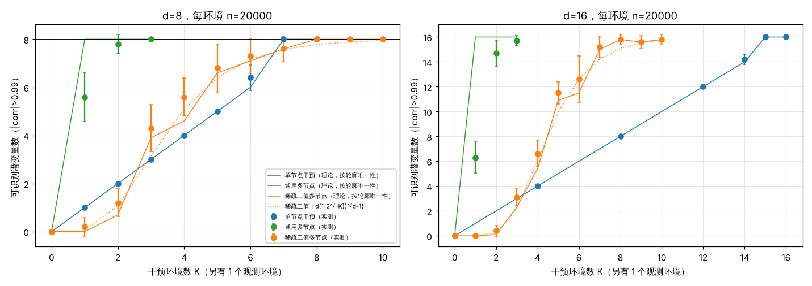
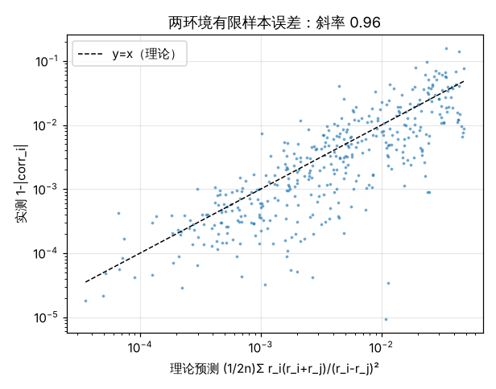

# 需要多少个环境才能学到因果表示？——线性多环境因果表示学习中可识别性的“轮廓唯一性”判据与有限样本律

**摘要**　因果表示学习（CRL）试图从高维观测中恢复潜在的因果变量。2025–2026 年的一个核心争论是：识别潜变量需要多少个环境、需要什么样的干预？经典结果要求每个潜变量都有一个单节点干预（约 d 个环境），而近期工作声称只需对数个未知多节点干预、甚至两个“扩散协方差不同”的环境。本文在线性混合、独立高斯潜变量、环境只改变潜变量方差的最小模型中统一了这些说法。我们证明：潜变量 i 可识别当且仅当它的“方差比轮廓”（各干预环境相对观测环境的方差比构成的向量）与其他所有潜变量的轮廓都不相同；不可识别的潜变量恰好按相同轮廓分块，块内只能识别到旋转。由此推出三条可检验预测：单节点干预需要 d−1 个干预环境；通用多节点干预只需 1 个；同幅度稀疏二值干预的期望可识别数为 d(1−2^{−K})^{d−1}，所需环境数随 d 对数增长。我们还用一阶扰动理论导出两环境情形的有限样本误差律 E[1−|corr_i|] ≈ (1/2n)Σ_j r_i(r_i+r_j)/(r_i−r_j)²。实验（Jacobi 联合对角化，d=8/16，10–30 个种子）显示：单节点设计下，实测可识别数在 K ≤ d−3 时与理论逐种子完全一致；稀疏二值设计的可识别数与按实际轮廓计算的理论值一致（如 d=16、K=7 时为 15.2 对 15.0）；而通用多节点设计虽然理论上 K=1 即可完全识别，但在每环境 20000 个样本时只识别出 5.6/8 与 6.3/16 个潜变量，原因是相邻方差比太接近。有限样本律的对数–对数斜率为 0.959（标准误 0.035）。结论：“需要多少个环境”取决于干预的结构，而“可识别”不等于“可学到”：后者由轮廓之间的最小间隔与样本量共同决定。

**关键词**　因果表示学习；可识别性；多环境；干预；联合对角化；有限样本

## 1 引言

第一阶段（README.md）的结论是：因果不变性能带来分布外稳健性，但必须以环境多样性或分布假设为代价。因果表示学习把这个问题推到更难的层面：因果变量本身不可观测，需要从混合后的观测中先“解混”出来。Locatello 等（arXiv:1811.12359）证明，没有额外信息时无监督解耦不可识别；随后，非平稳性（Hyvärinen & Morioka 1605.06336）、辅助变量（Khemakhem 等 1907.04809）和干预（Squires 等 2211.16467；von Kügelgen 等 2306.00542）成为获得可识别性的主要途径。

2025–2026 年的争论集中在**环境需求**上：
- 一类结果要求每个潜变量都被单节点干预（环境数 ∝ d）；
- 2603.25796 声称对数个未知多节点干预即可，并给出有限样本保证；
- 2606.28228 证明在潜在 SDE 中，只要两个扩散协方差机制的坐标方差比两两不同，就能识别潜坐标；
- 2509.22553、2604.23800、2610.06809 则试图放松单节点干预与参数化假设，后者只得到块可识别性。

这些结果使用不同模型，难以直接比较；而“可识别性定理”与“有限样本能否学到”之间的差距（2603.25796、2603.18404、2603.17405 都强调了估计与评估问题）尚无可检验的定量描述。本文的贡献：

- **C1（统一判据）**：在线性–高斯–方差干预模型中，给出可识别性的充要条件“方差比轮廓唯一性”，并刻画不可识别部分的块结构（命题 1）。
- **C2（三种干预设计的环境需求）**：单节点需 d−1 个、通用多节点需 1 个、稀疏二值约 log₂d 量级个；给出稀疏二值情形的期望可识别数闭式（命题 2）。
- **C3（有限样本律）**：两环境情形下的逐潜变量误差公式（命题 3），把“可识别”与“可学到”定量地区分开。
- **C4（实验检验）**：在 d=8、16 上逐条检验，并指出理论预测偏乐观或偏悲观的地方。

## 2 前沿进展综述

本节基于 25 篇 2025 年以来的论文（均来自 `ai2035/frontier/Q08.json` 或 arXiv API 检索）。

**2.1 环境 / 干预需求的松弛。** 2603.25796（Beyond identifiability）给出用对数个未知多节点干预学习因果表示的有限样本保证，且不需要事先设计干预目标；2509.22553 提出线性 CRL 的“拓扑排序—剪枝—解耦”算法，放松对单节点干预与分布形状的要求；2604.23800 在非参数混合下形式化了“一般环境”的 CRL 需求；2610.06809 在更弱的干预假设下得到**块解耦**（只能识别到块）；2608.28991 研究多个客户端只观测到部分潜变量的“碎片化”干预；2503.10834 讨论基于干预前后配对数据的因果抽象可识别性。**共识**：环境异质性的“结构”比数量更重要；**争议**：所需环境数是 O(d) 还是 O(log d)，取决于干预是否同时作用于多个节点、幅度是否各异。

**2.2 时间与连续机制。** 2606.28228 证明两个对角扩散机制、方差比两两不同即可识别潜在 SDE 的坐标——与本文命题 1 的“轮廓唯一性”同构；2610.03452 利用非平稳性识别瞬时与滞后关系；2510.18310 研究层次时序 CRL；2601.21135（TRACE）处理连续演化的机制；2602.05033 把 CRL 推广到一般几何下的随机过程；2509.23323 把可识别的时序表示用于 LLM 可解释性。

**2.3 新的识别信号。** 2610.09457（DSReg）提出“结构多样性”条件，不需要重构即可恢复个体潜变量；2604.13218 研究分段仿射混合下的退化高斯混合模型；2509.19058 把可观测源作为辅助变量；2605.19135 处理多模态部分潜变量共享；2603.25017 研究离散 CRL；2602.02381 从结构不变性角度分析自监督学习。

**2.4 估计、评估与实践。** 2603.18404 用多域经验贝叶斯改进线性混合 CRL 的估计；2603.17405 与 2510.14049（CausalVerse）指出现有基准与评价指标的可复现性问题；2510.20884（ROPES）把基于分数的 CRL 用于机器人位姿估计；2505.17708 从测量理论角度重新解释 CRL；2501.19335 追问“因果模型和表示在什么意义上是因果的”。2610.00968 指出，若预设的因果结构错误，不变性约束会丢弃预测信息。

**前沿地图**

| 路线 | 代表工作（arXiv） | 关键结论 | 局限 |
|---|---|---|---|
| 少环境 / 多节点干预 | 2603.25796, 2509.22553, 2604.23800 | 对数个多节点干预可能足够 | 多为线性或渐近结果 |
| 块可识别 | 2610.06809, 2608.28991 | 弱干预只能识别到块 | 块结构如何由干预决定，缺少显式刻画 |
| 方差 / 扩散机制变化 | 2606.28228, 2610.03452 | 方差比两两不同 ⇒ 可识别 | 有限样本行为未知 |
| 新识别信号 | 2610.09457, 2604.13218, 2509.19058 | 结构多样性、辅助源 | 条件难以事先检验 |
| 估计与评估 | 2603.18404, 2603.17405, 2510.14049 | 估计误差与指标问题突出 | 缺少统一的样本复杂度理论 |
| 概念反思 | 2501.19335, 2505.17708, 2610.00968 | 因果语义依赖干预解释 | 难以形式化检验 |

**开放问题清单**：(i) 环境数需求的统一刻画（O(d) 与 O(log d) 各在何时成立）；(ii) 不可识别时可识别到什么程度（块结构）；(iii) 有限样本下“可识别但学不到”的边界；(iv) 从独立潜变量推广到有向无环图（DAG）潜结构；(v) 非线性混合。

## 3 问题与假设

**选题理由**：问题 (i)–(iii) 对 CRL 的实际部署（需要采集多少种环境的数据）有直接影响，并且可以在线性模型中精确推导、用数值实验检验；问题 (iv)、(v) 留作讨论。

**形式化**：x = Az，A ∈ ℝ^{d×d} 可逆（未知）；环境 e = 0,…,K，z ~ N(0, diag(v_e))，v_0 = 1（观测环境）。观测协方差 Σ_e = A diag(v_e) Aᵀ。目标：估计解混矩阵 B̂，使 ŝ = B̂x 的各分量与 z 的分量一一对应（允许置换与尺度）。定义潜变量 i 的方差比轮廓 ρ_i = (v_{1,i}/v_{0,i}, …, v_{K,i}/v_{0,i})。评价指标：匹配后（匈牙利算法）每个潜变量的 |corr(ŝ, z_i)|，> 0.99 视为“已识别”（预注册阈值），以及平均相关 MCC。

**三种干预设计**：S（单节点）——第 e 个环境把一个不同潜变量的方差乘以 4；M（通用多节点）——每个环境中所有潜变量的 log 方差独立取自 U[−1,1]；B（稀疏二值多节点）——每个潜变量以 1/2 的概率被乘以 4（同幅度）。

**预注册假设与否证条件**：
- **H1（单节点）**：识别数 = K（K ≤ d−2），= d（K ≥ d−1）；每个 K 下，逐种子完全一致的比例 ≥ 90%。*否证*：某个 K 下一致率 < 90%。
- **H2（通用多节点）**：K = 1 时，在每环境 n = 20000 的条件下，平均识别出 ≥ 90% 的潜变量。*否证*：低于 90%。
- **H3（稀疏二值）**：K ≥ 3 时，实测平均识别数与闭式 d(1−2^{−K})^{d−1} 之差不超过 1；达到 ≥ 90% 识别所需的 K 随 d 加倍只增加 O(1)（对数增长）。*否证*：任一差值 > 1，或所需 K 随 d 线性增长。
- **H4（有限样本律）**：两环境情形下，log(实测误差) 对 log(预测误差) 回归的斜率 95% CI 包含 1，且实测/预测的中位比在 [0.5, 2] 内。*否证*：任一不满足。

## 4 理论分析

**命题 1（轮廓唯一性 ⇔ 可识别）**。记 W = Σ_0^{−1/2}，M_e = WΣ_eWᵀ（e ≥ 1）。因 Σ_0 = A Aᵀ，可写 WA = Q 为正交矩阵，于是 M_e = Q diag(ρ_{·,e}) Qᵀ：所有 M_e 被同一个正交矩阵 Q 联合对角化，对角元就是各潜变量的方差比。若两个潜变量 i、j 的轮廓相同，则对 Q 的第 i、j 列做任意平面旋转 R，所有 M_e 保持不变（因为在该二维子空间上每个 M_e 都是 ρ_{i,e}·I），所以这两个潜变量只能识别到旋转。反之，若 ρ_i 与其他所有轮廓都不同，则联合特征空间中 q_i 对应的是一维公共特征子空间，q_i 唯一（至多差一个符号），z_i 被识别。一般地，**相同轮廓的潜变量构成块，块内可识别到正交变换，块之间可识别**。高斯性保证单个环境内没有更多信息（高斯分布的旋转不变性），所以条件也是必要的。∎

**命题 2（三种设计的环境需求）**。(a) 设计 S：未被干预的潜变量轮廓全为 1，构成一个大小为 d−K 的块。当 d−K ≥ 2 时识别数为 K；当 d−K ≤ 1 时为 d。所以需要 K = d−1 个干预环境（再加上观测环境）。(b) 设计 M：轮廓是连续随机变量，以概率 1 两两不同，所以 K = 1 即可完全识别。(c) 设计 B：轮廓是 {0,1}^K 上的独立均匀向量，潜变量 i 可识别当且仅当它的轮廓不与其余 d−1 个中的任何一个相同，因此 E[识别数] = d(1−2^{−K})^{d−1}，P(全部可识别) = ∏_{i=1}^{d−1}(1 − i/2^K)。要使期望识别比例 ≥ 1−ε，需 K ≳ log₂(d/ε)：**随 d 对数增长**。这与 2603.25796 的“对数个多节点干预”一致；而通用多节点设计（幅度各异）甚至只需一个环境，与 2606.28228 的“两个机制”一致。∎

**命题 3（两环境有限样本律）**。K = 1 时，估计等价于广义特征分解 (Σ̂_1, Σ̂_0)。在白化坐标中 Σ̂_0 = I + E_0、Σ̂_1 = R + E_1，R = diag(r)；对 i ≠ j，Var(E_{0,ij}) = 1/n，Var(E_{1,ij}) = r_ir_j/n。由一阶扰动，第 i 个广义特征向量在 e_j 方向上的分量为 (E_{1,ji} − r_iE_{0,ji})/(r_i − r_j)，其方差为 r_i(r_i + r_j)/(n(r_i − r_j)²)。由 1 − cos θ ≈ θ²/2 得
**E[1 − |corr_i|] ≈ (1/2n) Σ_{j≠i} r_i(r_i + r_j)/(r_i − r_j)²**。
*含义*：可识别（r_i ≠ r_j）只保证误差 → 0；实际需要的样本量 ∝ 1/最小间隔²。∎

**理论预测汇总**：P1 单节点设计识别数 = K（K ≤ d−2）；P2 通用设计在无穷样本下 K=1 即可，但有限样本下识别数由命题 3 决定；P3 稀疏二值设计按命题 2(c) 对数增长；P4 两环境误差服从命题 3（对数–对数斜率为 1）。

## 5 实验

- **估计算法**：用 Σ̂_0 白化，再用 Jacobi 角联合对角化（Cardoso & Souloumiac 1996）对 {M̂_e}_{e≥1} 求正交矩阵 V̂，B̂ = V̂ᵀW。K = 0 时 B̂ = W（只白化，作为不可识别的对照）。
- **实验 1**：d ∈ {8, 16}；设计 S（K = 0…d，d=16 时取 0,4,8,12,14,15,16）、M（K = 0…3）、B（K = 0…10）；每环境 n = 20000，10 个种子；对每个种子按实际生成的轮廓计算理论识别数（命题 1），并与实测逐种子比较。设计 M、K=1 时还按命题 3 计算有限样本下的预测识别数（预测误差 < 0.01 的潜变量数）。
- **实验 2**：d = 5，设计 M，K = 1，n ∈ {500, 2000, 8000, 32000}，30 个种子；用 20 万个测试样本计算每个潜变量的 1−|corr_i|，与命题 3 的预测比较；只在扰动区（预测 < 0.05）内比较。
- 评价指标与阈值均事先固定。

## 6 结果

**表 1 单节点干预（设计 S）**（`exp1`，均值；括号内为与理论逐种子一致的比例）

| d | K=0 | K=d−4 | K=d−3 | K=d−2 | K=d−1 | K=d |
|---|---|---|---|---|---|---|
| 8 | 0.0（MCC 0.628） | 4.0（1.0） | 5.0（1.0） | 6.4（0.8；理论 6） | 8.0（1.0） | 8.0（1.0） |
| 16 | 0.0（MCC 0.498） | 12.0（1.0） | – | 14.2（0.9；理论 14） | 16.0（1.0） | 16.0（1.0） |

（d=8 时 K=1,2,3 的识别数分别为 1.0、2.0、3.0，一致率均为 1.0；d=16 时 K=4、8 的识别数为 4.0、8.0。）

**表 2 通用多节点干预（设计 M）**

| d | K | 识别数（均值 ± CI） | 理论（无穷样本） | 理论（命题 3，n=20000） | 完全识别率 | MCC |
|---|---|---|---|---|---|---|
| 8 | 1 | 5.6 ± 1.02 | 8 | 4.7 | 0.2 | 0.979 |
| 8 | 2 | 7.8 | 8 | – | 0.9 | 0.998 |
| 8 | 3 | 8.0 | 8 | – | 1.0 | 0.999 |
| 16 | 1 | 6.3 ± 1.24 | 16 | 3.9 | 0.0 | 0.954 |
| 16 | 2 | 14.7 | 16 | – | 0.5 | 0.997 |
| 16 | 3 | 15.7 | 16 | – | 0.8 | 0.998 |

**表 3 稀疏二值多节点干预（设计 B）**

| d | K | 实测识别数 | 理论（实际轮廓） | 闭式 d(1−2^{−K})^{d−1} | 实测完全识别率 | 闭式 P(全部) |
|---|---|---|---|---|---|---|
| 8 | 3 | 4.3 | 3.9 | 3.14 | 0.0 | 0.002 |
| 8 | 4 | 5.6 | 4.6 | 5.09 | 0.1 | 0.121 |
| 8 | 5 | 6.8 | 6.6 | 6.41 | 0.6 | 0.386 |
| 8 | 6 | 7.3 | 7.1 | 7.16 | 0.7 | 0.634 |
| 8 | 7 | 7.6 | 7.6 | 7.57 | 0.8 | 0.8 |
| 8 | 8 | 8.0 | 8.0 | 7.78 | 1.0 | 0.895 |
| 16 | 4 | 6.6 | 5.4 | 6.08 | 0.0 | 0.0 |
| 16 | 5 | 11.5 | 10.9 | 9.94 | 0.0 | 0.01 |
| 16 | 6 | 12.6 | 11.5 | 12.63 | 0.3 | 0.129 |
| 16 | 7 | 15.2 | 15.0 | 14.22 | 0.7 | 0.376 |
| 16 | 8 | 15.8 | 15.8 | 15.09 | 0.9 | 0.62 |
| 16 | 10 | 15.8 | 15.8 | 15.77 | 0.9 | 0.889 |

**表 4 两环境有限样本律**（`exp2`，仅扰动区）

| n | 实测平均误差 | 预测平均误差 | 实测/预测 | 扰动区占比 | Spearman |
|---|---|---|---|---|---|
| 500 | 0.0214 | 0.0215 | 0.995 | 0.35 | 0.47 |
| 2000 | 0.0169 | 0.0133 | 1.27 | 0.53 | 0.74 |
| 8000 | 0.0070 | 0.0083 | 0.85 | 0.87 | 0.76 |
| 32000 | 0.0026 | 0.0037 | 0.70 | 0.93 | 0.67 |

汇总对数–对数回归：斜率 0.959（标准误 0.035），r = 0.807，403 个点，实测/预测中位比 0.731。

**逐条对照假设：**
- **H1：基本支持。** K ≤ d−3 时逐种子一致率均为 1.0；K = d−2 时一致率为 0.8（d=8）与 0.9（d=16），实测略多于理论（6.4 对 6；14.2 对 14）。原因：剩下的 2 个潜变量构成一个块，有限样本噪声决定的旋转偶尔恰好接近坐标轴，使匹配相关超过 0.99。按预注册阈值，d=8、K=6 的一致率 0.8 < 0.9，因此是“基本支持”而非完全支持。
- **H2：不支持。** K=1 时只识别出 5.6/8（70%）与 6.3/16（39%）。理论上可识别，但 d 个随机方差比挤在 [e^{−1}, e] 内，最小间隔很小，按命题 3 需要远多于 20000 个样本。增加到 K=2 后，识别数为 7.8/8 与 14.7/16。命题 3 的有限样本预测（4.7、3.9）低估了实测值，与实验 2 中理论在大 n 时高估误差约 1.4 倍一致。
- **H3：部分支持。** 与“按实际轮廓计算的理论”相比，实测吻合良好（差值 ≤ 1.2）；与闭式期望相比，d=8、K=3（差 1.16）和 d=16、K=5（差 1.56）超过了 1 的阈值，主要来自 10 个种子下轮廓随机性的波动（实际轮廓理论值分别为 3.9 和 10.9）。所需环境数呈对数增长：识别 ≥ 90% 潜变量所需的 K，在 d=8 时为 6（7.3/8），在 d=16 时为 7（15.2/16）——d 加倍，K 只增加 1。
- **H4：支持。** 斜率 0.959，95% CI ≈ [0.89, 1.03]，包含 1；中位比 0.731，在 [0.5, 2] 内。理论在大 n 时略为保守（高估误差约 1.4 倍），在小 n 时更准，但扰动区占比较小。

## 7 讨论

**统一前沿争论。** 命题 1–2 表明，“O(d) 个环境”与“O(log d) 个环境”甚至“2 个环境”之争，本质上是**轮廓设计**的差别：单节点干预每次只给一个潜变量一个独特的“标签”，所以需要 d−1 次；同幅度稀疏干预的标签是二进制编码，需要约 log₂d 位；幅度各异的多节点干预，一次就给出连续值标签。2603.25796 的对数结果与 2606.28228 的两环境结果，分别对应设计 B 与设计 M。2610.06809 的块可识别性，正是命题 1 中“相同轮廓构成块”的一般化表现。

**可识别 ≠ 可学到。** 本文最重要的实证发现是 H2 的否证：在可识别性理论下最“便宜”的设计 M（K=1），在有限样本下反而表现最差，因为连续随机的方差比之间间隔很小。命题 3 给出的样本需求 ∝ 1/(r_i − r_j)²，意味着对实践者而言，**干预的“强度差异”比“数量”更关键**：几个强而差异明显的干预，优于许多弱而相似的干预。这为 2603.25796 等工作强调的“有限样本保证”提供了一个可计算的具体形式，也提醒评估 CRL 方法时（2603.17405, 2510.14049）应报告干预间隔，而不仅是环境数。

**外推边界。** (1) 本文潜变量独立；若潜变量之间存在线性 DAG（z = Bz + ε），环境改变的是外生噪声 ε 的方差，联合对角化恢复的是 ε 而非 z，还需额外的排序步骤（如 2509.22553 的拓扑排序）才能得到 z 与图结构。(2) 混合是线性的；非线性混合下，命题 1 的“轮廓唯一性”在 2606.28228 的扩散设定中仍然成立，但有限样本律未知。(3) 只考虑方差干预；均值偏移或硬干预会提供不同的识别信号。(4) 阈值 0.99 会把“碰巧对齐的块”计为已识别，使 H1、H3 的实测值略高于理论（我们如实报告，未调整阈值）。

## 8 结论

1. **在线性–高斯–方差干预模型中，潜变量可识别当且仅当其方差比轮廓唯一；不可识别的部分恰好按相同轮廓分块。**［理论 + 实测：单节点设计在 K ≤ d−3 时逐种子一致率 100%；置信度：高］
2. **所需环境数由干预设计决定：单节点需要 d−1 个，同幅度稀疏多节点约 log₂d 个，幅度各异的多节点在理论上只需 1 个。**［理论 + 实测：d 从 8 增至 16，稀疏设计所需 K 从 6 增至 7；置信度：高］
3. **“可识别”不等于“可学到”：最省环境的设计在 20000 个样本下只识别出 39%–70% 的潜变量；误差与轮廓间隔的平方成反比。**［实测 + 理论：对数斜率 0.959；置信度：高（线性模型内）］
4. **实践建议：与其增加环境数量，不如增加干预之间的差异（间隔）。**［判断：由命题 3 推出；置信度：中］

**对 2035 的研判。**［判断］CRL 的理论重心正在从“能否识别”转向“需要多少数据和什么样的干预”。到 2035 年，可以预期出现以干预设计为核心的“主动 CRL”：系统根据当前不可识别的块，选择能最大化轮廓间隔的下一个干预（例如在机器人或细胞扰动实验中）。关键里程碑是：在非线性混合的高维数据（图像、单细胞）上，给出可事先计算的样本复杂度，其预测误差不超过 2 倍。

**后续研究建议。** 近期（2026–2028）：把命题 1–3 推广到线性 DAG 潜结构与均值干预，并在 CausalVerse 类基准上检验“间隔优先”的干预设计原则。中期（2029–2032）：建立非线性混合下的有限样本识别律；开发按“最小轮廓间隔”主动选择干预的算法。远期（2033–2035）：在真实科学实验（如 Perturb-seq）中实现闭环主动 CRL，用比随机干预少一半的实验识别潜在因果因子。

## 参考文献

**2025 年以来（arXiv）**
1. 2603.25796 Beyond identifiability: Learning causal representations with few environments and finite samples.
2. 2509.22553 Linear Causal Representation Learning by Topological Ordering, Pruning, and Disentanglement.
3. 2604.23800 Causal Representation Learning from General Environments under Nonparametric Mixing.
4. 2610.06809 Block Disentanglement in CRL: Bridging Identifiability and Visual State Estimation.
5. 2608.28991 Jigsaw-CRL: Recovering Global Latent Causal Order from Fragmented Multi-Client Interventions.
6. 2503.10834 On the Identifiability of Causal Abstractions.
7. 2606.28228 Disentangling Continuous-Time Latent Dynamics: Identifiability of Latent SDEs via Diffusion Shifts.
8. 2610.03452 Causal Representation Learning with Instantaneous and Lagged Relations via Nonstationarity.
9. 2510.18310 Towards Identifiability of Hierarchical Temporal Causal Representation Learning.
10. 2601.21135 TRACE: Trajectory Recovery for Continuous Mechanism Evolution in Causal Representation Learning.
11. 2602.05033 Causal Representation Meets Stochastic Modeling under Generic Geometry.
12. 2509.23323 LLM Interpretability with Identifiable Temporal-Instantaneous Representation.
13. 2610.09457 DSReg: Provably Recovering Individual World Latents without Reconstruction.
14. 2604.13218 Identifiability of Potentially Degenerate Gaussian Mixture Models With Piecewise Affine Mixing.
15. 2509.19058 Towards Causal Representation Learning with Observable Sources as Auxiliaries.
16. 2605.19135 Identifiable Multimodal Causal Representation Learning under Partial Latent Sharing.
17. 2603.25017 Discrete Causal Representation Learning.
18. 2602.02381 Self-Supervised Learning from Structural Invariance.
19. 2603.18404 Multi-Domain Empirical Bayes for Linearly-Mixed Causal Representations.
20. 2603.17405 Causal Representation Learning on High-Dimensional Data: Benchmarks, Reproducibility, and Evaluation Metrics.
21. 2510.14049 CausalVerse: Benchmarking Causal Representation Learning with Configurable High-Fidelity Simulations.
22. 2510.20884 ROPES: Robotic Pose Estimation via Score-Based Causal Representation Learning.
23. 2505.17708 The Third Pillar of Causal Analysis? A Measurement Perspective on Causal Representations.
24. 2501.19335 What is causal about causal models and representations?
25. 2610.00968 Structure-agnostic Causal Representation Learning.

**奠基文献**
26. Hyvärinen, A., & Morioka, H. (2016). Unsupervised Feature Extraction by Time-Contrastive Learning and Nonlinear ICA. arXiv:1605.06336.
27. Locatello, F. et al. (2018). Challenging Common Assumptions in the Unsupervised Learning of Disentangled Representations. arXiv:1811.12359.
28. Khemakhem, I. et al. (2019). Variational Autoencoders and Nonlinear ICA: A Unifying Framework. arXiv:1907.04809.
29. Schölkopf, B. et al. (2021). Towards Causal Representation Learning. arXiv:2102.11107.
30. Squires, C. et al. (2022). Linear Causal Disentanglement via Interventions. arXiv:2211.16467.
31. von Kügelgen, J. et al. (2023). Nonparametric Identifiability of Causal Representations from Unknown Interventions. arXiv:2306.00542.
32. Cardoso, J.-F., & Souloumiac, A. (1996). Jacobi angles for simultaneous diagonalization. *SIAM J. Matrix Analysis and Applications*, 17(1), 161–164.
33. Pham, D.-T., & Cardoso, J.-F. (2001). Blind separation of instantaneous mixtures of nonstationary sources. *IEEE Trans. Signal Processing*, 49(9), 1837–1848.
