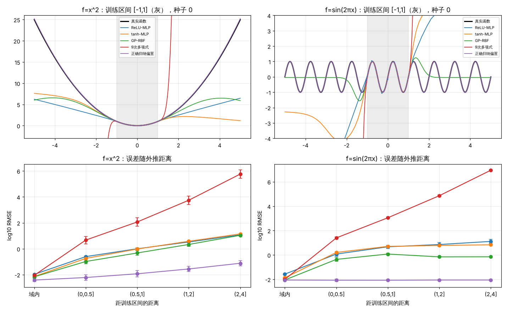
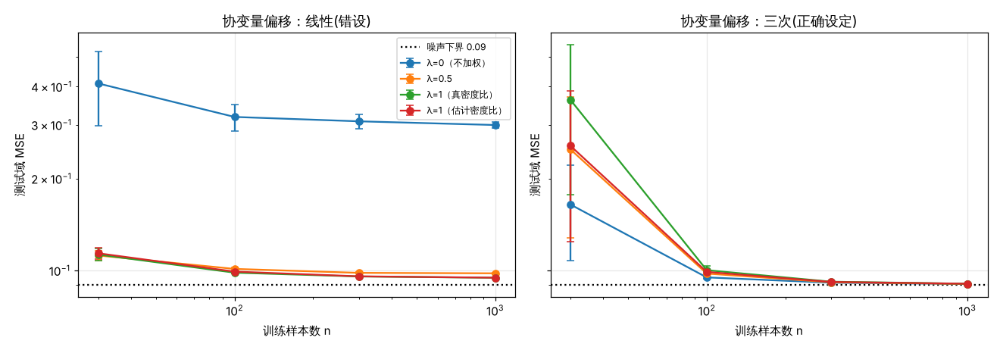
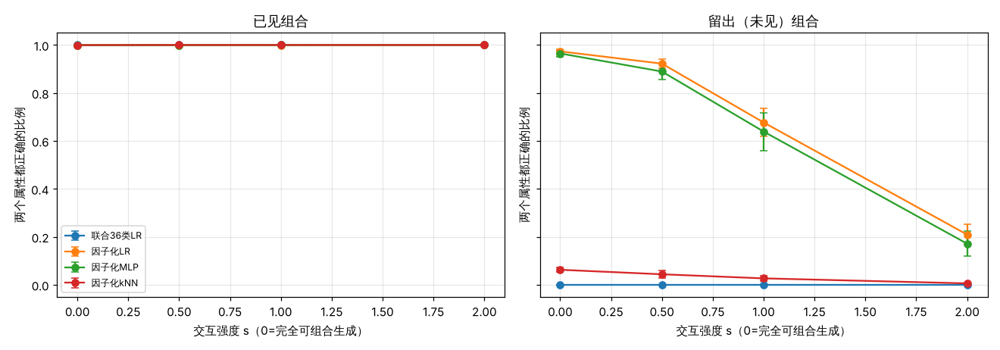

# Q09 分布外泛化与外推

> 分组：学习范式 ｜ 实验：`experiment.py`（运行时间约 57 秒） ｜ 证据标注：[实测] [文献] [判断]

## 摘要
分布外（OOD）泛化不是单一问题：输入落到训练支撑集之外（外推）、输入分布改变但条件分布不变（协变量偏移）、已知成分以新方式组合（组合泛化），三者的失败机理不同。我们为每一类设计了可控实验（种子数 8/100/10）。[实测] (a) 在 [−1,1] 上训练的 ReLU 网络在 |x|≥2 处的预测几乎是直线（对 x² 目标，线性拟合 R²=0.99988），距训练区间 2–4 时 RMSE 达 11.856；具有正确归纳偏置的模型低两个数量级以上。(b) 协变量偏移下，模型错设时重要性加权把测试 MSE 从 0.2996 降到 0.0948（n=1000）；模型设定正确时加权无益，在 n=30 时把平均 MSE 从 0.165 推高到 0.362。(c) 组合泛化中，联合标签模型对未见组合准确率为 0，因子化线性模型在生成过程可加时达 0.973，但随交互强度增大跌至 0.209。结论：OOD 泛化的成败主要取决于模型的归纳偏置是否与数据生成过程的结构相符，而不是数据量。

## 1. 问题界定
经典学习理论的保证建立在“训练与测试同分布”之上，而 OOD 泛化要求模型在训练分布未覆盖之处给出正确答案——这在逻辑上必须依赖**训练数据之外的假设**（归纳偏置）。它是基础问题，因为它决定了 AI 能否在开放世界中可靠工作、能否像科学理论那样外推。核心矛盾：越灵活的模型越能拟合训练分布，但在支撑集之外越不受约束；而约束（偏置）一旦错误又会带来系统性偏差。

预注册的可检验子假设：
- **H1（外推由架构决定）**：(i) ReLU-MLP 在 |x|≥2 区域的预测可被直线拟合，R² ≥ 0.99；(ii) 其 RMSE 从域内到距离 (2,4] 增长 ≥ 10 倍；(iii) 具有正确归纳偏置的模型在 (2,4] 的 RMSE 不超过其域内 RMSE 的 2 倍。*否证*：任一条不成立。
- **H2（重要性加权只对错设模型有益）**：线性（错设）模型下，真密度比加权在每个 n 都显著降低测试 MSE；三次（正确设定）模型下，加权不降低 MSE，且小样本时增大均值误差。*否证*：错设时加权无显著收益，或正确设定时加权显著降低 MSE。
- **H3（组合泛化需要结构匹配）**：联合标签模型在未见组合上准确率为 0；因子化线性模型在可加生成（s=0）时未见组合准确率 ≥ 0.9，并随交互强度 s 单调下降，而已见组合准确率保持 ≥ 0.99。*否证*：s=0 时 < 0.9 或不随 s 下降。

## 2. 研究现状
**分布偏移的经典理论。** Shimodaira（2000, *J. Statistical Planning and Inference*）证明：模型错设时，以密度比 p_test/p_train 加权的极大似然才是一致的，而模型正确设定时加权只增加方差，并提出用指数 λ 平滑权重 [文献]。Sugiyama 等发展了 KLIEP、KMM 等密度比估计方法；Ben-David 等（2010, *Machine Learning*）给出域适应的泛化界，其中包含源/目标分布差异项与“理想联合假设误差”项 [文献]。Cortes 等（2010, NIPS）分析了重要性加权的方差界 [文献]。在深度学习中，Byrd & Lipton（1812.03372）发现过参数化网络训练足够久后重要性加权的效果消失；Fang 等（2006.04662）重新审视了深度学习中的加权 [文献]。

**经验基准与“准确率在直线上”。** ImageNet-v2（Recht 等，1902.10811）、ImageNet-C（Hendrycks & Dietterich，1903.12261）、WILDS（Koh 等，2012.07421）表明模型在自然偏移下普遍掉点；Miller 等（2107.04649）发现 OOD 与 ID 准确率常呈线性关系，暗示许多偏移下“提升 ID 即提升 OOD”；Gulrajani & Lopez-Paz（2007.01434）发现调参良好的 ERM 难以被领域泛化方法超越 [文献]。综述见 Liu 等（2108.13624）[文献]。

**外推的机理。** Xu 等（2009.11848）证明以 NTK 方式训练的 ReLU MLP 沿任意方向远离训练支撑集时收敛为线性函数，因此只能外推线性目标；在架构或特征中编码非线性（如 GNN 中的合适聚合）可改善外推 [文献]。Ziyin 等（2006.08195）指出标准激活无法外推周期函数并提出 snake 激活；Tancik 等（2006.10739）表明傅里叶特征改变了网络的频谱偏置 [文献]。

**组合泛化。** SCAN（Lake & Baroni，1711.00350）显示序列模型缺乏系统性组合能力；CFQ（Keysers 等，1912.09713）用“复合结构分布差异最大化”构造组合划分；Hupkes 等（1908.08351）把组合性分解为多个可测维度；Wiedemer 等（2307.05596）从数据生成过程出发，证明当生成过程具有组合结构且模型结构与之匹配时，组合泛化可得到保证 [文献]。

**缺口。** 缺乏统一框架判断“给定偏移类型 + 给定归纳偏置，能否泛化”；现实偏移往往是多种类型的混合；大模型的“涌现”OOD 能力在多大程度上只是训练分布覆盖范围的扩大，尚无定论。

## 3. 研究设计
**(a) 外推。** x~U[−1,1]，n=200，噪声 σ=0.05；目标 f=x² 与 f=sin(2πx)；在 [−5,5] 上 2001 个网格点评估，按与训练区间的距离分箱（域内、(0,0.5]、(0.5,1]、(1,2]、(2,4]）。模型：ReLU-MLP 与 tanh-MLP（64-64，L-BFGS，α=1e-4）、GP（RBF+白噪声核）、9 次多项式（错误偏置）、“正确归纳偏置”模型（x² 用 2 次多项式；sin 用傅里叶基 sin/cos(kπx), k=1..4）。8 个种子；指标为各距离箱的 RMSE（CI 在 log10 尺度上计算）；对 ReLU 在 |x|≥2 两侧做线性拟合求 R²。
**(b) 协变量偏移（Shimodaira 2000 设定）。** f(x)=−x+x³，噪声 N(0,0.3²)（噪声下界 MSE=0.09）；训练 x~N(0.5,0.5²)，测试 x~N(0,0.3²)。线性模型（错设）与三次模型（正确设定）；权重 w^λ，λ∈{0,0.5,1} 用真密度比，另用逻辑回归在（训练样本 vs 同量无标签测试样本）上估计密度比（λ=1）。n∈{30,100,300,1000}，100 个种子，配对 Wilcoxon 检验。
**(c) 组合泛化。** 属性 a,b∈{0..5}（36 个组合），x = U_a + V_b + s·W_ab + N(0,0.3²I)，d=30，U、V、W 为随机向量；留出 (b−a) mod 6∈{0,3} 的 12 个组合（每个属性值在训练中仍出现 4 次）；每个已见组合 30 个训练样本。交互强度 s∈{0,0.5,1,2}。模型：联合 36 类 LR；因子化 LR、因子化 MLP（128 隐单元）、因子化 kNN（各自分别预测 a 与 b）。指标：两个属性都正确的比例，10 个种子。

## 4. 结果

**表 1 外推：各距离箱的平均 RMSE（8 种子）** [实测]

| 目标 | 模型 | 域内 | (0,0.5] | (0.5,1] | (1,2] | (2,4] |
|---|---|---|---|---|---|---|
| x² | ReLU-MLP | 0.011 | 0.252 | 1.011 | 3.348 | 11.856 |
| x² | tanh-MLP | 0.007 | 0.211 | 1.010 | 3.845 | 14.076 |
| x² | GP-RBF | 0.007 | 0.121 | 0.559 | 2.392 | 11.327 |
| x² | 9 次多项式 | 0.009 | 6.644 | 180.863 | 8574.663 | 915043.56 |
| x² | 正确偏置（2 次多项式） | 0.004 | 0.007 | 0.015 | 0.033 | 0.091 |
| sin(2πx) | ReLU-MLP | 0.027 | 1.418 | 5.091 | 8.117 | 14.627 |
| sin(2πx) | tanh-MLP | 0.014 | 1.656 | 5.131 | 6.095 | 6.952 |
| sin(2πx) | GP-RBF | 0.009 | 0.487 | 1.218 | 0.699 | 0.710 |
| sin(2πx) | 正确偏置（傅里叶基） | 0.009 | 0.009 | 0.009 | 0.009 | 0.009 |

ReLU-MLP 在 |x|≥2 处线性拟合的 R²：x² 目标 0.99988（最小 0.99964），sin 目标 0.990±0.011（最小 0.926）。tanh-MLP 在 |x|≥4 处斜率绝对值 0.167±0.078（x²），趋于饱和成常数。(2,4] 箱上 log10 RMSE 之差（ReLU − 正确偏置）：x² 为 2.19±0.19（p=9.3e-08），sin 为 3.17±0.12（p=2.5e-10）。

**表 2 协变量偏移：测试域 MSE（均值 ± 95% CI，100 种子；噪声下界 0.09）** [实测]

| 模型 | n | 不加权 | λ=0.5 | λ=1（真密度比） | λ=1（估计密度比） |
|---|---|---|---|---|---|
| 线性（错设） | 30 | 0.4098±0.1118 | 0.1121±0.0043 | 0.1129±0.0053 | 0.1140±0.0047 |
| 线性（错设） | 100 | 0.3183±0.0315 | 0.1013±0.0010 | 0.0985±0.0008 | 0.0993±0.0009 |
| 线性（错设） | 1000 | 0.2996±0.0073 | 0.0980±0.0004 | 0.0948±0.0004 | 0.0948±0.0004 |
| 三次（正确） | 30 | 0.1646±0.0570（中位 0.1057） | 0.2495±0.1212 | 0.3623±0.1855（中位 0.1201） | 0.2563±0.1321 |
| 三次（正确） | 100 | 0.0950±0.0010 | 0.0978±0.0021 | 0.1004±0.0030 | 0.0991±0.0024 |
| 三次（正确） | 1000 | 0.0905±0.0003 | 0.0905±0.0003 | 0.0906±0.0003 | 0.0906±0.0003 |

真密度比权重的相对有效样本量约为 0.42（即加权后等效于丢掉 58% 的样本）。

**表 3 组合泛化：两个属性都正确的比例（10 种子）** [实测]

| 交互强度 s | 联合 36 类 LR（已见/未见） | 因子化 LR 未见 | 因子化 MLP 未见 | 因子化 kNN 未见 |
|---|---|---|---|---|
| 0 | 1.0 / 0.0 | 0.973±0.008 | 0.965±0.013 | 0.062±0.009 |
| 0.5 | 1.0 / 0.0 | 0.922±0.020 | 0.889±0.034 | 0.044±0.015 |
| 1 | 1.0 / 0.0 | 0.677±0.059 | 0.639±0.079 | 0.027±0.012 |
| 2 | 1.0 / 0.0 | 0.209±0.043 | 0.171±0.052 | 0.006±0.003 |

所有因子化模型在已见组合上的准确率均为 0.999–1.0。

**逐条回应假设：**
- **H1：部分支持。** (i) 成立：ReLU 远端预测近似直线（x² 的 R² 0.99988；sin 平均 0.990，但有一个种子低至 0.926）。(ii) 成立：RMSE 从 0.011 增至 11.856（x²）、从 0.027 增至 14.627（sin）。(iii) 对 sin 成立（傅里叶基在所有距离上 RMSE 均为 0.009），对 x² **不成立**：二次多项式的 RMSE 从 0.004 增至 0.091，因为系数估计误差在远端被 x² 放大——即便归纳偏置完全正确，外推误差仍随距离增长，只是比 ReLU 低两个多数量级。
- **H2：支持。** 错设时加权在所有 n 显著降低 MSE（n=1000：0.2996→0.0948，接近噪声下界）；正确设定时加权在所有 n 都不降低 MSE，n=30 时平均 MSE 由 0.165 增至 0.362（中位数 0.106→0.120，说明是少数高权重样本导致的重尾）。估计密度比与真密度比效果相近。附带观察：错设模型在 n=30 时 λ=0.5 与 λ=1 几乎相同（0.1121 对 0.1129），本实验未显示出权重平滑的明显好处。
- **H3：支持。** 联合标签模型对未见组合恒为 0；因子化 LR 在 s=0 时 0.973，随 s 单调下降到 0.209，而已见组合始终约 1.0——训练分布内的完美表现完全不能预示组合泛化。另一个未预注册但重要的发现：因子化 kNN 即使输出被因子化，未见组合准确率也只有 0.062。

## 5. 讨论
**三种失败的共同机理。** (a) 中，ReLU 网络是分段线性函数，训练点之外不再有“折点”的证据，梯度下降的隐式偏置使其沿最后一段线性延伸（Xu 等 2020 的理论预测）[文献+实测]；tanh 网络饱和为常数，GP 回到先验均值——三者在远端分别给出“线性”“常数”“均值”三种外推，都与 x² 无关，误差同一数量级。对周期目标，GP 回归均值的 RMSE（0.710）恰约等于正弦信号本身的均方根，而 ReLU 网络（14.627）比“什么都不预测”还差 20 倍：**灵活模型的外推不是“不确定”，而是“自信地错”** [实测]。(b) 中，错设的线性模型只能是真函数在某个分布下的最佳线性近似，最佳近似依赖输入分布，因此训练分布下的最优解在测试分布下有偏；加权把“近似的分布”改到测试分布上，用方差换偏差。模型正确时不存在这一偏差，加权只剩方差成本（有效样本量约 0.42）[实测+文献]。(c) 中，因子化输出是必要但不充分的：kNN 依赖整体相似性，未见组合 (a,b) 的近邻来自共享 a 或共享 b 的组合，一半“投票”给错误属性；线性模型之所以能组合泛化，是因为其决策函数与可加的生成过程结构相同。交互项 s·W_ab 破坏了可加性，结构匹配失效，准确率随之下降——这与 Wiedemer 等（2023）的理论观点一致 [实测+文献]。

**统一的观点。** 三个实验都说明：训练数据只约束训练支撑集上的函数值，支撑集之外的行为完全由归纳偏置决定；OOD 泛化能力 ≈ 偏置与真实生成结构的匹配程度 [判断]。这也意味着“OOD 泛化”不存在与假设无关的通用解法，任何方法都是在押注某类偏移。

**效度威胁与外推边界。** (1) 一维函数与低维合成数据，规模远小于真实问题；高维中“外推”与“内插”的界限更模糊（几乎所有测试点都在训练凸包之外）。(2) MLP 使用 L-BFGS 全批量训练，与 SGD 训练的大网络的隐式偏置可能不同；Xu 等的结论严格成立于 NTK 区间。(3) 协变量偏移只研究了一个经典设定，且用的是可精确计算的高斯密度比。(4) 组合实验中留出组合的结构固定（对角模式），交互项为随机向量；更结构化的交互可能有不同结果。(5) (a) 中 CI 在 log 尺度计算，表中只列平均 RMSE。

<!-- BIBLIO:start -->
## 文献计量信号（arXiv，[实测]）

检索式：摘要含 “out-of-distribution generalization”、“domain generalization”、“distribution shift”、“extrapolation” 之一；基线为同年 cs.LG / cs.AI / stat.ML 论文总数。数据：`ai2035/bibliometrics/arxiv_counts.json`（检索日 2026-11-26）。

| 年份 | 命中论文数 | 占 AI/ML 基线比例 |
|---|---|---|
| 2015 | 482 | 11.86% |
| 2016 | 556 | 9.43% |
| 2017 | 560 | 6.62% |
| 2018 | 628 | 4.59% |
| 2019 | 828 | 3.74% |
| 2020 | 1,094 | 3.60% |
| 2021 | 1,349 | 4.06% |
| 2022 | 1,720 | 4.74% |
| 2023 | 2,041 | 4.52% |
| 2024 | 2,425 | 4.11% |
| 2025 | 3,363 | 4.51% |

- 2019–2025 年份额的对数线性趋势：**每年 +3.4%**（95% CI -0.6% ~ +7.5%，R²=0.49），判定：**与 AI/ML 总体同步（相对份额无显著趋势）**；在 20 个问题中按相对增速排第 15 位。
- 解读边界：分子覆盖 arXiv 全部类别、分母仅为 AI/ML 三个类别，所以“比例”是相对关注度指数，并非严格的子集占比；关键词匹配既会漏掉使用其他术语的工作，也会混入无关用法；arXiv 偏重机器学习社区，认知科学、神经科学与期刊论文覆盖不足。该信号衡量的是**研究关注度**，不是**问题被解决的程度**。
<!-- BIBLIO:end -->

## 6. 结论与 2035 展望
**核心结论**
1. 通用函数逼近器在训练支撑集外的行为由架构决定：ReLU 网络线性外推，距训练区间 2–4 时误差比正确偏置模型高两到三个数量级。[实测+文献，置信度：高]
2. 即便偏置正确，外推误差仍会被参数估计误差放大（二次模型 RMSE 从 0.004 增至 0.091），外推需要比内插更多的数据精度。[实测，置信度：高]
3. 重要性加权是“用方差换偏差”：只在模型错设时有益（MSE 0.2996→0.0948），模型正确时有害或无益。[实测+文献，置信度：高]
4. 组合泛化要求模型结构与数据生成过程的组合结构匹配；分布内完美表现不能预示组合泛化（已见 1.0，未见 0.209–0.973 取决于交互强度）。[实测，置信度：中高]
5. 不存在与假设无关的 OOD 泛化方法；未来进展的关键在于让模型能识别并表达“自己押注的是哪种结构”。[判断，置信度：中]

**关键未解问题**：能否从数据中检测出“当前输入超出了模型偏置的有效范围”；大模型的 OOD 能力在多大程度上来自训练数据覆盖而非真正的外推；如何学习（而非手工设计）正确的归纳偏置，例如从数据中发现守恒律或组合结构。

**建议研究路线**
- 近期（2026–2028）：建立按偏移类型（外推、协变量、标签、概念、组合）分解的 OOD 评估协议，每类提供可控的“偏移强度”旋钮；里程碑——主流模型在各类偏移下的性能–偏移强度曲线可在 ±5% 内复现。
- 中期（2029–2032）：发展可自动学习结构化归纳偏置的方法（如符号–神经混合、可学习的群等变性）；里程碑——在合成科学数据上，从 [−1,1] 数据中学到的模型在 [−5,5] 上 RMSE 不超过域内的 3 倍。
- 远期（2033–2035）：形成“偏置–偏移匹配”理论，可在部署前预测给定模型对给定偏移的泛化误差；里程碑——在 ≥10 个真实偏移基准上，事前预测误差与实测误差的秩相关 ≥0.8。

## 参考文献
1. Shimodaira, H. (2000). Improving predictive inference under covariate shift by weighting the log-likelihood function. *Journal of Statistical Planning and Inference*, 90(2), 227–244.
2. Sugiyama, M., Nakajima, S., Kashima, H., von Bünau, P., & Kawanabe, M. (2008). Direct importance estimation with model selection and its application to covariate shift adaptation. *NIPS 2007 (proc. 2008)*.
3. Ben-David, S., Blitzer, J., Crammer, K., Kulesza, A., Pereira, F., & Vaughan, J. W. (2010). A theory of learning from different domains. *Machine Learning*, 79, 151–175.
4. Cortes, C., Mansour, Y., & Mohri, M. (2010). Learning bounds for importance weighting. *NIPS 2010*.
5. Lake, B. M., & Baroni, M. (2017). Generalization without systematicity: On the compositional skills of sequence-to-sequence recurrent networks. arXiv:1711.00350.
6. Byrd, J., & Lipton, Z. C. (2018). What is the Effect of Importance Weighting in Deep Learning? arXiv:1812.03372.
7. Recht, B. et al. (2019). Do ImageNet Classifiers Generalize to ImageNet? arXiv:1902.10811.
8. Hendrycks, D., & Dietterich, T. (2019). Benchmarking Neural Network Robustness to Common Corruptions and Perturbations. arXiv:1903.12261.
9. Hupkes, D. et al. (2019). Compositionality decomposed: how do neural networks generalise? arXiv:1908.08351.
10. Keysers, D. et al. (2019). Measuring Compositional Generalization: A Comprehensive Method on Realistic Data. arXiv:1912.09713.
11. Fang, T. et al. (2020). Rethinking Importance Weighting for Deep Learning under Distribution Shift. arXiv:2006.04662.
12. Ziyin, L., Hartwig, T., & Ueda, M. (2020). Neural Networks Fail to Learn Periodic Functions and How to Fix It. arXiv:2006.08195.
13. Tancik, M. et al. (2020). Fourier Features Let Networks Learn High Frequency Functions in Low Dimensional Domains. arXiv:2006.10739.
14. Gulrajani, I., & Lopez-Paz, D. (2020). In Search of Lost Domain Generalization. arXiv:2007.01434.
15. Xu, K. et al. (2020). How Neural Networks Extrapolate: From Feedforward to Graph Neural Networks. arXiv:2009.11848.
16. Koh, P. W. et al. (2020). WILDS: A Benchmark of in-the-Wild Distribution Shifts. arXiv:2012.07421.
17. Miller, J. et al. (2021). Accuracy on the Line: On the Strong Correlation Between Out-of-Distribution and In-Distribution Generalization. arXiv:2107.04649.
18. Liu, J. et al. (2021). Towards Out-Of-Distribution Generalization: A Survey. arXiv:2108.13624.
19. Wiedemer, T. et al. (2023). Compositional Generalization from First Principles. arXiv:2307.05596.
