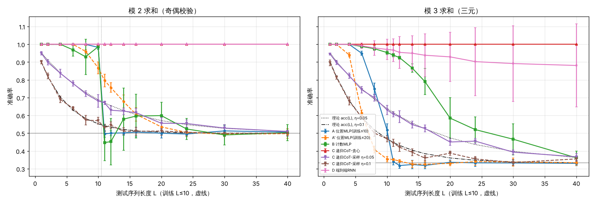

# 哪些归纳偏置能“把短学长”？——位置索引、计数池化、递归与中间监督在长度泛化上的可证明差异与误差累积律

**摘要**　长度泛化（在短输入上训练、在长输入上测试）是检验模型是否学到“算法”而非“模板”的最直接方式，也是 2025–2026 年关于 Transformer 推理能力争论的焦点：C-RASP 理论刻画了 Transformer 能长度泛化的任务类，循环 / 环状（looped）Transformer 与思维链（CoT）被提出作为突破方案，但也有工作指出 CoT 在标准位置编码下无法超出 TC⁰。本文用一个最小但关键的任务族——模 p 前缀和（p=2 即奇偶校验）——比较四类归纳偏置：位置索引模型（类比绝对位置编码）、计数池化模型（无位置、置换不变）、带中间监督的递归转移模型（类比 CoT / scratchpad）以及端到端训练的小型 RNN。理论上我们证明：(1) 位置索引模型在超出训练长度后准确率恰为 1/p（与训练是否充分无关）；(2) 计数池化模型的 ReLU 外推最终沿射线退化为常数预测；(3) 若 CoT 每步以概率 ε 出错，长度 L 处的准确率为 1/p + (1−1/p)(1−εp/(p−1))^L，贪心解码（ε=0）则对任意长度都正确。实验（训练长度 ≤10，测试到 40，5 个种子）完全符合 (1)：位置模型在训练长度之外的准确率为 0.502（p=2）与 0.329（p=3），与 1/p 无显著差异；把训练长度扩到 20，断崖只是后移。(3) 的误差累积律与实测的最大绝对偏差为 0.005–0.027；即使每步错误率只有 0.13%，在 L=40 时准确率也降到 0.952（理论 0.951），而贪心解码保持 1.0。(2) 只部分成立：p=2 时计数模型在 L=11 就失败（0.447），尽管计数仍在训练范围内，说明 ReLU 网络的隐式偏置未能学到“忽略无关计数”。端到端 RNN 在 p=2 时 5/5 个种子、p=3 时 4/5 个种子在 L=40 上达到 ≥ 95%。结论：长度泛化需要模型类中包含“与长度无关的局部状态更新”，并且训练过程要恰好选中它；中间监督能保证后者，但同时引入随长度指数累积的采样误差。

**关键词**　长度泛化；归纳偏置；思维链；递归；奇偶校验；误差累积；分布外泛化

## 1 引言

第一阶段（README.md）显示，分布外泛化的成败取决于模型的归纳偏置是否与数据生成结构相符：ReLU 网络会线性外推，组合泛化要求可加结构。长度泛化是同一问题在“计算深度”维度上的版本：训练时见过的最长输入决定了模型见过的计算步数，测试时要求更多步。2025–2026 年的争论包括：

1. **哪些任务能长度泛化？** C-RASP 假说认为 Transformer 能长度泛化当且仅当任务可以用 C-RASP 程序表达（2609.08851, 2603.02238, 2608.13433）；2502.16792 认为关键在于每个输出只依赖少数 token（稀疏性）；2610.32104 把七种 Transformer 理论的预测放在一起检验，发现它们相互矛盾。
2. **递归 / 循环能否突破？** 环状 Transformer（2609.33144, 2604.07822）和对数深度递归单元（2605.26035）在一些任务上实现了长度泛化；但 2507.02782 指出循环模型在训练中只见过部分状态时同样会失败（“未探索状态假说”）。
3. **CoT 是否解决问题？** 2511.07378 证明 Transformer 能学到长度可泛化的 CoT，2507.13332 用模仿图灵机的 CoT 实现长度泛化；而 2604.25800 证明在标准位置编码和有限字母表下，带 CoT 的 Transformer 仍无法超出 TC⁰。

这些工作多基于 Transformer 的形式化分析或大规模实验，难以分离“架构偏置”“训练信号”“解码方式”三个因素。本文用 numpy/sklearn 中可控的最小模型逐个分离它们。贡献：

- **C1**：证明位置索引模型在超出训练长度后的准确率恰为 1/p（命题 1），并由此说明“扩大训练长度”只能把断崖后移。
- **C2**：刻画计数池化模型的外推退化（命题 2），并实验显示其中等长度的表现取决于隐式偏置。
- **C3**：推导中间监督递归模型的误差累积律（命题 3），并精确验证；指出贪心解码与采样解码的根本差别。
- **C4**：给出端到端 RNN 的经验结果，并与“未探索状态假说”联系起来。

## 2 前沿进展综述

本节基于 24 篇 2025 年以来的论文（arXiv API 检索，另有 `ai2035/frontier/Q09.json` 中的循环 Transformer 条目）。

**2.1 长度泛化的形式理论。** 2502.16792 提出“k-稀疏植入相关分布”框架：每个预测 token 只依赖固定数目的前序 token 时，理想化 Transformer 能长度泛化；2506.03085 提出“非渐近长度泛化”与“长度复杂度”；2510.27015 给出所需训练长度的首个定量界；2603.02238 回答了 C-RASP 长度泛化界的可计算性问题；2609.08851 用压缩改进 C-RASP 假说；2608.13433 给出 Transformer 能长度泛化的正则语言的完整刻画与多项式时间判定算法；2610.41218 为单头位置注意力建立“位置可实现性”理论，解释为什么长度泛化强烈依赖位置编码。**共识**：长度泛化取决于任务的结构（稀疏性、可由计数式程序表达），奇偶校验这类依赖全部输入的任务对标准 Transformer 是困难的。

**2.2 位置编码与训练细节。** 2602.14050 提出随机浮点位置采样；2504.02827 发现长序列使注意力输出方差变小（“方差消失”）；2610.04518 发现权重衰减会阻碍外推，而合理放置的 dropout 有帮助；2506.09251 发现长度泛化能力可以在相关任务之间迁移；2505.21785 研究预训练能否克服架构限制。

**2.3 递归、循环与状态空间模型。** 2507.02782 提出“未探索状态假说”：循环模型在训练中只接触到可达状态分布的一部分时，就无法长度泛化；2605.26035 提出对数深度递归单元，在 21 个正则语言任务上实现长度泛化；2510.00258 发现 Transformer–RNN 混合模型中 Transformer 部分会“抢走”状态追踪任务，从而损害长度泛化；2510.14826 证明 SSM 无法完成真正的长文本生成，但借助工具可以；2609.33144 用机制分析比较两类循环 Transformer 的长度泛化极限；2608.31067 给出 280 个参数、可证明长度泛化的电路 Transformer；2604.07822 研究循环深度 Transformer 的隐式推理。

**2.4 CoT 与中间计算。** 2511.07378 证明梯度下降训练的 Transformer 能在状态追踪任务上学到长度可泛化的 CoT，泛化程度由问题的代数结构决定；2502.20129 在带 CoT 的 Transformer 内部找到了有限状态自动机电路；2507.13332 提出模仿图灵机执行的 CoT；2604.25800 则给出否定结果：标准位置编码 + 有限字母表下，长度可泛化的 CoT 不超出 TC⁰，但扩大词表可以突破；2602.14404 用命题逻辑数据集表明推理轨迹的收益依赖任务拓扑；2610.32104 发现不同理论对“哪些任务容易”给出相互冲突的预测。

**前沿地图**

| 路线 | 代表工作（arXiv） | 关键结论 | 局限 |
|---|---|---|---|
| 形式刻画（C-RASP / 稀疏性） | 2502.16792, 2603.02238, 2608.13433, 2609.08851 | 可刻画 Transformer 能长度泛化的任务类 | 理想化学习器；不含解码误差 |
| 位置编码 / 训练细节 | 2602.14050, 2610.41218, 2610.04518, 2504.02827 | 位置编码与正则化显著影响外推 | 多为经验或单头分析 |
| 递归 / 循环 | 2507.02782, 2605.26035, 2609.33144, 2510.00258 | 递归有潜力，但受“未探索状态”限制 | 训练稳定性与成功率未知 |
| CoT / 中间监督 | 2511.07378, 2507.13332, 2502.20129, 2604.25800 | CoT 可带来长度泛化，但有表达力上限 | 很少讨论逐步误差的累积 |
| 理论对比与基准 | 2610.32104, 2602.14404, 2506.09251 | 不同理论预测相互冲突 | 缺少最小可控实验 |

**开放问题清单**：(i) 绝对位置模型的失败是“训练不足”还是结构性的？(ii) 置换不变的计数式模型何时能泛化？(iii) CoT 的逐步误差如何随长度累积？贪心与采样解码有何不同？(iv) 端到端递归模型能否在没有中间监督时学到可泛化的状态机？

## 3 问题与假设

**选题理由**：长度泛化是检验模型是否学到算法的核心试金石，与 2035 年对“可靠推理”的需求直接相关；模 p 前缀和是状态追踪的最小代表（奇偶校验是 Transformer 理论中的标准困难任务），可以在本环境中完整实验，并给出精确的理论预测。

**任务**：输入 x_1…x_L ∈ Z_p，输出 y = Σx_l mod p。训练长度 L ∈ [1,10] 均匀，4000 条训练序列；测试长度 {1,2,4,6,8,10,11,12,14,16,20,24,30,40}，每个长度 500 条。

**模型**：
- A 位置索引 MLP：每个位置的 one-hot 拼接，补零到 40，MLP(256)；A′ 为训练长度 ≤ 20 的版本。
- B 计数 MLP：输入各 token 的计数，MLP(64,64)。
- C 中间监督递归模型：从训练序列中提取 (当前状态, token) → 下一状态 的样本（1500 条序列），用 MLP(32) 学习转移，推理时循环展开；贪心解码，或按预测概率采样解码；中间标签以概率 η ∈ {0, 0.02, 0.05, 0.1} 被替换为错误状态。
- D 端到端 RNN：tanh RNN（隐藏维 16），BPTT + Adam 训练 3000 步，只用最终答案监督。

**预注册假设与否证条件**：
- **H1**：A 与 A′ 在超出各自训练长度后的准确率与 1/p 无显著差异（单样本 t 检验 p > 0.05）。*否证*：显著偏离 1/p。
- **H2**：B 在计数超出训练范围后失败，且在 L=40 处的预测趋于常数（多数类比例 > 0.8）。*否证*：L=40 时准确率仍 > 0.9，或预测不趋于常数。
- **H3**：C 的贪心解码在所有测试长度上准确率 ≥ 0.99；采样解码的准确率与命题 3 的最大绝对偏差 ≤ 0.05（ε 使用转移表的实测错误概率）。*否证*：任一不满足。
- **H4（探索性）**：D 在多数种子（≥ 3/5）上于 L=40 达到 ≥ 95%。

## 4 理论分析

**命题 1（位置索引模型）**。设第一层为 Σ_l W_l e(x_l)。训练中位置 l > L_tr 总是补零，因此 ∂Loss/∂W_l ≡ 0，W_l 保持初始化值。考虑 L > L_tr，把 y 写成 y = (s + x_L) mod p，其中 s 是前 L−1 个 token 的和。若模型输出 ŷ 不依赖 x_L，则由于 x_L 在 Z_p 上均匀且独立，P(ŷ = y) = 1/p **恰好成立**；若 ŷ 通过未训练的随机权重 W_L 依赖 x_L，则对随机初始化取期望，同样得到 1/p。推论：增加训练长度到 L′ 只把断崖移到 L′；而且对奇偶校验这类依赖所有输入的任务，训练长度越长，分布内学习本身越难（需要拟合更高阶的奇偶函数）。

**命题 2（计数池化模型）**。计数向量 c ∈ ℕ^p 是充分统计量，且模型对置换不变。但目标是 c 的周期函数，而 ReLU MLP 是分段线性函数：在训练区域（Σc ≤ 10）之外沿任一射线 c = c₀ + t·u，logit 最终是 t 的线性函数，argmax 最终恒定。所以 L → ∞ 时预测退化为常数类别，准确率 → 1/p。中等长度的行为取决于模型是否学到“忽略与目标无关的方向”（例如 n_0 对 y 无影响）——这取决于隐式偏置，理论不保证。

**命题 3（中间监督递归模型的误差累积律）**。设学到的转移在每一步以概率 1−ε 给出正确状态，否则均匀地给出其余 p−1 个错误状态之一（中间标签噪声为对称噪声，且模型被校准时成立）。令偏差 d_t = (ŝ_t − s_t) mod p，则 d_t 是 Z_p 上的马尔可夫链，转移矩阵为 (1−ε)I + ε/(p−1)·(J−I)，特征值为 1 与 λ = 1 − εp/(p−1)。由 d_0 = 0 得
**P(ŷ_L = y_L) = 1/p + (1 − 1/p)·λ^L**。
推论：(a) 半衰长度 L_{1/2} ≈ (p−1)ln2/(pε)；ε = 0.0013 时约为 270 步，ε = 0.05 时约为 7 步。(b) **贪心解码**取 argmax：只要每个 (状态, token) 的多数标签正确（η < (p−1)/p），学到的转移就是精确的，ε = 0，对任意长度都正确。采样解码则把模型的残余不确定性变成真实的逐步错误。

**命题 4（端到端 RNN，定性）**。tanh RNN 能实现模 p 计数的充要条件是其隐藏动力学形成 p 个相互可区分、并在输入作用下精确置换的吸引子区域。若训练只覆盖了短序列下的可达状态，而长序列把状态推出吸引域，误差就会累积（与 2507.02782 的未探索状态假说一致）。理论预测：分布内已精确的 RNN（形成稳定吸引子）应能长度泛化；分布内不完美的 RNN 会在长序列上退化。

## 5 实验

- 每个 (模型, p) 用 5 个种子；报告各长度准确率的均值 ± 95% CI。
- H1：把超出训练长度的所有 (长度, 种子) 准确率汇总，与 1/p 做单样本 t 检验。
- H2：记录 L=40 时预测中多数类的比例。
- H3：ε 由学到的转移表直接计算（1 − 正确状态的平均预测概率），代入命题 3 得到每个长度的预测，再与实测比较。
- 计算量：在 4 核共享环境下，单核总运行时间为 203 秒。
- **与原设计的偏差**：初版用 6000 条训练序列、MLP 训练 400 轮，运行 489 秒，超出 4 分钟限制；按原设计缩减为 4000 条序列、200 轮（其他不变）后重跑，报告的全部数字来自重跑结果。两次运行的定性结论相同。

## 6 结果

**表 1 各模型在代表性长度上的准确率（均值，5 个种子）**（`results.
.accuracy`）

| 模型 | p | L=10（分布内） | L=11 | L=16 | L=20 | L=40 |
|---|---|---|---|---|---|---|
| A 位置 MLP（训练 ≤10） | 2 | 0.983 | 0.496 | 0.506 | 0.500 | 0.506 |
| A′ 位置 MLP（训练 ≤20） | 2 | 0.867 | 0.797 | 0.606 | 0.535 | 0.497 |
| B 计数 MLP | 2 | 0.986 | 0.447 | 0.596 | 0.599 | 0.503 |
| C CoT 贪心 | 2 | 1.0 | 1.0 | 1.0 | 1.0 | 1.0 |
| C CoT 采样 η=0 | 2 | 0.990 | 0.984 | 0.980 | 0.976 | 0.952 |
| C CoT 采样 η=0.05 | 2 | 0.681 | 0.671 | 0.615 | 0.556 | 0.510 |
| D 端到端 RNN | 2 | 1.0 | 1.0 | 1.0 | 1.0 | 1.0 |
| A 位置 MLP（训练 ≤10） | 3 | 0.519 | 0.340 | 0.318 | 0.336 | 0.330 |
| A′ 位置 MLP（训练 ≤20） | 3 | 0.355 | 0.352 | 0.325 | 0.330 | 0.334 |
| B 计数 MLP | 3 | 0.954 | 0.939 | 0.791 | 0.585 | 0.362 |
| C CoT 贪心 | 3 | 1.0 | 1.0 | 1.0 | 1.0 | 1.0 |
| C CoT 采样 η=0.05 | 3 | 0.632 | 0.607 | 0.527 | 0.450 | 0.367 |
| D 端到端 RNN | 3 | 0.971 | 0.967 | 0.938 | 0.929 | 0.881 |

**表 2 理论检验**（`theory_checks`）

| 检验 | p=2 | p=3 |
|---|---|---|
| A：超出训练长度的平均准确率（vs 1/p，t 检验 p 值） | 0.502 ± 0.007（p=0.54） | 0.329 ± 0.006（p=0.18） |
| A′：超出 20 的平均准确率（p 值） | 0.499 ± 0.011（p=0.82） | 0.337 ± 0.010（p=0.49） |
| A / A′：训练长度内的平均准确率 | 0.997 / 0.836 | 0.870 / 0.545 |
| B：L=40 时多数类比例 | 0.834 ± 0.125 | 0.735 ± 0.136 |
| B：训练长度内 / L ≥ 20 平均准确率 | 0.981 / 0.529 | 0.986 / 0.483 |
| C：实测逐步错误率 ε（η=0, 0.02, 0.05, 0.1） | 0.0013, 0.0206, 0.0465, 0.1008 | 0.0016, 0.022, 0.050, 0.0985 |
| C：命题 3 与实测的最大绝对偏差（η=0, 0.02, 0.05, 0.1） | 0.005, 0.013, 0.026, 0.017 | 0.007, 0.017, 0.023, 0.027 |
| D：L=40 时 ≥ 95% 的种子数 | 5/5 | 4/5（失败种子：L=10 时 0.856，L=40 时 0.404） |

**逐条对照假设：**
- **H1：支持。** 四种情形都与 1/p 无显著差异。值得注意的是，把训练长度扩到 20 后，分布内准确率反而下降（p=2：0.997 → 0.836；p=3：0.870 → 0.545），说明“用更长数据训练位置模型”既不能解决外推，还会让分布内学习更难。
- **H2：部分支持。** L=40 时两种 p 的准确率都回到约 1/p（0.503、0.362）；但多数类比例为 0.834 与 0.735，p=3 未达到预注册的 0.8 阈值。p=2 时计数模型在 L=11 就失败（0.447），而此时计数仍在训练范围内：模型没有学到“忽略 n_0”，在 n_0 + n_1 = 11 这一未见超平面上必须外推。p=3 时下降较缓（L=11 为 0.939，L=20 为 0.585），与大多数计数仍在训练范围内一致。
- **H3：支持。** 贪心解码在两种 p、所有长度上都为 1.0；采样解码与命题 3 的最大偏差为 0.005–0.027，均 < 0.05。即使 η = 0（无标签噪声），模型的残余不确定性（ε = 0.0013）也使 L=40 的准确率降到 0.952（理论 0.951）。
- **H4：支持（探索性）。** p=2 为 5/5，p=3 为 4/5；唯一失败的种子在分布内（L=10）就只有 0.856，符合命题 4 的预测：分布内不精确 ⇒ 长序列退化。

## 7 讨论

**对前沿争论的回应。** (1) 命题 1 给出了“绝对位置编码不能长度泛化”的最简单严格形式：失败是结构性的，不是训练不足（与 2610.41218“绝对编码固定位置”的结论一致）。(2) 计数模型的结果支持一个更细的观点：置换不变（类似 C-RASP 中的计数操作）只是必要条件；对于周期性目标，还需要模型在未见方向上的隐式偏置恰好正确——这与 2502.16792 和 C-RASP 理论认为奇偶校验困难相一致，也说明“表达力上能做到”不等于“训练能选中”。(3) 中间监督递归模型的贪心版本给出了完美的长度泛化，支持 2511.07378、2507.13332 关于 CoT 能带来长度泛化的结论；但命题 3 揭示了被忽视的另一面：**一旦解码是随机的（或模型的转移不完全确定），误差就按 λ^L 指数累积**，半衰长度与逐步错误率成反比。这为“推理链越长越容易出错”提供了一个可计算的模型，也说明长链推理中解码温度、自我一致性校验和逐步验证的重要性。(4) 端到端 RNN 的成功与失败模式与 2507.02782 的“未探索状态假说”一致：分布内已形成精确吸引子的种子都能外推，唯一的失败种子在分布内就不精确。

**外推边界。** (1) 任务只是模 p 求和这一种状态追踪问题（可交换群）；对非交换群或需要记忆检索的任务，结论可能不同（2511.07378 显示代数结构起决定作用）。(2) 我们没有训练真正的 Transformer；“位置 MLP”只是绝对位置编码的极端抽象，相对位置编码、注意力的归一化等因素不在本文范围内。(3) 命题 3 假设对称、独立的逐步错误；真实 LLM 的 CoT 错误是相关的，并且可能被后续步骤纠正，此时累积速度可能更慢。(4) RNN 只训练了一种规模与超参数，成功率随设置变化。

## 8 结论

1. **绝对位置索引模型的长度泛化失败是结构性的：超出训练长度后准确率恰为 1/p；扩大训练长度只移动断崖，还会损害分布内学习。**［理论 + 实测：0.502 / 0.329，p > 0.17；置信度：高］
2. **置换不变的计数模型在表达上足够，但对周期性目标的外推依赖隐式偏置，最终退化为近似常数预测。**［实测：L=40 时准确率 0.503 / 0.362；置信度：中］
3. **中间监督（CoT 式）递归 + 贪心解码可实现完美长度泛化；采样解码的准确率按 1/p + (1−1/p)(1−εp/(p−1))^L 指数衰减。**［理论 + 实测：最大偏差 ≤ 0.027；置信度：高］
4. **端到端递归能否长度泛化，取决于分布内是否学到精确的吸引子状态机。**［实测：9/10 个种子成功，唯一失败的种子分布内即不精确；置信度：中］

**对 2035 的研判。**［判断］长度泛化将从“架构竞赛”转向“状态机 + 误差控制”的工程问题：可靠的长链推理需要 (a) 局部、长度无关的状态更新（递归 / 循环深度 / CoT）；(b) 训练信号能选中精确解（中间监督或可验证奖励）；(c) 解码阶段的误差控制（贪心或低温解码、逐步验证、纠错）。命题 3 意味着，对于需要 10³–10⁴ 步的科学或工程推理，逐步错误率必须降到 10⁻⁴ 量级，或者引入能纠错的验证机制——这是一个可检验的里程碑。

**后续研究建议。** 近期（2026–2028）：在小型 Transformer 上检验命题 3（测量逐步错误率与长链准确率），并比较自我一致性、逐步验证对 λ 的改善。中期（2029–2032）：建立含纠错的 CoT 误差理论（错误可被后续步骤检测时的累积律）。远期（2033–2035）：实现逐步错误率 ≤ 10⁻⁴、能完成 10⁴ 步可验证推理的系统，并用长度泛化基准对其进行认证。

## 参考文献

**2025 年以来（arXiv）**
1. 2502.16792 The Role of Sparsity for Length Generalization in Transformers.
2. 2506.03085 Non-Asymptotic Length Generalization.
3. 2510.27015 Quantitative Bounds for Length Generalization in Transformers.
4. 2603.02238 Length Generalization Bounds for Transformers.
5. 2609.08851 Length Generalization for Transformers via Compression.
6. 2608.13433 Algebraic Decomposition Theory for Transformer Length Generalization.
7. 2610.41218 A Positional Realizability Theory of Length Generalization in Single-Head Attention.
8. 2602.14050 Position Encoding with Random Float Sampling Enhances Length Generalization of Transformers.
9. 2504.02827 On Vanishing Variance in Transformer Length Generalization.
10. 2610.04518 Length Generalization Needs Proper Regularization.
11. 2506.09251 Extrapolation by Association: Length Generalization Transfer in Transformers.
12. 2505.21785 Born a Transformer -- Always a Transformer? On the Effect of Pretraining on Architectural Abilities.
13. 2507.02782 Understanding and Improving Length Generalization in Recurrent Models.
14. 2605.26035 Length Generalization with Log-Depth Recurrent Units.
15. 2510.00258 Delayed Attention Training Improves Length Generalization in Transformer--RNN Hybrids.
16. 2510.14826 To Infinity and Beyond: Tool-Use Unlocks Length Generalization in State Space Models.
17. 2609.33144 Beyond the Training Horizon: Mechanisms and Limits of Length Generalization in Looped Transformers.
18. 2608.31067 Universal Transformers for Circuit Computations: Perfect Length Generalization in Tiny Transformers.
19. 2604.07822 Loop, Think, & Generalize: Implicit Reasoning in Recurrent-Depth Transformers.
20. 2511.07378 Transformers Provably Learn Chain-of-Thought Reasoning with Length Generalization.
21. 2502.20129 Finite State Automata Inside Transformers with Chain-of-Thought: A Mechanistic Study on State Tracking.
22. 2507.13332 The Imitation Game: Turing Machine Imitator is Length Generalizable Reasoner.
23. 2604.25800 Barriers to Universal Reasoning With Transformers (And How to Overcome Them).
24. 2602.14404 Boule or Baguette? A Study on Task Topology, Length Generalization, and the Benefit of Reasoning Traces.
25. 2610.32104 Putting Transformer Theories to the Test.

**奠基文献**
26. Hahn, M. (2019). Theoretical Limitations of Self-Attention in Neural Sequence Models. arXiv:1906.06755.
27. Press, O., Smith, N. A., & Lewis, M. (2021). Train Short, Test Long: Attention with Linear Biases Enables Input Length Extrapolation. arXiv:2108.12409.
28. Nye, M. et al. (2021). Show Your Work: Scratchpads for Intermediate Computation with Language Models. arXiv:2112.00114.
29. Wei, J. et al. (2022). Chain-of-Thought Prompting Elicits Reasoning in Large Language Models. arXiv:2201.11903.
30. Anil, C. et al. (2022). Exploring Length Generalization in Large Language Models. arXiv:2207.04901.
31. Delétang, G. et al. (2022). Neural Networks and the Chomsky Hierarchy. arXiv:2207.02098.
32. Liu, B. et al. (2022). Transformers Learn Shortcuts to Automata. arXiv:2210.10749.
33. Kazemnejad, A. et al. (2023). The Impact of Positional Encoding on Length Generalization in Transformers. arXiv:2305.19466.
34. Zhou, H. et al. (2023). What Algorithms can Transformers Learn? A Study in Length Generalization. arXiv:2310.16028.
35. Huang, X. et al. (2024). A Formal Framework for Understanding Length Generalization in Transformers. arXiv:2410.02140.
