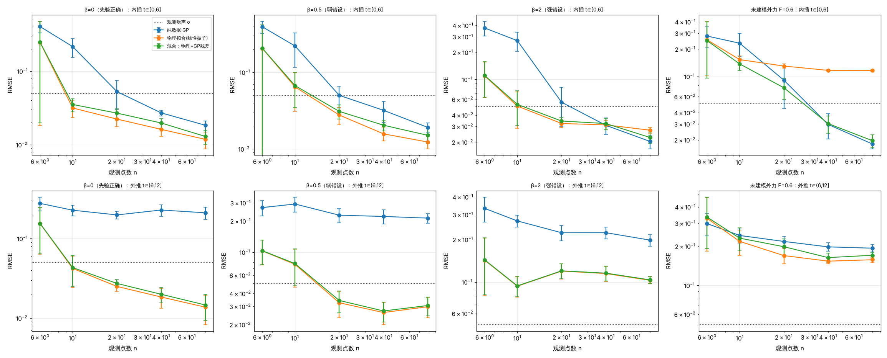
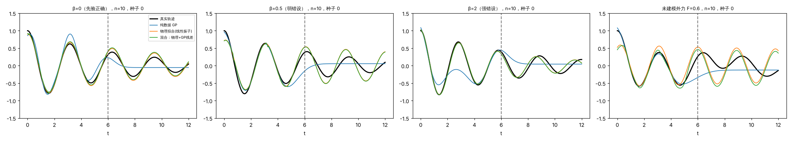
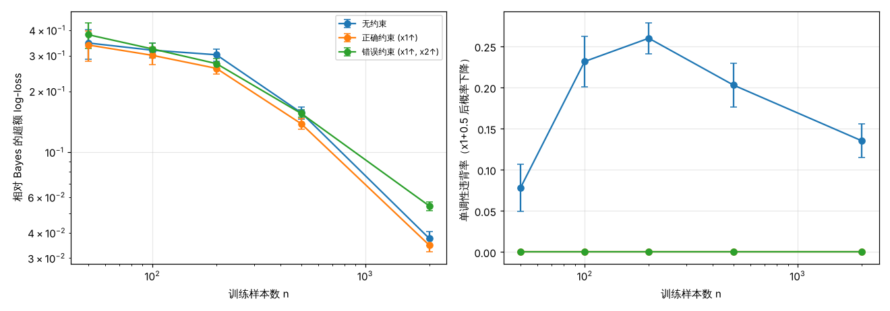

# Q10 知识与数据的融合：神经符号与物理先验

> 分组：学习范式 ｜ 实验：`experiment.py`（运行时间约 69 秒） ｜ 证据标注：[实测] [文献] [判断]

## 摘要
把先验知识注入学习系统被寄望于提高样本效率和外推能力，但知识也可能是错的。我们用两类先验检验这一取舍：(1) 物理先验——从少量带噪观测中学习阻尼振子轨迹，比较纯数据 GP、按线性振子方程拟合参数的物理模型，以及“物理 + GP 残差”的混合模型，真实系统分别为线性（先验正确）、Duffing 非线性（β=0.5、2）和带未建模外力（先验错误）；(2) 符号先验——在梯度提升分类器中加入正确或错误的单调性约束。10/20 个种子。[实测] 先验正确时，n=10 个观测下物理模型内插 RMSE 为 0.0316，GP 为 0.2158；外推到观测窗口之外时 GP 停留在约 0.21，物理模型降至 0.0137（n=80）。先验错误时物理模型出现偏差地板：外力情形下 n 从 20 增至 80 时 RMSE 仅降到原来的 0.893 倍，而混合模型把内插 RMSE 从 0.1164 拉回 0.0196，与 GP（0.0180）无显著差异；但没有任何模型能外推未建模的外力。单调性约束把无约束模型 7.8%–26% 的单调性违背率降为 0；错误约束在 n=2000 时显著增大损失，但在 n=200 时反而有益——错误知识也能起正则化作用。结论：知识的价值是一个偏差–方差取舍，混合残差结构能在数据充足时自动“纠错”内插，却不能纠正外推。

## 1. 问题界定
“数据驱动”与“知识驱动”是 AI 的两条主线：前者灵活但样本低效、外推不可靠，后者高效但脆弱。知识与数据如何融合是基础问题，因为它决定 AI 能否在科学、工程等数据稀缺但理论丰富的领域发挥作用，也触及“Bitter Lesson”式争论：长期看，规模化的通用方法是否终将胜过人为注入的知识 [判断]。核心矛盾是**偏差–方差取舍**：先验约束降低方差（提高样本效率），但先验错误时引入不随数据消失的偏差。

预注册的可检验子假设：
- **H1（正确物理先验的样本效率与外推）**：β=0 时，n≤10 时物理模型的内插 RMSE ≤ GP 的 1/5，外推 RMSE ≤ GP 的 1/10。*否证*：任一 n≤10 不满足。
- **H2（错误先验的偏差地板与混合纠错）**：强错设（β=2 或外力）时，物理模型的内插 RMSE 从 n=20 到 n=80 下降不到 30%（比值 > 0.7），而 GP 下降超过 50%；n=80 时混合模型内插显著优于物理模型且不显著劣于 GP；混合模型的外推不优于物理模型（残差 GP 在窗口外回到 0）。*否证*：物理模型比值 ≤ 0.7，或混合模型不优于物理模型，或混合模型外推显著优于物理模型。
- **H3（符号约束）**：正确单调约束在小样本（n≤200）时显著降低测试 log-loss 并使违背率为 0；错误约束损害性能，且损害随 n 增大而增大。*否证*：正确约束在 n≤200 时均不显著，或错误约束的损害不随 n 增大。

## 2. 研究现状
**物理信息机器学习。** PINN（Raissi 等，arXiv:1711.10561；*J. Comput. Phys.* 2019）把 PDE 残差加入损失 [文献]；Karniadakis 等（2021, *Nature Reviews Physics*，“Physics-informed machine learning”）系统综述了观测偏置、学习偏置与归纳偏置三种注入方式 [文献]；Krishnapriyan 等（2109.01050）指出 PINN 在困难问题上优化失败 [文献]。结构化架构路线包括 Hamiltonian NN（Greydanus 等，1906.01563）、Lagrangian NN（Cranmer 等，2003.04630）和 Neural ODE（Chen 等，1806.07366）[文献]。方程发现方面，SINDy（Brunton 等，1509.03580）用稀疏回归从数据识别控制方程 [文献]。

**混合（灰箱）建模。** 通用微分方程 UDE（Rackauckas 等，2001.04385）把已知方程项与神经网络未知项结合；APHYNITY（Yin 等，2010.04456）将动力学分解为“物理部分 + 最小范数数据驱动残差”，正是为处理不完整物理模型 [文献]。Willard 等（2003.04919）与 von Rueden 等（1903.12394，“Informed Machine Learning”）综述了工程与环境科学中知识注入的分类 [文献]。

**神经符号与约束学习。** Hu 等（1603.06318）用后验正则化把一阶逻辑规则蒸馏进网络；语义损失（Xu 等，1711.11157）把命题约束写成可微损失；DeepProbLog（Manhaeve 等，1805.10872）把神经谓词嵌入概率逻辑程序 [文献]。Garcez & Lamb（2012.05876）称之为 AI 的“第三波” [文献]。单调性先验有较长历史：Sill（1998, NIPS，“Monotonic Networks”）、深度格网络（You 等，1709.06680）、无约束单调网络（Wehenkel & Louppe，1908.05164）[文献]。Battaglia 等（1806.01261）主张关系归纳偏置是组合泛化的关键 [文献]。

**缺口。** (1) 知识部分错误时如何量化与自动纠正，缺乏统一理论（多数论文只报告先验正确的情形）；(2) 混合模型的可辨识性：残差网络可能“吃掉”物理项；(3) 知识获取本身（方程、规则从哪里来）仍依赖人类。

## 3. 研究设计
**(a) 物理先验。** 真实系统 x'' + 2γx' + ω0²x + βx³ = F·cos(0.8t)，γ=0.15，ω0=2，x(0)=1，x'(0)=0，用高精度 ODE 求解器生成。四种情形：β=0、F=0（线性振子先验正确）；β=0.5（弱错设）；β=2（强错设）；β=0、F=0.6（未建模外力，持续性错设）。在 t∈[0,6] 均匀随机取 n∈{6,10,20,40,80} 个点，加 σ=0.05 噪声；内插在 [0,6]、外推在 (6,12] 的密网格上评估 RMSE。模型：纯数据 GP（常数×RBF + 白噪声核，2 次重启）；物理拟合（线性振子闭式解 A·e^{−γt}·cos(ωt+φ)，20 个起点的有界最小二乘）；混合模型（物理拟合 + GP 拟合残差）。10 个种子，对 log10 RMSE 做配对 t 检验，并在种子间分解偏差²与方差。
**(b) 符号先验。** 5 个均匀特征 x∈[−2,2]，真 logit = 2tanh(1.5x1) + 0.5x1 + cos(2x2)（x1 单调递增，x2 非单调，x3–x5 无关）。HistGradientBoosting（100 轮、学习率 0.1、15 叶、每叶至少 10 个样本）：无约束；正确约束（x1 递增）；错误约束（x1 与 x2 都递增）。n∈{50,100,200,500,2000}，测试 5000，20 个种子。指标：测试 log-loss、相对 Bayes 最优的超额 log-loss、单调性违背率（将 x1 加 0.5 后预测概率下降的比例）。
**为何能检验假设**：真值已知，可以精确控制“知识是否正确”与“错到什么程度”，并区分偏差与方差。

## 4. 结果

**表 1 物理先验：内插 / 外推 RMSE（均值 ± 95% CI，10 种子；噪声 σ=0.05）** [实测]

| 情形 | n | 纯数据 GP | 物理拟合 | 混合（物理+GP 残差） |
|---|---|---|---|---|
| β=0 先验正确 | 6 | 0.4046±0.0721 / 0.2777±0.0548 | 0.2464±0.2281 / 0.1547±0.0909 | 0.2475±0.2277 / 0.1552±0.0907 |
| β=0 | 10 | 0.2158±0.0613 / 0.2278±0.0344 | 0.0316±0.0082 / 0.0422±0.0180 | 0.0353±0.0071 / 0.0432±0.0180 |
| β=0 | 20 | 0.0528±0.0225 / 0.1987±0.0215 | 0.0223±0.0048 / 0.0251±0.0033 | 0.0269 / 0.0273 |
| β=0 | 80 | 0.0184±0.0025 / 0.2113±0.0365 | 0.0118±0.0030 / 0.0137±0.0054 | 0.0130 / 0.0146 |
| β=2 强错设 | 10 | 0.2706±0.0657 / 0.2708±0.0258 | 0.0504±0.0219 / 0.0935±0.0153 | 0.0527 / 0.0940 |
| β=2 | 40 | 0.0308±0.0064 / 0.2236 | 0.0311±0.0036 / 0.1149 | 0.0322 / 0.1157 |
| β=2 | 80 | 0.0203±0.0035 / 0.1980±0.0187 | 0.0272±0.0020 / 0.1029±0.0057 | 0.0225±0.0033 / 0.1037±0.0057 |
| 外力 F=0.6 | 10 | 0.2328±0.0656 / 0.2417 | 0.1535±0.0157 / 0.2177 | 0.1377±0.0208 / 0.2306 |
| 外力 | 20 | 0.0910±0.0463 / 0.2175 | 0.1304±0.0072 / 0.1694 | 0.0751±0.0195 / 0.1982 |
| 外力 | 80 | 0.0180±0.0021 / 0.1931 | 0.1164±0.0026 / 0.1574 | 0.0196±0.0032 / 0.1704 |

弱错设 β=0.5 的结果与先验正确时类似（n=80：GP 0.0192，物理 0.0123，混合 0.0151；外推分别为 0.2138、0.0298、0.0306）。

**表 2 内插 RMSE 比值（n=80 / n=20）与 n=80 时的偏差²/方差分解** [实测]

| 情形 | GP 比值 | 物理比值 | 混合比值 | 物理 偏差² / 方差 | 混合 偏差² / 方差 |
|---|---|---|---|---|---|
| β=0 | 0.348 | 0.530 | 0.482 | 1e-05 / 0.00017 | 1e-05 / 0.0002 |
| β=0.5 | 0.382 | 0.444 | 0.487 | 5e-05 / 0.00013 | 5e-05 / 0.00022 |
| β=2 | 0.365 | 0.843 | 0.655 | 0.00055 / 0.00022 | 0.00024 / 0.00032 |
| 外力 | 0.198 | 0.893 | 0.261 | 0.01245 / 0.00124 | 0.00013 / 0.00031 |

关键配对比较（Δlog10 RMSE）：β=0、n=10，物理 − GP 内插 −0.83、外推 −0.81（p<0.001）；n=80 外推 −1.26。β=2、n=80，物理 − GP 内插 +0.14（p=0.001），混合 − 物理 −0.09（p=0.0157），混合 − GP +0.05（p=0.088）。外力、n=80，混合 − 物理 内插 −0.79（p<0.001），混合 − GP +0.03（p=0.46）；外推中混合 − 物理 +0.03（p=0.0047），物理 − GP −0.09（p=0.0011）。

**表 3 单调性约束：测试 log-loss 与违背率（20 种子）** [实测]

| n | 无约束 log-loss | 无约束违背率 | 正确约束 − 无约束（p） | 错误约束 − 无约束（p） |
|---|---|---|---|---|
| 50 | 0.7145 | 0.078±0.029 | −0.0078±0.0103（0.15） | +0.0342±0.0194（0.0027） |
| 100 | 0.6835 | 0.232±0.031 | −0.0180±0.0201（0.095） | +0.0047±0.0224（0.68） |
| 200 | 0.6701 | 0.260±0.019 | −0.0434±0.0109（2.3e-07） | −0.0290±0.0159（0.0020） |
| 500 | 0.5253 | 0.203±0.026 | −0.0184±0.0046（2.3e-07） | −0.0013±0.0066（0.71） |
| 2000 | 0.4011 | 0.135±0.021 | −0.0028±0.0013（0.00041） | +0.0168±0.0019（4.1e-13） |

两种约束模型的违背率在所有 n 下均为 0。n=2000 时相对 Bayes 的超额 log-loss：无约束 0.0375，正确约束 0.0347，错误约束 0.0542。

**逐条回应假设：**
- **H1：部分支持。** n=10 时内插 RMSE 比为 0.0316/0.2158（约 1/6.8），满足；但外推比约 1/5.4，未达 1/10；n=6 时物理拟合不稳定（0.2464±0.2281，4 个参数仅 6 个带噪点，多起点优化有时落入频率混叠解），不满足。外推优势随 n 增大而扩大：n=80 时 0.0137 对 0.2113。
- **H2：支持。** 强错设下物理模型比值为 0.843（β=2）和 0.893（外力），GP 为 0.365 和 0.198；外力情形下物理模型的偏差²（0.01245）是方差的 10 倍。n=80 时混合模型内插显著优于物理模型，与 GP 无显著差异（p=0.088、0.46）。混合模型外推不优于物理模型（外力情形略差，+0.03，p=0.0047）。
- **H3：部分支持。** 正确约束使违背率归零，在 n≥200 时显著降低 log-loss，但在 n=50、100 时不显著（与 H3 的“小样本收益”预期相反，收益峰值在中等样本量 n=200）。错误约束在 n=2000 时损害最显著（+0.0168），n=50 时也有损害（+0.0342），但在 n=200 时反而显著有益（−0.0290）——损害并非随 n 单调增大。

## 5. 讨论
**偏差–方差视角统一了全部结果。** 物理模型只有 4 个参数，方差极低；GP 是非参数模型，方差高但偏差随 n 消失。先验正确时物理模型两者兼得。先验错误时出现交叉点：β=2 时在 n≈40 处（0.0311 对 0.0308），外力情形在 n=10 到 20 之间——**在交叉点之前，错误的知识仍然比没有知识好** [实测]。混合残差模型把“物理负责主结构、数据负责修正”变成了自动的偏差修正：错设越严重，残差中可学习的信号越强，混合模型越接近 GP；先验正确时，残差只是噪声，混合模型略差于物理模型（β=0、n=80：0.0130 对 0.0118），这是为灵活性付出的小代价 [实测]。

**混合模型不能纠正外推。** 残差 GP 在观测窗口之外回到先验均值 0，于是混合模型的外推 = 物理模型的外推。外力情形下所有模型外推 RMSE 都在 0.15–0.20，没有模型知道持续外力的存在——数据在窗口内也许能“看到”误差，却无法告诉我们误差的**函数形式**。这与 Q09 的结论一致：外推只能来自结构性知识；要纠正外推，需要的是方程发现（如 SINDy）或 APHYNITY/UDE 式“在方程层面”学习缺失项，而非在输出层面加残差 [判断]。值得注意的是，即使物理模型是错的，其外推也优于 GP（β=2、n=80：0.1029 对 0.1980），因为它至少保留了振荡与衰减的定性结构。

**错误知识的正则化效应。** 错误单调约束把 x2 的 cos(2x2) 效应压成一个单调（在 [−2,2] 上接近平坦）的函数，近似于“丢弃 x2”。在 n=200 时，模型本就难以可靠估计 x2 的非单调效应，丢弃它反而降低了方差；当 n=2000 时，数据足以学到该效应，约束造成的偏差就占主导。这说明“知识是否有用”不只取决于知识的对错，还取决于数据量：**错误但简化的知识在中等数据量下可以有益** [实测+判断]。

**设计偏差（如实报告）。** 原设计只有 β∈{0,0.5,2}；看到 β 型错设因振幅衰减使非线性影响逐渐消失、偏差较弱后，我们加入了“未建模外力”这一持续性错设情形，其余设置不变。

**效度威胁与外推边界。** (1) 系统为一维 ODE，真实科学问题是高维、部分可观测的；(2) 物理先验以闭式解形式给出，比 PINN 等软约束“硬”得多，PINN 的优化困难不在本实验范围内；(3) 只用 GP 作为数据驱动基线，未测 MLP/Neural ODE；(4) 单调性只是最简单的符号知识，逻辑规则、因果约束等更复杂的知识可能表现不同；(5) n=6 的物理拟合失败依赖优化器设置（多起点数量），属于实现层面的脆弱性，而非先验本身的局限。

<!-- BIBLIO:start -->
## 文献计量信号（arXiv，[实测]）

检索式：摘要含 “neuro-symbolic”、“physics-informed”、“knowledge-guided”、“inductive bias” 之一；基线为同年 cs.LG / cs.AI / stat.ML 论文总数。数据：`ai2035/bibliometrics/arxiv_counts.json`（检索日 2026-11-26）。

| 年份 | 命中论文数 | 占 AI/ML 基线比例 |
|---|---|---|
| 2015 | 31 | 0.76% |
| 2016 | 30 | 0.51% |
| 2017 | 43 | 0.51% |
| 2018 | 106 | 0.77% |
| 2019 | 179 | 0.81% |
| 2020 | 301 | 0.99% |
| 2021 | 586 | 1.77% |
| 2022 | 821 | 2.26% |
| 2023 | 1,032 | 2.29% |
| 2024 | 1,398 | 2.37% |
| 2025 | 2,251 | 3.02% |

- 2019–2025 年份额的对数线性趋势：**每年 +23.7%**（95% CI +12.8% ~ +35.7%，R²=0.87），判定：**相对升温（增速显著快于 AI/ML 总体）**；在 20 个问题中按相对增速排第 4 位。
- 解读边界：分子覆盖 arXiv 全部类别、分母仅为 AI/ML 三个类别，所以“比例”是相对关注度指数，并非严格的子集占比；关键词匹配既会漏掉使用其他术语的工作，也会混入无关用法；arXiv 偏重机器学习社区，认知科学、神经科学与期刊论文覆盖不足。该信号衡量的是**研究关注度**，不是**问题被解决的程度**。
<!-- BIBLIO:end -->

## 6. 结论与 2035 展望
**核心结论**
1. 正确的物理先验带来约一个数量级的样本效率（n=10 时内插 RMSE 0.0316 对 0.2158）和数量级的外推优势，后者是纯数据模型无法通过增加数据获得的。[实测，置信度：高]
2. 错误先验产生不随数据消失的偏差地板（RMSE 比值 0.84–0.89），但在数据量越过交叉点之前，错误先验仍优于无先验。[实测，置信度：高（本系统）／中（推广）]
3. “物理 + 数据残差”的混合结构能在内插中自动纠正错误先验（外力情形 0.1164→0.0196），但不能纠正外推。[实测，置信度：高]
4. 符号约束可保证输出满足性质（违背率 0）；错误约束的代价依赖数据量，在中等数据量下甚至可能有益。[实测，置信度：中]
5. 知识与数据融合的核心科学问题不是“是否注入知识”，而是“如何让系统按数据证据自适应地信任或修正知识”，尤其是在需要外推的地方。[判断，置信度：中]

**关键未解问题**：如何在部署前检测先验是否错设（模型检验）；如何在方程层面而非输出层面纠正知识，以恢复外推能力；如何让大模型中隐含的知识与显式知识一致、可验证。

**建议研究路线**
- 近期（2026–2028）：建立含“可控错设程度”的知识融合基准（物理、化学、逻辑规则三类），要求方法报告先验正确与错误两种条件下的性能；里程碑——混合方法在所有错设程度下均不劣于纯数据与纯知识两者中的较优者（统计意义上）。
- 中期（2029–2032）：发展在方程层面纠错的混合方法（可解释残差的符号回归、知识图谱与规则的自动修订）；里程碑——在 ≥10 个已知真方程的动力学系统上，从错误先验出发恢复缺失项的成功率 ≥80%，并使外推误差降低一个数量级。
- 远期（2033–2035）：实现“科学家式”的知识–数据闭环——系统能提出先验、检验错设、修正理论并设计新实验；里程碑——在模拟科学发现任务中，以少于纯数据方法 1/10 的观测量得到可外推的正确模型。

## 参考文献
1. Sill, J. (1998). Monotonic Networks. *NIPS 1997 (proc. 1998)*.
2. Karniadakis, G. E., Kevrekidis, I. G., Lu, L., Perdikaris, P., Wang, S., & Yang, L. (2021). Physics-informed machine learning. *Nature Reviews Physics*, 3, 422–440.
3. Brunton, S. L., Proctor, J. L., & Kutz, J. N. (2015). Discovering governing equations from data: Sparse identification of nonlinear dynamical systems. arXiv:1509.03580（*PNAS* 2016）.
4. Hu, Z. et al. (2016). Harnessing Deep Neural Networks with Logic Rules. arXiv:1603.06318.
5. You, S. et al. (2017). Deep Lattice Networks and Partial Monotonic Functions. arXiv:1709.06680.
6. Raissi, M., Perdikaris, P., & Karniadakis, G. E. (2017). Physics Informed Deep Learning (Part I). arXiv:1711.10561.
7. Xu, J. et al. (2017). A Semantic Loss Function for Deep Learning with Symbolic Knowledge. arXiv:1711.11157.
8. Manhaeve, R. et al. (2018). DeepProbLog: Neural Probabilistic Logic Programming. arXiv:1805.10872.
9. Battaglia, P. W. et al. (2018). Relational inductive biases, deep learning, and graph networks. arXiv:1806.01261.
10. Chen, R. T. Q. et al. (2018). Neural Ordinary Differential Equations. arXiv:1806.07366.
11. von Rueden, L. et al. (2019). Informed Machine Learning – A Taxonomy and Survey of Integrating Knowledge into Learning Systems. arXiv:1903.12394.
12. Greydanus, S., Dzamba, M., & Yosinski, J. (2019). Hamiltonian Neural Networks. arXiv:1906.01563.
13. Wehenkel, A., & Louppe, G. (2019). Unconstrained Monotonic Neural Networks. arXiv:1908.05164.
14. Rackauckas, C. et al. (2020). Universal Differential Equations for Scientific Machine Learning. arXiv:2001.04385.
15. Willard, J. et al. (2020). Integrating Scientific Knowledge with Machine Learning for Engineering and Environmental Systems. arXiv:2003.04919.
16. Cranmer, M. et al. (2020). Lagrangian Neural Networks. arXiv:2003.04630.
17. Yin, Y. et al. (2020). Augmenting Physical Models with Deep Networks for Complex Dynamics Forecasting. arXiv:2010.04456.
18. Garcez, A. d'A., & Lamb, L. C. (2020). Neurosymbolic AI: The 3rd Wave. arXiv:2012.05876.
19. Krishnapriyan, A. S. et al. (2021). Characterizing possible failure modes in physics-informed neural networks. arXiv:2109.01050.
