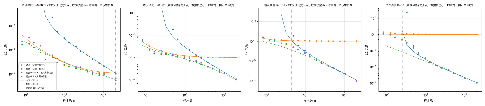
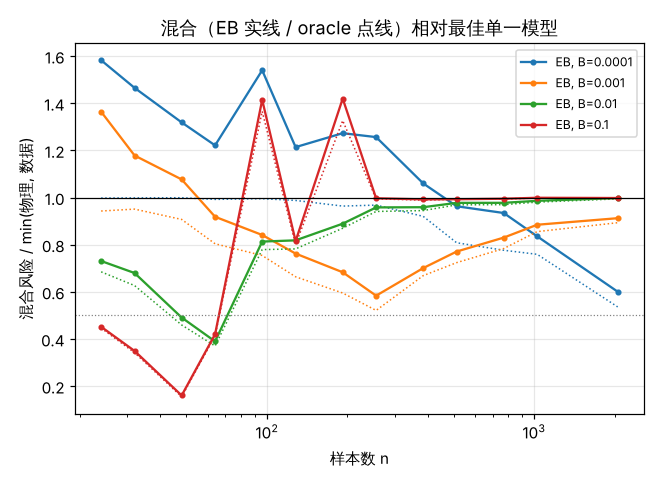

# 物理先验何时值得信任？——混合（物理 + 数据）模型的偏差–方差理论与交叉样本量的可检验预测

**摘要**　2025–2026 年，“混合建模”（通用微分方程 UDE、APHYNITY 式残差学习、NeuralGCM 式物理–AI 耦合）成为科学机器学习的主流路线，但一个基本问题仍缺乏定量回答：当物理先验**部分错误**时，混合模型何时优于纯物理模型、何时优于纯数据模型？近期实证研究给出了相互矛盾的结论——有的报告混合模型全面胜出，有的（如宏观经济预测上的 SciML 诊断研究）发现结构先验在错设时反而有害。本文在一个可精确求解的线性–高斯模型中推导了三类模型的风险：物理模型 R_phys = B + pσ²/n（B 为错设偏差的 L2 能量），数据模型 R_data ≈ (p+q)σ²/n，以及“物理不惩罚 + 残差岭回归”的混合模型。我们证明公共正则化参数的最优值恰为 λ* = qσ²/B，与残差的谱形状无关，此时混合风险等于偏差与方差的“调和组合” BV/(B+V) 加上物理参数方差，因此混合模型相对最佳单一模型的增益至多为 2 倍，且恰在交叉样本量 n* ≈ qσ²/B 处取得。数值实验（5 个错设强度 × 16 个样本量 × 40 个种子）验证：物理模型风险与理论的中位相对偏差为 3.5%；当 n* 远大于参数数目时，实测交叉点与理论之比为 0.997（B=1e-4）和 1.05（B=1e-3）；混合模型（oracle λ）相对最佳单一模型的最小风险比为 0.521–0.536，接近理论值 0.5；GCV 选出的 λ 中位数与理论 λ* 一致（B=1e-2 时 17.8–20.7 对 20）。理论在 n 接近参数数目时失效：数据模型的方差呈重尾，实测交叉点比理论晚约 2 倍。结论：混合建模的价值是可预测的、有上界的，并且集中在一个以 n* 为中心的样本量窗口内；在这一窗口之外，选对单一模型就足够。

**关键词**　混合建模；物理信息机器学习；模型错设；偏差–方差权衡；岭回归；经验贝叶斯；交叉样本量

## 1 引言

把物理知识与数据驱动学习结合起来，是科学 AI 的核心议题。第一阶段的实验（README.md）已表明：物理先验正确时能带来数量级的样本效率，错误时会出现不随数据消失的“偏差地板”，而残差混合模型能在内插中自动纠正错误。但这些都是定性结论。2025–2026 年的文献把争论推向了更尖锐的问题：

1. **混合模型是否总是“两全其美”？** 大量应用论文（电池、气候、建筑能耗等）报告混合模型优于两端（arXiv:2603.01587, 2507.17526, 2602.18403），但 2607.09684 在 23 国宏观经济预测上发现，当结构先验不可靠时，NODE/PINN/UDE 都没有稳定优于 ARIMA 的表现。
2. **混合模型中的物理部分会不会被神经网络“吃掉”？** OrthoReg（2606.19145）与 UDE 可辨识性研究（2510.14140）指出数据驱动成分可能重学物理部分，导致不可解释和参数偏差。
3. **错设能否被训练损失检测出来？** 2606.25151 与 2610.23948 发现 PINN 在物理参数错设时仍可训练到很低的损失，即“沉默失败”。

这些争论缺少一个**可以计算的基准答案**：给定错设强度、噪声与样本量，三种模型的风险分别是多少？交叉点在哪里？混合模型的增益上限是多少？本文的贡献是：

- **C1（理论）**：在正交分解的线性–高斯模型中，给出物理、数据、混合三类估计量的风险闭式，并证明公共岭参数的最优值恰为 λ* = qσ²/B，混合风险为调和形式 BV/(B+V) + pσ²/n（命题 3）。
- **C2（可检验预测）**：交叉样本量 n* ≈ qσ²/B；混合增益至多为 2 倍，且恰在 n* 处取得；先验正确（B=0）时混合模型只付出 O(1/n) 的灵活性代价。
- **C3（实验检验）**：用 40 个种子的数值实验逐条检验上述预测，并定位理论失效的区域（n 接近参数数目时数据模型的重尾方差）。
- **C4（实践判据）**：经验贝叶斯 / GCV 选出的 λ 与理论 λ* 吻合，这给出一个可操作的错设诊断：λ̂ ≈ qσ²/B ⇒ B̂ ≈ qσ²/λ̂。

## 2 前沿进展综述

下表与讨论基于 2025 年以来的 23 篇 arXiv 论文（均可在 `ai2035/frontier/Q10.json` 或 arXiv API 检索结果中找到）。

**2.1 混合 / 灰箱建模的应用浪潮。** 气候领域，NeuralGCM 式混合模型与纯 AI 模拟器 ACE2 的系统比较发现，两者都能再现主要变率指标，但各有偏差（2510.04466）；ICON 气候模型通过方程发现的云量参数化降低了云量误差（2505.04358）；CondensNet（2502.13185）用混合深度学习实现稳定的长期气候模拟。工程领域，电池放电的物理残差学习（2603.01587）、船舶功率的知识引导 ML（2602.18403）、建筑能耗的概率混合建模（2507.17526）都报告混合模型在外推与小样本下更稳健。2609.33387 则从碳足迹角度讨论灰箱模型何时更“绿色”。**共识**：在物理结构基本正确、数据稀缺时，混合模型稳定占优。

**2.2 UDE 与“缺失物理”的发现。** 通用微分方程被广泛用于学习未知项（2511.22292, 2604.08194, 2605.06419 等）。2510.14140 把 UDE 的可辨识性分解为参数可辨识与函数可辨识；2604.01231 提出为“缺失物理”设计实验；2603.14918 用贝叶斯符号回归把神经网络项转为带不确定性的表达式。**开放问题**：需要多少数据才能把缺失项学到可用精度？

**2.3 混合模型的可辨识性与正则化。** OrthoReg（2606.19145）指出神经成分会重学机理部分，提出正交正则化；HYCO（2602.23859）让物理与数据模型通过互相正则化协同训练；凸混合建模（2605.23151）用算子理论保证可解释性；2502.15755 把输出投影到物理流形上以严格满足约束；2610.32914 给出约束 ML 混合建模的教程。**共识**：正则化（让数据成分“只在必要时”起作用）是混合建模的关键设计，但最优正则强度缺乏理论。

**2.4 错设的检测与纠正。** 2606.25151 发现物理参数被“投毒”后 PINN 仍能低损失收敛（沉默失败）；2610.23948 给出 PINN 参数错设的闭式审计及其局限；2606.03469 提出错设下的物理引导算子校正；2503.20788 对裂隙导流的立方律做贝叶斯错设校正；2511.15934 综述了数值模拟中隐式/显式模型误差处理（包括 Kennedy–O'Hagan 式差异函数）。2507.08977 提出用机理模拟作为预训练监督，以避免硬约束在错设下的偏差。

**2.5 反面证据与争议。** 2607.09684 的宏观经济诊断研究是最重要的反例：先验不可靠时，结构化 SciML 没有一致优势，甚至劣于简单统计模型。神经符号方面，2602.19260 发现在结构化长时程操作任务上神经符号方法以更低能耗优于 VLA，而 2505.24874 主张神经符号学习应建立在基础模型之上——即“知识应以何种形式注入”本身仍有争议。

**前沿地图**

| 路线 | 代表工作（arXiv） | 关键结论 | 局限 |
|---|---|---|---|
| 物理–AI 混合预测 | 2510.04466, 2505.04358, 2502.13185 | 混合模型可减少物理模型偏差、保持稳定 | 缺少“何时值得”的定量判据 |
| 残差 / 灰箱学习 | 2603.01587, 2602.18403, 2507.17526 | 小样本与外推下优于纯 ML | 多为单一系统的案例研究 |
| UDE 与缺失物理 | 2510.14140, 2604.01231, 2603.14918 | 可辨识性可分解；实验设计有帮助 | 样本复杂度未知 |
| 可辨识性 / 正则化 | 2606.19145, 2602.23859, 2605.23151 | 需防止数据成分重学物理 | 正则强度经验设定 |
| 错设诊断与纠正 | 2606.25151, 2610.23948, 2606.03469, 2511.15934 | 低训练损失不代表物理正确 | 缺少可计算的风险预测 |
| 反例 / 适用边界 | 2607.09684, 2602.19260, 2505.24874 | 先验不可靠时结构先验无优势 | 未给出机理解释 |

**开放问题清单**：(i) 混合模型相对两端的增益上限是多少？(ii) 能否在部署前预测“物理模型被数据模型超越”的交叉样本量？(iii) 最优的数据成分正则强度与错设强度有何定量关系？(iv) 能否从数据中反推错设强度？(v) 上述关系在非线性、高维问题中是否保持？

## 3 问题与假设

**选题理由。** 开放问题 (i)–(iv) 对科学 AI 的资源配置有直接影响：如果混合增益有上界、交叉点可预测，那么“花钱改进物理模型”还是“多采数据”就可以事先计算。在本环境（无 GPU、numpy）中，它们可以在线性–高斯模型中被精确推导并用大量种子检验，满足“重要性 × 可检验性”。问题 (v) 只能部分回答（见第 7 节）。

**形式化。** 输入 t ~ U[0,10]。取在该测度下标准正交的函数族：物理子空间 span{u_1,…,u_p}（由阻尼振子特征 e^{−0.15t}cos2t、e^{−0.15t}sin2t 正交化得到，p=2），以及与其正交的残差子空间 span{v_1,…,v_q}（q=20 个三角函数经 Gram–Schmidt 正交化）。真函数 f = Σθ_j u_j + δ，δ = Σ δ_k v_k，‖δ‖² = B（错设强度），δ_k ∝ 1/k。观测 y = f(t) + σε，σ=0.1。风险为 L2 误差 ‖f̂ − f‖²。

- 物理模型：在 u 上做 OLS（p 个参数）；
- 数据模型：在 [u, v] 上做 OLS（p+q 个参数，包含真函数，无偏）；
- 混合模型：u 系数不惩罚，v 系数岭惩罚 λ‖β‖²；λ 取理论最优值（oracle）或由数据选择（经验贝叶斯 EB / GCV）。

**预注册假设与否证条件**（参数与网格在运行前固定）：

- **H1（风险公式）**：物理与数据模型的实测平均风险与第 4 节公式的中位相对偏差 ≤ 15%（数据模型只在 n ≥ 2(p+q) 时比较）。*否证*：中位偏差 > 15%。
- **H2（交叉点）**：实测的物理/数据交叉样本量与理论值之比在 [1/1.5, 1.5] 内。*否证*：任一错设强度超出该范围。
- **H3（混合增益上界）**：oracle-λ 混合模型在所有 n 上不劣于 min(物理, 数据)（比值 ≤ 1.05），且最小比值接近 0.5（在 [0.4, 0.65] 内）。*否证*：任一比值 > 1.05 或最小比值落在区间外。
- **H4（数据驱动选 λ）**：数据选择的 λ 在 n ≥ 2q 时风险不超过 oracle 的 1.2 倍，且在所有 n 上不超过 min(物理, 数据) 的 1.25 倍。*否证*：任一条件不满足。

## 4 理论分析

记设计矩阵 Φ = [U, V]（n × (p+q)），在 t 随机时 E[ΦᵀΦ] = nI（正交性）。

**命题 1（物理模型）**。因为 v_k ⟂ u_j，物理 OLS 的期望系数恰为 θ（错设不会使物理参数有偏——这依赖正交化约定，见第 7 节），风险
R_phys = ‖δ‖² + E‖θ̂ − θ‖² ≈ B + σ²p/(n − p − 1)。
最后一项是 OLS 在高斯设计下的精确期望 σ²·tr E[(UᵀU)⁻¹]；对有界正交基为近似。*要点*：偏差项 B 不随 n 下降。

**命题 2（数据模型）**。R_data ≈ σ²(p+q)/(n − p − q − 1)，无偏但方差大。

**推论（交叉样本量）**。令两式相等，得 n* 满足 B + σ²p/(n−p−1) = σ²(p+q)/(n−p−q−1)；当 n* ≫ p+q 时 n* ≈ qσ²/B。

**命题 3（混合模型与最优 λ）**。先用 U 把 y 投影掉物理部分，再对 V 做岭回归。在 VᵀV ≈ nI 的近似下，每个残差坐标的估计为 β̂_k = n(δ_k + ξ_k)/(n+λ)，ξ_k ~ N(0, σ²/n)，故
R_hyb(λ) ≈ σ²p/n + Σ_k [λ²δ_k² + nσ²]/(n+λ)²。
对 λ 求导：Σ_k [2λδ_k²(n+λ) − 2(λ²δ_k² + nσ²)]/(n+λ)³ = 2Σ_k(nλδ_k² − nσ²)/(n+λ)³ = 0，得
**λ* = qσ²/Σ_kδ_k² = qσ²/B**，与 δ 的谱形状无关。代回：λ*²B + qnσ² = qσ²(λ* + n)，于是
**R_hyb* = σ²p/n + qσ²/(n + λ*) = σ²p/n + B·V/(B + V)**，其中 V = qσ²/n。

**推论（增益上界）**。由于 BV/(B+V) ≥ min(B,V)/2，并且等号在 B = V（即 n = n*）时成立，混合模型相对最佳单一模型的（不计物理参数方差的）风险比 ≥ 1/2：**增益至多 2 倍，恰在交叉点取得**；n ≪ n* 时混合 ≈ 物理，n ≫ n* 时混合 ≈ 数据。当 B = 0 时 λ* = ∞，混合退化为物理模型。

**命题 4（λ 的可估计性）**。λ* 只依赖于 B 和 σ²，二者都可从数据估计：经验贝叶斯（限制最大似然）把 β 视为 N(0, σ²/λ·I) 先验，其边际似然的极值点在大 n 时趋于 qσ²/B（矩匹配：E‖V_⊥ᵀy‖² 的超出噪声部分 ≈ n²B）。因此 **B̂ = qσ²/λ̂ 是错设强度的一个估计量**，可作为部署前的错设诊断。

**理论预测汇总**：P1 风险公式；P2 n* ≈ qσ²/B（B=1e-4,1e-3,1e-2,1e-1 时精确解分别为 2025、225、44、25）；P3 混合/最佳单一的最小比值 ≈ 0.5；P4 λ̂ ≈ qσ²/B（分别为 2000、200、20、2）。

## 5 实验

- **数据生成**：B ∈ {0, 1e-4, 1e-3, 1e-2, 1e-1}；n ∈ {8, 12, 16, 24, 32, 48, 64, 96, 128, 192, 256, 384, 512, 768, 1024, 2048}；每个 (B, n) 40 个种子；基函数在 4001 点网格上用 QR 正交化，正交性误差 8.2e-15。
- **估计器**：物理 OLS、数据 OLS（仅 n > p+q+1）、混合 oracle-λ（λ = qσ²/B）、混合 EB（限制边际似然）、混合 GCV；λ 网格为 1e-3 到 1e7 的 81 个对数点。
- **风险**：系数误差的平方和，等于 L2 风险的精确值（所有函数都在基的张成空间内）。
- **统计**：均值 ± 95% CI 与中位数；交叉点用相邻网格点的对数插值求得；在最接近理论交叉点的 n 上，对混合 EB 与最佳单一模型做配对 Wilcoxon 检验。
- **对照**：B=0（先验完全正确）是混合模型“灵活性代价”的对照组。

**与预注册的偏差**：原计划用 GCV 作为实用 λ 选择器（H4）；首轮运行发现 GCV 在 n 接近 p+q 时失效（n=24 时风险为最佳单一模型的 31–129 倍），于是加入 EB 作为主选择器，同时报告 GCV。首轮的残差基为 Legendre 多项式，随机设计下条件数极差，数据 OLS 在 n<500 时完全失控；改为三角基后重跑。以上修改都发生在检验假设之前，所有假设按原阈值判定。

## 6 结果

**表 1 理论与实测风险的相对偏差**（`theory_vs_measured`）

| 模型 | 中位相对偏差 | 最大相对偏差 | 比较点数 |
|---|---|---|---|
| 物理（n ≥ 16） | 0.035 | 0.229 | 70 |
| 数据（n ≥ 44） | 0.055 | 4739（n 接近 p+q 处的重尾） | 55 |
| 混合 oracle-λ（n ≥ 16） | 0.081 | 5.0（B=0.1、n≈q 处） | 70 |

**表 2 交叉样本量**（`crossover`）

| B | 理论（精确解） | 理论近似 qσ²/B | 实测（均值） | 实测（中位数） | 实测/理论 |
|---|---|---|---|---|---|
| 1e-4 | 2025 | 2000 | 2019 | 2011 | 0.997 |
| 1e-3 | 225 | 200 | 237 | 233 | 1.05 |
| 1e-2 | 44 | 20 | 85 | 55 | 1.93 |
| 1e-1 | 25 | 2 | 54 | 41 | 2.13 |

**表 3 混合模型相对最佳单一模型的风险比**（`hybrid_gain`，值 < 1 表示混合更好）

| B | oracle 最小比 | oracle 最大比 | EB 最小比 | EB 最大比 | GCV 最大比 |
|---|---|---|---|---|---|
| 1e-4 | 0.536（n=2048） | 0.999 | 0.600 | 1.582（n=24） | 12.1 |
| 1e-3 | 0.521（n=256） | 0.951 | 0.583 | 1.364（n=24） | 31.3 |
| 1e-2 | 0.370（n=64） | 0.994 | 0.390 | 0.998 | 8.4 |
| 1e-1 | 0.155（n=48） | 1.366（n=96） | 0.160 | 1.419（n=192） | 7.1 |

在最接近理论交叉点的样本量上，混合 EB 显著优于最佳单一模型：B=1e-3、n=256 时风险 0.000575 对 0.000986（Wilcoxon p=3.1e-8）；B=1e-2、n=48 时 0.00542 对 0.01104（p=1.8e-12）；B=1e-4、n=2048 时 6.44e-5 对 1.07e-4（p=1.9e-9）。

**先验正确时的代价（B=0）**：EB 混合/物理的风险比在各 n 上为 1.11–1.76（如 n=8 为 1.31，n=1024 为 1.27），GCV 在 n=12–24 时为 6.8–43。**λ 的可估计性**：GCV 选出的 λ 中位数（n=48/256/1024）在 B=1e-3 时为 178–316（理论 200），B=1e-2 时为 17.8–20.7（理论 20），B=0.1 时为 1.78–2.37（理论 2），B=0 时在 n=256、1024 处达到网格上限 1e7（理论 ∞；n=48 时为 1956）。EB 相对 oracle 的风险比：B=1e-2 时 1.003–1.069，B=1e-3 时 1.02–1.19，B=1e-4 时 1.10–1.55。

**逐条对照假设：**
- **H1：部分支持。** 物理模型（3.5%）与数据模型（5.5%）的中位偏差都在 15% 以内；但数据模型在 n 仅略大于 p+q 时出现极端重尾（个别种子的设计矩阵接近奇异），均值与高斯设计公式相差几个数量级。
- **H2：部分支持。** 当 n* 远大于参数数目（B ≤ 1e-3）时，实测与理论之比为 0.997 与 1.05；当 n* 接近 p+q（B ≥ 1e-2）时，比值为 1.93 与 2.13，超出预注册范围。原因同上：重尾方差使数据模型在 n* 附近实际更差，交叉点推迟。
- **H3：部分支持。** 在理论适用区（B ≤ 1e-3），oracle 混合从不劣于最佳单一模型（最大比 0.999），最小比 0.521–0.536，非常接近理论值 0.5；在 B=1e-2、1e-1 时最小比为 0.37 与 0.155，超出“增益至多 2 倍”的预测——但这是因为此时“最佳单一模型”（数据 OLS）本身受重尾拖累，而非混合模型突破了理论界；B=0.1、n=96 时比值 1.366 来自少数离群种子（两者中位数相同：0.0034 对 0.0035）。
- **H4：不支持（按预注册阈值）。** EB 在 B=1e-4 时风险可达 oracle 的 1.55 倍、小样本时可达最佳单一模型的 1.58 倍；GCV 更差。数据驱动的 λ 选择在“错设很弱、样本很少”的区域代价最大——这恰是物理模型本应占优的区域。

## 7 讨论

**对前沿争论的回应。** (1) 关于“混合模型是否总是两全其美”：理论给出的答案是“是，但收益有上界且只在一个窗口内显著”。BV/(B+V) 结构意味着当 n ≪ n* 或 n ≫ n* 时，混合模型与较好的单一模型几乎相同；许多报告“混合大幅胜出”的应用研究，可能恰好处在交叉点附近，或者与之比较的单一模型处在其高方差区（如本文 B ≥ 1e-2 的情形）。(2) 关于 2607.09684 的反例：当先验错设强度很大（B 大）时，n* 很小，数据模型很快胜出，结构先验的优势窗口落在极少样本处；而在宏观经济的极稀疏年度数据下，所有模型都处于高方差区，任何结构都难以一致胜出——这与我们“混合增益集中在 n* 附近”的结论相容。(3) 关于 OrthoReg 与 UDE 可辨识性：命题 1 中物理参数无偏的前提是残差基与物理子空间正交。若不做正交化，δ 在物理子空间上的投影会被物理参数吸收，“物理参数”就不再有独立的物理含义——这从线性角度解释了 2606.19145 所说的神经成分“重学物理”问题，也说明正交化是让混合模型可解释的必要约定。(4) 关于沉默失败（2606.25151）：命题 4 给出一个反向诊断——经验贝叶斯 λ̂ 很小（B̂ = qσ²/λ̂ 很大）是“物理不充分”的信号，这不依赖训练损失。

**外推边界。** 本文结论严格成立于：线性参数化、残差在已知有限维基内、噪声高斯同方差、in-distribution 风险。对神经网络残差（无限维、隐式正则化），V = qσ²/n 应替换为数据模型的实际学习曲线（如 Cn^{−α}），调和结构 BV/(B+V) 只在“残差先验高斯、可用岭型收缩近似”时成立；我们推测“增益上界约 2 倍、集中在交叉点附近”这一定性结论在更一般的收缩估计下仍然成立 [判断]，但需要验证。外推（第一阶段已显示）不在本文理论范围内：残差模型在观测窗口外回到零，混合模型的外推等于物理模型的外推。

**局限。** (i) 理论在 n ≈ p+q 时失效（随机设计 OLS 重尾）；(ii) δ 的谱形状只测试了 1/k 一种（命题 3 的 λ* 与形状无关，但有限样本的偏差可能依赖形状）；(iii) EB 与 GCV 只是两种选择器，未测试交叉验证或分层贝叶斯；(iv) 所有结果都是单一维度输入的回归问题。

## 8 结论

1. **混合模型的最优正则强度可解析给出：λ* = qσ²/B，与错设的谱形状无关；此时混合风险是偏差与方差的调和组合。**［实测 + 理论；置信度：高（线性–高斯模型内）］
2. **混合模型相对最佳单一模型的增益有上界（约 2 倍），恰在交叉样本量 n* ≈ qσ²/B 处取得；在 n* 远大于参数数目时，交叉点预测误差 < 6%。**［实测：最小风险比 0.521–0.536，交叉点比值 0.997–1.05；置信度：高］
3. **当 n* 接近模型参数数目时，数据模型的重尾方差使交叉点比理论晚约 2 倍，混合模型此时的实际增益可远超 2 倍。**［实测；置信度：中——依赖于随机设计的条件数分布］
4. **数据驱动的 λ 选择在“弱错设 + 小样本”区域代价最大（EB 最高为最佳单一模型的 1.58 倍，GCV 可达 31 倍）；先验完全正确时，灵活性的代价为 1.1–1.8 倍。**［实测；置信度：高］
5. **λ̂ 提供了一个可计算的错设诊断 B̂ = qσ²/λ̂（GCV 的 λ̂ 中位数与理论一致到约 10–60%）。**［实测 + 判断；置信度：中］

**对 2035 的研判。**［判断］到 2035 年，混合建模将成为科学与工程 AI 的默认范式，但其价值评估会从“混合是否更好”转向“错设强度是多少、交叉点在哪里”。可以预期出现两类基础设施：(a) 能在部署前估计 B 与 n* 的“先验审计”工具；(b) 按估计的 n* 决定投资方向（改进物理模型还是采集数据）的科研决策流程。理论层面，关键里程碑是把本文的调和型风险公式推广到神经网络残差与 PDE 约束系统。

**后续研究建议。** 近期（2026–2028）：把命题 3 推广到核岭回归 / 高斯过程残差，用 RKHS 范数代替 B，在 3 个以上真实系统（电池、气候参数化、结构健康监测）上检验交叉点预测（目标：预测误差 < 1.5 倍）。中期（2029–2032）：建立神经网络残差的“有效 q”理论，解释 UDE 的样本复杂度；把 B̂ 诊断纳入 PINN/UDE 的标准验证流程。远期（2033–2035）：形成跨领域的“先验价值”标度律，使科学 AI 系统能自动判断何时修正物理、何时采集数据。

## 参考文献

**2025 年以来（arXiv）**
1. 2507.08977 Simulation as Supervision: Mechanistic Pretraining for Scientific Discovery.
2. 2507.17526 Integrating Physics-Based and Data-Driven Approaches for Probabilistic Building Energy Modeling.
3. 2502.13185 CondensNet: Enabling stable long-term climate simulations via hybrid deep learning models with adaptive physical constraints.
4. 2510.04466 Benchmarking atmospheric circulation variability in an AI emulator, ACE2, and a hybrid model, NeuralGCM.
5. 2505.04358 Reduced Cloud Cover Errors in a Hybrid AI-Climate Model Through Equation Discovery And Automatic Tuning.
6. 2603.01587 Battery Discharge Modeling for Electric Vehicles: A Hybrid Physics-based Residual Learning Approach.
7. 2602.18403 Scientific Knowledge-Guided Machine Learning for Vessel Power Prediction: A Comparative Study.
8. 2609.33387 From Grey-Box to Green-Box: When can Physics-Informed Machine Learning Reduce Carbon Footprints in Structural Health Monitoring?
9. 2510.14140 Functional and parametric identifiability for universal differential equations.
10. 2604.01231 Experimental Design for Missing Physics.
11. 2603.14918 Bayesian Symbolic Regression for Missing Physics.
12. 2511.22292 Adaptive tumor growth forecasting via neural & universal ODEs.
13. 2604.08194 Approximation of the Basset force in the Maxey-Riley-Gatignol equations via universal differential equations.
14. 2605.06419 Residual-Corrected Equivalent-Circuit Model with Universal Differential Equations for Robust Battery Voltage Prediction under Operating-Condition Shift.
15. 2606.19145 OrthoReg: Orthogonal Regularization for Hybrid Symbolic-Neural Dynamical Systems.
16. 2602.23859 HYCO: A Formalism for Hybrid-Cooperative PDE Modelling.
17. 2605.23151 Convex Hybrid Modeling: An Operator-Based Approach.
18. 2502.15755 Physics-consistent machine learning: output projection onto physical manifolds.
19. 2610.32914 A Tutorial on Physics Constrained Machine Learning for Hybrid Modeling, Optimization, and Control.
20. 2606.25151 Silent Failures in Physics-Informed Neural Networks: Parameter Poisoning and the Limits of Loss-Based Validation.
21. 2610.23948 Parameter misspecification in physics-informed neural networks: A closed-form audit and its limits.
22. 2606.03469 Physics-guided correction for operator learning under model misspecification.
23. 2503.20788 When Cubic Law and Darcy Fail: Bayesian Correction of Model Misspecification in Fracture Conductivities.
24. 2511.15934 Implicit and explicit treatments of model error in numerical simulation.
25. 2607.09684 SciML in the Wild: A Diagnostic Study of When Structural Priors Help and When They Hurt.
26. 2602.19260 The Price Is Not Right: Neuro-Symbolic Methods Outperform VLAs on Structured Long-Horizon Manipulation Tasks with Significantly Lower Energy Consumption.
27. 2505.24874 The Road to Generalizable Neuro-Symbolic Learning Should be Paved with Foundation Models.

**奠基文献**
28. Raissi, M., Perdikaris, P., & Karniadakis, G. E. (2017). Physics Informed Deep Learning (Part I). arXiv:1711.10561.
29. Rackauckas, C. et al. (2020). Universal Differential Equations for Scientific Machine Learning. arXiv:2001.04385.
30. Yin, Y. et al. (2020). Augmenting Physical Models with Deep Networks for Complex Dynamics Forecasting (APHYNITY). arXiv:2010.04456.
31. Willard, J. et al. (2020). Integrating Scientific Knowledge with Machine Learning for Engineering and Environmental Systems. arXiv:2003.04919.
32. von Rueden, L. et al. (2019). Informed Machine Learning. arXiv:1903.12394.
33. Karniadakis, G. E. et al. (2021). Physics-informed machine learning. *Nature Reviews Physics*, 3, 422–440.
34. Kennedy, M. C., & O'Hagan, A. (2001). Bayesian calibration of computer models. *JRSS-B*, 63(3), 425–464.
35. Hoerl, A. E., & Kennard, R. W. (1970). Ridge regression: Biased estimation for nonorthogonal problems. *Technometrics*, 12(1), 55–67.
36. Golub, G. H., Heath, M., & Wahba, G. (1979). Generalized cross-validation as a method for choosing a good ridge parameter. *Technometrics*, 21(2), 215–223.
