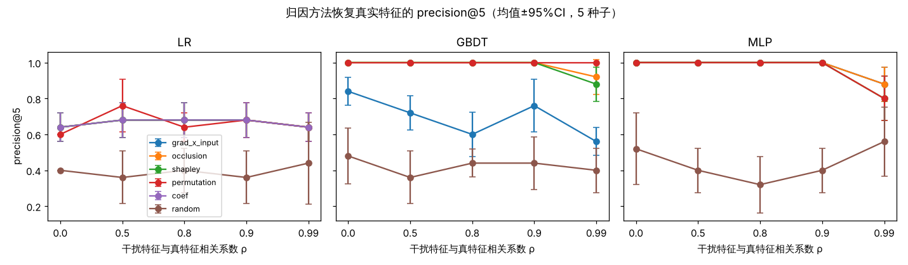
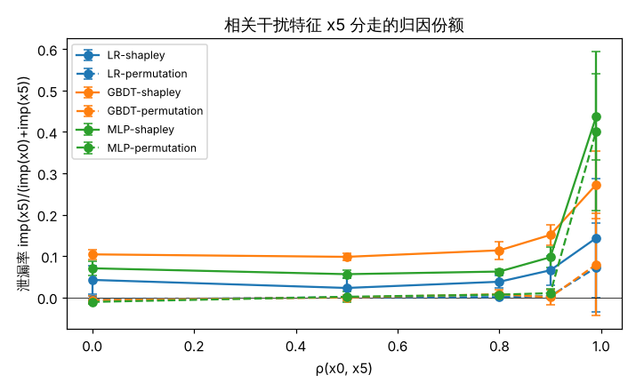
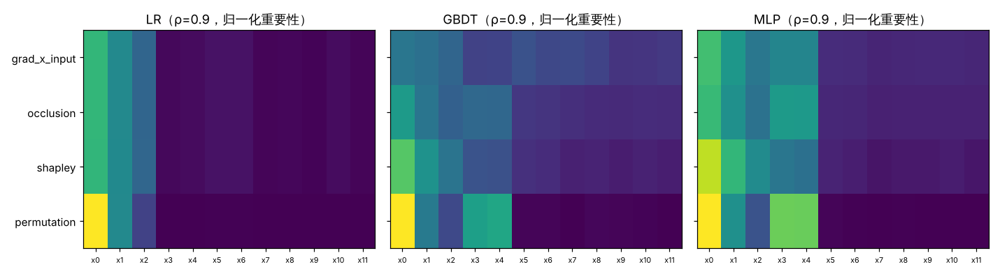

# Q11 人工智能的可解释性

> 分组：可信智能 ｜ 实验：`experiment.py`（单核运行时间约 85–120 秒，视机器负载） ｜ 证据标注：[实测] [文献] [判断]

## 摘要
可解释性的基础难题不是"能否画出一张热力图"，而是**归因是否忠实于模型、又是否忠实于数据生成机制**——二者在真实任务中都没有真值可对照。本项目构造了真值已知的合成表格任务（12 个特征中只有 5 个真正起作用，含一个纯交互项和两个与真特征相关的"代理"干扰特征），在逻辑回归、梯度提升树、MLP 上系统评估 5 种归因方法，并复现 Adebayo 等人的健全性检验。主要发现：(1) 在非线性模型上，扰动类方法（遮挡、采样 Shapley、置换重要性）在 ρ≤0.9 时 precision@5 = 1.00，而梯度×输入在树模型上显著更差（与真值 Shapley 的 Spearman 低 0.106，p=0.023）[实测]；(2) 线性模型的所有归因都无法发现纯交互特征（交互特征召回 0.10）——这是模型而非归因方法的失败 [实测]；(3) 相关代理特征分走的归因份额随 ρ 上升，在 ρ=0.99 时 MLP 上达 0.44，且在此区间**模型之间**的分歧大于**方法之间**的分歧 [实测]；(4) 权重/标签随机化后全局归因均与原归因去相关（|Spearman|≤0.21），但局部梯度×输入仍保留约 0.34 的秩相关，其中大部分可由输入幅值 |x| 本身解释 [实测]。结论：归因的"忠实"必须分层定义——忠实于模型、忠实于数据、可通过健全性检验——三者可以分离。

## 1. 问题界定
**为何是基础问题。** 解释方法本身是一个从（模型, 输入）到重要性向量的映射，但其"正确性"缺乏公认的数学定义：Shapley 值依赖于"缺失特征"如何定义（干预式 vs 条件式）[文献: Janzing 2019; Chen 2020]；梯度类方法依赖局部光滑性；而在相关特征下，"模型用了哪个特征"与"哪个特征在因果上起作用"本身就是不同的问题 [文献: Kumar 2020; Hooker 2019]。Bilodeau 等进一步证明，在足够丰富的模型类上，完备且线性的归因方法在推断模型行为的若干任务上可能不优于随机猜测 [文献: Bilodeau 2022]。因此，核心矛盾是：**用户需要的是关于世界的解释，而归因方法最多给出关于模型的解释，两者之间的落差无法在无真值的场景下被检测。**

**可检验的子假设（实验前固定）：**
- **H1（真值恢复与模型依赖）**：在独立特征（ρ=0）下，扰动类方法在 GBDT/MLP 上的 precision@5 ≥ 0.8；线性模型上所有方法对交互特征 (x3, x4) 的召回 ≤ 0.2；梯度×输入在分段常数的 GBDT 上显著劣于 Shapley（配对 t 检验 p<0.05）。*否证*：扰动类方法 precision@5 < 0.8，或梯度×输入在 GBDT 上不劣于 Shapley。
- **H2（相关特征导致归因泄漏）**：与真特征 x0 相关但无因果作用的 x5 所获归因份额随 ρ 单调上升，在 ρ=0.9 时（Shapley）超过 10%，且不同模型的泄漏率显著不同。*否证*：ρ=0.9 时所有模型泄漏率 ≤10%，或与 ρ=0 无差别。
- **H3（健全性检验）**：模型权重随机化 / 标签随机化后，各方法的全局重要性与原始重要性的 |Spearman| < 0.3；但局部梯度×输入因含输入因子，其与原局部归因的相似度显著高于 Shapley。*否证*：任一方法全局 |Spearman| ≥ 0.3，或梯度×输入局部相似度不高于 Shapley。

## 2. 研究现状
- **里程碑**：梯度显著图 [文献: Simonyan 2013]；LIME 局部代理 [文献: Ribeiro 2016]；DeepLIFT / 梯度×输入 [文献: Shrikumar 2017]；积分梯度及其公理化（敏感性、实现不变性）[文献: Sundararajan 2017]；SHAP 将多种方法统一到 Shapley 值框架 [文献: Lundberg 2017]；置换重要性源自随机森林 [文献: Breiman 2001]。
- **对归因的系统性质疑**：Adebayo 等的健全性检验显示部分显著图在模型随机化后几乎不变，与"边缘检测器"无异 [文献: Adebayo 2018]；Kindermans 等表明显著图对输入的常数平移不具不变性 [文献: Kindermans 2017]；ROAR 基准发现许多方法不比随机删除更好 [文献: Hooker 2018]；Zhou 等用"植入真值"的数据集发现主流方法常常不能正确归因 [文献: Zhou 2021]。
- **学派与争议**：(i) "事后解释"派与"本质可解释模型"派之争——Rudin 主张高风险决策应直接使用可解释模型而非解释黑箱 [文献: Rudin 2018]；(ii) Shapley 值"忠实于模型还是忠实于数据"之争——干预式 Shapley 会在相关特征上外推到数据流形之外，条件式 Shapley 则会把归因分给模型未使用的特征 [文献: Aas 2019; Chen 2020; Janzing 2019]；(iii) 机制可解释性试图从电路层面理解网络，但面临叠加（superposition）现象——单个神经元编码多个特征 [文献: Elhage 2022]。
- **评价学**：Doshi-Velez 与 Kim 提出功能级 / 人类级 / 应用级三层评估框架 [文献: Doshi-Velez 2017]，但迄今缺少被广泛接受的"忠实度"度量。
- **关键缺口**：(1) 无真值场景下忠实度如何检测；(2) 相关/冗余特征下"正确归因"的规范性定义；(3) 归因方法的统计不确定性（置信区间）几乎从不报告。

## 3. 研究设计
- **数据**：x ~ N(0, I₁₂)，并令 x5 = ρ·x0 + √(1−ρ²)·ε，x6 = ρ·x1 + √(1−ρ²)·ε；y ~ Bernoulli(σ(1.5x0 − 1.0x1 + 0.7x2 + 1.5x3·x4))。真特征集 S={x0..x4}（k=5），其中 x3、x4 **只**通过交互项起作用。ρ ∈ {0, 0.5, 0.8, 0.9, 0.99}；训练 3000、测试 1000、解释 150 个测试点。
- **模型**：LR（C=1）、GBDT（HistGradientBoosting，200 轮）、MLP（64-64，早停）。在 ρ=0 时测试准确率分别为 0.740、0.773、0.788，贝叶斯最优为 0.800 [实测]。
- **归因方法**：梯度×输入（中心差分 h=0.01）；遮挡（置为训练均值）；采样 Shapley（干预式、每点 48 个随机排列，背景取 500 个训练样本，自实现 Štrumbelj–Kononenko 置换采样）；置换重要性（测试集 log-loss 增量，5 次重复）；系数幅度（仅 LR，|β|·sd）；**随机归因**作为对照。局部归因取 |·| 的样本均值作为全局重要性。
- **指标**：precision@5；与"真值 Shapley"（对真实 logit 用同一采样器计算）的 Spearman；泄漏率 imp(x5)/(imp(x0)+imp(x5))；代理比 imp(x5)/mean(imp(x7..x11))（相对纯噪声特征）；方法间 Kendall τ；健全性检验中原归因与随机化模型归因的全局 Spearman、逐样本局部 Spearman，以及随机化模型局部归因与 |x| 的 Spearman。
- **统计**：5 个种子（数据 + 模型），均值 ± 95% CI（正态近似）；配对 t 检验（同种子比较方法）、Welch t 检验（比较模型）。
- **为何能检验假设**：真值已知使"忠实于数据"可直接度量；同一数据上比较多模型、多方法可以把"模型差异"与"方法差异"分离；随机化对照检验方法是否真正依赖模型参数。

## 4. 结果

### 4.1 真值恢复（ρ=0，独立特征）

| 模型 | 方法 | precision@5 | Spearman(与真值 Shapley) | 交互特征召回 |
|---|---|---|---|---|
| LR | 梯度×输入 / 遮挡 / Shapley / 系数 | 0.640±0.078 | 0.593±0.096（系数 0.579） | 0.10±0.20 |
| LR | 置换重要性 | 0.600±0.000 | 0.577±0.086 | 0.00 |
| GBDT | 梯度×输入 | 0.840±0.078 | 0.784±0.056 | 0.60±0.20 |
| GBDT | 遮挡 | 1.000 | 0.866±0.005 | 1.00 |
| GBDT | Shapley | 1.000 | 0.891±0.003 | 1.00 |
| GBDT | 置换重要性 | 1.000 | 0.847±0.016 | 1.00 |
| MLP | 梯度×输入 | 1.000 | 0.872±0.024 | 1.00 |
| MLP | 遮挡 | 1.000 | 0.859±0.023 | 1.00 |
| MLP | Shapley | 1.000 | 0.889±0.008 | 1.00 |
| MLP | 置换重要性 | 1.000 | 0.833±0.003 | 1.00 |
| 任意 | 随机归因（对照） | 0.40–0.52 | −0.05–0.21 | — |

- LR 上四种局部/系数方法给出几乎相同的排序（方法间 Kendall τ = 1.0）：对线性模型，梯度×输入、遮挡、干预式 Shapley 在数学上都等于 β_j(x_j − E x_j) [实测 + 推导]。LR 对 x3、x4 的系数接近 0（归一化重要性 0.006、0.015），因此**任何**基于 LR 的解释都"忠实于模型"却"不忠实于数据"[实测]。
- GBDT 上梯度×输入与真值 Shapley 的 Spearman 比 Shapley 低 0.106（配对 t，p=0.023；ρ=0.9 时差 0.285，p=0.053）[实测]。原因是树模型几乎处处梯度为零，有限差分只在恰好跨越分裂阈值的点上有值。
- **H1：支持。**

### 4.2 相关代理特征（ρ 扫描）

| 模型 | 方法 | 泄漏率 ρ=0 | ρ=0.9 | ρ=0.99 | 代理比(Shapley) ρ=0 → 0.9 → 0.99 |
|---|---|---|---|---|---|
| LR | Shapley | 0.042±0.035 | 0.066±0.036 | 0.143±0.143 | 1.74 → 4.19 → 6.20 |
| GBDT | Shapley | 0.104±0.012 | 0.151±0.025 | 0.273±0.081 | 1.18 → 1.57 → 2.75 |
| MLP | Shapley | 0.070±0.018 | 0.097±0.025 | 0.437±0.104 | 1.22 → 1.55 → 7.04 |
| LR | 置换 | −0.005±0.008 | 0.003±0.006 | 0.072±0.108 | — |
| GBDT | 置换 | −0.006±0.010 | 0.000±0.018 | 0.080±0.123 | — |
| MLP | 置换 | −0.011±0.005 | 0.010±0.010 | 0.402±0.192 | — |

- 局部方法（Shapley 等）在 ρ=0 时已有 0.04–0.10 的"泄漏"底噪：这是 |φ| 的蒙特卡洛估计噪声和模型对纯噪声特征的轻度使用造成的（代理比约 1，即 x5 与纯噪声特征无异）[实测]。因此应看**相对 ρ=0 的增量**与代理比。
- ρ=0.9 时 GBDT 的 Shapley 泄漏率为 0.151，与 LR（0.066，Welch p=0.006）和 MLP（0.097，p=0.018）显著不同；而置换重要性在三模型间无显著差别（p≥0.29）[实测]。ρ=0.99 时，MLP 上**所有**方法都把约 0.40–0.44 的份额给了 x5，precision@5 降至 0.80–0.88 [实测]——此时模型本身确实在用 x5（两者几乎不可区分），归因"忠实于模型"却"不忠实于因果"。
- 方法一致性：ρ=0.9 时同一模型上四种方法两两之间的 Kendall τ 在 GBDT 上仅 0.36–0.84，在 MLP 上 0.58–0.92；同一方法（Shapley）跨模型的 τ 为 0.56–0.69 [实测]（τ 包含 7 个无关特征的噪声排序，因此会偏低）。
- **H2：部分支持。** 泄漏率随 ρ 上升且在 ρ=0.9 时 GBDT 超过 10%、模型间差异显著；但相对 ρ=0 底噪的增量在 ρ≤0.9 时较小（GBDT 从 0.104 到 0.151），真正大幅泄漏只出现在近共线（ρ=0.99）。

### 4.3 健全性检验（ρ=0）

| 模型 | 随机化 | 方法 | 全局 Spearman | 局部 Spearman | 随机模型归因 vs |x| |
|---|---|---|---|---|---|
| MLP | 权重 | 梯度×输入 | −0.106±0.166 | 0.338±0.046 | 0.639±0.018 |
| MLP | 权重 | 遮挡 | −0.126±0.142 | 0.320±0.036 | 0.614±0.022 |
| MLP | 权重 | Shapley | −0.110±0.142 | 0.131±0.061 | 0.486±0.025 |
| MLP | 标签 | 梯度×输入 | 0.010±0.271 | 0.374±0.015 | 0.630±0.015 |
| MLP | 标签 | Shapley | −0.050±0.128 | 0.157±0.033 | 0.446±0.030 |
| MLP | 标签 / 权重 | 置换 | 0.214±0.314 / −0.041±0.393 | — | — |
| LR | 权重 | 梯度×输入 / Shapley | 0.048±0.193 | 0.279±0.137 / 0.247±0.134 | 0.570 / 0.543 |
| GBDT | 标签 | 梯度×输入 / Shapley | −0.038 / −0.077 | 0.067±0.020 / 0.054±0.035 | −0.038 / 0.233 |

- 所有方法的全局重要性在随机化后都与原重要性去相关（|Spearman| ≤ 0.214）[实测]：在全局层面，本实验的方法都通过了健全性检验。
- 局部层面，MLP 上梯度×输入的局部相似度比 Shapley 高 0.21（权重随机化 p<0.001，标签随机化 p<0.001），LR 上高 0.03–0.04（p≤0.001），GBDT 上无显著差异（p=0.36）[实测]。随机化模型的梯度×输入与 |x| 的秩相关高达 0.64 [实测]：**这部分"解释"来自输入而非模型**，这正是 Adebayo 等所说的"边缘检测器"效应在表格数据上的对应物。
- **H3：支持。**

## 5. 讨论
**机理解释。** (1) 归因 = 模型 × 归因方法 × 基线/缺失定义。LR 的失败说明：当模型类不能表示真实机制时，再忠实的归因也只是忠实地复述错误模型 [判断]。(2) 梯度类方法假设局部光滑，在树模型上崩溃；这意味着"模型无关"的解释工具在实践中并非真正模型无关 [实测]。(3) 相关特征下，模型对 x0 与 x5 的使用比例本身是欠定的——不同的归纳偏置（树的贪心分裂、MLP 的平滑分配、LR 的 L2 收缩）会给出不同分配，而归因方法只能如实报告。这与 Chen 等"忠实于模型 vs 忠实于数据"的区分 [文献: Chen 2020] 以及 Kumar 等对 Shapley 作为特征重要性度量的批评 [文献: Kumar 2020] 一致。(4) 置换重要性在 ρ≤0.9 时几乎不给 x5 归因，部分原因是它衡量的是"打乱后性能损失"，而模型对 x5 的轻度依赖造成的损失很小；但边际置换会制造数据流形外的样本 [文献: Hooker 2019]，在高相关下其可靠性同样存疑。

**与文献的一致与分歧。** 与 Adebayo 等一致，乘法型局部归因在随机模型上仍呈现输入结构 [文献: Adebayo 2018]；但与其图像实验中部分方法"完全不变"不同，本实验中全局重要性都对随机化敏感——低维表格数据中输入结构的主导性弱于图像边缘 [判断]。

**效度威胁与外推边界。**
- 内部效度：Shapley 只用 48 个排列，|φ| 的估计噪声造成泄漏率底噪；真值 Shapley 也用同一采样器估计，存在共同噪声；梯度用有限差分。
- 构念效度："真值"采用干预式 Shapley 于真实 logit——对相关特征，另一种合理的真值（条件式）会给出不同答案；precision@5 只看集合不看排序。
- 外部效度：d=12 的低维表格数据，模型规模小；结论**不能**直接外推到图像/语言大模型中的显著图或机制可解释性（叠加、分布式表示）。5 个种子下部分 CI 较宽（如 LR 的代理比）。
- 统计：多重比较未做校正；p≈0.02–0.05 的结论应视为中等强度证据。

<!-- BIBLIO:start -->
## 文献计量信号（arXiv，[实测]）

检索式：摘要含 “explainable artificial intelligence”、“feature attribution”、“saliency map”、“mechanistic interpretability” 之一；基线为同年 cs.LG / cs.AI / stat.ML 论文总数。数据：`ai2035/bibliometrics/arxiv_counts.json`（检索日 2026-11-26）。

| 年份 | 命中论文数 | 占 AI/ML 基线比例 |
|---|---|---|
| 2015 | 25 | 0.62% |
| 2016 | 39 | 0.66% |
| 2017 | 71 | 0.84% |
| 2018 | 93 | 0.68% |
| 2019 | 134 | 0.60% |
| 2020 | 232 | 0.76% |
| 2021 | 260 | 0.78% |
| 2022 | 337 | 0.93% |
| 2023 | 447 | 0.99% |
| 2024 | 573 | 0.97% |
| 2025 | 769 | 1.03% |

- 2019–2025 年份额的对数线性趋势：**每年 +8.6%**（95% CI +4.7% ~ +12.7%，R²=0.87），判定：**相对升温（增速显著快于 AI/ML 总体）**；在 20 个问题中按相对增速排第 11 位。
- 解读边界：分子覆盖 arXiv 全部类别、分母仅为 AI/ML 三个类别，所以“比例”是相对关注度指数，并非严格的子集占比；关键词匹配既会漏掉使用其他术语的工作，也会混入无关用法；arXiv 偏重机器学习社区，认知科学、神经科学与期刊论文覆盖不足。该信号衡量的是**研究关注度**，不是**问题被解决的程度**。
<!-- BIBLIO:end -->

## 6. 结论与 2035 展望
**核心结论**
1. [实测] 在真值已知、特征独立的任务上，扰动类归因（遮挡、Shapley、置换）对非线性模型能完美恢复真特征集（precision@5=1.00）；梯度×输入在树模型上明显失效。置信度：**高**（就本设定而言）。
2. [实测] 解释的上限由模型决定：线性模型下所有归因都看不见纯交互特征（召回 0.10）。"解释正确"不能脱离"模型正确"单独评估。置信度：**高**。
3. [实测][判断] 相关特征使归因在"模型使用"与"因果作用"之间系统性背离；在近共线区（ρ=0.99）模型间差异（MLP 泄漏 0.44 vs LR 0.14）超过方法间差异，说明这是一个**欠定问题**而非方法缺陷。置信度：**中**。
4. [实测] 健全性检验应在全局与局部两个层面进行：全局层面所有方法都通过，局部层面梯度×输入保留了约 0.34 的与模型无关的输入结构。置信度：**中-高**。

**关键未解问题**：无真值时如何估计归因的忠实度与置信区间；相关特征下归因的规范性定义（干预式、条件式还是因果式）；如何把局部归因上升为可验证的机制性解释（电路级）。

**建议研究路线**
- **近期（2026–2028）**：建立"植入真值"的归因基准族（表格、图像、文本，含交互与相关结构），要求每个归因报告 bootstrap 置信区间；里程碑：主流方法在基准上的 precision@k 与 Spearman 公开排行榜，且至少一种方法在 ρ≥0.9 下仍能区分因果特征与代理特征（需借助因果假设）。
- **中期（2029–2032）**：将归因与因果推断结合，给出"在何种因果假设下归因可识别"的定理与检验；里程碑：在已知因果图的半合成任务上，因果归因方法的代理泄漏率显著低于干预式 Shapley。
- **远期（2033–2035）**：面向大模型的可验证机制解释——解释以可执行的"子电路"形式给出，并能通过干预实验被证伪；里程碑：对一个十亿参数级模型的若干能力给出可干预、可复现且通过健全性检验的电路级解释，并在独立团队复现。

## 参考文献
- Adebayo, J. et al. (2018). Sanity Checks for Saliency Maps. arXiv:1810.03292
- Simonyan, K., Vedaldi, A., Zisserman, A. (2013). Deep Inside Convolutional Networks: Visualising Image Classification Models and Saliency Maps. arXiv:1312.6034
- Ribeiro, M. T., Singh, S., Guestrin, C. (2016). "Why Should I Trust You?": Explaining the Predictions of Any Classifier. arXiv:1602.04938
- Shrikumar, A., Greenside, P., Kundaje, A. (2017). Learning Important Features Through Propagating Activation Differences. arXiv:1704.02685
- Sundararajan, M., Taly, A., Yan, Q. (2017). Axiomatic Attribution for Deep Networks. arXiv:1703.01365
- Lundberg, S., Lee, S.-I. (2017). A Unified Approach to Interpreting Model Predictions. arXiv:1705.07874
- Breiman, L. (2001). Random Forests. *Machine Learning*, 45(1), 5–32.
- Štrumbelj, E., Kononenko, I. (2014). Explaining prediction models and individual predictions with feature contributions. *Knowledge and Information Systems*, 41(3), 647–665.
- Kindermans, P.-J. et al. (2017). The (Un)reliability of saliency methods. arXiv:1711.00867
- Hooker, S. et al. (2018). A Benchmark for Interpretability Methods in Deep Neural Networks. arXiv:1806.10758
- Zhou, Y. et al. (2021). Do Feature Attribution Methods Correctly Attribute Features? arXiv:2104.14403
- Rudin, C. (2018). Stop Explaining Black Box Machine Learning Models for High Stakes Decisions and Use Interpretable Models Instead. arXiv:1811.10154
- Doshi-Velez, F., Kim, B. (2017). Towards A Rigorous Science of Interpretable Machine Learning. arXiv:1702.08608
- Hooker, G., Mentch, L., Zhou, S. (2019). Unrestricted Permutation forces Extrapolation. arXiv:1905.03151
- Janzing, D., Minorics, L., Blöbaum, P. (2019). Feature relevance quantification in explainable AI: A causal problem. arXiv:1910.13413
- Aas, K., Jullum, M., Løland, A. (2019). Explaining individual predictions when features are dependent. arXiv:1903.10464
- Kumar, I. E. et al. (2020). Problems with Shapley-value-based explanations as feature importance measures. arXiv:2002.11097
- Chen, H. et al. (2020). True to the Model or True to the Data? arXiv:2006.16234
- Bilodeau, B. et al. (2022). Impossibility Theorems for Feature Attribution. arXiv:2212.11870
- Elhage, N. et al. (2022). Toy Models of Superposition. arXiv:2209.10652
