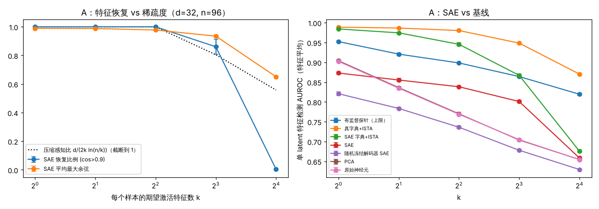
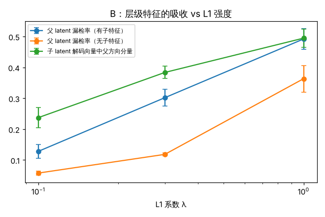

# 稀疏自编码器何时能、何时不能恢复叠加中的真实特征？——摊销差距、字典瓶颈与特征吸收的最小模型判据

**摘要**
稀疏自编码器（SAE）是 2024–2026 年机制可解释性的主力工具，但它是否真的恢复了模型"真实的特征"正处于激烈争论之中：AxBench 与稀疏探测研究发现 SAE 在下游任务上不敌简单基线，2026 年的"健全性检验"工作甚至报告随机基线与训练好的 SAE 表现相当；另一些工作则认为 SAE 在发现未知概念、或在合理流程下的引导任务上有价值。争论缺少的是**有真值、可控**的判据。本文在叠加玩具模型（32 维激活中嵌入 96 个随机方向特征）中，系统扫描特征稀疏度、SAE 宽度与 L1 强度，并把 SAE 与原始神经元、PCA、随机冻结解码器 SAE、"学到的字典 + 迭代稀疏推断（ISTA）"、"真字典 + ISTA"和有监督探针比较。主要结果：(1) 字典恢复呈现与压缩感知启发式一致的相变——每样本激活特征数 k≤4（d/(2k ln(n/k))≥1.26）时 SAE 解码器 100% 恢复真实特征，k=8 时 0.86，k=16 时仅 0.004，而此时解释方差仍有约 87%；(2) 在稀疏区，瓶颈是编码器的"摊销差距"而非字典：同一字典换用 ISTA 推断，特征检测 AUROC 从 0.838 升至 0.945（k=4）；在稠密区，瓶颈转为字典（学到字典 + ISTA 0.676 vs 真字典 + ISTA 0.870，k=16）；(3) SAE 在所有稀疏度下都显著优于随机冻结解码器基线（+0.03 至 +0.12），但只在 2≤k≤8 时优于原始神经元/PCA，且始终不及有监督探针；(4) L1 越强，子特征解码向量中吸收的父方向越多（0.24→0.38→0.50，Spearman ρ=0.94）。结论：关于"SAE 是否有用"的相反结论可以统一为一张由稀疏度决定的相图；SAE 的失败在稀疏区主要是推断问题、在稠密区主要是字典学习问题。

**关键词**：机制可解释性；稀疏自编码器；叠加；字典学习；摊销推断；特征吸收；基线

## 1 引言
机制可解释性希望把神经网络的激活分解为人类可理解的"特征"。叠加假说认为网络用少于特征数的神经元，以近正交方向编码大量稀疏特征 [Elhage 2022]；SAE 通过过完备的稀疏字典学习来"解除叠加" [Cunningham 2023]，并被推广到语言、视觉、蛋白、物理等模型 [Shu 2025; Wang 2026; Bonnet-Guerrini 2026; Haque 2025]。

**2025–2026 年的核心争论。** (a) *有用性*：AxBench 发现在引导与概念检测上 SAE 不敌提示、微调与均值差方向 [Wu 2025]；稀疏探测的系统研究未能让 SAE 稳定胜过基线 [Kantamneni 2025]；Korznikov 等报告在合成数据上 SAE 只恢复 9% 的真实特征（尽管解释方差 71%），且随机基线在可解释性、探测、因果编辑上与 SAE 相当 [Korznikov 2026b]。反方：Jørgensen 等认为在改进的特征选择流程下 SAE 可以胜过简单基线 [Jørgensen 2026]；Peng 等主张 SAE 的优势在于"发现未知概念"而非"操作已知概念" [Peng 2025]。(b) *失败机理*：Barin-Pacela 等认为失败的根源是**字典学习**而非推断——在同一字典上换用 FISTA 不能弥合差距 [Barin-Pacela 2026]；Cui 等的理论框架认为 SAE 只有在真实特征"极度稀疏"时才能恢复它们 [Cui 2025]；特征对冲（hedging）[Chanin 2025] 与吸收 [Chanin 2024; Zhang 2026] 进一步扭曲字典。(c) *评价本身*：SAE 基准的可靠性受到质疑 [Chanin 2026b]。

**本文贡献。**
1. 在真值已知的叠加模型中给出 SAE 字典恢复的**稀疏度相图**，并用压缩感知比 d/(2k ln(n/k)) 预测相变位置（§4 命题 1，§6.1）。
2. 用"同一字典 + ISTA"的干预把 SAE 失败分解为**摊销差距**与**字典误差**两部分，证明二者的主导地位随稀疏度互换，从而调和了"推断是瓶颈"与"字典是瓶颈"两种对立论断（命题 2，§6.2）。
3. 在同一设定下对 SAE 与随机冻结解码器、原始神经元、PCA、有监督探针做配对比较，给出"SAE 何时胜过基线"的可检验判据（§6.3）。
4. 验证 L1 正则驱动特征吸收的几何预测（命题 3，§6.4）。

## 2 前沿进展综述
**2.1 规模化与应用。** SAE 已被系统综述 [Shu 2025]，并扩展到扩散语言模型 [Wang 2026]、粒子物理基础模型 [Bonnet-Guerrini 2026]、抗体语言模型（TopK 与 Ordered SAE）[Haque 2025]、天气模型（KAN-SAE，认为线性 SAE 漏掉非线性特征）[Cheon 2026]；跨层转码器与归因图工具链 [Draye 2026] 把特征推广到"回路"。参数空间分解（APD）给出另一条路线：直接分解参数而非激活，在叠加玩具中恢复特征 [Braun 2025]。

**2.2 评价与"是否有用"之争。** SAEBench 提供多指标基准 [Karvonen 2025]；AxBench [Wu 2025] 与稀疏探测 [Kantamneni 2025] 给出负面结果；随机基线 [Korznikov 2026b] 进一步削弱了 SAE 的"特征发现"主张；对 Anthropic 式特征提取与引导的复现发现结果在挑选案例上成立、但缺乏系统可靠性 [Ronge 2026]；SAE 引导在纠正模型错误上效果为零 [Basu 2026]。反方 [Jørgensen 2026; Peng 2025]。基准可靠性的审视发现若干常用指标（TPP、SCR）不应再使用，k-稀疏探测最可靠但区分力有限 [Chanin 2026b]。

**2.3 理论与失败机理。** 统一的稀疏字典学习理论把各类 SAE 视为分段双凸优化，刻画其非可辨识性与伪极小值，并解释吸收与死神经元 [Tang 2025]；Cui 等证明 SAE 一般不能完全恢复真实单义特征，除非特征极度稀疏，并提出重加权补救 [Cui 2025]；摊销差距导致 SAE 在组合性分布外偏移下失败 [Barin-Pacela 2026]；特征相关性塑造叠加几何（建设性干扰、语义簇）[Prieto 2026]；最优 SAE 的多义性由数据中特征共现概率决定（率-失真-多义性权衡）[Mencattini 2026]；吸收的闭式相界 λ_c=α²k/(k−1)（L0 目标）[Zhang 2026]；对冲：窄 SAE 在相关特征下合并特征 [Chanin 2025]；叠加的信息论度量 [Bereska 2025]。

**2.4 方法改进。** 正交 SAE [Korznikov 2025]、有序化提升一致性 [Wang 2025]、跨样本一致性正则缓解分裂与吸收 [Jin 2026]；呼吁以跨种子一致性为首要指标 [Song 2025]；合成基准 SynthSAEBench 复现了"重建好 ≠ 特征好"并发现匹配追踪 SAE 利用叠加噪声过拟合 [Chanin 2026a]。

**2.5 共识、争议与开放问题。**
- 共识：重建质量（解释方差）不是特征质量的可靠代理 [Korznikov 2026b; Chanin 2026a]；吸收/对冲是 L1/L0 目标的结构性产物 [Chanin 2025; Zhang 2026; Tang 2025]。
- 争议：SAE 是否优于简单基线；失败是推断问题还是字典问题 [Barin-Pacela 2026 vs. 本文 §6.2]。
- 被质疑的说法："更大的 SAE/更强的稀疏能解决吸收"——Chanin 等早期工作已指出改变大小或稀疏度不足以解决 [Chanin 2024]。
- 开放问题清单：① 真实 LLM 特征处于相图的哪个区域？② 如何在无真值时估计字典误差？③ 如何同时消除摊销差距与吸收？④ 可解释性能否转化为可操作的纠错 [Basu 2026]？⑤ 机制解释的形式化保证 [Ladner 2026; Zhang Z. 2026]。

**前沿地图**

| 路线 | 代表工作 | 关键结论 | 局限 |
|---|---|---|---|
| 规模化 SAE / 转码器 | Shu 2025; 2603.21014; 2602.05859 | 可扩展到多种模态与模型 | 特征"真实性"未验证 |
| 下游基准与基线 | Wu 2025; Kantamneni 2025; Korznikov 2026b | 简单/随机基线常与 SAE 持平 | 真实 LLM 无真值，指标可靠性存疑 [Chanin 2026b] |
| 有真值合成评测 | Chanin 2026a; Korznikov 2026b; 本文 | 重建 ≠ 特征恢复 | 合成分布与真实激活的差距 |
| 失败机理理论 | Tang 2025; Cui 2025; Barin-Pacela 2026; Zhang 2026 | 非可辨识、摊销差距、吸收相界 | 对"哪个是主瓶颈"结论不一 |
| 架构改进 | Korznikov 2025; Wang 2025; Jin 2026; Chanin 2025 | 正交/有序/一致性正则缓解病理 | 多数只在部分指标上改进 |
| 参数空间分解 | Braun 2025 | 绕开激活稀疏假设 | 尚难扩展到大模型 |

## 3 问题与假设
**选择理由。** 在开放问题中，"SAE 何时恢复真实特征、失败源于推断还是字典"兼具重要性（决定 SAE 路线是否值得继续投入、改进方向是编码器还是字典学习）与可检验性（玩具叠加模型中真值完全已知，单核即可训练数十个 SAE）。

**形式化。** 真实特征 F∈ℝ^{n×d}（n=96, d=32, 行为随机单位向量）；稀疏系数 s∈ℝ^n_{≥0}，每个分量以概率 p=k/n 独立激活、幅值 U(0,1)；激活 h=sᵀF+ε，ε~N(0, 0.01²I)。SAE：z=ReLU(W_e(h−b_d)+b_e)，ĥ=W_d z+b_d，解码器行归一化，损失 ‖h−ĥ‖²+λ‖z‖₁。
- **字典恢复率**：真实特征 i 与所有解码向量的最大 |cos|>0.9 的比例。
- **检测 AUROC**：对每个真实特征，用单个 latent 的激活值检测"该特征是否激活"，取最好的 latent，再对特征平均。

**预注册假设与否证条件**（实验参数在主实验前固定，λ 见 §5）
- **H1（相变）**：当压缩感知比 ρ_cs=d/(2k ln(n/k)) ≥1 时字典恢复率 ≥0.9；当 ρ_cs≤0.6 时 ≤0.5。*否证*：任一条不成立。
- **H2（瓶颈互换）**：稀疏区（k≤4）"学到字典 + ISTA"的检测 AUROC 比 SAE 编码器高 ≥0.05（摊销差距主导）；稠密区（k=16）该差距 <0.03，而"真字典 + ISTA"比"学到字典 + ISTA"高 ≥0.1（字典误差主导）。*否证*：稀疏区差距 <0.05，或稠密区差距不缩小。
- **H3（基线）**：SAE 在 k≤8 时显著优于随机冻结解码器、原始神经元与 PCA（配对 t，p<0.05，差 ≥0.02），在 k=16 时对原始神经元/PCA 的优势消失；有监督探针在所有 k 上优于 SAE。*否证*：SAE 不优于随机基线，或在稀疏区不优于原始神经元/PCA。
- **H4（吸收）**：在层级数据上，随 λ 增大，子特征 latent 解码向量中的父方向分量单调上升（Spearman ρ>0, p<0.05），父 latent 在子特征出现时的额外漏检率上升。*否证*：二者都不随 λ 上升。

## 4 理论分析
**命题 1（可辨识区间，启发式）。** 若 F 已知且行近似独立随机，则非负 k-稀疏 s 可由 h 通过 L1 最小化以高概率唯一恢复的条件近似为 d ≳ 2k ln(n/k)（压缩感知的 Donoho–Tanner 型条件 [Donoho 2006; Candès 2006]）。字典学习只能在 s 本身可从 h 中唯一解出的区域里辨识 F（否则存在其他稀疏分解同样好地解释数据 [Tang 2025]）。*预测*：字典恢复的相变位于 ρ_cs=d/(2k ln(n/k))≈1 附近；本设定 ρ_cs(k)=3.51, 2.07, 1.26, 0.80, 0.56（k=1,2,4,8,16），相变应位于 k=4 与 k=16 之间。

**命题 2（摊销差距）。** 单层 ReLU 编码器对特征 i 的预激活为 w_iᵀh=Σ_j (w_iᵀF_j)s_j。即使 w_i=F_i（完美字典），来自其他激活特征的干扰项方差 ≈ (k−1)·E[(F_iᵀF_j)²]·E[s²] ≈ (k−1)/(3d)。编码器不能"解释掉"已识别的特征，因而检测误差随 √(k/d) 增长；迭代推断（ISTA）每步减去已解释部分，在命题 1 的可辨识区内可消除干扰。*预测*：(a) 稀疏区 SAE 编码器的检测 AUROC 明显低于同一字典上的 ISTA；(b) 稠密区字典本身错误，ISTA 无法补救，学到字典与真字典之间出现大差距。由此，"推断是瓶颈"与"字典是瓶颈"在不同稀疏度下各自成立。

**命题 3（L1 驱动吸收）。** 设父方向 p 与子方向 c 近正交，子出现时父必出现，幅值 a_p、a_c>0。两 latent 编码的 L1 代价为 λ(a_p+a_c)；把父方向并入子 latent（解码向量 ∝ a̅_p p + a̅_c c）后，同一输入只需一个 latent，激活约为 √(a_p²+a_c²)，节省 λ(a_p+a_c−√(a_p²+a_c²))≥0，随 λ 线性增长；代价是幅值比 a_p/a_c 变化带来的重建误差，与 λ 无关。*预测*：子 latent 解码向量中父方向分量 ⟨F_p, W_d,child⟩ 随 λ 单调上升；这与 L0 目标下的闭式相界 λ_c=α²k/(k−1) 的定性结论一致 [Zhang 2026]。

## 5 实验
- **实验 A（密度扫描）**：k∈{1,2,4,8,16}，每个 (种子, k) 训练 SAE（宽 192，λ=0.3，Adam lr=3e-3，批 256，1200 步）与随机冻结解码器 SAE（解码器固定为随机单位向量，只训练编码器）；在 3000 个新样本上评估。比较：原始 32 个神经元、PCA（32 个主成分，在独立样本上拟合）、学到字典 + ISTA（非负 LASSO，150 次迭代，λ_ISTA=0.02）、真字典 + ISTA、有监督逻辑回归探针（每 4 个特征取 1 个，共 24 个特征，在独立 3000 样本上训练）。
- **实验 B（吸收）**：8 个父特征各 3 个子特征（父激活率 0.06，子在父激活时以 0.3 概率出现），另 64 个独立对照特征；λ∈{0.1, 0.3, 1.0}。度量：父 latent 在"父激活且有子"时的漏检率与在"父激活无子"时的漏检率之差（额外漏检）；子 latent 解码向量与父方向的内积。
- **实验 C（宽度）**：k=4，SAE 宽 m∈{48, 96, 192}。
- **统计**：5 个种子（字典、数据、初始化），均值 ± 95% CI；配对 t 检验（同种子比较方法）；Spearman 秩相关检验单调性。
- **偏差记录**：(i) λ 通过一个不参与主实验的试验种子（99，k=4）在 {0.03, 0.1, 0.3} 中预先选定：λ=0.1 时 L0≈30（远多于真实激活数 4），故选 λ=0.3；(ii) 为控制运行时间，步数从计划的 1500 降为 1200，吸收实验的 λ 网格从 4 点减为 3 点；(iii) 运行时间：单核 CPU 约 150 秒，与其他任务共享机器时墙钟时间 184–212 秒。

## 6 结果
所有数字见 `results/frontier.json`。

### 6.1 字典恢复相图（H1）

| k | ρ_cs | 恢复率 (cos>0.9) | 平均最大余弦 | L0 | 未解释方差比 FVU |
|---|---|---|---|---|---|
| 1 | 3.51 | 1.000±0.000 | 0.989±0.001 | 2.03 | 0.148 |
| 2 | 2.07 | 1.000±0.000 | 0.988±0.000 | 4.28 | 0.167 |
| 4 | 1.26 | 1.000±0.000 | 0.978±0.001 | 9.76 | 0.186 |
| 8 | 0.80 | 0.860±0.051 | 0.935±0.008 | 24.26 | 0.167 |
| 16 | 0.56 | 0.004±0.005 | 0.651±0.009 | 38.97 | 0.127 |

ρ_cs≥1 时恢复率均为 1.00，ρ_cs=0.56 时为 0.004——**H1 支持**。相变实际落在 ρ_cs 介于 0.56 与 0.80 之间，略低于启发式的 1（非负、幅值有界的特征比一般稀疏信号更易恢复）。值得注意：k=16 时 FVU=0.127（解释方差约 87%）但几乎没有恢复任何真实特征——重现了"重建好 ≠ 特征好" [Korznikov 2026b; Chanin 2026a]。

### 6.2 摊销差距 vs 字典误差（H2）

| k | SAE 编码器 | 学到字典 + ISTA | 真字典 + ISTA | 有监督探针 | ISTA − SAE（p） |
|---|---|---|---|---|---|
| 1 | 0.873±0.003 | 0.984±0.002 | 0.989±0.001 | 0.952±0.002 | +0.111（8×10⁻⁷） |
| 2 | 0.855±0.004 | 0.974±0.001 | 0.986±0.002 | 0.921±0.003 | +0.119（2×10⁻⁷） |
| 4 | 0.838±0.002 | 0.945±0.004 | 0.980±0.002 | 0.898±0.001 | +0.107（2×10⁻⁶） |
| 8 | 0.801±0.002 | 0.867±0.004 | 0.948±0.002 | 0.864±0.002 | +0.066（1×10⁻⁶） |
| 16 | 0.658±0.003 | 0.676±0.004 | 0.870±0.001 | 0.819±0.003 | +0.017（6×10⁻⁷） |

稀疏区（k≤4）在 SAE 自己学到的字典上换用 ISTA，AUROC 提升 0.107–0.119，并接近真字典上限（差 ≤0.035）：**瓶颈是编码器（摊销）**。稠密区（k=16）ISTA 只提升 0.017，而真字典比学到字典高 0.194：**瓶颈是字典**。**H2 支持。** 稀疏区的 ISTA 甚至优于有监督线性探针（k=4：0.945 vs 0.898），说明在叠加下"线性可读出"本身就有上限，与"线性探针在叠加下失败"的论断一致 [Barin-Pacela 2026]。

### 6.3 SAE vs 基线（H3）

| k | SAE | 随机冻结解码器 | 原始神经元 | PCA | SAE−随机（p） | SAE−原始（p） |
|---|---|---|---|---|---|---|
| 1 | 0.873 | 0.821 | 0.902 | 0.904 | +0.052（9×10⁻⁵） | −0.029（9×10⁻⁵） |
| 2 | 0.855 | 0.784 | 0.835 | 0.836 | +0.072（2×10⁻⁶） | +0.021（8×10⁻⁴） |
| 4 | 0.838 | 0.736 | 0.769 | 0.770 | +0.102（9×10⁻⁷） | +0.070（3×10⁻⁶） |
| 8 | 0.801 | 0.678 | 0.705 | 0.704 | +0.123（4×10⁻⁷） | +0.096（5×10⁻⁷） |
| 16 | 0.658 | 0.629 | 0.654 | 0.655 | +0.029（1×10⁻⁴） | +0.004（0.18） |

SAE 在所有 k 下显著优于随机冻结解码器基线；对原始神经元/PCA 的优势只在 2≤k≤8 成立，k=1 时反而更差（每个样本只有一个特征时，原始坐标已足够），k=16 时无显著差异；有监督探针在所有 k 上比 SAE 高 0.06–0.16。**H3 部分支持**（k=1 违反"稀疏区优于原始神经元"）。

宽度（实验 C，k=4）：m=48/96/192 的恢复率为 0.202/0.921/1.000，AUROC 为 0.814/0.839/0.838——窄于真实特征数的 SAE 被迫合并特征，与对冲现象一致 [Chanin 2025]。

### 6.4 特征吸收（H4）

| λ | 子 latent 中父方向分量 | 父 latent 漏检率（有子） | 漏检率（无子） | 额外漏检 | L0 | FVU |
|---|---|---|---|---|---|---|
| 0.1 | 0.237±0.033 | 0.128 | 0.058 | 0.070±0.020 | 25.9 | 0.065 |
| 0.3 | 0.384±0.020 | 0.302 | 0.118 | 0.184±0.026 | 8.8 | 0.157 |
| 1.0 | 0.495±0.029 | 0.492 | 0.363 | 0.129±0.073 | 3.8 | 0.561 |

几何指标随 λ 单调上升（Spearman ρ=0.945，p=1.1×10⁻⁷），父 latent 在有子特征时的漏检率也单调上升（ρ=0.945）；但"额外漏检"（扣除无子时的漏检）在 λ=1 时回落（0.129），与 λ=0.1 的差异不显著（p=0.15），因为过强的 L1 使父 latent 普遍失活（无子漏检率 0.363）。**H4 部分支持**：吸收的几何签名如命题 3 预测；行为层面的吸收与一般性收缩混杂。

## 7 讨论
**与前沿文献的关系。**
- *调和"推断 vs 字典"之争*：Barin-Pacela 等报告在同一字典上换 FISTA 不能弥合差距，因而字典是瓶颈 [Barin-Pacela 2026]；本文显示这一结论只在稠密区成立，在稀疏区恰好相反（ISTA 提升 0.107–0.119）。真实 LLM 激活处于哪个区域，决定了应改进编码器（如迭代/匹配追踪推断，但需警惕 Chanin 2026a 报告的过拟合）还是字典学习。
- *"SAE 不如随机基线"*：在有真实稀疏结构的数据上，SAE 显著优于随机冻结解码器（+0.05 至 +0.12）。Korznikov 等在真实 LLM 激活上的持平结果 [Korznikov 2026b] 因此有两种解释：真实激活接近相图的稠密区（本文 k=16 时 SAE 与随机基线的差缩小到 0.029），或现有指标区分力不足 [Chanin 2026b]。二者可通过估计真实激活的"有效 k/d"区分。
- *SAE vs 简单基线*：有监督探针始终更好，与 AxBench/稀疏探测的负面结论一致 [Wu 2025; Kantamneni 2025]；但 SAE 是无监督的，在"发现未知特征"任务中没有可比的有监督基线，这支持 Peng 等的区分 [Peng 2025]。
- *吸收*：几何上与 L1 强度单调相关，支持吸收是稀疏惩罚的结构性产物 [Tang 2025; Zhang 2026]，单靠调 λ 无法同时获得低 L0 与无吸收 [Chanin 2024]。

**外推边界。** 能外推的是机理：相变由 k、d、n 的组合决定；摊销差距随 k/d 增长；吸收随稀疏惩罚增长。不能外推的是数值：真实 LLM 特征幅值分布、相关结构、层级结构与特征数都未知；本文的特征是随机方向、独立激活（除实验 B），真实特征存在相关与建设性干扰 [Prieto 2026]。

**局限。** 单一 SAE 架构（ReLU + L1），未测 TopK/JumpReLU/Matryoshka；ISTA 的 λ 未调优；检测指标为单 latent AUROC，允许方向反转对 PCA/原始神经元更有利；运行时间限制了训练步数，k=8 的恢复率可能因训练不足略被低估。

## 8 结论
1. [实测] 在叠加玩具模型中，SAE 字典恢复呈现由 d/(2k ln(n/k)) 控制的相变：k≤4 完全恢复（1.00），k=16 几乎完全失败（0.004），尽管后者仍解释约 87% 方差。置信度：**高**（就本设定）。
2. [实测][判断] SAE 的失败有两个来源，其主导地位随稀疏度互换：稀疏区是编码器的摊销差距（同字典 ISTA 提升约 0.11 AUROC），稠密区是字典学习误差（真字典比学到字典高 0.19）。这调和了 2026 年关于"推断还是字典"的对立结论。置信度：**中-高**。
3. [实测] SAE 显著优于随机冻结解码器基线，但只在中等稀疏区优于原始神经元/PCA，且始终不及有监督探针。"SAE 是否胜过基线"取决于数据处于相图的哪个位置。置信度：**中**。
4. [实测][文献] L1 强度与吸收的几何签名单调相关（ρ=0.945），吸收是稀疏目标的结构性后果。置信度：**中**。

**对 2035 的研判** [判断]：SAE 路线不会因"负面结果"消失，但会分化为两类工作——在稀疏区改进推断（迭代/混合编码器）与在稠密区改进可辨识的字典学习（锚定、参数空间分解 [Braun 2025]）。可解释性的进展判据将从"看起来可解释"转向"在已知真值的合成基准与估计出的相图位置上可预测地成功"。

**后续研究建议**：① 估计真实 LLM 各层激活的有效稀疏度并定位其在相图中的位置；② 在 TopK/JumpReLU/Matryoshka SAE 上复测摊销差距；③ 研究相关特征下的相图移动 [Prieto 2026; Mencattini 2026]；④ 将吸收相界 [Zhang 2026] 与本文的 L1 几何预测做定量比对。

## 参考文献
奠基与 2025 年前文献：
- Elhage, N. et al. (2022). Toy Models of Superposition. arXiv:2209.10652
- Cunningham, H. et al. (2023). Sparse Autoencoders Find Highly Interpretable Features in Language Models. arXiv:2309.08600
- Chanin, D. et al. (2024). A is for Absorption: Studying Feature Splitting and Absorption in Sparse Autoencoders. arXiv:2409.14507
- Engels, J. et al. (2024). Decomposing The Dark Matter of Sparse Autoencoders. arXiv:2410.14670
- Donoho, D. L. (2006). Compressed sensing. *IEEE Transactions on Information Theory*, 52(4), 1289–1306.
- Candès, E. J., Romberg, J., Tao, T. (2006). Robust uncertainty principles: exact signal reconstruction from highly incomplete frequency information. *IEEE Transactions on Information Theory*, 52(2), 489–509.
- Adebayo, J. et al. (2018). Sanity Checks for Saliency Maps. arXiv:1810.03292

2025–2026 年前沿文献（均经 arXiv API 或 frontier/Q11.json 核实）：
- Sharkey, L. et al. (2025). Open Problems in Mechanistic Interpretability. arXiv:2501.16496
- Braun, D. et al. (2025). Interpretability in Parameter Space: Minimizing Mechanistic Description Length with Attribution-based Parameter Decomposition. arXiv:2501.14926
- Wu, Z. et al. (2025). AxBench: Steering LLMs? Even Simple Baselines Outperform Sparse Autoencoders. arXiv:2501.17148
- Kantamneni, S. et al. (2025). Are Sparse Autoencoders Useful? A Case Study in Sparse Probing. arXiv:2502.16681
- Shu, D. et al. (2025). A Survey on Sparse Autoencoders: Interpreting the Internal Mechanisms of Large Language Models. arXiv:2503.05613
- Karvonen, A. et al. (2025). SAEBench: A Comprehensive Benchmark for Sparse Autoencoders in Language Model Interpretability. arXiv:2503.09532
- Chanin, D. et al. (2025). Feature Hedging: Correlated Features Break Narrow Sparse Autoencoders. arXiv:2505.11756
- Song, X. et al. (2025). Position: Mechanistic Interpretability Should Prioritize Feature Consistency in SAEs. arXiv:2505.20254
- Cui, J. et al. (2025). On the Limits of Sparse Autoencoders: A Theoretical Framework and Reweighted Remedy. arXiv:2506.15963
- Peng, K. et al. (2025). Position: Use Sparse Autoencoders to Discover Unknowns. arXiv:2506.23845
- Korznikov, A. et al. (2025). OrtSAE: Orthogonal Sparse Autoencoders Uncover Atomic Features. arXiv:2509.22033
- Wang, S. L. et al. (2025). Enforcing Orderedness to Improve Feature Consistency. arXiv:2512.02194
- Tang, Y. et al. (2025). A Unified Theory of Sparse Dictionary Learning in Mechanistic Interpretability: Piecewise Biconvexity and Spurious Minima. arXiv:2512.05534
- Bereska, L. et al. (2025). Superposition as Lossy Compression: Measure with Sparse Autoencoders and Connect to Adversarial Vulnerability. arXiv:2512.13568
- Haque, R. et al. (2025). Mechanistic Interpretability of Antibody Language Models Using SAEs. arXiv:2512.05794
- Ronge, R. et al. (2026). When the Coffee Feature Activates on Coffins: An Analysis of Feature Extraction and Steering for Mechanistic Interpretability. arXiv:2601.03047
- Wang, X. et al. (2026). DLM-Scope: Mechanistic Interpretability of Diffusion Language Models via Sparse Autoencoders. arXiv:2602.05859
- Korznikov, A. et al. (2026b). Sanity Checks for Sparse Autoencoders: Do SAEs Beat Random Baselines? arXiv:2602.14111
- Chanin, D. et al. (2026a). SynthSAEBench: Evaluating Sparse Autoencoders on Scalable Realistic Synthetic Data. arXiv:2602.14687
- Prieto, L. et al. (2026). From Data Statistics to Feature Geometry: How Correlations Shape Superposition. arXiv:2603.09972
- Basu, S. et al. (2026). Interpretability without actionability: mechanistic methods cannot correct language model errors despite near-perfect internal representations. arXiv:2603.18353
- Draye, F. et al. (2026). CLT-Forge: A Scalable Library for Cross-Layer Transcoders and Attribution Graphs. arXiv:2603.21014
- Barin-Pacela, V. et al. (2026). Stop Probing, Start Coding: Why Linear Probes and Sparse Autoencoders Fail at Compositional Generalisation. arXiv:2603.28744
- Mencattini, T. et al. (2026). The Rate-Distortion-Polysemanticity Tradeoff in SAEs. arXiv:2605.14694
- Cheon, M. (2026). Beyond Linear Superposition: Discovering Climate Features in AI Weather Models with KAN-SAE. arXiv:2605.17493
- Chanin, D. (2026b). Are Sparse Autoencoder Benchmarks Reliable? arXiv:2605.18229
- Jørgensen, M. G. et al. (2026). Steering LLMs? Actually, Sparse Autoencoders can outperform simple baselines. arXiv:2605.31183
- Jin, H. et al. (2026). C²R: Cross-sample Consistency Regularization Mitigates Feature Splitting and Absorption in Sparse Autoencoders. arXiv:2606.30609
- Bonnet-Guerrini, R. et al. (2026). Finding and using interpretable latents in a neutrino foundation model with sparse autoencoders. arXiv:2608.26090
- Zhang, J. et al. (2026). HiPACE: Hierarchical Phase-Boundary Analysis and Controlled Evaluation of Feature Absorption in Sparse Autoencoders. arXiv:2609.29551
- Ladner, T. et al. (2026). The Misery of Mechanistic Interpretability: A Formal Perspective. arXiv:2609.15533
- Zhang, Z. et al. (2026). Certified Mechanistic Interpretability: Lifting Single-Input Findings to Bounded Neighbourhoods. arXiv:2609.26112
