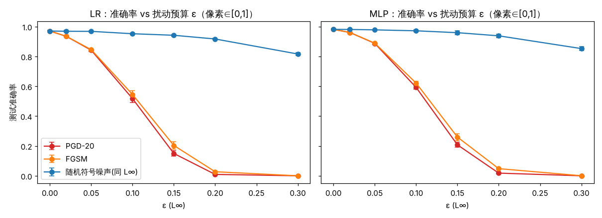
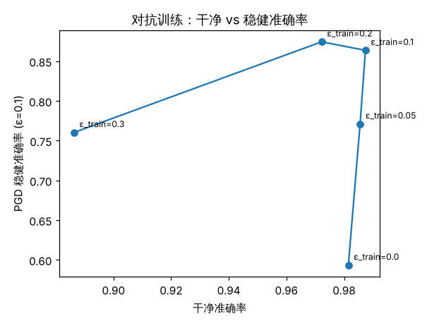
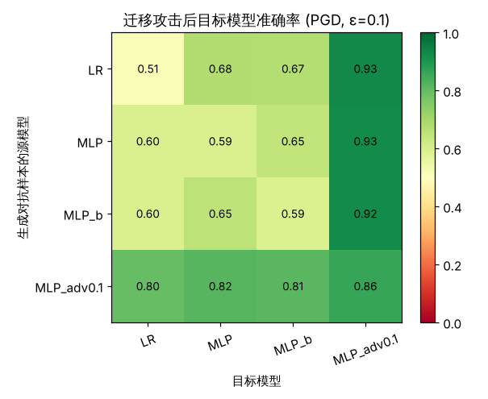

# Q12 稳健性与对抗安全

> 分组：可信智能 ｜ 实验：`experiment.py`（单核运行时间约 145 秒） ｜ 证据标注：[实测] [文献] [判断]

## 摘要
对抗样本揭示了一个基础矛盾：在平均意义上近乎完美的分类器，在输入的最坏情形邻域里却可能几乎完全失效。本项目在 sklearn digits（8×8，像素归一化到 [0,1]）上，用自写 numpy 的 softmax 逻辑回归与 MLP（可精确求输入梯度），系统测量了 FGSM/PGD 攻击下的准确率–ε 曲线、同范数随机噪声对照、对抗训练的干净/稳健权衡以及攻击迁移性。主要发现：ε=0.1 时 PGD 使 LR 准确率从 0.970 降至 0.517、MLP 从 0.981 降至 0.593，而同 L∞ 范数的随机符号噪声仅降至 0.952 / 0.972 [实测]；小扰动下"对抗/随机"损失增量之比（LR 6.95，MLP 6.93）与线性假设给出的预测值 ‖g‖₁/(‖g‖₂√(2/π))（7.14 / 6.98）高度吻合 [实测]；对抗训练在小 ε_train 时反而略升干净准确率，只有 ε_train≥0.2 才出现显著的干净准确率损失（ε_train=0.3 时下降 9.5 个百分点）[实测]；对抗样本跨模型迁移显著，而对抗训练模型对迁移攻击几乎免疫（0.93）[实测]。结论：Goodfellow 的线性解释在定量上成立；稳健–准确权衡真实存在但依赖于扰动预算与数据的类间间隔。

## 1. 问题界定
**为何是基础问题。** 统计学习理论保证的是**平均**风险，而安全需要的是**最坏情形**风险；二者之间的落差决定了 AI 系统能否被部署在对抗环境中。核心矛盾在于：(i) 高维输入中，大量每维微小的扰动可以沿权重方向累积成巨大的输出变化 [文献: Goodfellow 2014]；(ii) 稳健性可能需要不同于准确性的特征，从而两者存在内在权衡 [文献: Tsipras 2018]；(iii) 对抗样本在模型之间迁移，使黑盒攻击成为可能 [文献: Papernot 2016]。

**可检验的子假设（实验前固定）：**
- **H1（线性假设）**：(a) ε=0.1 时 PGD 造成的准确率下降 ≥50 个百分点，而同 L∞ 范数随机符号噪声造成的下降 ≤5 个百分点；(b) 小 ε 下对抗/随机损失增量之比 ≈ ‖g‖₁/(‖g‖₂√(2/π))，且 ‖g‖₁/‖g‖₂ ≥ √d/2 = 4；(c) 对线性模型 FGSM 与 PGD 几乎等效（差距 ≤3 个百分点）。*否证*：随机噪声与对抗噪声效果相近，或比值与预测偏离超过 30%。
- **H2（权衡）**：随 ε_train 增加，ε=0.1 下的稳健准确率上升而干净准确率单调下降。*否证*：干净准确率不随 ε_train 下降。
- **H3（迁移）**：迁移攻击使目标模型准确率比其干净准确率下降 ≥20 个百分点；同架构（MLP→MLP′）的迁移强于跨架构（LR→MLP′）。*否证*：迁移后准确率下降 <20 个百分点，或跨架构迁移更强。

## 2. 研究现状
- **发现与解释**：Szegedy 等首次报告神经网络对不可察觉扰动的脆弱性及其跨模型迁移 [文献: Szegedy 2013]；Goodfellow 等提出"线性假设"并给出 FGSM 与对抗训练 [文献: Goodfellow 2014]；Ilyas 等认为对抗样本源于数据中"非稳健但有预测力"的特征 [文献: Ilyas 2019]；Fawzi 等证明对任意分类器（在生成模型假设下）都存在小范数对抗扰动 [文献: Fawzi 2018]。
- **攻击与评估**：迭代攻击 BIM [文献: Kurakin 2016]、C&W [文献: Carlini 2016]、PGD 鞍点框架 [文献: Madry 2017]；"梯度混淆"使许多防御名不副实 [文献: Athalye 2018]，促成 AutoAttack 等标准化评估 [文献: Croce 2020]。
- **防御**：PGD 对抗训练 [文献: Madry 2017]；TRADES 显式平衡干净与稳健损失 [文献: Zhang 2019]；可证明防御——凸松弛 [文献: Wong 2017] 与随机平滑 [文献: Cohen 2019]。
- **权衡之争**：Tsipras 等构造了稳健与准确不可兼得的分布 [文献: Tsipras 2018]；Schmidt 等指出稳健泛化需要更多数据 [文献: Schmidt 2018]；Raghunathan 等表明对抗训练可能损害泛化，但可通过无标签数据缓解 [文献: Raghunathan 2019; Raghunathan 2020]；Yang 等则发现真实图像数据集通常是"类间分离"的，原则上稳健与准确可以兼得，权衡更多来自算法而非分布 [文献: Yang 2020]。
- **迁移**：Papernot 等系统研究了跨模型与跨算法迁移 [文献: Papernot 2016]；Tramèr 等估计对抗子空间的维度以解释迁移 [文献: Tramèr 2017]。
- **关键缺口**：稳健性的样本复杂度与计算复杂度下界；超出 Lp 球的语义扰动的形式化；大模型（含 LLM 越狱）的稳健性评估缺乏可证明保证。

## 3. 研究设计
- **数据**：digits，1797 张 8×8 图像，像素/16 ∈ [0,1]，d=64；每个种子分层划分 70% 训练 / 30% 测试（540 张）。
- **模型（numpy 自实现，Adam）**：LR = 64→10 softmax（100 轮，lr=0.01）；MLP = 64-256-256-10 ReLU（60 轮，lr=0.002，权重衰减 1e-4）；另训练一个不同初始化的 MLP_b 用于同架构迁移。
- **攻击**：FGSM；PGD-20（随机起点，步长 2.5ε/20，投影到 L∞ 球并裁剪到 [0,1]）；**对照**：随机符号噪声 x+ε·s，s∈{±1}^d（与 FGSM 有相同的 L∞ 与 L2 范数）。ε ∈ {0, 0.02, 0.05, 0.1, 0.15, 0.2, 0.3}。
- **线性诊断**：对每个测试样本计算输入梯度 g；记录 ‖g‖₁/‖g‖₂ 中位数、实际损失增量与一阶预测 ε‖g‖₁ 之比、对抗与随机噪声的平均损失增量之比。线性模型下，随机符号噪声的期望 |g·s| ≈ ‖g‖₂√(2/π)，故预测比值为 ‖g‖₁/(‖g‖₂√(2/π))。
- **对抗训练**：Madry 式（仅用 PGD-5 对抗样本训练，40 轮），ε_train ∈ {0, 0.05, 0.1, 0.2, 0.3}；评估干净准确率与 PGD-20 下 ε=0.05/0.1/0.2 的稳健准确率。
- **迁移**：源模型 {LR, MLP, MLP_b, MLP_adv(ε_train=0.1)} 上生成 PGD ε=0.1 样本，在全部目标模型上测准确率。
- **统计**：5 个种子（数据划分 + 初始化），均值 ± 95% CI；配对 t 检验。

**设计偏差（如实记录）**：初版 ε_train 网格为 {0, 0.05, 0.1, 0.2}，对抗训练 60 轮 PGD-7。看到首轮结果（ε_train≤0.2 时干净准确率无下降）且运行时间超过 3 分钟后，**增加了 ε_train=0.3**，并把对抗训练降为 40 轮 PGD-5。H2 的结论因此对 ε_train=0.3 一档属于事后扩展，应以较低置信度看待。

## 4. 结果

### 4.1 准确率–ε 曲线与随机噪声对照

| ε | LR: PGD | LR: FGSM | LR: 随机 | MLP: PGD | MLP: FGSM | MLP: 随机 |
|---|---|---|---|---|---|---|
| 0 | 0.970±0.006 | — | — | 0.981±0.003 | — | — |
| 0.05 | 0.842±0.009 | 0.846±0.008 | 0.968±0.005 | 0.887±0.009 | 0.889±0.007 | 0.978±0.002 |
| 0.1 | 0.517±0.027 | 0.545±0.026 | 0.952±0.005 | 0.593±0.011 | 0.621±0.012 | 0.972±0.006 |
| 0.15 | 0.150±0.018 | 0.203±0.024 | 0.942±0.005 | 0.207±0.017 | 0.259±0.023 | 0.959±0.012 |
| 0.2 | 0.009±0.003 | 0.027±0.005 | 0.917±0.004 | 0.018±0.004 | 0.048±0.005 | 0.938±0.012 |
| 0.3 | 0.000 | 0.000 | 0.816±0.010 | 0.000 | 0.000±0.001 | 0.853±0.012 |

- ε=0.1 时随机噪声比 PGD 的准确率高 0.435（LR，p=5×10⁻⁶）和 0.379（MLP，p=1.4×10⁻⁷）[实测]。
- FGSM 与 PGD 的差距在 ε=0.1 时为 0.027（LR）和 0.029（MLP），ε=0.05 时仅 0.004 / 0.001 [实测]：单步线性化攻击已接近最优。

### 4.2 线性诊断

| 模型 | ε | ‖g‖₁/‖g‖₂ | 实际/一阶损失增量 | 预测 对抗/随机 比 | 实测 对抗/随机 比 |
|---|---|---|---|---|---|
| LR | 0.01 | 5.633±0.025 | 1.089±0.005 | 7.143±0.043 | 6.954±0.570 |
| LR | 0.1 | 5.633 | 13.649±0.650 | 7.143 | 19.079±0.908 |
| MLP | 0.01 | 5.540±0.050 | 1.282±0.014 | 6.980±0.111 | 6.931±0.871 |
| MLP | 0.1 | 5.540 | 184.979±25.890 | 6.980 | 28.184±4.363 |

- 在 ε=0.01 时，实测比值与线性预测相差不到 3%（LR 6.954 vs 7.143；MLP 6.931 vs 6.980）[实测]。‖g‖₁/‖g‖₂≈5.6，低于 √64=8，因为 digits 的边缘像素几乎恒为 0，有效维度小于 64 [判断]。
- ε 增大后实际损失增量远超一阶预测（MLP 在 ε=0.1 时为 185 倍），这是交叉熵在样本被误分类后的凸性所致，并不否定"方向上的线性"[判断]。
- **H1：部分支持。** (b)(c) 成立：线性预测在小 ε 下定量吻合，FGSM≈PGD；(a) 中随机噪声降幅 ≤5 个百分点成立（1.8 / 0.9 个百分点），但 PGD 在 ε=0.1 时的降幅为 45（LR）与 39（MLP）个百分点，**未达到**预设的 50 个百分点阈值（ε=0.15 时达到）。

### 4.3 对抗训练权衡（MLP）

| ε_train | 干净准确率 | 训练集干净准确率 | PGD@0.05 | PGD@0.1 | PGD@0.2 |
|---|---|---|---|---|---|
| 0 | 0.981±0.003 | 1.000 | 0.887±0.008 | 0.593±0.013 | 0.019±0.006 |
| 0.05 | 0.986±0.002 | 1.000 | 0.944±0.005 | 0.771±0.011 | 0.073±0.010 |
| 0.1 | 0.987±0.003 | 0.999 | 0.959±0.007 | 0.864±0.011 | 0.258±0.011 |
| 0.2 | 0.972±0.003 | 0.986±0.001 | 0.949±0.003 | 0.874±0.018 | 0.574±0.009 |
| 0.3 | 0.886±0.017 | 0.900±0.015 | 0.833±0.014 | 0.760±0.015 | 0.530±0.028 |

- ε_train=0.05/0.1 时干净准确率**上升** 0.004（p=0.051）/ 0.006（p=0.005）；ε_train=0.2 时下降 0.009（p=0.019）；ε_train=0.3 时下降 0.095（p=0.0008）[实测]。
- 稳健准确率@0.1 在所有 ε_train>0 下均显著提升（+0.17 至 +0.28，p<0.001），但在 ε_train=0.3 时低于 ε_train=0.2（0.760 vs 0.874）[实测]：过大的训练扰动使模型连训练集都拟合不好（训练准确率 0.900）。
- **H2：部分支持。** 稳健性提升成立；干净准确率并非单调下降，而是先升后降——权衡只在 ε_train ≥ 0.2 出现。

### 4.4 迁移性（PGD，ε=0.1；表中为目标模型在迁移样本上的准确率）

| 源 \ 目标 | LR (干净 0.970) | MLP (0.981) | MLP_b (0.979) | MLP_adv0.1 (0.987) |
|---|---|---|---|---|
| LR | **0.513** | 0.679 | 0.674 | 0.929 |
| MLP | 0.596 | **0.594** | 0.647 | 0.926 |
| MLP_b | 0.596 | 0.654 | **0.591** | 0.924 |
| MLP_adv0.1 | 0.798 | 0.818 | 0.814 | **0.861** |

- 所有标准模型之间的迁移均使目标准确率下降 30–38 个百分点 [实测]。MLP→MLP_b 造成的下降比 LR→MLP_b 多 0.027（p=0.0005），但比 MLP→LR 少 0.043（p=0.007）[实测]：MLP 生成的对抗样本对 LR 几乎与白盒攻击同样有效（0.596 vs LR 自身白盒 0.513）。
- 对抗训练模型对迁移攻击几乎免疫（0.924–0.929），而它生成的样本对标准模型也有一定迁移力（0.80–0.82）[实测]。
- **H3：部分支持。** 迁移强度 ≥20 个百分点成立；"同架构迁移强于跨架构迁移"只对 LR→MLP 方向成立，MLP→LR 方向反而最强——迁移的不对称性比架构相似度更重要。

## 5. 讨论
**机理解释。** (1) 线性假设的定量验证：随机符号噪声沿梯度方向的投影只有 O(‖g‖₂) 量级，而对抗扰动可以取到 ‖g‖₁，二者之比约为有效维度的平方根；在 64 维数据中这一比值约为 7，在 ImageNet 级（d≈1.5×10⁵）数据中会大两个数量级 [判断，基于同一推导]。(2) MLP 样本迁移到 LR 极强，与"线性模型是 MLP 的局部近似"一致：MLP 的输入梯度包含了 LR 所依赖的主要线性方向 [判断]。(3) 权衡的非单调性与 Yang 等的观点一致：digits 的类间 L∞ 间隔较大，小 ε 的对抗训练相当于数据增强/正则化，只有当 ε 接近类间间隔的一半时才不可避免地牺牲准确率 [文献: Yang 2020; 判断]。这也与 Tsipras 等的构造并不矛盾——他们的权衡依赖于存在"弱相关但非稳健"的特征 [文献: Tsipras 2018]。

**效度威胁与外推边界。**
- 内部效度：PGD-20 加单次随机起点可能低估最强攻击（未用 AutoAttack 级评估）[文献: Croce 2020]；对抗训练只用 PGD-5，稳健准确率可能被高估。
- 构念效度：L∞ 球只是一类扰动；随机符号噪声是"同范数"对照，但人类感知的"不可察觉"与 L∞ 范数并不等价。
- 外部效度：digits 是低维、小样本、高类间间隔的数据集，无法代表自然图像或语言模型；‖g‖₁/‖g‖₂ 的维度依赖与权衡的出现点都会随数据而变。
- 研究过程：ε_train=0.3 是事后添加的（见第 3 节），H2 的后半部分证据较弱。

<!-- BIBLIO:start -->
## 文献计量信号（arXiv，[实测]）

检索式：摘要含 “adversarial examples”、“adversarial robustness”、“adversarial training”、“certified robustness” 之一；基线为同年 cs.LG / cs.AI / stat.ML 论文总数。数据：`ai2035/bibliometrics/arxiv_counts.json`（检索日 2026-11-26）。

| 年份 | 命中论文数 | 占 AI/ML 基线比例 |
|---|---|---|
| 2015 | 13 | 0.32% |
| 2016 | 41 | 0.70% |
| 2017 | 196 | 2.32% |
| 2018 | 507 | 3.70% |
| 2019 | 748 | 3.37% |
| 2020 | 1,013 | 3.33% |
| 2021 | 1,046 | 3.15% |
| 2022 | 1,050 | 2.90% |
| 2023 | 1,093 | 2.42% |
| 2024 | 1,033 | 1.75% |
| 2025 | 1,064 | 1.43% |

- 2019–2025 年份额的对数线性趋势：**每年 -13.7%**（95% CI -18.9% ~ -8.3%，R²=0.88），判定：**相对降温（增速显著慢于 AI/ML 总体，绝对量仍可能增长）**；在 20 个问题中按相对增速排第 20 位。
- 解读边界：分子覆盖 arXiv 全部类别、分母仅为 AI/ML 三个类别，所以“比例”是相对关注度指数，并非严格的子集占比；关键词匹配既会漏掉使用其他术语的工作，也会混入无关用法；arXiv 偏重机器学习社区，认知科学、神经科学与期刊论文覆盖不足。该信号衡量的是**研究关注度**，不是**问题被解决的程度**。
<!-- BIBLIO:end -->

## 6. 结论与 2035 展望
**核心结论**
1. [实测] 对抗扰动的破坏力远超同范数随机噪声（ε=0.1 时 LR 准确率 0.517 vs 0.952），且小 ε 下二者之比与线性预测吻合到 3% 以内——线性假设在机理层面得到定量支持。置信度：**高**（对本数据与模型）。
2. [实测] FGSM 在小 ε 下几乎与 PGD 等效（差 ≤0.004），迭代攻击的优势随 ε 增大而增大。置信度：**高**。
3. [实测][判断] 稳健–准确权衡是有条件的：在 digits 上 ε_train≤0.1 的对抗训练提升干净准确率，ε_train=0.3 时干净准确率下降 9.5 个百分点。置信度：**中**（含事后扩展的网格点）。
4. [实测] 对抗样本在标准模型间普遍迁移（下降 30–38 个百分点），对抗训练模型几乎不受迁移攻击影响。置信度：**中-高**。

**关键未解问题**：稳健学习的统计/计算复杂度下界；超越 Lp 范数的语义与因果扰动的形式化；如何为大模型（含多模态与 LLM 越狱）提供可证明、可扩展的稳健性保证。

**建议研究路线**
- **近期（2026–2028）**：建立"线性度—脆弱性"的标度律测量：在不同维度/分辨率与架构下测量 ‖g‖₁/‖g‖₂ 与对抗/随机比值；里程碑：在 ≥3 个数据集上验证该比值对脆弱性的预测误差 <20%。
- **中期（2029–2032）**：可证明稳健性从 L2/L∞ 扩展到语义变换集合（光照、几何、改写），并把认证半径作为常规发布指标；里程碑：在 ImageNet 级任务上，认证稳健准确率与经验稳健准确率的差距缩小到 10 个百分点以内。
- **远期（2033–2035）**：对通用大模型的对抗安全形成"攻防基准 + 形式化规范"的体系，包括越狱与提示注入；里程碑：关键安全属性在给定威胁模型内可被形式验证，并经第三方红队在固定预算内无法攻破。

## 参考文献
- Szegedy, C. et al. (2013). Intriguing properties of neural networks. arXiv:1312.6199
- Goodfellow, I. J., Shlens, J., Szegedy, C. (2014). Explaining and Harnessing Adversarial Examples. arXiv:1412.6572
- Kurakin, A., Goodfellow, I., Bengio, S. (2016). Adversarial examples in the physical world. arXiv:1607.02533
- Papernot, N., McDaniel, P., Goodfellow, I. (2016). Transferability in Machine Learning: from Phenomena to Black-Box Attacks using Adversarial Samples. arXiv:1605.07277
- Carlini, N., Wagner, D. (2016). Towards Evaluating the Robustness of Neural Networks. arXiv:1608.04644
- Madry, A. et al. (2017). Towards Deep Learning Models Resistant to Adversarial Attacks. arXiv:1706.06083
- Tramèr, F. et al. (2017). The Space of Transferable Adversarial Examples. arXiv:1704.03453
- Wong, E., Kolter, J. Z. (2017). Provable defenses against adversarial examples via the convex outer adversarial polytope. arXiv:1711.00851
- Athalye, A., Carlini, N., Wagner, D. (2018). Obfuscated Gradients Give a False Sense of Security. arXiv:1802.00420
- Fawzi, A., Fawzi, H., Fawzi, O. (2018). Adversarial vulnerability for any classifier. arXiv:1802.08686
- Schmidt, L. et al. (2018). Adversarially Robust Generalization Requires More Data. arXiv:1804.11285
- Tsipras, D. et al. (2018). Robustness May Be at Odds with Accuracy. arXiv:1805.12152
- Zhang, H. et al. (2019). Theoretically Principled Trade-off between Robustness and Accuracy. arXiv:1901.08573
- Cohen, J., Rosenfeld, E., Kolter, J. Z. (2019). Certified Adversarial Robustness via Randomized Smoothing. arXiv:1902.02918
- Ilyas, A. et al. (2019). Adversarial Examples Are Not Bugs, They Are Features. arXiv:1905.02175
- Raghunathan, A. et al. (2019). Adversarial Training Can Hurt Generalization. arXiv:1906.06032
- Raghunathan, A. et al. (2020). Understanding and Mitigating the Tradeoff Between Robustness and Accuracy. arXiv:2002.10716
- Yang, Y.-Y. et al. (2020). A Closer Look at Accuracy vs. Robustness. arXiv:2003.02460
- Croce, F., Hein, M. (2020). Reliable evaluation of adversarial robustness with an ensemble of diverse parameter-free attacks. arXiv:2003.01690
