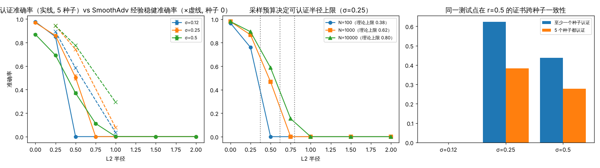

# 随机平滑证书有多可信？——线性紧性、采样预算上限、种子不稳定性与认证-经验差距的最小模型检验

**摘要**
2025–2026 年，对抗稳健性研究的重心正在从"经验防御"转向"可证明保证"，而随机平滑（randomized smoothing, RS）是唯一能对任意分类器给出 L2 证书的通用方法。与此同时，一批工作开始质疑证书的实际含义：认证半径与经验稳健性之间存在持续差距；证书在不同训练种子之间方差极大；认证所需的蒙特卡洛（MC）采样代价高昂；"有证书 ≠ 安全"。本文在 sklearn digits（d=64）上从零实现 Cohen 等的 CERTIFY 过程，推导并检验四个可证伪的理论预测：(1) 对线性模型，精确 pA 下的 Cohen 半径等于到决策超平面的距离，MC 证书的保守程度可由 Clopper–Pearson 下界解释；(2) N 个噪声样本下可认证半径存在硬上限 R_max=σΦ⁻¹(α^{1/N})，只随 √ln N 增长；(3) 聚合认证准确率在种子间的低方差可以与逐样本证书的高度不一致并存；(4) 认证准确率显著低于对平滑分类器的强攻击下的经验准确率，且 L2 证书换算为 L∞ 时被 √d 稀释。结果：线性情形下证书 100%（≥99.8%）可靠，N=10⁴、σ=0.5 时中位紧度 0.955；实测最大半径与 R_max 在三个 N 上完全一致，σ=0.12、N=2000 时 68% 的测试点被上限截断；σ=0.25 时聚合认证准确率跨种子标准差仅 0.025，但任意两个种子在 r=0.5 处对 11.4% 的测试点给出相反结论，只有 38.3% 的点被全部 5 个种子认证；r=0.5 处 SmoothAdv 经验准确率比认证准确率高 20–42 个百分点。结论：RS 证书在其声明的范围内是可靠的，但其"可认证范围"主要由采样预算与 σ 决定，逐样本证书依赖于训练种子，不应被解读为对具体输入的安全保证。

**关键词**：对抗稳健性；随机平滑；可证明稳健性；Clopper–Pearson；种子方差；认证-经验差距

## 1 引言
自 Szegedy 等发现对抗样本以来 [Szegedy 2013]，经验防御一再被更强的攻击攻破 [Athalye 2018]。可证明防御因此成为"打破攻防循环"的希望：凸松弛 [Wong 2017]、Lipschitz 网络、以及随机平滑 [Lecuyer 2018; Cohen 2019; Salman 2019]。RS 的吸引力在于对任意基分类器给出 L2 证书：平滑分类器 g(x)=argmax_c P(f(x+ε)=c)，ε~N(0,σ²I)，若最可能类别的概率下界为 pA，则 g 在半径 R=σΦ⁻¹(pA) 内不变 [Cohen 2019]。

**2025–2026 年的核心争论。** (a) *理论与实践的差距*：Delattre 等指出 RS 的理论认证半径与经验稳健准确率之间存在持续差距，主张利用局部 Lipschitz 常数和专门的置信区间缩小差距 [Delattre 2025]。(b) *证书的可靠性*：Le 等报告认证局部稳健性在不同模型种子之间方差极大，"幸运种子"的优势在新测试集上不能保持，呼吁报告置信区间 [Le 2026]。(c) *计算代价*：标准 RS 每个输入需要上万次模型评估，促生了早停/任意时刻有效的认证 [Cullen 2026] 和解析近似 [Lin 2026]。(d) *证书的意义*：Cullen 等的立场论文认为"可证明稳健并不（尚）意味着模型安全" [Cullen 2025]；Schwinn 等认为 LLM 时代的对抗对齐需要更简单、可复现、可度量的目标 [Schwinn 2025]。

**本文贡献。**
1. 给出四个关于 RS 证书的可证伪命题（线性紧性、采样上限、种子不稳定性的方差分解、L∞ 稀释），并在同一最小模型上逐一检验（§4–§6）。
2. 定量显示认证曲线在常用采样预算下主要被 R_max 截断，而非由模型决定。
3. 将"种子方差"争论精确化：聚合指标的低方差与逐样本证书的不一致并不矛盾，并给出二者的关系式。
4. 用对平滑分类器的强攻击给出认证-经验差距的上下夹逼。

## 2 前沿进展综述
**2.1 随机平滑的理论与效率。** Delattre 等从 Lipschitz 视角弥合理论-经验差距 [Delattre 2025]；Jin 等在 PAC-Bayes 框架下分析平滑多数投票分类器，用谱范数正则提升认证 [Jin 2025b]，并用平滑混淆矩阵的主特征值改善最差类别的认证稳健性 [Jin 2025a]；Cullen 等提出任意时刻有效的早停认证以降低采样代价 [Cullen 2026]；Lin 等的 Laplace 桥接平滑无需噪声增强训练并在边缘设备上大幅提速 [Lin 2026]；Hedayatnia 等处理去噪平滑中的协变量偏移 [Hedayatnia 2025]；Emmanouilidis 等利用预训练潜空间的近似高斯混合结构给出证书 [Emmanouilidis 2026]；RS 还被用于像素级解释的认证 [Anani 2025]。

**2.2 确定性认证与 Lipschitz 网络。** LipNeXt 把 1-Lipschitz 认证扩展到十亿参数模型 [Hu 2026]；块反射正交层与 logit 退火损失 [Lai 2025]；线性嫁接收紧局部 Lipschitz 常数 [Han 2025]；用经验稳健教师蒸馏改进认证训练 [De Palma 2026]；差分隐私式认证（PixelDP）在 ViT 上的失效与修复 [Yan 2026]。

**2.3 离散/语言域的认证。** 编辑距离下可变删除率的 RS [Huang 2025]；用于后门防御的模糊随机平滑 [He 2025]；多轮对话 LLM 安全的组合式证书 [Liu 2026]。与之相对，多轮越狱攻击仍在快速演进 [Narula 2025]，说明语言模型的"威胁模型"远超 Lp 球 [Schwinn 2025]。

**2.4 对证书意义的反思。** 种子方差 [Le 2026]；"证书 ≠ 安全" [Cullen 2025]；叠加与对抗脆弱性的关系也被重新审视——对抗训练可增加有效特征数，与"叠加导致脆弱"的假说相悖 [Bereska 2025]。

**2.5 共识、争议与开放问题。**
- 共识：RS 证书在统计意义上可靠，但代价高、半径小；高维 L∞ 认证存在维数诅咒 [Kumar 2020; Yang 2020]。
- 争议：理论-经验差距主要来自证书松弛还是攻击不足 [Delattre 2025]；种子方差是否使排行榜结论失效 [Le 2026]。
- 开放问题：① 逐样本证书能否跨训练种子稳定？② 如何以可接受的代价认证大半径？③ 如何定义并认证语义/非 Lp 威胁？④ 证书如何进入真实系统的安全论证 [Cullen 2025]？

**前沿地图**

| 路线 | 代表工作 | 关键结论 | 局限 |
|---|---|---|---|
| RS 理论与效率 | Delattre 2025; Cullen 2026; Lin 2026 | 缩小理论-经验差距、降低采样代价 | 半径仍受采样预算与 σ 限制 |
| RS 变体与应用 | Jin 2025a/b; Hedayatnia 2025; Emmanouilidis 2026; Anani 2025 | 改进最差类别、去噪、潜空间认证 | 多为图像 L2 威胁 |
| Lipschitz 确定性认证 | Hu 2026; Lai 2025; Han 2025; De Palma 2026 | 可扩展到十亿参数 | 干净准确率代价 |
| 离散与 LLM 认证 | Huang 2025; He 2025; Liu 2026 | 编辑距离、多轮对话的组合证书 | 威胁模型与真实越狱 [Narula 2025] 差距大 |
| 证书可靠性与意义 | Le 2026; Cullen 2025; Schwinn 2025 | 种子方差大；证书不等于安全 | 缺少定量的方差理论 |

## 3 问题与假设
**选择理由。** "证书有多可信"直接决定可证明防御能否成为 2035 年安全评估的基础；它在 digits 上完全可检验（MC 认证、线性模型的精确解、可控种子）。

**形式化。** 基分类器 f；平滑分类器 g；CERTIFY：用 n₀=100 个噪声样本选类别 ĉ，再用 N 个样本计数 k_ĉ，pA=CP_lower(k_ĉ, N, α)（α=0.001），若 pA≥1/2 则认证半径 R=σΦ⁻¹(pA)，否则弃权。认证准确率 CA(r)=P(g 预测正确且 R≥r)。

**预注册假设与否证条件**
- **H1（线性紧性与可靠性）**：对二分类线性模型，MC 证书满足 R≤R_exact 的比例 ≥0.99；当 R_max 不约束时（σ≥0.25, N=10⁴），中位紧度 R/R_exact ≥0.9。*否证*：可靠比例 <0.99，或紧度 <0.9。
- **H2（采样上限）**：实测最大认证半径等于 σΦ⁻¹(α^{1/N})，且 CA(r)=0 对所有 r>R_max 成立。*否证*：出现超过 R_max 的证书，或最大半径明显低于 R_max。
- **H3（种子不稳定性）**：在 r=0.5，任意两种子对逐样本认证结论的不一致率 ≥10%，而聚合 CA 的跨种子标准差 ≤0.03。*否证*：不一致率 <10%。
- **H4（认证-经验差距）**：在 r=0.5，SmoothAdv 攻击下平滑分类器的经验准确率比认证准确率高 ≥10 个百分点。*否证*：差距 <10 个百分点（说明证书接近紧）。

## 4 理论分析
**命题 1（线性模型的精确性）。** 设 f(x)=1[wᵀx+b>0]。则 P(f(x+ε)=f(x))=Φ(|wᵀx+b|/(σ‖w‖))，故 g=f，且 Cohen 半径 σΦ⁻¹(pA)=|wᵀx+b|/‖w‖=到决策超平面的距离——这正是 g 的真实稳健半径，证书紧。*证明*：wᵀε~N(0,σ²‖w‖²)。MC 情形下 pA 被 CP 下界替代，P(R>R_exact)≤α，因而可靠比例 ≥1−α；紧度 R/R_exact = Φ⁻¹(CP_lower)/Φ⁻¹(p_true) 随 N 增大而趋于 1，但被命题 2 截断。

**命题 2（采样上限）。** 当 N 个样本全部投票给 ĉ 时，CP 下界取最大值 α^{1/N}，故 R≤R_max(N)=σΦ⁻¹(α^{1/N})。由 Φ⁻¹(1−t)≈√(2ln(1/t)) 得 R_max≈σ√(2 ln(N/ln(1/α)))：半径只随采样数的对数平方根增长。本设定 σ=0.25 时 R_max(100, 1000, 10⁴)=0.375, 0.616, 0.800；N=2000 时 σ=0.12, 0.25, 0.5 对应 0.324, 0.675, 1.351。

**命题 3（L∞ 稀释）。** ‖δ‖∞≤ε ⇒ ‖δ‖₂≤ε√d。故 L2 证书 R 只能认证 L∞ 半径 R/√d（d=64 时为 R/8）；而对 L∞ 威胁，任何平滑分布的证书都存在维数依赖 [Kumar 2020; Yang 2020]。

**命题 4（种子方差分解）。** 设测试点 i 在随机种子下被认证（于半径 r）的概率为 p_i，各点在种子间独立。则两种子的逐样本不一致率 D=(1/n)Σ2p_i(1−p_i)，而聚合 CA 的跨种子方差 Var=(1/n²)Σp_i(1−p_i)=D/(2n)。故聚合标准差 ≈√(D/(2n))：n=300、D=0.1 时仅约 0.013——逐样本高度不稳定与聚合指标的高度稳定完全相容。若种子影响在点之间正相关（整体模型质量的波动），实测聚合方差会高于此预测。

## 5 实验
- **数据**：digits（像素/16 ∈ [0,1]，d=64），固定划分（random_state=0），70% 训练；认证固定的前 300 个测试点（便于跨种子逐样本比较）。
- **T1 线性**：3 vs 8 二分类逻辑回归；"种子"=训练集 bootstrap 重采样；σ∈{0.12, 0.25, 0.5}，N∈{100, 1000, 10⁴}；对全部 3/8 测试点比较 MC 证书与精确距离。
- **主实验**：MLP 64-128-10，以 N(0,σ²) 噪声增强训练 60 轮（Adam），σ∈{0.12, 0.25, 0.5}，5 个种子（初始化与噪声）；n₀=100，N=2000，α=0.001；CA 于 r∈{0, 0.25, 0.5, 0.75, 1, 1.5, 2}。
- **T2 采样预算**：σ=0.25，种子 0，150 个点，N∈{100, 1000, 10⁴}。
- **T4 攻击**：种子 0 的平滑分类器，前 120 个点；SmoothAdv 式 L2-PGD（20 步，步长 2.5ε/20，每步 32 个噪声样本，最大化平均 softmax 的负对数概率，投影并裁剪到 [0,1]）[Salman 2019]；攻击后用 500 个噪声样本判定平滑预测。经验准确率是真实稳健准确率的上界，认证准确率是其下界。
- **统计**：均值 ± 95% CI（5 种子）；测试集 bootstrap（1000 次）。运行时间：单核约 50–90 秒（墙钟 63–93 秒）。
- **偏差记录**：主实验完成后补充记录了 N=2000 下的理论上限与截断比例、以及命题 4 的预测值（不改变任何已有结果；重跑后数值相同）。

## 6 结果
所有数字见 `results/frontier.json`。

### 6.1 线性紧性（H1）

| σ | N | R_max | 中位 R/R_exact | 平均 R/R_exact | R≤R_exact 的比例 |
|---|---|---|---|---|---|
| 0.12 | 100 / 1000 / 10⁴ | 0.180 / 0.296 / 0.384 | 0.238 / 0.395 / 0.513 | 0.281 / 0.458 / 0.576 | 1.000 / 1.000 / 1.000 |
| 0.25 | 100 / 1000 / 10⁴ | 0.375 / 0.616 / 0.800 | 0.467 / 0.763 / 0.912 | 0.463 / 0.731 / 0.869 | 1.000 / 0.998 / 1.000 |
| 0.5 | 100 / 1000 / 10⁴ | 0.750 / 1.232 / 1.599 | 0.569 / 0.860 / 0.955 | 0.531 / 0.829 / 0.937 | 1.000 / 0.998 / 0.998 |

证书的可靠比例在所有条件下 ≥0.998（5 种子 × 约 108 个点中最多 1 例越界，与 α=0.001 的名义失败率相容）；σ≥0.25、N=10⁴ 时中位紧度 0.912 / 0.955。σ=0.12 时即便 N=10⁴ 紧度也只有 0.513，因为大多数点的精确距离超过 R_max=0.384。**H1 支持。**

### 6.2 采样上限（H2）

| N（σ=0.25） | 理论 R_max | 实测最大半径 | 落在上限的点比例 | CA(0.25) | CA(0.5) | CA(0.75) |
|---|---|---|---|---|---|---|
| 100 | 0.375 | 0.375 | 0.42 | 0.760 | 0.000 | 0.000 |
| 1000 | 0.616 | 0.616 | 0.19 | 0.867 | 0.467 | 0.000 |
| 10⁴ | 0.800 | 0.800 | 0.06 | 0.893 | 0.587 | 0.153 |

主实验（N=2000）中 σ=0.12、0.25、0.5 的上限为 0.324、0.675、1.351，分别有 68.1%、14.2%、0% 的测试点被截断在上限上；σ=0.12 时 CA(0.5)=0，σ=0.25 时 CA(0.75)=0，均由上限而非模型决定。**H2 支持。**

### 6.3 主实验与种子不稳定性（H3）

| σ | 干净准确率（基分类器） | CA(0) | CA(0.25) | CA(0.5) | CA(0.75) | 弃权率 |
|---|---|---|---|---|---|---|
| 0.12 | 0.982 | 0.976±0.002 | 0.849±0.006 | 0.000 | 0.000 | 0.007 |
| 0.25 | 0.980 | 0.969±0.008 | 0.859±0.009 | 0.503±0.022 | 0.000 | 0.022 |
| 0.5 | 0.965 | 0.869±0.005 | 0.692±0.007 | 0.370±0.013 | 0.111±0.010 | 0.129 |

| σ | CA(0.5) 跨种子 SD | 测试集 bootstrap SD | 命题 4 预测 SD（独立） | 两两逐样本不一致率 | 半径 Spearman | 5 种子均认证 / 至少 1 种子认证 |
|---|---|---|---|---|---|---|
| 0.25 | 0.025 | 0.028 | 0.014 | 0.114±0.012 | 0.933 | 0.383 / 0.623 |
| 0.5 | 0.014 | 0.028 | 0.011 | 0.079±0.008 | 0.946 | 0.277 / 0.437 |

σ=0.25 时聚合 CA(0.5) 的跨种子标准差（0.025）与测试集抽样标准差（0.028）同量级，看似稳定；但任意两个种子对 11.4% 的测试点给出相反的认证结论，在至少一个种子下被认证的 62.3% 的点中，只有 38.3% 被全部 5 个种子认证。σ=0.5 时不一致率为 7.9%。**H3 部分支持**（σ=0.25 满足 ≥10% 的阈值，σ=0.5 不满足；σ=0.12 在 r=0.5 处无点被认证，不适用）。命题 4 的独立性预测（0.014 / 0.011）与实测聚合 SD（0.025 / 0.014）同量级但偏低，见 §7。

### 6.4 认证-经验差距与 L∞（H4）

| σ | r | 经验准确率（SmoothAdv，种子 0） | 认证准确率（同一批 120 点） |
|---|---|---|---|
| 0.12 | 0.25 / 0.5 / 1.0 | 0.892 / 0.583 / 0.033 | 0.858 / 0.000 / 0.000 |
| 0.25 | 0.25 / 0.5 / 1.0 | 0.942 / 0.742 / 0.075 | 0.900 / 0.542 / 0.000 |
| 0.5 | 0.25 / 0.5 / 1.0 | 0.942 / 0.775 / 0.292 | 0.700 / 0.358 / 0.000 |

r=0.5 时差距为 58（σ=0.12，证书被上限截断）、20（σ=0.25）、42（σ=0.5）个百分点。**H4 支持。** L∞ 视角：L2 证书换算后，σ=0.25 时 L∞ 半径 0.05 处的认证准确率为 0.696，L∞ 半径 0.1（需要 R≥0.8>R_max）处为 0；σ=0.5 时为 0.492 与 0.074。作为参照，第一阶段实验中未经任何防御的 MLP 在 L∞ ε=0.1 的 PGD 攻击下经验准确率为 0.593（`results/results.json`，不同模型，仅作量级对比）。

## 7 讨论
**与前沿文献的关系。**
- *理论-经验差距* [Delattre 2025]：本文显示该差距在 digits 上为 20–42 个百分点，并可分解为三部分：采样上限造成的截断（σ=0.12 时证书在 r=0.5 处完全失效）、CP 下界的保守性（线性实验中 N=10³ 时中位紧度仅 0.76–0.86）、以及攻击本身的不完备（经验准确率只是上界）。在线性模型上证书几乎紧，说明差距主要来自非线性基分类器上 pA 与真实稳健半径的关系，而不是 Cohen 界本身的松弛。
- *种子方差* [Le 2026]：本文复现了"逐样本证书依赖种子"的现象，并用命题 4 说明它与聚合指标的稳定并存。实测聚合 SD 高于独立性预测（σ=0.25 时 0.025 vs 0.014），说明种子影响在点之间正相关（整体模型质量波动），这正是 Le 等担心的"幸运种子"效应来源。
- *计算代价* [Cullen 2026; Lin 2026]：命题 2 说明增加采样只能以 √ln N 的速度扩大可认证半径，提高效率的方法（早停、解析近似）主要节约的是常数，而大半径需要更大的 σ（以干净准确率为代价：σ=0.5 时 CA(0)=0.869 vs σ=0.25 时 0.969）。
- *证书 ≠ 安全* [Cullen 2025; Schwinn 2025]：L2 证书在 L∞ 视角下被 √d 稀释；对语义扰动、越狱等威胁则完全不覆盖。

**外推边界。** 命题 1、2、4 是数学事实，可外推到任意规模；具体数值（紧度、差距、种子不一致率）依赖于 digits、MLP 与 σ，不可直接外推到 ImageNet 或 LLM。

**局限。** 只认证 300 个点；攻击只在种子 0 上进行；SmoothAdv 攻击未做多重随机重启，经验上界可能偏高；线性实验的"种子"是 bootstrap 重采样而非初始化。

## 8 结论
1. [实测][文献] 随机平滑证书在统计意义上可靠（线性情形可靠比例 ≥0.998），在线性模型上几乎紧（σ=0.5、N=10⁴ 时中位紧度 0.955）。置信度：**高**。
2. [实测] 在常用采样预算下，可认证半径主要由 R_max=σΦ⁻¹(α^{1/N}) 决定（实测最大半径与理论值完全一致，σ=0.12 时 68% 的点被截断）；半径只随 √ln N 增长。置信度：**高**。
3. [实测] 聚合认证准确率跨种子稳定（SD 0.014–0.025），逐样本证书却不稳定（两两不一致 7.9–11.4%，仅 38% 的点被所有种子认证）——证书是关于"这个模型"而非"这个输入"的陈述。置信度：**中-高**。
4. [实测] 认证准确率比强攻击下的经验准确率低 20–42 个百分点（r=0.5），且 L2 证书换算到 L∞ 后严重稀释。置信度：**中**。

**对 2035 的研判** [判断]：可证明稳健性会成为高风险视觉/控制系统认证流程的组成部分，但证书将以"模型级、带置信区间、附带采样预算与威胁模型声明"的形式出现，而不是逐输入的安全保证。对 LLM 的越狱/语义威胁，到 2035 年仍难以获得与 Lp 证书同等强度的保证；可行路径是对受限接口（组合式、多轮）做局部证书 [Liu 2026]。

**后续研究建议**：① 把命题 4 的方差分解用于大规模认证排行榜的重新分析；② 用任意时刻有效的序贯检验 [Cullen 2026] 在固定预算下最大化 R_max；③ 研究跨种子"共识证书"（多个模型共同认证）的性质；④ 将证书与语义威胁模型对接。

## 参考文献
奠基与 2025 年前文献：
- Szegedy, C. et al. (2013). Intriguing properties of neural networks. arXiv:1312.6199
- Athalye, A., Carlini, N., Wagner, D. (2018). Obfuscated Gradients Give a False Sense of Security. arXiv:1802.00420
- Wong, E., Kolter, J. Z. (2017). Provable defenses against adversarial examples via the convex outer adversarial polytope. arXiv:1711.00851
- Lecuyer, M. et al. (2018). Certified Robustness to Adversarial Examples with Differential Privacy. arXiv:1802.03471
- Cohen, J., Rosenfeld, E., Kolter, J. Z. (2019). Certified Adversarial Robustness via Randomized Smoothing. arXiv:1902.02918
- Salman, H. et al. (2019). Provably Robust Deep Learning via Adversarially Trained Smoothed Classifiers. arXiv:1906.04584
- Kumar, A. et al. (2020). Curse of Dimensionality on Randomized Smoothing for Certifiable Robustness. arXiv:2002.03239
- Yang, G. et al. (2020). Randomized Smoothing of All Shapes and Sizes. arXiv:2002.08118

2025–2026 年前沿文献（均经 arXiv API 或 frontier/Q12.json 核实）：
- Delattre, B. et al. (2025). Bridging the Theoretical Gap in Randomized Smoothing. arXiv:2504.02412
- Le, M. et al. (2026). On the Extreme Variance of Certified Local Robustness Across Model Seeds. arXiv:2601.13303
- Cullen, A. C. et al. (2025). Position: Certified Robustness Does Not (Yet) Imply Model Security. arXiv:2506.13024
- Cullen, A. C. et al. (2026). Halt Fast! Early Stopping for Certified Robustness. arXiv:2606.27694
- Lin, M. et al. (2026). Laplace-Bridged Randomized Smoothing for Fast Certified Robustness. arXiv:2604.24993
- Jin, G. et al. (2025a). Principal Eigenvalue Regularization for Improved Worst-Class Certified Robustness of Smoothed Classifiers. arXiv:2503.17172
- Jin, G. et al. (2025b). Reconcile Certified Robustness and Accuracy for DNN-based Smoothed Majority Vote Classifier. arXiv:2509.25979
- Hedayatnia, A. et al. (2025). Robustifying Diffusion-Denoised Smoothing Against Covariate Shift. arXiv:2509.10913
- Emmanouilidis, K. et al. (2026). Certified Robustness from Approximate Gaussian Mixture Structures in Pretrained Latent Spaces. arXiv:2605.25352
- Anani, A. et al. (2025). Pixel-level Certified Explanations via Randomized Smoothing. arXiv:2506.15499
- Hu, K. et al. (2026). LipNeXt: Scaling up Lipschitz-based Certified Robustness to Billion-parameter Models. arXiv:2601.18513
- Lai, B.-H. et al. (2025). Enhancing Certified Robustness via Block Reflector Orthogonal Layers and Logit Annealing Loss. arXiv:2505.15174
- Han, Y. et al. (2025). Lipschitz-aware Linearity Grafting for Certified Robustness. arXiv:2510.25130
- De Palma, A. (2026). Learning Better Certified Models from Empirically-Robust Teachers. arXiv:2602.02626
- Yan, J. et al. (2026). Revisiting Certified Defense with Differential Privacy on Vision Transformers. arXiv:2609.31310
- Huang, Z. et al. (2025). AdaptDel: Adaptable Deletion Rate Randomized Smoothing for Certified Robustness. arXiv:2511.09316
- He, B. et al. (2025). Certifying Language Model Robustness with Fuzzed Randomized Smoothing: An Efficient Defense Against Backdoor Attacks. arXiv:2502.06892
- Liu, Y. et al. (2026). Certified Multi-Turn Robustness for LLM Safety via Compositional Bounds and Safety Persistence. arXiv:2608.20820
- Narula, S. et al. (2025). HarmNet: A Framework for Adaptive Multi-Turn Jailbreak Attacks on Large Language Models. arXiv:2510.18728
- Schwinn, L. et al. (2025). Adversarial Alignment for LLMs Requires Simpler, Reproducible, and More Measurable Objectives. arXiv:2502.11910
- Bereska, L. et al. (2025). Superposition as Lossy Compression: Measure with Sparse Autoencoders and Connect to Adversarial Vulnerability. arXiv:2512.13568
