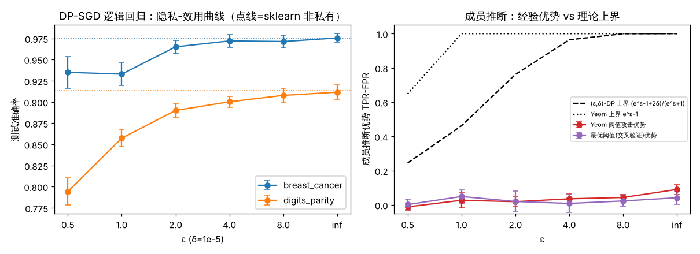
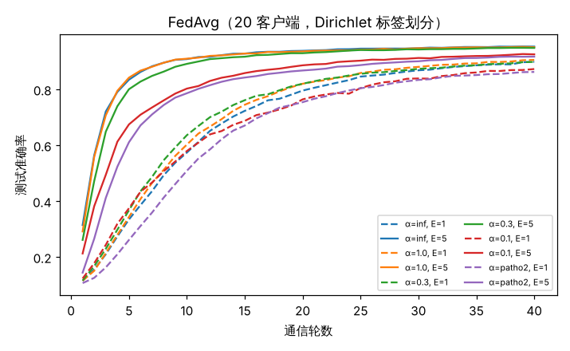

# Q13 数据共享与隐私保护

> 分组：可信智能 ｜ 实验：`experiment.py`（单核运行时间约 75 秒） ｜ 证据标注：[实测] [文献] [判断]

## 摘要
数据要素流通的基础科学问题是：**能否在可证明地限制个体信息泄露的同时，保留数据的统计价值？** 本项目从零实现了 DP-SGD（Poisson 子采样、逐样本裁剪、高斯噪声）与基于 Rényi 差分隐私（RDP）的子采样高斯机制记账器，在两个数据集上测量 ε∈{0.5,1,2,4,8,∞} 的隐私–效用曲线；用 Yeom 损失阈值攻击与"金丝雀"最坏情形审计度量经验泄露，并与 (ε,δ)-DP 的理论上界比较；最后模拟 20 个客户端的非 IID 联邦平均。主要发现：digits 奇偶分类的准确率从非私有 0.912 降至 ε=1 的 0.857、ε=0.5 的 0.794，而 ε≥4 时损失不显著 [实测]；所有 ε 下经验成员推断优势（≤0.043）都远低于理论上界（ε=2 时为 0.762），非私有模型的优势也只有 0.090 [实测]；但金丝雀审计显示，非私有训练对单个异常记录的"在/不在"几乎完全可分（AUC 0.984），而 ε≤8 时 AUC 降到 0.47–0.62 [实测]；FedAvg 在极端标签异质下准确率下降 2.6–3.6 个百分点 [实测]。结论：DP 的理论保证是正确但对"平均成员"极其保守的；隐私风险集中在异常记录上，这正是 DP 最坏情形定义的价值所在。

## 1. 问题界定
**为何是基础问题。** 匿名化已被反复证明不可靠，而"可用不可见"的数据共享需要一个可组合、可证明的隐私定义。差分隐私（DP）提供了这样的定义 [文献: Dwork 2006]，但带来三个基础张力：(i) **隐私–效用**：噪声以 1/(nε) 的速率损害精度，小数据、高维模型首当其冲 [文献: Tramèr 2020]；(ii) **理论–经验**：DP 是对最坏情形与最强攻击者的上界，实际攻击往往远达不到，导致实践者倾向于选择很大的 ε；(iii) **数据不出域 ≠ 隐私**：联邦学习只解决了数据集中的问题，梯度本身仍可泄露数据 [文献: Zhu 2019]，并且非 IID 数据会损害收敛 [文献: Zhao 2018]。

**可检验的子假设（实验前固定）：**
- **H1（隐私–效用）**：在固定训练超参数下，ε≥4 时 DP-SGD 与无噪声基线的准确率差 ≤2 个百分点且不显著；ε≤1 时差异显著（配对 t，p<0.05）。*否证*：ε≥4 时有显著且 >2 个百分点的损失，或 ε≤1 时无显著损失。
- **H2（理论界与经验泄露）**：所有 ε 下经验成员推断优势不超过 (ε,δ)-DP 上界 (e^ε−1+2δ)/(e^ε+1)；非私有模型的优势显著高于各 DP 模型；对平均成员而言上界宽松一个数量级以上（ε≥2）。*否证*：任一 ε 下经验优势的 95% 置信下限超过上界（意味着实现或记账有误）。
- **H3（联邦异质性）**：FedAvg 准确率随标签异质性增加（Dirichlet α 减小）而下降；本地轮数 E=5 时的异质性惩罚大于 E=1（客户端漂移）。*否证*：IID 与 α=0.1 无显著差异，或惩罚与 E 无关。

## 2. 研究现状
- **定义与机制**：DP 由 Dwork 等提出 [文献: Dwork 2006]；Wasserman 与 Zhou 给出其统计假设检验解释 [文献: Wasserman 2008]；Kairouz 等证明了最优组合定理，并刻画了 (ε,δ)-DP 下检验的 TPR/FPR 可行域 [文献: Kairouz 2013]。
- **深度学习中的 DP**：Abadi 等提出 DP-SGD 与矩会计（moments accountant）[文献: Abadi 2016]；Mironov 提出 RDP [文献: Mironov 2017]，并给出子采样高斯机制的 RDP 精确计算 [文献: Mironov 2019]；Balle 等用耦合分析了子采样放大 [文献: Balle 2018]；Dong 等提出 f-DP / 高斯 DP，使组合更紧 [文献: Dong 2019]。Tramèr 与 Boneh 指出 DP 学习"需要更好的特征或更多数据"[文献: Tramèr 2020]。
- **攻击与审计**：Shokri 等提出基于影子模型的成员推断 [文献: Shokri 2016]；Yeom 等将其与过拟合联系，并给出 ε-DP 下优势 ≤ e^ε−1 的界 [文献: Yeom 2017]；Carlini 等的 LiRA 强调低假阳性率区间的评估 [文献: Carlini 2021]；Jagielski 等与 Nasr 等用投毒/金丝雀给出 ε 的经验下界，发现最强攻击者下 DP-SGD 的分析接近紧 [文献: Jagielski 2020; Nasr 2021]；Steinke 等实现了单次训练审计 [文献: Steinke 2023]。
- **联邦学习**：FedAvg [文献: McMahan 2016]；非 IID 导致精度下降 [文献: Zhao 2018; Hsu 2019]；FedProx 与 SCAFFOLD 针对客户端漂移 [文献: Li 2018; Karimireddy 2019]；综述见 [文献: Kairouz 2019]；梯度泄露攻击 [文献: Zhu 2019]。
- **关键缺口**：(1) "可接受的 ε"缺乏与真实风险挂钩的原则；(2) 大模型预训练 + DP 微调的效用–隐私标度律；(3) 联邦学习中隐私、异质性与鲁棒性的联合保证。

## 3. 研究设计
- **(A) 隐私–效用**：breast_cancer（n_train=426，d=30）与 digits 奇偶二分类（n_train=1347，d=64），标准化；逻辑回归 DP-SGD：期望批量 32（Poisson 采样率 q=0.075 / 0.024），30 个 epoch（399 / 1262 步），lr=0.5，裁剪 C=1，权重衰减 1e-3；δ=1e-5。ε=∞ 为同样裁剪但无噪声的基线，另附 sklearn 非私有 LR 作参照。10 个种子（数据划分 + 噪声）。
- **RDP 记账**：整数阶 α=2..256 的 Poisson 子采样高斯 RDP 精确公式 A_α = Σ_k C(α,k)(1−q)^{α−k}q^k exp((k²−k)/(2σ²))，ε(α)=log A_α/(α−1)，T 步线性组合，转换 ε = min_α [T·ε(α) + log(1/δ)/(α−1)]；对目标 ε 二分求 σ。**校验**：q=1 时代码输出与闭式 α/(2σ²) 完全一致（α=2,8,32 时为 0.25、1.0、4.0，σ=2）[实测]。
- **(B) 成员推断**：digits 奇偶，像素/16；成员 150、非成员 150；批量 15（q=0.1）、100 epoch（1000 步）、lr=1、无正则（刻意鼓励过拟合）。攻击：(i) Yeom 阈值攻击（阈值=平均训练损失）；(ii) 最优阈值攻击（一半样本选阈值、另一半评估）；(iii) AUC。10 个种子。
- **(B2) 金丝雀审计**：固定 150 个成员，额外插入一个全亮像素、标签为 0 的分布外"金丝雀"；每个 ε∈{1,4,8,∞} 各训练 120 次含/不含金丝雀的模型（q≈0.1，302 步），以金丝雀损失为检验统计量；前一半运行选阈值，后一半用 Clopper–Pearson 区间计算 ε 的 95% 经验下界 [文献: Jagielski 2020]。
- **(C) FedAvg**：digits 10 类，MLP 64-64-10，20 个客户端全参与，40 轮，客户端 SGD（lr=0.05，批量 16），本地轮数 E∈{1,5}；标签划分：IID、Dirichlet α∈{1, 0.3, 0.1}，以及（补充）McMahan 式"每客户端 2 个标签分片"病态划分；以客户端与全局标签分布的平均总变差（TV）度量异质性；中心化基线用相同 epoch 数训练。5 个种子。
- **设计偏差（如实记录）**：(B2) 金丝雀审计与 (C) 的病态划分是在看到首轮结果（平均成员优势很小；Dirichlet 下降幅度较小）后补充的，属于探索性分析，不用于检验预设假设。

## 4. 结果

### 4.1 隐私–效用曲线（DP-SGD 逻辑回归，δ=1e-5）

| ε | σ (breast_cancer) | 准确率 breast_cancer | σ (digits) | 准确率 digits 奇偶 |
|---|---|---|---|---|
| 0.5 | 14.68 | 0.935±0.019 | 8.28 | 0.794±0.016 |
| 1 | 7.49 | 0.933±0.013 | 4.26 | 0.857±0.010 |
| 2 | 3.92 | 0.965±0.008 | 2.28 | 0.890±0.009 |
| 4 | 2.16 | 0.972±0.008 | 1.34 | 0.900±0.006 |
| 8 | 1.30 | 0.971±0.008 | 0.91 | 0.908±0.008 |
| ∞（裁剪无噪声） | 0 | 0.976±0.005 | 0 | 0.912±0.008 |
| sklearn 非私有 | — | 0.976±0.006 | — | 0.913±0.011 |

- 相对 ε=∞ 的下降：digits 在 ε=0.5/1/2 时为 0.117（p=1×10⁻⁷）/ 0.054（p=1×10⁻⁶）/ 0.022（p=0.0005），ε=4 时 0.011（p=0.050），ε=8 时 0.004（p=0.25）；breast_cancer 在 ε=0.5/1 时为 0.041/0.043（p≤0.002），ε=2 时 0.010（p=0.015），ε≥4 时不显著 [实测]。
- 数据集越"容易"（breast_cancer 近线性可分），噪声的代价越小：同为 ε=0.5，breast_cancer 仅下降 0.041，digits 下降 0.117 [实测]。
- **H1：支持**（ε=4 的 digits 下降 0.011、p=0.050，处于边界）。

### 4.2 成员推断：经验优势 vs 理论上界（σ 见 `sigma_mia`）

| ε | Yeom 优势 | 最优阈值优势（交叉） | AUC | 训练/测试准确率 | DP 上界 (e^ε−1+2δ)/(e^ε+1) | Yeom 上界 e^ε−1 |
|---|---|---|---|---|---|---|
| 0.5 | −0.011±0.020 | 0.002±0.031 | 0.501 | 0.627 / 0.615 | 0.245 | 0.649 |
| 1 | 0.027±0.043 | 0.049±0.038 | 0.524 | 0.664 / 0.639 | 0.462 | 1 |
| 2 | 0.019±0.031 | 0.020±0.061 | 0.512 | 0.729 / 0.710 | 0.762 | 1 |
| 4 | 0.035±0.029 | 0.009±0.052 | 0.523 | 0.805 / 0.761 | 0.964 | 1 |
| 8 | 0.043±0.016 | 0.023±0.030 | 0.519 | 0.889 / 0.839 | 0.999 | 1 |
| ∞ | 0.090±0.028 | 0.041±0.039 | 0.541 | 0.954 / 0.886 | 1 | 1 |

- 所有 ε 下经验优势（含置信上限）均低于理论上界；非私有模型的 Yeom 优势比各 DP 模型高 0.047–0.101（p≤0.026）[实测]。
- ε=2 时理论上界 0.762，而经验优势 0.019——相差一个数量级以上 [实测]。
- 代价：n=150 的小数据下，ε=1 的模型准确率只有 0.639，几乎不可用 [实测]。

### 4.3 金丝雀审计（最坏情形单条记录）

| ε | σ | 留出半数上的 FNR / FPR | 优势 | AUC | 经验 ε 下界 (95%) |
|---|---|---|---|---|---|
| 1 | 8.61 | 0.00 / 1.00 | 0.00 | 0.467 | 0 |
| 4 | 2.44 | 0.65 / 0.40 | −0.05 | 0.604 | 0 |
| 8 | 1.45 | 0.28 / 0.53 | 0.18 | 0.616 | 0 |
| ∞ | 0 | 0.15 / 0.03 | 0.82 | 0.984 | 1.85 |

- 非私有训练下，单个异常记录是否在训练集中几乎可被完美判定（AUC 0.984），远强于对"平均成员"的攻击（AUC 0.541）[实测]。DP 训练把这种可区分性压到 AUC≤0.62 [实测]。
- 120 次/组的运行数只能证明 ε_lb≤1.85 左右的下界（受 Clopper–Pearson 区间限制），因此有限 ε 时得不出非零下界——审计的统计功效本身是瓶颈 [实测][判断]。
- **H2：支持。** 未发现任何违反上界的情况；上界对平均成员极度宽松，但对最坏情形记录的保护是实打实的。

### 4.4 联邦平均与数据异质性

| 划分 | 标签 TV | E=1 准确率 | E=5 准确率 |
|---|---|---|---|
| IID | 0.021 | 0.899±0.012 | 0.953±0.004 |
| Dirichlet α=1 | 0.337 | 0.905±0.011 | 0.951±0.003 |
| Dirichlet α=0.3 | 0.523 | 0.898±0.016 | 0.948±0.005 |
| Dirichlet α=0.1 | 0.703 | 0.873±0.020 | 0.925±0.013 |
| 病态 2 标签/客户端 | 0.784 | 0.862±0.007 | 0.917±0.006 |
| 中心化（40 / 200 epoch） | — | 0.967±0.003 | 0.972±0.003 |

- IID 相对 α=0.1 的优势：E=1 时 0.026（p=0.030），E=5 时 0.028（p=0.008）；相对病态划分：0.036（p=0.002）/ 0.036（p=0.001）[实测]。α≥0.3 时下降不明显 [实测]。
- 在固定 40 轮通信下，E=5 在所有划分上都比 E=1 高 0.046–0.055（p≤0.011）[实测]：更多本地计算的收益超过了客户端漂移的损失。
- **H3：部分支持。** 精度随异质性增加而下降成立（但幅度有限，且主要发生在 α≤0.1）；"E 越大异质性惩罚越大"未被支持（惩罚在 E=1 与 E=5 时几乎相同）。

## 5. 讨论
**机理解释。** (1) DP-SGD 的效用损失来自噪声与裁剪：噪声标准差 σC/(qn) 随样本量增大而减小，因此同为 ε=1，n=1347 的 digits 比 n=150 的 MIA 场景好得多（0.857 vs 0.639）[实测]——"隐私要用数据量来买"。(2) 理论上界针对**所有**数据集与**最坏**记录，而 Yeom 式攻击针对**平均**成员；平均成员的损失分布与非成员高度重叠，这就是为何经验优势远低于上界——与 Jagielski、Nasr 等"平均攻击远弱于最坏情形攻击"的结论一致 [文献: Jagielski 2020; Nasr 2021]。(3) 金丝雀实验说明隐私风险高度集中在离群样本上——这恰是医疗、金融数据中最敏感的人群 [判断]。(4) digits 上的 MLP 联邦学习对异质性相对稳健，可能因为任务简单、模型容量足以拟合所有客户端；复杂任务上客户端漂移会更显著 [文献: Hsu 2019; Karimireddy 2019]。

**效度威胁与外推边界。**
- 隐私会计：标准化的均值/方差使用了非私有统计量；超参数（学习率、轮数）未做私有化选择；RDP→(ε,δ) 转换使用的是标准（略松）公式而非最优转换，σ 偏保守。
- 攻击强度：只用了损失阈值类攻击，未用影子模型或 LiRA [文献: Carlini 2021]；金丝雀审计受运行次数限制，统计功效低。
- 外部效度：逻辑回归与小 MLP、小型表格/图像数据，无法代表大模型记忆训练数据的行为（大模型对重复与离群文本的记忆可能远强于此）。
- 研究过程：(B2)(C-病态) 为事后补充分析，仅作探索性证据。

<!-- BIBLIO:start -->
## 文献计量信号（arXiv，[实测]）

检索式：摘要含 “differential privacy”、“federated learning”、“membership inference” 之一；基线为同年 cs.LG / cs.AI / stat.ML 论文总数。数据：`ai2035/bibliometrics/arxiv_counts.json`（检索日 2026-11-26）。

| 年份 | 命中论文数 | 占 AI/ML 基线比例 |
|---|---|---|
| 2015 | 67 | 1.65% |
| 2016 | 77 | 1.31% |
| 2017 | 115 | 1.36% |
| 2018 | 197 | 1.44% |
| 2019 | 398 | 1.80% |
| 2020 | 873 | 2.87% |
| 2021 | 1,290 | 3.89% |
| 2022 | 1,727 | 4.76% |
| 2023 | 2,069 | 4.58% |
| 2024 | 2,510 | 4.25% |
| 2025 | 2,665 | 3.57% |

- 2019–2025 年份额的对数线性趋势：**每年 +11.4%**（95% CI -2.5% ~ +27.2%，R²=0.46），判定：**与 AI/ML 总体同步（相对份额无显著趋势）**；在 20 个问题中按相对增速排第 8 位。
- 解读边界：分子覆盖 arXiv 全部类别、分母仅为 AI/ML 三个类别，所以“比例”是相对关注度指数，并非严格的子集占比；关键词匹配既会漏掉使用其他术语的工作，也会混入无关用法；arXiv 偏重机器学习社区，认知科学、神经科学与期刊论文覆盖不足。该信号衡量的是**研究关注度**，不是**问题被解决的程度**。
<!-- BIBLIO:end -->

## 6. 结论与 2035 展望
**核心结论**
1. [实测] DP-SGD 的效用代价在 ε≥4 时可忽略，在 ε≤1 时显著（digits 下降 5–12 个百分点），且强烈依赖样本量与任务难度。置信度：**高**（就本设定）。
2. [实测][文献] 对平均成员的经验泄露远低于 DP 上界（ε=2 时 0.019 vs 0.762），上界在平均情形下宽松一个数量级以上。置信度：**高**。
3. [实测] 隐私风险集中于离群记录：非私有训练下单条金丝雀几乎完全可辨（AUC 0.984），DP 将其压至 ≤0.62。这支持以最坏情形定义隐私。置信度：**中**（运行次数有限）。
4. [实测] 联邦平均的精度在极端标签异质下下降约 3–4 个百分点；在本任务上增加本地计算的收益大于客户端漂移的代价。置信度：**中**。

**关键未解问题**：如何把 ε 与可解释的真实风险（如再识别概率、对离群群体的伤害）挂钩；大模型时代"公共预训练 + 私有微调"的隐私–效用标度律；联邦学习中隐私、异质性与拜占庭鲁棒性能否同时获得保证。

**建议研究路线**
- **近期（2026–2028）**：建立标准化的隐私审计协议（金丝雀 + 单次训练审计）与 ε 披露规范；里程碑：对主流 DP 训练库在公开基准上给出与理论 ε 相差 <2 倍的经验下界。
- **中期（2029–2032）**：发展面向基础模型的 DP 微调与合成数据理论，证明在公共数据预训练下私有微调的样本复杂度改进；里程碑：在 ε≤1 下，大模型私有微调在标准任务上与非私有的差距 <3 个百分点。
- **远期（2033–2035）**：形成"数据要素可信流通"的组合体系——DP、安全多方计算、可信执行环境与联邦学习的联合保证可被形式验证；里程碑：跨机构医疗数据联合建模在可审计 ε≤2 下达到集中式建模 95% 以上的效用，并通过第三方攻击审计。

## 参考文献
- Dwork, C., McSherry, F., Nissim, K., Smith, A. (2006). Calibrating Noise to Sensitivity in Private Data Analysis. *Theory of Cryptography Conference (TCC)*, LNCS 3876, 265–284.
- Wasserman, L., Zhou, S. (2008). A statistical framework for differential privacy. arXiv:0811.2501
- Kairouz, P., Oh, S., Viswanath, P. (2013). The Composition Theorem for Differential Privacy. arXiv:1311.0776
- Abadi, M. et al. (2016). Deep Learning with Differential Privacy. arXiv:1607.00133
- Mironov, I. (2017). Rényi Differential Privacy. arXiv:1702.07476
- Mironov, I., Talwar, K., Zhang, L. (2019). Rényi Differential Privacy of the Sampled Gaussian Mechanism. arXiv:1908.10530
- Balle, B., Barthe, G., Gaboardi, M. (2018). Privacy Amplification by Subsampling: Tight Analyses via Couplings and Divergences. arXiv:1807.01647
- Dong, J., Roth, A., Su, W. J. (2019). Gaussian Differential Privacy. arXiv:1905.02383
- Tramèr, F., Boneh, D. (2020). Differentially Private Learning Needs Better Features (or Much More Data). arXiv:2011.11660
- Shokri, R. et al. (2016). Membership Inference Attacks against Machine Learning Models. arXiv:1610.05820
- Yeom, S. et al. (2017). Privacy Risk in Machine Learning: Analyzing the Connection to Overfitting. arXiv:1709.01604
- Carlini, N. et al. (2021). Membership Inference Attacks From First Principles. arXiv:2112.03570
- Jagielski, M., Ullman, J., Oprea, A. (2020). Auditing Differentially Private Machine Learning: How Private is Private SGD? arXiv:2006.07709
- Nasr, M. et al. (2021). Adversary Instantiation: Lower Bounds for Differentially Private Machine Learning. arXiv:2101.04535
- Steinke, T., Nasr, M., Jagielski, M. (2023). Privacy Auditing with One (1) Training Run. arXiv:2305.08846
- McMahan, H. B. et al. (2016). Communication-Efficient Learning of Deep Networks from Decentralized Data. arXiv:1602.05629
- Zhao, Y. et al. (2018). Federated Learning with Non-IID Data. arXiv:1806.00582
- Hsu, T.-M. H., Qi, H., Brown, M. (2019). Measuring the Effects of Non-Identical Data Distribution for Federated Visual Classification. arXiv:1909.06335
- Li, T. et al. (2018). Federated Optimization in Heterogeneous Networks. arXiv:1812.06127
- Karimireddy, S. P. et al. (2019). SCAFFOLD: Stochastic Controlled Averaging for Federated Learning. arXiv:1910.06378
- Kairouz, P. et al. (2019). Advances and Open Problems in Federated Learning. arXiv:1912.04977
- Zhu, L., Liu, Z., Han, S. (2019). Deep Leakage from Gradients. arXiv:1906.08935
