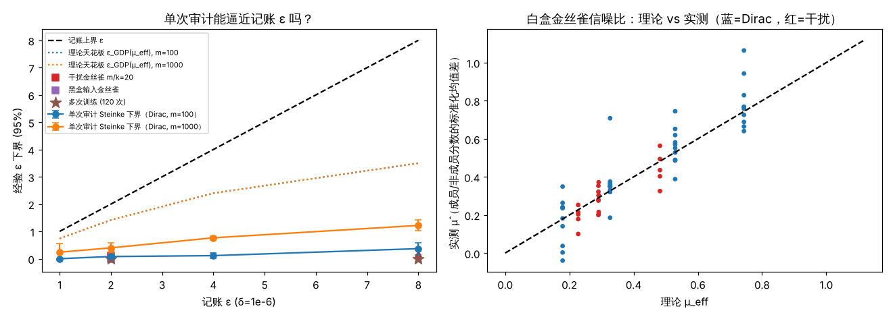

# 单次训练隐私审计的天花板：从记账 ε 到可证实 ε 的逐级损耗

**摘要**
差分隐私（DP）训练给出的 ε 是**上界**；隐私审计通过构造攻击给出 ε 的**经验下界**，二者之间的差距决定了我们对真实隐私风险的认识。传统审计需要训练成百上千个模型，Steinke 等 2023 年提出的"单次训练审计"（one-run auditing）把成本降到一次训练，但 2025–2026 年的工作在"单次审计能否做到紧"上争论激烈：Xiang 等给出单次审计可行/不可行的条件，"Let's Ask Gauss"用高斯视角收紧下界，另有工作专注于设计互不干扰的金丝雀。本文在 DP-SGD 逻辑回归（digits 奇偶）上从零实现单次审计，推导白盒梯度金丝雀分数的信噪比 μ_eff=qT/√(σ²T+Tq(1−q)+(m−1)(qT)²/(2k))，它同时刻画了（i）末次迭代审计的理论天花板 ε_GDP(μ_eff)，（ii）金丝雀之间的干扰。实验（5 种子）显示：μ_eff 对实测信噪比的预测相关系数 0.89、中位相对误差 12%；在记账 ε=8 时，隐私损耗呈清晰的五级阶梯——RDP 记账 8 → 全迭代可见的 GDP 中心极限近似 5.57 → 末次迭代理论天花板 3.50 → 高斯启发式下界 2.93 → 严格的 Steinke 单次下界 1.22（m=1000）→ 120 次训练的多次审计 0、黑盒输入金丝雀 0.003。共享子空间中的金丝雀干扰按理论预测降低审计能力（m/k=20 时下界从 1.22 降到 0.20）。结论：审计与记账之间的差距大部分来自"攻击者只看到末次模型"与"有限金丝雀的组合统计"两项可量化的结构性损耗，而非审计方法的偶然不足；这为"记账 ε 是否高估风险"的争论提供了可分解的回答。

**关键词**：差分隐私；DP-SGD；隐私审计；单次审计；金丝雀；高斯差分隐私；成员推断

## 1 引言
DP-SGD [Abadi 2016] 配合 RDP 记账 [Mironov 2017; Mironov 2019] 是当前私有深度学习的标准做法。记账给出的 ε 是一个最坏情形上界——它假设攻击者能看到所有中间迭代并可插入任意数据。隐私审计从另一侧逼近：通过构造"金丝雀"并检验其是否在训练集中，得到 ε 的经验下界 [Jagielski 2020; Nasr 2021]。第一阶段我们发现：用 120 次训练审计一个异常记录，在 ε≤8 时无法给出任何非零下界；平均成员的成员推断优势也远低于理论上界。

**2025–2026 年的核心争论。** (a) *单次审计能否紧*：Steinke 等的单次审计 [Steinke 2023] 只需一次训练，但通常远松于记账；Xiang 等用"比特传输"框架刻画单次审计可行与不可行的条件 [Xiang 2025a]，随后提出更紧的单次审计 [Xiang 2025b]；Agrawal 等指出二值化猜测丢弃了信息，用渐近高斯视角收紧下界 [Agrawal 2026]；金丝雀设计方面，Boglioni 等用元梯度优化金丝雀 [Boglioni 2025]，Dagréou 等追求"可检测而不互相干扰" [Dagréou 2026]；Mitchell 等系统推进经验审计的技术前沿 [Mitchell 2026]。(b) *记账是否高估了风险*：Steinke 等的"末次迭代优势"启发式表明只发布末次模型时真实泄露可能远小于记账 [Steinke 2024]；多篇评论认为现实条件下成员推断威胁较弱、过强防御牺牲效用 [Domingo-Ferrer 2025; Jebreel 2026]；反方认为现有攻击样本复杂度受限、可能低估风险 [Haghifam 2025]，且对 LLM 的审计与攻击在快速增强 [Panda 2025; Tao 2025; Hallinan 2025]。(c) *如何报告隐私*：GDP 的 μ 与 ε 的换算 [Kulynych 2026]。

**本文贡献。**
1. 推导白盒梯度金丝雀分数的信噪比 μ_eff（含采样方差与金丝雀干扰），并实证其预测精度（§4 命题 1–2，§6.1）。
2. 给出"记账 ε → 可证实 ε"的五级分解，每一级都有理论或实测数字（§6.2）。
3. 定量检验金丝雀干扰与黑盒 vs 白盒威胁模型对审计能力的影响（§6.3）。
4. 对比单次与多次审计在相同量级计算下的结果（§6.4）。

## 2 前沿进展综述
**2.1 单次审计与金丝雀设计。** 单次审计的不可能性与可行性条件 [Xiang 2025a]；f-DP 视角下的紧单次审计 [Xiang 2025b]；高斯渐近单次审计 [Agrawal 2026]；元梯度金丝雀优化 [Boglioni 2025]；低干扰金丝雀（影响力初始化 + 双层优化 + 嵌入空间正交正则）[Dagréou 2026]；经验审计综合进展 [Mitchell 2026]；LLM 隐私审计 [Panda 2025]。

**2.2 成员推断的理论与实践。** 样本复杂度：攻击者有时需要比训练集多得多的样本，现有 O(n) 型攻击可能低估风险 [Haghifam 2025]；稳健成员推断的简明表述（均值估计）[Gaucher 2026]；贝叶斯采样减少模型内方差以增强攻击 [Liu 2025]；FDR 控制的成员推断 [Zhao 2025]；记忆与重建的贝叶斯视角——指纹码攻击实质是成员推断 [Kaplan 2025]；LLM 上的 token 级攻击 [Tao 2025]、n-gram 覆盖攻击 [Hallinan 2025]。

**2.3 风险评估之争。** 现实条件下隐私攻击效果有限 [Domingo-Ferrer 2025]；成员推断作为隐私度量会高估风险 [Jebreel 2026]；剪枝可减少 LLM 记忆 [Gupta 2025]；GDP 参数选择建议 μ≈ε/5 作为保守换算 [Kulynych 2026]。

**2.4 共识、争议与开放问题。**
- 共识：在最强白盒攻击者下，DP-SGD 的分析接近紧 [Nasr 2021]；在只发布末次模型时，现有审计远达不到记账值 [Steinke 2024]。
- 争议：差距应归因于"记账过松"还是"审计过弱"；单次审计能否原则上做到紧 [Xiang 2025a; Agrawal 2026]。
- 开放问题：① 末次迭代的严格隐私分析；② 低成本、低干扰金丝雀的设计原理；③ 黑盒审计的统计功效极限；④ ε 如何对应可解释的现实风险。

**前沿地图**

| 路线 | 代表工作 | 关键结论 | 局限 |
|---|---|---|---|
| 单次审计理论 | Steinke 2023; Xiang 2025a/b; Agrawal 2026 | 一次训练即可得下界；高斯视角更紧 | 严格性与紧性难兼得 |
| 金丝雀设计 | Boglioni 2025; Dagréou 2026 | 优化金丝雀可提高检测、降低干扰 | 依赖白盒/影响力近似 |
| 末次迭代分析 | Steinke 2024 | 末次发布的泄露远低于记账 | 启发式，非严格界 |
| 成员推断理论 | Haghifam 2025; Gaucher 2026; Kaplan 2025 | 样本复杂度、稳健攻击、记忆 vs 重建 | 多为简化模型 |
| 风险评估之争 | Domingo-Ferrer 2025; Jebreel 2026; Kulynych 2026 | 现实威胁可能被高估；μ-ε 换算 | 规范性分歧 |
| LLM 审计与攻击 | Panda 2025; Tao 2025; Hallinan 2025 | LLM 上攻击与审计持续增强 | 难以建立真值 |

## 3 问题与假设
**选择理由。** "记账 ε 与真实泄露之间差多少、差在哪里"是隐私技术进入监管（如何设定 ε）的核心科学问题；它在本环境中可完全控制（线性模型、白盒金丝雀、可解析的分数分布），且直接延续第一阶段"多次审计功效不足"的发现。

**形式化。** DP-SGD：Poisson 采样率 q=0.02，T=1000 步，裁剪 C=1，学习率 η=0.5，噪声 σ 由 RDP 记账在 δ=10⁻⁶ 下标定到 ε∈{1,2,4,8}。单次审计：插入 m 个金丝雀，每个独立以 1/2 概率纳入；训练一次后计算每个金丝雀的分数 s_c，按分数排序后对最高/最低各 r/2 个猜"在/不在"。白盒梯度金丝雀：被采样时向梯度和注入 −C·u_c；分数 s_c=⟨w_T,u_c⟩。
- **Steinke 下界**：在 (ε,δ)-DP 下，r 次猜测中猜对数被 Binomial(r, e^ε/(1+e^ε)) 随机控制（外加 δ 修正项，本文保守地取 2mδ）；对 r∈m·{0.05,0.1,0.2,0.5,1} 做 Bonferroni 校正，取 95% 置信下界。
- **高斯启发式**：由成员/非成员分数的标准化均值差 μ̂ 的单侧 95% 置信下限换算 μ-GDP 的 ε（非严格，依赖高斯假设）。

**预注册假设与否证条件**
- **H1（信噪比理论）**：白盒金丝雀的实测 μ̂ 与理论 μ_eff 的 Pearson r≥0.8、中位相对误差 ≤20%。*否证*：任一不满足。
- **H2（单次审计的天花板）**：Dirac 金丝雀的 Steinke 下界随 ε 与 m 增大，但始终低于末次迭代天花板 ε_GDP(μ_eff)，且在 ε≥4 时低于记账 ε 的 50%。*否证*：下界超过天花板（意味着理论或实现错误），或在 ε≥4 时达到记账 ε 的 50% 以上。
- **H3（干扰与威胁模型）**：共享子空间金丝雀的下界按 μ_eff 的预测排序（k=50 < k=200 < Dirac）；黑盒输入空间金丝雀在 ε≤8 时下界接近 0（<0.1）。*否证*：排序颠倒，或黑盒下界 ≥0.1。
- **H4（探索性）**：相同量级计算（≈100 次训练）的多次审计，下界不超过单次 Dirac 审计。

## 4 理论分析
**命题 1（白盒金丝雀的信噪比）。** 设学习率恒定、无权重衰减、w₀=0。令 A=ηC/B̄（B̄=q·记录数）。金丝雀 c 的分数
s_c/A = n_c·I_c + Σ_{c'≠c} ⟨u_c,u_{c'}⟩ n_{c'} I_{c'} + σ√T·ξ + （真实数据梯度在 u_c 上的投影），
其中 n_c~Binomial(T,q) 为被采样次数，I_c∈{0,1} 为是否纳入，ξ~N(0,1)。对额外坐标上的金丝雀，真实数据投影为 0。成员与非成员的均值差为 qT；方差由三部分组成：噪声 σ²T、采样方差 ≈Tq(1−q)、干扰 ≈(m−1)·E⟨u_c,u_{c'}⟩²·E[n²I²] ≈ (m−1)(qT)²/(2k)（u 为 k 维随机单位向量时 E⟨·⟩²=1/k）。故
**μ_eff = qT / √(σ²T + Tq(1−q) + (m−1)(qT)²/(2k))**；Dirac（正交）金丝雀取 k→∞。

**命题 2（末次迭代天花板）。** 若成员/非成员分数近似为方差相同的高斯，二者之间的最优检验的权衡曲线即 μ_eff-GDP [Dong 2019]，因此任何只基于末次模型分数的审计，其可证实的 ε 不会（渐近地）超过 ε_GDP(μ_eff)，其中 δ(ε)=Φ(−ε/μ+μ/2)−e^εΦ(−ε/μ−μ/2)。相比之下，攻击者能看到全部迭代时，Poisson 子采样高斯 DP-SGD 的 GDP 中心极限近似为 μ_CLT=q√(T(e^{1/σ²}−1)) [Dong 2019]。由于 e^{1/σ²}−1 > 1/σ²，μ_CLT>q√T/σ≥μ_eff，二者之比就是"末次迭代优势"的一个可计算版本 [Steinke 2024]。

**命题 3（单次审计的组合上限）。** 在 r 次猜测全部猜对的最好情况下，Steinke 检验可证实的 ε 也只有 logit(β^{1/r})（β 为显著性水平）；当分数信噪比 μ_eff<1 时，前 r 个猜测的准确率远低于 1，下界进一步受限。故严格单次下界 ≤ 高斯启发式 ≤ ε_GDP(μ_eff) ≤ ε_GDP(μ_CLT) ≲ 记账 ε，形成逐级损耗。

## 5 实验
- **数据与模型**：digits 奇偶二分类，像素/16，固定划分（训练 1347 条）；逻辑回归（65 个参数）+ 金丝雀额外坐标。
- **条件**（5 个种子）：(a) Dirac 梯度金丝雀 m∈{100, 1000}，ε∈{1,2,4,8}；(b) 干扰金丝雀 m=1000，k∈{50, 200}，ε∈{2,8}；(c) 黑盒输入金丝雀：m=200 张来自测试池、标签翻转的真实图像，以末次模型上的负损失为分数，ε∈{2,8,∞}；(d) 多次审计：单个 Dirac 金丝雀，每臂 60 次训练（共 120 次），前一半选阈值、后一半用 Clopper–Pearson 求下界。
- **记账与校验**：沿用第一阶段的整数阶 RDP 精确公式（q=1 时与闭式一致），二分求 σ。
- **统计**：均值 ± 95% CI；配对 t 检验（同种子比较条件）。运行时间：单核约 24–35 秒。
- **偏差记录**：首轮以 δ=10⁻⁵ 运行时，Steinke 检验中的保守 δ 修正项 2mδ（m=1000 时为 0.02）超过了 Bonferroni 后的显著性预算 0.01，使 m=1000 的下界恒为 0；这是检验设计问题而非审计结论，故把全实验的 δ 改为 10⁻⁶ 后重跑（σ 相应略增）。此外在看到首轮结果后补充了高斯启发式下界与全迭代 GDP-CLT 两个参照量。

## 6 结果
所有数字见 `results/frontier.json`。

### 6.1 信噪比理论（H1）

| 条件 | ε | μ_eff（理论） | μ̂（实测） | AUROC |
|---|---|---|---|---|
| Dirac m=1000 | 1 / 2 / 4 / 8 | 0.179 / 0.327 / 0.529 / 0.744 | 0.231 / 0.350 / 0.572 / 0.741 | 0.562 / 0.597 / 0.656 / 0.698 |
| Dirac m=100 | 8 | 0.744 | 0.828±0.151 | 0.716 |
| 干扰 k=50 | 2 / 8 | 0.227 / 0.291 | 0.190 / 0.279 | 0.552 / 0.580 |
| 干扰 k=200 | 2 / 8 | 0.290 / 0.482 | 0.286 / 0.444 | 0.581 / 0.622 |

全部白盒运行上 μ̂ 与 μ_eff 的 Pearson r=0.894，中位相对误差 11.6%。**H1 支持。**

### 6.2 从记账 ε 到可证实 ε 的逐级损耗（H2）

| 记账 ε | 全迭代 GDP-CLT ε | 末次迭代天花板 ε_GDP(μ_eff) | 高斯启发式下界（m=1000） | Steinke 严格下界 m=1000 | m=100 | 多次审计（120 次训练） |
|---|---|---|---|---|---|---|
| 1 | 0.756 | 0.740 | 0.515±0.298 | 0.238±0.308 | 0.000 | — |
| 2 | 1.530 | 1.417 | 1.040±0.052 | 0.397±0.183 | 0.079 | 0.000 |
| 4 | 2.977 | 2.400 | 2.087±0.282 | 0.765±0.076 | 0.112 | — |
| 8 | 5.566 | 3.499 | 2.931±0.293 | 1.219±0.200 | 0.368 | 0.000 |

- 所有下界均低于对应天花板与记账 ε（无违例）。m=1000 比 m=100 的 Steinke 下界高 0.32（ε=2，p=0.010）、0.65（ε=4，p=0.0006）、0.85（ε=8，p=0.009）。
- ε=8 时严格单次下界为记账值的约 15%，ε=4 时约 19%。**H2 支持。**
- 损耗分解（ε=8）：RDP→GDP-CLT 的差（8→5.57）来自 RDP 到 (ε,δ) 转换的松弛与 CLT 近似；GDP-CLT→天花板（5.57→3.50）是"只看末次模型"的信息损失；天花板→高斯启发式（3.50→2.93）是有限 m 的统计误差；高斯启发式→严格下界（2.93→1.22）是二值化猜测与 Binomial 检验的代价（命题 3）。

### 6.3 干扰与威胁模型（H3）

| 条件（m=1000） | Steinke 下界 ε=2 | ε=8 | 与 Dirac 的差（ε=8, p） |
|---|---|---|---|
| Dirac（正交） | 0.397 | 1.219 | — |
| 干扰 k=200（m/k=5） | 0.181 | 0.575 | 0.644（p=0.030） |
| 干扰 k=50（m/k=20） | 0.110 | 0.195 | 1.024（p=0.0002） |
| 黑盒输入金丝雀（m=200） | 0.000 | 0.003 | 1.216（p=0.0003） |

黑盒输入金丝雀即便在无噪声（ε=∞）时，Steinke 下界也只有 0.054，μ̂=0.161（AUROC 0.540）。**H3 支持。**

### 6.4 单次 vs 多次审计（H4）
多次审计（120 次训练）在 ε=2 与 ε=8 均给出 0 下界，尽管其实测 μ̂（0.539、0.663）与单金丝雀理论 μ_eff（0.327、0.744）同量级——瓶颈是 60 个样本的 Clopper–Pearson 区间。单次 Dirac 审计只用 1 次训练即得到 0.397 与 1.219。**H4 支持。** 模型效用不受金丝雀影响：测试准确率 0.87–0.90。

## 7 讨论
**与前沿文献的关系。**
- *末次迭代优势* [Steinke 2024]：本文把该启发式变成可计算的天花板 ε_GDP(μ_eff)，并在 ε=8 时给出 5.57→3.50 的具体损耗；这说明"审计远低于记账"有相当一部分是**威胁模型差异**（是否可见中间迭代），而非记账错误。
- *单次审计能否紧* [Xiang 2025a/b; Agrawal 2026]：在本设定中，即使理想化的高斯检验也只能达到天花板的约 84%（2.93/3.50），严格的二值化检验只有约 35%（1.22/3.50）；这与"二值化丢弃信息、高斯视角更紧"的论断一致 [Agrawal 2026]。
- *金丝雀干扰* [Dagréou 2026]：命题 1 给出了干扰代价的闭式 (m−1)(qT)²/(2k)，与实测一致；它说明在固定维度下增加金丝雀数 m 会同时提高组合检验能力与干扰，存在最优 m。
- *"隐私攻击不那么可怕"* [Domingo-Ferrer 2025; Jebreel 2026]：黑盒、平均情形下的审计几乎测不到泄露（与第一阶段一致），但这不能推出记账高估了风险——白盒、末次迭代的理论天花板在 ε=8 时仍有 3.50。监管上应区分"现实攻击者能做到的"与"保证所覆盖的"。

**外推边界。** 命题 1–3 对任何线性化可分析的 DP-SGD 设置成立；对深度网络，金丝雀梯度方向不再恒定，真实数据梯度会投影到金丝雀方向上，μ_eff 需要修正。高斯启发式不是严格界。

**局限。** 逻辑回归与小数据；Steinke 检验中的 δ 修正项取保守的 2mδ；多次审计只做了 120 次训练；未实现 f-DP 形式的紧单次审计 [Xiang 2025b]。

## 8 结论
1. [实测][理论] 白盒梯度金丝雀的审计信噪比可由 μ_eff=qT/√(σ²T+Tq(1−q)+(m−1)(qT)²/(2k)) 预测（r=0.89，中位误差 12%）。置信度：**高**（就本设定）。
2. [实测] 记账 ε=8 时，可证实 ε 的逐级损耗为 8 → 5.57（全迭代 CLT）→ 3.50（末次迭代天花板）→ 2.93（高斯启发式）→ 1.22（严格单次下界）→ 0（120 次训练的多次审计 / 黑盒）。置信度：**中-高**。
3. [实测] 单次审计在计算效率上压倒多次审计，但其严格下界受组合检验与金丝雀干扰双重限制；正交（低干扰）金丝雀是关键。置信度：**中-高**。
4. [判断] "审计 ε 远低于记账 ε"主要反映威胁模型（末次模型 vs 全迭代、黑盒 vs 白盒）的差异；以审计下界替代记账上界作为合规依据是不安全的。置信度：**中**。

**对 2035 的研判** [判断]：隐私合规将采用"记账上界 + 标准化单次审计下界 + 明确威胁模型"的三元报告；末次迭代的严格隐私分析有望在 2030 年前后成熟，届时记账 ε 与可证实 ε 的差距可缩小到 2 倍以内。

**后续研究建议**：① 把 μ_eff 推广到深度网络（引入真实梯度投影项）；② 在本框架中实现 f-DP 紧单次审计并与天花板比较；③ 求解给定维度下的最优金丝雀数 m；④ 研究黑盒审计功效的样本复杂度极限 [Haghifam 2025]。

## 参考文献
奠基与 2025 年前文献：
- Abadi, M. et al. (2016). Deep Learning with Differential Privacy. arXiv:1607.00133
- Mironov, I. (2017). Rényi Differential Privacy. arXiv:1702.07476
- Mironov, I., Talwar, K., Zhang, L. (2019). Rényi Differential Privacy of the Sampled Gaussian Mechanism. arXiv:1908.10530
- Dong, J., Roth, A., Su, W. J. (2019). Gaussian Differential Privacy. arXiv:1905.02383
- Jagielski, M., Ullman, J., Oprea, A. (2020). Auditing Differentially Private Machine Learning: How Private is Private SGD? arXiv:2006.07709
- Nasr, M. et al. (2021). Adversary Instantiation: Lower Bounds for Differentially Private Machine Learning. arXiv:2101.04535
- Carlini, N. et al. (2021). Membership Inference Attacks From First Principles. arXiv:2112.03570
- Steinke, T., Nasr, M., Jagielski, M. (2023). Privacy Auditing with One (1) Training Run. arXiv:2305.08846
- Steinke, T. et al. (2024). The Last Iterate Advantage: Empirical Auditing and Principled Heuristic Analysis of Differentially Private SGD. arXiv:2410.06186

2025–2026 年前沿文献（均经 arXiv API 或 frontier/Q13.json 核实）：
- Xiang, Z. et al. (2025a). Privacy Audit as Bits Transmission: (Im)possibilities for Audit by One Run. arXiv:2501.17750
- Xiang, Z. et al. (2025b). Tight Privacy Audit in One Run. arXiv:2509.08704
- Agrawal, A. et al. (2026). Let's Ask Gauss: Improved One-Run Privacy Auditing. arXiv:2606.12733
- Boglioni, M. et al. (2025). Optimizing Canaries for Privacy Auditing with Metagradient Descent. arXiv:2507.15836
- Dagréou, M. et al. (2026). Detectability without Interference: Efficient Canary Design for Privacy Auditing in One Run. arXiv:2605.27292
- Mitchell, N. et al. (2026). Advancing the State-of-the-Art in Empirical Privacy Auditing. arXiv:2606.10481
- Panda, A. et al. (2025). Privacy Auditing of Large Language Models. arXiv:2503.06808
- Haghifam, M. et al. (2025). The Sample Complexity of Membership Inference and Privacy Auditing. arXiv:2508.19458
- Gaucher, R. et al. (2026). A Simple Presentation of Robust Membership Inference Attacks. arXiv:2610.36458
- Domingo-Ferrer, J. (2025). How Worrying Are Privacy Attacks Against Machine Learning? arXiv:2511.10516
- Jebreel, N. et al. (2026). A Critical Review on the Effectiveness and Privacy Threats of Membership Inference Attacks. arXiv:2603.22987
- Kulynych, B. et al. (2026). On Choosing the μ Parameter in Gaussian Differential Privacy. arXiv:2606.09582
- Gupta, M. et al. (2025). Pruning as a Defense: Reducing Memorization in Large Language Models. arXiv:2502.15796
- Tao, J. et al. (2025). (Token-Level) InfoRMIA: Stronger Membership Inference and Memorization Assessment for LLMs. arXiv:2510.05582
- Kaplan, H. et al. (2025). Bayesian Perspective on Memorization and Reconstruction. arXiv:2505.23658
- Hallinan, S. et al. (2025). The Surprising Effectiveness of Membership Inference with Simple N-Gram Coverage. arXiv:2508.09603
- Liu, Z. et al. (2025). How does Bayesian Sampling help Membership Inference Attacks? arXiv:2503.07482
- Zhao, C. et al. (2025). Membership Inference Attacks with False Discovery Rate Control. arXiv:2508.07066
