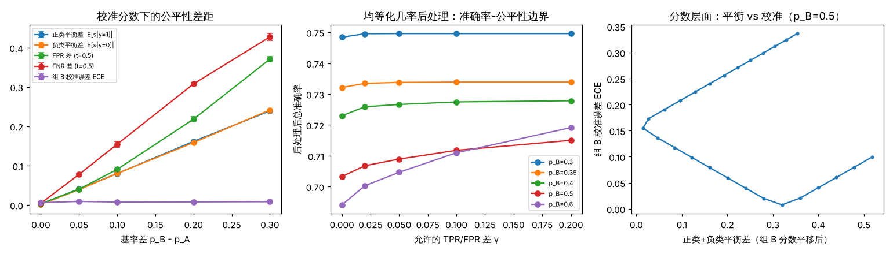
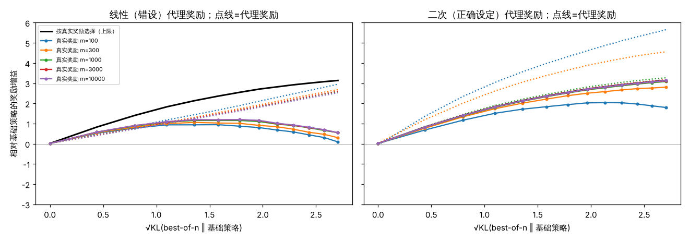

# Q14 公平性与价值对齐

> 分组：可信智能 ｜ 实验：`experiment.py`（单核运行时间约 10 秒） ｜ 证据标注：[实测] [文献] [判断]

## 摘要
公平性与价值对齐共享同一个基础结构：**我们只能优化可度量的代理目标，而真正关心的价值（公正、人类意图）要么包含相互冲突的多重准则，要么无法被有限数据完全刻画。** 本项目做了两个互补的实验。(a) 公平性：在基率不同的两组人群上构造组内完美校准的风险分数，实证复现 Kleinberg–Chouldechova 不可能定理，并用线性规划实现 Hardt 等的均等化几率后处理，绘出准确率–公平性边界。基率差从 0 增至 0.3 时，校准分数的正/负类平衡差从 0.002/0.001 升至 0.239/0.241；强制均等化几率的准确率代价从 0.001 升至 0.033，同时预测阳性值（PPV）差距从 0.005 升至 0.270 [实测]。(b) 对齐：从有限含噪偏好数据学习 Bradley–Terry 代理奖励，用 best-of-n 施加优化压力。当代理奖励模型错设（线性）时，真实奖励在 n≈2⁵ 附近见顶后下降（峰值到 n=4096 平均回落 0.64–0.90），而代理奖励持续上升，且增加偏好数据到 10⁴ 也不能消除；当模型正确设定（二次）时，过优化只在小数据（m≤300）出现，峰值位置随数据量后移 [实测]。结论：公平准则之间的冲突是数学必然，只能显式权衡；对齐中的 Goodhart 效应有"估计误差"与"模型错设"两个来源，只有前者可以靠更多数据解决。

## 1. 问题界定
**为何是基础问题。** (i) 公平性：当不同群体的基率不同，"校准"（同分同险）与"误差率均衡"（同真实状态同待遇）这两种直觉上都合理的公平概念不能同时满足 [文献: Kleinberg 2016; Chouldechova 2017]。这不是工程缺陷，而是价值冲突在数学上的体现——必须由社会选择而非算法给出答案。(ii) 价值对齐：RLHF 用从人类偏好学到的奖励模型代替真实目标 [文献: Christiano 2017; Ouyang 2022]；对代理的优化压力越大，代理与真实目标的背离越可能被放大（Goodhart 定律）[文献: Manheim 2018; Gao 2022]。核心问题是：**这种背离来自哪里、随数据与优化压力如何标度、能否预测与控制？**

**可检验的子假设（实验前固定）：**
- **H1（不可能性）**：基率差 Δ≥0.05 时，组内校准分数的正类/负类平衡差及阈值分类器的 FPR/FNR 差的 95% CI 均不含 0；Δ=0（对照）时它们均 <0.01。*否证*：Δ>0 时平衡差不显著，或 Δ=0 时出现显著差距。
- **H2（权衡代价）**：强制均等化几率（γ=0）的准确率代价与 PPV 差距都随 Δ 单调增大；Δ=0 时代价 <0.005。*否证*：Δ>0 时能以零代价同时满足均等化几率与预测均等。
- **H3（错设代理的过优化）**：线性（错设）代理下，真实奖励随 n 非单调：先升后降，峰值到 n=4096 的回落显著大于 0，而代理奖励单调上升。*否证*：真实奖励在 n≤4096 内单调不减。
- **H4（数据可治愈性）**：正确设定（二次）代理下，过优化随偏好数据量 m 增加而消失，峰值位置 log₂n* 后移；错设代理下，增加数据不能消除与"按真实奖励选择"之间的差距。*否证*：二次代理在 m=10⁴ 时仍显著过优化，或线性代理的差距随 m 持续趋于 0。

## 2. 研究现状
**公平性。** Dwork 等提出"相似个体相似对待"的个体公平 [文献: Dwork 2011]；Hardt 等提出均等化几率/机会均等及其后处理算法 [文献: Hardt 2016]；Kleinberg 等证明校准与正负类平衡三者只有在完美预测或基率相等时才能同时成立 [文献: Kleinberg 2016]；Chouldechova 以 COMPAS 为例给出 FPR、FNR、PPV 与基率之间的恒等式 [文献: Chouldechova 2017]；Pleiss 等表明校准与误差率均衡只能在很有限的意义上兼容（通过随机化丢弃信息）[文献: Pleiss 2017]；Corbett-Davies 等从决策论角度指出公平约束的代价及"阈值规则"的最优性 [文献: Corbett-Davies 2017; Corbett-Davies 2018]；Kearns 等研究交叉子群的"公平性 gerrymandering"[文献: Kearns 2017]。系统论述可见 Barocas、Hardt 与 Narayanan 的教材 [文献: Barocas 2023]。**争议**：应选择哪种准则（群体 vs 个体、结果 vs 程序）本身是规范性问题；统计准则与因果/反事实公平的关系仍未厘清。

**价值对齐。** 对齐问题被系统化为奖励设定、可扩展监督、分布外稳健等具体问题 [文献: Amodei 2016]；Gabriel 从哲学层面讨论"对齐于什么"[文献: Gabriel 2020]。技术路线上，偏好学习 + RL [文献: Christiano 2017; Stiennon 2020; Ouyang 2022; Bai 2022]，以及绕过显式奖励模型的 DPO [文献: Rafailov 2023]。关于奖励过优化：Manheim 与 Garrabrant 将 Goodhart 效应分为回归型、极值型、因果型与对抗型 [文献: Manheim 2018]；Gao 等发现 best-of-n 下金标准奖励近似遵循 R(d)=d(α−βd)（d=√KL），系数随奖励模型规模平滑变化 [文献: Gao 2022]；Pan 等观察到随智能体能力提升出现的"相变式"奖励黑客 [文献: Pan 2022]；Skalse 等给出奖励黑客的形式定义 [文献: Skalse 2022]；Zhuang 与 Hadfield-Menell 证明对不完整描述的目标进行优化会在未描述维度上造成任意损失 [文献: Zhuang 2021]；奖励模型集成可缓解过优化 [文献: Coste 2023]；RLHF 的根本局限见综述 [文献: Casper 2023]。

**关键缺口**：公平准则的选择缺乏与社会福利挂钩的原则；奖励过优化的可预测理论（何时、多快、与模型容量和数据量如何标度）；以及将多元、冲突的人类价值聚合为单一奖励的合法性问题。

## 3. 研究设计
**(a) 公平性。** 组 A 基率 0.3，组 B 基率 ∈{0.3, 0.35, 0.4, 0.5, 0.6}；每组 20000 人，个体风险 p ~ Beta(μκ, (1−μ)κ)，κ=4；y ~ Bernoulli(p)；分数 s=p（组内完美校准，这是 Kleinberg 定理的前提）。度量：组内 ECE（10 箱）、正/负类平衡差 |E[s|y,A]−E[s|y,B]|；统一阈值 0.5 下的 FPR/FNR/PPV 差；验证 Chouldechova 恒等式 FPR = p/(1−p)·(1−PPV)/PPV·(1−FNR)。均等化几率后处理：对每组 101 个阈值的 ROC 点做随机化凸组合，用线性规划在 |ΔTPR|≤γ、|ΔFPR|≤γ 约束下最大化总体准确率，γ ∈{0, 0.02, 0.05, 0.1, 0.2, 1}（γ=1 即无约束）。分数层面：对组 B 的 logit 平移 c∈[−2, 0.5]，观察平衡差与校准误差的此消彼长。5 个种子。

**(b) Goodhart。** x∈ℝ¹⁰，基础策略 N(0, I)；真实奖励 r*(x)=w·x − 0.25‖x‖²（‖w‖=1）。偏好数据：m∈{100, 300, 1000, 3000, 10000} 对独立样本，标注 P(a≻b)=σ(r*(a)−r*(b))（含噪）。代理：Bradley–Terry 逻辑回归（无截距、C=10），特征为线性 x（**错设**：无法表示二次惩罚）或二次 (x, x²)（**正确设定**）。优化压力：best-of-n，n=2⁰..2¹²，KL_bon = log n − (n−1)/n；每个 n 做 300 次试验；以"按真实奖励选择"的 best-of-n 为上限对照。拟合 Gao 函数形式 R(d)=d(α−βd)。5 个种子（各自抽取 w 与数据）。

**为何能检验假设。** (a) 中分数被构造成完美校准，任何误差率不均都只能来自基率差，Δ=0 构成干净对照；(b) 中真实奖励已知，并通过"错设 vs 正确设定"把 Goodhart 的两种来源（模型错设 / 有限数据估计误差）分离开。

## 4. 结果

### 4.1 公平性：不可能定理的实证

| 基率 p_B（p_A=0.3） | 正类平衡差 | 负类平衡差 | FPR 差 (t=0.5) | FNR 差 (t=0.5) | PPV 差 (t=0.5) | ECE_A / ECE_B |
|---|---|---|---|---|---|---|
| 0.30（对照） | 0.002±0.002 | 0.001±0.001 | 0.003±0.002 | 0.004±0.003 | 0.008±0.007 | 0.006 / 0.006 |
| 0.35 | 0.041±0.002 | 0.039±0.001 | 0.040±0.002 | 0.078±0.003 | 0.016±0.006 | 0.006 / 0.009 |
| 0.40 | 0.080±0.003 | 0.080±0.001 | 0.090±0.001 | 0.154±0.007 | 0.028±0.008 | 0.006 / 0.007 |
| 0.50 | 0.161±0.002 | 0.158±0.002 | 0.218±0.006 | 0.308±0.004 | 0.056±0.010 | 0.006 / 0.008 |
| 0.60 | 0.239±0.003 | 0.241±0.002 | 0.371±0.007 | 0.427±0.008 | 0.090±0.005 | 0.006 / 0.008 |

- Chouldechova 恒等式的数值误差在所有条件下为 0.000（到小数点后三位）[实测]。
- 两组分数都校准良好（ECE≤0.009），但只要基率不同，正负类平衡就被打破，且差距与基率差近似成正比 [实测]。
- **H1：支持。**

### 4.2 均等化几率后处理的代价

| p_B | 无约束最优准确率 (γ=1) | 均等化几率 (γ=0) 准确率 | 准确率代价 | γ=0 时 PPV 差 | γ=1 时 PPV 差 |
|---|---|---|---|---|---|
| 0.30 | 0.750±0.002 | 0.748±0.003 | 0.001±0.001 | 0.005±0.003 | 0.017±0.009 |
| 0.35 | 0.734±0.003 | 0.732±0.002 | 0.002±0.001 | 0.054±0.002 | 0.021±0.014 |
| 0.40 | 0.728±0.001 | 0.723±0.001 | 0.005±0.001 | 0.104±0.004 | 0.023±0.017 |
| 0.50 | 0.717±0.002 | 0.703±0.003 | 0.013±0.001 | 0.188±0.003 | 0.048±0.019 |
| 0.60 | 0.727±0.002 | 0.694±0.001 | 0.033±0.003 | 0.270±0.008 | 0.083±0.012 |

- 放松约束到 γ=0.05 即可收回大部分准确率（p_B=0.5 时 0.709，p_B=0.6 时 0.705），但 PPV 差仍有 0.159 / 0.242 [实测]。
- 分数层面（p_B=0.5）：对组 B 的 logit 平移 c=−0.8 可使正/负类平衡差降至 0.003 / 0.012，但组 B 的 ECE 从未平移时的 0.008 升至 0.155 [实测]（图右：V 形边界的下支即 Pareto 前沿）。
- **H2：支持。** 均等化几率与预测均等此消彼长，代价随基率差增大；Δ=0 时三者可同时近似满足（对照）。

### 4.3 Goodhart：best-of-n 过优化

| 代理 | m | 基础分布上 corr(代理, 真实) | 峰值 log₂n* | 峰值到 n=4096 的真实奖励回落 | n=4096 时真实 / 代理增益 | 与"真实选择"差距 (n=4096) | Gao α / β |
|---|---|---|---|---|---|---|---|
| 线性（错设） | 100 | 0.575±0.041 | 5.2±1.1 | 0.900±0.135 (p=0.0002) | 0.09 / 2.95 | 3.04±0.21 | 1.37 / 0.49 |
| 线性 | 1000 | 0.656±0.006 | 5.6±1.0 | 0.640±0.057 (p<10⁻⁴) | 0.55 / 2.58 | 2.58±0.03 | 1.50 / 0.48 |
| 线性 | 10000 | 0.666±0.002 | 4.6±0.8 | 0.677±0.055 (p<10⁻⁴) | 0.55 / 2.53 | 2.58±0.03 | 1.55 / 0.50 |
| 二次（正确） | 100 | 0.834±0.058 | 8.0±1.2 | 0.281±0.175 (p=0.035) | 1.80 / 5.65 | 1.34±0.30 | 1.86 / 0.43 |
| 二次 | 300 | 0.940±0.019 | 11.4±0.8 | 0.006±0.008 (p=0.22) | 2.81 / 4.55 | 0.33±0.18 | 1.93 / 0.33 |
| 二次 | 1000 | 0.985±0.002 | 12.0 | 0.000 | 3.09 / 3.27 | 0.050±0.014 | 1.97 / 0.31 |
| 二次 | 10000 | 0.998±0.001 | 12.0 | 0.000 | 3.13 / 3.12 | 0.005±0.002 | 1.99 / 0.31 |
| 真实奖励选择（上限） | — | 1 | 12 | 0 | 3.14 | 0 | — |

- 线性代理的真实奖励在 n≈16–64 达到约 0.94–1.20 后下降，代理奖励却单调上升到 2.5–2.95：典型的过优化曲线 [实测]。原因是二次惩罚项对线性代理不可见——选择沿 w 方向极端的样本会同时放大 ‖x‖² [判断，与 Zhuang 2021 的"未描述维度"机理一致]。
- 线性代理从 m=1000 到 m=10000，与上限的差距停留在 2.58，峰值位置不再后移 [实测]：**错设导致的 Goodhart 无法用更多数据治愈**。
- 二次代理下，m=100 时仍有显著过优化（回落 0.281，p=0.035），m≥300 时消失；峰值 log₂n* 从 m=100 到 m=10⁴ 后移 4.0（配对 t，p=0.003）[实测]。代理对真实奖励的"高估"（代理增益 − 真实增益）也随 m 收敛（m=100 时 5.65 vs 1.80，m=10⁴ 时 3.12 vs 3.13）[实测]。
- 注意：β>0 并不等价于过优化——即便按真实奖励选择，增益对 √KL 也是凹的；判断过优化应看是否出现峰值与回落 [判断]。
- **H3：支持。H4：支持。**

## 5. 讨论
**机理解释。** (1) 不可能定理的根源在于贝叶斯一致性：校准意味着分数是给定组别的条件概率，而高基率组的正负样本都会获得更高的平均分，因此平衡必然被打破；均等化几率后处理通过对一组"故意降低信息量"（随机化）来实现平衡，从而以准确率和预测均等为代价 [文献: Pleiss 2017; 实测]。(2) Goodhart 的两种来源在本实验中可清晰分离：**回归型**（有限数据的估计噪声被 argmax 选择性放大，m 增大可消除）与**错设型/未描述维度型**（代理的函数类不包含真实奖励，数据无法修复）[文献: Manheim 2018; Zhuang 2021]。(3) 与 Gao 等的大模型实验相比，本实验复现了"代理持续上升、真实先升后降"的定性形态，也复现了更多数据/更好奖励模型使峰值后移的趋势 [文献: Gao 2022]。

**对 2035 的含义** [判断]：公平性需要从"选择一个统计准则"转向"显式公开权衡曲线并由利益相关者选择操作点"；对齐研究需要区分可以通过扩大偏好数据解决的问题与必须改进奖励模型表达能力或引入不确定性惩罚（如集成、KL 约束）的问题 [文献: Coste 2023]。

**效度威胁与外推边界。**
- (a) 中 s=p 是理想化的完美校准分数；真实模型的分数只是近似校准，且组别信息可能不可用（后处理需要组别）。只考察了两组、单一二值属性，未考虑交叉群体 [文献: Kearns 2017]。
- (b) 中真实奖励是人为设定的低维二次函数，"错设"被刻意构造；best-of-n 只是最简单的优化器，RL 优化可能表现出不同的过优化动力学；偏好噪声模型（BT）与真实人类标注者的系统性偏差不同。Gao 函数形式只有 13 个点、5 个种子，系数的外推意义有限。
- 结论只为机理提供证据，不能直接给出大语言模型 RLHF 的定量预测。

<!-- BIBLIO:start -->
## 文献计量信号（arXiv，[实测]）

检索式：摘要含 “algorithmic fairness”、“value alignment”、“equalized odds”、“RLHF” 之一；基线为同年 cs.LG / cs.AI / stat.ML 论文总数。数据：`ai2035/bibliometrics/arxiv_counts.json`（检索日 2026-11-26）。

| 年份 | 命中论文数 | 占 AI/ML 基线比例 |
|---|---|---|
| 2015 | 2 | 0.05% |
| 2016 | 8 | 0.14% |
| 2017 | 13 | 0.15% |
| 2018 | 30 | 0.22% |
| 2019 | 40 | 0.18% |
| 2020 | 90 | 0.30% |
| 2021 | 77 | 0.23% |
| 2022 | 116 | 0.32% |
| 2023 | 287 | 0.64% |
| 2024 | 584 | 0.99% |
| 2025 | 686 | 0.92% |

- 2019–2025 年份额的对数线性趋势：**每年 +34.5%**（95% CI +19.0% ~ +52.1%，R²=0.89），判定：**相对升温（增速显著快于 AI/ML 总体）**；在 20 个问题中按相对增速排第 1 位。
- 解读边界：分子覆盖 arXiv 全部类别、分母仅为 AI/ML 三个类别，所以“比例”是相对关注度指数，并非严格的子集占比；关键词匹配既会漏掉使用其他术语的工作，也会混入无关用法；arXiv 偏重机器学习社区，认知科学、神经科学与期刊论文覆盖不足。该信号衡量的是**研究关注度**，不是**问题被解决的程度**。
<!-- BIBLIO:end -->

## 6. 结论与 2035 展望
**核心结论**
1. [实测][文献] 基率不同时，组内校准与正负类平衡/误差率均衡不能同时成立；差距随基率差近似线性增长（Δ=0.3 时平衡差 0.24），Δ=0 时消失。置信度：**高**（定理 + 实测）。
2. [实测] 强制均等化几率的准确率代价随基率差从 0.001 增至 0.033，同时 PPV 差距增至 0.270；公平是可度量的权衡曲线而非单一最优点。置信度：**高**。
3. [实测] 当代理奖励模型错设时，best-of-n 优化出现真实奖励先升后降的过优化，增加 100 倍偏好数据也无法消除与最优的差距（2.58）。置信度：**中-高**（机理清晰，但设定人为）。
4. [实测] 当代理正确设定时，过优化仅由有限数据引起，m≥300 即消失、峰值随数据后移。置信度：**中**。

**关键未解问题**：公平准则选择的规范性基础及其与因果公平的关系；奖励过优化的预测理论（能否在部署前估计峰值位置）；多元、冲突价值的聚合与"对齐于谁"的合法性问题。

**建议研究路线**
- **近期（2026–2028）**：在真实决策数据上发布"公平性–准确率前沿"作为模型卡的必备项；建立奖励过优化基准（已知金标准奖励的合成与半合成任务）。里程碑：给定奖励模型容量与偏好数据量，能以 ±1 bit（log₂n）精度预测 best-of-n 峰值位置。
- **中期（2029–2032）**：发展带不确定性的奖励建模（集成/贝叶斯）与基于不确定性的优化约束，并给出过优化的理论上界；里程碑：在标准 RLHF 基准上，金标准奖励随优化压力单调不降的区间扩大一个数量级（以 KL 计）。
- **远期（2033–2035）**：形成多利益相关方的价值聚合与审计框架，把公平与对齐的权衡选择制度化、可追溯；里程碑：关键领域（信贷、司法、医疗）部署的 AI 系统能公开其所选公平操作点与对齐目标，并通过第三方可复现审计。

## 参考文献
- Dwork, C. et al. (2011). Fairness Through Awareness. arXiv:1104.3913
- Hardt, M., Price, E., Srebro, N. (2016). Equality of Opportunity in Supervised Learning. arXiv:1610.02413
- Kleinberg, J., Mullainathan, S., Raghavan, M. (2016). Inherent Trade-Offs in the Fair Determination of Risk Scores. arXiv:1609.05807
- Chouldechova, A. (2017). Fair prediction with disparate impact: A study of bias in recidivism prediction instruments. arXiv:1703.00056
- Pleiss, G. et al. (2017). On Fairness and Calibration. arXiv:1709.02012
- Corbett-Davies, S. et al. (2017). Algorithmic decision making and the cost of fairness. arXiv:1701.08230
- Corbett-Davies, S., Goel, S. (2018). The Measure and Mismeasure of Fairness. arXiv:1808.00023
- Kearns, M. et al. (2017). Preventing Fairness Gerrymandering: Auditing and Learning for Subgroup Fairness. arXiv:1711.05144
- Barocas, S., Hardt, M., Narayanan, A. (2023). *Fairness and Machine Learning: Limitations and Opportunities*. MIT Press.
- Bradley, R. A., Terry, M. E. (1952). Rank Analysis of Incomplete Block Designs: I. The Method of Paired Comparisons. *Biometrika*, 39(3/4), 324–345.
- Amodei, D. et al. (2016). Concrete Problems in AI Safety. arXiv:1606.06565
- Christiano, P. et al. (2017). Deep reinforcement learning from human preferences. arXiv:1706.03741
- Manheim, D., Garrabrant, S. (2018). Categorizing Variants of Goodhart's Law. arXiv:1803.04585
- Gabriel, I. (2020). Artificial Intelligence, Values and Alignment. arXiv:2001.09768
- Stiennon, N. et al. (2020). Learning to summarize from human feedback. arXiv:2009.01325
- Zhuang, S., Hadfield-Menell, D. (2021). Consequences of Misaligned AI. arXiv:2102.03896
- Pan, A., Bhatia, K., Steinhardt, J. (2022). The Effects of Reward Misspecification: Mapping and Mitigating Misaligned Models. arXiv:2201.03544
- Ouyang, L. et al. (2022). Training language models to follow instructions with human feedback. arXiv:2203.02155
- Bai, Y. et al. (2022). Training a Helpful and Harmless Assistant with Reinforcement Learning from Human Feedback. arXiv:2204.05862
- Skalse, J. et al. (2022). Defining and Characterizing Reward Hacking. arXiv:2209.13085
- Gao, L., Schulman, J., Hilton, J. (2022). Scaling Laws for Reward Model Overoptimization. arXiv:2210.10760
- Rafailov, R. et al. (2023). Direct Preference Optimization: Your Language Model is Secretly a Reward Model. arXiv:2305.18290
- Casper, S. et al. (2023). Open Problems and Fundamental Limitations of Reinforcement Learning from Human Feedback. arXiv:2307.15217
- Coste, T. et al. (2023). Reward Model Ensembles Help Mitigate Overoptimization. arXiv:2310.02743
