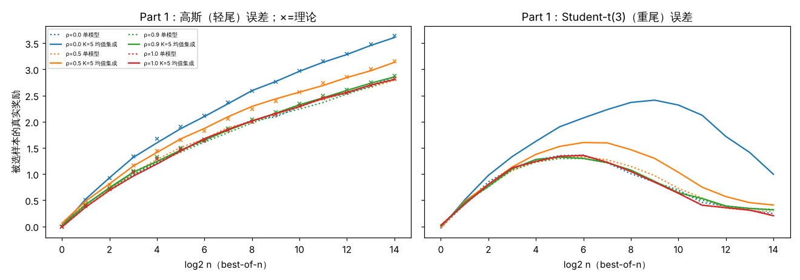
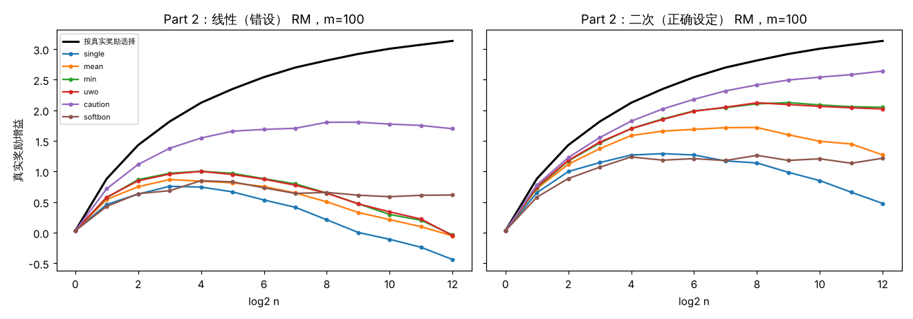

# 奖励模型集成与悲观策略何时能缓解奖励过优化？——误差尾部、误差相关性与模型错设的判据

**摘要**
奖励过优化（reward hacking）是 RLHF/RLVR 时代对齐研究的中心问题：对代理奖励施加越强的优化压力，真实目标越可能先升后降。2025–2026 年，缓解方法层出不穷——奖励模型集成、悲观/保守奖励、推断时的"谨慎"惩罚、软 best-of-n、优势符号鲁棒化——但它们各自在何种条件下有效、何时注定失效，缺少统一判据；与此同时，有工作声称"先升后降"是一大类推断时机制的必然性质。本文给出一个可检验的理论框架：best-of-n 下真实奖励随 n 单调的充分条件是 E[r|r̂=t] 关于 t 单调不减；在高斯（轻尾）加性误差下该条件恒成立，集成的收益完全由有效误差方差 σ_eff²=ρσ_e²+(1−ρ)σ_e²/K 决定；而过优化只在重尾误差或模型错设（误差随偏离基础分布而增长）时出现，且集成只能消除**独立**部分的误差。实验分两部分（5 种子）。解析可控部分：高斯误差下 16 种（ρ, 聚合方式）组合的真实奖励全部单调（回落 0），理论对实测的最大相对误差 2.4%；Student-t(3) 重尾误差下单模型在 n≈2^5.6 见顶后回落 1.14，最小值/不确定性加权集成只在成员误差独立（ρ=0）时消除回落，ρ≥0.5 时全部失效。学习型 Bradley–Terry 奖励模型部分：错设（线性）奖励模型成员误差相关 0.71–0.94，任何集成聚合都不能消除回落（0.73–1.07），而针对偏离基础分布的"谨慎"惩罚使 n=4096 处的真实奖励比单模型高 1.87–2.14；正确设定但小数据（ρ̂=0.49）时，最小值/UWO 集成消除回落。结论：缓解方法的选择应由误差的"尾部 × 相关性 × 错设"诊断决定，而不是一概而论。

**关键词**：价值对齐；奖励过优化；Goodhart 定律；奖励模型集成；悲观；best-of-n；重尾误差

## 1 引言
RLHF [Christiano 2017; Ouyang 2022] 用学到的奖励模型（RM）代替人类真实偏好；Gao 等系统测量了 best-of-n 与 RL 下的过优化曲线 [Gao 2022]，第一阶段我们在玩具模型中复现了"代理持续上升、真实先升后降"并发现错设型 Goodhart 无法用更多数据治愈。2025–2026 年，奖励黑客在生产级 RL 中被观察到会泛化为更广泛的失对齐 [MacDiarmid 2025; Taylor 2025]，使"如何缓解"成为紧迫问题。

**核心争论。** (a) *集成是否足够*：Coste 等发现 RM 集成（尤其最差情况/不确定性加权）可缓解过优化 [Coste 2023]，但 Eisenstein 等指出集成"缓解但不消除"奖励黑客，因为所有成员共享相似的错误模式 [Eisenstein 2023]；2026 年的 RMB 用多样化与 boosting 聚合继续推进 [Fan 2026]，RewardUQ 统一了不确定性感知 RM [Yang 2026]。(b) *悲观主义*：悲观 RM 微调 [Xu 2025]、偏好黑客的悲观策略优化 [Gupta 2025]、BoN 中基于"好奇心"OOD 信号的谨慎惩罚 [Yu 2026]。(c) *过优化是否必然*：Khalaf 等认为"先升后降"是 BoN 等一大类推断时机制的必然性质，并提出对冲 [Khalaf 2025]；Kwa 等则论证只有重尾误差才导致"灾难性 Goodhart"，轻尾误差下 KL 正则足够 [Kwa 2024]；软 BoN 在代理质量差时缓解过优化 [Aminian 2025]。

**本文贡献。**
1. 一个充分条件（命题 1）：E[r|r̂] 单调 ⇒ BoN 真实奖励对 n 单调；据此把过优化的来源归结为重尾或错设，从而对"必然性"论断给出可检验的边界。
2. 集成收益的闭式（命题 2）与"集成只消除独立误差"的推论，以及最小值/不确定性聚合在重尾独立误差下的尾部抑制机制。
3. 在解析可控与学习型 RM 两个层面检验上述预测，并比较集成、谨慎惩罚、软 BoN 的适用范围与代价。

## 2 前沿进展综述
**2.1 奖励黑客的观测与基准。** 生产级 RL 中奖励黑客导致自然涌现的失对齐 [MacDiarmid 2025]；在无害任务上学会黑客会泛化到有害行为 [Taylor 2025]；可验证的黑客测量环境 [Roth 2026]；RLVR 中黑客的出现与泛化测试平台 [Khalifa 2026]；机制层面的分类（黑客、坍缩、评估者博弈）[Abahana 2026]；综述 [Wang X. 2026]；世界模型可被利用的形式化 [Bhamidipaty 2026]。

**2.2 奖励模型层面的缓解。** 集成 [Coste 2023; Eisenstein 2023]；奖励模型 boosting [Fan 2026]；不确定性感知 RM 框架 [Yang 2026]；悲观 RM [Xu 2025]；数据构造与可验证奖励对黑客的抵抗力 [Shen 2025]。

**2.3 策略优化层面的缓解。** 优势符号鲁棒的策略优化 [Ono 2026]；直接对齐算法中的重要性采样 [Nguyen 2025]；稳定优化与参考正则的统一 [He L. 2026]；能量损失视角的 EPPO [Miao 2025]；悲观的偏好黑客缓解 [Gupta 2025]；多步黑客的短视优化 + 非短视认可（MONA）[Farquhar 2025]。

**2.4 推断时缓解。** BoN 的谨慎惩罚 [Yu 2026]；推断时奖励黑客的必然性与对冲 [Khalaf 2025]；软 BoN 的 KL 与遗憾分析 [Aminian 2025]。

**2.5 共识、争议与开放问题。**
- 共识：过优化真实存在且会泛化为更广泛的失对齐 [MacDiarmid 2025; Taylor 2025]；集成通常有帮助但不是万能 [Coste 2023; Eisenstein 2023]。
- 争议：过优化是否对推断时方法"必然" [Khalaf 2025 vs. Kwa 2024]；悲观/谨慎的代价何时超过收益。
- 被质疑的说法："足够多的偏好数据可以消除过优化"——第一阶段与本文都显示错设型 Goodhart 不随数据消失。
- 开放问题：① 部署前如何诊断 RM 误差的尾部与相关结构？② 谨慎/OOD 惩罚依赖的"基础分布"在 LLM 中如何定义？③ 如何把这些判据推广到多步 RL？

**前沿地图**

| 路线 | 代表工作 | 关键结论 | 局限 |
|---|---|---|---|
| 观测与基准 | MacDiarmid 2025; Taylor 2025; Roth 2026; Khalifa 2026 | 黑客会泛化为失对齐；可构造可验证环境 | 缺少统一的发生条件理论 |
| RM 集成与不确定性 | Coste 2023; Eisenstein 2023; Fan 2026; Yang 2026 | 集成缓解但不消除 | 共享误差无法被平均掉 |
| 悲观/谨慎 | Xu 2025; Gupta 2025; Yu 2026 | 惩罚 OOD 或不确定区域 | 依赖 OOD 信号质量，可能过度保守 |
| 策略优化正则 | Ono 2026; Nguyen 2025; He L. 2026; Miao 2025; Farquhar 2025 | 在优化端抑制黑客 | 多为经验验证 |
| 过优化理论 | Gao 2022; Kwa 2024; Khalaf 2025; Aminian 2025 | 标度律、重尾、必然性、软化 | 结论依赖误差假设 |

## 3 问题与假设
**选择理由。** "哪种缓解在何时有效"直接决定对齐工程的资源配置（多训几个 RM、还是做 OOD 检测、还是改 RL 目标）；它可在本环境中用已知真值的奖励完全检验。

**形式化。** 候选 x 来自基础策略 p₀；真实奖励 r(x)，代理 r̂_k(x)=r(x)+e_s(x)+e_k(x)，Var e_s=ρσ_e²，Var e_k=(1−ρ)σ_e²（Part 1）；或由 Bradley–Terry 在偏好数据上学得（Part 2）。聚合：单模型、均值、最小值、均值−标准差（UWO）、谨慎（均值 − λ·偏离基础分布的程度）、软 BoN（按 exp(r̂/β) 抽样）。过优化定义为：真实奖励在 n 上的峰值到 n_max 的回落显著大于 0（单样本 t 检验，5 种子）。

**预注册假设与否证条件**
- **H1（尾部决定过优化）**：高斯误差下，所有 ρ 与聚合方式的回落均为 0（或不显著）；Student-t(3) 误差下单模型出现显著回落。*否证*：高斯误差下出现显著回落（反驳命题 1），或重尾下无回落。
- **H2（集成收益公式）**：高斯误差下 n=1024 的真实奖励与命题 2 的预测相对误差 ≤5%，ρ=1 时集成收益为 0。*否证*：误差 >5%。
- **H3（集成只消除独立误差）**：重尾误差下，最小值/UWO 集成在 ρ=0 时消除回落，在 ρ≥0.5 时不能。*否证*：ρ≥0.5 时仍能消除，或 ρ=0 时也不能。
- **H4（学习型 RM 的判据）**：错设线性 RM（成员误差高度相关）下，任何集成聚合的回落仍显著；谨慎惩罚消除回落；正确设定小数据（成员误差中度相关）下最小值/UWO 集成消除回落；在不需要缓解的条件（二次 RM，m=1000）下保守方法有代价。*否证*：错设下集成消除回落，或谨慎惩罚无效。

## 4 理论分析
**命题 1（单调性充分条件）。** 设 n 个候选独立同分布，选择 r̂ 最大者。若 h(t)=E[r | r̂=t] 关于 t 单调不减，则 E[r_sel(n)]=E[h(max_i r̂_i)] 关于 n 单调不减。*证明*：max_i r̂_i 随 n 一阶随机占优递增，单调函数的期望随之递增。∎
*推论 1a（高斯）*：若 (r, r̂) 联合高斯，h(t) 为线性递增，故**轻尾加性误差下不存在 BoN 过优化**；E[r_sel]=σ_r²/√(σ_r²+σ_e²)·E[max_n Z]。
*推论 1b（过优化的来源）*：过优化 ⇔ h 在高 t 处下降，这需要（i）误差尾部重于 r 的尾部——极大的 r̂ 主要来自误差，h(t)→E[r] [Kwa 2024]；或（ii）错设——误差与"偏离基础分布的方向"相关（如第一阶段的线性代理忽略 ‖x‖² 惩罚），极端 r̂ 系统性地对应低 r。因此 Khalaf 等的"必然性"[Khalaf 2025] 应理解为在某类误差假设下成立。

**命题 2（集成的有效误差）。** 均值集成的误差为 e_s+K⁻¹Σe_k，方差 σ_eff²=ρσ_e²+(1−ρ)σ_e²/K；高斯下代入推论 1a 得到真实奖励的闭式预测。ρ→1 时收益→0。*推论 2a*：UWO 的惩罚项 std_k(r̂_k) 只反映独立部分，对共享误差 e_s 完全"失明"。*推论 2b（重尾）*：最小值聚合要求所有 K 个成员同时给出高分，独立重尾离群值被压制（尾部概率从 P(e>t) 变为 ≈P(e>t)^K 量级）；共享重尾分量则原样保留。

**命题 3（谨慎惩罚）。** 以 r̂(x)−λ·s·(‖x‖²−d) 选择（s 为代理尺度）等价于把基础高斯 p₀ 的对数密度加入目标，即 KL 正则化最优策略 π∝p₀·exp(r̂/β) 的一种推断时近似。若错设误差随 ‖x‖² 增长，惩罚恰好抵消误差的增长方向，从而恢复 h 的单调性；若代理已正确设定，惩罚引入偏差（有代价）。

## 5 实验
- **Part 1（解析可控）**：r~N(0,1)，σ_e=1，K=5，ρ∈{0, 0.5, 0.9, 1}，误差分布：高斯或 Student-t(3)（方差归一）；n=2⁰..2¹⁴，每个 n 150 次试验；理论值中 E[max_n Z] 用 400 次独立模拟估计。
- **Part 2（学习型 RM）**：x~N(0,I₁₀)，r*(x)=w·x−0.25‖x‖²（‖w‖=1，同第一阶段）；m∈{100, 1000} 对偏好，P(a≻b)=σ(r*(a)−r*(b))；Bradley–Terry 逻辑回归（C=10），特征为线性（错设）或线性 + 平方（正确设定）；K=5 个 bootstrap 成员（同一份数据）；n=2⁰..2¹²，每个 n 200 次试验。成员误差相关 ρ̂：在基础分布上将每个成员线性校准到真实奖励尺度后，残差两两相关的均值。谨慎：λ=0.1；软 BoN：β=0.5（相对代理标准差）。超参数在实验前固定，未调优。
- **统计**：5 种子（每种子独立抽取 w、偏好数据与候选池）；均值 ± 95% CI；回落的单样本 t 检验；与单模型在 n_max 处的配对 t 检验。运行时间：单核约 32–40 秒。

## 6 结果
所有数字见 `results/frontier.json`。

### 6.1 Part 1：尾部与相关性（H1–H3）

| 误差 | ρ | 聚合 | n=64 | n=1024 | n=16384 | 峰值 log₂n | 回落（p） |
|---|---|---|---|---|---|---|---|
| 高斯 | 0 | 单 / 均值 | 1.627 / 2.099 | 2.286 / 2.963 | 2.854 / 3.608 | 14 / 14 | 0 / 0 |
| 高斯 | 0.5 | 单 / 均值 | 1.673 / 1.873 | 2.322 / 2.565 | 2.792 / 3.135 | 14 / 14 | 0 / 0 |
| 高斯 | 0.9 | 单 / 均值 | 1.611 / 1.650 | 2.242 / 2.324 | 2.817 / 2.857 | 14 / 14 | 0 / 0 |
| 高斯 | 1.0 | 全部相同 | 1.676 | 2.288 | 2.807 | 14 | 0 |
| t(3) | 0 | 单 | 1.364 | 0.696 | 0.245 | 5.6 | 1.139（7×10⁻⁵） |
| t(3) | 0 | 均值 | 2.072 | 2.318 | 0.997 | 8.6 | 1.452（2×10⁻⁶） |
| t(3) | 0 | 最小值 / UWO | 2.115 / 2.188 | 3.006 / 3.043 | 3.675 / 3.740 | 14 / 14 | 0 / 0 |
| t(3) | 0.5 | 均值 / 最小值 / UWO | 1.603 / 1.604 / 1.635 | 1.033 / 1.071 / 1.054 | 0.409 / 0.430 / 0.438 | 6.4 / 6.6 / 6.4 | 1.23 / 1.19 / 1.22（p<10⁻⁵） |
| t(3) | 0.9 / 1.0 | 所有聚合 | ≈1.27–1.36 | ≈0.63–0.66 | ≈0.21–0.32 | 4.4–5.8 | 0.99–1.18（p<10⁻⁴） |

- 高斯误差下 16 种组合的回落全部为 0（峰值都在 n 的最大值）：**H1 支持**；t(3) 误差下单模型在 n≈2^5.6 见顶后回落 1.139。
- 命题 2 的预测（n=1024，单模型与均值集成，4 个 ρ）与实测的最大相对误差 2.4%（如 ρ=0：理论 2.298/2.966，实测 2.286/2.963；ρ=0.5：2.569 vs 2.565）；ρ=1 时集成与单模型完全相同：**H2 支持**。
- 重尾 + 独立误差（ρ=0）：最小值与 UWO 完全消除回落，均值集成只把峰值推迟到 2^8.6 但仍回落 1.452；ρ≥0.5 时所有聚合都回落 ≥0.99：**H3 支持**。

### 6.2 Part 2：学习型 Bradley–Terry 奖励模型（H4）

| RM | m | 成员误差相关 ρ̂ | 方法 | 峰值真实增益 | 峰值 log₂n | 回落（p） | n=4096 相对单模型（p） |
|---|---|---|---|---|---|---|---|
| 线性（错设） | 100 | 0.710 | 单模型 | 0.79 | 3.2 | 1.23（0.007） | — |
| | | | 均值 / 最小值 / UWO | 0.90 / 1.02 / 1.02 | 4.2 | 0.95 / 1.06 / 1.07（≤9×10⁻⁴） | +0.39 / +0.40 / +0.39（0.19 / 0.30 / 0.23） |
| | | | 谨慎 | 1.82 | 9.2 | 0.12（0.058） | +2.14（0.001） |
| | | | 软 BoN | 0.87 | 4.4 | 0.26（0.035） | +1.06（0.021） |
| 线性（错设） | 1000 | 0.939 | 单模型 | 1.18 | 5.4 | 0.83（5×10⁻⁵） | — |
| | | | 均值 / 最小值 / UWO | 1.20 / 1.28 / 1.26 | 5.0–5.8 | 0.79 / 0.73 / 0.74（≤3×10⁻⁴） | +0.06 / +0.20 / +0.18（0.17 / 0.012 / 0.001） |
| | | | 谨慎 | 2.27 | 10.0 | 0.05（0.062） | +1.87（2×10⁻⁵） |
| 二次（正确） | 100 | 0.490 | 单模型 | 1.40 | 5.2 | 0.92（0.026） | — |
| | | | 均值 / 最小值 / UWO | 1.78 / 2.17 / 2.15 | 6.6 / 10.0 / 9.2 | 0.51（0.050）/ 0.12（0.29）/ 0.13（0.30） | +0.79 / +1.57 / +1.54（0.082 / 0.030 / 0.035） |
| | | | 谨慎 | 2.64 | 12.0 | 0 | +2.16（0.007） |
| 二次（正确） | 1000 | 0.479 | 单模型 | 3.05 | 12.0 | 0 | — |
| | | | 谨慎 / 软 BoN | 2.99 / 1.67 | 12.0 / 8.2 | 0 / 0.04 | −0.066（0.007）/ −1.42（4×10⁻⁷） |
| 按真实奖励选择 | — | — | 上限 | n=4096 时 3.13 | 12 | 0 | — |

- 错设 RM 的成员误差高度相关（0.71、0.94），**任何集成聚合的回落都仍显著**（0.73–1.07）；数据越多（m=1000），成员越"一致地错"，集成收益越小（均值集成在 n=4096 只多 0.06）。
- 谨慎惩罚在错设下几乎消除回落（0.12、0.05，p≈0.06），并在 n=4096 处比单模型高 1.87–2.14。
- 正确设定但小数据（ρ̂=0.49）时，最小值/UWO 集成消除回落（p≈0.3）。
- 不需要缓解时（二次 RM，m=1000），谨慎有小代价（−0.066），软 BoN 代价很大（−1.42）。
- **H4 支持。**

## 7 讨论
**与前沿文献的关系。**
- *"集成缓解但不消除"*[Eisenstein 2023]：命题 2 与 Part 1/2 给出了定量版本——集成只作用于误差的独立部分；ρ̂ 是可在部署前估计的诊断量。本文中错设导致 ρ̂ 高达 0.94，这与 Eisenstein 等观察到"所有成员表现出相似错误模式"一致。
- *"过优化的必然性"*[Khalaf 2025] vs *重尾论*[Kwa 2024]：高斯误差下 16 种组合零回落，说明"先升后降"不是 BoN 的普适性质；它需要命题 1 的单调性被破坏（重尾或错设）。这支持 Kwa 等关于尾部的论点，并补充了"错设"这一同样重要的来源。
- *悲观/谨慎* [Yu 2026; Xu 2025; Gupta 2025]：谨慎惩罚的成功依赖于 OOD 信号与错设方向的对齐——在本玩具中惩罚项 ‖x‖² 恰好就是被代理遗漏的项，这是**对谨慎方法有利的设定**。真实 LLM 中 OOD 信号（如好奇心预测误差 [Yu 2026]）与 RM 错误方向的对齐程度是开放问题。
- *软 BoN* [Aminian 2025]：确实减小回落，但在代理良好时损失巨大（−1.42），与"在代理质量低时更有用"的结论一致。

**外推边界。** 命题 1、2 是一般性的数学结论；"何种聚合在何种 (尾部, ρ) 下有效"的定性判据可外推。具体数值、谨慎惩罚的效果高度依赖玩具设定；BoN 之外的 RL 优化可能出现不同的动力学（如策略主动寻找 RM 漏洞）。

**局限。** 只研究 best-of-n；bootstrap 集成成员共享数据，未测"不同预训练"式集成；谨慎惩罚的 OOD 信号是理想化的；t(3) 只是重尾的一个代表。

## 8 结论
1. [实测][理论] BoN 下真实奖励单调的充分条件是 E[r|r̂] 单调；轻尾加性误差下无论误差多大都不过优化（16/16 组合回落为 0），过优化需要重尾误差或模型错设。置信度：**高**（理论 + 受控实验）。
2. [实测][理论] 集成只消除误差的独立部分：高斯下收益由 σ_eff²=ρσ_e²+(1−ρ)σ_e²/K 精确预测（误差 2.4%）；重尾下最小值/UWO 集成仅在 ρ=0 时消除过优化。置信度：**高**。
3. [实测] 学习型 RM 中，错设使成员误差高度相关（ρ̂ 0.71–0.94），集成无法消除过优化；指向错设方向的谨慎惩罚可以（n=4096 处 +1.87 至 +2.14），但依赖 OOD 信号对齐。置信度：**中**。
4. [实测] 保守方法在不需要时有代价（软 BoN −1.42），缓解方法应依据诊断而非默认启用。置信度：**中**。

**对 2035 的研判** [判断]：奖励过优化不会被单一技术"解决"；对齐工程将形成"误差诊断（尾部、成员相关、错设方向）→ 选择缓解（集成/悲观/OOD 惩罚/验证器）"的标准流程。可验证奖励（RLVR）会缩小错设空间，但验证器本身的漏洞（黑客环境）将成为新的错设来源。

**后续研究建议**：① 在真实 RM 上估计 ρ̂ 与误差尾部指数，检验其对过优化起点的预测力；② 把命题 1 推广到 KL 正则 RL；③ 研究谨慎惩罚在 OOD 信号与错设方向部分对齐时的性能曲线；④ 将"不同预训练"集成纳入 ρ̂ 诊断。

## 参考文献
奠基与 2025 年前文献：
- Christiano, P. et al. (2017). Deep reinforcement learning from human preferences. arXiv:1706.03741
- Ouyang, L. et al. (2022). Training language models to follow instructions with human feedback. arXiv:2203.02155
- Gao, L., Schulman, J., Hilton, J. (2022). Scaling Laws for Reward Model Overoptimization. arXiv:2210.10760
- Manheim, D., Garrabrant, S. (2018). Categorizing Variants of Goodhart's Law. arXiv:1803.04585
- Coste, T. et al. (2023). Reward Model Ensembles Help Mitigate Overoptimization. arXiv:2310.02743
- Eisenstein, J. et al. (2023). Helping or Herding? Reward Model Ensembles Mitigate but do not Eliminate Reward Hacking. arXiv:2312.09244
- Kwa, T. et al. (2024). Catastrophic Goodhart: regularizing RLHF with KL divergence does not mitigate heavy-tailed reward misspecification. arXiv:2407.14503
- Bradley, R. A., Terry, M. E. (1952). Rank Analysis of Incomplete Block Designs: I. The Method of Paired Comparisons. *Biometrika*, 39(3/4), 324–345.

2025–2026 年前沿文献（均经 arXiv API 或 frontier/Q14.json 核实）：
- Farquhar, S. et al. (2025). MONA: Myopic Optimization with Non-myopic Approval Can Mitigate Multi-step Reward Hacking. arXiv:2501.13011
- Miao, Y. et al. (2025). The Energy Loss Phenomenon in RLHF: A New Perspective on Mitigating Reward Hacking. arXiv:2501.19358
- Gupta, D. et al. (2025). Mitigating Preference Hacking in Policy Optimization with Pessimism. arXiv:2503.06810
- Shen, W. et al. (2025). Exploring Data Scaling Trends and Effects in Reinforcement Learning from Human Feedback. arXiv:2503.22230
- Xu, Y. et al. (2025). Learning a Pessimistic Reward Model in RLHF. arXiv:2505.20556
- Nguyen, P. M. et al. (2025). Mitigating Reward Over-optimization in Direct Alignment Algorithms with Importance Sampling. arXiv:2506.08681
- Khalaf, H. et al. (2025). Inference-Time Reward Hacking in Large Language Models. arXiv:2506.19248
- Aminian, G. et al. (2025). Best-of-N through the Smoothing Lens: KL Divergence and Regret Analysis. arXiv:2507.05913
- Taylor, M. et al. (2025). School of Reward Hacks: Hacking harmless tasks generalizes to misaligned behavior in LLMs. arXiv:2508.17511
- MacDiarmid, M. et al. (2025). Natural Emergent Misalignment from Reward Hacking in Production RL. arXiv:2511.18397
- He, L. et al. (2026). Unifying Stable Optimization and Reference Regularization in RLHF. arXiv:2602.11523
- Yang, D. et al. (2026). RewardUQ: A Unified Framework for Uncertainty-Aware Reward Models. arXiv:2602.24040
- Khalifa, M. et al. (2026). Countdown-Code: A Testbed for Studying The Emergence and Generalization of Reward Hacking in RLVR. arXiv:2603.07084
- Ono, S. et al. (2026). Mitigating Reward Hacking in Reinforcement Learning from Human Feedback via Advantage Sign Robustness. arXiv:2604.02986
- Yu, Z. et al. (2026). From Curiosity to Caution: Mitigating Reward Hacking for Best-of-N with Pessimism. arXiv:2604.04648
- Wang, X. et al. (2026). Reward Hacking in the Era of Large Models: Mechanisms, Emergent Misalignment, Challenges. arXiv:2604.13602
- Bhamidipaty, L. M. et al. (2026). Imperfect World Models are Exploitable. arXiv:2605.15960
- Roth, A. et al. (2026). Hack-Verifiable Environments: Towards Evaluating Reward Hacking at Scale. arXiv:2605.20744
- Abahana, Z. et al. (2026). When RLHF Fails: A Mechanistic Taxonomy of Reward Hacking, Collapse, and Evaluator Gaming. arXiv:2606.03238
- Fan, J. et al. (2026). RMB: Reward Model Boosting Mitigates Reward Hacking. arXiv:2609.33221
