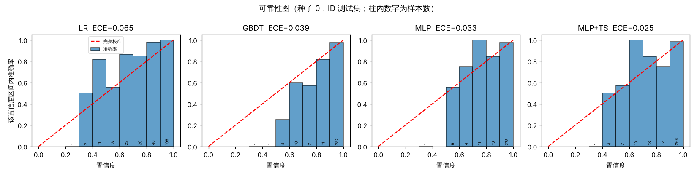
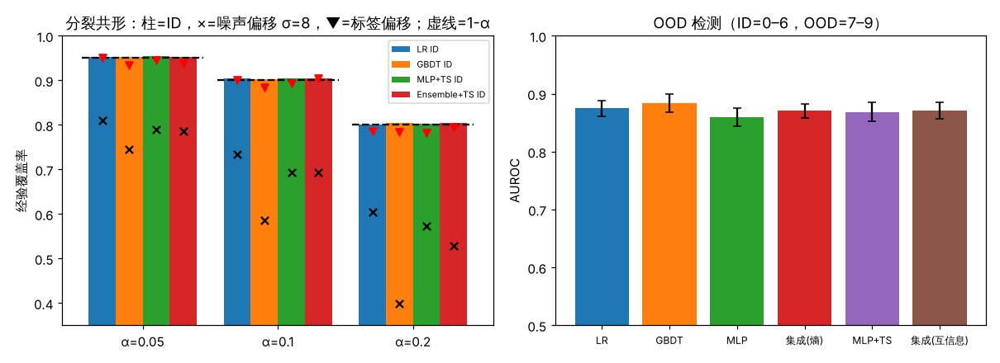

# Q15 不确定性量化与可信决策

> 分组：可信智能 ｜ 实验：`experiment.py`（单核运行时间约 30 秒） ｜ 证据标注：[实测] [文献] [判断]

## 摘要
可信决策要求模型不仅给出预测，还要给出"有多可信"——而且这种不确定性本身必须是可信的。本项目在加噪的 digits 任务（类别 0–6 为分布内，7–9 为分布外）上系统比较了逻辑回归、梯度提升树、过拟合 MLP 及 5 成员深度集成的校准性、温度缩放效果、OOD 检测能力，以及分裂共形预测在可交换与分布偏移下的覆盖率。主要发现：(1) 与"神经网络普遍过度自信"的预期相反，本设定下逻辑回归 ECE 最大（0.065，欠自信，最优温度 T=0.64），过拟合 MLP 反而较好（0.033，T=1.41）；温度缩放把 MLP 的 ECE 降低 25%（p=0.07），未达到预设的 50% [实测]。(2) 深度集成使 OOD AUROC 提高 0.011（p=0.019），但单模型温度缩放也带来 0.009 的提升，二者差异不显著 [实测]。(3) 分裂共形预测在可交换数据上的覆盖率与理论期望 ⌈(n+1)(1−α)⌉/(n+1) 吻合到千分位（α=0.1：0.903–0.905 vs 0.902）；但在更强噪声的协变量偏移下，α=0.1 的覆盖率跌至 0.585–0.734，而预测集反而变小 [实测]。结论：不确定性的"有效性"有两个层次——分布内可由共形方法无条件保证，分布外则没有任何方法能自动保证，模型会"自信地错"。

## 1. 问题界定
**为何是基础问题。** 统计决策理论要求后验概率可信，而现代学习系统的概率输出常常既不校准、也不能区分"见过的难题"与"没见过的东西"。核心矛盾：(i) 校准是对边际分布的平均性质，不保证个体可信；(ii) 认知不确定性（模型不知道）与偶然不确定性（数据本身含噪）需要不同的处理 [文献: Kendall 2017; Hüllermeier 2019]；(iii) 无分布假设的覆盖保证（共形预测）依赖可交换性，而部署环境恰恰会发生偏移 [文献: Tibshirani 2019; Barber 2022]。

**可检验的子假设（实验前固定）：**
- **H1（校准与温度缩放）**：过拟合 MLP 的 ECE 显著高于 LR；温度缩放使 MLP 的 ECE 降低 ≥50%，且不改变准确率。*否证*：MLP 的 ECE 不高于 LR，或相对降幅 <50%。
- **H2（深度集成）**：5 成员 MLP 集成的 OOD AUROC（预测熵）与 NLL 显著优于单个 MLP（配对 t，p<0.05）。*否证*：二者均无显著改进。
- **H3（共形覆盖与偏移）**：可交换条件下，所有模型、α∈{0.05,0.1,0.2} 的经验覆盖率落在 [1−α−0.02, 1−α+1/(n+1)+0.02]；在噪声偏移 σ=8 下，α=0.1 的覆盖率比 1−α 低 ≥5 个百分点。*否证*：分布内覆盖率越界，或偏移下覆盖率不降。

## 2. 研究现状
- **校准**：Niculescu-Mizil 与 Caruana 发现浅层神经网络与 LR 通常校准良好，而提升树与朴素贝叶斯偏差较大 [文献: Niculescu-Mizil 2005]；Platt 缩放 [文献: Platt 1999]；ECE 度量 [文献: Naeini 2015]；Guo 等指出现代深度网络（更深、更宽、BN、弱正则）显著过度自信，温度缩放简单而有效 [文献: Guo 2017]；Minderer 等发现新一代架构（如 Transformer）校准反而更好，校准与架构族强相关 [文献: Minderer 2021]。
- **贝叶斯与集成**：MC Dropout [文献: Gal 2015]；深度集成在精度、校准与 OOD 上常优于近似贝叶斯 [文献: Lakshminarayanan 2016]，其优势来自函数空间的多样性 [文献: Fort 2019]；Ovadia 等的大规模评估显示在数据集偏移下所有方法的校准都会退化，集成相对最好 [文献: Ovadia 2019]。
- **OOD 检测**：最大 softmax 概率基线 [文献: Hendrycks 2016]；大语言模型在一定程度上"知道自己知道什么"[文献: Kadavath 2022]。
- **共形预测**：Vovk 等奠定理论 [文献: Vovk 2005]；分裂共形与无分布推断 [文献: Lei 2016]；最小模糊集合 LAC [文献: Sadinle 2016]；自适应集合 APS [文献: Romano 2020]；综述 [文献: Angelopoulos 2021]。超越可交换：加权共形处理协变量偏移 [文献: Tibshirani 2019]、标签偏移 [文献: Podkopaev 2021]、在线自适应 [文献: Gibbs 2021]、一般非可交换 [文献: Barber 2022]。
- **关键缺口**：条件覆盖（对个体/子群）在无分布假设下不可能精确实现；未知偏移下的不确定性没有通用保证；不确定性如何进入下游决策（弃权、人机协作）的理论仍不完整。

## 3. 研究设计
- **数据**：digits，像素加高斯噪声 σ0=4（灰度 0–16）后除以 16，使准确率从约 98% 降到约 93–94%，以便测量校准。ID = 类 0–6（约 1257 张），OOD = 类 7–9；ID 数据按 50% 训练 / 25% 校准（兼作温度缩放验证集，n_cal=316）/ 25% 测试划分。
- **偏移**：(i) 协变量偏移：对 ID 测试图像的干净版本加更强噪声 σ∈{6, 8}；(ii) 标签偏移：把测试集按校准集上最难的 3 类占 80% 重采样 2000 次；(iii) OOD 类别。
- **模型**：LR（C=1）；GBDT（HistGradientBoosting）；MLP（200-200，α=1e-5，最多 1000 轮，几乎无正则）；5 个不同随机初始化的 MLP 平均概率构成深度集成。每个模型另有温度缩放版本（在校准集上最小化 NLL 拟合标量 T）。
- **指标**：准确率、ECE（15 箱，top-label）、NLL、Brier；OOD AUROC（预测熵、最大概率，集成另用互信息）；共形：LAC 分数 1−p̂_y，阈值取第 ⌈(n+1)(1−α)⌉ 小的校准分数，记录覆盖率与平均集合大小；分布内覆盖率在每个种子内对 校准/测试 合并集做 50 次随机重划分取平均。
- **统计**：5 个种子（噪声、划分、初始化），均值 ± 95% CI，配对 t 检验。
- **实现校验（如实记录）**：初版共形阈值用 `np.quantile(..., method="higher")`，造成一个秩的偏移，导致 α=0.05 的覆盖率（0.956）超过理论上界 0.953——正是理论上界帮助发现了这个实现错误。改为 `inverted_cdf` 后覆盖率与理论期望一致。文中报告的均为修正后的结果。

## 4. 结果

### 4.1 校准与温度缩放（ID 测试集）

| 模型 | 准确率 | ECE | NLL | Brier | 拟合温度 T |
|---|---|---|---|---|---|
| LR | 0.930±0.009 | 0.065±0.006 | 0.226±0.020 | 0.104±0.007 | — |
| LR+TS | 0.930 | 0.031±0.004 | 0.206±0.034 | 0.098±0.010 | 0.64±0.07 |
| GBDT | 0.929±0.018 | 0.039±0.011 | 0.234±0.061 | 0.108±0.026 | — |
| GBDT+TS | 0.929 | 0.031±0.010 | 0.211±0.047 | 0.103±0.023 | 1.38±0.12 |
| MLP（过拟合） | 0.941±0.011 | 0.033±0.007 | 0.201±0.040 | 0.092±0.012 | — |
| MLP+TS | 0.941 | 0.025±0.008 | 0.186±0.030 | 0.089±0.010 | 1.41±0.17 |
| 集成(5) | 0.944±0.011 | 0.029±0.005 | 0.192±0.033 | 0.087±0.010 | — |
| 集成+TS | 0.944 | 0.028±0.006 | 0.188±0.032 | 0.087±0.009 | 1.23±0.21 |

- MLP 的 ECE 比 LR **低** 0.031（p=0.004）[实测]；LR 的 T<1 说明它**欠自信**（L2 正则把 logit 压小），MLP/GBDT 的 T>1 说明它们轻度过自信 [实测]。
- 温度缩放对 MLP 的 ECE 平均相对降幅为 25%（差 0.009，p=0.072），对 GBDT 降低 0.007（p=0.003），对 LR 由 0.065 降至 0.031；准确率不变（温度缩放不改变 argmax）[实测]。
- **H1：不支持。** 方向性预期（"过拟合 MLP 最不校准"）被否证；温度缩放有效但幅度未达 50%。

### 4.2 OOD 检测（ID 类 0–6 vs OOD 类 7–9）

| 模型 | AUROC（熵） | AUROC（最大概率） | OOD 样本平均最大概率 |
|---|---|---|---|
| LR | 0.875±0.014 | 0.860±0.013 | 0.628 |
| GBDT | 0.884±0.015 | 0.878±0.015 | 0.771 |
| GBDT+TS | 0.891±0.015 | 0.883±0.014 | 0.695 |
| MLP | 0.859±0.015 | 0.853±0.015 | 0.816 |
| MLP+TS | 0.869±0.016 | 0.859±0.016 | 0.747 |
| 集成(5) | 0.870±0.012 | 0.864±0.012 | 0.790 |
| 集成（互信息） | 0.871±0.014 | — | — |

- 集成相对单 MLP：AUROC +0.011（p=0.019），NLL −0.009（p=0.23），ECE −0.005（p=0.056）[实测]。
- 但单个 MLP 加温度缩放也使 AUROC +0.009（p=0.022），集成与 MLP+TS 之间无显著差异（+0.002，p=0.53）；集成也不优于 LR（−0.005，p=0.17）[实测]。
- 所有模型对从未见过的数字仍给出平均 0.63–0.82 的最大概率 [实测]。
- **H2：部分支持。** OOD AUROC 显著提升，但 NLL 未显著改善，且提升幅度与廉价的温度缩放相当。

### 4.3 分裂共形预测（n_cal=316；LAC 分数）

| 模型 | α | 理论期望 / 上界 | ID 覆盖率 | ID 集合大小 | 标签偏移覆盖率 | 噪声 σ=6 覆盖率 | 噪声 σ=8 覆盖率 | σ=8 集合大小 |
|---|---|---|---|---|---|---|---|---|
| LR | 0.1 | 0.902 / 0.903 | 0.904±0.002 | 0.939 | 0.902±0.035 | 0.815±0.037 | 0.734±0.029 | 0.894 |
| GBDT | 0.1 | 0.902 / 0.903 | 0.903±0.003 | 0.942 | 0.884±0.033 | 0.751±0.041 | 0.585±0.054 | 0.744 |
| MLP+TS | 0.1 | 0.902 / 0.903 | 0.904±0.001 | 0.933 | 0.894±0.013 | 0.795±0.042 | 0.693±0.035 | 0.835 |
| 集成+TS | 0.1 | 0.902 / 0.903 | 0.905±0.001 | 0.929 | 0.905±0.031 | 0.794±0.034 | 0.693±0.035 | 0.823 |
| LR | 0.05 | 0.953 / 0.953 | 0.953±0.002 | 1.054 | 0.950±0.032 | 0.891±0.026 | 0.809±0.033 | 1.102 |
| 集成+TS | 0.05 | 0.953 / 0.953 | 0.953±0.001 | 1.023 | 0.938±0.035 | 0.871±0.030 | 0.785±0.034 | 1.031 |
| LR | 0.2 | 0.801 / 0.803 | 0.801±0.004 | 0.808 | 0.787±0.036 | 0.689±0.036 | 0.605±0.036 | 0.679 |
| GBDT | 0.2 | 0.801 / 0.803 | 0.805±0.002 | 0.814 | 0.784±0.024 | 0.573±0.035 | 0.399±0.038 | 0.434 |

（完整 4 模型 × 3 个 α 的结果见 `results/results.json` 的 `conformal` 字段。）

- 可交换条件下，12 个 (模型, α) 组合的覆盖率均在 1−α 与上界附近（偏差 ≤0.004），单次划分的标准差约 0.015–0.034 [实测]。平均集合大小 <1 是因为 LAC 允许空集——当模型准确率（约 93%）高于 1−α 时，部分低置信样本得到空集 [实测][判断]。
- 噪声偏移 σ=8 下，α=0.1 的覆盖率降至 0.585–0.734，**同时**预测集在 GBDT（0.942→0.744）、MLP+TS、集成上反而变小 [实测]：模型在偏移数据上"自信地错"，共形集合继承了这种错误。
- 标签偏移下边际覆盖率基本维持（0.884–0.905），因为 LAC 阈值对各类近似一致，难类比例上升带来的损失有限 [实测]；但 GBDT 已出现约 2 个百分点的欠覆盖。
- OOD 输入上，α=0.1 时 37–42% 的样本得到空集 [实测]——空集可以作为"拒绝预测"的信号，但仍有大多数 OOD 样本得到一个（必然错误的）非空集合。
- **H3：支持。**

## 5. 讨论
**机理解释。** (1) 校准不是"神经网络 vs 传统模型"的属性，而取决于模型容量与正则化的相对强弱：本设定的 MLP 宽度适中、在 628 个训练样本上按损失容差（tol）停止训练，未进入 Guo 等所描述的"NLL 过拟合"区间；而 C=1 的 L2 正则让 LR 欠自信。这与 Niculescu-Mizil & Caruana 及 Minderer 等"校准依赖于架构与训练细节"的结论一致 [文献: Niculescu-Mizil 2005; Minderer 2021]，而与"深度网络普遍过自信"的笼统说法存在分歧 [文献: Guo 2017]。(2) 集成的 OOD 优势在小模型、低维输入上有限，因为 5 个 MLP 的函数多样性不足；温度缩放之所以也改善 OOD，是因为它升温后拉开了 ID 与 OOD 的熵差 [判断]。(3) 共形预测的分布内保证是有限样本精确的（覆盖率与 ⌈(n+1)(1−α)⌉/(n+1) 的吻合度达到千分位）；它的失效完全来自可交换性被破坏，而且失效方向是危险的——集合变小、覆盖下降 [实测]。加权共形或在线自适应方法可在偏移可估计时部分修复 [文献: Tibshirani 2019; Gibbs 2021; Podkopaev 2021]。

**效度威胁与外推边界。**
- 内部效度：ECE 在 n≈315 的测试集上有估计偏差（分箱依赖），差异 ~0.01 量级的结论需谨慎；温度缩放与共形共用一个校准集（TS 后的模型再用同一校准集做共形，严格说会轻微破坏可交换性，但 TS 是单调变换，对 LAC 排序影响有限）。
- 构念效度：OOD 选用"未见类别"这一近 OOD 情形；协变量偏移只用了加噪一种。
- 外部效度：8×8 图像、小 MLP、5 成员集成，不代表大规模深度网络或 LLM 的校准行为；"MLP 校准较好"的结论不能外推到深层网络。
- 研究过程：发现并修正了一个共形分位数实现错误（见第 3 节）。

<!-- BIBLIO:start -->
## 文献计量信号（arXiv，[实测]）

检索式：摘要含 “uncertainty quantification”、“model calibration”、“conformal prediction”、“deep ensembles” 之一；基线为同年 cs.LG / cs.AI / stat.ML 论文总数。数据：`ai2035/bibliometrics/arxiv_counts.json`（检索日 2026-11-26）。

| 年份 | 命中论文数 | 占 AI/ML 基线比例 |
|---|---|---|
| 2015 | 71 | 1.75% |
| 2016 | 87 | 1.48% |
| 2017 | 151 | 1.79% |
| 2018 | 213 | 1.56% |
| 2019 | 273 | 1.23% |
| 2020 | 398 | 1.31% |
| 2021 | 517 | 1.56% |
| 2022 | 648 | 1.79% |
| 2023 | 869 | 1.92% |
| 2024 | 1,148 | 1.94% |
| 2025 | 1,766 | 2.37% |

- 2019–2025 年份额的对数线性趋势：**每年 +11.2%**（95% CI +8.6% ~ +13.8%，R²=0.96），判定：**相对升温（增速显著快于 AI/ML 总体）**；在 20 个问题中按相对增速排第 9 位。
- 解读边界：分子覆盖 arXiv 全部类别、分母仅为 AI/ML 三个类别，所以“比例”是相对关注度指数，并非严格的子集占比；关键词匹配既会漏掉使用其他术语的工作，也会混入无关用法；arXiv 偏重机器学习社区，认知科学、神经科学与期刊论文覆盖不足。该信号衡量的是**研究关注度**，不是**问题被解决的程度**。
<!-- BIBLIO:end -->

## 6. 结论与 2035 展望
**核心结论**
1. [实测][文献] 模型校准性由容量—正则化平衡决定而非由模型族决定：本设定中 LR 欠自信（T=0.64）、MLP 轻度过自信（T=1.41）；温度缩放普遍有效但幅度有限（MLP ECE 相对 −25%）。置信度：**中**。
2. [实测] 深度集成提升 OOD 检测（+0.011 AUROC）但优势与单模型温度缩放相当；所有模型对未见类仍给出 0.63–0.82 的平均最高置信度。置信度：**中**。
3. [实测][文献] 分裂共形预测在可交换数据上的覆盖保证在有限样本下精确成立（误差 ≤0.004）。置信度：**高**。
4. [实测] 协变量偏移下共形覆盖率大幅下降（α=0.1 时最低 0.585），且预测集变小——不确定性估计在最需要它的时候最不可靠。置信度：**高**（就本设定）。

**关键未解问题**：未知、未标注分布偏移下的有效不确定性是否可能（需要何种最小假设）；条件/子群覆盖与效率之间的根本权衡；大模型（含生成式模型）的不确定性如何定义与校准（语义层面的不确定性）。

**建议研究路线**
- **近期（2026–2028）**：把"偏移下覆盖率"作为不确定性方法的标准评测项；里程碑：在 ≥5 种自然偏移基准上，自适应/加权共形方法的覆盖率损失控制在 3 个百分点以内。
- **中期（2029–2032）**：建立带偏移检测与自动弃权的"可证伪不确定性"管线：检测到可交换性被破坏时显式降级为弃权或人类接管；里程碑：在医疗/自动驾驶仿真中，系统在偏移下的"静默失败率"（覆盖失败且未弃权）降低一个数量级。
- **远期（2033–2035）**：面向生成式大模型的语义级不确定性与覆盖保证——对开放式输出给出可校准的置信与可验证的事实性集合；里程碑：大模型在开放问答上给出的 90% 置信集合在独立审计中实际覆盖率 ≥88%，并在已知偏移下自动报告保证失效。

## 参考文献
- Platt, J. (1999). Probabilistic Outputs for Support Vector Machines and Comparisons to Regularized Likelihood Methods. In *Advances in Large Margin Classifiers*, MIT Press.
- Niculescu-Mizil, A., Caruana, R. (2005). Predicting Good Probabilities with Supervised Learning. *Proceedings of ICML 2005*, 625–632.
- Vovk, V., Gammerman, A., Shafer, G. (2005). *Algorithmic Learning in a Random World*. Springer.
- Naeini, M. P., Cooper, G., Hauskrecht, M. (2015). Obtaining Well Calibrated Probabilities Using Bayesian Binning. *Proceedings of AAAI 2015*.
- Gal, Y., Ghahramani, Z. (2015). Dropout as a Bayesian Approximation: Representing Model Uncertainty in Deep Learning. arXiv:1506.02142
- Lakshminarayanan, B., Pritzel, A., Blundell, C. (2016). Simple and Scalable Predictive Uncertainty Estimation using Deep Ensembles. arXiv:1612.01474
- Hendrycks, D., Gimpel, K. (2016). A Baseline for Detecting Misclassified and Out-of-Distribution Examples in Neural Networks. arXiv:1610.02136
- Lei, J. et al. (2016). Distribution-Free Predictive Inference For Regression. arXiv:1604.04173
- Sadinle, M., Lei, J., Wasserman, L. (2016). Least Ambiguous Set-Valued Classifiers with Bounded Error Levels. arXiv:1609.00451
- Guo, C. et al. (2017). On Calibration of Modern Neural Networks. arXiv:1706.04599
- Kendall, A., Gal, Y. (2017). What Uncertainties Do We Need in Bayesian Deep Learning for Computer Vision? arXiv:1703.04977
- Ovadia, Y. et al. (2019). Can You Trust Your Model's Uncertainty? Evaluating Predictive Uncertainty Under Dataset Shift. arXiv:1906.02530
- Tibshirani, R. J. et al. (2019). Conformal Prediction Under Covariate Shift. arXiv:1904.06019
- Hüllermeier, E., Waegeman, W. (2019). Aleatoric and Epistemic Uncertainty in Machine Learning: An Introduction to Concepts and Methods. arXiv:1910.09457
- Fort, S., Hu, H., Lakshminarayanan, B. (2019). Deep Ensembles: A Loss Landscape Perspective. arXiv:1912.02757
- Romano, Y., Sesia, M., Candès, E. (2020). Classification with Valid and Adaptive Coverage. arXiv:2006.02544
- Angelopoulos, A. N., Bates, S. (2021). A Gentle Introduction to Conformal Prediction and Distribution-Free Uncertainty Quantification. arXiv:2107.07511
- Podkopaev, A., Ramdas, A. (2021). Distribution-free uncertainty quantification for classification under label shift. arXiv:2103.03323
- Gibbs, I., Candès, E. (2021). Adaptive Conformal Inference Under Distribution Shift. arXiv:2106.00170
- Minderer, M. et al. (2021). Revisiting the Calibration of Modern Neural Networks. arXiv:2106.07998
- Barber, R. F. et al. (2022). Conformal prediction beyond exchangeability. arXiv:2202.13415
- Kadavath, S. et al. (2022). Language Models (Mostly) Know What They Know. arXiv:2207.05221
