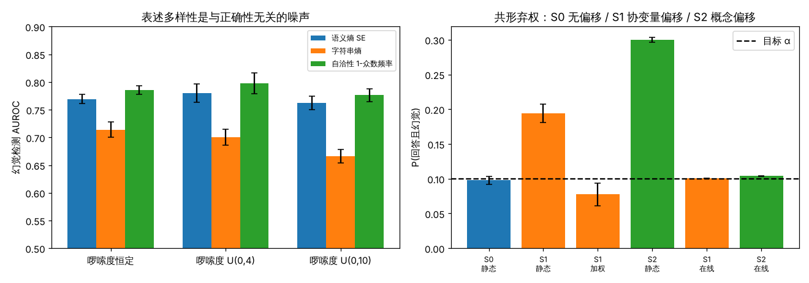

# 生成式模型的语义不确定性与共形弃权：表述噪声、聚类误差与分布偏移下的保证

**摘要**
大语言模型（LLM）的幻觉检测与"何时该拒答"是 2025–2026 年不确定性量化最活跃的方向。两条主线并行发展：一是语义熵（semantic entropy, SE）类方法——按含义而非字面对多次采样聚类再计算熵；二是共形方法——把不确定性分数转化为有限样本、无分布假设的"回答时错误率 ≤α"保证。争论集中在：SE 相对于简单基线（自洽性、token 熵）的真实增益有多大；检测器在分布外是否失效；共形保证在部署分布偏移下是否还成立。本文构造一个真值已知的玩具生成模型——每个问题有若干"含义"，每个含义有数量随机的表述——并从链式法则 H(串)=H(含义)+E[H(串|含义)] 出发，推导字符串熵相对 SE 的劣势完全来自与正确性无关的"表述噪声"项。实验（5 种子）显示：SE 的幻觉检测 AUROC 比字符串熵高 0.055、0.079、0.096（表述多样性方差比 0.67、1.16、1.93，均 p<0.001）；但当语义聚类以 30% 概率出错时，SE 的优势完全消失（0.696 vs 0.708）；有限采样（M=10）下离散 SE 并不优于更简单的自洽性分数（0.780 vs 0.798）。在共形风险控制（CRC，目标 P(回答且幻觉)≤0.1）上：无偏移时实测风险 0.098；主题难度的协变量偏移使静态 CRC 风险升至 0.194，似然比加权 CRC 恢复到 0.078（代价是弃权率从 0.309 升至 0.576）；"误解"增多的概念偏移使风险升至 0.300 且任何协变量加权都无济于事，而带反馈的在线自适应阈值把长期风险控制在 0.104（理论偏差界 0.012），弃权率 0.655。结论：语义不确定性的价值取决于聚类质量与采样预算；共形保证的边界恰好等于其可交换性/可识别偏移假设的边界，"自信地错"只能靠外部反馈纠正。

**关键词**：不确定性量化；语义熵；幻觉检测；共形预测；共形风险控制；分布偏移；在线自适应；选择性生成

## 1 引言
LLM 的幻觉使"给出答案时附带可信度、必要时拒答"成为部署前提。语义熵 [Kuhn 2023] 把多次采样按语义等价聚类后计算熵，在问答幻觉检测上优于 token 熵；后续有语义熵探针 [Kossen 2024]、核语言熵 [Nikitin 2024]、以语义熵为信号的弃权微调 [Tjandra 2024]。共形预测提供了另一类保证：分裂共形 [Angelopoulos 2021]、共形风险控制 [Angelopoulos 2022]、面向语言模型的共形生成 [Quach 2023]；其可交换性假设在偏移下失效，需要加权 [Tibshirani 2019] 或在线自适应 [Gibbs 2021]。

**2025–2026 年的核心争论。** (a) *SE 的真实增益*：自洽性方法几乎与有监督黑盒探针一样好 [Xue 2025]；"仅用概率"的方法可与语义方法竞争 [Nguyen M. 2025]；SE 的估计在小采样预算下需要贝叶斯修正 [Ciosek 2025]，语义"字母表大小"的估计影响 SE [McCabe 2025]；更细的语义相似度 [Nguyen D. 2025] 与"语义能量" [Ma 2025] 被提出以超越熵。(b) *检测器是否可靠*：基于 ROUGE 的评估夸大了进展、简单长度启发式即可匹敌复杂方法 [Janiak 2025]；表示型检测器在分布外接近随机 [Dubanowska 2025]；理论上，仅凭正例无法实现自动幻觉检测，需要专家标注的负例 [Karbasi 2025]；也有工作把幻觉检测重构为 OOD 检测 [Liu L. 2026]。(c) *共形保证在偏移下*：面向 LLM 的偏移感知共形 [Lin 2025]、Lévy–Prokhorov 偏移下的稳健共形 [Aolaritei 2025]、在线共形的噪声稳健性 [Xi 2025] 与分布信息 [Hu 2025]、对抗半老虎机反馈 [Yang J. 2026]、以及自适应共形语义熵的弃权保证 [Karimi 2026]。

**本文贡献。**
1. 由链式法则给出"字符串熵 = 语义熵 + 表述噪声"的分解，并定量验证 SE 的增益随表述噪声方差增长、随聚类误差消失（§4 命题 1–2，§6.1）。
2. 在同一生成模型上，比较静态 CRC、似然比加权 CRC 与在线自适应阈值在三类偏移下的风险与弃权代价（命题 3–4，§6.2–6.3）。
3. 给出"自信地错"（误解）这一类偏移下，任何基于模型自身不确定性的静态保证都会失效的实证，并与幻觉检测的不可能性结果相联系。

## 2 前沿进展综述
**2.1 语义不确定性与幻觉检测。** 语义能量超越熵 [Ma 2025]；预算受限下的贝叶斯 SE 估计 [Ciosek 2025]；语义字母表大小估计 [McCabe 2025]；成对语义相似度增强 [Nguyen D. 2025]；仅概率的不确定性估计 [Nguyen M. 2025]；自洽性与交叉一致性的切换 [Xue 2025]；语义图增强的不确定性建模 [Chen 2025]；OOD 几何视角 [Liu L. 2026]；自适应共形语义熵 [Karimi 2026]。

**2.2 对检测进展的质疑。** 评估指标夸大进展 [Janiak 2025]；分布外泛化失败 [Dubanowska 2025]；自动幻觉检测的（不）可能性 [Karbasi 2025]。

**2.3 共形预测在偏移与在线场景。** LLM 的领域偏移感知共形 [Lin 2025]；LP 模糊集下的稳健共形 [Aolaritei 2025]；在线共形的噪声稳健性 [Xi 2025]；分布信息在线共形 [Hu 2025]；对抗半老虎机反馈的在线共形 [Yang J. 2026]；共形预测的假设检验视角（普适性、不可能性与最优性）[Tibshirani 2026]；实践挑战 [Hong 2025]；共形集合与人类决策的张力 [Hullman 2025]。

**2.4 共识、争议与开放问题。**
- 共识：按语义而非字面聚合能去除部分与正确性无关的变异 [Kuhn 2023; Kossen 2024]；共形保证依赖可交换性，偏移下需要加权或在线修正 [Tibshirani 2019; Gibbs 2021]。
- 争议：SE 相对简单自洽性/概率基线的增益 [Xue 2025; Nguyen M. 2025]；检测器在真实偏移下是否还有用 [Dubanowska 2025; Janiak 2025]。
- 开放问题：① 聚类（语义等价判断）误差如何传导到 SE？② 对"自信地错"如何获得任何保证？③ 弃权的效用代价如何与保证强度权衡？④ 人类如何使用集合/弃权输出 [Hullman 2025]？

**前沿地图**

| 路线 | 代表工作 | 关键结论 | 局限 |
|---|---|---|---|
| 语义熵及其变体 | Kuhn 2023; Ma 2025; Ciosek 2025; McCabe 2025; Nguyen D. 2025 | 语义聚合优于 token 熵；估计需修正 | 依赖聚类质量与采样预算 |
| 简单基线 | Xue 2025; Nguyen M. 2025 | 自洽性/概率基线竞争力强 | 无法区分"自信地错" |
| 检测的可靠性与理论 | Janiak 2025; Dubanowska 2025; Karbasi 2025; Liu L. 2026 | 评估夸大、OOD 失效、需负例 | 缺少可证保证 |
| 共形 + LLM | Quach 2023; Lin 2025; Karimi 2026 | 有限样本的回答错误率保证 | 假设可交换或已知偏移 |
| 偏移与在线共形 | Tibshirani 2019; Gibbs 2021; Aolaritei 2025; Xi 2025; Hu 2025; Yang J. 2026 | 加权、稳健、在线长期保证 | 需要权重或反馈 |

## 3 问题与假设
**选择理由。** "生成式模型何时可信、何时应拒答，以及该保证在部署偏移下是否还成立"是不确定性量化走向 LLM 的核心问题；其机理（表述噪声、聚类误差、偏移类型）可以在真值已知的玩具生成模型中完全控制。

**形式化（玩具生成模型）。** 每个问题属于主题 z∈{0,…,4}（正确含义的平均概率 c̄_z=0.9, 0.8, 0.65, 0.5, 0.35）；模型在 6 个含义上的分布 π：正确含义 c~Beta(5c̄_z, 5(1−c̄_z))，其余按 Dirichlet(0.5) 分配；以概率 mis 发生"误解"（正确含义与最大错误含义互换质量，模型自信地错）。含义 j 有 L_j=1+Poisson(v) 种表述，表述分布 Dirichlet(1)；啰嗦度 v 与正确性无关。每题采样 M=10 次，回答为样本中最多的含义；幻觉 = 回答 ≠ 正确含义。
分数：离散语义熵 SE（按含义聚类的样本频率熵；聚类误差 η：每个样本以概率 η 被错误地拆成单独一簇）；字符串熵（按表述聚类）；自洽性 1−众数频率。
弃权规则：SE≤τ 时回答，否则弃权；损失 ℓ(τ)=1{回答且幻觉}，目标 E[ℓ]≤α=0.1。

**预注册假设与否证条件**
- **H1（表述噪声与聚类误差）**：在所有啰嗦度条件下 SE 的 AUROC 显著高于字符串熵（配对 p<0.05），且差距随表述噪声方差比单调增大；聚类误差 η=0.3 时 SE 对字符串熵的优势 ≤0.01。*否证*：任一不成立。
- **H2（可交换下的 CRC）**：无偏移（S0）时静态 CRC 的期望风险 ≤α+0.01。*否证*：超出。
- **H3（偏移下的保证边界）**：协变量偏移（S1）使静态 CRC 风险 >α+0.02，而似然比加权 CRC 恢复到 ≤α+0.01；概念偏移（S2）使静态 CRC 风险 >α+0.02，在线自适应把长期风险控制在 α±（理论界）。*否证*：S1 加权失败，或 S2 在线自适应超出理论界。

## 4 理论分析
**命题 1（字符串熵的分解）。** 含义是字符串的确定性函数，故 H(S)=H(Mn)+Σ_j π_j H(S|Mn=j)。第二项（表述噪声 N）由表述数与表述分布决定，与回答是否正确独立。若 SE 与幻觉指示 Y 的关系为 SE|Y 的位置移动 Δ，则加入独立噪声 N 后，判别能力（如高斯近似下 AUROC=Φ(Δ/√(2(σ²_SE+σ²_N)))）随 σ²_N/σ²_SE 单调下降。*预测*：SE−字符串熵的 AUROC 差随表述噪声方差比增大；精确（无限样本）版本的恒等式误差为 0。

**命题 2（聚类误差）。** 以概率 η 把样本误拆为单独一簇，相当于向 SE 加入一个只依赖于 η 与 M、与 Y 无关的随机熵增量，作用与 N 相同。*预测*：η 增大时 SE 的 AUROC 单调下降，趋向（甚至低于）字符串熵。

**命题 3（共形风险控制及加权）。** 设损失 ℓ_i(τ)∈[0,1] 关于 τ 单调不减。可交换时取 τ̂=sup{τ: (Σ_i ℓ_i(τ)+1)/(n+1)≤α}，则 E[ℓ_{n+1}(τ̂)]≤α [Angelopoulos 2022]。协变量偏移且似然比 w(z)=p_tgt(z)/p_src(z) 已知时，用 (Σ_i w_i ℓ_i(τ)+w_{n+1})/(Σ_i w_i+w_{n+1})≤α 选取依赖于测试点 z 的阈值，可恢复保证（与加权共形预测 [Tibshirani 2019] 同理）。若偏移改变的是 P(Y|SE,z)（概念偏移），任何以 z 为权重的修正都无效。

**命题 4（在线自适应的长期保证）。** 阈值更新 τ_{t+1}=Π[τ_t+γ(α−ℓ_t)]，Π 投影到 [−γ, log M+γ]。由于 τ 有界且每步变化量恰为 γ(α−ℓ_t)，对任意序列有 |(1/T)Σ_t ℓ_t−α| ≤ (log M+2γ)/(γT)（Gibbs & Candès 论证的风险版本 [Gibbs 2021]）。本设定 γ=0.05、T=4000，界为 0.012。代价：保证是长期平均意义的，需要逐题反馈；为补偿"自信地错"，阈值会收紧，弃权率上升。

## 5 实验
- **Part A（检测）**：每个 (种子, 条件) 3000 题，源分布 P_src(z)=(0.35, 0.3, 0.2, 0.1, 0.05)，误解率 0.05；啰嗦度：恒定 v=2、v~U(0,4)、v~U(0,10)；聚类误差 η∈{0, 0.1, 0.3}（在 U(0,4) 条件下）。报告离散估计（M=10）与精确（无限样本）两种 AUROC。
- **Part B（静态与加权 CRC）**：每个种子：源分布题库 2000，随机抽 500 作校准集（100 次重复）；测试集 2000 题，三种场景：S0 无偏移；S1 协变量偏移 P_tgt(z)=(0.05, 0.1, 0.2, 0.3, 0.35)（P(幻觉|SE,z) 不变）；S2 概念偏移（主题分布不变，误解率 0.3）。加权 CRC 使用已知的 P_tgt/P_src。
- **Part C（在线）**：从源分布 500 题上的 CRC 阈值出发，在 S1、S2 的 4000 题流上逐题更新，γ=0.05。
- **统计**：5 个种子；每种子内对 100 次重复取平均后跨种子求 95% CI；配对 t 检验。运行时间：单核约 40 秒。
- **偏差记录**：首轮运行中误把 S1 的协变量权重套用到 S2（S2 的主题分布与源相同，正确权重恒为 1，加权 CRC 即退化为静态 CRC），已在定稿版本中删除该无意义条件；其余设置未变。

## 6 结果
所有数字见 `results/frontier.json`。

### 6.1 表述噪声与聚类误差（H1）

| 条件 | 表述噪声方差比 | 幻觉率 | AUROC：SE | 字符串熵 | 自洽性 | 精确 SE | 精确字符串熵 | SE−字符串（p） |
|---|---|---|---|---|---|---|---|---|
| 啰嗦度恒定 | 0.670 | 0.156 | 0.769±0.008 | 0.714±0.014 | 0.786 | 0.792 | 0.741 | +0.055（2×10⁻⁴） |
| U(0,4) | 1.159 | 0.150 | 0.780±0.016 | 0.701±0.014 | 0.798 | 0.800 | 0.707 | +0.079（6×10⁻⁵） |
| U(0,10) | 1.934 | 0.150 | 0.763±0.012 | 0.666±0.013 | 0.776 | 0.784 | 0.679 | +0.096（2×10⁻⁵） |
| U(0,4)，η=0.1 | 1.145 | 0.156 | 0.732±0.012 | 0.697 | 0.780 | 0.782 | 0.702 | — |
| U(0,4)，η=0.3 | 1.148 | 0.151 | 0.696±0.013 | 0.708 | 0.792 | 0.795 | 0.714 | — |

- 链式法则恒等式的数值误差为 0（所有条件）。SE 的优势随表述噪声方差比单调增大（0.055→0.079→0.096）。
- 聚类误差使 SE 的 AUROC 下降 0.048（η=0.1，p=0.016）与 0.084（η=0.3，p=0.0015）；η=0.3 时 SE 反而低于字符串熵。**H1 支持。**
- 附带发现：M=10 时离散 SE 的 AUROC 比自洽性低约 0.01–0.02，也低于无限样本 SE（0.784–0.800）——有限采样估计而非"语义"本身是瓶颈之一，这与 Xue 等、Ciosek 等的观察一致。

### 6.2 静态与加权 CRC（H2, H3）

| 场景 | 方法 | P(回答且幻觉) | 弃权率 | 单次重复中风险 >α 的比例 |
|---|---|---|---|---|
| S0 无偏移 | 静态 CRC | 0.098±0.006 | 0.127 | 0.334 |
| S1 协变量偏移 | 静态 CRC | 0.194±0.014 | 0.309 | 0.992 |
| S1 协变量偏移 | 加权 CRC | 0.078±0.016 | 0.576 | 0.202 |
| S2 概念偏移（误解率 0.3） | 静态 CRC | 0.300±0.004 | 0.126 | 1.000 |

- S0：期望风险 0.098≤α（CRC 保证的是期望而非每次实现，故 33% 的单次重复略超 α 符合预期）：**H2 支持**。
- S1：静态 CRC 风险几乎翻倍（0.194），加权 CRC 恢复到 0.078，但弃权率从 0.309 升至 0.576。
- S2：误解使模型在低 SE 时也会错，静态 CRC 风险 0.300，而 S2 的主题分布与源相同，协变量加权（权重恒为 1）无法提供任何修正。

### 6.3 在线自适应（H3）

| 场景 | 在线：长期风险 | 后半段风险 | 弃权率 | 同一数据流上的静态阈值：风险 / 弃权 |
|---|---|---|---|---|
| S1 | 0.101±0.000 | 0.100 | 0.521 | 0.177 / 0.338 |
| S2 | 0.104±0.000 | 0.100 | 0.655 | 0.284 / 0.142 |

长期风险与 α 的偏差为 0.001 与 0.004，均在理论界 0.012 内；代价是 S2 中 65.5% 的问题被拒答。**H3 支持。**

## 7 讨论
**与前沿文献的关系。**
- *SE 的真实增益* [Xue 2025; Nguyen M. 2025; Ciosek 2025]：命题 1 表明 SE 相对字符串/token 熵的增益等于"去除了表述噪声"，因此其大小取决于任务中表述多样性的方差——在答案形式单一的任务（如多选、数值）上增益应很小，在开放式生成上较大。SE 与自洽性在本设定下相近，说明二者的主要区别是估计方差而非信息内容；在小采样预算下，简单的自洽性分数是有力基线。
- *聚类质量* [McCabe 2025; Nguyen D. 2025]：η=0.3 的聚类错误即可抹去 SE 的全部优势，说明"语义等价判断"（通常由 NLI 模型或 LLM 完成）的可靠性是 SE 类方法的单点故障。
- *检测在分布外失效* [Dubanowska 2025] 与*不可能性* [Karbasi 2025]：S2 的"自信地错"在 SE 低时发生，任何只依赖模型自身输出分布的分数都无法识别；这正是 Karbasi 等所说需要外部负例的情形。本文的在线方案用逐题反馈（相当于外部标注）恢复长期保证，与其理论结论相容。
- *共形 + LLM* [Lin 2025; Karimi 2026; Quach 2023]：加权与在线方法确实能恢复保证，但都以大幅提高弃权率为代价（S1 加权 0.576、S2 在线 0.655）；保证的"强度"与系统的"有用性"之间存在不可回避的权衡，需要与人类决策流程共同设计 [Hullman 2025]。

**外推边界。** 命题 1–4 是一般性结论；"SE 增益随表述噪声增长""聚类误差抹去增益""概念偏移使静态保证失效"可外推到真实 LLM。具体 AUROC、风险与弃权数值依赖玩具参数（6 个含义、M=10、主题难度设置），不能直接外推。

**局限。** 玩具模型中的"含义"是离散且已知的，真实 LLM 的语义空间是连续且有层级的；加权 CRC 假设似然比已知（实践中需要估计，会引入额外误差）；在线方案假设逐题反馈立即可得；未测试条件覆盖（按主题的保证）。

## 8 结论
1. [实测][理论] 字符串/token 熵 = 语义熵 + 与正确性无关的表述噪声；SE 的增益随表述噪声方差增长（AUROC +0.055 至 +0.096）。置信度：**高**（就本模型）。
2. [实测] 语义聚类出错 30% 即可抹去 SE 的全部优势；M=10 的有限采样下 SE 不优于简单自洽性。SE 类方法的瓶颈在聚类质量与采样预算。置信度：**中-高**。
3. [实测][文献] 共形风险控制在可交换时有效（风险 0.098），在已知协变量偏移下可由加权恢复（0.078），但对"自信地错"的概念偏移，静态保证完全失效（0.300），只有带反馈的在线方法能恢复长期保证（0.104），且代价是大量拒答。置信度：**高**（就本模型）。
4. [判断] 对 LLM 而言，"有保证的拒答"在技术上可行，但保证的覆盖范围恰好等于其假设（可交换或可识别的偏移、可得的反馈）的覆盖范围；部署者必须明确声明这些假设。置信度：**中**。

**对 2035 的研判** [判断]：高风险领域的 LLM 将普遍采用"语义不确定性 + 共形弃权 + 在线监测"的组合，以"回答时错误率 ≤α"的形式对外承诺；但"自信地错"（系统性误解）仍是主要残余风险，需要外部事实核查与反馈闭环。到 2035 年，评估的重点将从检测器 AUROC 转向"在声明的偏移类型下保证是否兑现"以及弃权代价。

**后续研究建议**：① 在真实 LLM 上估计表述噪声方差比，检验命题 1 对 SE 增益的预测；② 研究估计似然比时加权 CRC 的稳健性 [Aolaritei 2025]；③ 设计减少弃权代价的在线方法（如分主题自适应）；④ 将聚类误差纳入 SE 的置信区间。

## 参考文献
奠基与 2025 年前文献：
- Kuhn, L., Gal, Y., Farquhar, S. (2023). Semantic Uncertainty: Linguistic Invariances for Uncertainty Estimation in Natural Language Generation. arXiv:2302.09664
- Kossen, J. et al. (2024). Semantic Entropy Probes: Robust and Cheap Hallucination Detection in LLMs. arXiv:2406.15927
- Nikitin, A. et al. (2024). Kernel Language Entropy: Fine-grained Uncertainty Quantification for LLMs from Semantic Similarities. arXiv:2405.20003
- Tjandra, B. A. et al. (2024). Fine-Tuning Large Language Models to Appropriately Abstain with Semantic Entropy. arXiv:2410.17234
- Angelopoulos, A. N., Bates, S. (2021). A Gentle Introduction to Conformal Prediction and Distribution-Free Uncertainty Quantification. arXiv:2107.07511
- Angelopoulos, A. N. et al. (2022). Conformal Risk Control. arXiv:2208.02814
- Quach, V. et al. (2023). Conformal Language Modeling. arXiv:2306.10193
- Tibshirani, R. J. et al. (2019). Conformal Prediction Under Covariate Shift. arXiv:1904.06019
- Gibbs, I., Candès, E. (2021). Adaptive Conformal Inference Under Distribution Shift. arXiv:2106.00170

2025–2026 年前沿文献（均经 arXiv API 或 frontier/Q15.json 核实）：
- Xue, Y. et al. (2025). Verify when Uncertain: Beyond Self-Consistency in Black Box Hallucination Detection. arXiv:2502.15845
- Nguyen, M. et al. (2025). Probabilities Are All You Need: A Probability-Only Approach to Uncertainty Estimation in Large Language Models. arXiv:2511.07694
- Ciosek, K. et al. (2025). Hallucination Detection on a Budget: Efficient Bayesian Estimation of Semantic Entropy. arXiv:2504.03579
- McCabe, L. H. et al. (2025). Estimating Semantic Alphabet Size for LLM Uncertainty Quantification. arXiv:2509.14478
- Nguyen, D. et al. (2025). Beyond Semantic Entropy: Boosting LLM Uncertainty Quantification with Pairwise Semantic Similarity. arXiv:2506.00245
- Ma, H. et al. (2025). Semantic Energy: Detecting LLM Hallucination Beyond Entropy. arXiv:2508.14496
- Janiak, D. et al. (2025). The Illusion of Progress: Re-evaluating Hallucination Detection in LLMs. arXiv:2508.08285
- Dubanowska, Z. et al. (2025). Representation-based Broad Hallucination Detectors Fail to Generalize Out of Distribution. arXiv:2509.19372
- Karbasi, A. et al. (2025). (Im)possibility of Automated Hallucination Detection in Large Language Models. arXiv:2504.17004
- Liu, L. et al. (2026). From Out-of-Distribution Detection to Hallucination Detection: A Geometric View. arXiv:2602.07253
- Karimi, H. et al. (2026). LLMs Uncertainty Quantification via Adaptive Conformal Semantic Entropy. arXiv:2605.04295
- Lin, Z. et al. (2025). Domain-Shift-Aware Conformal Prediction for Large Language Models. arXiv:2510.05566
- Aolaritei, L. et al. (2025). Conformal Prediction under Levy-Prokhorov Distribution Shifts: Robustness to Local and Global Perturbations. arXiv:2502.14105
- Xi, H. et al. (2025). Exploring the Noise Robustness of Online Conformal Prediction. arXiv:2501.18363
- Hu, D. et al. (2025). Distribution-informed Online Conformal Prediction. arXiv:2512.07770
- Yang, J. et al. (2026). Online Conformal Prediction with Adversarial Semi-bandit Feedback via Regret Minimization. arXiv:2604.17984
- Tibshirani, R. J. et al. (2026). Conformal Prediction Through the Lens of Hypothesis Testing: Universality, Impossibility, and Optimality. arXiv:2608.27310
- Hong, L. et al. (2025). On some practical challenges of conformal prediction. arXiv:2510.10324
- Hullman, J. et al. (2025). Conformal Prediction and Human Decision Making. arXiv:2503.11709
- Chen, K. et al. (2025). Enhancing Uncertainty Modeling with Semantic Graph for Hallucination Detection. arXiv:2501.02020
