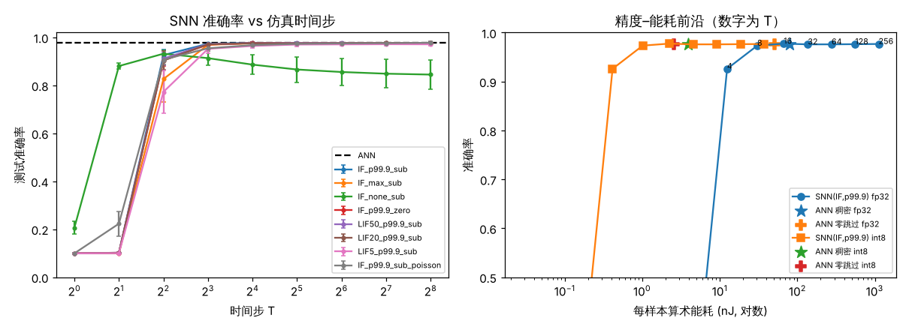
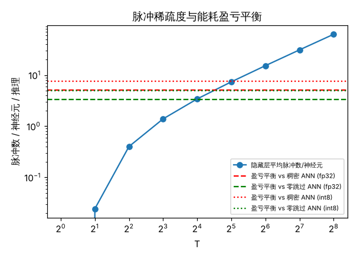

# Q16 类脑智能与低能耗计算

> 分组：系统与交叉 ｜ 实验：`experiment.py`（单核运行时间约 16 秒） ｜ 证据标注：[实测] [文献] [判断]

## 摘要
“脉冲神经网络（SNN）比人工神经网络（ANN）更省能”常被当作类脑计算的前提，但它其实是一个取决于编码方式、时延和硬件能耗模型的定量问题。本研究在 sklearn digits 上训练 ReLU MLP（64-128-64-10），按 Diehl 2015 / Rueckauer 2017 的数据驱动归一化转换为积分-发放（IF/LIF）SNN，测量准确率随仿真时间步 T 的变化，统计突触操作数，并用 Horowitz 2014 的 45 nm 单次操作能耗换算为能耗。[实测] 采用 99.9 分位数归一化时，SNN 在 T=8 时准确率为 0.973±0.005（ANN 为 0.977±0.002），所有 5 个种子都在 T=8 达到与 ANN 相差 ≤1 个百分点。此时 FP32 算术能耗只有稠密 ANN 的 0.39±0.01 倍，是零跳过（稀疏）ANN 的 0.60±0.02 倍。不过 SNN 能耗随 T 线性增长，T≥32 时已比稠密 ANN 更耗能；改用 Poisson 编码后，等精度能耗与稠密 ANN 持平（1.02±0.31 倍）。结论：SNN 的能耗优势真实存在但很窄。它取决于低时延（T≲16）、确定性编码和低发放率，而且对比对象一旦换成利用激活稀疏的 ANN，优势就缩小到 1.7 倍（FP32）至 2.5 倍（INT8）。

## 1. 问题界定
**为何是基础问题。** 人脑功耗约 20 W，而大模型推理的能耗高出几个数量级。类脑计算的核心主张是：**事件驱动的稀疏脉冲把乘加（MAC）换成累加（AC），并只在有脉冲时计算**，因此能效更高。这一主张引出三个基础矛盾：
1. **精度–时延矛盾**：速率编码需要足够多的时间步才能逼近连续激活值，时间步越多，时延和操作数就越高；
2. **能耗核算的参照系**：SNN 的“省能”是相对于稠密 ANN、稀疏 ANN 还是专用加速器？以及采用哪种数值精度？
3. **生物合理性与工程效率**：泄漏（LIF）、随机编码等生物特征是否有代价？

**可检验的子假设（实验前固定）：**
- **H1（转换可行性）**：采用 99.9 分位数归一化时，SNN 能在 T≤64 内达到与 ANN 相差 ≤1 个百分点；不归一化时，在所有 T 上差距都 >1 个百分点。*否证条件*：归一化 SNN 在 T=64 时差距仍 >1 个百分点，或未归一化 SNN 在某个 T 上差距 ≤1 个百分点。
- **H2（存在节能区间）**：在等精度（≤1 个百分点）条件下，至少存在一个 T，使 SNN 的 FP32 算术能耗低于稠密 ANN。*否证*：所有达到等精度的 T 上 SNN 能耗都 ≥ 稠密 ANN。
- **H3（优势有限）**：与零跳过 ANN（只对非零激活做 MAC）相比，SNN 的等精度能耗优势小于 2 倍（能耗比 >0.5）。*否证*：比值 ≤0.5。
- **H4（泄漏的代价）**：强泄漏（LIF τ=5 步）会增加达到等精度所需的 T；τ≥20 时影响可忽略。

## 2. 研究现状
- **理论起点。** Maass（1997）把脉冲网络称为“第三代神经网络模型”，证明其计算能力不弱于 sigmoid 网络 [文献]。
- **ANN→SNN 转换路线。** Cao 等（2015，IJCV）首先把 CNN 转换为 SNN 用于低能耗识别；Diehl 等（2015，IJCNN）提出基于权重/阈值平衡的数据驱动归一化（逐层最大激活）；Rueckauer 等（2017，arXiv:1612.04052）将其扩展为分位数归一化、偏置与 BN 转换和“减法复位”，使深层 CNN 的转换精度接近 ANN [文献]。Sengupta 等（2019，arXiv:1802.02627）把转换推广到 VGG/ResNet 和 ImageNet，但需要数千个时间步；RMP-SNN（Han 等 2020，arXiv:2003.01811）和 Bu 等（2022/2023，arXiv:2303.04347）通过残差膜电位和量化-裁剪激活，把等精度所需的时间步降到几十甚至个位数 [文献]。可见“时延”是该路线的主要矛盾。
- **直接训练路线。** 代理梯度（Neftci、Mostafa、Zenke 2019，arXiv:1901.09948）让 SNN 能用 BPTT 直接训练；近年又出现 Spikformer（arXiv:2209.15425）、SpikeGPT（arXiv:2302.13939）等脉冲 Transformer/语言模型 [文献]。
- **硬件。** IBM TrueNorth（Merolla 等 2014，Science 345:668–673）、Intel Loihi（Davies 等 2018，IEEE Micro 38(1):82–99）、清华天机芯 Tianjic（Pei 等 2019，Nature 572:106–111，ANN/SNN 混合）展示了数量级的能效潜力 [文献]。Roy、Jaiswal、Panda（2019，Nature 575:607–617）系统论述了基于脉冲的机器智能 [文献]。
- **争议与缺口。** (i) 很多能效比较只计算算术操作，并以稠密 ANN 为基线，忽略了访存。Horowitz（2014，ISSCC）的数据显示，从 SRAM/DRAM 读取一次数据的能耗比一次 32 位运算高 1–3 个数量级 [文献]。(ii) 基线是否利用了激活稀疏，结论会相差数倍。(iii) 高精度往往要靠长时间窗口，从而抵消了稀疏性收益。**缺口**：缺少一个把精度、时延、能耗放在同一框架下、并对基线和精度做敏感性分析的“盈亏平衡”刻画。本项目用一个小而透明的实验填补这一机理层面的空缺。

## 3. 研究设计
- **数据与 ANN**：sklearn digits（1797 张 8×8 图，像素归一到 [0,1]），每个种子分层划分 70/30（测试 540 张）；MLP 64-128-64-10，ReLU，adam，L2=1e-4，最多 400 轮。
- **转换**：λ_l 取训练集上第 l 层正激活的 99.9 分位数（对照：最大值 = Diehl 2015；不归一化）；W'_l = W_l·λ_{l-1}/λ_l，b'_l = b_l/λ_l；隐藏层为 IF 神经元，阈值 1，减法复位（对照：置零复位）；LIF 对照 τ ∈ {50, 20, 5} 步；输出层只积分不发放，取膜电位 argmax。输入编码：确定性 IF 速率编码（主条件）或 Poisson 编码（对照）。
- **操作计数**：SNN 的 AC = Σ_l（第 l−1 层脉冲数 × 扇出）+ 每神经元每步一次偏置累加；LIF 另计每神经元每步一次乘法。稠密 ANN 的 MAC = Σ fan_in·fan_out = 17024；零跳过 ANN 的 MAC = Σ nnz(a_{l−1})·fan_out。
- **能耗模型 [文献]**：Horowitz（2014）给出的 45 nm 数据为：FP32 乘 3.7 pJ、加 0.9 pJ（MAC≈4.6 pJ）；INT8 乘 0.2 pJ、加 0.03 pJ（MAC≈0.23 pJ）。**只计算算术能耗**，这是有意的简化，见 §5。
- **统计**：5 个种子（数据划分 + 初始化），报告均值 ± 95% CI（正态近似），组间用配对 t 检验和 Cohen's d_z。“等精度时间步” T_1pp 定义为每个种子在检查点 {1,2,4,…,256} 中第一个满足 ANN−SNN ≤1 个百分点的 T。
- **设计逻辑**：同一套训练好的权重被重复转换，只改变归一化、复位、泄漏和编码这些单一因素，因此差异可以归因于该因素；同时报告两种基线和两种精度，检验结论对“参照系”是否稳健。

## 4. 结果

**表 1　准确率与能耗随时间步变化（主条件 IF + 99.9 分位数 + 减法复位）[实测]**

| T | 准确率 | 与 ANN 差距 (pp) | 隐藏层脉冲/神经元 | FP32 能耗 (nJ) | 比稠密 ANN (FP32) | 比零跳过 ANN (FP32) |
|---|---|---|---|---|---|---|
| 4 | 0.926±0.022 | 5.07±2.10 | 0.40±0.05 | 12.4±0.5 | 0.158 | 0.243 |
| 8 | 0.973±0.005 | 0.33±0.37 | 1.39±0.13 | 30.4±1.0 | 0.388 | 0.595 |
| 16 | 0.977±0.003 | −0.07±0.09 | 3.42±0.28 | 66.7±2.1 | 0.850 | 1.305 |
| 32 | 0.976±0.003 | 0.07±0.15 | 7.39±0.58 | 136.6±4.2 | 1.740 | 2.673 |
| 64 | 0.976±0.003 | 0.07±0.09 | 15.3±1.2 | 276.5±8.4 | 3.522 | 5.411 |
| 256 | 0.977±0.003 | 0.00±0.11 | 62.9±4.7 | 1115.8±33.6 | 14.21 | 21.84 |

ANN 参照：准确率 0.977±0.002；稠密 MAC 17024，零跳过 MAC 11073±193（非零激活比例 0.650）；FP32 能耗：稠密 78.5 nJ、零跳过 51.1±0.9 nJ；INT8 能耗：稠密 3.92 nJ、零跳过 2.55±0.04 nJ。

**表 2　等精度（≤1 pp）分析：各条件 T_1pp 与能耗比（均值±CI，跨种子）[实测]**

| 条件 | 达标种子数 | T_1pp（中位数） | 比稠密 ANN FP32 | 比零跳过 ANN FP32 | 比零跳过 ANN INT8 |
|---|---|---|---|---|---|
| IF, p99.9, 减法复位（主） | 5/5 | 8 | 0.388±0.013 | 0.595±0.024 | 0.397±0.016 |
| IF, max 归一化 | 5/5 | 8 | 0.517±0.184 | 0.793±0.279 | 0.529±0.186 |
| IF, 不归一化 | 0/5 | — | — | — | — |
| IF, 置零复位 | 5/5 | 8 | 0.446±0.166 | 0.684±0.251 | 0.457±0.168 |
| LIF τ=50 | 5/5 | 8 | 0.556±0.185 | 0.853±0.281 | 0.625±0.205 |
| LIF τ=20 | 5/5 | 8 | 0.650±0.232 | 0.997±0.352 | 0.730±0.257 |
| LIF τ=5 | 4/5 | 32 | 1.886±1.201 | 2.914±1.841 | 2.142±1.358 |
| IF, Poisson 输入 | 5/5 | 16 | 1.020±0.305 | 1.566±0.464 | 1.045±0.309 |

**盈亏平衡**：在只计算算术能耗的模型下，若每个神经元（按扇出加权）每次推理平均发放的脉冲数低于 E_MAC/E_AC，SNN 就比稠密 ANN 省能。这个阈值在 FP32 下为 5.11，在 INT8 下为 7.67；若基线换成零跳过 ANN，阈值降为 3.32（FP32）和 4.99（INT8）[实测/推导]。实测中，主条件 SNN 的平均能耗从 T=32 起超过稠密 ANN（FP32 与 INT8 均如此），对零跳过 ANN 则在 FP32 下从 T=16 起、INT8 下从 T=32 起超过。

**逐条回应：**
- **H1 支持。** p99.9 归一化在 T=8 时差距为 0.33±0.37 pp。不归一化时，T=4 的峰值准确率为 0.932±0.016，随后随 T 增大反而下降，T=256 时差距达 13.2±6.3 pp：未归一化导致高层神经元饱和（每步最多 1 个脉冲），误差随时间积累而不会消失。在 T=32 时，p99.9 比不归一化高 11.0±5.3 pp（配对 t=4.05，p=0.015，d_z=1.81）。p99.9 相对 max 归一化在 T=32 时仅高 0.07 pp（p=0.18）；但在低时延的 T=4，max 归一化的准确率为 0.826±0.096，主条件为 0.926±0.022，说明分位数归一化的优势主要体现在低时延区间。
- **H2 支持。** 主条件在 T_1pp=8 时，能耗为稠密 ANN 的 0.388±0.013 倍（FP32），即约 2.6 倍节能；INT8 下为 0.259±0.009 倍。
- **H3 部分支持。** 以零跳过 ANN 为基线，FP32 下的比值为 0.595±0.024（优势 1.7 倍 <2 倍，支持）；INT8 下为 0.397±0.016（优势 2.5 倍，否证）。原因在于：INT8 的乘法相对加法更贵（MAC/AC=7.67，FP32 为 5.11），所以低精度硬件反而**放大**了 AC 替代 MAC 的相对收益。
- **H4 部分支持。** τ=5 时 T_1pp 中位数升至 32，且只有 4/5 个种子在 T≤256 内达标，等精度能耗升至稠密 ANN 的 1.89 倍；τ=20/50 时 T_1pp 仍为 8。不过在 T=64 时，IF 相对 LIF5 的准确率差为 0.52±0.46 pp（p=0.094），未达到显著性。

## 5. 讨论
**机理。** 转换后的 SNN 用“T 个时间步内的脉冲计数/T”逼近 ReLU 激活，量化分辨率约为 1/T。因此精度误差约按 1/T 下降，而操作数和能耗按 T 线性增长：**精度–能耗前沿是一条“先陡后平”的曲线**，最优工作点落在刚好达到等精度的最小 T 处（本例 T=8）。超过该点后，多出的时间步只增加能耗、不提高精度（表 1 中 T=16→256 能耗增加 16.7 倍，准确率不变）。减法复位保留了超过阈值的“余量”，在低 T 区间优于置零复位（T=8 时 0.973 对 0.970），与 Rueckauer 等和 RMP-SNN 的论点一致 [实测 + 文献]。Poisson 编码引入采样方差，所需 T 翻倍，能耗优势随之消失。这说明**省能的来源是“少而准”的脉冲，而不是“脉冲”本身** [判断]。

**与文献的一致与分歧。** 等精度所需 T 很小（8），比 Sengupta 等在 ImageNet 上需要的数千步少得多。这主要是任务简单、网络浅造成的：深层网络中逐层累积的量化误差会推高 T，这也正是 Bu 等致力于把 T 压低的原因 [判断]。“优势在 2 倍左右、并且对基线敏感”的结论，与一些硬件感知研究对 SNN 能效的质疑方向一致 [判断]。

**效度威胁与外推边界。**
1. **只计算算术能耗**：Horowitz（2014）的数据表明，从 8 KB SRAM 读 64 位约需 10 pJ，读 DRAM 约需 1.3–2.6 nJ [文献]，远高于单次运算。SNN 每个时间步都要读写膜电位、按事件路由脉冲；ANN 可以复用权重。把访存计入后，结论可能朝任一方向变化，需要在具体硬件（Loihi、天机、GPU）上实测 [判断]。
2. **能耗数字来自 45 nm 工艺**：先进工艺的绝对值更低，但 MAC/AC 比值大致保持；结论主要依赖这个比值。
3. **任务与规模**：digits 是 8×8 的小图，网络只有 3 层，不能外推到深层 CNN/Transformer。在深层网络中，时延与误差累积会更严重。
4. **T_1pp 在测试集上确定**：规则是预先固定的，检查点也很粗（2 的幂），但仍有少量选择偏差；不过所有种子都在同一个 T=8 达标，偏差有限。
5. **未考虑时延和吞吐的系统代价**：T 步串行仿真会增加推理延迟，在部分实时场景中不可接受。

<!-- BIBLIO:start -->
## 文献计量信号（arXiv，[实测]）

检索式：摘要含 “spiking neural network”、“neuromorphic”、“brain-inspired” 之一；基线为同年 cs.LG / cs.AI / stat.ML 论文总数。数据：`ai2035/bibliometrics/arxiv_counts.json`（检索日 2026-11-26）。

| 年份 | 命中论文数 | 占 AI/ML 基线比例 |
|---|---|---|
| 2015 | 61 | 1.50% |
| 2016 | 73 | 1.24% |
| 2017 | 108 | 1.28% |
| 2018 | 176 | 1.29% |
| 2019 | 270 | 1.22% |
| 2020 | 378 | 1.24% |
| 2021 | 385 | 1.16% |
| 2022 | 471 | 1.30% |
| 2023 | 660 | 1.46% |
| 2024 | 834 | 1.41% |
| 2025 | 1,013 | 1.36% |

- 2019–2025 年份额的对数线性趋势：**每年 +2.9%**（95% CI -0.0% ~ +6.0%，R²=0.56），判定：**与 AI/ML 总体同步（相对份额无显著趋势）**；在 20 个问题中按相对增速排第 16 位。
- 解读边界：分子覆盖 arXiv 全部类别、分母仅为 AI/ML 三个类别，所以“比例”是相对关注度指数，并非严格的子集占比；关键词匹配既会漏掉使用其他术语的工作，也会混入无关用法；arXiv 偏重机器学习社区，认知科学、神经科学与期刊论文覆盖不足。该信号衡量的是**研究关注度**，不是**问题被解决的程度**。
<!-- BIBLIO:end -->

## 6. 结论与 2035 展望
**核心结论**
1. 通过分位数归一化，ANN→SNN 转换在小网络上能以 T=8 的低时延达到 ANN 精度（差距 0.33±0.37 pp）；不归一化则无法达到 [实测，置信度：高（限于小型 MLP）]。
2. SNN 的能耗优势存在于一个狭窄窗口内：等精度时为稠密 ANN 的 0.39 倍，但 T≥32 时已反超；Poisson 编码下等精度能耗与稠密 ANN 相当（1.02 倍）[实测，置信度：高（限于算术能耗模型）]。
3. 公平基线（零跳过 ANN）把优势压缩到 1.7 倍（FP32）至 2.5 倍（INT8）；“SNN 节能数量级”的说法主要来自硬件与访存层面，而不是算法本身的 AC/MAC 替换 [实测 + 判断，置信度：中]。
4. 生物特征并非免费：强泄漏（τ=5）使等精度 T 增至 32、能耗高于稠密 ANN；类脑计算应把生物合理性当作设计变量，而不是目标 [实测，置信度：中]。
5. 盈亏平衡判据“每神经元每次推理脉冲数 < E_MAC/E_AC（约 3–8）”简单可用，可作为评估 SNN 方案的第一道检验 [实测/推导，置信度：中]。

**关键未解问题**：(i) 计入访存与数据移动后的全系统能耗模型；(ii) 深层网络与 Transformer 中，低时延（T≤4）高精度转换或直接训练的极限；(iii) 时间编码（首脉冲时间、相位编码）能否把“每神经元脉冲数”降到 1 以下，同时保持精度；(iv) 类脑芯片在大模型推理上的端到端能效。

**建议研究路线**
- **近期（2026–2028）**：建立包含访存的开放能耗基准（同一任务在 GPU、ANN 加速器、类脑芯片上实测 J/推理）。*里程碑*：在 ImageNet 级任务上，T≤4、精度损失 ≤1 pp，且实测能耗 ≤ 同工艺 INT8 稀疏 ANN 加速器的 0.5 倍。
- **中期（2029–2032）**：发展脉冲/事件驱动的大模型（脉冲 Transformer、状态空间模型），以及软硬件协同的存算一体类脑芯片。*里程碑*：10 亿参数级脉冲语言模型达到同规模 ANN 95% 以上的基准分，端到端能效提高 ≥5 倍。
- **远期（2033–2035）**：形成“大脑式”的持续学习与低功耗推理一体化系统。*里程碑*：百瓦级系统完成当前千瓦级 GPU 集群上的同等推理任务，并支持在线可塑性学习（检验指标：持续学习遗忘率与能耗同时达标）。

## 参考文献
1. Maass, W. (1997). Networks of spiking neurons: The third generation of neural network models. *Neural Networks*, 10(9), 1659–1671.
2. Cao, Y., Chen, Y., & Khosla, D. (2015). Spiking deep convolutional neural networks for energy-efficient object recognition. *International Journal of Computer Vision*, 113(1), 54–66.
3. Diehl, P. U., Neil, D., Binas, J., Cook, M., Liu, S.-C., & Pfeiffer, M. (2015). Fast-classifying, high-accuracy spiking deep networks through weight and threshold balancing. *IJCNN 2015*.
4. Rueckauer, B., Lungu, I.-A., Hu, Y., & Pfeiffer, M. (2016/2017). Theory and tools for the conversion of analog to spiking convolutional neural networks. arXiv:1612.04052（期刊版：Conversion of continuous-valued deep networks to efficient event-driven networks for image classification, *Frontiers in Neuroscience* 11:682, 2017）。
5. Horowitz, M. (2014). Computing's energy problem (and what we can do about it). *IEEE ISSCC 2014*, Digest of Technical Papers, 10–14.
6. Sengupta, A., Ye, Y., Wang, R., Liu, C., & Roy, K. (2018). Going deeper in spiking neural networks: VGG and residual architectures. arXiv:1802.02627.
7. Han, B., Srinivasan, G., & Roy, K. (2020). RMP-SNN: Residual membrane potential neuron for enabling deeper high-accuracy and low-latency spiking neural network. arXiv:2003.01811.
8. Bu, T., Fang, W., Ding, J., Dai, P., Yu, Z., & Huang, T. (2023). Optimal ANN-SNN conversion for high-accuracy and ultra-low-latency spiking neural networks. arXiv:2303.04347（ICLR 2022）。
9. Neftci, E. O., Mostafa, H., & Zenke, F. (2019). Surrogate gradient learning in spiking neural networks. arXiv:1901.09948.
10. Zhou, Z., et al. (2022). Spikformer: When spiking neural network meets Transformer. arXiv:2209.15425.
11. Zhu, R.-J., et al. (2023). SpikeGPT: Generative pre-trained language model with spiking neural networks. arXiv:2302.13939.
12. Merolla, P. A., et al. (2014). A million spiking-neuron integrated circuit with a scalable communication network and interface. *Science*, 345(6197), 668–673.
13. Davies, M., et al. (2018). Loihi: A neuromorphic manycore processor with on-chip learning. *IEEE Micro*, 38(1), 82–99.
14. Pei, J., et al. (2019). Towards artificial general intelligence with hybrid Tianjic chip architecture. *Nature*, 572, 106–111.
15. Roy, K., Jaiswal, A., & Panda, P. (2019). Towards spike-based machine intelligence with neuromorphic computing. *Nature*, 575, 607–617.
