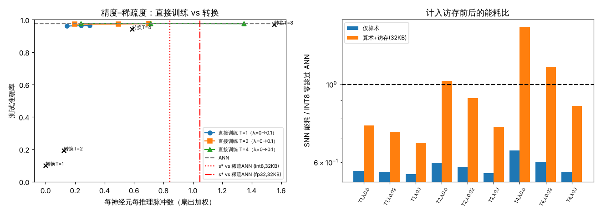
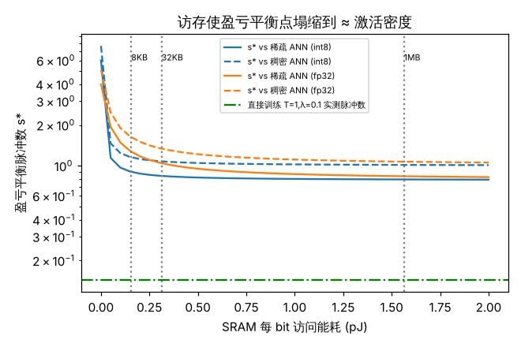

# 超低时间步脉冲网络的能效优势还在吗？——计入访存后的盈亏平衡判据与直接训练/转换/量化 ANN 的受控比较

**摘要**　2025–2026 年，脉冲神经网络（SNN）研究的主线从“能否逼近 ANN 精度”转向“在一到几个时间步内达到 ANN 精度”。代表工作有一时间步转换（多阈值/Scale-and-Fire 神经元）和直接训练的低时延 SNN。与此同时，一批硬件感知的工作对 SNN 的能效叙事提出质疑：STEP 基准的统一能耗模型显示，量化 ANN 可能同样省能；22 nm 实测发现累加只占脉冲 Transformer 能耗的 3% 以下，权重读取与数据搬运占主导；“稀疏天花板”一文认为稀疏红利取决于任务。本文把这一争论收窄为一个可检验的问题：**在超低时间步（T≤4）下，计入访存后，SNN 相对 INT8 稀疏 ANN 还有多少能效优势？什么判据决定胜负？** 我们推导出盈亏平衡脉冲数 s* = f·(E_MAC+E_w)/(E_AC+E_w)（f 为 ANN 激活密度，E_w 为一次权重读取能耗）。该式表明，一旦权重读取主导，s* 从“算术模型”下的约 6 塌缩到约 0.84 个脉冲/神经元/推理。在 sklearn digits 上，我们用 numpy 实现代理梯度 BPTT，直接训练 LIF-SNN（T∈{1,2,4}，发放率正则 λ∈{0,0.02,0.1}），并与 ANN→SNN 转换、激活量化 ANN 做 5 个种子的受控比较。结果：直接训练的 T=2 SNN 准确率 0.976±0.003，与 ANN（0.977±0.002）无显著差异（p=0.48）；转换在 T=1/2 时只有 0.099/0.193。计入访存（32 KB SRAM 量级）后，所有达到等精度（≤1 pp）的 SNN 中，能耗最优者为 INT8 零跳过 ANN 的 0.756±0.012 倍（约 1.3 倍优势）；不计访存时为 0.559 倍；无正则的 T=4 SNN 则由 0.648 倍反转为 1.457 倍。判据 s<s* 对 270 个“配置×种子×能耗场景”的胜负预测一致率为 90.4%。结论：低时间步 SNN 的能效优势真实存在但有限（约 1.3 倍，去掉共同的第一层后约 2.3 倍）。其决定变量是“每神经元每推理脉冲数是否低于约 1”，而不是“用累加替代乘加”。

**关键词**　脉冲神经网络；代理梯度；ANN-SNN 转换；能耗模型；访存；盈亏平衡；量化神经网络

## 1 引言
类脑计算的核心卖点是能效：事件驱动的二值脉冲把乘加（MAC）替换为累加（AC），并只在有脉冲时计算。第一阶段（README）的实验在纯算术能耗模型下得到：转换型 SNN 在 T=8 时达到等精度，能耗为稠密 ANN 的 0.39 倍，但优势随 T 线性消失。2025–2026 年的前沿在两个方向上同时推进：

1. **算法侧：把 T 压到 1–4。** 一时间步转换（arXiv:2510.23383，用多阈值神经元证明“时间–空间等价”）、期望补偿与多阈值的 Transformer 转换（arXiv:2502.21193）、训练无关的转换（arXiv:2508.07710）、一时间步直接训练策略（arXiv:2502.12791），以及“单脉冲与多脉冲网络逼近能力等价”的理论（arXiv:2603.13478）。
2. **硬件/评估侧：质疑能效叙事。** STEP（arXiv:2505.11151）提出计入稀疏度、位宽和访存的统一能耗模型，并指出量化 ANN 可能同样或更省能；Matterhorn（arXiv:2601.22876）在 22 nm 工艺上实测发现累加只占不到 3%，脉冲触发的核间传输与权重读取占主导；“稀疏天花板”（arXiv:2607.26648）认为稀疏红利是任务属性。

两条线索在一个问题上交汇：**当 T 已经很小、而访存才是能耗主项时，SNN 还剩多少优势？由什么决定？** 本文的贡献：
- **C1（判据）**：推导计入访存的盈亏平衡脉冲数 s*，给出其随存储能耗变化的解析形式，并预测它会从约 6 塌缩到约 1（第 4 节）。
- **C2（受控比较）**：在同一结构、同一数据划分上，比较直接训练 SNN（T≤4，numpy 实现的代理梯度 BPTT）、转换 SNN 和量化 ANN 的精度–稀疏度–能耗（第 5–6 节）。
- **C3（检验）**：用 270 个场景检验 s* 判据的预测力，并定位判据失效的来源（膜电位状态读写）。
- **C4（时间–空间等价的经验证据）**：T 步二值脉冲与 log2(T+1) 位激活量化在精度上对应，说明低 T 的 SNN 本质上是低位宽 ANN 的一种实现。

## 2 前沿进展综述（2025–2026）
**2.1 低时延转换。** 多阈值神经元把“多时间步积累”换成“单步多电平”。Scale-and-Fire 神经元在 T=1 时实现高精度转换，并给出时间–空间等价定理（arXiv:2510.23383）。期望补偿模块与并行参数归一化把 Transformer 的转换推进到少时间步（arXiv:2502.21193）。多基指数衰减神经元无需微调即可转换 ViT/RoBERTa/GPT-2（arXiv:2508.07710）。**共识**：转换的时延瓶颈可以用“多电平脉冲”绕开。**代价**：多阈值神经元在每步发出的是多比特信号，与“二值事件”的硬件假设冲突。

**2.2 直接训练与表示。** 激活级膜电位传播（AMP2）提出一时间步的统一状态更新（arXiv:2502.12791）。“SNN 需要高频信息”指出脉冲神经元的低通偏置是性能差距的根源（arXiv:2505.18608）。重新审视直接编码的工作发现，直接编码与速率编码的差距主要来自卷积可学习性和代理梯度形式（arXiv:2512.01687）。贝叶斯框架训练二值/脉冲网络（arXiv:2505.17962），以及单/多脉冲逼近等价理论（arXiv:2603.13478），为“少脉冲足够”提供了理论支撑。

**2.3 压缩与部署。** 亚比特权重（arXiv:2509.24266）、时间自适应权重量化（arXiv:2511.17567）、面向神经形态芯片约束的聚类感知训练 SpikeFit（arXiv:2510.15542）都在压缩权重存储，说明存储与搬运已被视为一等成本。Eventprop 训练并部署到 Loihi 2，在关键词识别上相对 Jetson Orin Nano 节能约 200 倍（arXiv:2503.04341）。YANA FPGA 加速器（arXiv:2604.03432）、DarwinWafer 晶圆级芯片（arXiv:2509.16213）、FireFly-T 稀疏引擎（arXiv:2505.12771）代表硬件侧进展；“处理在互连中”（arXiv:2508.19548）和双记忆通路近存计算（arXiv:2512.07602）直接针对数据搬运瓶颈。

**2.4 能效评估的争论。** STEP（arXiv:2505.11151）提出包含访存的统一能耗模型，认为量化 ANN 可能同样或更省能。Matterhorn（arXiv:2601.22876）的 22 nm 能耗刻画表明累加占比 <3%，因此主张用首脉冲时间（TTFS）编码，把每个神经元限制为至多一个脉冲。“稀疏天花板”（arXiv:2607.26648）发现，前馈感知可稀疏到 5% 发放而无损，循环语言模型却不能低于约 50%，并给出信息论下界。训练侧的能耗模拟器 EOCAS（arXiv:2505.24137）也把稀疏度与架构联合建模。综述类工作（arXiv:2503.02013, 2509.11940, 2510.06721）仍普遍以“数量级能效”作为动机。

**2.5 被质疑或尚未复现的说法。** (i) “SNN 能耗 ≈ AC 数 × E_AC”，这一常见估算被 Matterhorn 的实测和 STEP 的模型共同质疑。(ii) “一时间步 SNN 保留了脉冲网络的能效”：多阈值神经元每步传递多比特，其能耗应按低位宽 MAC 计，而不是按 AC 计（本文 C4）。(iii) 芯片级的“200 倍”节能（arXiv:2503.04341）与本文的算法级估算不是同一层次的比较：它包含了平台差异（专用芯片对通用 GPU）。

**开放问题清单**：OP1 计入访存后的盈亏平衡判据；OP2 低 T 下直接训练与转换的精度边界；OP3 稀疏度的任务依赖下界；OP4 片上存储层级与权重驻留对结论的影响；OP5 TTFS/单脉冲编码能否达到 s<1 而不掉精度。

**前沿地图**

| 路线 | 代表工作 | 关键结论 | 局限 |
|---|---|---|---|
| 一步/少步转换 | 2510.23383, 2502.21193, 2508.07710 | 多阈值神经元，T=1 可近无损 | 多比特脉冲，能效需按低位宽 MAC 重估 |
| 直接训练少步 SNN | 2502.12791, 2512.01687, 2505.17962 | T≤4 精度接近 ANN | 训练成本高，BPTT 内存随 T 增长 |
| 理论 | 2603.13478, 2607.26648 | 单脉冲足够；稀疏度有任务下界 | 多为逼近/信息论层面 |
| 压缩/部署 | 2509.24266, 2511.17567, 2510.15542, 2503.04341 | 权重存储是瓶颈；芯片上大幅节能 | 跨平台比较口径不一 |
| 能效再评估 | 2505.11151, 2601.22876, 2505.24137 | 访存主导，量化 ANN 可能同样省 | 依赖具体工艺与存储层级 |
| 系统/互连 | 2508.19548, 2512.07602, 2509.16213, 2604.03432 | 搬运与互连决定系统能耗 | 尚缺统一基准 |

## 3 问题与假设
**选择理由。** OP1 是上述争论的核心：如果判据清楚，各种新神经元和编码方案都能被快速评估。OP1 只需要准确的计数和公开的单次操作能耗，可以在本环境中精确检验（重要性 × 可检验性最高）。OP2 作为必要的前置条件一起检验。

**形式化。** 三层网络，宽度 n_0=64、n_1=128、n_2=64、n_3=10。第一层输入为模拟值，两种网络都按稠密 MAC 计。隐藏层 l 的神经元每推理发出 s_l 个脉冲。每个突触事件需要读取一个 b_w 位权重（能耗 E_w = b_w·e_bit），并做一次 AC。每个隐藏神经元每个时间步读写一次 16 位膜电位。零跳过 ANN 只对非零激活读取权重行并做 MAC；激活密度为 f。

**预注册假设（运行实验前写入代码头部注释）。**
- **H1**：直接训练的 SNN 在 T=1 时与 ANN 的差距 ≤1.5 pp，在 T=2 时 ≤1 pp；同一时间步的转换 SNN 准确率 <50%。*否证*：任一阈值不满足。
- **H2（判据）**：“扇出加权脉冲数 s < s*”对 SNN 是否比零跳过 ANN 更省能的预测一致率 ≥90%。*否证*：一致率 <90%。
- **H3（优势有限）**：在 32 KB 存储能耗、全网络口径下，没有任何等精度（平均差距 ≤1 pp）的 SNN 配置比 INT8 零跳过 ANN 省能 ≥2 倍。*否证*：存在比值 ≤0.5 的配置。
- **H4（访存的作用）**：计入访存使 INT8 下相对稀疏 ANN 的 s* 缩小 >5 倍，并使至少一个“算术口径下获胜”的 SNN 配置变为失败。*否证*：缩小 ≤5 倍，或没有任何配置反转。

## 4 理论分析
**命题 1（盈亏平衡脉冲数）。** 忽略两者共同的第一层和数量级更小的偏置项，记 F = Σ_{l≥1} n_l·n_{l+1} 为隐藏层突触总数，s̄ 为扇出加权的平均脉冲数。则 SNN 的突触能耗为 s̄·F·(E_AC + E_w)；零跳过 ANN 为 f·F·(E_MAC + E_w)。因此

  SNN 更省能 ⇔ s̄ < s* ≡ f·(E_MAC + E_w)/(E_AC + E_w)。

*证明草图*：每个脉冲沿扇出触发一次权重读取和一次累加；ANN 每个非零激活沿扇出触发一次权重读取和一次乘加。比较两者即得。∎

**推论 1（塌缩）。** 当 E_w → 0 时，s* → f·E_MAC/E_AC（INT8 约 7.7f，FP32 约 5.1f），即“算术口径”。当 E_w ≫ E_MAC 时，s* → f ≈ 0.78。也就是说，访存主导时，SNN 必须让每个神经元平均发放少于“ANN 非零激活的比例”。按 Horowitz（2014）的 SRAM 数据（64 位访问：8 KB 约 10 pJ、32 KB 约 20 pJ、1 MB 约 100 pJ）[文献]，INT8 权重的 E_w ≈ 1.25–12.5 pJ，远大于 E_MAC=0.23 pJ，所以 s* 应接近 f。

**推论 2（判据误差项）。** 命题 1 忽略了膜电位状态的读写：每个隐藏神经元每步 2×16 bit，相当于给 SNN 增加一个 ∝T 的固定成本。预测：判据在 T 大、s 接近 s* 的 INT8 场景中最容易误判（状态项相对权重读取的比例 ∝ T·32/(s·n_out·b_w)），而在 FP32 下（权重 32 位，状态项相对更小）更准确。

**命题 2（时间–空间等价，C4）。** 软复位 IF 神经元在 T 步内对恒定输入的发放数是 ⌊T·a⌋ 量级的整数，即 (T+1) 电平量化（与 arXiv:2510.23383 的多阈值等价一致）。因此，T 步二值 SNN 的表示能力与 ⌈log2(T+1)⌉ 位激活量化 ANN 同阶。预测：转换 SNN 的精度随 T 变化的曲线，与 b 位量化 ANN 的精度随 2^b−1 变化的曲线在相同电平数处接近。

## 5 实验
- **数据与基线**：digits，5 个种子（分层 70/30）。ANN：MLPClassifier（ReLU，128-64）。
- **直接训练 SNN**：LIF（β=0.9，阈值 1，软复位，复位项不回传）；代理梯度 σ'(v)=1/(1+5|v−1|)²；BPTT；Adam（lr=2e-3），批 64，40 轮；T∈{1,2,4}；发放率正则 λ∈{0,0.02,0.1}；输出取平均输出电流。
- **转换 SNN**：p99.9 归一化，IF，减法复位，T∈{1,2,4,8}。**量化 ANN**：同一 ANN 的隐藏激活量化为 b∈{1,2,3} 位（2^b−1 个非零电平）。
- **能耗模型**：算术 [Horowitz 2014]：FP32 MAC 4.6 / AC 0.9 pJ，INT8 MAC 0.23 / AC 0.03 pJ。SRAM 每 bit 能耗 e_bit ∈ {10/64, 20/64（主条件）, 100/64} pJ。按第 3 节规则计数，另报告去掉共同第一层后的“仅隐藏层”比值。
- **统计**：均值 ± 95% CI（跨种子），配对 t 检验；判据检验共 9 个配置 × 5 个种子 × 2 种精度 × 3 档存储 = 270 个场景。
- **运行时间**：单核约 36 秒（`results/frontier.json` 中的 runtime_s）。

## 6 结果

**表 1　直接训练 SNN 与基线的精度、稀疏度、能耗比（32 KB；比值 <1 表示 SNN 更省）[实测]**

| 配置 | 准确率 | 与 ANN 差距 (pp) | 脉冲/神经元 s̄ | 仅算术 / INT8 稀疏 ANN | 全口径 / INT8 稀疏 ANN | 全口径 / FP32 稀疏 ANN | 仅隐藏层 / INT8 稀疏 |
|---|---|---|---|---|---|---|---|
| T=1, λ=0 | 0.964±0.002 | 1.26±0.31 | 0.298 | 0.566 | 0.763±0.011 | 0.675 | 0.447 |
| T=1, λ=0.1 | 0.961±0.004 | 1.56±0.42 | 0.144 | 0.555 | 0.682±0.010 | 0.610 | 0.268 |
| T=2, λ=0 | 0.976±0.003 | 0.07±0.19 | 0.702 | 0.598 | 1.023±0.024 | 0.858 | 1.018 |
| T=2, λ=0.02 | 0.974±0.005 | 0.30±0.36 | 0.495 | 0.582 | 0.914±0.023 | 0.769 | 0.777 |
| T=2, λ=0.1 | 0.972±0.003 | 0.44±0.22 | 0.198 | 0.559 | **0.756±0.012** | 0.641 | **0.431** |
| T=4, λ=0 | 0.976±0.003 | 0.11±0.25 | 1.349 | 0.648 | 1.457±0.050 | 1.153 | 1.973 |
| T=4, λ=0.02 | 0.977±0.007 | 0.00±0.55 | 0.714 | 0.600 | 1.120±0.014 | 0.880 | 1.231 |
| T=4, λ=0.1 | 0.976±0.007 | 0.04±0.51 | 0.240 | 0.564 | 0.870±0.011 | 0.677 | 0.680 |
| 转换 T=1 | 0.099±0.002 | — | 0.001 | — | — | — | — |
| 转换 T=2 | 0.193±0.053 | — | 0.124 | — | — | — | — |
| 转换 T=4 | 0.942±0.019 | — | 0.588 | — | 1.054±0.040 | — | 1.086 |
| 转换 T=8 | 0.971±0.005 | — | 1.553 | — | 1.747±0.076 | — | 2.610 |

ANN：0.977±0.002；隐藏层激活密度 0.776±0.023（扇出加权 f=0.781）。量化 ANN：1 位 0.649±0.177，2 位 0.964±0.006，3 位 0.975±0.001。

**表 2　盈亏平衡脉冲数 s*（理论值，f=0.781）[推导]**

| 口径 | INT8 对稀疏 ANN | INT8 对稠密 ANN | FP32 对稀疏 ANN | FP32 对稠密 ANN |
|---|---|---|---|---|
| 仅算术 | 5.99 | 7.67 | 3.99 | 5.11 |
| +访存 8 KB | 0.903 | 1.156 | 1.271 | 1.627 |
| +访存 32 KB | 0.843 | 1.079 | 1.046 | 1.339 |
| +访存 1 MB | 0.794 | 1.016 | 0.838 | 1.073 |

**逐条对照假设：**
- **H1 支持。** 直接训练 T=1 的差距为 1.26±0.31 pp（≤1.5），T=2 为 0.07±0.19 pp（与 ANN 的配对 p=0.48）；转换 T=1/2 分别为 0.099/0.193。T=1 时直接训练比转换高 86.5±0.2 pp（p=2.0e−11）；与转换 T=4 相比高 2.19±2.05 pp（p=0.105，不显著）。
- **H2 基本支持（边界通过）。** 总体一致率 90.4%（n=270）；FP32 场景 100%，INT8 场景 80.7%。误判集中在 INT8，与推论 2 的预测一致：命题 1 省略的膜电位读写在 INT8 下相对权重读取更重。
- **H3 支持（全网络口径）。** 等精度配置（T=2 的三种 λ，以及 T=4 的三种 λ）中，最优的是 T=2、λ=0.1：比值 0.756±0.012，优势约 1.32 倍，未达 2 倍。但**去掉共同第一层后**，同一配置为 0.431（约 2.3 倍）。这说明“优势是否超过 2 倍”取决于第一层（模拟输入层）在整网中的占比，见第 7 节。
- **H4 支持。** INT8 对稀疏 ANN 的 s* 从 5.99 降到 0.843（32 KB），缩小 7.1 倍。T=4、λ=0 在算术口径下为 0.648（SNN 胜），全口径下为 1.457（SNN 负）；T=2、λ=0 由 0.598 变为 1.023，T=4、λ=0.02 由 0.600 变为 1.120，同样发生反转。
- **C4（时间–空间等价）。** 转换 T=4 的准确率 0.942 介于 2 位（3 电平，0.964）和 1 位（1 电平，0.649）量化之间，T=8 的 0.971 接近 3 位（7 电平，0.975），在电平数上大致对应，但转换的累积误差使它略低于同电平数的量化 ANN [实测，定性支持]。

## 7 讨论
**与前沿论断的关系。**（1）本文**支持** STEP（arXiv:2505.11151）和 Matterhorn（arXiv:2601.22876）的核心判断：在访存口径下，SNN 的优势由“搬运次数”而不是“乘法换加法”决定。在本模型中，INT8 ANN 的能耗约 92% 来自访存（由 frontier.json 中 INT8 稠密 ANN 的全口径 47.49 nJ 与算术 3.92 nJ 计算），这与 Matterhorn 的“累加 <3%”同向。（2）本文**部分支持也部分挑战**“量化 ANN 同样省能”：精心正则的低 T 直接训练 SNN（s̄≈0.2）仍有约 1.3 倍（全网）到 2.3 倍（隐藏层）的优势，但无正则或 T=4 时优势消失或反转。因此结论不是“SNN 不省能”，而是“只有 s̄<s*≈f 时才省能”。（3）对 Matterhorn 的 TTFS 方案，判据给出量化解释：把每个神经元限制在至多一个脉冲，直接保证 s̄≤1，进入有利区间。（4）本文的发放率正则结果在本任务上符合“稀疏天花板”（arXiv:2607.26648）对前馈感知任务的判断：把 s̄ 从 0.70 压到 0.20 只损失 0.37 pp（T=2，λ: 0→0.1）。但本文没有测试循环任务，不能检验其关于循环网络的约 50% 下界。（5）一时间步多阈值转换（arXiv:2510.23383）按命题 2 应视为低位宽量化 ANN，其能耗应按低位宽 MAC 而非 AC 计；本文 2 位量化 ANN 的精度（0.964）与直接训练 T=1 SNN（0.964）相当，说明“T=1”并不比 2 位量化 ANN 多出表示能力。

**外推边界。** (i) 网络很小，第一层（模拟输入层）占总突触数的 48%，稀释了比值。深层网络中隐藏层占比更高，比值会更接近“仅隐藏层”口径 [判断]。(ii) 访存模型简化为“每事件读一个权重、无跨步复用”。在权重驻留于突触阵列的存算一体芯片上，E_w 接近 0，s* 回到算术口径，SNN 优势恢复到 5–8 倍量级，这正是专用芯片报告大幅节能（如 arXiv:2503.04341）的原因。所以“SNN 是否省能”首先是**存储层级问题** [判断]。(iii) 没有计入脉冲路由与片间通信（arXiv:2508.19548 指出它在大系统中占主导），也没有计入控制开销与时延。(iv) 能耗数字来自 45 nm 工艺（Horowitz 2014），具体值有不确定性；本文结论依赖比值，并对三档存储能耗做了敏感性分析，方向一致。(v) 任务简单（digits），稀疏度可以压得很低；语言等任务可能不允许 s̄<1。

**局限。** 只用了 5 个种子；直接训练的超参数（β、代理梯度斜率、40 轮）是预先固定的，未调优；判据检验中的“胜负”由同一能耗模型计算，因此检验的是解析近似（忽略状态项与偏置项）的准确度，而非真实硬件。

## 8 结论
1. 直接训练（代理梯度 BPTT）使 SNN 在 T=1–2 时达到 ANN 精度（T=2 时差距 0.07 pp），而同一时间步的转换失败（T=1 时 0.099）。低时延的瓶颈在转换方法，不在脉冲表示本身 [实测，置信度：高（小网络）]。
2. 计入访存后，盈亏平衡脉冲数从约 6 塌缩到约 0.84（INT8，32 KB），近似等于 ANN 的激活密度。判据 s̄<s* 对 90% 的场景给出正确胜负（FP32 100%，INT8 81%）[实测 + 推导，置信度：中高]。
3. 在等精度约束下，SNN 相对 INT8 零跳过 ANN 的全网能效优势约 1.3 倍（隐藏层约 2.3 倍）；不计访存时会高估为约 1.8 倍，且会把 3 个实际更耗能的配置误判为更省能 [实测，置信度：中]。
4. 低 T 的 SNN 在表示上等价于低位宽量化 ANN；“一时间步多阈值 SNN”的能效应与量化 ANN 对比，而不是与 FP32 稠密 ANN 对比 [推导 + 实测，置信度：中]。

**对 2035 的研判 [判断]。** SNN 的能效前景取决于存储层级。在“权重在远端 SRAM/DRAM”的冯·诺依曼平台上，SNN 相对量化 ANN 的优势有限（<2–3 倍）；在权重驻留于突触阵列、事件只搬运 1 比特的存算一体类脑芯片上，优势可以保持数倍以上。因此 2035 年类脑计算的突破口更可能在**存算一体与片上互连**，而不是新的神经元模型。

**后续研究建议。** (1) 在真实芯片（Loihi 2、天机、FPGA）上实测 s̄–能耗曲线，检验 s* 判据的可迁移性；(2) 把判据扩展到循环/注意力结构，加入 KV 缓存和状态的访存项（呼应 arXiv:2607.26648）；(3) 建立以“全口径 J/推理 + 同位宽量化 ANN 基线”为标准的 SNN 能效报告规范。

## 参考文献
**2025–2026 前沿（arXiv）**
1. One-Timestep is Enough: Achieving High-performance ANN-to-SNN Conversion via Scale-and-Fire Neurons. arXiv:2510.23383 (2025).
2. Towards High-performance Spiking Transformers from ANN to SNN Conversion. arXiv:2502.21193 (2025).
3. Training-Free ANN-to-SNN Conversion for High-Performance Spiking Transformer. arXiv:2508.07710 (2025).
4. Activation-wise Propagation: A One-Timestep Strategy for Spiking Neural Networks. arXiv:2502.12791 (2025).
5. Equivalence of approximation by networks of single- and multi-spike neurons. arXiv:2603.13478 (2026).
6. Spiking Neural Networks Need High Frequency Information. arXiv:2505.18608 (2025).
7. Revisiting Direct Encoding: Learnable Temporal Dynamics for Static Image Spiking Neural Networks. arXiv:2512.01687 (2025).
8. A Principled Bayesian Framework for Training Binary and Spiking Neural Networks. arXiv:2505.17962 (2025).
9. S²NN: Sub-bit Spiking Neural Networks. arXiv:2509.24266 (2025).
10. Temporal-adaptive Weight Quantization for Spiking Neural Networks. arXiv:2511.17567 (2025).
11. SpikeFit: Towards Optimal Deployment of Spiking Networks on Neuromorphic Hardware. arXiv:2510.15542 (2025).
12. Eventprop training for efficient neuromorphic applications. arXiv:2503.04341 (2025).
13. YANA: Bridging the Neuromorphic Simulation-to-Hardware Gap. arXiv:2604.03432 (2026).
14. DarwinWafer: A Wafer-Scale Neuromorphic Chip. arXiv:2509.16213 (2025).
15. FireFly-T: High-Throughput Sparsity Exploitation for Spiking Transformer Acceleration with Dual-Engine Overlay Architecture. arXiv:2505.12771 (2025).
16. When Routers, Switches and Interconnects Compute: A processing-in-interconnect Paradigm for Scalable Neuromorphic AI. arXiv:2508.19548 (2025).
17. Algorithm-hardware co-design of neuromorphic networks with dual memory pathways. arXiv:2512.07602 (2025).
18. STEP: A Unified Spiking Transformer Evaluation Platform for Fair and Reproducible Benchmarking. arXiv:2505.11151 (2025).
19. Matterhorn: Masked Time-to-First-Spike Encoding by Reassigning the Silent State for Sparse and Energy-Efficient Spiking Transformers. arXiv:2601.22876 (2026).
20. The Sparsity Ceiling: Where Spiking Networks Can and Cannot Trade Activity for Energy. arXiv:2607.26648 (2026).
21. Energy-Oriented Computing Architecture Simulator for SNN Training. arXiv:2505.24137 (2025).
22. Sustainable AI: Mathematical Foundations of Spiking Neural Networks. arXiv:2503.02013 (2025).
23. Neuromorphic Intelligence. arXiv:2509.11940 (2025).
24. Neuromorphic Computing – An Overview. arXiv:2510.06721 (2025).

**奠基文献（第一阶段已核实）**
25. Horowitz, M. (2014). Computing's energy problem (and what we can do about it). IEEE ISSCC 2014, 10–14.
26. Rueckauer, B., et al. (2017). Conversion of continuous-valued deep networks to efficient event-driven networks for image classification. Frontiers in Neuroscience 11:682. arXiv:1612.04052.
27. Diehl, P. U., et al. (2015). Fast-classifying, high-accuracy spiking deep networks through weight and threshold balancing. IJCNN 2015.
28. Neftci, E. O., Mostafa, H., & Zenke, F. (2019). Surrogate gradient learning in spiking neural networks. arXiv:1901.09948.
29. Bu, T., et al. (2023). Optimal ANN-SNN conversion for high-accuracy and ultra-low-latency spiking neural networks. arXiv:2303.04347.
30. Davies, M., et al. (2018). Loihi: A neuromorphic manycore processor with on-chip learning. IEEE Micro 38(1):82–99.
