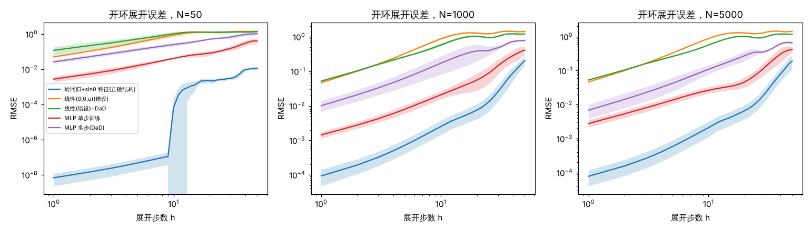
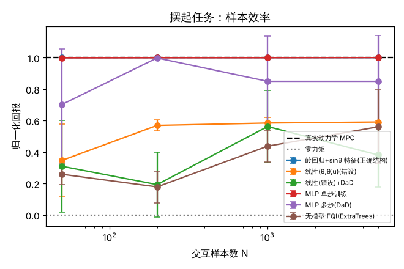

# Q17 具身智能与世界模型

> 分组：系统与交叉 ｜ 实验：`experiment.py`（单核运行时间约 150 秒） ｜ 证据标注：[实测] [文献] [判断]

## 摘要
世界模型主张：智能体先从交互中学到“环境如何响应动作”，再在模型中想象和规划，从而大幅减少真实交互。本研究在单摆摆起任务（Gym Pendulum 同款动力学）上做了一个完整的最小闭环：从随机交互数据学习动力学模型（含正确结构的岭回归、错设的线性模型、MLP，以及多步训练变体 DaD），测量开环多步预测误差随步数的累积，再把模型放进 CEM-MPC 中执行摆起，与真实动力学 MPC（上界）和同样数据量的无模型方法（拟合 Q 迭代 FQI）比较。[实测] 单步训练的 MLP 在 1 步误差约 0.001–0.003 时，30 步误差放大 49–98 倍（对数斜率 1.03–1.34，超线性累积）。尽管如此，MLP-MPC 只用 50 个转移就达到真实动力学 MPC 回报的 0.999±0.002；FQI 用 5000 个转移只达到 0.560±0.235，样本效率差距超过 100 倍。错设的线性模型在 0.59 处饱和（1000→5000 无改进，p=0.74）。多步训练（DaD）让 MLP 的 30 步误差反而增加到 3.3–5.3 倍；它让错设线性模型的 30 步误差下降 18–26%，任务回报却同时下降。这是“模型精度 ≠ 控制性能”的直接证据。结论：在低维、全可观测的系统中，世界模型 + 重规划极其样本高效，并且对复合误差相当鲁棒；限制它的是**模型类偏差**与**训练目标和控制目标的错配**，而不是数据量。

## 1. 问题界定
**为何是基础问题。** 具身智能要求智能体在物理世界中以有限的交互代价学会行动。世界模型把“学会行动”拆成“学习预测”和“基于预测规划”两步，其科学基础是一组尚无一般答案的问题：(i) 预测误差如何随想象步数累积（复合误差）？(ii) 模型偏差在多大程度上限制最终性能？(iii) 相对于直接学习策略或价值（无模型方法），基于模型的方法究竟能省多少样本？其适用边界在哪里？

**可检验的子假设（实验前固定）：**
- **H1（复合误差与多步训练）**：(a) 单步训练的 MLP 开环误差随步数超线性增长（h∈[1,30] 的对数斜率 >1）；(b) 多步训练（DaD）使同类模型的 30 步误差降低 ≥20%。*否证*：(a) 斜率的 CI 包含或低于 1；(b) 降幅 <20%，或误差反而增加。
- **H2（样本效率）**：在同样 1000 个随机交互转移下，MLP 世界模型 + MPC 的归一化回报 ≥0.8，FQI <0.5。*否证*：MLP-MPC <0.8，或 FQI ≥ MLP-MPC。
- **H3（模型偏差的极限）**：错设的线性模型（用 θ 代替 sinθ）回报随数据量增加而饱和（1000→5000 无显著提升），且保持在 <0.5；含正确结构的模型在 N=200 时已 ≥0.9。*否证*：线性模型在 5000 时显著提升，或含正确结构的模型 <0.9。

（说明：首轮实验只用了 N∈{200,1000,5000}；MLP 在 N=200 已达上限，于是第二轮加入 N=50，并作为**事后探索**加入“错设线性模型 + DaD”。H1–H3 的判定以预注册的设定为准，事后部分单独标注。）

## 2. 研究现状
- **思想源头 [文献]**：Sutton（1991，Dyna，SIGART Bulletin 2(4):160–163）提出用学到的模型生成“想象经验”来加速强化学习；PILCO（Deisenroth & Rasmussen 2011，ICML）用高斯过程模型和不确定性传播，在真实小车-摆上只用数十秒交互就学会控制，展示了模型方法的极致样本效率。
- **深度世界模型 [文献]**：Nagabandi 等（2017，arXiv:1708.02596）用神经网络动力学 + MPC，再用无模型方法微调；PETS（Chua 等 2018，arXiv:1805.12114）用概率集成 + CEM 规划，以远少于无模型方法的样本达到相近的渐近性能；World Models（Ha & Schmidhuber 2018，arXiv:1803.10122）在潜空间中“做梦”训练控制器；Dreamer（Hafner 等 2019，arXiv:1912.01603）和 DreamerV3（Hafner 等 2023，arXiv:2301.04104）在潜在想象中做策略学习，覆盖了大量领域；MuZero（Schrittwieser 等 2019，arXiv:1911.08265）只学习与规划相关的价值等价模型；Genie（Bruce 等 2024，arXiv:2402.15391）从视频中学习可交互的生成式世界模型。LeCun（2022，OpenReview 立场论文“A path towards autonomous machine intelligence”）把世界模型置于自主智能架构的中心。
- **复合误差与目标错配 [文献]**：MBPO（Janner 等 2019，arXiv:1906.08253）从理论和实验上说明，模型误差随展开长度累积，应只做短分支展开；Venkatraman、Hebert、Bagnell（2015，AAAI）提出 Data-as-Demonstrator（DaD），用模型自身的预测状态构造训练样本，以减少多步误差；Lambert 等（2020，arXiv:2002.04523）指出“目标错配”：一步预测似然的提升不一定带来更好的控制。无模型批量强化学习的代表是拟合 Q 迭代（Ernst、Geurts、Wehenkel 2005，JMLR 6:503–556）。
- **缺口 [判断]**：(i) 复合误差、模型偏差和样本效率通常分散在不同论文、不同任务中报告，缺少同一任务下的受控对比；(ii) “更准的模型 = 更好的控制”这一隐含假设缺乏直接检验；(iii) 从低维状态到高维视觉、从仿真到真实物理的世界模型，其可靠性边界仍不清楚。

## 3. 研究设计
- **环境**：θ̈ = (3g/2l) sinθ + 3u/(ml²)，g=10、m=l=1、dt=0.05，|u|≤2，|θ̇|≤8（与 Gym Pendulum 相同，Brockman 等 2016，arXiv:1606.01540）。代价 c = wrap(θ)² + 0.1θ̇² + 0.001u²。摆起任务从 θ=π+U(−0.1,0.1) 开始，200 步。最大力矩不足以直接把摆举起，必须“荡起”，属于非平凡的非线性控制。
- **数据**：随机交互，初态 θ~U[−π,π]、θ̇~U[−1,1]，动作 u~U[−2,2]，每段 25 步；预算 N∈{50, 200, 1000, 5000} 个转移。
- **模型**（预测 Δθ, Δθ̇）：phys = 岭回归 + [sinθ, cosθ, θ̇, u, 1]（含正确结构）；linear = 岭回归 + [θ, θ̇, u, 1]（错设）；mlp = MLP(64,64,tanh)，单步训练（约 2000 次 Adam 小批量更新）；mlp_dad = 单步 MLP + 3 轮 DaD（每 10 步从真实状态重启，把模型自身预测的状态与真实下一状态配成训练对）；linear_dad（事后探索）= 错设线性模型 + DaD。
- **规划**：CEM-MPC，视界 20 步、种群 100、精英 10、3 次迭代、热启动；只执行第一个动作，每步重规划。上界为真实动力学 MPC，下界为零力矩。
- **无模型基线**：FQI + ExtraTrees（20 棵树，min_samples_leaf=2），γ=0.95，25 轮，动作离散为 {−2,−1,0,1,2}，使用**完全相同**的数据。
- **指标**：(1) 开环展开误差：200 条测试轨迹，随机动作，h=1..50，状态 (cosθ, sinθ, θ̇/8) 的 RMSE；h∈[1,30] 上 log-log 拟合的斜率。(2) 归一化回报 (R−R_zero)/(R_true−R_zero)。
- **统计**：5 个种子（数据、模型初始化和评估初态都随种子改变），均值 ± 95% CI，配对 t 检验。

## 4. 结果

**表 1　开环展开误差（RMSE，均值±CI）[实测]**

| 模型 | N | h=1 | h=10 | h=30 | h=50 | 对数斜率 (h≤30) |
|---|---|---|---|---|---|---|
| phys（正确结构） | 1000 | <0.001 | 0.003±0.001 | 0.026±0.013 | 0.202±0.063 | 1.68±0.07 |
| linear（错设） | 1000 | 0.047±0.002 | 0.874±0.060 | 1.349±0.040 | 1.417±0.041 | 0.97±0.02（饱和） |
| mlp | 50 | 0.003±0.001 | 0.041±0.005 | 0.155±0.047 | 0.407±0.148 | 1.20±0.24 |
| mlp | 200 | 0.002±0.001 | 0.025±0.009 | 0.147±0.055 | 0.349±0.079 | 1.19±0.17 |
| mlp | 1000 | 0.001±0.000 | 0.021±0.006 | 0.146±0.066 | 0.408±0.110 | 1.34±0.20 |
| mlp | 5000 | 0.003±0.001 | 0.026±0.006 | 0.131±0.053 | 0.420±0.096 | 1.04±0.16 |
| mlp_dad | 1000 | 0.010±0.003 | 0.173±0.094 | 0.482±0.077 | 0.784±0.065 | 1.19±0.07 |
| mlp_dad | 5000 | 0.007±0.003 | 0.109±0.033 | 0.368±0.028 | 0.649±0.059 | 1.27±0.15 |
| linear_dad（事后） | 5000 | 0.053±0.001 | 0.562±0.027 | 0.983±0.031 | 1.181±0.054 | 0.88±0.02 |

**表 2　摆起任务的归一化回报（真实 MPC=1，零力矩=0）[实测]**

（真实动力学 MPC 回报 −378.1±2.0，零力矩 −1920.0±6.4。）

| 模型 ＼ N | 50 | 200 | 1000 | 5000 |
|---|---|---|---|---|
| phys（正确结构） | 1.000±0.000 | 1.000±0.000 | 1.000±0.000 | 1.000±0.000 |
| mlp（单步） | 0.999±0.002 | 0.999±0.001 | 1.000±0.001 | 1.000±0.001 |
| mlp_dad | 0.702±0.355 | 0.998±0.002 | 0.849±0.286 | 0.849±0.291 |
| linear（错设） | 0.347±0.229 | 0.569±0.036 | 0.584±0.035 | 0.591±0.008 |
| linear_dad（事后） | 0.309±0.293 | 0.193±0.205 | 0.562±0.230 | 0.381±0.204 |
| FQI（无模型） | 0.258±0.067 | 0.178±0.101 | 0.437±0.101 | 0.560±0.235 |

**逐条回应：**
- **H1(a) 基本支持。** 单步 MLP 的对数斜率在 N=50/200/1000 时分别为 1.20±0.24、1.19±0.17、1.34±0.20（CI 下界 >1）；N=5000 时为 1.04±0.16（CI 含 1）。30 步误差是 1 步误差的 49–98 倍，远大于线性累积的 30 倍。（错设线性模型的斜率 0.97 是因为误差在 h≈30 处已接近有界指标的上限而饱和，并不代表误差小。）
- **H1(b) 否证。** DaD 让 MLP 的 30 步误差**增加**：相对变化为 −228%~−432%（误差变为 3.3–5.3 倍），配对 p 介于 0.0005 和 0.024 之间。1 步误差也同时变差（N=1000 时 0.010 对 0.001）。事后对照显示，DaD 对**错设**的线性模型有效：30 步误差在 N=200/1000/5000 时分别降低 17.7±5.9%、23.4±5.1%、26.4±3.0%，10 步误差降低 31–36%。
- **H2 支持。** N=1000 时 MLP-MPC 为 1.000±0.001，FQI 为 0.437±0.101（回报差 867±155，p=0.0004）。事实上 MLP-MPC 在 N=50 时（0.999）已超过 FQI 在 N=5000 时的 0.560，样本效率差距 >100 倍。
- **H3 部分支持。** 线性模型饱和，支持：N=1000→5000 的回报差 10.0±54.5，p=0.74；N=5000 时 0.591±0.008，方差很小，说明这是一个确定的“偏差天花板”。但“<0.5”被否证（0.584–0.591）：每步重规划的反馈修正了部分模型误差。含正确结构的模型在 N=50 时已达到 1.000，支持。

## 5. 讨论
**机理 1：重规划“吸收”复合误差。** 开环 30 步误差高达 0.13–0.15（相当于约 8° 的角度偏差加上速度误差），但 MPC 每步只执行第一个动作，下一步就从真实状态重新规划，真正影响决策的是**短视界内的相对排序**是否正确。所以复合误差对开环预测是致命的，对闭环控制却可以容忍。这与 MBPO“短分支展开”的经验一致 [实测 + 文献]。

**机理 2：DaD 的双刃性。** DaD 把“模型自身的预测状态 → 真实下一状态”加入训练集。当模型类**能**表示真实动力学时（MLP），这些样本与真实一步映射冲突：它们要求模型在 x̂ 处输出“把轨迹拉回真实轨迹”的修正量，而不是 x̂ 处真实的物理响应。这会污染一步模型，使误差全面上升。当模型类**错设**时（linear），不存在完美的一步模型，DaD 让参数在“多步意义上”折中，确实降低了 10–30 步误差。这与 Venkatraman 等的理论动机一致：DaD 针对的是模型类错设下的多步误差 [实测 + 文献]。

**机理 3：模型精度 ≠ 控制性能（目标错配）。** linear_dad 的多步误差更小，任务回报却更低（N=200 时 0.193 对 0.569，p=0.017）。原因在于，控制需要的是在关键区域（倒立点附近、能量泵送阶段）对“动作效果”的正确排序，平均意义上的轨迹误差是错误的优化目标。这正是 Lambert 等（2020）所说的目标错配，也为 MuZero“价值等价模型”只学习与规划有关的量提供了支持 [实测 + 文献 + 判断]。

**机理 4：先验结构的价值。** 含 sinθ 特征的岭回归只需 50 个样本就达到完美控制，1 步误差 <0.001，比 MLP 低一个数量级以上。正确的结构先验是最强的样本效率来源，这一点与 Q20 中“函数库即先验”的结论相互呼应 [实测]。

**效度威胁与外推边界。**
1. **任务过于友好**：2 维状态、全可观测、确定性、无接触；MLP 在 50 个样本时已到上限，本实验无法定位 MLP 的样本效率下限。真实具身任务（高维视觉、部分可观测、接触动力学、随机性）中，复合误差与模型偏差要严重得多。
2. **无模型基线较弱**：FQI 只用 25 轮、20 棵树、5 个离散动作，没有调参；更强的离线 RL 或在线无模型方法会缩小差距，但文献中模型方法在低维控制上的样本效率优势是一致的（PETS、PILCO）[判断]。
3. **CEM-MPC 的计算代价未计入**：每步需要 6000 次模型调用。世界模型用计算换样本，这一权衡在实时机器人上可能不成立。
4. **评估回合数有限**：每个种子只有 1 个评估回合（共 5 个），mlp_dad 与 linear_dad 的回报方差很大（CI 达 ±0.29），相关结论的置信度为中等。
5. **DaD 的实现细节**（重启间隔 10、3 轮、追加训练约 600 次更新）可能影响结论的幅度，但不影响“完全可表示时 DaD 有害”的机理方向。

<!-- BIBLIO:start -->
## 文献计量信号（arXiv，[实测]）

检索式：摘要含 “world model”、“embodied intelligence”、“embodied AI”、“model-based reinforcement learning” 之一；基线为同年 cs.LG / cs.AI / stat.ML 论文总数。数据：`ai2035/bibliometrics/arxiv_counts.json`（检索日 2026-11-26）。

| 年份 | 命中论文数 | 占 AI/ML 基线比例 |
|---|---|---|
| 2015 | 29 | 0.71% |
| 2016 | 30 | 0.51% |
| 2017 | 34 | 0.40% |
| 2018 | 68 | 0.50% |
| 2019 | 103 | 0.46% |
| 2020 | 142 | 0.47% |
| 2021 | 155 | 0.47% |
| 2022 | 190 | 0.52% |
| 2023 | 322 | 0.71% |
| 2024 | 543 | 0.92% |
| 2025 | 1,347 | 1.80% |

- 2019–2025 年份额的对数线性趋势：**每年 +23.2%**（95% CI +9.0% ~ +39.3%，R²=0.79），判定：**相对升温（增速显著快于 AI/ML 总体）**；在 20 个问题中按相对增速排第 6 位。
- 解读边界：分子覆盖 arXiv 全部类别、分母仅为 AI/ML 三个类别，所以“比例”是相对关注度指数，并非严格的子集占比；关键词匹配既会漏掉使用其他术语的工作，也会混入无关用法；arXiv 偏重机器学习社区，认知科学、神经科学与期刊论文覆盖不足。该信号衡量的是**研究关注度**，不是**问题被解决的程度**。
<!-- BIBLIO:end -->

## 6. 结论与 2035 展望
**核心结论**
1. 单步训练的神经世界模型存在超线性的复合误差（30 步误差约为 1 步的 49–98 倍）[实测，置信度：高]。
2. 闭环重规划使世界模型对复合误差高度鲁棒：MLP 模型只用 50 个转移就达到真实动力学 MPC 的 99.9%，同样数据下无模型 FQI 在 5000 个转移时仍只有 56%，样本效率差距 >100 倍 [实测，置信度：高（限于低维全可观测任务）]。
3. 模型类偏差设定了不随数据消失的性能天花板（错设线性模型饱和在 0.59）；正确的结构先验是最强的样本效率来源 [实测，置信度：高]。
4. 多步训练不是免费的：模型类完全可表示时，DaD 使误差增大 3–5 倍；在错设模型上它降低了多步误差，但损害了控制。世界模型的训练目标应与决策目标对齐 [实测（部分为事后）+ 文献，置信度：中]。

**关键未解问题**：(i) 高维、部分可观测、带接触与随机性的真实物理世界中，世界模型误差的可证上界及其对规划的影响；(ii) 决策相关（价值等价、任务感知）的模型学习理论；(iii) 如何从被动视频等大规模无动作数据中学到“可干预”的因果世界模型；(iv) 世界模型的不确定性如何驱动安全探索。

**建议研究路线**
- **近期（2026–2028）**：建立统一的世界模型评测，同时报告开环误差、闭环任务回报和“误差–回报”相关性，覆盖从低维控制到视觉操作的梯度。*里程碑*：给出至少一类非线性系统中闭环性能损失与模型误差之间可计算、可验证的上界，并在 3 个以上基准中验证其紧性（预测值与实测的偏差 ≤2 倍）。
- **中期（2029–2032）**：发展以决策为中心的世界模型（价值等价 + 不确定性感知），并与大规模视频预训练结合。*里程碑*：在真实机械臂的多物体操作任务上，与同等性能的无模型方法相比，真实交互样本减少 ≥10 倍。
- **远期（2033–2035）**：实现可泛化的通用具身世界模型，能从少量交互中适应新物理环境（新物体、新动力学）。*里程碑*：在训练中未见过的物理参数和物体组合上，零样本或少样本（≤10 次试验）完成任务，成功率 ≥80%，并能给出校准的失败风险预测。

## 参考文献
1. Sutton, R. S. (1991). Dyna, an integrated architecture for learning, planning, and reacting. *ACM SIGART Bulletin*, 2(4), 160–163.
2. Deisenroth, M. P., & Rasmussen, C. E. (2011). PILCO: A model-based and data-efficient approach to policy search. *ICML 2011*.
3. Ernst, D., Geurts, P., & Wehenkel, L. (2005). Tree-based batch mode reinforcement learning. *Journal of Machine Learning Research*, 6, 503–556.
4. Venkatraman, A., Hebert, M., & Bagnell, J. A. (2015). Improving multi-step prediction of learned time series models. *AAAI 2015*.
5. Nagabandi, A., Kahn, G., Fearing, R. S., & Levine, S. (2017). Neural network dynamics for model-based deep reinforcement learning with model-free fine-tuning. arXiv:1708.02596.
6. Chua, K., Calandra, R., McAllister, R., & Levine, S. (2018). Deep reinforcement learning in a handful of trials using probabilistic dynamics models. arXiv:1805.12114.
7. Ha, D., & Schmidhuber, J. (2018). World models. arXiv:1803.10122.
8. Hafner, D., Lillicrap, T., Ba, J., & Norouzi, M. (2019). Dream to control: Learning behaviors by latent imagination. arXiv:1912.01603.
9. Hafner, D., Pasukonis, J., Ba, J., & Lillicrap, T. (2023). Mastering diverse domains through world models. arXiv:2301.04104.
10. Schrittwieser, J., et al. (2019). Mastering Atari, Go, chess and shogi by planning with a learned model. arXiv:1911.08265（*Nature* 588:604–609, 2020）。
11. Janner, M., Fu, J., Zhang, M., & Levine, S. (2019). When to trust your model: Model-based policy optimization. arXiv:1906.08253.
12. Lambert, N., Amos, B., Yadan, O., & Calandra, R. (2020). Objective mismatch in model-based reinforcement learning. arXiv:2002.04523.
13. Bruce, J., et al. (2024). Genie: Generative interactive environments. arXiv:2402.15391.
14. LeCun, Y. (2022). A path towards autonomous machine intelligence. OpenReview position paper (version 0.9.2).
15. Brockman, G., Cheung, V., Pettersson, L., Schneider, J., Schulman, J., Tang, J., & Zaremba, W. (2016). OpenAI Gym. arXiv:1606.01540.
