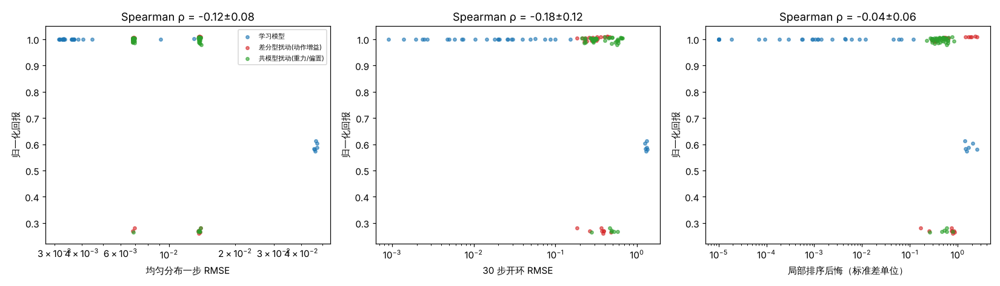
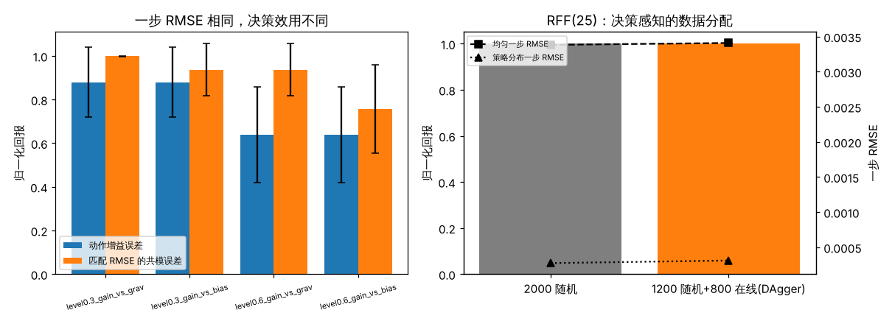

# 世界模型的“保真度–效用”鸿沟：预测误差与排序误差都不能预测控制效果，而“乐观度”能

**摘要**　2025–2026 年，世界模型研究的核心争论是：应该用预测/视觉保真度评价世界模型，还是用它在下游决策中的效用？WorldArena（arXiv:2602.08971）系统地把感知质量与功能效用分开评测；MiraBench（arXiv:2605.29360）提出“动作条件可靠性”，并把“乐观偏差检测”列为最高层级；“潜在世界模型的局限”（arXiv:2610.37588）发现，现有潜在世界模型都在没有忠实建模环境动力学的情况下解决了任务；RLVR-World（arXiv:2505.13934）则直接用任务指标做强化学习来训练世界模型。本文在一个可完全控制的单摆摆起任务（CEM-MPC）上构建了 18 个世界模型组成的“模型动物园”：随机特征回归、错设线性模型、含正确结构的物理模型，以及受控扰动的真实动力学（动作增益误差，以及按一步 RMSE 匹配的重力/状态偏置误差）。我们检验哪一种离线指标能预测闭环回报。预注册的“动作序列排序保真度”判据被**否证**：跨模型的 Spearman 相关，一步 RMSE 为 −0.12±0.08，30 步开环误差为 −0.18±0.12，局部排序后悔为 −0.04±0.06，均不能预测回报。在一步 RMSE 完全匹配时，动作增益误差使局部排序后悔高 2.3–2.6 倍（p≈0.001），但回报差异不显著。事后分析发现，决定成败的是误差的**符号**而不是大小：在模型自身诱导的状态分布上，“乐观度”（所选计划的真实代价减去预测代价）与回报的相关为 −0.76±0.05；只需在固定评估状态上计算的**离线乐观度**也达到 −0.62±0.08，显著优于一步 RMSE（|ρ| 高 0.50，p=1e−4）。全部 20 次失败（归一化回报 <0.9）都伴随正的乐观度，成功样本中这一比例为 60%。例如，高估控制力（增益 1.6）的模型只获得 0.27 的回报，而低估同样幅度（增益 0.4）的模型获得 1.01。DAgger 式的在线数据分配对容量受限模型没有作用（已达上限），对错设线性模型反而使回报下降 0.21（p=0.06）。结论：在带重规划的控制中，悲观误差会被反馈吸收，乐观误差会被规划器主动利用。因此，世界模型评测应加入“乐观偏差”这一维度，这为 MiraBench 的乐观偏差层级与 RLVR-World 的任务对齐训练提供了机理依据。

**关键词**　世界模型；模型预测控制；目标错配；乐观偏差；决策感知模型学习；具身智能

## 1 引言
第一阶段（README）发现了一个“目标错配”现象：多步训练（DaD）降低了错设线性模型的多步预测误差，却损害了控制回报；单步 MLP 的开环误差超线性累积，MPC 却几乎不受影响。2025–2026 年，这一现象已成为世界模型领域的中心议题：

- **评测之争**：WorldArena（arXiv:2602.08971）指出，评测偏重感知保真度，忽视了作为数据引擎、策略评估器和动作规划器的功能效用；MiraBench（arXiv:2605.29360）把“物理遵循—动作跟随—乐观偏差检测”分成三层；WorldFailBench（arXiv:2610.33565）追问世界模型能否忠实模拟策略**如何**失败；GAUGE（arXiv:2608.05948）用真实测量作为物理保真度的锚点；自动驾驶中，WOSAC 元指标作为策略训练环境的评价不够稳健（arXiv:2508.01922）。
- **忠实性之争**：“潜在世界模型的局限”（arXiv:2610.37588）用潜在展开一致性（LRC）发现，主流潜在世界模型都不是忠实的；world2vec（arXiv:2610.40637）强调“控制性能好不等于忠实地捕获动力学”；“通用智能体必含世界模型”（arXiv:2506.01622）从理论上论证，泛化的目标导向智能体必须学到预测模型。
- **训练目标之争**：RLVR-World（arXiv:2505.13934）用可验证奖励的强化学习直接优化世界模型的任务指标；变长潜在世界模型（arXiv:2606.21775）针对复合误差与目标错配，直接预测多步；“可预测的潜变量”（arXiv:2610.34663）主张潜空间应为“易于预测”而优化。

但一个基础问题仍缺少可检验的答案：**哪一个可离线计算的量能预测世界模型的决策效用？** 本文的贡献：
- **C1**：在 18 个模型、6 个种子上系统检验一步误差、多步误差、动作序列排序保真度、局部后悔与乐观度对闭环回报的预测力（第 6.1 节）。
- **C2**：在一步 RMSE 严格匹配的条件下，比较“作用于动作的误差”与“与动作无关的误差”（第 6.2 节）。
- **C3**：提出并检验“乐观度”判据（包括只需固定状态的离线版本），用模拟引理给出理论依据（第 4 节），并联系 MiraBench 的乐观偏差层级。
- **C4**：检验决策感知的数据分配（DAgger，Ross & Bagnell 2012）是否能弥合鸿沟，并报告它的负结果。

## 2 前沿进展综述（2025–2026）
**2.1 定义与路线图。** 世界模型的科学定义与分阶段路线图（arXiv:2607.06401）。物理可解释世界模型的四原则（arXiv:2503.02143）。“缸中之 AI”揭示了世界模型在效率与可解释性之间的根本取舍（arXiv:2504.04608）。

**2.2 架构与效率。** 无循环网络、无 Transformer、无重建的简单世界模型 SGF（arXiv:2506.02612）；8 个 token 的紧凑离散分词器使潜在规划提速几个数量级（arXiv:2603.05438）；世界模型量化的系统研究（arXiv:2602.02110）；潜在动作世界模型利用无动作标签的轨迹（arXiv:2512.10016）；反事实世界模型用观测轨迹做“回看”式策略梯度（arXiv:2611.29259）；贝叶斯神经网络的全协方差平滑用于在线适应（arXiv:2609.27244）。

**2.3 评测与可靠性。** WorldArena（arXiv:2602.08971）、MiraBench（arXiv:2605.29360）、WorldFailBench（arXiv:2610.33565）、GAUGE（arXiv:2608.05948）、自动驾驶世界模型基准（arXiv:2508.01922）。对抗鲁棒性：状态幻觉与动力学偏移攻击直接作用于下游规划（arXiv:2611.28345）。

**2.4 训练目标。** RLVR-World（arXiv:2505.13934）、变长潜在世界模型（arXiv:2606.21775）、可预测潜变量（arXiv:2610.34663）、world2vec（arXiv:2610.40637）。

**共识**：保真度指标与功能效用存在系统性脱节；复合误差与目标错配是核心难题。**争议**：应该追求“忠实的”世界模型（world2vec、LRC），还是“对任务有用的”世界模型（RLVR-World、MuZero 式的价值等价）？**未被复现/被挑战的说法**：“更低的预测误差带来更好的规划”被多项基准挑战（arXiv:2602.08971, 2610.37588）。**开放问题**：OP1 什么离线指标能预测决策效用；OP2 哪类误差（大小、方向、是否作用于动作）对规划致命；OP3 如何把数据和训练目标对齐到决策；OP4 世界模型的乐观偏差如何检测与校正。

**前沿地图**

| 路线 | 代表工作 | 关键结论 | 局限 |
|---|---|---|---|
| 功能效用评测 | 2602.08971, 2605.29360, 2610.33565, 2608.05948, 2508.01922 | 感知保真度 ≠ 功能效用；需检验乐观偏差与失败模式 | 指标多、缺乏机理解释 |
| 忠实性/机制 | 2610.37588, 2610.40637, 2506.01622, 2503.02143 | 当前模型不忠实；忠实性有利于可解释与科学发现 | 忠实性与任务效用的关系未定量 |
| 任务对齐训练 | 2505.13934, 2606.21775, 2610.34663 | 直接优化任务指标或多步目标 | 可能牺牲通用性 |
| 效率/数据 | 2506.02612, 2603.05438, 2602.02110, 2512.10016, 2611.29259 | 压缩表示、利用无标签数据 | 评测仍以回报为主 |
| 安全/鲁棒 | 2611.28345, 2504.04608 | 世界模型是集中失效点 | 缺乏防御与检测标准 |

## 3 问题与假设
**选择理由。** OP1–OP2 是评测之争的核心：如果找到能预测效用的离线量，就能在部署前筛选世界模型（这正是 WorldArena、MiraBench 等基准试图做的事）。在单摆上，真实动力学、真实代价和真实最优计划都可精确计算，可以对误差做受控分解，这是大规模视频世界模型做不到的。这一选题也直接承接第一阶段发现的“预测精度 ≠ 控制”。

**形式化。** 真实动力学为 f，模型为 f̂，代价 J(s, a_{1:H}) 为 H 步累计代价，Ĵ 为模型预测的代价。规划器在模型下取 â = argmin Ĵ，闭环中每步重规划。指标：(a) 均匀状态分布上的一步 RMSE；(b) 30 步开环 RMSE；(c) 真实 MPC 轨迹的 30 个状态上，64 条候选序列的模型代价与真实代价之间的 Spearman ρ，以及“局部后悔” (J(argmin Ĵ) − min J)/std(J)，候选序列分全局 N(0,1) 和局部（真实规划解 + N(0,0.3²)）两种；(d) 闭环归一化回报。

**预注册假设（设计写在 `frontier_experiment.py` 头部，阈值在首轮运行前确定）**
- **H1（排序判据）**：跨模型的 |Spearman(回报, 局部后悔)| 显著大于 |Spearman(回报, 一步 RMSE)|（配对于种子，p<0.05）。*否证*：差值不显著或为负。
- **H2（误差类型）**：在一步 RMSE 匹配时，动作增益误差（差分型）的局部排序后悔大于与动作无关的误差（共模型）。*否证*：不大于。
- **H3（决策感知数据）**：对容量受限的 RFF(25)，在总预算 2000 下，DAgger 式在线数据（1200 随机 + 2×400 在线）比 2000 随机数据带来更高的回报，而均匀一步 RMSE 不改善。*否证*：回报无提升。

## 4 理论分析
**命题 1（模拟引理式分解）。** 令 a* = argmin J，â = argmin Ĵ。则
  J(â) − J(a*) = [J(â) − Ĵ(â)] + [Ĵ(â) − Ĵ(a*)] + [Ĵ(a*) − J(a*)] ≤ O(â) + P(a*)，
其中 O(â) = J(â) − Ĵ(â) 是模型对**自身所选计划**的乐观度，P(a*) = Ĵ(a*) − J(a*) 是对最优计划的悲观度，中间项 ≤ 0。*含义*：决策后悔只取决于这两个“有方向的”误差，而不取决于整体误差大小。一步 RMSE、排序相关等对称指标把乐观与悲观同等计入，因此可能与后悔脱节。

**命题 2（重规划下的不对称性）。** 在闭环 MPC 中，若模型悲观（低估所选计划的效果），执行后真实状态比预期**更好**，下一步重规划从更好的状态出发，误差被反馈吸收。若模型乐观（高估效果），执行后状态比预期差，而规划器会持续选择“在模型中看似可行、实际不可行”的计划，形成系统性陷阱。在力矩受限的摆起任务中，高估动作增益的模型相信可以直接把摆举起，因而不做必要的能量泵送，陷入下垂附近的振荡。*预测*：(i) 失败集中在乐观模型；(ii) 动作增益误差的影响符号不对称：k>1 有害，k<1 基本无害；(iii) 在模型自身诱导的状态分布上测得的乐观度最能预测回报。

**命题 3（排序指标的盲点）。** 在专家（真实 MPC）轨迹的状态上测量排序保真度，忽略了模型诱导的分布偏移：模型的闭环轨迹会进入专家不会到达的状态（命题 2 中的陷阱）。*预测*：在专家状态上计算的排序指标，对失败的预测力有限。

**推论（离线乐观度）。** 在固定评估状态上，用模型自身的规划器求出 â 并计算 O(â)，可以在不做闭环部署的前提下近似测量乐观倾向。*预测*：它对回报的预测力介于“专家状态排序指标”和“闭环乐观度”之间。

## 5 实验
- **环境与规划器**：同第一阶段（Gym Pendulum 动力学，200 步摆起；CEM-MPC：视界 20、种群 100、精英 10、3 次迭代）。
- **模型动物园（每种子 18 个）**：RFF 岭回归 M∈{25,100} × N∈{200,2000}；错设线性（N=2000）；物理特征（N=2000）；扰动的真实动力学：增益 k∈{0.7, 1.3, 0.4, 1.6}；重力误差与状态偏置 δ·sin2θ，两者的幅度用二分法标定，使一步 RMSE 与 |k−1|∈{0.3, 0.6} 的增益误差逐一匹配（匹配误差 <0.001）。
- **DAgger 干预**：RFF(25)（预注册）与错设线性模型（事后补充）。
- **统计**：6 个种子；每个种子计算跨 18 个模型的 Spearman 相关，再取均值 ± 95% CI；指标间比较用 |ρ| 差值的单样本 t 检验；其他为配对 t 检验。运行时间约 210 秒。
- **偏离首轮设计（如实报告）**：首轮 8 个种子并含 RFF(400) 时超出 4 分钟限制，删去 M=400 并改为 6 个种子；首轮结果出来后加入了“乐观度”（闭环与离线两种）和线性模型的 DAgger，均属事后分析。

## 6 结果

**6.1 哪个指标能预测回报？（表 1）[实测]**

| 指标 | 与归一化回报的 Spearman ρ（跨模型，6 个种子均值±CI） |
|---|---|
| 均匀一步 RMSE | −0.121±0.083 |
| 策略分布一步 RMSE | −0.172±0.087 |
| 30 步开环 RMSE | −0.180±0.121 |
| 全局排序相关 ρ | −0.015±0.127 |
| 局部排序相关 ρ | +0.104±0.124 |
| 全局后悔 | +0.040±0.081 |
| 局部后悔 | −0.036±0.061 |
| **离线乐观度**（事后） | **−0.619±0.077** |
| **闭环乐观度**（事后） | **−0.758±0.049** |
| 闭环 \|乐观度\|（不区分符号） | −0.320±0.102 |

指标比较：|ρ|(局部后悔) − |ρ|(一步 RMSE) = −0.054±0.082（p=0.25）；|ρ|(离线乐观度) − |ρ|(一步 RMSE) = +0.497±0.088（p=1.0e−4）；|ρ|(闭环乐观度) − |ρ|(局部后悔) = +0.691±0.056（p=2.2e−6）。失败分析：108 个“模型 × 种子”中有 20 次失败（归一化回报 <0.9），全部伴随正的闭环乐观度；成功样本中这一比例为 60.2%。

**6.2 一步 RMSE 匹配时的误差类型（表 2）[实测]**

| 模型（一步 RMSE） | 局部后悔 | 闭环乐观度 | 归一化回报 |
|---|---|---|---|
| 增益 0.7（0.007） | 0.558 | −0.101 | 1.005±0.001 |
| 增益 1.3（0.007） | 0.288 | +0.371 | 0.754±0.297 |
| 增益 0.4（0.014） | 1.970 | +0.009 | 1.010±0.001 |
| 增益 1.6（0.014） | 0.789 | **+1.443** | **0.269±0.006** |
| 重力 −（0.007 / 0.014） | 0.392 / 0.678 | +0.134 / +0.370 | 0.995 / 0.869 |
| 重力 +（0.007 / 0.014） | 0.429 / 0.518 | −0.057 / −0.030 | 1.002 / 1.004 |
| 偏置 −（0.007 / 0.014） | 0.337 / 0.545 | +0.031 / +0.098 | 1.003 / 1.005 |
| 偏置 +（0.007 / 0.014） | 0.293 / 0.506 | +0.130 / +0.742 | 0.872 / 0.510 |
| 学习模型：线性（0.047） | 1.784 | +3.140 | 0.590±0.012 |
| 学习模型：RFF/物理（0.003–0.006） | 0.001–0.102 | ≈0 | 1.000 |

配对汇总（增益对共模型，按幅度合并正负号）：RMSE 0.014 档，局部后悔 1.380±0.382 对 0.598±0.066（重力，p=0.0011）、0.526±0.065（偏置，p=0.0013）；回报 0.639 对 0.937（p=0.063）、0.757（p=0.18）。RMSE 0.007 档，局部后悔 0.423 对 0.411（重力，p=0.83）、0.315（偏置，p=0.030）。

**6.3 决策感知数据分配（表 3）[实测]**：RFF(25)：随机 1.000±0.000，DAgger 1.000±0.001（p=0.22），均匀 RMSE 比值 1.007。错设线性（事后）：随机 0.596±0.014，DAgger 0.385±0.169（差 −0.212±0.172，p=0.061）；均匀 RMSE 比值 0.988，策略分布 RMSE 比值 0.988。

**逐条对照：**
- **H1 否证。** 局部后悔与回报的相关（−0.04）并不比一步 RMSE（−0.12）更强（差值 −0.054，p=0.25）。所有对称误差指标（大小类、排序类）的 |ρ| 都 ≤0.18。
- **H2 部分支持。** RMSE 0.014 档时，增益误差的局部后悔是共模误差的 2.3–2.6 倍（p≈0.001），支持；0.007 档时只对偏置成立（p=0.03），对重力不成立（p=0.83）。但更重要的是，后悔大的模型并不一定回报低：增益 0.4 的后悔最高（1.97），回报却最好（1.01）。
- **H3 不支持（天花板）。** RFF(25) 用随机数据已达满分，无法检验；在错设线性模型上，DAgger 反而降低回报（p=0.061，边缘显著），且没有改善任何 RMSE。

## 7 讨论
**机理：误差的“符号”而非“大小”决定效用。** 表 2 是命题 2 的直接证据：一步 RMSE 完全相同的增益 0.4 与增益 1.6，回报分别为 1.01 与 0.27，差别来自乐观度（+0.009 对 +1.443）。低估控制力的模型做出保守而足够的计划，执行效果“超出预期”，重规划会吸收这一差异；高估控制力的模型持续选择不可行的“直接举起”，陷入陷阱。重力与偏置误差也呈现同样的符号不对称：重力 −（模型以为重力更弱，摆更易举起）是乐观的，偶有失败；偏置 + 的乐观度在大幅度时达到 +0.742，回报为 0.51。H1 失败的原因由命题 3 解释：在专家状态上测量的排序误差看不到模型诱导的陷阱状态。

**与前沿论断的关系。**
1. *WorldArena 的“感知 ≠ 功能”*（arXiv:2602.08971）：本文在最小模型中复现并加强了这一结论。不仅预测误差，连“动作条件的排序保真度”这类看似决策相关的指标也不能预测效用。
2. *MiraBench 的乐观偏差检测*（arXiv:2605.29360）：本文为把“乐观偏差”作为最高层级评测提供了机理与定量依据：在 18 个模型上，乐观度是唯一强预测因子（离线 −0.62，闭环 −0.76）。
3. *RLVR-World*（arXiv:2505.13934）与 *MuZero 式价值等价*：任务对齐训练之所以有效，按命题 1 是因为它直接惩罚乐观的计划代价误差。本文的结果提示了一个更便宜的替代：在训练中对乐观误差施加**非对称损失**（悲观正则）。离线强化学习中的悲观原则也是同一思路。
4. *忠实性之争*（arXiv:2610.37588, 2610.40637）：本文表明“不忠实但悲观”的模型（增益 0.4）控制得很好，“同样不忠实但乐观”的模型则失败。忠实性对科学发现和可解释性很重要，但对控制而言，**有方向的可靠性**比忠实度更关键。
5. *DAgger 的负结果*：Ross & Bagnell（2012）的保证针对的是“预测误差”在策略分布上的控制，而错设模型在策略分布上的误差并没有因为在线数据而减小（比值 0.988）。在线数据甚至改变了线性拟合的折中方式，使模型更乐观。这再次说明，单靠数据分配无法修复函数类的结构性偏差。

**外推边界与局限。** (i) 只有 2 维状态的单摆和一个 CEM 规划器；在高维视觉世界模型中，“乐观度”的测量需要可执行的真实环境或高保真模拟器。(ii) 动物园中的“受控扰动”是人为构造的；学习得到的模型大多已达满分（RFF、物理模型），真正失败的学习模型只有线性模型，因此跨模型相关主要来自扰动模型。(iii) 乐观度判据是事后发现的，需要在新任务上预注册复验。(iv) 6 个种子，部分条件（如增益 1.3、偏置 +）的回报方差很大。

## 8 结论
1. 对称的误差指标（一步/多步 RMSE、动作序列排序保真度、局部后悔）都不能预测世界模型的闭环控制效用（|ρ|≤0.18）；预注册的排序判据被否证 [实测，置信度：中高]。
2. 误差的方向决定效用：在一步 RMSE 相同时，高估控制力的模型回报为 0.27，低估的为 1.01；全部失败都伴随正的乐观度 [实测 + 推导，置信度：中高（事后发现）]。
3. 离线可计算的“乐观度”（在固定状态上用模型自身规划器评估）与回报的相关为 −0.62，比一步 RMSE 强 0.50（p=1e−4），可作为部署前的筛选指标 [实测，置信度：中（需预注册复验）]。
4. 在线数据分配（DAgger）不能修复错设模型的偏差，甚至可能使其更乐观 [实测，置信度：中低（p=0.06）]。

**对 2035 的研判 [判断]。** 到 2035 年，世界模型将成为具身智能和智能体系统的核心组件。决定其安全与效用的关键指标将不是视频保真度或预测误差，而是**有方向的可靠性**：模型是否会让规划器“以为能做到实际做不到的事”。世界模型的训练与评测会从“对称最小化误差”转向“校准的悲观 + 失败模式检测”，与离线强化学习中的悲观原则汇合。

**后续研究建议。** (1) 在高维视觉控制基准上，用 MiraBench 式的乐观偏差检测复验“乐观度预测效用”；(2) 设计非对称（悲观）世界模型损失，并与 RLVR 式任务训练对比；(3) 把乐观度作为世界模型对抗鲁棒性评估（arXiv:2611.28345）的度量之一。

## 参考文献
**2025–2026 前沿（arXiv）**
1. A Definition and Roadmap for World Models. arXiv:2607.06401 (2026).
2. WorldArena: A Unified Benchmark for Evaluating Perception and Functional Utility of Embodied World Models. arXiv:2602.08971 (2026).
3. MiraBench: Evaluating Action-Conditioned Reliability in Robotic World Models. arXiv:2605.29360 (2026).
4. WorldFailBench: Do World Models Understand Policy Failures? arXiv:2610.33565 (2026).
5. GAUGE: A Measurement-Grounded Benchmark for Physical Fidelity in Simulation Engines and Video World Models. arXiv:2608.05948 (2026).
6. Beyond Simulation: Benchmarking World Models for Planning and Causality in Autonomous Driving. arXiv:2508.01922 (2025).
7. Understanding the limits of latent world models. arXiv:2610.37588 (2026).
8. world2vec: Mechanistic world models through latent dynamics learning. arXiv:2610.40637 (2026).
9. General agents contain world models. arXiv:2506.01622 (2025).
10. Four Principles for Physically Interpretable World Models. arXiv:2503.02143 (2025).
11. AI in a vat: Fundamental limits of efficient world modelling for agent sandboxing and interpretability. arXiv:2504.04608 (2025).
12. RLVR-World: Training World Models with Reinforcement Learning. arXiv:2505.13934 (2025).
13. Beyond the Next Step: Variable-Length Latent World Models for Long-Horizon Planning. arXiv:2606.21775 (2026).
14. Video World Models Need Predictable Latents. arXiv:2610.34663 (2026).
15. Simple, Good, Fast: Self-Supervised World Models Free of Baggage. arXiv:2506.02612 (2025).
16. Planning in 8 Tokens: A Compact Discrete Tokenizer for Latent World Model. arXiv:2603.05438 (2026).
17. An Empirical Study of World Model Quantization. arXiv:2602.02110 (2026).
18. Latent Action World Models for Control with Unlabeled Trajectories. arXiv:2512.10016 (2025).
19. Look Back: Reinforcement Learning with Counterfactual World Models. arXiv:2611.29259 (2026).
20. Toward Adversarially Robust World Models. arXiv:2611.28345 (2026).
21. Full-Covariance Smoothing of Bayesian Neural Networks for Online Adaptation. arXiv:2609.27244 (2026).

**奠基文献**
22. Ross, S., & Bagnell, J. A. (2012). Agnostic system identification for model-based reinforcement learning. ICML 2012. arXiv:1203.1007.
23. Lambert, N., Amos, B., Yadan, O., & Calandra, R. (2020). Objective mismatch in model-based reinforcement learning. arXiv:2002.04523.
24. Janner, M., Fu, J., Zhang, M., & Levine, S. (2019). When to trust your model: Model-based policy optimization. arXiv:1906.08253.
25. Schrittwieser, J., et al. (2019). Mastering Atari, Go, chess and shogi by planning with a learned model. arXiv:1911.08265.
26. Chua, K., Calandra, R., McAllister, R., & Levine, S. (2018). Deep reinforcement learning in a handful of trials using probabilistic dynamics models. arXiv:1805.12114.
27. Hansen, N., Su, H., & Wang, X. (2023). TD-MPC2: Scalable, robust world models for continuous control. arXiv:2310.16828.
28. Venkatraman, A., Hebert, M., & Bagnell, J. A. (2015). Improving multi-step prediction of learned time series models. AAAI 2015.
29. Brockman, G., et al. (2016). OpenAI Gym. arXiv:1606.01540.
