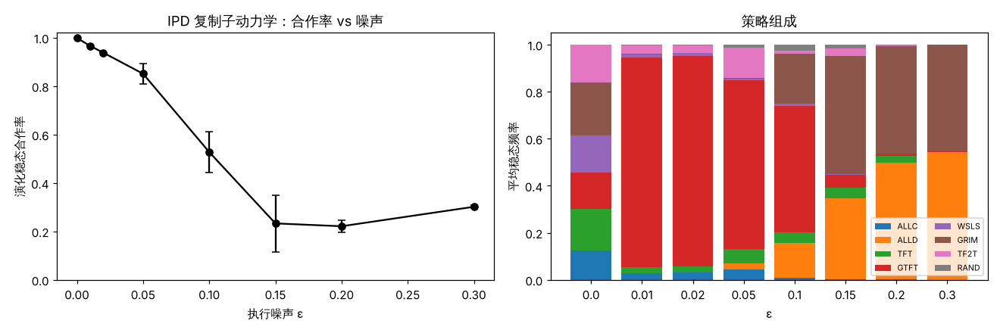
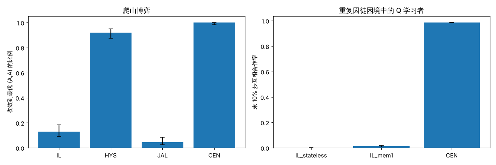
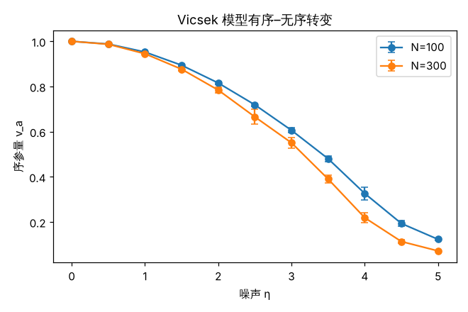

# Q18 多智能体协作与群体智能

> 分组：系统与交叉 ｜ 实验：`experiment.py`（单核运行时间约 110 秒） ｜ 证据标注：[实测] [文献] [判断]

## 摘要
群体智能的基础问题是：在没有中央控制的情况下，个体局部规则或局部学习何时能产生群体层面的协作与秩序，何时会失败？本研究在三个层次上做了可复现的最小实验。(a) **演化层**：8 种 Axelrod 式策略在带执行噪声 ε 的迭代囚徒困境中做复制子动力学。[实测] 无噪声时，演化稳态合作率为 0.999；ε 介于 0.10 和 0.15 之间时合作崩塌（0.528→0.233）；低噪声下占优的是宽容的 GTFT，而不是 TFT 或 WSLS。(b) **学习层**：在 Claus & Boutilier 的爬山博弈中，独立 Q 学习者只有 13%（95% Wilson CI 9.0–18.4%）收敛到最优联合动作，联合动作学习者为 4.5%，迟滞 Q 学习为 92%，集中式学习者为 100%。在重复囚徒困境中，独立学习者几乎全部走向互相背叛（一阶记忆时互相合作率 1.2%），集中式学习者为 98.5%。(c) **涌现层**：Vicsek 模型的序参量随噪声从 1.0 降到 0.07，且系统越大，涨落峰越高（N=300 时 χ_max=1.93，N=100 时为 0.95），呈现有限尺寸相变的特征。结论：去中心化协作的失败主要来自三个机制：**噪声破坏互惠**、**非平稳导致的协调失败**、**个体与集体回报不一致**。在算法层面，这三者分别可以由宽容、乐观（迟滞）学习、集中训练或回报重塑来缓解，但都需要付出信息或通信代价。

## 1. 问题界定
**为何是基础问题。** 单体智能研究“一个体如何最优决策”；多智能体与群体智能研究的则是一个**不同的科学问题**：每个个体在其余个体也在适应的非平稳环境中决策，群体结果由相互作用决定，个体理性不保证集体理性。核心矛盾有三：(i) **社会困境**：个体占优策略（背叛）导致集体次优；(ii) **非平稳与信用分配**：独立学习者把同伴的探索当作环境噪声，导致协调失败；(iii) **涌现**：局部规则何时产生宏观有序，转变点在哪里。

**可检验的子假设（实验前固定）：**
- **H1（噪声与合作）**：(i) ε=0 时演化稳态合作率 ≥0.9；(ii) 合作率随 ε 下降，并在某个 ε*≤0.2 处跌破 0.5；(iii) 有噪声时，具纠错能力的策略（WSLS 或 GTFT）取代 TFT 成为占优策略。*否证*：(ii) 在 ε≤0.2 内合作率始终 ≥0.5；(iii) 有噪声时 TFT 仍然占优。
- **H2（协调失败）**：爬山博弈中，独立 Q 学习者收敛到最优 (A,A) 的比例 <50%，集中式学习者 ≥95%，迟滞学习者 ≥80%。*否证*：任一阈值不满足。
- **H3（社会困境中的学习）**：重复囚徒困境中，无状态独立学习者的互相合作率 <10%，集中式学习者（最大化总回报）>95%；一阶记忆独立学习者介于二者之间。*否证*：无状态独立学习者 ≥10%，或集中式学习者 ≤95%。
- **H4（群体相变）**：Vicsek 模型的序参量在低噪声时 >0.9、高噪声时 <0.2；系统越大，涨落（χ=N·Var(v_a)）峰值越高。*否证*：N=300 的 χ 峰值不高于 N=100。

## 2. 研究现状
- **合作的演化 [文献]**：Axelrod & Hamilton（1981，Science 211:1390–1396）通过计算机锦标赛发现 TFT 的成功；Nowak & Sigmund（1992，Nature 355:250–253）表明在异质群体与噪声下，宽容的 GTFT 胜出；Nowak & Sigmund（1993，Nature 364:56–58）提出 WSLS（Pavlov）优于 TFT；Wu & Axelrod（1995，J. Conflict Resolution 39:183–189）系统研究了噪声下的应对策略；Nowak（2006，Science 314:1560–1563）总结了合作演化的五条规则；复制子动力学的形式化见 Taylor & Jonker（1978，Math. Biosci. 40:145–156）。
- **多智能体强化学习 [文献]**：Claus & Boutilier（1998，AAAI）比较了独立学习者与联合动作学习者，提出“爬山博弈”作为协调失败的基准；Lauer & Riedmiller（2000，ICML）的分布式 Q 学习与 Matignon 等（2007，IROS）的迟滞 Q 学习通过“乐观”更新缓解了这一失败；Sandholm & Crites（1996，BioSystems 37:147–166）研究了囚徒困境中的 Q 学习者。Hernandez-Leal 等（2017，arXiv:1707.09183）系统综述了多智能体学习中的非平稳问题。深度时代的“集中训练–分散执行”范式包括 MADDPG（Lowe 等 2017，arXiv:1706.02275）、QMIX（Rashid 等 2018，arXiv:1803.11485）；Leibo 等（2017，arXiv:1702.03037）研究了时序社会困境；LOLA（Foerster 等 2018，arXiv:1709.04326）让智能体对对手的学习进行建模；AlphaStar（Vinyals 等 2019，Nature 575:350–354）展示了大规模多智能体自博弈。
- **群体智能与集体运动 [文献]**：Vicsek 等（1995，PRL 75:1226；arXiv:cond-mat/0611743）提出自驱动粒子模型，发现噪声驱动的有序–无序转变；Grégoire & Chaté（2004，PRL 92:025702）指出在足够大的系统中该转变为不连续（一级）转变。
- **新动向与缺口 [文献 + 判断]**：大模型智能体的社会模拟（Generative Agents，Park 等 2023，arXiv:2304.03442），以及“合作式 AI”议程（Dafoe 等 2020，arXiv:2012.08630）把问题推向开放环境。**缺口**：多智能体学习的收敛性仍缺乏一般理论；演化、学习、涌现三个层次的结论分散在不同学科中，缺少统一的可比实验。本项目在同一份代码中并列这三个层次。

## 3. 研究设计
- **(a) IPD**：支付 (R,S,T,P)=(3,0,5,1)；策略 ALLC、ALLD、TFT、GTFT（以 1/3 的概率宽恕）、WSLS、GRIM、TF2T、RAND；每局 200 轮，意图动作以概率 ε 翻转，ε∈{0,0.01,0.02,0.05,0.1,0.15,0.2,0.3}。每个种子用 20 次重复估计 8×8 支付矩阵，再从 40 个 Dirichlet(1) 随机初态运行离散复制子动力学 3000 代（突变率 μ=1e-3，防止灭绝造成的伪吸收）。指标：稳态群体合作率 x^T C x（C 为两两合作率矩阵）、各策略的占优比例和平均频率。
- **(b1) 爬山博弈**：支付矩阵 [[11,−30,0],[−30,7,6],[0,0,5]]，最优为 (A,A)=11；IL：各自对 3 个动作做 Q 学习；HYS：正 TD 误差学习率 0.1、负 TD 误差 0.01；JAL：对联合动作的 Q 值加上对手的经验频率模型；CEN：单一学习者在 9 个联合动作上学习。Boltzmann 温度 T_t=max(0.05, 10·0.996^t)，α=0.1，3000 步。每个种子 40 次独立运行，共 200 次。比例的 CI 用 Wilson 区间；IL 与 CEN 用 Fisher 精确检验比较。
- **(b2) 重复囚徒困境**：无状态 IL（γ=0）、一阶记忆 IL（状态为上一联合动作，γ=0.95）、CEN（最大化双方回报之和）；ε-greedy 从 1 线性衰减到 0.02，20000 步；指标为最后 10% 步的互相合作率。每个种子 40 次运行。
- **(c) Vicsek**：密度 ρ=4，速度 0.03，相互作用半径 1，周期边界；η∈[0,5] 共 11 个点；N∈{100,300}；600 步，取后 200 步的 v_a 均值与 χ=N·Var(v_a)。
- **统计**：所有实验 5 个种子，均值 ± 95% CI。

## 4. 结果

**表 1　IPD：执行噪声与演化稳态合作 [实测]**

| ε | 稳态合作率 | 合作率>0.5 的初态比例 | 主要占优策略（占优初态比例） |
|---|---|---|---|
| 0 | 0.999±0.000 | 1.00 | GRIM 0.925，TFT 0.075（善意策略间中性漂移） |
| 0.01 | 0.966±0.001 | 1.00 | GTFT 1.00（平均频率 0.893） |
| 0.02 | 0.938±0.002 | 1.00 | GTFT 1.00 |
| 0.05 | 0.851±0.041 | 0.975 | GTFT 0.975，ALLD 0.025 |
| 0.10 | 0.528±0.086 | 0.63 | GTFT 0.61，GRIM 0.21，ALLD 0.145 |
| 0.15 | 0.233±0.117 | 0.15 | GRIM 0.515，ALLD 0.335 |
| 0.20 | 0.221±0.026 | 0.045 | ALLD 0.565，GRIM 0.39 |
| 0.30 | 0.302±0.006 | 0.00 | ALLD 0.555，GRIM 0.445 |

**表 2　学习者的协调与合作 [实测]**

| 博弈 | 学习者 | 结果 | 95% CI | 其他 |
|---|---|---|---|---|
| 爬山 | IL（独立） | 13.0% 收敛到 (A,A) | Wilson [9.0%, 18.4%] | 66.5% 停在 (B,B)=7，19% 停在 (B,C)=6；平均最终收益 7.3 |
| 爬山 | HYS（迟滞） | 92.0% | [87.4%, 95.0%] | 收敛步 126±15；平均收益 10.68 |
| 爬山 | JAL（联合动作） | 4.5% | [2.4%, 8.3%] | 76.5% 停在 (B,C)；收敛步 1256±112；平均收益 6.335 |
| 爬山 | CEN（集中式） | 100% | [98.1%, 100%] | 收敛步 27.8±3.3 |
| 囚徒困境 | IL 无状态 | 互相合作率 0.0001 | — | 100% 的运行以背叛为主 |
| 囚徒困境 | IL 一阶记忆 | 0.0116±0.0058 | — | 98.5% 的运行以背叛为主 |
| 囚徒困境 | CEN | 0.9851±0.0002 | — | 100% 的运行以合作为主 |

IL 与 CEN 在爬山博弈上的差异：Fisher p=1.7e−85。一阶记忆与无状态 IL 的差异：配对 t=3.92，p=0.017（显著但效应很小）。

**表 3　Vicsek 序参量 v_a 与涨落 χ（均值±CI）[实测]**

| η | 0 | 1.0 | 2.0 | 2.5 | 3.0 | 3.5 | 4.0 | 4.5 | 5.0 |
|---|---|---|---|---|---|---|---|---|---|
| v_a, N=100 | 1.000 | 0.953 | 0.816 | 0.719 | 0.606 | 0.480 | 0.326 | 0.194 | 0.123 |
| v_a, N=300 | 1.000 | 0.945 | 0.784 | 0.665 | 0.551 | 0.390 | 0.219 | 0.114 | 0.072 |
| χ, N=100 | 0.00 | 0.00 | 0.07 | 0.15 | 0.33±0.15 | 0.47±0.09 | **0.95±0.32** | 0.67±0.09 | 0.39 |
| χ, N=300 | 0.00 | 0.03 | 0.21 | 0.78±0.75 | 1.07±0.44 | **1.93±0.47** | 1.34±0.36 | 0.94±0.19 | 0.41 |

**逐条回应：**
- **H1 基本支持（(iii) 部分否证）。** (i) ε=0 时为 0.999；(ii) ε=0.10 时 0.528、ε=0.15 时 0.233，ε* 位于 (0.10, 0.15]。ε=0.3 时合作率回升到 0.302，是因为噪声本身就会让“意图背叛”以概率 ε 变成合作，合作率的下限约为 ε，并非真正的合作恢复。(iii) GTFT 在 ε∈[0.01,0.05] 中占优（97.5–100% 的初态），支持“宽容取代 TFT”；但 WSLS 在任何噪声水平下都**没有**占优，其平均频率从 ε=0 时的 0.159 降为接近 0。原因在于本支付矩阵下 2R = T+P（6=6），恰好处于 WSLS 抵御 ALLD 的临界条件上：WSLS 每两轮被 ALLD 剥削一次，在有背叛者的群体中无法维持 [实测 + 推导]。
- **H2 支持。** IL 13%、CEN 100%、HYS 92%。另外（未预注册）：JAL 只有 4.5%，**比 IL 更差**，并且大多停在 (B,C)。联合动作学习者对对手的经验频率模型继承了早期探索中对手的“随机性”，在 −30 惩罚下系统性地回避 A。这与 Claus & Boutilier 的观察一致：仅仅建模联合动作并不能解决协调问题 [实测 + 文献]。
- **H3 支持。** 无状态 IL 为 0.0001，CEN 为 0.985；一阶记忆 IL 为 0.012，显著高于无状态，但仍几乎全部背叛：仅有“记忆”而没有对对手学习过程的建模，不足以让互惠在独立学习中自发涌现。
- **H4 支持。** v_a 从 1.000 降到 0.072（N=300）和 0.123（N=100）；χ 峰值在 N=300 时为 1.93±0.47（η=3.5），高于 N=100 时的 0.95±0.32（η=4.0），且峰位随 N 增大向低噪声移动，符合有限尺寸标度的定性预期。

## 5. 讨论
**三个层次的统一机理 [判断]。**
1. *互惠的脆弱性*：TFT/GRIM 的合作依赖“对背叛的对称报复”。噪声引入的误判会触发报复链（TFT 对 TFT 的回声效应），GRIM 则会永久背叛。宽容（GTFT 以 1/3 的概率原谅）以少量被剥削为代价打断报复链，因此在低噪声下胜出。噪声更高时，“宽容”的成本超过收益，ALLD 与 GRIM（此时实际上等价于背叛）接管群体，表现为合作的相变式崩塌。
2. *非平稳导致的协调失败*：在爬山博弈中，最优动作 A 与对手的错配代价极大（−30）。独立学习者在探索期看到的是“对手随机时 A 的平均回报”，因此低估了 A 的价值，被吸引到风险占优的 (B,B)。迟滞学习忽略负向更新，相当于“假设同伴最终会配合”，从而恢复最优；集中式学习者没有这个问题，代价是需要全局信息和联合动作空间（随智能体数指数增长）。这正是“集中训练–分散执行”（MADDPG、QMIX）的动机。
3. *个体与集体回报的不一致*：在囚徒困境中，独立学习者各自最大化自身回报，必然收敛到纳什均衡（背叛）；集中式学习者只是换了目标函数（总回报）就得到了合作。说明多智能体系统中的“合作”首先是一个**目标/机制设计问题**，然后才是学习算法问题。
4. *涌现*：Vicsek 模型中，局部对齐规则在噪声低于阈值时产生长程有序。这种秩序不需要任何个体“知道”全局目标，是群体智能最纯粹的形式。

**与文献的一致与分歧。** GTFT 在噪声下胜出，与 Nowak & Sigmund（1992）一致。WSLS 未能胜出，似乎与 Nowak & Sigmund（1993）相悖，但该文的结论依赖于 2R > T+P 的支付条件（常用的 (3,0,5,1) 恰在边界上）。这提醒我们：“哪种策略最好”高度依赖支付结构和策略池，没有普适的赢家 [文献 + 实测]。在 Vicsek 模型中，本实验的尺寸太小，无法区分连续相变与 Grégoire & Chaté 指出的一级相变（带状结构）。

**效度威胁与外推边界。**
1. 策略池有限（8 种），且限于记忆 ≤2 的策略；更丰富的策略空间（如零行列式策略）可能改变结论。
2. 复制子动力学假设无限群体、充分混合；有限群体（Moran 过程）、空间结构或网络互惠会显著改变合作阈值（Nowak 2006 的“网络互惠”规则）。
3. 学习实验是 2 智能体的矩阵博弈，温度和学习率等超参数固定，未调优；HYS 的优势依赖于确定性回报，在随机回报博弈中，迟滞学习可能因过度乐观而失败。
4. Vicsek 的尺寸（N≤300）与时长（600 步）不足以做严格的有限尺寸标度或判定相变阶数。
5. 本研究不涉及通信、语言或大模型智能体；对 LLM 多智能体系统的外推只能是类比 [判断]。

<!-- BIBLIO:start -->
## 文献计量信号（arXiv，[实测]）

检索式：摘要含 “multi-agent reinforcement learning”、“swarm intelligence”、“emergent cooperation”、“multi-agent system” 之一；基线为同年 cs.LG / cs.AI / stat.ML 论文总数。数据：`ai2035/bibliometrics/arxiv_counts.json`（检索日 2026-11-26）。

| 年份 | 命中论文数 | 占 AI/ML 基线比例 |
|---|---|---|
| 2015 | 92 | 2.26% |
| 2016 | 91 | 1.54% |
| 2017 | 124 | 1.47% |
| 2018 | 182 | 1.33% |
| 2019 | 251 | 1.13% |
| 2020 | 362 | 1.19% |
| 2021 | 453 | 1.36% |
| 2022 | 505 | 1.39% |
| 2023 | 669 | 1.48% |
| 2024 | 851 | 1.44% |
| 2025 | 1,772 | 2.37% |

- 2019–2025 年份额的对数线性趋势：**每年 +10.1%**（95% CI +3.1% ~ +17.5%，R²=0.74），判定：**相对升温（增速显著快于 AI/ML 总体）**；在 20 个问题中按相对增速排第 10 位。
- 解读边界：分子覆盖 arXiv 全部类别、分母仅为 AI/ML 三个类别，所以“比例”是相对关注度指数，并非严格的子集占比；关键词匹配既会漏掉使用其他术语的工作，也会混入无关用法；arXiv 偏重机器学习社区，认知科学、神经科学与期刊论文覆盖不足。该信号衡量的是**研究关注度**，不是**问题被解决的程度**。
<!-- BIBLIO:end -->

## 6. 结论与 2035 展望
**核心结论**
1. 互惠合作对执行噪声非常敏感：在 (3,0,5,1) 囚徒困境与 8 种策略的群体中，合作率在 ε≈0.10–0.15 处从 0.53 崩塌到 0.23；宽容策略（GTFT）是低噪声下的占优解 [实测，置信度：高（限于本策略池）]。
2. 独立学习者在需要协调的任务中系统性失败（爬山博弈中最优收敛率 13%），而乐观（迟滞）更新或集中学习可以恢复到 92–100%；仅建模联合动作（JAL）不能解决问题 [实测 + 文献，置信度：高]。
3. 社会困境中，合作取决于目标设计：同一 Q 学习算法，个体目标下合作率约 0–1%，集体目标下为 98.5% [实测，置信度：高]。
4. 简单局部规则可以产生宏观有序，并在噪声阈值附近呈现相变特征，群体越大转变越陡 [实测，置信度：中]。
5. 三个层次共同指向一个基础结论：去中心化群体的协作需要“容错机制 + 一致的激励 + 足够的信息共享”，缺一则会退化到个体理性的低效均衡 [判断，置信度：中]。

**关键未解问题**：(i) 一般和博弈中多智能体学习的收敛性与均衡选择理论；(ii) 智能体数量扩展到成千上万时，信用分配与通信的可扩展机制；(iii) 大模型智能体群体中，合作、合谋与欺骗的涌现规律及其可控性；(iv) 人–机混合群体中的激励相容机制设计。

**建议研究路线**
- **近期（2026–2028）**：建立统一的多智能体合作基准，覆盖矩阵博弈、时序社会困境和 LLM 智能体谈判，并报告对噪声与策略池的敏感性曲线。*里程碑*：给出至少一类一般和随机博弈中独立学习收敛到帕累托最优的充分条件，并在基准上验证（收敛率 ≥90%）。
- **中期（2029–2032）**：研究可扩展的“集中训练–分散执行”与通信学习，以及面向合作的机制设计（回报重塑、契约、声誉）。*里程碑*：1000 个以上智能体的系统在部分可观测任务中达到集中式上界 90% 的性能，且通信开销亚线性增长。
- **远期（2033–2035）**：形成群体智能的“统计物理”式理论，能从个体规则预测宏观相变与鲁棒性。*里程碑*：对给定的个体学习规则和交互拓扑，事先预测合作崩塌的噪声阈值（误差 ≤20%），并在大规模 LLM 智能体社会中得到验证。

## 参考文献
1. Axelrod, R., & Hamilton, W. D. (1981). The evolution of cooperation. *Science*, 211(4489), 1390–1396.
2. Nowak, M. A., & Sigmund, K. (1992). Tit for tat in heterogeneous populations. *Nature*, 355, 250–253.
3. Nowak, M., & Sigmund, K. (1993). A strategy of win-stay, lose-shift that outperforms tit-for-tat in the Prisoner's Dilemma game. *Nature*, 364, 56–58.
4. Wu, J., & Axelrod, R. (1995). How to cope with noise in the iterated prisoner's dilemma. *Journal of Conflict Resolution*, 39(1), 183–189.
5. Nowak, M. A. (2006). Five rules for the evolution of cooperation. *Science*, 314(5805), 1560–1563.
6. Taylor, P. D., & Jonker, L. B. (1978). Evolutionary stable strategies and game dynamics. *Mathematical Biosciences*, 40(1–2), 145–156.
7. Claus, C., & Boutilier, C. (1998). The dynamics of reinforcement learning in cooperative multiagent systems. *AAAI 1998*, 746–752.
8. Lauer, M., & Riedmiller, M. (2000). An algorithm for distributed reinforcement learning in cooperative multi-agent systems. *ICML 2000*.
9. Matignon, L., Laurent, G. J., & Le Fort-Piat, N. (2007). Hysteretic Q-learning: an algorithm for decentralized reinforcement learning in cooperative multi-agent teams. *IEEE/RSJ IROS 2007*.
10. Sandholm, T. W., & Crites, R. H. (1996). Multiagent reinforcement learning in the iterated prisoner's dilemma. *BioSystems*, 37(1–2), 147–166.
11. Hernandez-Leal, P., Kaisers, M., Baarslag, T., & Munoz de Cote, E. (2017). A survey of learning in multiagent environments: Dealing with non-stationarity. arXiv:1707.09183.
12. Lowe, R., Wu, Y., Tamar, A., Harb, J., Abbeel, P., & Mordatch, I. (2017). Multi-agent actor-critic for mixed cooperative-competitive environments. arXiv:1706.02275.
13. Rashid, T., Samvelyan, M., Schroeder de Witt, C., Farquhar, G., Foerster, J., & Whiteson, S. (2018). QMIX: Monotonic value function factorisation for deep multi-agent reinforcement learning. arXiv:1803.11485.
14. Leibo, J. Z., Zambaldi, V., Lanctot, M., Marecki, J., & Graepel, T. (2017). Multi-agent reinforcement learning in sequential social dilemmas. arXiv:1702.03037.
15. Foerster, J. N., Chen, R. Y., Al-Shedivat, M., Whiteson, S., Abbeel, P., & Mordatch, I. (2018). Learning with opponent-learning awareness. arXiv:1709.04326.
16. Vinyals, O., et al. (2019). Grandmaster level in StarCraft II using multi-agent reinforcement learning. *Nature*, 575, 350–354.
17. Vicsek, T., Czirók, A., Ben-Jacob, E., Cohen, I., & Shochet, O. (1995). Novel type of phase transition in a system of self-driven particles. *Physical Review Letters*, 75, 1226–1229. arXiv:cond-mat/0611743.
18. Grégoire, G., & Chaté, H. (2004). Onset of collective and cohesive motion. *Physical Review Letters*, 92, 025702.
19. Park, J. S., O'Brien, J. C., Cai, C. J., Morris, M. R., Liang, P., & Bernstein, M. S. (2023). Generative agents: Interactive simulacra of human behavior. arXiv:2304.03442.
20. Dafoe, A., Hughes, E., Bachrach, Y., Collins, T., McKee, K. R., Leibo, J. Z., Larson, K., & Graepel, T. (2020). Open problems in cooperative AI. arXiv:2012.08630.
