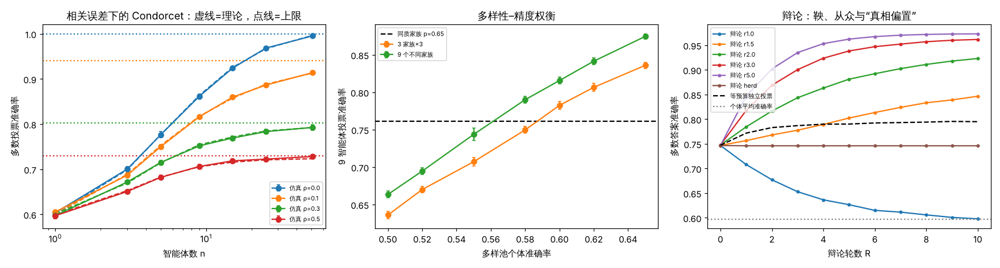

# 什么时候“更多智能体”有用？——相关误差下的投票上限、辩论的鞅性与“验证优势”阈值

**摘要**　多智能体大模型系统（投票、辩论、协作）是 2025–2026 年最热的推理增强范式之一，但证据互相矛盾。一方面，“Debate or Vote”（arXiv:2508.17536）证明对称辩论诱导信念鞅，并在 7 个基准上发现收益几乎全部来自多数投票；同质辩论中的从众、谄媚和错误共识被反复报告（arXiv:2605.00914, 2509.05396, 2509.23055, 2608.02827）。另一方面，“打破鞅诅咒”（arXiv:2603.06801）、置信度与多样性干预（arXiv:2601.19921）、验证感知读出（arXiv:2610.04686）等工作报告了辩论的真实增益。本文给出一个统一的最小模型，用三个可计算的量回答“何时更多智能体有用”：(1) 相关误差下多数投票的**上限** P_z[p(z) > q_dis(1−p(z))]，它解释了智能体数量的收益递减；(2) **设计效应** n_eff = n/(1+(n−1)ρ̄)，它解释了“多样性 vs 个体精度”的权衡；(3) 把辩论建模为带“真相偏置” r 的 Moran 型过程，其终态正确率为 E[(1−r^{−k})/(1−r^{−n})]。r=1 时退化为鞅：终态多数正确率回落到**个体平均精度**，而不是多数投票精度。仿真（10 个种子 × 3000 题）显示：有限 n 的理论曲线与仿真偏差 ≤0.51 pp；ρ=0.3 时 51 个智能体的投票精度为 0.793，理论上限为 0.802；9 个来自 9 个不同“家族”、个体精度 0.60 的智能体，比 9 个同家族、个体精度 0.65 的智能体高 5.4±0.5 pp。香草辩论 10 轮后多数正确率从 0.747 降到 0.598（Moran 理论值 0.597）；纯从众保持在 0.746；真相偏置 r 超过 r*≈1.34（理论 1.35）时，辩论才优于同等调用预算的独立投票（0.795）。结论：辩论的价值等于“验证优势 × 可恢复余量”，其中可恢复余量是“至少一人答对但多数答错”的比例，本模型中为 23.4%。没有验证优势时，辩论有害；智能体数量的收益受错误相关性约束。

**关键词**　多智能体辩论；多数投票；Condorcet 陪审团定理；相关误差；从众；Moran 过程；多样性

## 1 引言
第一阶段（README）在演化博弈、多智能体强化学习和 Vicsek 模型三个层次上表明，去中心化协作的失败来自“噪声破坏互惠、非平稳导致协调失败、个体与集体回报不一致”。2025–2026 年，多智能体研究的重心转到了**大模型智能体群体**：多个 LLM 实例投票、辩论或分工，以提升推理与事实性（奠基工作：Du 等 2023，arXiv:2305.14325；Li 等 2024，arXiv:2402.05120；Chen 等 2024，arXiv:2403.02419）。这一方向的核心争论是：

- **辩论真的比投票好吗？** Choi 等（arXiv:2508.17536）证明对称辩论是鞅；Kaesberg 等（arXiv:2502.19130）发现投票在推理任务上 +13.2%，共识在知识任务上 +2.8%；Ferreira 等（arXiv:2609.35875）在 23 个小模型上发现，预算匹配后辩论与自一致采样持平甚至更差。
- **多样性是关键吗？** Zhu 等（arXiv:2601.19921）认为多样性与置信度交流是辩论缺失的两种机制；但 arXiv:2609.35875 在人设、温度、模型身份三条轴上都**否证**了“认知多样性驱动收益”。
- **从众是灾难还是理性？** 同质辩论中，“从众采纳”高达 85.5%（arXiv:2605.00914）；但 arXiv:2606.00820 指出“并非所有翻转都是从众”。

本文的贡献：
- **C1**：在“共同难度 + 家族因子 + 个体噪声”的潜变量模型下，推导多数投票的有限 n 精度与 n→∞ 上限，并用仿真验证（第 4.1、6.1 节）。
- **C2**：用设计效应解释多样性–精度权衡，给出多样池的盈亏平衡个体精度（第 4.2、6.2 节）。
- **C3**：把辩论形式化为带真相偏置 r 的配对说服过程，证明 r=1 时的鞅性，并得到“辩论终态 → 个体平均精度”这一比“辩论不优于投票”更强的预测；给出辩论胜过等预算投票的阈值 r*（第 4.3、6.3 节）。
- **C4**：把上述结果与 2025–2026 年的经验论断逐条对照，指出哪些说法在本模型中成立、哪些依赖未言明的假设（第 7 节）。

## 2 前沿进展综述（2025–2026）
**2.1 投票与规模化。** Chen 等（arXiv:2504.00762）用多模型重复采样 + 一致性切换，以更低成本超过自一致与辩论，并指出弱模型因互补而有价值。“扩团队还是扩时间”（arXiv:2604.03295）在成本约束下联合考虑团队规模与终身记忆。“智能体社会会产生知识精英吗”（arXiv:2604.02674）分析了 150 万次交互，发现协调呈重尾级联并经优先连接集中到少数精英，规模化回报递减且不稳定。

**2.2 辩论的理论与“鞅诅咒”。** Choi 等（arXiv:2508.17536）把辩论建模为随机过程，证明对称更新下的信念鞅，并通过偏向纠错的干预获得增益。AceMAD（arXiv:2603.06801）把相关误差导致的错误共识称为“鞅诅咒”，用同伴预测揭示“非对称认知势能”来制造正漂移。LASE（arXiv:2610.16343）认为对称辩论在期望上是中性的，主张只在合适时机触发辩论。“辩论何时有用”（arXiv:2610.04686）把成功拆为“候选供给”（至少有人提出正确答案）和“验证感知读出”，并定义了可恢复余量。

**2.3 失败模式：从众、谄媚、漂移、偏见。** 同质辩论中的谄媚式从众与语境脆弱性（arXiv:2605.00914）；强模型占多数时，准确率仍可能随辩论下降（arXiv:2509.05396）；谄媚导致过早共识（arXiv:2509.23055）；长链推理中的问题漂移（arXiv:2502.19559）；噪声驱动的偏见共识相变（arXiv:2608.02827，用社会动力学模型预测从众超过临界值时出现集体偏见）。“沉默的异议”（arXiv:2610.02702）发现，向多数屈服的智能体内部仍保留原始前提。“少数哨兵”（arXiv:2606.29270）发现约四分之一的分歧案例中少数派是对的，并训练分类器决定何时推翻多数。

**2.4 多样性与置信度。** 多样性初始化与置信度调制（arXiv:2601.19921）；DynaDebate 打破同质推理路径（arXiv:2601.05746）；Knight–Knave–Spy 受控研究（arXiv:2511.07784）发现内在推理能力与群体多样性是主导因素，而顺序、置信度可见性等结构参数影响有限；arXiv:2609.35875 则在预算匹配下否证了多样性假说。

**2.5 决策协议与安全。** 投票 vs 共识（arXiv:2502.19130）；把辩论输出转为“行动或上报”的共形社会选择（arXiv:2604.07667）；综述（arXiv:2607.26212，141 篇研究）。另有 LLM 智能体在社会困境中的演化研究（arXiv:2501.16173）与多智能体失败归因（arXiv:2505.00212）。

**被反驳或未被复现的说法**：“辩论普遍优于单模型与投票”（Du 等 2023 的早期叙事）在预算匹配实验中多次未被复现（arXiv:2508.17536, 2609.35875, 2605.00914）；“多样性必然有益”被 arXiv:2609.35875 否证，又被 arXiv:2511.07784、2601.19921 支持。这一分歧尚未解决。

**开放问题**：OP1 何时增加智能体数量有用（相关误差下的规模律）；OP2 多样性与个体能力如何权衡；OP3 辩论何时优于投票，所需的“验证优势”有多大；OP4 从众何时导致错误共识的相变；OP5 如何在不知道真值时检测“少数派正确”。

**前沿地图**

| 路线 | 代表工作 | 关键结论 | 局限 |
|---|---|---|---|
| 投票/采样规模化 | 2504.00762, 2604.03295, 2604.02674 | 多模型互补；规模收益递减、不稳定 | 缺少误差相关性的度量 |
| 辩论理论 | 2508.17536, 2603.06801, 2610.16343, 2610.04686 | 对称辩论为鞅；需正漂移/验证 | 多为定性或特定协议 |
| 失败模式 | 2605.00914, 2509.05396, 2509.23055, 2608.02827, 2502.19559 | 从众、谄媚、偏见相变、漂移 | 难以与收益统一度量 |
| 多样性/置信度 | 2601.19921, 2601.05746, 2511.07784, 2609.35875 | 结论分歧 | 多样性的操作化定义不一 |
| 读出/安全 | 2606.29270, 2604.07667, 2502.19130, 2610.02702 | 少数派常常正确；共识 ≠ 正确 | 需要额外校准数据 |

## 3 问题与假设
**选择理由。** OP1 与 OP3 是当前争论的焦点，直接决定工程实践（投钱买更多智能体，还是更多辩论轮次）。它们可以在一个只有三个参数（相关性、个体精度、真相偏置）的最小模型中得到闭式预测，并在本环境中精确检验。OP2 作为 OP1 的推论一并检验。

**形式化。** 题目 i 的共同难度 z_i ~ N(0,1)，家族因子 u_{f,i} ~ N(0,1)。智能体 j（属于家族 f）的正确性得分 s_ij = √ρ_g z_i + √ρ_f u_{f,i} + √(1−ρ_g−ρ_f) ε_ij，答对 ⇔ s_ij > Φ⁻¹(1−p_j)。题目为 4 选 1；答错时以 κ=0.5 选择共同干扰项，否则均匀选择，因此共同干扰项占错误答案的比例 q_dis = 2/3。辩论：每轮每个智能体随机选择一名同伴，以 w(同伴)/(w(自己)+w(同伴)) 的概率采纳同伴答案，w(正确)=r，w(错误)=1；从众变体以 0.5 的概率采纳当前多数答案。

**预注册假设**（在运行前确定；数值阈值写在本节，设计写在 `frontier_experiment.py` 头部）：
- **H1（相关 Condorcet）**：有限 n 理论与仿真偏差 ≤1 pp；ρ_g=0.3 时，n=51 的精度距离理论上限 ≤2 pp，且从 n=9 到 51 的增益 <2 pp。*否证*：任一条件不满足。
- **H2（多样性）**：n=9 时，3 个家族 × 3（个体精度 0.60）的投票精度高于同质家族（0.65）。*否证*：差值 ≤0 或不显著。
- **H3（鞅）**：香草辩论（r=1）10 轮后，多数正确率显著低于初始投票，并与 Moran 预测（个体平均精度）相差 ≤3 pp；纯从众辩论与初始投票无显著差异。
- **H4（阈值）**：辩论（10 轮）胜过等调用预算独立投票的经验阈值 r*，与 Moran 理论的 r* 相差在 1.5 倍以内。

## 4 理论分析
**4.1 相关误差下的投票上限（命题 1）。** 给定 z，智能体条件独立，答对概率 p(z) = Φ((√ρ z − τ)/√(1−ρ))，τ=Φ⁻¹(1−p)。由大数定律，n→∞ 时相对多数正确 ⇔ p(z) > q_dis·(1−p(z)) ⇔ p(z) > q_dis/(1+q_dis) = 0.4。因此

  A_∞ = P_z[p(z) > 0.4] = 1 − Φ((τ + √(1−ρ)·Φ⁻¹(0.4))/√ρ)。

ρ=0 时 A_∞=1（经典 Condorcet）；ρ>0 时存在严格小于 1 的上限。有限 n 时 A_n = E_z[P(Multinomial(n, π(z)) 的众数为正确项)]，用 Gauss–Hermite 积分计算。**预测**：A_n 随 n 单调上升并饱和于 A_∞；ρ 越大饱和越早。

**4.2 设计效应（命题 2，近似）。** 对 n 个两两潜变量相关为 ρ̄ 的投票者，投票均值的方差相当于 n_eff = n/(1+(n−1)ρ̄) 个独立投票者（Kish 设计效应）。同质家族（ρ_g=0.1, ρ_f=0.4）：ρ̄=0.5，n_eff=1.8；3 家族 × 3：ρ̄=0.2，n_eff=3.46；9 个家族：ρ̄=0.1，n_eff=5.0。**预测**：多样池可以用更低的个体精度换取更大的 n_eff，并存在一个盈亏平衡个体精度 p_div* < 0.65，且家族越多，p_div* 越低。

**4.3 辩论的鞅性与真相偏置（命题 3）。** 令 k_t 为第 t 次配对说服后答对的人数。一次更新中，k 增加 1 的概率 ∝ (n−k)k·r/(1+r)，减少 1 的概率 ∝ k(n−k)·1/(1+r)；错误答案之间的互换不改变 k。因此嵌入链满足 P(k→k+1)/P(k→k−1) = r，即 Moran 过程：
- r=1：E[k_{t+1} | k_t] = k_t（鞅）。终态被吸收到全对或全错，P(全对) = k_0/n。所以**辩论终态的多数正确率 = E[k_0/n] = 个体平均精度 p̄**，严格低于初始多数投票精度（只要投票本身有增益）。这比“辩论不能提升期望正确率”（arXiv:2508.17536）更强：在吸收极限下，香草辩论会**抹去**投票带来的增益。
- r≠1：P(全对) = φ(k_0) = (1−r^{−k_0})/(1−r^{−n})。
- 从众（向多数答案靠拢）：吸收到初始多数，终态精度 = 初始投票精度。

**推论（验证优势阈值）。** 辩论（R 轮，n 个智能体，共 n(R+1) 次调用）胜过等预算独立投票 ⇔ E[φ(k_0)] > A_{n(R+1)}。由于 E[φ(k_0)] ≤ P(k_0≥1) = A_n + H（H 为可恢复余量 = P(k_0≥1 且多数错)），辩论的最大增益受 H 约束，而 r 决定能取到其中多少。

## 5 实验
- **E1**：单家族，p=0.6，ρ_g ∈ {0, 0.1, 0.3, 0.5}，n ∈ {1,3,5,9,15,25,51}；比较仿真、有限 n 理论和上限。
- **E2**：n=9；同质家族 p=0.65（ρ_g=0.1, ρ_f=0.4）；对比 3 家族×3 和 9 个家族两种多样池，个体精度 p_div 扫描 {0.50, 0.52, 0.55, 0.58, 0.60, 0.62, 0.65}。
- **E3/E4**：n=9，p=0.6，ρ_g=0.3；r ∈ {0.8, 1, 1.1, 1.2, 1.3, 1.4, 1.5, 2, 3, 5} 与从众变体；R=0..10；与等预算独立投票（n(R+1) 个样本）比较。
- **统计**：10 个种子 × 3000 题；均值 ± 95% CI；配对 t 检验。运行时间约 4 秒（frontier.json 中的 runtime_s）。

## 6 结果

**6.1 投票规模律（表 1）[实测 + 理论]**

| ρ_g | n=1 | n=9 | n=25 | n=51 | 理论 n=51 | 理论上限 A_∞ |
|---|---|---|---|---|---|---|
| 0 | 0.604 | 0.861 | 0.969 | 0.996 | 0.997 | 1.000 |
| 0.1 | 0.606 | 0.816 | 0.887 | 0.914 | 0.913 | 0.941 |
| 0.3 | 0.598 | 0.752 | 0.783 | 0.793 | 0.793 | 0.802 |
| 0.5 | 0.597 | 0.706 | 0.723 | 0.728 | 0.723 | 0.730 |

（仿真 95% CI 均在 ±0.007 以内；全部 28 个格点中，仿真与有限 n 理论的最大偏差为 0.51 pp。）

**6.2 多样性–精度权衡 [实测]**：同质家族（p=0.65）的投票精度为 0.761±0.004。多样池在 p_div=0.60 时：3 家族为 0.783±0.005（+2.1±0.6 pp，p=1.2e−4），9 个家族为 0.816±0.004（+5.4±0.5 pp，p=3.0e−9）。盈亏平衡个体精度：3 家族 p_div* = 0.587，9 个家族 p_div* = 0.561。设计效应给出的 n_eff 分别为 1.8 / 3.46 / 5.0，排序与 p_div* 的排序一致。

**6.3 辩论动力学（表 2）[实测 + 理论]**（初始投票 0.747±0.006；个体平均精度 0.597；可恢复余量 H = 0.234±0.005；等预算投票 n·11=99 个样本：0.795±0.005）

| 过程 | R=1 | R=3 | R=10 | R=10 相对初始投票 (pp) | 相对等预算投票 (pp) | Moran 理论（吸收极限） |
|---|---|---|---|---|---|---|
| r=0.8（错误更具说服力） | 0.681 | 0.575 | 0.438 | −30.9±0.3 | −35.7±0.3 | 0.429 |
| r=1（香草） | 0.708 | 0.653 | 0.598 | −14.9±0.4 | −19.7±0.5 | 0.597 |
| r=1.2 | 0.736 | 0.718 | 0.734 | −1.4±0.6 | −6.1±0.7 | 0.728 |
| r=1.3 | 0.744 | 0.743 | 0.779 | +3.1±0.4 | −1.6±0.4 | 0.776 |
| r=1.4 | 0.753 | 0.767 | 0.816 | +6.8±0.5 | +2.1±0.5 | 0.813 |
| r=2 | 0.785 | 0.844 | 0.923 | +17.6±0.5 | +12.8±0.5 | 0.914 |
| r=5 | 0.847 | 0.935 | 0.973 | +22.7±0.5 | +17.8±0.5 | 0.968 |
| 从众 | 0.746 | 0.746 | 0.746 | −0.05±0.12（p=0.42） | −4.9±0.2 | = 初始投票 |

阈值：辩论胜过初始投票的 r*，经验值 1.229、理论值 1.240；胜过等预算投票的 r*，经验值 1.343、理论值 1.352。

**逐条对照：**
- **H1 部分支持。** 理论与仿真的偏差 ≤0.51 pp（支持）；ρ=0.3、n=51 时距上限 0.94 pp（支持）。但 n=9→51 的增益为 4.1 pp，**超过**预设的 2 pp（该部分否证）：收益递减比预期更慢，不过已经非常接近上限。
- **H2 支持。** 3 家族多样池高 2.1±0.6 pp（p=1.2e−4）。
- **H3 支持。** 香草辩论比初始投票低 14.9±0.4 pp（p=4.4e−14），终态 0.598 与 Moran 预测 0.597 相差 0.1 pp。个体平均精度保持不变（0.597→0.593），体现了鞅性。从众辩论与初始投票无差异（p=0.42）。
- **H4 支持。** r* 的经验值 1.343 与理论值 1.352 几乎重合。

## 7 讨论
**与前沿论断的关系。**
1. *“辩论收益来自投票”*（arXiv:2508.17536）：本模型给出更强也更精确的版本。对称辩论不仅不提升期望正确率，在多轮趋于共识时还会把多数投票的增益“还回去”，终态退回个体平均精度。现实中辩论轮数少（1–3 轮），所以观察到的往往是“略差于投票”（R=1 时 0.708 对 0.747），与 arXiv:2605.00914、2509.05396 的经验一致。读出时机因此很重要：**辩论之后仍应投票，而且应尽早投票**。
2. *“打破鞅诅咒需要正漂移”*（arXiv:2603.06801, 2610.16343）：本模型把“正漂移”量化为验证优势 r，并给出阈值：r≈1.35 才能胜过等预算投票。直观地说，正确论证被采纳的概率需要比错误论证高约 35%。这为“辩论是否值得”提供了可测量的判据：在验证集上估计 LLM 被正确/错误论证说服的比率。
3. *“可恢复余量”*（arXiv:2610.04686）：本模型中 H=23.4%；即使 r=5，终态（0.973）也只能逼近 P(k_0≥1) ≈ 0.981（初始投票 0.747 + H 0.234）。候选供给（至少有人答对）是辩论增益的硬上限。
4. *多样性之争*（arXiv:2601.19921 对 2609.35875）：本模型表明，多样性的价值取决于它是否**降低了错误相关**（家族因子），而不是表面上的人设或温度差异。arXiv:2609.35875 用人设、温度、模型身份操作化多样性，如果这些操作没有改变错误相关结构（同一预训练语料带来的共同难度 z），就不会带来收益。“少数哨兵”（arXiv:2606.29270）报告的约 1/4 少数派正确，正是共同难度造成的系统性多数错误。
5. *偏见共识相变*（arXiv:2608.02827）：本模型中的从众变体会把初始多数冻结下来；当初始多数是偏见时，从众会把偏见固化。这与该文“从众超过阈值导致集体偏见”的结论一致，但本模型没有噪声项，无法复现相变本身。

**外推边界与局限。** (i) 智能体被建模为“答案 + 潜在正确性”，没有显式推理内容；真实 LLM 的说服受论证质量、长度、顺序影响，r 可能依赖于题目与智能体（异质 r）。(ii) 共同难度的单因子结构是简化；真实的错误相关可能是多维的（知识盲区、推理缺陷各不相同）。(iii) 等预算比较只按“调用次数”计，没有计入辩论上下文变长带来的 token 成本（arXiv:2609.35875 报告为 3.4 倍），这会进一步不利于辩论。(iv) 同步更新与 Moran 异步过程不同，但终态与理论相差 ≤1 pp。(v) 本文没有真实 LLM 实验；r 的真实取值是开放的经验问题。

## 8 结论
1. 错误相关性给多数投票设了上限 A_∞（ρ=0.3 时为 0.802）。智能体数量的收益递减可以由闭式理论精确预测（偏差 ≤0.51 pp）[实测 + 推导，置信度：高]。
2. 多样性的价值来自降低错误相关：9 个不同家族、个体精度低 5 pp 的智能体，投票精度高 5.4 pp [实测，置信度：高（模型内）]。
3. 对称辩论是鞅：多轮后终态退回个体平均精度（−14.9 pp）；从众则冻结初始多数 [实测 + 推导，置信度：高（模型内）]。
4. 辩论胜过同等调用预算投票的必要条件是验证优势 r > r*≈1.35，且增益上限为可恢复余量（23.4%）[实测 + 推导，置信度：中（r 的真实值未知）]。

**对 2035 的研判 [判断]。** 大模型多智能体系统的扩展规律将由“错误相关结构”而不是“智能体数量”决定。2035 年前，有效的群体智能系统应具备：(a) 可测量、可控的错误去相关（异源训练数据和模型家族，而不仅仅是换人设）；(b) 显式的验证机制（工具、执行、形式检查），使 r 显著大于 1；(c) 在辩论前后都做投票，并对少数派意见建立校准的推翻机制。没有验证能力的“群聊式”辩论，在高相关的同源模型间会系统性地放大错误。

**后续研究建议。** (1) 在真实 LLM 上测量 r（被正确/错误论证说服的比率）与错误相关 ρ，检验阈值 r*≈1.35 的预测；(2) 把模型扩展到异质 r、多维难度和网络拓扑（呼应 arXiv:2604.02674 的精英化现象）；(3) 研究“验证优势”能否通过训练获得（如 arXiv:2611.09568 用辩论做偏好学习一类方法）。

## 参考文献
**2025–2026 前沿（arXiv）**
1. Choi, H. K., et al. Debate or Vote: Which Yields Better Decisions in Multi-Agent Large Language Models? arXiv:2508.17536 (2025).
2. Liu, Y., et al. Breaking the Martingale Curse: Multi-Agent Debate via Asymmetric Cognitive Potential Energy. arXiv:2603.06801 (2026).
3. Zhu, X., et al. Demystifying Multi-Agent Debate: The Role of Confidence and Diversity. arXiv:2601.19921 (2026).
4. Bertalanič, B., et al. The Cost of Consensus: Isolated Self-Correction Prevails Over Unguided Homogeneous Multi-Agent Debate. arXiv:2605.00914 (2026).
5. Wynn, A., et al. Talk Isn't Always Cheap: Understanding Failure Modes in Multi-Agent Debate. arXiv:2509.05396 (2025).
6. Yao, B., et al. Peacemaker or Troublemaker: How Sycophancy Shapes Multi-Agent Debate. arXiv:2509.23055 (2025).
7. Kaesberg, L. B., et al. Voting or Consensus? Decision-Making in Multi-Agent Debate. arXiv:2502.19130 (2025).
8. He, C., et al. Minority Sentinel: When to Overturn Majority Voting in Multi-Agent LLM Debates. arXiv:2606.29270 (2026).
9. Hao, X., et al. Not All Flips Are Conformity: Decomposing Stance Convergence in Multi-Agent LLM Debate. arXiv:2606.00820 (2026).
10. Zhao, Z., et al. When Debate Helps: Proposal Supply and Verification-Aware Readout in Multi-Agent Reasoning. arXiv:2610.04686 (2026).
11. Chen, J., et al. Do We Truly Need So Many Samples? Multi-LLM Repeated Sampling Efficiently Scales Test-Time Compute. arXiv:2504.00762 (2025).
12. Okawa, M. Emergence of Biased Consensus in Multi-Agent LLM Debates. arXiv:2608.02827 (2026).
13. Ferreira, L., et al. Beyond Symmetric Agents: Cognitive Diversity and Multi-Agent Debate in Small Language Models. arXiv:2609.35875 (2026).
14. Wu, H., et al. Can LLM Agents Really Debate? A Controlled Study of Multi-Agent Debate in Logical Reasoning. arXiv:2511.07784 (2025).
15. Ni, Z., et al. Silent Dissent: LLM Agents That Yield to the Majority Still Represent Their Original Premise. arXiv:2610.02702 (2026).
16. Stay Focused: Problem Drift in Multi-Agent Debate. arXiv:2502.19559 (2025).
17. Efficient Multi-Agent Reasoning via Confidence-Guided Adaptive Debate (LASE). arXiv:2610.16343 (2026).
18. DynaDebate: Breaking Homogeneity in Multi-Agent Debate with Dynamic Path Generation. arXiv:2601.05746 (2026).
19. From Debate to Decision: Conformal Social Choice for Safe Multi-Agent Deliberation. arXiv:2604.07667 (2026).
20. Multi-Agent Debate Strategies: Survey, Taxonomy, and Challenges. arXiv:2607.26212 (2026).
21. Scaling Teams or Scaling Time? Memory Enabled Lifelong Learning in LLM Multi-Agent Systems. arXiv:2604.03295 (2026).
22. Do Agent Societies Develop Intellectual Elites? The Hidden Power Laws of Collective Cognition in LLM Multi-Agent Systems. arXiv:2604.02674 (2026).
23. Will Systems of LLM Agents Cooperate: An Investigation into a Social Dilemma. arXiv:2501.16173 (2025).
24. Which Agent Causes Task Failures and When? On Automated Failure Attribution of LLM Multi-Agent Systems. arXiv:2505.00212 (2025).
25. Alignment by Confident Debate: Preference Learning from Multi-Agent Debate. arXiv:2611.09568 (2026).

**奠基文献**
26. Du, Y., Li, S., Torralba, A., Tenenbaum, J. B., & Mordatch, I. (2023). Improving factuality and reasoning in language models through multiagent debate. arXiv:2305.14325.
27. Li, J., et al. (2024). More agents is all you need. arXiv:2402.05120.
28. Chen, L., et al. (2024). Are more LLM calls all you need? Towards scaling laws of compound inference systems. arXiv:2403.02419.
29. Nowak, M. A. (2006). Five rules for the evolution of cooperation. Science 314:1560–1563.（第一阶段已核实）
30. Condorcet, M. de (1785). Essai sur l'application de l'analyse à la probabilité des décisions rendues à la pluralité des voix. Paris: Imprimerie Royale.
31. Moran, P. A. P. (1958). Random processes in genetics. Mathematical Proceedings of the Cambridge Philosophical Society 54(1):60–71.
32. Kish, L. (1965). Survey Sampling. New York: Wiley.
