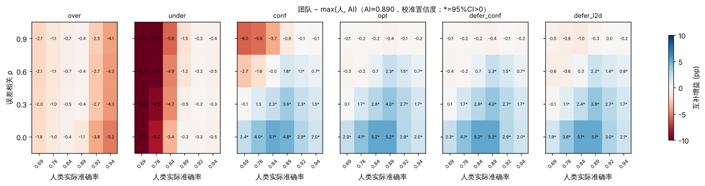
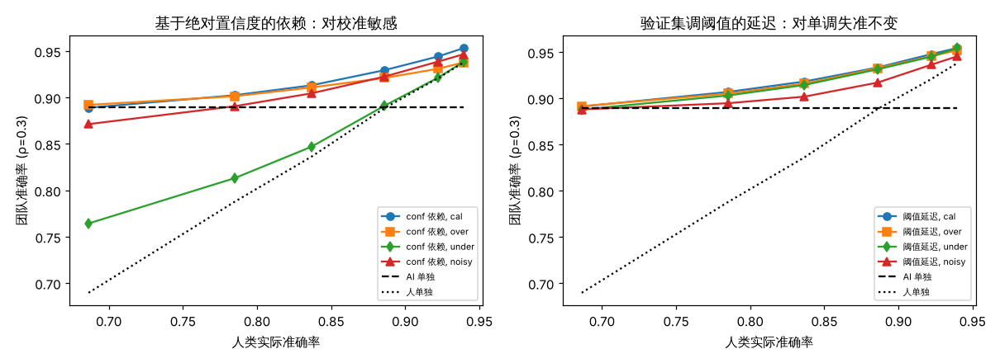

# Q19 人机混合增强智能

> 分组：系统与交叉 ｜ 实验：`experiment.py`（单核运行时间约 11 秒） ｜ 证据标注：[实测] [文献] [判断]

## 摘要
人机混合增强智能的核心承诺是“团队优于任何一方”（互补性），但实证研究反复发现：人看到 AI 建议后，团队往往只达到较强一方的水平。本研究以真实分类器（digits 上的 PCA(8)+Logistic 回归，准确率 0.890±0.013）配合参数化的模拟人类，系统扫描三类因素：人–AI 错误相关性 ρ、人类准确率（0.69–0.94），以及 AI 置信度的校准状态（校准、过度自信、信心不足、排序被噪声破坏）。比较的协作策略有：过度依赖、依赖不足、基于置信度的依赖、最优阈值依赖，以及两种延迟决策（learning-to-defer）。[实测] 互补增益最高为 +5.2±1.5 pp（ρ=0、人类 0.84 时的阈值延迟）。但当潜变量相关 ρ=0.9（错误指示的 φ 相关 0.54）时，**没有任何策略**取得显著正增益。过度依赖的团队准确率与 AI 单独相差 −2.1~+0.6 pp，依赖不足的团队与人单独相差 −0.5~+2.2 pp，两者都没有互补性。校准的价值取决于决策规则：如果人按置信度的**绝对数值**决定是否采纳，AI 信心不足会使团队准确率在全网格上平均下降 5.29±0.56 pp（最多 14.5 pp）；如果阈值在验证集上调好，单调失准的影响 <0.5 pp，真正有害的是排序被破坏（平均 −0.85±0.36 pp）。结论：互补性的必要条件是**错误独立性**，加上能分辨“谁在何处更可靠”的**判别性信号**；校准只在人或规则按绝对概率行事时才必需。

## 1. 问题界定
**为何是基础问题。** “人机混合增强智能”（Zheng 等 2017）主张把人的认知与机器智能耦合，形成更强的混合智能。这一主张的前提是一个尚未被定量刻画的命题：**在什么条件下，人+AI 的团队严格优于 max(人, AI)？** 这不是界面设计问题，而是关于两个不完美、相互关联的信息源如何最优融合的统计决策问题。它涉及：(i) 两者错误的相关结构；(ii) 元认知：谁知道自己何时可靠；(iii) 依赖行为：人是否适度采纳 AI。

**可检验的子假设（实验前固定）：**
- **H1（互补区域）**：显著互补（95% CI 下界 >0）只出现在 ρ≤0.6 且 |人−AI 准确率差| ≤10 pp 的区域；ρ=0.9 或差距 >15 pp 时，任何策略都没有显著正增益。*否证*：在 ρ=0.9 或差距 >15 pp 时出现显著正增益。
- **H2（依赖失当消灭互补）**：过度依赖的团队准确率接近 AI 单独（相差 ≤2 pp），依赖不足的接近人单独（≤2 pp），两者在任何格点都不产生显著互补。*否证*：两者之一出现显著正增益。
- **H3（校准的价值取决于决策规则）**：(a) 基于绝对置信度的依赖规则在过度自信或信心不足的显示下，团队准确率较校准时下降 ≥2 pp（网格平均）；(b) 在验证集上调阈值的延迟规则对单调失准不敏感（<0.5 pp），但在排序被噪声破坏时受损。*否证*：(a) 中下降 <2 pp，或 (b) 中单调失准影响 ≥0.5 pp，或噪声置信度无损失。

## 2. 研究现状
- **人因学基础 [文献]**：Parasuraman & Riley（1997）把人对自动化的使用分为 use / misuse（过度依赖）/ disuse（依赖不足）/ abuse；Lee & See（2004）提出“为适度依赖而设计”的信任校准框架。
- **互补性的实证困境 [文献]**：Bansal 等（2021，CHI，arXiv:2006.14779）在多个任务上发现，AI 解释提高了人对 AI 的采纳，却**没有**带来超过双方的团队表现：解释让人在 AI 错误时也采纳，即过度依赖。Zhang、Liao、Bellamy（2020，arXiv:2001.02114）发现展示置信度有助于信任校准，但不一定提高团队准确率。Vaccaro、Almaatouq、Malone（2024，Nature Human Behaviour 8:2293–2303）的元分析显示，平均而言人+AI 组合**劣于**两者中较强的一方，只在“人强于 AI”的任务中出现增益。
- **算法路线：学习何时延迟 [文献]**：Madras 等（2018，arXiv:1711.06664）提出 learning-to-defer；Raghu 等（2019，arXiv:1903.12220）研究“算法分诊”；Mozannar & Sontag（2020，arXiv:2006.01862）给出一致的代理损失；Okati 等（2021，arXiv:2103.08902）研究在分诊下可微训练；Bansal 等（2021，AAAI，arXiv:2004.13102）指出“最准确的 AI 未必是最好的队友”，应按团队效用训练 AI。
- **概率融合 [文献]**：Kerrigan 等（2021，arXiv:2109.14591）用混淆矩阵和校准把人类标签与模型概率组合；Steyvers 等（2022，PNAS 119(11):e2111547119）用贝叶斯模型说明互补性来自人与 AI 错误模式的差异；Guo 等（2017，arXiv:1706.04599）揭示现代神经网络普遍失准，并提出温度缩放。
- **缺口**：现有研究多为单点实验，缺少一张在**同一框架**下同时变化相关性、能力差距和校准状态的“互补相图”；“校准究竟值多少”也缺乏与决策规则绑定的定量回答。

## 3. 研究设计
- **AI**：digits，每个种子分层划分训练/验证/测试 = 50/25/25%；PCA(8)+多项 Logistic 回归（刻意保持中等精度 0.89，为互补留出空间）。置信度 c = max softmax，并在验证集上拟合温度 T*。四种显示置信度：cal（T*，ECE=0.033±0.012）、over（logit×3，ECE=0.074±0.015）、under（logit×1/3，ECE=0.253±0.043）、noisy（校准 logit 加 N(0,1.5²)，ECE=0.058±0.014，但排序被打乱）。
- **模拟人类**：z_h = ρ·z_ai + √(1−ρ²)·ε，其中 z_ai 是 AI 对真类概率的秩正态化分数，因此 ρ 越大，人越在 AI 觉得难的样本上犯错。人的类条件准确率为 acc_h ± 0.08（偶数类强、奇数类弱，代表可学习的专长差异）；答错时在 9 个错误类中均匀随机选择。ρ=0/0.3/0.6/0.9 对应的错误指示 φ 相关为 0.011/0.136/0.298/0.540（acc_h=0.85 时）。名义 acc_h ∈ {0.70,…,0.98}，由于截断，实际准确率为 0.69/0.78/0.84/0.89/0.92/0.94；下文一律使用实际值。
- **策略**：AI 单独；人单独；建议模式（双方一致则直接采纳；分歧时）：over（以 0.9 概率跟随 AI）、under（以 0.1 概率跟随）、conf（显示置信度 > 人对自身准确率的信念时跟随，信念取人在验证集上的真实边际准确率）、opt（分歧时跟随 AI 的置信度阈值在验证集上调优，对应理想的适度依赖）；延迟模式：defer_conf（置信度阈值在验证集上调优）、defer_l2d（两阶段 learning-to-defer：用 Logistic 回归从特征、AI 预测类和置信度预测“人是否答对”，若 P̂ > AI 显示置信度则延迟）。
- **统计**：5 个种子 × 每种子 10 次人类抽样；互补增益 = 团队准确率 − max(AI, 人)（在同一测试集上）；均值 ± 95% CI（跨种子）；“*”表示 CI 下界 >0。

## 4. 结果

**表 1　互补增益（pp，校准置信度，均值±95% CI）[实测]**

| ρ ＼ 人类实际准确率 | 0.69 | 0.78 | 0.84 | 0.89 | 0.92 | 0.94 |
|---|---|---|---|---|---|---|
| **opt / 阈值延迟** ρ=0 | +2.3±1.1* | +4.1±1.3* | +5.2±1.5* | +5.2±0.8* | +2.9±0.6* | +2.0±0.5* |
| ρ=0.3 | +0.1±0.2 | +1.7±1.1* | +2.8±1.4* | +4.0±1.0* | +2.7±0.6* | +1.7±0.7* |
| ρ=0.6 | −0.3±0.3 | −0.2±0.3 | +0.7±0.8 | +2.3±1.0* | +1.5±0.3* | +0.7±0.4* |
| ρ=0.9 | −0.1±0.2 | −0.2±0.2 | −0.2±0.1 | −0.4±0.5 | −0.1±0.1 | −0.2±0.4 |
| **defer_l2d** ρ=0 | +1.9±0.9* | +3.8±1.2* | +5.1±1.4* | +5.1±0.8* | +3.0±0.6* | +2.1±0.4* |
| ρ=0.9 | −0.5±0.2 | −0.8±0.3 | −1.0±0.7 | −0.3±1.1 | +0.0±0.2 | −0.2±0.2 |

（opt 与 defer_conf 的结果几乎相同（差 ≤0.1 pp）：二者一致时选谁都一样，分歧时两条规则都是同一个置信度阈值。阈值延迟的延迟率随人类能力上升：ρ=0 时从 16.8%（人 0.69）升到 36.7%（人 0.94）。）

**表 2　依赖失当（pp）[实测]**：过度依赖团队 − AI 单独：−2.1~+0.6（ρ=0.9、人 0.69 时为 −2.1±0.2）；依赖不足团队 − 人单独：−0.5~+2.2（ρ=0.6、人 0.69 时为 +2.2±0.2）。两者在全部 24 个格点上的互补增益都为负。

**表 3　校准的价值：校准 − 失准时的团队准确率（pp，24 格点平均±CI；括号内为格点最大/最小值）[实测]**

| 决策规则 | 过度自信 over | 信心不足 under | 排序噪声 noisy |
|---|---|---|---|
| conf（按绝对置信度） | 0.09±1.11（+2.09/−4.15） | **5.29±0.56**（+14.49/−0.14） | 0.70±0.56（+2.07/−0.54） |
| opt（调阈值依赖） | 0.11±0.09（+0.33/−0.26） | 0.16±0.26（+0.40/−0.14） | **0.84±0.37**（+2.11/−0.11） |
| defer_conf（调阈值延迟） | 0.11±0.07（+0.35/−0.28） | 0.15±0.25（+0.43/−0.15） | **0.85±0.36**（+2.12/−0.12） |
| defer_l2d（比较绝对概率） | 0.85±0.81（+2.15/−1.01） | **5.04±0.77**（+12.30/−0.12） | 1.14±0.43（+2.54/+0.27） |

**逐条回应：**
- **H1 部分支持。** ρ=0.9 时，所有策略在所有能力水平上都没有显著正增益（最佳仍是“AI 单独”或增益 ≤0.0），支持。但“差距 >15 pp 时无互补”被**否证**：ρ=0、人类准确率 0.69（比 AI 低 20 pp）时，opt 仍有 +2.3±1.1 pp 的显著增益。只要错误独立、并且有可靠的分诊信号，一个弱得多的人也能在 AI 低置信度的样本上纠错。约束互补性的首先是**相关性**，其次才是能力差距。
- **H2 基本支持。** 过度依赖与依赖不足在所有格点上都没有正互补；它们与对应单方的差距在 ±2.2 pp 以内（个别格点略超 2 pp 的预设阈值，因为 10%/90% 的“例外采纳”本身有小幅纠错或伤害效应）。
- **H3 部分支持。** (a) 信心不足的显示使 conf 规则平均损失 5.29±0.56 pp，支持；过度自信的平均影响只有 0.09±1.11 pp，并且**符号随区域改变**：ρ 高、人弱时多跟随 AI 反而有利（+2.09），人强时有害（−4.15），故 (a) 中“过度自信必然损害”被否证。(b) 调阈值的规则对单调失准的影响 ≤0.16 pp（格点最大 0.43），支持；排序噪声造成 0.84–0.85 pp 的平均损失（最多 2.1 pp），支持。

## 5. 讨论
**机理。** 团队决策本质上是一个**分诊问题**：对每个样本，选择更可能正确的一方。可达的上界是“谁对就选谁”的 oracle：AI 正确的样本，加上 AI 错而人对的样本。这部分额外收益的大小取决于两者错误的重叠程度，因此 ρ 决定了**互补的天花板**。而实际能取到多少，取决于分诊信号区分“AI 可能错”与“人可能对”的能力（判别力/分辨率），与信号的数值标度无关。这解释了表 3 的分化：任何“在验证集上调阈值”的规则只用到置信度的**序**，单调失准不改变序，所以无害；规则一旦把置信度当作绝对概率与另一个数（人的自信、P̂(人对)）比较，失准就会直接转化为错误分诊 [实测 + 判断]。

一个值得注意的现象：即使 AI 完全校准、人也准确知道自己的平均准确率，conf 规则在 ρ 高时仍然**大幅失败**（ρ=0.9、人 0.69 时 −6.0 pp）。原因是人在“分歧样本”上的条件准确率远低于其边际准确率：分歧恰好集中在两者都难的样本上。**适度依赖需要的是条件可靠性，而不是平均可靠性**，这对“向用户展示 AI 置信度”的界面设计是一个直接的警示 [实测 + 判断]。

**与文献的一致与分歧。** 结果与 Bansal 等（2021）和 Vaccaro 等（2024）的“互补难得”一致：现实中人与 AI 往往在同一批难题上出错（相关性高），人又倾向于过度或不足依赖，二者都会把增益压到 0 以下。与 Vaccaro 等“人强于 AI 才有增益”的观察相比，本研究表明，在错误独立、分诊得当时，人弱于 AI 也能带来增益。现实中这种情形少见，可能是因为真实的人–AI 错误相关性较高，而且人无法按 AI 置信度精确分诊 [判断]。

**效度威胁与外推边界。**
1. **模拟的人类**：错误结构由一个高斯 copula 参数化，答错时均匀随机选错类。真实人类的错误更可能与 AI 落在同一个混淆类上（如 3/8），这会让“错–错一致”增多，互补更难。人的行为策略也被简化为固定概率或阈值，未建模学习、疲劳与信任动态。
2. **φ 相关偏小**：ρ=0.9 只对应错误指示 φ=0.54；真实系统的相关水平需要实测。
3. **任务单一**：10 类数字识别，AI 是简单线性模型；在高风险领域（医疗、司法），代价不对称，需要改用期望效用而非准确率。
4. **验证集上已知人的标签**：learning-to-defer 需要每个人的历史表现数据，现实中这类数据稀缺且非平稳。
5. **两阶段 L2D 而非联合训练**：未实现 Mozannar & Sontag 的联合代理损失，联合训练可能改进 defer_l2d。

<!-- BIBLIO:start -->
## 文献计量信号（arXiv，[实测]）

检索式：摘要含 “human-AI collaboration”、“learning to defer”、“human-in-the-loop”、“human-AI teaming” 之一；基线为同年 cs.LG / cs.AI / stat.ML 论文总数。数据：`ai2035/bibliometrics/arxiv_counts.json`（检索日 2026-11-26）。

| 年份 | 命中论文数 | 占 AI/ML 基线比例 |
|---|---|---|
| 2015 | 7 | 0.17% |
| 2016 | 19 | 0.32% |
| 2017 | 32 | 0.38% |
| 2018 | 53 | 0.39% |
| 2019 | 86 | 0.39% |
| 2020 | 94 | 0.31% |
| 2021 | 141 | 0.42% |
| 2022 | 203 | 0.56% |
| 2023 | 323 | 0.72% |
| 2024 | 473 | 0.80% |
| 2025 | 937 | 1.26% |

- 2019–2025 年份额的对数线性趋势：**每年 +23.7%**（95% CI +14.1% ~ +34.0%，R²=0.90），判定：**相对升温（增速显著快于 AI/ML 总体）**；在 20 个问题中按相对增速排第 5 位。
- 解读边界：分子覆盖 arXiv 全部类别、分母仅为 AI/ML 三个类别，所以“比例”是相对关注度指数，并非严格的子集占比；关键词匹配既会漏掉使用其他术语的工作，也会混入无关用法；arXiv 偏重机器学习社区，认知科学、神经科学与期刊论文覆盖不足。该信号衡量的是**研究关注度**，不是**问题被解决的程度**。
<!-- BIBLIO:end -->

## 6. 结论与 2035 展望
**核心结论**
1. 人–AI 错误相关性是互补性的“硬约束”：φ≈0.54（ρ=0.9）时，无论能力差距与协作策略如何都没有显著互补；ρ=0 时最高可达 +5.2 pp [实测，置信度：高（在本模拟框架内）]。
2. 过度依赖与依赖不足都会把团队“拉回”单方水平，互补增益在全部格点上为负；互补必须依靠按样本的分诊 [实测，置信度：高]。
3. 校准的价值取决于决策规则：基于绝对概率的规则受信心不足的显示影响很大（平均 −5.3 pp，最多 −14.5 pp），调阈值的规则只怕排序被破坏（−0.85 pp）。因此，评估 AI“可协作性”时应同时报告**判别力**（如 AUROC/分辨率）与**校准度**（ECE）[实测，置信度：中]。
4. 适度依赖需要知道人在**分歧样本上的条件可靠性**；仅展示校准的 AI 置信度不足以实现适度依赖 [实测 + 判断，置信度：中]。
5. 一个能力弱得多的人，在错误独立、分诊得当时仍能贡献正增益；因此“让多样化的人参与回路”比“让最强的人参与回路”更重要 [实测 + 判断，置信度：中低]。

**关键未解问题**：(i) 真实任务中人–AI 错误相关性的测量方法与典型取值；(ii) 如何训练“为互补而生”的 AI，使其错误与人的错误去相关（多样性正则、团队效用训练）；(iii) 人的信任动态与非平稳行为下的在线分诊；(iv) 大模型时代开放式任务（写作、编程、科研）中，“正确率”之外的互补性度量。

**建议研究路线**
- **近期（2026–2028）**：建立含人–AI 错误相关性标注的公开协作基准（每个样本同时记录人与 AI 的答案和置信度）。*里程碑*：在 ≥3 个领域的真实用户实验中测得错误相关 φ，并验证“φ 越高，互补越少”的单调关系（预测：φ>0.5 时增益 ≤0）。
- **中期（2029–2032）**：发展面向团队效用的训练与分诊理论，即联合优化 AI 模型、延迟策略与界面呈现。*里程碑*：在医疗影像等高风险任务中实现经预注册检验的稳定互补（团队超过较强方 ≥3 pp，置信区间不含 0）。
- **远期（2033–2035）**：形成可持续学习的人机混合系统，AI 在线建模每个人的条件可靠性，并主动降低与人的错误相关性。*里程碑*：在开放式科研或工程任务中，混合团队在预注册指标上持续超过最强人类专家和最强 AI 系统单独的表现。

## 参考文献
1. Zheng, N., Liu, Z., Ren, P., et al. (2017). Hybrid-augmented intelligence: collaboration and cognition. *Frontiers of Information Technology & Electronic Engineering*, 18(2), 153–179.
2. Parasuraman, R., & Riley, V. (1997). Humans and automation: Use, misuse, disuse, abuse. *Human Factors*, 39(2), 230–253.
3. Lee, J. D., & See, K. A. (2004). Trust in automation: Designing for appropriate reliance. *Human Factors*, 46(1), 50–80.
4. Bansal, G., Wu, T., Zhou, J., Fok, R., Nushi, B., Kamar, E., Ribeiro, M. T., & Weld, D. S. (2021). Does the whole exceed its parts? The effect of AI explanations on complementary team performance. *CHI 2021*. arXiv:2006.14779.
5. Bansal, G., Nushi, B., Kamar, E., Horvitz, E., & Weld, D. S. (2021). Is the most accurate AI the best teammate? Optimizing AI for teamwork. *AAAI 2021*. arXiv:2004.13102.
6. Mozannar, H., & Sontag, D. (2020). Consistent estimators for learning to defer to an expert. *ICML 2020*. arXiv:2006.01862.
7. Madras, D., Pitassi, T., & Zemel, R. (2018). Predict responsibly: Improving fairness and accuracy by learning to defer. *NeurIPS 2018*. arXiv:1711.06664.
8. Raghu, M., Blumer, K., Corrado, G., Kleinberg, J., Obermeyer, Z., & Mullainathan, S. (2019). The algorithmic automation problem: Prediction, triage, and human effort. arXiv:1903.12220.
9. Okati, N., De, A., & Gomez-Rodriguez, M. (2021). Differentiable learning under triage. *NeurIPS 2021*. arXiv:2103.08902.
10. Zhang, Y., Liao, Q. V., & Bellamy, R. K. E. (2020). Effect of confidence and explanation on accuracy and trust calibration in AI-assisted decision making. *FAT* 2020*. arXiv:2001.02114.
11. Kerrigan, G., Smyth, P., & Steyvers, M. (2021). Combining human predictions with model probabilities via confusion matrices and calibration. *NeurIPS 2021*. arXiv:2109.14591.
12. Steyvers, M., Tejeda, H., Kerrigan, G., & Smyth, P. (2022). Bayesian modeling of human–AI complementarity. *PNAS*, 119(11), e2111547119.
13. Guo, C., Pleiss, G., Sun, Y., & Weinberger, K. Q. (2017). On calibration of modern neural networks. *ICML 2017*. arXiv:1706.04599.
14. Vaccaro, M., Almaatouq, A., & Malone, T. (2024). When combinations of humans and AI are useful: A systematic review and meta-analysis. *Nature Human Behaviour*, 8, 2293–2303.
