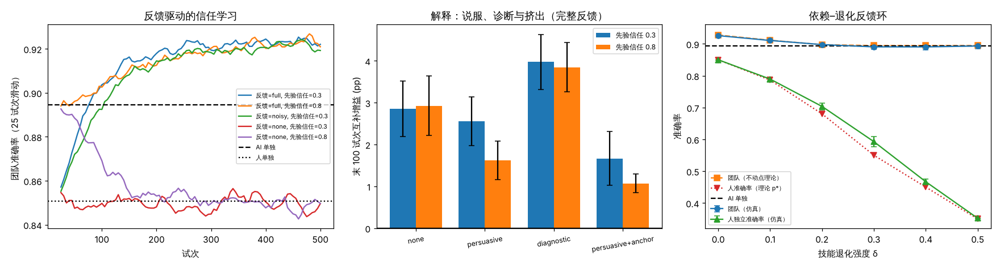

# 人如何学会（不）信任 AI：依赖动态的反馈学习模型——解释的说服偏置、挤出效应与“依赖–技能退化”反馈环

**摘要**　第一阶段的静态分析表明，人机互补需要“错误独立 + 按样本分诊”。真实协作却是**动态**的：人在一次次交互中形成对 AI 的心智模型并调整依赖。2025–2026 年的实证研究报告了三类动态风险：展示 AI 推理会显著提高信任与采纳，同时挤出人的独有知识（arXiv:2511.04050，N=752）；持续的认知卸载会损害独立表现与坚持（arXiv:2604.04721，N=1222；arXiv:2609.20143；arXiv:2604.03501）；人对 AI 建议的依赖只弱地随风险校准（arXiv:2511.15352，N=6474）。本文建立一个可计算的依赖动态模型：人按“置信度档 × 解释信号”线索单元维护“分歧时 AI 对 / 自己对”的 Beta 后验，分歧时比较两者决定是否跟随，并从反馈中学习。在此基础上加入三种机制：解释的说服偏置 b、挤出效应 γ（不独立思考直接采用 AI 答案）、技能退化 δ（人的准确率随依赖率下降）。用 digits 上的真实分类器（准确率 0.894）与模拟人（0.85），每个条件 5 个种子 × 200 人 × 500 试次。结果：完整反馈下，两种先验信任都在约 50–90 个试次后出现互补，末 100 试次增益 +2.9 pp；没有反馈时（自我确认启发式），依赖率坍缩到 0，团队退回“人单独”，比最优单方低 4.5 pp；20% 的噪声反馈几乎无害（−0.12 pp，p=0.32）。说服型解释在先验信任高时使团队准确率降低 1.32 pp（p=0.003），诊断型解释提高 1.10 pp（p=0.013）；挤出效应让分歧率恰好按 (1−γ) 缩减（0.221→0.155），并再损失 0.85 pp。技能退化的不动点理论 p* = 0.85 − δ·F(p*) 预测，δ≈0.3 时互补消失，团队退化为“AI 单独”；仿真中人的最终准确率与理论相差 ≤0.043，团队准确率相差 ≤0.4 pp。结论：适度依赖是可学习的，但前提是**真实反馈**；而说服性呈现与技能退化会从两侧侵蚀互补，后者在长期中会让“人在回路”名存实亡。

**关键词**　人机协作；信任校准；适度依赖；反馈学习；可解释性；认知卸载；技能退化；learning to defer

## 1 引言
第一阶段（README）在静态设定下发现：错误相关 ρ 是互补的硬约束；过度依赖与依赖不足都会把团队拉回单方水平；校准的价值取决于决策规则是否使用绝对概率。但在静态分析里，人对 AI 的可靠性是“已知”的；现实中这种知识必须**从经验中习得**，而习得过程本身又会改变人。2025–2026 年的前沿争论集中在三个问题上：

1. **信任 ≠ 适度依赖。** 依赖测量综述（arXiv:2604.23896）指出，信任量表并不能反映适度依赖；心智模型发展框架（arXiv:2510.08104）强调决策者在持续交互中演化，而现有研究多把人当作“固定的”。
2. **解释是帮助还是说服？** 展示推理提高了信任，却挤出了人的独有知识（arXiv:2511.04050）；“循环中的偏差”（arXiv:2509.08514，N=2784）与有偏 AI 推荐下的简历筛选（arXiv:2606.22213）发现，人对 AI 建议的审查强度受设计和个体因素强烈影响。
3. **长期代价：认知卸载与技能退化。** AI 帮助降低了坚持性和独立表现（arXiv:2604.04721）；元认知反馈可以减少卸载（arXiv:2609.20143）；“增强陷阱”（arXiv:2604.03501）对“即时生产率 vs 技能侵蚀”做了动态经济学建模；“Brainrot”（arXiv:2605.03512）把技能退化列为被忽视的 AI 风险。在算法侧，learning-to-defer 开始处理人的时变表现：专家漂移（arXiv:2611.26440）、疲劳（arXiv:2604.00904）、在线变化的专家（arXiv:2605.12340）、非平稳时间序列（arXiv:2601.22538）。

本文贡献：
- **C1**：给出依赖的贝叶斯学习模型，推导反馈、先验信任、说服偏置和挤出效应下的可检验预测（第 4 节）。
- **C2**：证明“无反馈 + 自我确认”必然导致依赖坍缩到“人单独”，并在仿真中检验。
- **C3**：提出“依赖–技能退化”不动点模型，预测互补消失的临界退化强度 δ*，并用仿真检验。
- **C4**：用真实分类器的置信度分布，定量比较说服型与诊断型解释的净效应。

## 2 前沿进展综述（2025–2026）
**2.1 适度依赖的度量与心智模型。** arXiv:2604.23896 区分了信任、依赖与适度依赖三类构念；arXiv:2606.06081 把适度依赖的度量扩展到集合值 AI 建议；arXiv:2510.08104 提出人机协作中三类心智模型的发展框架；arXiv:2609.36481 用“悖论”视角分析自主性与主动性两个设计维度。

**2.2 解释、呈现与说服。** arXiv:2511.04050（预注册，N=752）：展示 AI 推理（无论简短还是详尽）都是强有力的说服启发式，提高了信任与一致率，却没有帮助参与者在 AI 出错时利用独有知识。arXiv:2603.22152：多 AI 小组给建议时，小组规模越大，从众压力越大，大小组没有额外收益。arXiv:2501.10316：通过问责建模加入“正向摩擦”以减少对对话式 AI 的过度依赖。arXiv:2511.15352（N=6474 的纵向 RCT）：最多 79% 的人遵循 AI 的个人建议，高风险建议的遵循率也在 65% 以上，说明依赖只弱地随风险校准。

**2.3 认知卸载与技能退化。** arXiv:2604.04721（N=1222）提供了 AI 帮助降低坚持性和独立表现的因果证据；arXiv:2609.20143（预注册，N=704）表明元认知反馈与基于努力的奖励可以减少卸载；arXiv:2604.03501 的动态模型把 AI 生产率拆成与专长无关和与专长互补两部分；arXiv:2506.08872 报告了使用 LLM 写作时的“认知负债”；arXiv:2605.03512 把技能退化与成瘾列为被忽视的风险。

**2.4 学习延迟与时变专家。** 专家漂移（arXiv:2611.26440）、疲劳感知的约束优化（arXiv:2604.00904）、在线变化的专家池（arXiv:2605.12340）、非平稳时间序列中的延迟（arXiv:2601.22538）、监督容量与疲劳的人（arXiv:2606.08919）、不确定性量化能否替代学习式延迟（arXiv:2508.02319）、延迟策略可能触发人的偏差（arXiv:2608.28050）。在模型侧，“噪声反馈下的自我评估”（arXiv:2610.34737）发现模型难以从不完整、不正确的交互反馈中形成可信的自我评估。

**共识**：信任会随交互演化；呈现方式（解释、多 AI 小组）强烈影响依赖；长期卸载有代价。**争议**：解释整体上有益还是有害？反馈稀缺或有噪时，人能否学会适度依赖？**被挑战的说法**：“提供解释可提升适度依赖”被 arXiv:2511.04050 挑战；“人机组合普遍更优”被第一阶段引用的 Vaccaro 等（2024）元分析挑战。**开放问题**：OP1 依赖学习需要什么反馈条件；OP2 解释的说服与诊断成分如何分离；OP3 依赖与技能退化的长期动力学；OP4 时变的人如何进入延迟算法。

**前沿地图**

| 路线 | 代表工作 | 关键结论 | 局限 |
|---|---|---|---|
| 依赖度量与心智模型 | 2604.23896, 2606.06081, 2510.08104 | 信任 ≠ 适度依赖；心智模型会演化 | 多为概念框架 |
| 解释与呈现 | 2511.04050, 2603.22152, 2509.08514, 2501.10316 | 解释说服 > 诊断；从众压力 | 多为短期实验 |
| 卸载与退化 | 2604.04721, 2609.20143, 2604.03501, 2605.03512, 2506.08872 | 独立能力下降；可被元认知干预缓解 | 长期机制缺乏定量模型 |
| 时变专家的延迟 | 2611.26440, 2604.00904, 2605.12340, 2601.22538, 2606.08919 | 必须建模人的漂移与疲劳 | 假设外生漂移，忽略 AI 对人的反作用 |
| 现实依赖 | 2511.15352, 2606.22213, 2608.28050 | 依赖只弱地随风险校准 | 因果机制不清 |

## 3 问题与假设
**选择理由。** OP1 与 OP3 构成一个闭环：人从反馈中学会依赖（OP1），依赖又反过来改变人的能力（OP3）。现有延迟算法把人的漂移当作外生（arXiv:2611.26440, 2604.00904）；行为研究观察到了退化（arXiv:2604.04721），却缺少可预测临界点的模型。这一问题重要，而且可以在模拟人上精确检验。OP2 作为第三个机制并入。

**形式化。** 每个试次：AI 给出答案 a 与校准置信度（5 档），可选地附带解释信号 e ∈ {合理, 不合理}；人先独立作答 h（挤出效应下以概率 γ 直接取 h=a）。若 h=a，采纳之；若分歧，当 E[q_c] + b·1[e=合理] > E[h_c] 时跟随 AI。q_c、h_c 是线索单元 c 中“分歧时 AI 对 / 人对”的 Beta 后验均值，先验均值为 m0 与 1−m0，强度为 4。反馈揭示真值后更新后验。技能退化：p_h(t) = 0.85 − δ·r̄_t，r̄_t 为分歧时跟随率的指数滑动平均（时间常数 200）。

**预注册假设（设计写在 `frontier_experiment.py` 头部，阈值在运行前确定）。**
- **H1（反馈）**：完整反馈下，两种先验信任（0.3、0.8）的末 100 试次团队准确率都显著高于 max(AI, 人)；无反馈（自我确认）下，团队准确率收敛到不高于“人单独”的水平。*否证*：完整反馈下任一先验的增益 CI 包含 0；或无反馈时团队准确率显著高于“人单独”。
- **H2（解释）**：(a) 完整反馈下，说服型解释降低团队准确率，幅度与渐近理论预测相差 ≤1 pp；(b) 诊断型解释提高团队准确率；(c) 挤出效应使分歧率乘以 (1−γ)，且降低团队准确率。*否证*：任一方向相反，或 (a) 的偏差 >1 pp。
- **H3（退化反馈环）**：存在临界 δ*，超过它后长期团队准确率 ≤ AI 单独；不动点理论对人最终准确率的预测误差 ≤0.05，对团队准确率的预测误差 ≤1 pp。*否证*：δ≤0.5 内团队始终显著优于 AI，或预测误差超限。

## 4 理论分析
**命题 1（反馈下的一致学习）。** 完整反馈时，线索单元 c 的 Beta 后验均值以速率 O(1/n_c) 收敛到真实条件概率 q_c、h_c，其中 n_c ≈ t·P(分歧)·P(c | 分歧)。决策“跟随 ⇔ q̂_c > ĥ_c”在 |q_c − h_c| = Δ_c 的单元上，约需 n_c ≳ z²·σ²/Δ_c² 次分歧样本才能稳定做对。先验对估计的残余影响为 κ0/(κ0+n_c)。**预测**：本设置下 P(分歧) ≈ 0.22，500 个试次后每个单元约有 22 次分歧，先验残余约 15%。因此 m0=0.8 的人仍会残留过度依赖（过度依赖率高于 m0=0.3 的人），但两者都能取得互补。噪声反馈（翻转率 ε）把 q̂、ĥ 同向压缩（各自乘以 1−ε 再加小常数），在 ε 小、没有系统偏差时不改变 q̂ 与 ĥ 的排序，因此几乎无害。

**命题 2（自我确认导致依赖坍缩）。** 无反馈时，人在每次分歧后记为“AI 错、自己对”，于是 q̂_c 单调趋于 0、ĥ_c 趋于 1。依赖率 → 0，团队准确率 → P(h=y)，即“人单独”。若 AI 强于人，则团队劣于 AI。说服偏置 b 只能在 q̂_c + b > ĥ_c 的早期维持少量跟随。∎

**命题 3（说服偏置的渐近损失）。** 设单元 c 的真实值为 q_c、h_c，被说服的单元（e=合理）满足 q_c < h_c < q_c + b 时会被错误地跟随。渐近损失为 L_b = Σ_c P(c, 分歧)·(h_c − q_c)·1[q_c < h_c < q_c + b]。用真实分类器的置信度分布估计，L_b = 0.17±0.20 pp（各种子的蒙特卡洛估计）。**预测**：在渐近意义上，说服偏置的代价很小；有限试次下，它会与先验过度信任叠加而放大。

**命题 4（挤出效应）。** 以概率 γ 直接采用 AI 答案，分歧率精确地乘以 (1−γ)：P(分歧) = (1−γ)·P₀(分歧)。由于互补只在分歧样本上产生，可获得的最大增益同比例缩小。

**命题 5（依赖–退化不动点）。** 令 F(p) 为准确率为 p 的人在最优依赖下的分歧跟随率；p 越低，人越常被 AI 纠正，F 单调递减。长期动态满足 p = 0.85 − δ·F(p)，即 p 是映射 T(p) = 0.85 − δF(p) 的不动点。δ 增大时，p* 下降、F(p*) 上升，形成正反馈。当 F(p*) → 1 时，人的独立判断不再影响结果，团队 → AI 单独。临界 δ* 由“团队(p*) = AI”决定。F(p) 用静态蒙特卡洛在 12 个 p 格点上估计后插值，再迭代求不动点。

## 5 实验
- **AI**：digits，PCA(8)+Logistic，温度缩放；5 个种子（数据划分），AI 准确率 0.894±0.008。
- **模拟人**：ρ=0.3、p_h=0.85；每个条件 200 个独立的人 × 500 试次（流式随机抽取测试样本）。
- **条件网格**：反馈 {完整, 噪声 20%, 无（自我确认）} × 先验信任 {0.3, 0.8} × 解释 {无, 说服型 (0.9/0.8, b=0.15), 诊断型 (0.9/0.3, b=0), 说服型+挤出 (γ=0.3)}。
- **指标**：末 100 试次团队准确率与互补增益（减去同一试次流上的 max(AI, 人)）；过度/不足依赖率；分歧率；“互补出现时间”（50 试次滑动平均首次超过 max(AI, 人) 的试次）。
- **技能退化**：完整反馈、无解释、m0=0.5，3000 个试次，δ ∈ {0, 0.1, …, 0.5}；理论不动点见命题 5。
- **统计**：均值 ± 95% CI（跨种子），配对 t 检验。运行时间约 67 秒（frontier.json 中的 runtime_s）。

## 6 结果

**表 1　反馈与先验信任（无解释）[实测]**

| 反馈 | 先验信任 | 前 100 试次团队 | 末 100 试次团队 | 互补增益 (pp) | 过度依赖率 | 依赖不足率 | 互补出现时间 |
|---|---|---|---|---|---|---|---|
| 完整 | 0.3 | 0.883 | 0.923±0.005 | +2.85±0.67 | 0.218 | 0.242 | 89 |
| 完整 | 0.8 | 0.898 | 0.923±0.007 | +2.93±0.71 | 0.335 | 0.183 | 50 |
| 噪声 20% | 0.3 | 0.876 | 0.922±0.007 | +2.74±0.60 | 0.211 | 0.264 | 114 |
| 噪声 20% | 0.8 | 0.897 | 0.919±0.005 | +2.58±0.61 | 0.401 | 0.165 | 50 |
| 无（自我确认） | 0.3 | 0.850 | 0.849±0.002 | −4.54±0.82 | 0.000 | 1.000 | — |
| 无（自我确认） | 0.8 | 0.882 | 0.849±0.004 | −4.48±1.15 | 0.000 | 1.000 | — |

（人单独约 0.850，AI 单独 0.894。完整反馈对比无反馈，m0=0.8：+7.39±0.82 pp，p=6e−5；噪声对比完整，m0=0.3：−0.12±0.21 pp，p=0.32。）

**表 2　解释的效应（完整反馈，末 100 试次）[实测]**

| 解释 | 先验 0.3：增益 (pp) | 先验 0.8：增益 (pp) | 过度依赖率 (0.8) | 分歧率 |
|---|---|---|---|---|
| 无 | +2.85±0.67 | +2.93±0.71 | 0.335 | 0.221 |
| 说服型 | +2.55±0.58 | +1.62±0.46 | 0.629 | 0.223 |
| 诊断型 | +3.97±0.66 | +3.85±0.59 | 0.391 | 0.221 |
| 说服型 + 挤出 γ=0.3 | +1.67±0.65 | +1.07±0.23 | 0.702 | 0.155 |

配对检验：说服型对无解释，m0=0.3 时 −0.38±0.38 pp（p=0.12），m0=0.8 时 −1.32±0.40 pp（p=0.003）；诊断型对无解释（m0=0.3）+1.10±0.51 pp（p=0.013）；挤出对说服型（m0=0.3）−0.85±0.23 pp（p=0.002）。命题 3 的渐近理论损失为 0.17±0.20 pp。

**表 3　依赖–技能退化（3000 试次，末 500 试次）[实测 + 理论]**

| δ | 人最终准确率（仿真） | p*（理论） | 分歧跟随率（仿真） | 团队（仿真） | 团队（理论） | 团队 − AI (pp) |
|---|---|---|---|---|---|---|
| 0 | 0.850 | 0.850 | 0.533 | 0.926±0.006 | 0.928 | +3.22±0.61 |
| 0.1 | 0.789 | 0.786 | 0.626 | 0.911±0.006 | 0.911 | +1.68±0.54 |
| 0.2 | 0.704 | 0.680 | 0.756 | 0.898±0.006 | 0.897 | +0.41±0.33 |
| 0.3 | 0.593 | 0.550 | 0.877 | 0.891±0.008 | 0.895 | −0.31±0.11 |
| 0.4 | 0.467 | 0.450 | 0.969 | 0.891±0.009 | 0.895 | −0.33±0.20 |
| 0.5 | 0.352 | 0.350 | 0.998 | 0.893±0.008 | 0.895 | −0.05±0.08 |

**逐条对照：**
- **H1 支持。** 完整反馈下两种先验的增益分别为 +2.85 和 +2.93 pp（CI 均不含 0）；无反馈时，依赖率坍缩到 0，团队为 0.849（人单独约 0.850），与命题 2 一致。先验 0.8 的人在早期因信任 AI 而领先（0.882），随后退化（0.849）。这是“自我确认”的典型轨迹：每一次分歧都被解读为 AI 出错。
- **H2 部分支持。** (a) 方向成立，但幅度上：m0=0.3 时观测损失 0.38 pp（不显著），与理论 0.17 pp 相差 0.21 pp；m0=0.8 时观测 1.32 pp，与理论相差 1.15 pp，超过 1 pp 的阈值（否证）。有限试次下，说服偏置与先验过度信任叠加，过度依赖率从 0.335 升至 0.629，渐近理论低估了这一放大。(b) 支持（+1.10 pp，p=0.013）。(c) 支持：分歧率 0.221→0.155，恰为 ×0.70；团队再损失 0.85 pp（p=0.002）。
- **H3 支持。** 团队 − AI 由 δ=0 时的 +3.22 pp 降为 δ=0.3 时的 −0.31±0.11 pp（CI 不含 0），临界 δ* 位于 0.2 与 0.3 之间。人最终准确率的理论误差最大为 0.043（δ=0.3），团队准确率的理论误差 ≤0.4 pp。δ≥0.4 时，分歧跟随率 ≥0.97，“人在回路”名存实亡。

## 7 讨论
**与前沿论断的关系。**
1. *“解释是说服而非诊断”*（arXiv:2511.04050）：本模型复现了其核心现象（说服型解释提升采纳与过度依赖：0.335→0.629），并给出分解：伤害取决于说服偏置与先验信任的叠加，以及反馈能否把二者校正掉。只要解释带来**诊断信息**（错误时看起来不合理），即使不改变说服力，也能带来 +1.1 pp。因此，评估解释应测量它的**区分力**（对 AI 对/错样本的似然比），而不是满意度或信任。
2. *挤出独有知识*（arXiv:2511.04050）与*认知卸载*（arXiv:2604.04721, 2609.20143）：命题 4 指出，挤出效应的代价与“互补只发生在分歧样本上”这一结构直接相关：每挤出 γ 的独立判断，就按比例消除互补机会。命题 5 把卸载推广到长期：依赖降低技能，技能下降又增加依赖。这一正反馈在 δ≈0.25 时把团队推到 AI 的水平，与“增强陷阱”（arXiv:2604.03501）的经济学直觉一致，并给出了可检验的临界点。
3. *时变专家的延迟*（arXiv:2611.26440, 2604.00904, 2605.12340）：这些工作把人的漂移视为外生；本文表明，漂移可以**由 AI 部署本身引起**（内生退化）。延迟策略越优化短期准确率（越多地把决策交给 AI），越可能加速退化。这提示延迟算法的目标函数需要包含“人的长期技能”状态变量。
4. *噪声反馈*（arXiv:2610.34737 讨论模型在噪声反馈下的自我评估）：对人而言，20% 的对称噪声几乎无害；真正的危险是**无反馈 + 自我确认**。在缺少真值反馈的部署环境（多数现实场景）中，“学会适度依赖”无法自动发生。
5. *依赖只弱随风险校准*（arXiv:2511.15352）：本模型提供一种解释：现实中大多数建议得不到真值反馈，人无法学习条件可靠性，依赖由先验和呈现方式决定。

**外推边界与局限。** (i) 模拟人是一个理想化的贝叶斯学习者，线索单元固定；真实人类的学习更慢、有遗忘、受情绪和代价影响。(ii) 技能退化被建模为准确率随依赖率线性下降，形式与系数 δ 都是假设；真实的退化速率、可逆性和练习效应需要纵向实验来测定（arXiv:2604.04721 一类研究可提供参数）。(iii) 解释被抽象为二值信号，忽略了内容、长度与人的理解能力。(iv) 任务是 10 类数字识别；高风险任务中代价不对称、反馈延迟更长。(v) 只用了 5 个种子（每个含 200 人），对“互补出现时间”等离散量只报告了均值曲线上的估计。

## 8 结论
1. 适度依赖可以从反馈中学到：完整反馈下，无论先验信任高低，约 50–90 个试次后都会出现互补（末期 +2.9 pp）；对称噪声反馈影响很小 [实测 + 推导，置信度：中高（模型内）]。
2. 没有真值反馈时，“自我确认”会让人对 AI 的依赖坍缩到 0，团队退回“人单独”，比 AI 单独低 4.5 pp [实测 + 推导，置信度：中高]。
3. 解释的净效应取决于其诊断性：说服型解释在高先验信任下损失 1.3 pp，诊断型解释提升 1.1 pp；挤出效应按 (1−γ) 消除互补机会 [实测，置信度：中]。
4. 依赖–技能退化构成正反馈环，存在临界强度 δ*（0.2–0.3），超过后互补消失，团队退化为“AI 单独”；不动点理论定量地预测了这一过程 [实测 + 推导，置信度：中（退化函数形式为假设）]。

**对 2035 的研判 [判断]。** 随着 AI 能力提高、使用频率增加，人机混合系统的主要风险将从“短期错误依赖”转向“长期能力侵蚀”：人类的独立判断力在不知不觉中退化，最终使“人在回路”失去纠错价值。2035 年的人机混合增强智能需要三类基础设施：(a) 系统性的真值反馈回路（让人能够学习 AI 的条件可靠性）；(b) 以诊断性而非说服力为目标的解释设计与评测；(c) 把人的技能状态纳入优化目标的协作与延迟算法（例如定期安排“无 AI”练习、按技能状态调节延迟率）。

**后续研究建议。** (1) 纵向实验测量人对 AI 依赖的学习曲线，并估计 δ（退化速率）和可逆性；(2) 把“人的技能状态”作为状态变量加入 learning-to-defer 的约束 MDP（在 arXiv:2604.00904 的框架上扩展）；(3) 建立解释诊断性的标准化度量，与满意度、信任并列报告。

## 参考文献
**2025–2026 前沿（arXiv）**
1. Revealing AI Reasoning Increases Trust but Crowds Out Unique Human Knowledge. arXiv:2511.04050 (2025).
2. From Trust to Appropriate Reliance: Measurement Constructs in Human-AI Decision-Making. arXiv:2604.23896 (2026).
3. Development of Mental Models in Human-AI Collaboration: A Conceptual Framework. arXiv:2510.08104 (2025).
4. A Framework for Measuring Appropriate Reliance on Set-Valued AI Advice. arXiv:2606.06081 (2026).
5. Human-AI Collaboration: From Paradoxes to Patterns. arXiv:2609.36481 (2026).
6. More Isn't Always Better: Balancing Decision Accuracy and Conformity Pressures in Multi-AI Advice. arXiv:2603.22152 (2026).
7. Bias in the Loop: How Humans Evaluate AI-Generated Suggestions. arXiv:2509.08514 (2025).
8. Resume Screening, Fast and Slow: (Biased) AI Recommendations' Influence on Human Decision Making. arXiv:2606.22213 (2026).
9. Know Your Mistakes: Towards Preventing Overreliance on Task-Oriented Conversational AI Through Accountability Modeling. arXiv:2501.10316 (2025).
10. People readily follow personal advice from AI but it does not improve their well-being. arXiv:2511.15352 (2025).
11. AI Assistance Reduces Persistence and Hurts Independent Performance. arXiv:2604.04721 (2026).
12. Designing Against Deskilling: Metacognitive Feedback Reduces Cognitive Offloading to LLM Assistants. arXiv:2609.20143 (2026).
13. The Augmentation Trap: AI Productivity and the Cost of Cognitive Offloading. arXiv:2604.03501 (2026).
14. Brainrot: Deskilling and Addiction are Overlooked AI Risks. arXiv:2605.03512 (2026).
15. Your Brain on ChatGPT: Accumulation of Cognitive Debt when Using an AI Assistant for Essay Writing Task. arXiv:2506.08872 (2025).
16. Learning to Defer under Expert Drift. arXiv:2611.26440 (2026).
17. Fatigue-Aware Learning to Defer via Constrained Optimisation. arXiv:2604.00904 (2026).
18. Online Learning-to-Defer with Varying Experts. arXiv:2605.12340 (2026).
19. Learning-to-Defer in Non-Stationary Time Series via Switching State-Space Models. arXiv:2601.22538 (2026).
20. Oversight Has a Capacity: Calibrating Agent Guards to a Subjective, Fatiguing Human. arXiv:2606.08919 (2026).
21. Is Uncertainty Quantification a Viable Alternative to Learned Deferral? arXiv:2508.02319 (2025).
22. Too Much of the Same: From Algorithmic to Human Bias in Learning to Defer. arXiv:2608.28050 (2026).
23. LADDER: Diagnosing Domain-Level Self-Assessment Under Noisy Feedback. arXiv:2610.34737 (2026).

**奠基文献（第一阶段已核实）**
24. Bansal, G., et al. (2021). Does the whole exceed its parts? The effect of AI explanations on complementary team performance. CHI 2021. arXiv:2006.14779.
25. Mozannar, H., & Sontag, D. (2020). Consistent estimators for learning to defer to an expert. arXiv:2006.01862.
26. Lee, J. D., & See, K. A. (2004). Trust in automation: Designing for appropriate reliance. Human Factors 46(1):50–80.
27. Parasuraman, R., & Riley, V. (1997). Humans and automation: Use, misuse, disuse, abuse. Human Factors 39(2):230–253.
28. Buçinca, Z., Malaya, M. B., & Gajos, K. Z. (2021). To trust or to think: Cognitive forcing functions can reduce overreliance on AI in AI-assisted decision-making. arXiv:2102.09692.
29. Vaccaro, M., Almaatouq, A., & Malone, T. (2024). When combinations of humans and AI are useful: A systematic review and meta-analysis. Nature Human Behaviour 8:2293–2303.
