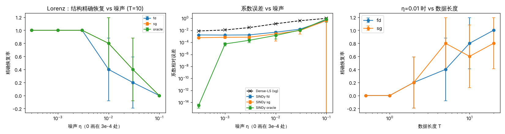
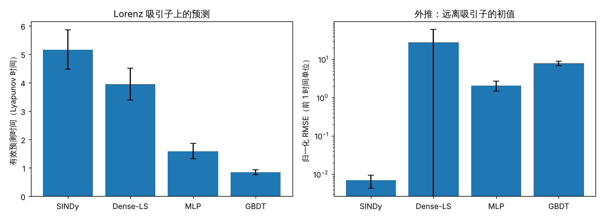
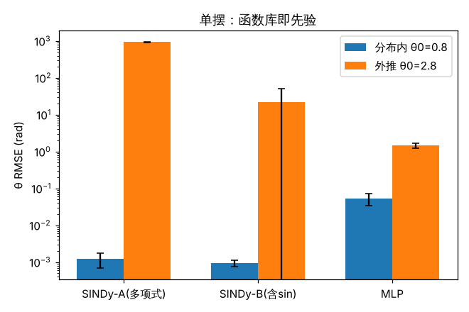

# Q20 科学智能：从数据中发现科学规律

> 分组：系统与交叉 ｜ 实验：`experiment.py`（单核运行时间约 130 秒） ｜ 证据标注：[实测] [文献] [判断]

## 摘要
“AI 能否从数据中发现科学规律”可以收窄为一个可检验的问题：在什么条件下，算法能从有限、带噪的观测中**精确恢复**控制方程的结构，而不只是拟合数据？发现的方程又在多大程度上优于黑箱模型？本研究用 numpy 实现 SINDy（多项式库 + 序贯阈值最小二乘），在 Lorenz 系统和阻尼单摆上系统改变噪声、数据长度、导数估计方法和函数库，并与 MLP、GBDT 和“不稀疏的同库最小二乘”对比。[实测] 在 Lorenz 系统上，噪声 η≤0.3% 时 5/5 种子精确恢复 7 项结构；η=1% 时 Savitzky–Golay 平滑与有限差分的精确恢复率分别为 0.8 和 0.4；η=10% 时全部失败；数据短于 1 个时间单位时也全部失败。发现的方程的有效预测时间为 5.16±0.69 个 Lyapunov 时间，MLP 为 1.59±0.28、GBDT 为 0.85±0.09；在远离吸引子的外推中，误差比 MLP 低约 300 倍（0.0069 对 2.09）。单摆实验揭示了“发现”的两个先决条件：**正确的函数库**（纯多项式库只能学到泰勒展开，外推发散）和**足够有信息量的数据**（只用小振幅数据时，即使库正确也只有 1/5 的种子精确恢复；事后把训练振幅放宽到 2.5 rad 后，5/5 精确恢复，外推误差 0.003 rad）。结论：稀疏回归式的规律发现是真实而强大的，但它在“先验库 × 数据激发 × 噪声”的狭窄交集中才成立；科学智能的核心难点在于自动构造假设空间和设计实验。

## 1. 问题界定
**为何是基础问题。** 科学规律的价值在于**简约、可解释、可外推**：F=ma 在训练分布外依然成立。深度学习擅长插值，却往往无法外推。“AI for Science”的基础问题是：机器学习能否产出具有这种外推能力的符号化规律？其可行条件是什么？核心矛盾在于：(i) 表达能力与可识别性：假设空间越大，越可能包含真规律，但也越难从有限数据中唯一确定；(ii) 噪声与微分：动力学规律涉及导数，而数值求导会放大噪声；(iii) 先验与发现：如果正确答案必须事先放在库里，“发现”在多大程度上是机器完成的？

**可检验的子假设（实验前固定）：**
- **H1（可恢复性边界）**：在正确函数库下，SINDy 在低噪声（η≤1%）和充足数据（T=10）时精确恢复 Lorenz 结构；精确恢复率随噪声上升而下降；平滑求导（SG）相较有限差分提高噪声容限（同噪声下恢复率更高、系数误差更低）。*否证*：η≤1% 时恢复率 <0.5，或 SG 不优于 FD。
- **H2（简约模型的外推优势）**：在相同数据下，SINDy 的有效预测时间（VPT）和离吸引子外推误差都显著优于黑箱回归器（MLP、GBDT）。*否证*：任一黑箱在 VPT 或外推误差上不劣于 SINDy。
- **H3（库即先验）**：当函数库不含真实结构（单摆只用多项式库）时，无法得到正确结构，在训练范围之外的外推误差远大于含 sinθ 的库。*否证*：多项式库的外推误差不高于含 sin 库的。

## 2. 研究现状
- **符号回归与方程发现 [文献]**：Schmidt & Lipson（2009，Science 324:81–85）用遗传编程从实验数据中提取守恒律和运动方程；Brunton、Proctor、Kutz（2016，PNAS，arXiv:1509.03580）提出 SINDy，把方程发现转化为在候选函数库上的稀疏回归，大幅降低了计算量；Rudy 等（2017，arXiv:1609.06401）将其扩展到偏微分方程（PDE-FIND）；Champion 等（2019，arXiv:1904.02107）把自编码器与 SINDy 结合，学习“坐标 + 方程”；SINDy-PI（Kaheman 等 2020，arXiv:2004.02322）处理隐式和有理函数动力学；Weak SINDy（Messenger & Bortz 2021，arXiv:2005.04339）用弱形式规避数值求导，显著提高抗噪性；Ensemble-SINDy（Fasel 等 2022，arXiv:2111.10992）用自助法在低数据、高噪声下给出不确定性；PySINDy（de Silva 等 2020，arXiv:2004.08424）提供了开源实现。AI Feynman（Udrescu & Tegmark 2020，arXiv:1905.11481）利用量纲分析、对称性和可分性等物理先验做符号回归；Cranmer 等（2020，arXiv:2006.11287）从带归纳偏置的图网络中提取符号模型。
- **神经网络代理模型与黑箱路线 [文献]**：物理信息神经网络（Raissi 等 2017，arXiv:1711.10561）、DeepONet（Lu 等 2019，arXiv:1910.03193）、傅里叶神经算子（Li 等 2020，arXiv:2010.08895）和 GraphCast（Lam 等 2022，arXiv:2212.12794）代表“高精度代理模型”路线；储备池计算可以复现混沌吸引子并估计 Lyapunov 指数（Pathak 等 2017，arXiv:1710.07313）。AlphaFold（Jumper 等 2021，Nature 596:583–589）表明，数据驱动模型可以在不给出显式规律的情况下解决核心科学问题。Wang 等（2023，Nature 620:47–60）综述了 AI 时代的科学发现。
- **争议与缺口 [判断]**：(i) “发现”与“拟合”之争：黑箱代理模型精度高但不可外推、不可解释；符号方法可解释，但依赖人为设定的库。(ii) 可识别性：多数 SINDy 研究在已知真解的“干净”基准上报告成功，很少系统报告失败边界（噪声、数据激发不足、库共线性）。(iii) 缺少把“先验知识的量”作为自变量的对照实验。本项目在一个透明框架中同时度量这些边界。

## 3. 研究设计
- **Lorenz（σ=10, ρ=28, β=8/3）**：初值在 (−8,8,27) 附近随机扰动，高精度积分（LSODA，rtol=atol=1e-10），采样 dt=0.005，丢弃前 1 个时间单位；加性高斯噪声 η·std(x)。
- **导数估计**：FD（二阶中心差分）、SG（Savitzky–Golay 窗口 21、3 阶，同时平滑状态并求导），以及 oracle（真实导数，但库仍用带噪状态，用来分离“求导误差”与“变量误差”）。
- **SINDy**：三阶多项式库（20 项）；STLSQ 阈值 λ=0.1（预先固定），10 次迭代。对照 Dense-LS：同一个库、不做稀疏化的最小二乘。λ 敏感性分析只作报告，不用于选参。
- **指标**：项支撑的精确率和召回率、精确恢复（支撑完全一致）、系数相对误差 ‖Ξ−Ξ*‖_F/‖Ξ*‖_F。
- **预测对比**（η=1%，T=10，SG）：四个模型都学习 x→ẋ，再用 RK4（dt=0.01）积分。20 个吸引子上的测试初值，计算有效预测时间 VPT（归一化误差首次 >0.5，单位为 Lyapunov 时间，λ₁≈0.906，上限 9.06）；外推：20 个均匀分布在 |x|,|y|≤40、z∈[−20,80] 的离吸引子初值，取前 1 个时间单位的归一化 RMSE。
- **阻尼单摆** θ̈ = −4 sinθ − 0.2 θ̇：5 条小振幅（|θ0|≤1）轨迹，每条 10 s，η=1%，SG 求导。库 A 为 (θ,ω) 三阶多项式（不含真结构）；库 B 为二阶多项式 ∪ {sinθ, cosθ}（含真结构）。在分布内（θ0=0.8）和外推（θ0=2.8，接近分界线 π）条件下比较 10 s 轨迹的 θ RMSE，并与 MLP 对比。**事后补充**（首轮结果出来后加入，非预注册）：把训练振幅放宽到 |θ0|≤2.5，其余不变。
- **统计**：5 个种子；均值 ± 95% CI；SG 与 FD 的对比用对数系数误差的配对 t 检验；VPT 与外推误差用配对 t 检验。

## 4. 结果

**表 1　Lorenz：噪声对结构恢复的影响（T=10）[实测]**

| η | FD 精确恢复 | FD 精确率 | FD 系数误差 | SG 精确恢复 | SG 精确率 | SG 系数误差 | oracle 精确恢复 | Dense-LS 系数误差 |
|---|---|---|---|---|---|---|---|---|
| 0 | 1.0 | 1.000 | 0.002 | 1.0 | 1.000 | 0.001 | 1.0 | 0.008±0.004 |
| 0.1% | 1.0 | 1.000 | 0.002 | 1.0 | 1.000 | 0.001 | 1.0 | 0.011±0.002 |
| 0.3% | 1.0 | 1.000 | 0.002 | 1.0 | 1.000 | 0.001 | 1.0 | 0.029±0.011 |
| 1% | 0.4 | 0.925±0.060 | 0.005±0.002 | 0.8 | 0.975±0.049 | 0.003±0.002 | 0.8 | 0.124±0.059 |
| 3% | 0.2 | 0.842±0.086 | 0.015±0.005 | 0.4 | 0.906±0.083 | 0.009±0.007 | 0.4 | 0.398±0.130 |
| 10% | 0.0 | 0.521±0.063 | 0.485±0.138 | 0.0 | 0.648±0.115 | 0.426±0.724 | 0.0 | 0.975±0.539 |

SG 相对 FD 的系数误差（几何平均比值）：η=0.3% 时 0.39（p=0.020），1% 时 0.34（p=0.065），3% 时 0.44（p=0.051）。召回率在 η≤3% 时始终为 1.000：失败的形式是**多出伪项**，而不是漏掉真项。

**表 2　数据长度（η=1%）与阈值敏感性 [实测]**

| T（时间单位） | 0.5 | 1 | 2 | 5 | 10 | 20 |
|---|---|---|---|---|---|---|
| SG 精确恢复 | 0.0 | 0.0 | 0.2 | 0.8 | 0.6 | 0.8 |
| SG 系数误差 | 191±86 | 10.4±12.5 | 0.009 | 0.003 | 0.003 | 0.001 |
| FD 精确恢复 | 0.0 | 0.0 | 0.2 | 0.4 | 0.8 | 1.0 |

（长度实验与噪声实验使用不同的噪声抽样，且噪声按 20 个时间单位长轨迹的标准差缩放，所以 T=10 时的恢复率（0.6 对 0.8）不完全相同，这本身也反映了 5 个种子下比例估计的抽样波动。）

λ 敏感性（SG，η=1%）：λ=0.02/0.05/0.1/0.2/0.5/1.0 时精确恢复率为 0/0.2/0.8/1.0/0.6/0；η=3% 时最高只有 0.4（λ=0.1 或 0.2）。

**表 3　Lorenz 预测与外推（η=1%，T=10）[实测]**

| 模型 | VPT（Lyapunov 时间） | 离吸引子外推归一化 RMSE |
|---|---|---|
| SINDy | **5.16±0.69** | **0.0069±0.0026** |
| Dense-LS（同库不稀疏） | 3.95±0.57 | 27.7±32.8（部分初值发散） |
| MLP | 1.59±0.28 | 2.09±0.59 |
| GBDT | 0.85±0.09 | 7.97±1.05 |

SINDy 与 MLP 比较：VPT 的配对 p=0.0015，外推误差（对数）的配对 p=5.4e−6。

**表 4　单摆：函数库与数据信息量 [实测]**

| 训练数据 | 模型 | 分布内 θ RMSE（θ0=0.8） | 外推 θ RMSE（θ0=2.8） | 库 B 精确恢复 |
|---|---|---|---|---|
| 小振幅 \|θ0\|≤1 | SINDy-A（多项式） | 0.0012±0.0005 | 931±4（发散，被积分器截断） | — |
| 小振幅 | SINDy-B（含 sin） | 0.0009±0.0002 | 22.2±27.9（各种子：70.6, 39.2, 0.004, 0.69, 0.75） | 0.2（精确率 0.47±0.27） |
| 小振幅 | MLP | 0.052±0.019 | 1.46±0.21 | — |
| 大振幅 \|θ0\|≤2.5（事后） | SINDy-A（多项式） | 0.031±0.006 | 881±25（发散） | — |
| 大振幅（事后） | SINDy-B（含 sin） | 0.0007±0.0002 | **0.0029±0.0018** | **1.0**（系数误差 0.0002） |

多项式库在小振幅数据上学到的是 ω̇ ≈ −3.992θ − 0.200ω + 0.617θ³（真值的泰勒展开为 −4θ + 0.667θ³ − 0.2ω）：它“发现”的是一个只在局部成立的近似律。

**逐条回应：**
- **H1 支持（SG 优势的统计强度为中等）。** η≤0.3% 时 100% 精确恢复，η=1% 时 SG 为 0.8（≥0.5），随噪声单调下降，η=10% 时为 0。SG 在 η=1% 和 3% 时的恢复率是 FD 的两倍（0.8 对 0.4，0.4 对 0.2），系数误差降为 FD 的 0.34–0.44，但在 5 个种子下只有 η=0.3% 达到 p<0.05。值得注意的是，SG 的恢复率与 oracle 导数**完全相同**（0.8/0.4/0）：一旦导数平滑得当，瓶颈就转移到库中带噪的状态变量（变量误差），而不是求导本身。
- **H2 支持。** SINDy 的 VPT 是 MLP 的 3.2 倍、GBDT 的 6.1 倍；外推误差比 MLP 低约 300 倍。Dense-LS 的结果说明，**稀疏性**本身至关重要：同一个正确的库，若不剪除伪项，分布内预测尚可（3.95），外推则发散（27.7±32.8）。
- **H3 支持，并有重要补充。** 多项式库的外推完全失败（发散），甚至比 MLP 更差（931 对 1.46 rad）：错误的“简约规律”在外推时可能比黑箱更危险。但**正确的库并不充分**：只用小振幅数据时，sinθ 与 θ、θ³ 几乎共线，库 B 只有 1/5 的种子精确恢复，外推在 2/5 的种子上严重失败。事后实验证实了这一机理：训练振幅扩大到 2.5 rad 后，库 B 的 5/5 个种子精确恢复，外推误差为 0.0029 rad。

## 5. 讨论
**机理：发现 = 先验库 × 数据激发 × 稀疏选择。** 稀疏回归能“发现”规律有三个条件：(1) 真结构在候选空间内（表 4 中库 A 的失败）；(2) 数据足以区分候选项，即库矩阵在数据上的条件数良好（小振幅时 sinθ≈θ−θ³/6，使三者不可区分；Lorenz 的 T≤1 时轨迹还没有穿越两翼，也不可识别）；(3) 噪声足够低、稀疏阈值合适，使伪项能被剪掉（表 1、表 2）。这三条分别对应科学实践中的**理论假设**、**实验设计**和**测量精度**。机器做的是第三步，以及在给定库内的组合搜索；前两步仍主要依赖人 [判断]。

**为何简约模型外推更好。** 黑箱模型只在训练数据覆盖的状态区域学到 ẋ=f(x)，在吸引子之外没有约束（MLP 外推误差 2.09，GBDT 的分段常数为 7.97）；SINDy 的输出是一个全局函数形式，一旦结构正确，它在整个状态空间都成立，这就是“规律”的含义。反过来，结构一旦错了（多项式单摆），全局形式会让错误在外推时**放大**，表现得比黑箱更糟。可解释性与外推性是同一枚硬币的两面 [实测 + 判断]。

**与文献的一致与分歧。** Lorenz 在低噪声下的精确恢复与 Brunton 等（2016）一致；η≥3% 时恢复率下降，与 Weak SINDy 和 Ensemble-SINDy 的出发点一致，说明经典 STLSQ 的噪声容限有限。λ 敏感性（λ=0.2 时 η=1% 可达 100%，λ=1.0 时为 0）提醒我们：报告“成功恢复”的文献往往隐含了阈值调优，而预先固定 λ 时，成功率会明显低于最优值 [实测 + 判断]。

**效度威胁与外推边界。**
1. 只研究了低维 ODE，且真实方程恰好在“多项式 + 三角函数”库中；真实科学问题（高维、PDE、隐变量、未知坐标）要难得多。
2. 精确恢复率基于 5 个种子，粒度为 0.2，CI 很宽（图中正态近似的 CI 会超出 [0,1]）；结论看的是方向，而非精确数值。
3. 黑箱基线只做了默认调参，没有使用更强的时序模型（如储备池计算、神经 ODE、物理约束网络），因此 VPT 差距可能被高估；但外推差距源于模型形式，调参无法弥合 [判断]。
4. 单摆的“数据信息量”结论来自事后实验，属于探索性证据，需要在其他系统上预注册复验。
5. 噪声模型为独立同分布的高斯噪声；实际测量中的系统误差、漂移和离散事件不在范围内。

<!-- BIBLIO:start -->
## 文献计量信号（arXiv，[实测]）

检索式：摘要含 “AI for science”、“symbolic regression”、“equation discovery”、“scientific machine learning” 之一；基线为同年 cs.LG / cs.AI / stat.ML 论文总数。数据：`ai2035/bibliometrics/arxiv_counts.json`（检索日 2026-11-26）。

| 年份 | 命中论文数 | 占 AI/ML 基线比例 |
|---|---|---|
| 2015 | 1 | 0.02% |
| 2016 | 2 | 0.03% |
| 2017 | 14 | 0.17% |
| 2018 | 11 | 0.08% |
| 2019 | 33 | 0.15% |
| 2020 | 51 | 0.17% |
| 2021 | 73 | 0.22% |
| 2022 | 109 | 0.30% |
| 2023 | 184 | 0.41% |
| 2024 | 260 | 0.44% |
| 2025 | 453 | 0.61% |

- 2019–2025 年份额的对数线性趋势：**每年 +27.3%**（95% CI +23.1% ~ +31.7%，R²=0.99），判定：**相对升温（增速显著快于 AI/ML 总体）**；在 20 个问题中按相对增速排第 2 位。
- 解读边界：分子覆盖 arXiv 全部类别、分母仅为 AI/ML 三个类别，所以“比例”是相对关注度指数，并非严格的子集占比；关键词匹配既会漏掉使用其他术语的工作，也会混入无关用法；arXiv 偏重机器学习社区，认知科学、神经科学与期刊论文覆盖不足。该信号衡量的是**研究关注度**，不是**问题被解决的程度**。
<!-- BIBLIO:end -->

## 6. 结论与 2035 展望
**核心结论**
1. 在正确的函数库、低噪声（≤0.3%）、足够长的数据下，SINDy 能精确恢复 Lorenz 方程；噪声升到 1–3% 时恢复率降到 0.8–0.2，10% 时为 0 [实测，置信度：高]。
2. 被发现的简约方程在预测（VPT 5.16 对 1.59 Lyapunov 时间）和外推（误差约为 MLP 的 1/300）上都显著优于黑箱；稀疏化是外推稳定的关键 [实测，置信度：高（限于低维 ODE）]。
3. “发现”要求先验库包含真结构：缺少 sinθ 时，只能学到泰勒近似，外推发散，比黑箱更危险 [实测，置信度：高]。
4. 正确的库也不充分，还需要能激发非线性的数据：小振幅数据只有 1/5 精确恢复，大振幅数据为 5/5。主动实验设计是规律发现的核心环节 [实测（事后）+ 判断，置信度：中]。
5. 平滑求导能缓解噪声，但瓶颈随后转移到变量误差；需要弱形式、集成或误差在变量中的回归方法 [实测，置信度：中]。

**关键未解问题**：(i) 假设空间（库、坐标、守恒律）能否自动构造，例如由大模型提出候选、由稀疏回归检验；(ii) 带隐变量、部分可观测和高维 PDE 系统的可识别性理论；(iii) 面向可识别性的主动实验设计，即根据库矩阵的条件数选择下一次实验；(iv) 如何量化“发现”的可信度，包括模型不确定性、发现结果的可重复性，以及与已有理论的一致性。

**建议研究路线**
- **近期（2026–2028）**：建立带“失败边界”的方程发现基准，系统报告噪声、数据长度和库错设下的恢复率。*里程碑*：方法在 10% 噪声下对 10 个标准 ODE 和 PDE 的平均精确恢复率 ≥80%，并在预注册条件下给出校准的不确定性。
- **中期（2029–2032）**：发展“大模型提出假设 + 稀疏或符号回归检验 + 主动实验”的闭环科学智能体。*里程碑*：在至少一个真实实验平台（如流体或化学反应）上，闭环系统以比随机实验少 5 倍的实验次数，恢复已知但未提供给系统的控制方程。
- **远期（2033–2035）**：实现对未知规律的可验证发现。*里程碑*：AI 系统提出的新的简约定律（非训练语料中的已知方程）在独立实验室的外推实验中得到验证，并被同行评审发表。

## 参考文献
1. Brunton, S. L., Proctor, J. L., & Kutz, J. N. (2016). Discovering governing equations from data by sparse identification of nonlinear dynamical systems. *PNAS*, 113(15), 3932–3937. arXiv:1509.03580.
2. Schmidt, M., & Lipson, H. (2009). Distilling free-form natural laws from experimental data. *Science*, 324(5923), 81–85.
3. Lorenz, E. N. (1963). Deterministic nonperiodic flow. *Journal of the Atmospheric Sciences*, 20(2), 130–141.
4. Rudy, S. H., Brunton, S. L., Proctor, J. L., & Kutz, J. N. (2017). Data-driven discovery of partial differential equations. *Science Advances*, 3(4), e1602614. arXiv:1609.06401.
5. Champion, K., Lusch, B., Kutz, J. N., & Brunton, S. L. (2019). Data-driven discovery of coordinates and governing equations. *PNAS*, 116(45), 22445–22451. arXiv:1904.02107.
6. Kaheman, K., Kutz, J. N., & Brunton, S. L. (2020). SINDy-PI: A robust algorithm for parallel implicit sparse identification of nonlinear dynamics. arXiv:2004.02322.
7. Messenger, D. A., & Bortz, D. M. (2021). Weak SINDy: Galerkin-based data-driven model selection. arXiv:2005.04339.
8. Fasel, U., Kutz, J. N., Brunton, B. W., & Brunton, S. L. (2022). Ensemble-SINDy: Robust sparse model discovery in the low-data, high-noise limit, with active learning and control. arXiv:2111.10992.
9. de Silva, B. M., Champion, K., Quade, M., Loiseau, J.-C., Kutz, J. N., & Brunton, S. L. (2020). PySINDy: A Python package for the sparse identification of nonlinear dynamics from data. arXiv:2004.08424.
10. Udrescu, S.-M., & Tegmark, M. (2020). AI Feynman: A physics-inspired method for symbolic regression. *Science Advances*, 6(16). arXiv:1905.11481.
11. Cranmer, M., Sanchez-Gonzalez, A., Battaglia, P., Xu, R., Cranmer, K., Spergel, D., & Ho, S. (2020). Discovering symbolic models from deep learning with inductive biases. arXiv:2006.11287.
12. Raissi, M., Perdikaris, P., & Karniadakis, G. E. (2017). Physics informed deep learning (Part I): Data-driven solutions of nonlinear partial differential equations. arXiv:1711.10561.
13. Lu, L., Jin, P., & Karniadakis, G. E. (2019). DeepONet: Learning nonlinear operators for identifying differential equations based on the universal approximation theorem of operators. arXiv:1910.03193.
14. Li, Z., Kovachki, N., Azizzadenesheli, K., Liu, B., Bhattacharya, K., Stuart, A., & Anandkumar, A. (2020). Fourier neural operator for parametric partial differential equations. arXiv:2010.08895.
15. Lam, R., et al. (2022). GraphCast: Learning skillful medium-range global weather forecasting. arXiv:2212.12794.
16. Pathak, J., Lu, Z., Hunt, B. R., Girvan, M., & Ott, E. (2017). Using machine learning to replicate chaotic attractors and calculate Lyapunov exponents from data. *Chaos*, 27, 121102. arXiv:1710.07313.
17. Jumper, J., et al. (2021). Highly accurate protein structure prediction with AlphaFold. *Nature*, 596, 583–589.
18. Wang, H., et al. (2023). Scientific discovery in the age of artificial intelligence. *Nature*, 620, 47–60.
