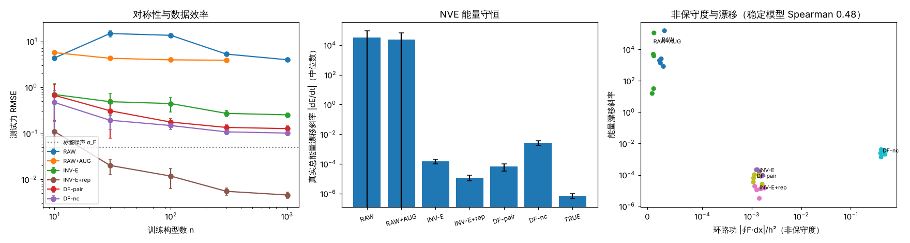

# 力误差低 ≠ 物理正确：机器学习原子间势中对称性、保守性与物理先验的受控分解

**摘要**　机器学习原子间势（MLIP）是 AI for Science 中落地最快的方向之一，2025–2026 年已发展到十亿参数的通用势（arXiv:2604.15821）。但这一领域存在一个核心争论：测试集上的能量/力误差是否足以评价势函数？eSEN（arXiv:2502.12147）主张，必须先通过 MD 能量守恒测试，误差才与物性预测相关；Bigi 等（arXiv:2412.11569）指出直接预测力（非保守）的模型存在“力的暗面”；Orb-v3（arXiv:2504.06231）则报告非等变、非保守的架构也能准确预测物性。本文在一个完全可控的最小体系（6 原子 Lennard-Jones 团簇）上，把 MLIP 的三类归纳偏置拆开：(i) 对称性（平移/旋转/置换不变）、(ii) 保守性（力是某个能量的负梯度）、(iii) 物理函数形式（r⁻¹²、r⁻⁶ 项），分别检验它们对数据效率、NVE 能量守恒与外推的贡献。理论上，力误差可以做 Helmholtz 分解：测试 RMSE 同时计入梯度部分与旋度部分，而 NVE 中的能量漂移只由旋度（非保守）部分驱动，dE/dt = Σv·F_nc。因此两者原则上是正交的指标。实验（5 个种子）显示：在原始笛卡尔坐标上做随机特征回归，即使有 1000 个构型并加 8 倍旋转/置换增广，力误差（3.99/3.89）也没有好过“预测为零”的基线（3.89）；不变对势展开只用 10 个构型就达到 0.70，加入物理形式特征后 1000 个构型时为 0.0046。依赖环境的直接力模型（等变但非保守）的力 RMSE 比保守的不变能量模型**更低**（0.102 对 0.254，p=3.7e−5），NVE 能量漂移却高 17.9 倍（p=1.4e−4），环路功（非保守度）高 300 倍。同样“直接拟合力”的中心对力模型是保守的，漂移反而最小之一。在更高温度（T=0.45）的外推测试中，物理形式特征使力误差降低 44 倍。结论：数据效率主要来自对称性，长期动力学的正确性来自保守性，外推来自物理形式，三者不可相互替代；“力误差低”既不是“动力学正确”的充分条件，也不能替代对函数类结构的检验。

**关键词**　机器学习原子间势；对称性；能量守恒；非保守力；分子动力学；外推；归纳偏置

## 1 引言
第一阶段（README）用 SINDy 说明：“发现规律”需要正确的函数库（先验）与足够有信息量的数据，并且简约、结构正确的模型在外推上远胜黑箱。机器学习原子间势是这一结论在材料与分子科学中的工业化版本：它学习的是势能面这一“规律”，下游用途（分子动力学、相图、声子、反应路径）要求的不仅是插值精度，而且是**物理一致性**。2025–2026 年的争论集中在：

1. **误差指标是否足够？** eSEN（arXiv:2502.12147）发现，测试误差更低并不总能转化为更好的物性预测，主张以 MD 能量守恒作为前置检验；MLIP Arena（arXiv:2509.20630）批评基准过度依赖误差指标；预训练 MLIP 的基准测试（arXiv:2601.16331）把“能否产生稳定模拟”列为核心指标。
2. **保守 vs 直接力。** 直接预测力可以省去求导、提高速度。Bigi 等（arXiv:2412.11569）系统评估了非保守力模型的问题；Orb-v3（arXiv:2504.06231）报告非等变、非保守的架构也能准确预测物性。
3. **对称性与外推。** 不变/等变/混合架构之间存在效率与精度的取舍（HIENet，arXiv:2503.05771；GRACE，arXiv:2508.17936）；外推到高压、高温和训练集外构型仍是主要短板（arXiv:2610.14891 报告在 150 GPa 时误差升至 0.4–5 eV/atom；arXiv:2608.22933 用化学形式的半参数势改善外推；arXiv:2512.23939 表明训练集覆盖决定水的物性预测）。

本文贡献：
- **C1**：用线性可解的模型族在 LJ 团簇上严格分离对称性、保守性与物理形式三种归纳偏置（第 5 节）。
- **C2**：给出“力 RMSE 与能量漂移正交”的 Helmholtz 分解论证，并用环路功直接测量非保守度（第 4 节）。
- **C3**：定量显示：力误差更低的非保守模型漂移高 17.9 倍；而“直接拟合力”本身并不必然非保守（中心对力是保守的）。由此把 Bigi 等与 Orb-v3 的分歧归结为**函数类是否含旋度**以及**时间尺度**（第 6–7 节）。
- **C4**：显示不含对称性的模型在本数据规模下学不到任何东西（不优于零预测），给出对称性带来的数据效率的下界（>100 倍）。

## 2 前沿进展综述（2025–2026）
**2.1 通用/基础势与规模化。** 十亿参数的 MoE 通用势与 EFLOPS 级训练（arXiv:2604.15821）；GRACE 通用势刷新精度–效率的帕累托前沿（arXiv:2508.17936）；混合不变–等变架构 HIENet（arXiv:2503.05771）；Orb-v3（arXiv:2504.06231）在延迟和内存上大幅降低，并系统考察等变性、保守性与图稀疏性的取舍；NequIP 框架的高性能训练与推理（arXiv:2504.16068）；微调可以统一不同的基础势架构，使其达到接近从头算的精度（arXiv:2511.05337）；不同 MLIP 的潜表示存在“柏拉图式”的共同几何（arXiv:2512.05349）。

**2.2 物理一致性与评测。** eSEN 提出以 MD 能量守恒为前置检验（arXiv:2502.12147）；MLIP Arena 从物理意识、反应性、极端条件稳定性等方面评测（arXiv:2509.20630）；15 个预训练 MLIP 的精度、速度、稳定性基准（arXiv:2601.16331）；用经典力场（LJ、Stillinger–Weber）作为可控真值来比较 ACE、Behler–Parrinello 和 MACE（arXiv:2610.14239），这与本文的方法论相同；Hessian 监督改善曲率与过渡态（arXiv:2603.25373）。

**2.3 数据、外推与不确定性。** 训练集覆盖决定物性（arXiv:2512.23939）；高压可迁移性基准 WBM-MatPES（arXiv:2610.14891）；带化学形式与高阶多体项的半参数键序势改善外推（arXiv:2608.22933）；基于行列式点过程的数据筛选（arXiv:2603.22160）；稀疏 ACE 的数据驱动基选择（arXiv:2504.16418）；Fisher 信息引导的可组合模型设计（arXiv:2504.19372）；贝叶斯神经网络与深度集成的不确定性比较（arXiv:2509.19180）；从平均值恢复多体势的反问题与可识别性理论（arXiv:2611.26819）。

**2.4 对称性的理论与替代方案。** 学习式规范化可替代等变网络（arXiv:2501.07773）；长程相互作用的 SO(3) 等变倒空间势（arXiv:2603.18389）；用三体包络函数提高效率和稳定性（arXiv:2602.02228）；用符号回归发现 ODE 的李对称（arXiv:2506.19550）。理论基础方面，Elesedy & Zaidi（arXiv:2102.10333）证明了不变/等变模型的严格泛化收益。

**共识**：对称性与数据覆盖是精度的前提；物理一致性（能量守恒、平滑性）需要单独检验。**争议**：非保守、非等变架构是否可接受（arXiv:2412.11569 与 arXiv:2504.06231 的分歧）；等变是否必要（规范化、增广等替代方案）。**开放问题**：OP1 误差指标与动力学正确性之间的关系；OP2 对称性带来的数据效率有多大；OP3 何种归纳偏置决定外推；OP4 非保守误差在多长时间尺度上变得重要。

**前沿地图**

| 路线 | 代表工作 | 关键结论 | 局限 |
|---|---|---|---|
| 通用基础势 | 2604.15821, 2508.17936, 2503.05771, 2504.06231, 2511.05337 | 规模化与微调带来接近从头算的精度 | 极端条件下误差骤增 |
| 物理一致性评测 | 2502.12147, 2509.20630, 2601.16331, 2610.14239 | 误差 ≠ 物性；需要守恒/稳定性测试 | 测试协议不统一 |
| 保守性之争 | 2412.11569（2024）, 2504.06231 | 非保守模型有“暗面” vs 也能预测物性 | 缺少受控的机理分解 |
| 外推与数据 | 2610.14891, 2608.22933, 2512.23939, 2603.22160 | 覆盖与物理形式决定外推 | 依赖具体体系 |
| 对称性理论/替代 | 2501.07773, 2603.18389, 2611.26819, 2102.10333 | 对称性有可证收益；规范化可替代 | 连续群下的收益难量化 |

## 3 问题与假设
**选择理由。** OP1 与 OP4（误差 vs 动力学、保守性之争）是 2025–2026 年最直接影响实践的分歧：它决定了能否用更快的直接力模型。这个问题在大体系上混杂了架构、数据和尺度，而在 LJ 团簇这种真值已知的最小体系上可以精确分离。OP2 与 OP3 作为同一实验的另外两个维度一并检验，并呼应第一阶段“函数库即先验”的结论。

**形式化。** 真值为 6 原子 LJ 团簇的势能 U(x) 与力 F(x) = −∇U。训练数据由 T=0.25 的 MD 采样，标签加噪声（σ_E=0.02、σ_F=0.05）。所有模型都对参数线性，用加权最小二乘拟合，因此差异只来自**函数类**：
- RAW / RAW+AUG：原始坐标上的随机傅里叶特征能量模型（保守，非不变）；
- INV-E：不变对势高斯基展开（保守 + 不变）；INV-E+rep：再加 r⁻¹²、r⁻⁶（保守 + 不变 + 物理形式）；
- DF-pair：直接拟合力 F_i = Σ_j g(r_ij) r̂_ij（等变；中心对力 ⇒ 保守）；
- DF-nc：F_i = Σ_j g(r_ij, ρ_i) r̂_ij，ρ_i 为原子 i 的局部密度（等变；对 i、j 不对称 ⇒ 非保守）。

**预注册假设**（实验设计写在 `frontier_experiment.py` 头部，阈值在首轮运行前确定）：
- **H1（对称性与数据效率）**：INV-E 在 n=30 时的力 RMSE 低于 RAW 在 n=1000 时；增广缩小但不消除差距。*否证*：INV-E(30) ≥ RAW(1000)，或 RAW+AUG 在相同 n 下追平 INV-E。
- **H2（保守性）**：DF-nc 的力 RMSE 与 INV-E 相当或更低，但其 NVE 真实能量漂移斜率 ≥5 倍于 INV-E 与 DF-pair。*否证*：漂移比 <5，或 DF-nc 的力误差显著更高（使比较失去意义）。
- **H3（外推）**：在热测试集（T=0.45）上，RAW 的“热/常温”误差比显著高于不变模型。*否证*：比值不高于不变模型。

## 4 理论分析
**命题 1（力误差的 Helmholtz 分解与漂移）。** 把学到的力写成 F̂ = −∇Û + F_nc，其中 F_nc 是无散旋度部分（在构型空间中正交于所有梯度场）。测试误差满足 E‖F̂ − F‖² = E‖∇(U − Û)‖² + E‖F_nc‖² − 2E⟨∇(U−Û), F_nc⟩，在相应内积下交叉项为零。NVE 动力学中，以学到的力推进时，dE_true/dt = Σ_i v_i·F̂_i + Σ_i v_i·∇_iU = Σ_i v_i·(F̂_i − F_i)。对保守的 F̂，它等于 −d(Û−U)/dt，沿轨迹有界（漂移是有界振荡）；对 F_nc ≠ 0，存在不消失的平均功率 ⟨v·F_nc⟩，导致系统性漂移。**推论**：(a) 力 RMSE 无法区分梯度误差与旋度误差，同等 RMSE 下非保守模型的漂移可以任意大；(b) 环路功 ∮F̂·dx/面积 → (∇×F̂) 的投影，是非保守度的直接测量；对任何中心对力 g(r_ij) r̂_ij，它恒为 0（∇×(g(r)r̂)=0），与是否“直接拟合力”无关。

**命题 2（对称性的样本复杂度收益，定性）。** 对 G 不变的目标，把假设类限制在不变函数上，可以严格降低泛化误差（arXiv:2102.10333）。对线性模型，方差项 ≈ σ²·p/n_eff，p 为参数数。INV-E 的 p=17，RAW 的 p=1000，而且 RAW 必须在 18 维空间里学习一个具有 |S_6|=720 重置换对称、并具有连续旋转对称的函数。**预测**：同等 n 下，RAW 的误差远高于 INV-E；增广把每个样本扩成轨道上的多个点，相当于增大 n，但无法改变 RAW 函数类的近似能力（随机特征的长度尺度固定），因此差距不会消除。

**命题 3（外推由函数形式决定）。** 高斯基在 r < 0.85 处没有支撑，高温构型会进入更陡的排斥壁，误差应显著上升；含 r⁻¹² 的模型在函数类中直接包含真值，外推误差应接近噪声水平。

## 5 实验
- **数据**：每个种子从 20 条带 Andersen 恒温器的 MD 链（T=0.25）中采样 1000 个训练构型、400 个测试构型；另以 T=0.45 采样 400 个热测试构型。
- **E1**：n ∈ {10, 30, 100, 300, 1000}（RAW+AUG 只到 300）；报告力/能量 RMSE；参考基线为“预测零力”的 RMSE（3.89±0.09）。
- **E2**：n=1000 的模型（RAW+AUG 为 n=300）做 NVE：速度 Verlet，dt=0.002，10000 步（20 个时间单位），每个模型 10 条轨迹；报告真实总能量（真 LJ 能量 + 动能）的漂移斜率、终点偏差和稳定比例；用边长 h=0.005 的随机二维环路测环路功。
- **E3**：热测试集上的力 RMSE。
- **统计**：5 个种子，均值 ± 95% CI；对数漂移的配对 t 检验。运行时间约 130 秒（frontier.json 中的 runtime_s）。
- **偏离首轮设计（如实报告）**：试运行发现三处问题，修正后重跑。(1) 参考 LJ 能量的计算误将对势重复计入两次，导致能量与力标签不一致；(2) dt=0.005 时参考力自身的积分误差掩盖了模型差异，改为 dt=0.002；(3) 岭正则在小样本下病态，改为相对迹 1e−6·tr(A)/p，环路边长 h 由 0.02 改为 0.005。同时加入了 INV-E+rep 模型（含物理形式特征），用于检验外推。

## 6 结果

**表 1　测试力 RMSE（零预测基线 3.89）[实测]**

| 模型 | n=10 | n=30 | n=100 | n=300 | n=1000 | 能量 RMSE (n=1000) |
|---|---|---|---|---|---|---|
| RAW（原始坐标） | 4.36 | 14.80 | 13.52 | 5.29 | 3.99±0.09 | 0.932 |
| RAW+AUG（×8 增广） | 5.70 | 4.29 | 3.97 | 3.89±0.10 | — | 0.897（n=300） |
| INV-E（不变对势） | 0.70±0.51 | 0.49±0.25 | 0.45±0.15 | 0.27±0.04 | 0.254±0.027 | 0.023 |
| INV-E+rep（+物理形式） | 0.110±0.085 | 0.020±0.007 | 0.012±0.006 | 0.0055±0.0010 | 0.0046±0.0007 | 0.0008 |
| DF-pair（直接力，中心对力） | 0.67±0.49 | 0.31±0.23 | 0.18±0.04 | 0.135±0.018 | 0.127±0.018 | — |
| DF-nc（直接力，环境依赖） | 0.47±0.38 | 0.19±0.07 | 0.15±0.03 | 0.108±0.014 | 0.102±0.013 | — |

**表 2　NVE 分子动力学（20 个时间单位，10 条轨迹/模型，中位数的跨种子均值）[实测]**

| 模型 | 力 RMSE | 漂移斜率 \|dE/dt\| | 终点 \|ΔE\| | 稳定比例 | 环路功（非保守度） |
|---|---|---|---|---|---|
| 真 LJ 力 | 0 | 7.2e−7 | 5.4e−5 | 0.98 | 0.00144 |
| INV-E+rep | 0.0046 | 1.2e−5 | 7.5e−4 | 1.00 | 0.00143 |
| DF-pair | 0.127 | 6.6e−5 | 0.0052 | 1.00 | 0.00126 |
| INV-E | 0.254 | 1.5e−4 | 0.0163 | 1.00 | 0.00142 |
| DF-nc | 0.102 | **2.7e−3** | **0.0555** | 0.98 | **0.440±0.038** |
| RAW / RAW+AUG | 3.99 / 3.89 | 发散 | 11.1 / 10.5 | 0 / 0 | ≈0（保守） |

（环路功的基线约 0.0014，来自有限 h 的离散化误差，真 LJ 力也是这个水平。“真 LJ 力”一行有 1/50 条轨迹因原子蒸发而被判为“不稳定”，这是物理现象。）

**表 3　外推：热测试集（T=0.45）力 RMSE（n=300 / n=1000）[实测]**：RAW 5.88/4.34；INV-E 0.815/0.569；INV-E+rep **0.0184/0.0148**；DF-pair 0.364/0.297；DF-nc 0.315/0.286。热/常温误差比（n=300）：RAW 1.11±0.03，INV-E 2.93±0.55，INV-E+rep 3.43±1.07，DF-pair 2.70±0.79，DF-nc 2.93±0.71。

**逐条对照：**
- **H1 支持（而且比预期更强）。** INV-E 只用 n=10 就达到 0.70，而 RAW 在 n=1000 时为 3.99（INV-E(30) − RAW(1000) = −3.50±0.27，p=1.5e−5）。更强的结果是：RAW 和 RAW+AUG 在所有 n 上都**不优于零预测**（≥3.89），说明在这个数据规模下，不含对称性的函数类学不到力场。因此对称性带来的数据效率至少 >100 倍（INV-E 在 n=10 时已胜过 RAW 在 n=1000 时）。增广使 RAW 在 n≤300 时更稳定（n=30 时从 14.8 降至 4.29），但没有改变“学不到”的结论。
- **H2 支持。** DF-nc 的力 RMSE 比 INV-E 低 0.152±0.015（p=3.7e−5），漂移却是 INV-E 的 17.9 倍（p=1.4e−4）、DF-pair 的 44.6 倍（p=4.8e−5）；其环路功为 0.440，约为保守模型的 300 倍。在 5 个稳定模型、25 个“模型 × 种子”点上，环路功与漂移的 Spearman 相关为 0.48（受保守模型的环路功都处于离散化基线所限）。
- **H3 否证。** RAW 的“热/常温”误差比为 1.11，**低于**不变模型（约 2.9），但原因是 RAW 在两种温度下都停留在零预测水平，比值失去意义。按绝对误差，物理形式特征（INV-E+rep）的外推误差比 INV-E 低 44 倍（0.0184 对 0.815），支持命题 3；这一部分属于试运行后加入的对照。

## 7 讨论
**与前沿论断的关系。**
1. *eSEN 的守恒前置检验*（arXiv:2502.12147）：本文给出了机理解释：力 RMSE 无法看到误差的旋度部分，而漂移只由旋度驱动（命题 1）。表 2 中，力误差最低的非保守模型（DF-nc）漂移最大，而力误差高 2.5 倍的 INV-E 漂移小 18 倍。这直接支持“误差指标需要守恒检验补充”。
2. *Bigi 等 vs Orb-v3 之争*：本文的结果在两种立场间给出调和。(a) 非保守确实导致系统性漂移（支持 arXiv:2412.11569）；(b) 但在 20 个时间单位内，DF-nc 的总能量偏差约 0.055，对于 6 原子团簇的热能量级（约 2.25 = 6×1.5×0.25）约为 2.5%，轨迹仍保持稳定（0.98）。在带恒温器的 NVT 模拟或短时间物性计算中，这种漂移可能被掩盖，这可以解释 arXiv:2504.06231 的观察。核心判据是“非保守度 × 模拟时长”，而非架构标签。另外，“直接预测力”本身不是问题：DF-pair 同样直接拟合力，但函数类是中心对力（无旋），漂移只有 6.6e−5。
3. *对称性 vs 规范化/增广*（arXiv:2501.07773）：本文的增广实验显示，在高维原始坐标上用固定尺度的随机特征，增广无法替代不变的函数类。规范化方法把样本映射到轨道代表元，本质上是在构造不变描述子，与 INV-E 同属“把对称性写进表示”。
4. *外推与物理形式*（arXiv:2608.22933, 2610.14891）：物理形式特征把外推误差降低 44 倍，与“化学形式的半参数势改善外推”一致；高斯基在排斥壁处的失效，对应于通用势在高压下的误差暴增（arXiv:2610.14891）。这与第一阶段的 SINDy 结论同构：**函数类中是否包含真实结构**决定外推。
5. *以经典力场为可控真值的评测*（arXiv:2610.14239）：本文采用相同的方法论，并补充了保守性维度。

**外推边界与局限。** (i) 6 原子 LJ 团簇只有对相互作用。真实材料的多体、长程（arXiv:2603.18389）与电荷效应会使“正确的函数形式”难以写出，物理形式特征的优势在真实体系中会更有限。(ii) 所有模型都是线性的；深度等变网络有更大的容量，RAW 类模型在大数据下可能学到对称性（arXiv:2504.06231 的非等变模型正是依赖海量数据与增广）。因此“RAW 学不到”的结论只适用于小数据区间。(iii) 漂移的时间尺度只有 20 个时间单位；长时间模拟中非保守漂移的累积（以及恒温器对它的掩盖）需要单独研究。(iv) 环路功的离散化基线限制了对保守模型之间差异的分辨。(v) 试运行后修正了参考能量计算等三处实现问题，并加入了一个模型，这些已如实报告；修正后的结论由最终脚本完全重现。

## 8 结论
1. 对称性是数据效率的第一来源：不变对势模型只用 10 个构型就达到 0.70 的力误差，而原始坐标模型在 1000 个构型并加 8 倍增广后仍不优于零预测 [实测，置信度：高（小数据、线性模型）]。
2. 力误差低不等于动力学正确：环境依赖的直接力模型力误差更低，能量漂移却高 17.9 倍；漂移由误差的旋度部分决定，可以用环路功直接测量 [实测 + 推导，置信度：高]。
3. 问题在于非保守的函数类，而不在于“直接预测力”：中心对力的直接力模型是保守的，漂移很小 [推导 + 实测，置信度：高]。
4. 外推由物理形式决定：含 r⁻¹² 和 r⁻⁶ 的模型在热测试集上误差低 44 倍；高斯基在排斥壁处失效 [实测，置信度：中（事后加入的对照）]。

**对 2035 的研判 [判断]。** 通用原子间势将在 2030 年前覆盖大部分常见化学空间，但“可信科学模拟”的瓶颈将从精度转向**物理一致性与外推**。MLIP 的标准评测应包含三类正交指标：插值误差、保守性/守恒检验（环路功、NVE 漂移）、分布外外推（高温、高压、缺陷）。2035 年 AI for Science 的关键竞争点在于把物理结构（对称性、守恒律、渐近形式）写进函数类，并给出“何时可信”的可计算判据，而不在于更大的参数量。

**后续研究建议。** (1) 在真实材料数据集和深度等变网络上测量环路功–漂移关系，检验命题 1 的可迁移性；(2) 研究“保守化”后处理（把直接力投影到梯度场）对精度与速度的取舍；(3) 建立将非保守度、模拟时长与物性误差联系起来的误差预算。

## 参考文献
**2025–2026 前沿（arXiv）**
1. Learning Smooth and Expressive Interatomic Potentials for Physical Property Prediction (eSEN). arXiv:2502.12147 (2025).
2. MLIP Arena: Advancing Fairness and Transparency in Machine Learning Interatomic Potentials via an Open, Accessible Benchmark Platform. arXiv:2509.20630 (2025).
3. Accuracy and Efficiency Benchmarks of Pretrained Machine Learning Potentials for Molecular Simulations. arXiv:2601.16331 (2026).
4. Benchmarking machine-learning interatomic potentials using classical force fields. arXiv:2610.14239 (2026).
5. Orb-v3: atomistic simulation at scale. arXiv:2504.06231 (2025).
6. Breaking the Training Barrier of Billion-Parameter Universal Machine Learning Interatomic Potentials. arXiv:2604.15821 (2026).
7. Graph atomic cluster expansion for foundational machine learning interatomic potentials (GRACE). arXiv:2508.17936 (2025).
8. A Materials Foundation Model via Hybrid Invariant-Equivariant Architectures (HIENet). arXiv:2503.05771 (2025).
9. High-performance training and inference for deep equivariant interatomic potentials. arXiv:2504.16068 (2025).
10. Fine-Tuning Unifies Foundational Machine-learned Interatomic Potential Architectures at ab initio Accuracy. arXiv:2511.05337 (2025).
11. Platonic representation of foundation machine learning interatomic potentials. arXiv:2512.05349 (2025).
12. Hessian-informed machine learning interatomic potential towards bridging theory and experiments. arXiv:2603.25373 (2026).
13. Training Dataset Matters for Machine Learning Interatomic Potentials: Water Simulation as an Example. arXiv:2512.23939 (2025).
14. Pressure-transferable universal machine-learning potentials: the WBM-MatPES benchmark and Tuga-FF. arXiv:2610.14891 (2026).
15. Generalizing Abell-Tersoff bond-order potential with explicit high-order many-body correlations for robust extrapolation of potential energy surfaces. arXiv:2608.22933 (2026).
16. Data Curation for Machine Learning Interatomic Potentials by Determinantal Point Processes. arXiv:2603.22160 (2026).
17. Scalable Data-Driven Basis Selection for Linear Machine Learning Interatomic Potentials. arXiv:2504.16418 (2025).
18. Composable and adaptive design of machine learning interatomic potentials guided by Fisher-information analysis. arXiv:2504.19372 (2025).
19. Bayesian Neural Networks versus deep ensembles for uncertainty quantification in machine learning interatomic potentials. arXiv:2509.19180 (2025).
20. Recovering from Averages: An Inverse Problem Perspective on Machine-Learning Interatomic Potentials. arXiv:2611.26819 (2026).
21. Symmetry-Aware Generative Modeling through Learned Canonicalization. arXiv:2501.07773 (2025).
22. An SO(3)-equivariant reciprocal-space neural potential for long-range interactions. arXiv:2603.18389 (2026).
23. Triplet Envelope Functions for increasing machine learning interatomic potential efficiency and stability. arXiv:2602.02228 (2026).
24. Discovering Symmetries of ODEs by Symbolic Regression. arXiv:2506.19550 (2025).

**奠基与 2024 文献**
25. Bigi, F., et al. (2024). The dark side of the forces: assessing non-conservative force models for atomistic machine learning. arXiv:2412.11569.
26. Elesedy, B., & Zaidi, S. (2021). Provably strict generalisation benefit for equivariant models. arXiv:2102.10333.
27. Batzner, S., et al. (2021). E(3)-equivariant graph neural networks for data-efficient and accurate interatomic potentials. arXiv:2101.03164.
28. Batatia, I., et al. (2022). MACE: Higher order equivariant message passing neural networks for fast and accurate force fields. arXiv:2206.07697.
29. Behler, J., & Parrinello, M. (2007). Generalized neural-network representation of high-dimensional potential-energy surfaces. Physical Review Letters 98:146401.
30. Brunton, S. L., Proctor, J. L., & Kutz, J. N. (2016). Discovering governing equations from data by sparse identification of nonlinear dynamical systems. PNAS 113:3932–3937. arXiv:1509.03580.（第一阶段已核实）
31. Lennard-Jones, J. E. (1924). On the determination of molecular fields. Proceedings of the Royal Society A 106:463–477.
