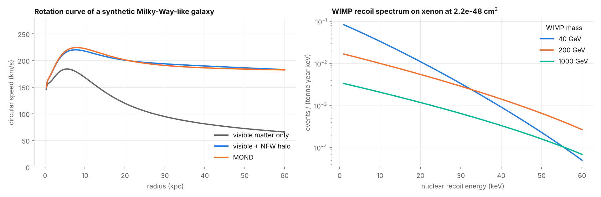
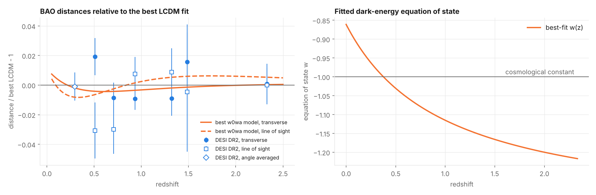
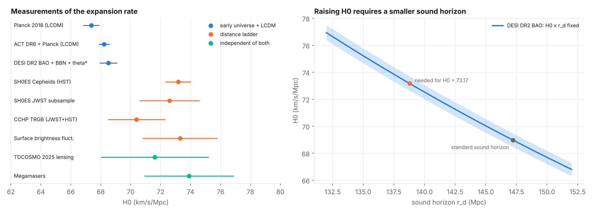
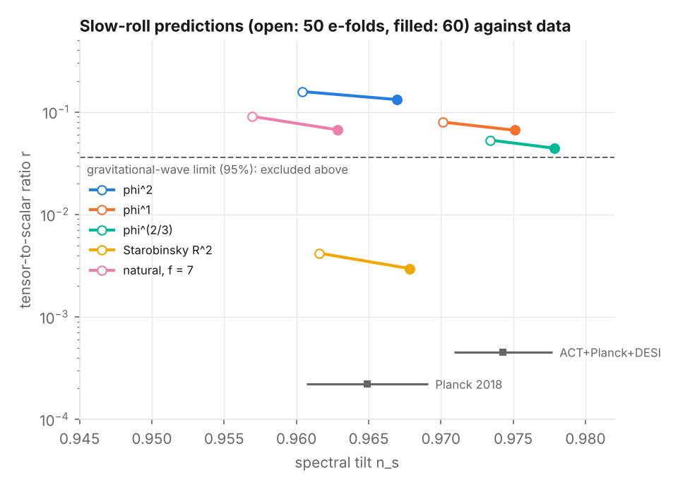
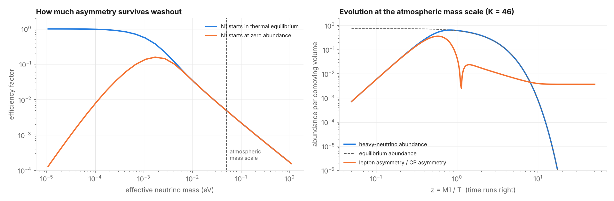
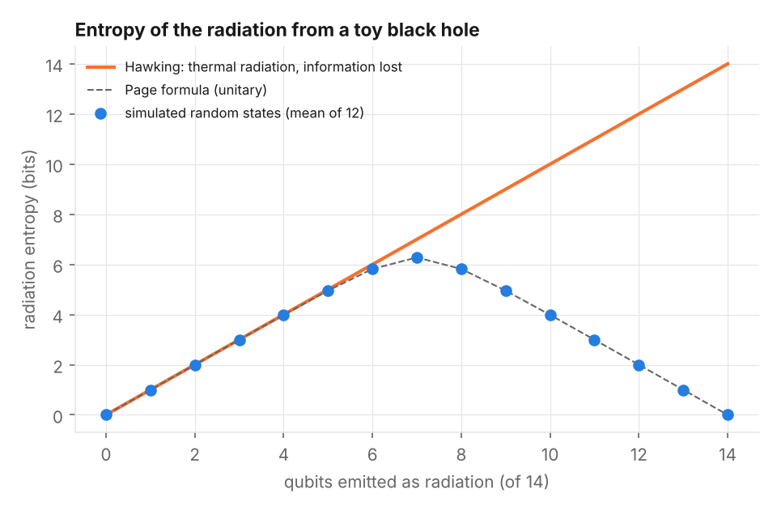
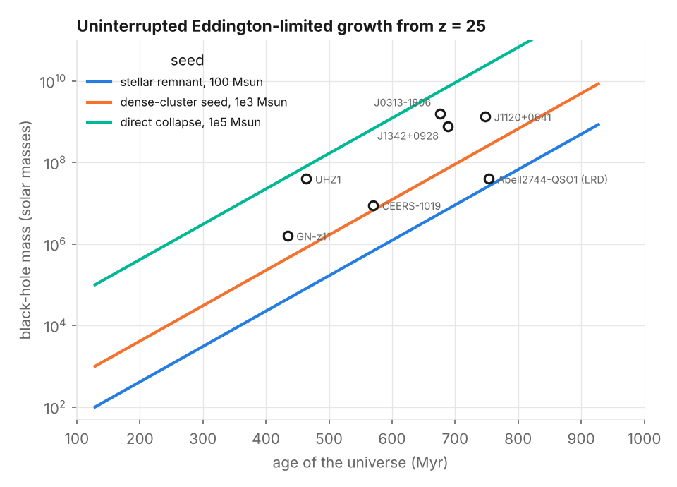
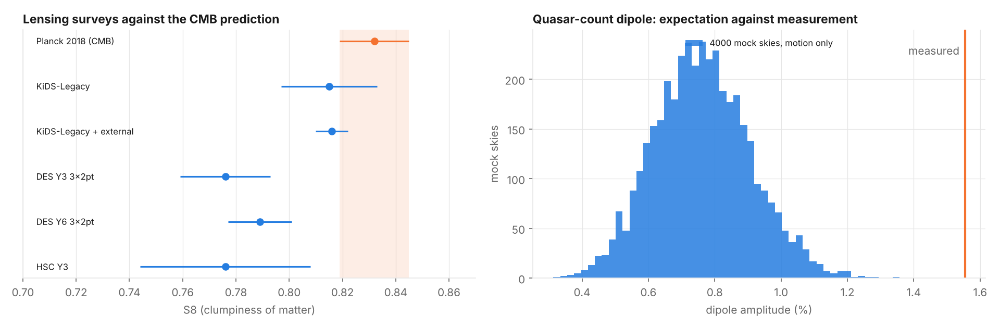
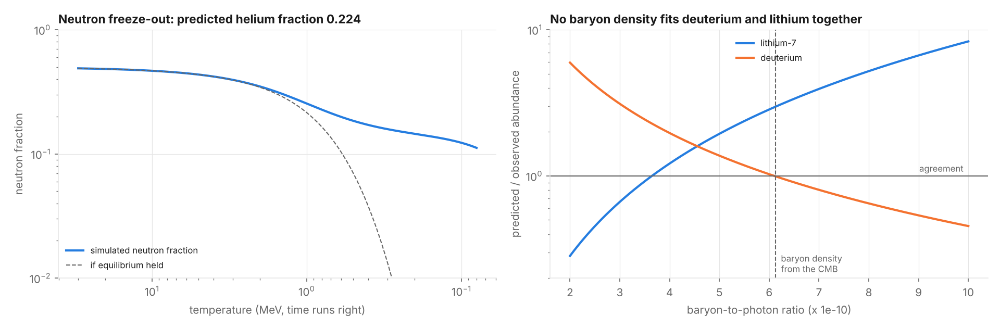
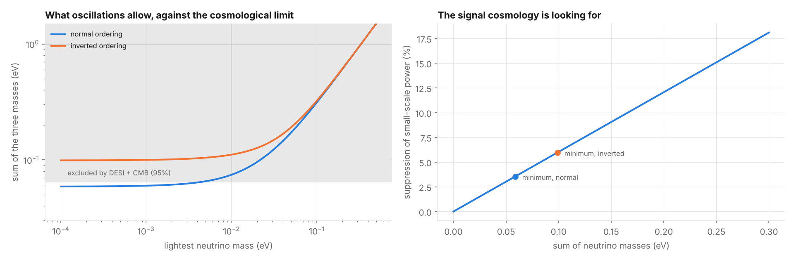

# Simulation results

Generated by `python -m cosmos.run_all`. Full numbers are in `results.json`.

## 1. What is dark matter?

Visible matter alone falls away with radius; a halo or MOND both keep the curve flat, so rotation curves alone cannot choose between them. At the published LZ limit a 40 GeV WIMP would give about 1.1 events in the whole exposure: limits of this size are statements about one or two events, which is why a single candidate event cannot be a discovery.

Limits of this simulation:

- Galaxy is synthetic (assumed parameters), not a fit to SPARC data.
- Flat 50% detection efficiency and no escape-velocity cut-off.

## 2. Is dark energy constant?

The evolving model fits better in every combination, by an amount close to the published values, and never by enough to be decisive. The best fit crosses w = -1, which a single simple scalar field cannot do.

Limits of this simulation:

- CMB enters only through the three-parameter compressed prior, not the full likelihood.
- Supernovae are binned; the model is evaluated at each bin's effective redshift.
- Significance uses the chi^2 difference with 2 extra parameters, as DESI does.

## 3. The Hubble tension

BAO alone pin the product of H0 and the sound horizon. Matching the Cepheid value means shrinking the sound horizon by 5.7%, which in the toy model takes a new component peaking at 25% of the energy density around redshift 3500. Published early-dark-energy fits need less (about 10%) because they also let the matter density and other parameters move.

Limits of this simulation:

- Grouped means treat measurements as independent; ladder results share calibrators, so the ladder group error is too small.
- The early-dark-energy model is a Gaussian bump in the energy budget, not a scalar field, and ignores the changes to the CMB peaks that a full analysis must also fit.

## 4. What drove inflation?

Power-law potentials are excluded by the absence of gravitational waves. Plateau models such as Starobinsky survive that test but predict a tilt that sits below the newer ACT-based measurement, so the surviving class is under mild pressure from the other side.

Limits of this simulation:

- First-order slow-roll; the number of e-folds is an assumed bracket, not derived from reheating.
- Measured tilt values are quoted from memory and should be checked before reuse.

## 5. Why matter and not antimatter?

With light-neutrino masses at the measured scale the mechanism sits in the strong-washout regime: the answer no longer depends on initial conditions, about 0.5% of the asymmetry survives, and a CP asymmetry of 1.3e-05 is enough. That needs a heavy neutrino above about 1e+11 GeV, far beyond any collider, which is why the idea is plausible but hard to test.

Limits of this simulation:

- One flavour, decays and inverse decays only; no scatterings, flavour or spectator effects.
- The mass bound assumes hierarchical heavy neutrinos (no resonant enhancement).

## 6. Black-hole information

A generic quantum-mechanical evolution reproduces Page's curve to within a fraction of a bit: the radiation entropy rises, turns over when half the system has been emitted, and returns to zero. Hawking's calculation keeps rising. The two only disagree after the turnover, which for a solar-mass black hole is ~1e67 years away, so no observation of an astrophysical black hole can distinguish them.

Limits of this simulation:

- A random state stands in for the black hole's dynamics; this shows what unitarity requires, not how gravity achieves it.
- 14 qubits, against ~1e77 for a solar-mass black hole.

## 7. Early giant black holes

A 100-solar-mass seed can reach the observed masses only by accreting at or above the Eddington limit without interruption for the entire available time, which feedback makes implausible. Heavy seeds or sustained super-Eddington phases relax this to duty cycles well below one. The objects at z > 10 are the binding constraint.

Limits of this simulation:

- Constant radiative efficiency of 0.1; lower efficiency (spinning-down or slim discs) shortens the e-folding time and eases the problem.
- Observed masses are single-epoch estimates uncertain by a factor of several, and for 'little red dots' may be overestimated.
- Mergers are ignored.

## 8. Structure growth and the cosmic dipole

The lensing discrepancy is now survey-dependent and at most 2.6 sigma. The dipole is a different matter: 0 of 4000 mock skies reach the measured amplitude, and the excess is 5.5 standard deviations of the mock scatter (published: 4.9). If the catalogue is sound, our motion does not explain the lopsidedness of the distant universe. Evolving dark energy as fitted in problem 2 changes today's growth by only +0.8%, so it does not by itself explain a low S8.

Limits of this simulation:

- Mocks contain shot noise and the mask only: no clustering, no survey systematics. The test shows the excess is not a noise or masking artefact, not that the catalogue is clean.
- Source-count slope and spectral index are quoted from memory.

## 9. The lithium problem

The simplified freeze-out integration gives a helium fraction of 0.22 against 0.245 observed (full reaction-network codes give 0.247), so the framework works; yet it overpredicts lithium by a factor of 3.0. Lowering the baryon density enough to fix lithium would more than double deuterium, which is measured to a percent, so the fix cannot be in the cosmology. The depletion measured in globular-cluster stars closes about half of the gap in the log; a factor of 1.7 remains, at 2.1 sigma given the quoted errors.

Limits of this simulation:

- Helium comes from a simplified freeze-out integration; the moment fusion starts is set by an assumed deuterium threshold, and the quoted range shows the yield for thresholds ten times lower and higher.
- Deuterium and lithium curves are power-law scalings anchored to published predictions, not a reaction-network calculation.

## 10. Neutrino masses

The cosmological limit sits almost exactly on the smallest sum that oscillations allow. Inverted ordering is disfavoured at 3.0 sigma, and even normal ordering sits at 1.8 sigma. The laboratory experiment cannot arbitrate: its final sensitivity (0.3 eV) is 6 to 34 times the effective mass these numbers imply.

Limits of this simulation:

- The cosmological posterior is approximated as a zero-centred Gaussian; the real one peaks at negative effective mass, which makes the tension larger than computed here.
- The limit assumes LCDM; with evolving dark energy it relaxes substantially.
- The suppression formula (8 x neutrino fraction) is the standard linear-theory estimate.
