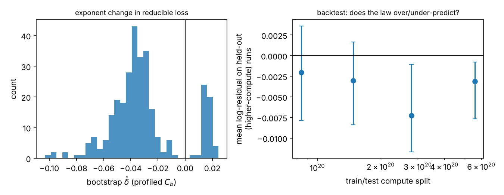
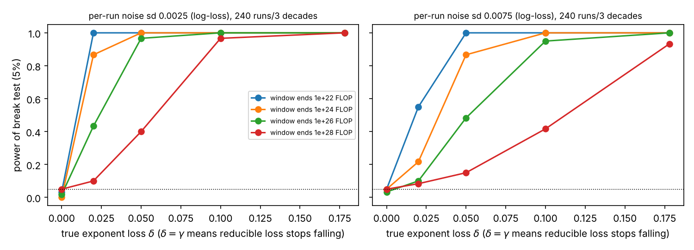
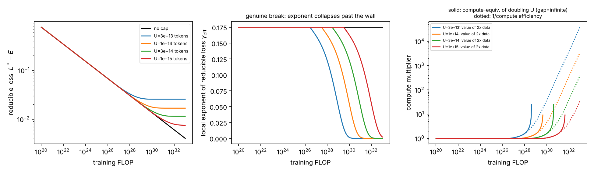

# Deceleration Without a Break: Separating Mechanical Slowdown from Genuine Regime Change in Pretraining Scaling Laws, with a Self-Similar Model of the Data Wall

**Target venue:** NeurIPS (main track). Fallback: TMLR.

---

## Abstract

People often ask whether the scaling laws for pretraining are "slowing down", but the question is usually left undefined. We give it a precise meaning and test it on public data. We show three things.

1. **A constant-exponent law produces a mechanical slowdown.** Take the saturating law $L^*(C)=E+GC^{-\gamma}$. Its raw log–log slope falls as $\gamma(1-E/L^*)$. Each additional decade of compute buys exactly $10^{-\gamma}$ times the loss reduction of the previous decade. The curve $\log L^*$ against $\log C$ is strictly convex. So any test that looks for "flattening" in raw loss rejects with probability that tends to one, even when nothing has changed. A genuine slowdown has to be defined on the reducible loss. We test it with a nested break model, $L=E+(AN^{-\alpha}+BD^{-\beta})\max(1,C/C_b)^{\delta}$.
2. **No slowdown in the Chinchilla runs.** We refit the Chinchilla law to Epoch AI's reconstruction of the 240 Hoffmann et al. runs, which span $1.4\times10^{18}$ to $1.3\times10^{22}$ FLOP. We recover $E=1.817$, $\alpha=0.347$, $\beta=0.367$ and $\gamma=0.178$ (80% bootstrap CI $[0.173,0.186]$). There is no evidence that the reducible loss slows within this range. The profiled break estimate is $\hat\delta=-0.039$ (95% CI $[-0.072,0.020]$). Forecasts fitted on low-compute runs over-predict the loss of held-out high-compute runs by 0.2–0.7%; they do not under-predict it.
3. **Breaks get harder to see at larger scale.** In simulation, the naive curvature test rejects in 81–100% of datasets drawn from the no-break law. The break test keeps its nominal size and detects $\delta\ge0.02$ with power of about 0.8 at Chinchilla scale. Detectability falls with the reducible fraction $\rho=(L^*-E)/L^*$, which drops from 0.15 at $10^{22}$ FLOP to 0.015 at $10^{28}$ FLOP. With 240 runs over 3 decades ending at $10^{28}$ FLOP, even a complete halt of reducible-loss scaling ($\delta=\gamma$) is detected only 93% of the time at our noise level. An unmodelled break does not disappear from the fit: it raises the fitted irreducible loss instead.

We then model the most concrete mechanism for a genuine break, a cap on unique data. We use the data-constrained law of Muennighoff et al. (2023) and prove that when $\alpha=\beta$ the data wall is **self-similar**. Every milestone of the transition occurs at a fixed multiple of $U^2$, where $U$ is the number of unique tokens. The wall begins at $C_{\text{wall}}\approx0.30\,U^2$. Compute efficiency falls to 50% at $75\,C_{\text{wall}}$. Doubling the unique data becomes worth more than doubling compute at $64\,C_{\text{wall}}$, and worth more than any amount of compute at $161\,C_{\text{wall}}$. Across repetition half-lives from 5 to 40, the 50%-efficiency point lies between $20\times$ and $250\times$ $C_{\text{wall}}$.

Two consequences follow. A factor of $k$ in effective unique data postpones every milestone by a factor of $k^2$ in compute. And past the wall the efficiency loss is large while the loss signature is small, below about 0.5% in log-loss. This is why debates about slowdown that rely on loss curves cannot be settled. We close with five falsifiable predictions and a test protocol that can be run at small scale.

## 中文摘要

"预训练扩展定律是否正在放缓"这一问题常被提出，但缺乏精确定义。本文给出其形式化定义并在公开数据上检验。（1）对于饱和幂律 $L^*(C)=E+GC^{-\gamma}$，原始对数–对数斜率按 $\gamma(1-E/L^*)$ 单调下降，每多一个数量级算力带来的损失下降恰为上一数量级的 $10^{-\gamma}$ 倍，且 $\log L^*$ 关于 $\log C$ 严格凸。因此，任何基于原始损失"变平"的检验在指数不变时也几乎必然报告"放缓"。真正的放缓必须定义在可约损失上，我们用嵌套断点模型 $L=E+(AN^{-\alpha}+BD^{-\beta})\max(1,C/C_b)^{\delta}$ 对其进行检验。（2）我们在 Epoch AI 重建的 240 个 Chinchilla 训练点（$1.4\times10^{18}$ 至 $1.3\times10^{22}$ FLOP）上重新拟合，得到 $E=1.817$、$\gamma=0.178$（80% 置信区间 $[0.173,0.186]$）。可约损失在样本内没有放缓的证据：$\hat\delta=-0.039$（95% 置信区间 $[-0.072,0.020]$）。用低算力训练点拟合后外推到高算力训练点，预测损失反而偏高 0.2–0.7%。（3）在模拟中，朴素曲率检验在无断点数据上的误报率为 81–100%；断点检验保持名义水平，在 Chinchilla 尺度上以约 0.8 的功效检出 $\delta\ge0.02$。但随可约损失占比 $\rho$ 从 0.15（$10^{22}$ FLOP）降到 0.015（$10^{28}$ FLOP），可检测性急剧下降。未被建模的断点不会从拟合中消失，而是表现为被高估的不可约损失 $E$。随后，我们基于 Muennighoff 等（2023）的数据受限扩展律，证明当 $\alpha=\beta$ 时"数据墙"具有自相似性：所有转变里程碑都出现在 $U^2$（$U$ 为唯一 token 数）的固定倍数处。具体而言，数据墙始于 $C_{\text{wall}}\approx0.30U^2$；在 $75C_{\text{wall}}$ 处算力效率降至 50%；在 $64C_{\text{wall}}$ 处，把唯一数据翻倍的价值超过把算力翻倍；在 $161C_{\text{wall}}$ 处，其价值超过任何数量的算力。由此可得：有效唯一数据每增加 $k$ 倍，所有里程碑在算力上推迟 $k^2$ 倍，所以下一个增长点在于数据效率与新数据来源。我们给出五个可证伪预测，以及可在小规模上执行的检验方案。

---

## 1 Introduction

Since 2024, practitioners and commentators have repeatedly claimed that "pretraining scaling is hitting a wall". The claims rest on a mix of benchmark plateaus, reports of disappointing large training runs, and the observation that labs are moving compute into reinforcement learning and inference-time scaling (Snell et al., 2024; DeepSeek-AI, 2025). The empirical literature on scaling laws, by contrast, describes pretraining loss with saturating power laws whose exponents do not change (Kaplan et al., 2020; Hoffmann et al., 2022; Besiroglu et al., 2024; Porian et al., 2024). These two views are hard to reconcile because "slowing down" is rarely defined.

The paper starts from a simple observation. Under a saturating law, the absolute return to each additional decade of compute *must* shrink geometrically, and the raw log–log curve *must* bend. This is a property of the functional form; it says nothing about whether the world has changed. A meaningful slowdown claim therefore has to be about a change in the parameters of the law. Examples are a fall in the exponent of the reducible loss, or a rise in the effective floor. Once the claim is stated that way, three questions can be answered with public data and a CPU:

- **(Q1) Measurement.** How should a genuine slowdown be tested, and how badly do naive tests mislead?
- **(Q2) Evidence.** Is there any sign of genuine deceleration in the best public suite of pretraining runs?
- **(Q3) Mechanism and forecast.** If a genuine break comes, what does it look like, when does it arrive, and what is the next lever for growth? We study the most concrete candidate, a finite stock of unique text (Villalobos et al., 2024).

**Contributions.**

1. **Formal separation of mechanical and genuine deceleration.**
   - Proposition 1 shows that under $L^*=E+GC^{-\gamma}$ the raw local exponent decays as $\gamma(1-E/L^*)$ and that per-decade gains shrink by a constant factor of $10^{-\gamma}$.
   - Lemma 1 shows that $\log L^*$ is strictly convex in $\log C$, so curvature tests are inconsistent as tests of slowdown.
   - We define genuine deceleration as $\delta>0$ in a nested break model of the reducible loss.
2. **A re-analysis of the Chinchilla runs.**
   - We use Epoch AI's reconstruction (Besiroglu et al., 2024) and recover the published refit.
   - We bound within-sample deceleration: $\delta\le0.020$ at the 97.5th percentile, which is about 11% of $\gamma$.
   - A compute-split backtest finds no under-performance at higher compute.
3. **A simulation study of size and power** (4,000 + 2,400 + 720 synthetic datasets).
   - The naive curvature test has a false-alarm rate of 81–100%.
   - The break test is close to its nominal size.
   - We identify *signal shrinkage*: the power to detect a fixed exponent change falls in proportion to the reducible fraction $\rho(C)$, which falls about tenfold between $10^{22}$ and $10^{28}$ FLOP.
   - We show that an unmodelled break is absorbed into a biased estimate of the irreducible loss $E$.
4. **A self-similar model of the data wall.**
   - Proposition 3 proves that under the data-constrained law of Muennighoff et al. (2023) with $\alpha=\beta$, compute efficiency, the effective exponent and the shadow price of data depend on $(C,U)$ only through $C/U^2$.
   - We compute the universal constants of the transition and their sensitivity to the repetition half-lives and to the base law.
   - We convert them into a compute-equivalent value of new data, which identifies data efficiency as the leverage point after the wall.
5. **Five falsifiable predictions and a test protocol.** The protocol can be run at small scale, where self-similarity makes the wall cheap to study.

We do not claim to have measured frontier-scale training runs; none are public. Every number below is either computed by our code from public data or simulation (marked **[computed]**) or quoted from a cited source (**[cited]**).

## 2 Related Work

**Scaling laws for pretraining.** Hestness et al. (2017) documented power-law generalisation across domains. Kaplan et al. (2020) fitted power laws in parameters, data and compute for language models. Hoffmann et al. (2022) proposed the parametric form $L(N,D)=E+AN^{-\alpha}+BD^{-\beta}$ and the "Chinchilla" policy of scaling $N$ and $D$ equally. Two papers reconcile Kaplan and Chinchilla: Pearce & Song (2024) through non-embedding parameter counts and small scale, and Porian et al. (2024) through last-layer compute, warmup and optimiser tuning. Besiroglu et al. (2024) reconstructed the Chinchilla data from the original figure and showed that the original Approach-3 fit and its confidence intervals were unreliable. Their refit is $E=1.8172$, $A=482.01$, $B=2085.43$, $\alpha=0.3478$, $\beta=0.3658$ **[cited]**. We build on their released data.

**Breaks and functional forms.** Caballero et al. (2023) introduced smoothly broken power laws (BNSL) for extrapolating scaling with multiple regimes. Our break model is a minimal nested special case. It is designed for *hypothesis testing* (is $\delta>0$?) rather than flexible extrapolation. We also characterise its size and power, which BNSL does not address.

**Data constraints.** Muennighoff et al. (2023) trained about 400 models (up to 9B parameters and 900B tokens) and fitted a law in which repeated tokens and excess parameters decay in value with half-lives $R_D^*=15.4$ and $R_N^*=5.3$ **[cited]**. Villalobos et al. (2024) estimate the effective stock of public human text at about 300T tokens (90% CI 100T–1000T), with exhaustion projected between 2026 and 2032 **[cited]**. Sevilla et al. (2024) conclude that $2\times10^{29}$-FLOP runs are likely feasible by 2030, with data as one of four constraints **[cited]**. Sorscher et al. (2022) show that data pruning can beat power-law scaling in data. Shumailov et al. (2024) document model collapse under recursive training on synthetic data. Both bear on whether the data stock can be stretched.

**Beyond pretraining loss.** Sardana & Frankle (2024) incorporate inference cost and find that over-training beyond Chinchilla-optimal ratios keeps paying off. Snell et al. (2024) and DeepSeek-AI (2025) show large gains from test-time compute and reinforcement learning. These are the main candidates for "next growth points" outside pretraining.

**Gap.** We know of no work that (i) formalises why raw-loss "slowdown" is guaranteed under a constant-exponent law, (ii) gives a nested test with characterised size and power and applies it to public runs, (iii) quantifies how detectability decays near the irreducible loss, or (iv) derives the scale invariance of the data wall and its compute-equivalent value of data.

## 3 Theory

### 3.1 Setup

We use the Chinchilla form $L(N,D)=E+AN^{-\alpha}+BD^{-\beta}$ with $C=6ND$. Minimising over $N$ at fixed $C$ gives the standard frontier:

$$L^*(C)=E+G\,C^{-\gamma},\qquad \gamma=\frac{\alpha\beta}{\alpha+\beta}, \tag{1}$$

where $G$ depends on $(A,B,\alpha,\beta)$, and $N^*\propto C^{\beta/(\alpha+\beta)}$. We write $R(C)=L^*(C)-E$ for the reducible loss and $\rho(C)=R(C)/L^*(C)$ for the reducible fraction.

### 3.2 Mechanical deceleration

**Proposition 1 (mechanical deceleration).** Under (1) with $E>0$:

- (a) the raw local exponent $s(C):=-\frac{d\ln L^*}{d\ln C}=\gamma\,\rho(C)$ is strictly decreasing and tends to 0;
- (b) the loss reduction from the next decade, $\Delta_{10}(C)=L^*(C)-L^*(10C)=GC^{-\gamma}(1-10^{-\gamma})$, satisfies $\Delta_{10}(10C)/\Delta_{10}(C)=10^{-\gamma}$ for all $C$;
- (c) to buy a fixed absolute improvement $\epsilon<R(C)$, the compute multiplier needed is $(1-\epsilon/R(C))^{-1/\gamma}$, which diverges as $R(C)\downarrow\epsilon$.

*Proof.* Part (a): $s=\gamma GC^{-\gamma}/(E+GC^{-\gamma})=\gamma\rho$, and $\rho$ is decreasing because $R$ decreases while $E$ is fixed. Part (b) follows by substitution. Part (c): solve $G(kC)^{-\gamma}=R(C)-\epsilon$ for $k$. ∎

**Lemma 1 (strict convexity).** Let $x=\ln C$. Then $\ell(x):=\ln L^*(e^x)$ satisfies

$$\ell''(x)=\frac{\gamma^2EGe^{-\gamma x}}{(E+Ge^{-\gamma x})^2}>0.$$

*Consequence.* Suppose a test declares "slowdown" when $\ln L$ is significantly convex in $\ln C$, for example through a positive quadratic coefficient or a smaller fitted slope in the upper half of the range. Its rejection probability under the no-change law (1) tends to 1 as the number of runs grows or the noise shrinks. Such a test is therefore not a test of slowdown at all.

**Definition (genuine deceleration).** We embed the law in

$$L(N,D,C)=E+\big(AN^{-\alpha}+BD^{-\beta}\big)\max(1,C/C_b)^{\delta}. \tag{2}$$

Along the frontier, the reducible loss scales as $C^{-\gamma}$ below $C_b$ and as $C^{-(\gamma-\delta)}$ above it. Genuine deceleration means $\delta>0$; $\delta=\gamma$ means reducible-loss scaling stops completely. The multiplier depends only on $C$, so the optimal allocation $N^*(C)$ is unchanged. Model (2) is a minimal nested alternative, chosen so that a likelihood-ratio test of $\delta=0$ is well defined.

### 3.3 Signal shrinkage

**Proposition 2 (signal shrinkage).** Along the frontier, for $C>C_b$, the log-loss signature of a break is

$$\ln L_{\delta}(C)-\ln L_0(C)=\ln\!\big(1+\rho(C)[(C/C_b)^{\delta}-1]\big)\approx\rho(C)\,\delta\,\ln(C/C_b).$$

So, for fixed $\delta$, window width and design, the signal-to-noise ratio of any test on log-loss scales as $\rho(C)\sqrt{n}/\sigma$, where $n$ is the number of runs and $\sigma$ the per-run noise in log-loss. Because $\rho(C)\propto C^{-\gamma}$ asymptotically, the minimum detectable $\delta$ grows by roughly $10^{\gamma}\approx1.5\times$ per decade of compute. *Proof:* substitute (2) into (1) and expand. ∎

The interpretation is that the closer models get to the irreducible loss, the less loss data can say about whether scaling has slowed.

### 3.4 The data wall is self-similar

We take the data-constrained law of Muennighoff et al. (2023, eq. 17) **[cited]**:

$$L=E+\frac{A}{N'^{\alpha}}+\frac{B}{D'^{\beta}},\qquad D'=U_D\big(1+R_D^*(1-e^{-R_D/R_D^*})\big),\qquad N'=U_N\big(1+R_N^*(1-e^{-R_N/R_N^*})\big),$$

with the following definitions:

- $U_D=\min(D,U)$, where $U$ is the stock of unique tokens;
- $R_D=D/U_D-1$, the number of repeated passes;
- $U_N=\min(N,k_NU_D)$;
- $R_N=N/U_N-1$.

The fitted values are $(A,B,E,\alpha,\beta)=(521,1488,1.87,0.35,0.35)$, $R_D^*=15.4$, $R_N^*=5.3$ and $k_N=0.051$. Let $L^*_U(C)$ be the minimum over $N$ at fixed $C=6ND$, and $L^*_\infty$ the uncapped frontier.

We define three diagnostics:

- **compute efficiency** $\eta(C,U)$, by $L^*_\infty(\eta C)=L^*_U(C)$;
- **effective exponent** $\gamma_{\text{eff}}=-d\ln(L^*_U-E)/d\ln C$;
- **shadow price of data** $\kappa(C,U)$, the compute multiplier that matches doubling the data: $L^*_U(\kappa C)=L^*_{2U}(C)$, with $\kappa=\infty$ if no amount of compute suffices.

**Proposition 3 (self-similarity).** If $\alpha=\beta$, then $L^*_U(C)-E=U^{-\beta}\,\Psi(C/U^2)$ for a function $\Psi$ that does not depend on $U$. Consequently $\eta$, $\gamma_{\text{eff}}$ and $\kappa$ depend on $(C,U)$ only through $C/U^2$. Every threshold defined by them (the wall, 50% efficiency, $\kappa=2$, $\kappa=\infty$, and so on) has the form $C_x=c_x\,U^2$ with universal constants $c_x$.

*Proof.* Write $n=N/U$ and $d=D/U$. Then:

- $U_D/U=\min(d,1)$ and $R_D=d/\min(d,1)-1$, so $D'/U=:\phi_D(d)$;
- $U_N/U=\min(n,k_N\min(d,1))$, so $N'/U=:\phi_N(n,d)$.

With $\alpha=\beta$, $L-E=U^{-\beta}[A\phi_N^{-\beta}+B\phi_D^{-\beta}]$. The constraint is $C=6U^2nd$. Minimising over $n$ with $nd=C/(6U^2)$ gives $U^{-\beta}\Psi(C/U^2)$. The uncapped frontier is $GC^{-\beta/2}=U^{-\beta}G(C/U^2)^{-\beta/2}$, which has the same form. Each diagnostic is defined by equating or differentiating functions of the form $U^{-\beta}f(C/U^2)$, and replacing $U$ by $2U$ changes only constant factors. So each diagnostic is a function of $C/U^2$. ∎

**Corollary 1.**

- (i) Multiplying the effective unique-data stock by $k$ postpones every milestone by $k^2$ in compute. At a compute growth rate of $g$ per year this is $2\ln k/\ln g$ years; for $k=10$ that is 3.3 years at $g=4$ and 2.9 years at $g=5$.
- (ii) Before the wall, $\kappa=1$, so new data is worth nothing at the margin. After the wall, a $k$-fold improvement in data efficiency (better filtering, synthetic data that behaves like fresh data, transfer from other modalities) is worth a $k^2$-fold increase in compute.
- (iii) Over-training at $r$ tokens per parameter instead of the compute-optimal $r^*\approx20$ moves the onset of the wall to $C=6U^2/r$, that is earlier by a factor of $r/r^*$.

Because Chinchilla-type fits have $\alpha\approx\beta$ (0.347 against 0.367 in our refit), self-similarity should hold approximately. We check numerically how much it drifts when $\alpha\ne\beta$ (§5.4).

## 4 Data and Methods

**Data.** We use Epoch AI's reconstruction of the 245 training runs in Hoffmann et al. (2022, Fig. 4) **[cited]**, file `svg_extracted_data.csv` from the `analyzing-chinchilla` repository. It has model size $N$, training FLOP $C$ and final loss $L$, with $D=C/(6N)$. Following Epoch's notebook, we drop the five highest-loss runs, leaving 240. The runs span $1.4\times10^{18}$–$1.3\times10^{22}$ FLOP and $5.7\times10^7$–$1.6\times10^{10}$ parameters.

**Fitting.** We minimise the summed Huber loss ($\delta_H=10^{-3}$) between $\ln L$ and the log-sum-exp form $\ln(e^{a-\alpha\ln N}+e^{b-\beta\ln D}+e^{e})$. We use BFGS with an analytic gradient, started from the 4,500-point grid of Hoffmann et al. Uncertainty comes from 300 nonparametric bootstrap resamples, each warm-started at the full-sample optimum.

**Break test on real data (Exp. 2).**

- We fit (2) with $C_b$ profiled over the 30th–70th compute percentiles, and bootstrap the whole profiled procedure 300 times.
- **Backtest.** We fit the base law on runs below a compute split (50th–80th percentiles) and forecast the held-out higher-compute runs. Bands come from 200 bootstrap resamples of the training set.

**Simulation (Exps. 3, 6, 7).**

- *Ground truth:* our refit, plus optional breaks.
- *Design:* 12 iso-FLOP budgets, log-uniform over $W$ decades, with 20 model sizes per budget at tokens-per-parameter ratios log-uniform in $[2,200]$; 240 runs in total.
- *Noise:* Gaussian on log-loss, with $\sigma_0=0.0075$ (our residual standard deviation) or $2\sigma_0$. Exp. 7 also uses $\sigma=0.0025$.
- *Tests.* NAIVE fits a quadratic of per-budget minimum $\ln L$ against $\log_{10}C$ and rejects if the quadratic coefficient is $>0$ at $p<0.05$ (one-sided $t$-test). BREAK is a one-sided likelihood-ratio test of $\delta=0$ in (2) under least squares. $C_b$ is fixed at the design midpoint, which is optimistic; in Exp. 6b we instead use a Bonferroni correction over five candidate values.
- *Replicates:* 100 per cell in Exp. 3 and 60 in Exps. 6–7.

**Data-wall model (Exps. 4–5).** For each $C$ we compute $L^*_U(C)$ by a 5,000–6,000-point grid search over $\ln N$. We compute $\eta$ and $\kappa$ by monotone log-interpolation, and $\gamma_{\text{eff}}$ by finite differences. Sensitivity runs cover $R_D^*\in\{5,10,15.4,25,40\}$ and $R_N^*\in\{2,5.3,10\}$. A second base law plugs our refit Chinchilla parameters ($\alpha\neq\beta$) into the same repetition structure.

**Reproducibility.** The code is in `code/` and the run order is in `code/README.md`. Total CPU time is about 20 minutes, and all seeds are fixed. Raw outputs are the JSON files in `results/`.

## 5 Results

### 5.1 Refit and mechanical deceleration (Exp. 1)

The 240-run fit gives $E=1.8172$, $A=477.8$, $B=2143.4$, $\alpha=0.3473$, $\beta=0.3672$ **[computed]**. This matches Epoch's published refit to three significant figures in $E,\alpha,\beta$ **[cited above]**. The 80% bootstrap intervals are:

| parameter | 80% CI |
|---|---|
| $E$ | $[1.788,1.853]$ |
| $\alpha$ | $[0.326,0.364]$ |
| $\beta$ | $[0.348,0.399]$ |
| $\gamma$ | $[0.173,0.186]$ |

The point estimate is $\gamma=0.1785$, and the residual standard deviation is 0.0075 in log-loss. Fitting all 245 runs instead moves the estimates to $E=1.891$, $\beta=0.453$. The fit is sensitive to the five extreme runs, which Epoch also noted.

Table 1 shows the mechanical deceleration implied by this single fixed-exponent law. The values at $10^{23}$ FLOP and above are extrapolations of the fitted law to MassiveText loss, not observations.

**Table 1.** Frontier implied by the refit law **[computed]**. $s$ is the raw local log–log exponent; the bracket is its 80% bootstrap interval.

| $C$ (FLOP) | $L^*$ | $R=L^*-E$ | $s=-d\ln L^*/d\ln C$ [80% CI] | loss gain from next $10\times$ |
|---|---|---|---|---|
| $10^{21}$ | 2.304 | 0.487 | 0.0377 [0.0366, 0.0386] | 0.164 |
| $10^{23}$ | 2.031 | 0.214 | 0.0188 [0.0176, 0.0198] | 0.072 |
| $10^{25}$ | 1.911 | 0.094 | 0.0088 [0.0079, 0.0095] | 0.032 |
| $10^{27}$ | 1.859 | 0.041 | 0.0040 [0.0034, 0.0044] | 0.014 |
| $10^{29}$ | 1.835 | 0.018 | 0.0018 [0.0015, 0.0020] | 0.006 |

The raw exponent falls about 20-fold between $10^{21}$ and $10^{29}$ FLOP while the reducible-loss exponent stays fixed at 0.178 (Fig. 1). Each decade returns $10^{-0.178}=0.663$ times the loss reduction of the previous one; equivalently, the same absolute gain costs about $1.51\times$ more compute per decade. An analyst who reads "the last $10\times$ bought less than half of what the $10\times$ before it bought" as evidence of slowdown is describing this law, not a change in it.

*Figure 1. Left: Chinchilla runs and the fitted frontier; the shaded band is the observed compute range. Middle: the raw exponent declines while the reducible-loss exponent is constant. Right: the absolute gain per additional decade of compute.*

### 5.2 No within-sample deceleration in the Chinchilla runs (Exp. 2)

**Profiled break model.** The fit selects $C_b=2.8\times10^{20}$ with $\hat\delta=-0.039$, which points toward acceleration if anything. The bootstrap 95% interval for the profiled $\hat\delta$ is $[-0.072,0.020]$; the 80% interval is $[-0.055,0.015]$. Only 17% of bootstrap replicates have $\hat\delta>0$ **[computed]**.

**Fixed breakpoints.** The sign of $\hat\delta$ depends on $C_b$. At the lowest candidate, $C_b=2.8\times10^{19}$, the 95% interval is $[0.0007,0.020]$. At $C_b\ge1.5\times10^{20}$ the intervals lie entirely below zero, for example $[-0.072,-0.011]$ at $2.8\times10^{20}$. We read this as residual structure that the 5-parameter law does not capture, not as a monotone slowdown. Without correcting for the choice of breakpoint, the low-$C_b$ interval is not significant evidence of deceleration. Taken together, the data bound any within-sample exponent loss at about $\delta\le0.02$, roughly 11% of $\gamma$.

**Backtest.** Fitting on low-compute runs and forecasting higher-compute runs gives mean log-residuals of $-0.0020$, $-0.0030$, $-0.0073$ and $-0.0031$ for splits at the 50th, 60th, 70th and 80th percentiles of compute. The training-bootstrap 90% bands are $[-0.0078,0.0036]$, $[-0.0084,0.0016]$, $[-0.0117,-0.0010]$ and $[-0.0077,-0.0008]$ **[computed]**. High-compute runs did as well as or slightly better than forecast, the opposite of a slowdown. These bands reflect parameter uncertainty only and ignore noise in the test set, so they are somewhat too narrow.

*Figure 2. Left: bootstrap distribution of the profiled $\hat\delta$. Right: backtest residuals on held-out higher-compute runs.*

### 5.3 Size, power, confounding and signal shrinkage (Exps. 3, 6a, 7)

**Naive tests always find a slowdown.** Under the no-break truth ($\delta=0$), the naive curvature test rejected in 100% of datasets at $\sigma_0$ for every window width $W\in\{2,3,4,6\}$. At $2\sigma_0$ it rejected in 81–100% (Table 2). This is Lemma 1 in practice.

**The break test is close to nominal size and has useful power at Chinchilla scale.** Its rejection rate at $\delta=0$ was 2–9% across cells (nominal 5%; with 100 replicates the Monte Carlo standard error is about 2.2 points). At $\sigma_0$ the power was 0.74–0.87 at $\delta=0.02$ and 1.00 at $\delta\ge0.04$. Power did not rise with $W$ because the number of runs is fixed at 240: wider windows spread the same runs more thinly.

**Table 2.** Rejection rates, BREAK / NAIVE, design starting at $10^{18}$ FLOP, 100 replicates per cell **[computed]**.

| $\sigma$ | $W$ | $\delta=0$ | 0.01 | 0.02 | 0.04 | 0.08 |
|---|---|---|---|---|---|---|
| 0.0075 | 2 | 0.07 / 1.00 | 0.46 / 1.00 | 0.87 / 1.00 | 1.00 / 1.00 | 1.00 / 1.00 |
| 0.0075 | 4 | 0.04 / 1.00 | 0.45 / 1.00 | 0.74 / 1.00 | 1.00 / 1.00 | 1.00 / 1.00 |
| 0.0075 | 6 | 0.02 / 1.00 | 0.36 / 1.00 | 0.81 / 1.00 | 1.00 / 1.00 | 1.00 / 1.00 |
| 0.0150 | 2 | 0.06 / 0.81 | 0.13 / 0.93 | 0.38 / 0.93 | 0.92 / 0.99 | 1.00 / 1.00 |
| 0.0150 | 4 | 0.06 / 1.00 | 0.19 / 1.00 | 0.41 / 1.00 | 0.75 / 1.00 | 1.00 / 1.00 |
| 0.0150 | 6 | 0.08 / 1.00 | 0.19 / 1.00 | 0.31 / 1.00 | 0.76 / 1.00 | 1.00 / 1.00 |

($W=3$ results are in `results/exp3_simulation.json` and are consistent with the rows shown. Figure 3, `results/fig3_power.png`, plots all cells.)

**An unmodelled break is absorbed into $E$.** In Exp. 6a ($W=4$, $\sigma_0$, 60 replicates), fitting the no-break law to data with a genuine break pushed the fitted irreducible loss upward. The mean $\hat E$ was 1.816, 1.860, 1.905 and 1.988 for $\delta=0$, 0.01, 0.02 and 0.04 (truth 1.817). Two decades beyond the design, the mean log-errors of the frontier forecast were $-0.0002$, $+0.0071$, $+0.0144$ and $+0.0253$ **[computed]**. A genuine slowdown can therefore appear as a "higher entropy floor" rather than as a changed exponent. Reports that compare $E$ estimates across studies should be read with this in mind.

**Signal shrinkage (Proposition 2).** The reducible fraction along the refit frontier is **[computed]**:

| $C$ (FLOP) | $10^{20}$ | $10^{22}$ | $10^{24}$ | $10^{26}$ | $10^{28}$ | $10^{30}$ |
|---|---|---|---|---|---|---|
| $\rho$ | 0.288 | 0.151 | 0.072 | 0.033 | 0.015 | 0.0066 |

Exp. 7 places the same 240-run, 3-decade design at increasing compute (Table 3). At $\sigma_0$, the $\delta$ needed for about 80% power rises from roughly 0.02–0.05 for a window ending at $10^{22}$ FLOP, to about 0.05 at $10^{24}$, about 0.1 at $10^{26}$, and about $\gamma$ itself at $10^{28}$, where a complete halt is detected 93% of the time. The power at $\delta=0.05$ falls from 1.00 to 0.15. With lower noise ($\sigma=0.0025$) the threshold improves by roughly a factor of 2–3 but follows the same pattern.

**Table 3.** Power of the break test as the window moves up in compute, 60 replicates per cell **[computed]**.

| $\sigma$ | window ends at | $\delta=0$ | 0.02 | 0.05 | 0.10 | 0.178 ($=\gamma$) |
|---|---|---|---|---|---|---|
| 0.0025 | $10^{22}$ | 0.03 | 1.00 | 1.00 | 1.00 | 1.00 |
| 0.0025 | $10^{24}$ | 0.00 | 0.87 | 1.00 | 1.00 | 1.00 |
| 0.0025 | $10^{26}$ | 0.02 | 0.43 | 0.97 | 1.00 | 1.00 |
| 0.0025 | $10^{28}$ | 0.05 | 0.10 | 0.40 | 0.97 | 1.00 |
| 0.0075 | $10^{22}$ | 0.05 | 0.55 | 1.00 | 1.00 | 1.00 |
| 0.0075 | $10^{24}$ | 0.05 | 0.22 | 0.87 | 1.00 | 1.00 |
| 0.0075 | $10^{26}$ | 0.03 | 0.10 | 0.48 | 0.95 | 1.00 |
| 0.0075 | $10^{28}$ | 0.05 | 0.08 | 0.15 | 0.42 | 0.93 |

*Figure 5. The same exponent change gets harder to detect as the design moves toward the irreducible loss.*

### 5.4 The data wall (Exps. 4–5)

**Self-similarity is confirmed numerically.** Under the Muennighoff et al. law, thresholds expressed as multiples of $C_{\text{wall}}$ agree to grid precision across $U\in\{3\times10^{13},10^{14},3\times10^{14},10^{15}\}$ (Table 4). $C_{\text{wall}}/U^2=0.299$ in every case, consistent with $6/r^*$ for $r^*\approx20$ tokens per parameter **[computed]**.

**Table 4.** Universal transition constants, in multiples of $C_{\text{wall}}$, for $R_D^*=15.4$ and $R_N^*=5.3$ **[computed]**. The values hold for all four $U$ to within ±0.5%.

| milestone | multiple of $C_{\text{wall}}$ |
|---|---|
| $\kappa>2$: doubling data is worth more than doubling compute | 64 |
| $\eta<0.5$: half of the compute is effectively wasted | 75 |
| $\gamma_{\text{eff}}<\gamma/2$ | 128 |
| $\kappa=\infty$: doubling data beats any amount of compute | 161 |
| $\eta<0.1$ | 942 |

The wall also raises the floor. As $C\to\infty$, $L^*_U\to E+A(k_NU(1+R_N^*))^{-\beta}+B(U(1+R_D^*))^{-\beta}$. This exceeds $E$ by 0.026, 0.017, 0.011 and 0.0075 nats for the four values of $U$. Figure 4 shows the reducible loss flattening and $\gamma_{\text{eff}}$ collapsing from 0.175 to 0 over about three decades past $C_{\text{wall}}$.

**Small in loss, large in compute.** At $C=10^{29}$ FLOP with $U=10^{14}$ ($33\,C_{\text{wall}}$), the capped loss exceeds the uncapped loss by only 0.0016 nats, about 0.08% in log-loss. The compute efficiency there is already $\eta=0.65$; that is, 35% of the compute is wasted. At $10^{30}$ FLOP the excess is 0.0041 nats (0.2%) while $\eta=0.22$ **[computed]**. This asymmetry explains Exp. 6b. With data simulated from the capped law ($U=10^{14}$) in a 3-decade window ending anywhere between $0.1$ and $100\,C_{\text{wall}}$, the Bonferroni break test detected the wall in at most 7% of datasets at $\sigma_0$ (0–3% at $2\sigma_0$). The naive test fired in 28–87% of datasets whether or not the window had reached the wall. Loss-curve analysis at frontier scale is effectively blind to the data wall even after it has cut efficiency by more than half.

**Paired data-doubling test.** A sharper instrument is the matched comparison: train at the same $(N,D)$ on $U$ and on $2U$ unique tokens. At $C/C_{\text{wall}}=3$, 10, 30 and 100, the log-loss gap is $9.3\times10^{-5}$, $3.2\times10^{-4}$, $5.4\times10^{-4}$ and $8.2\times10^{-4}$. The number of run pairs needed for a one-sided 5% test at 80% power, with per-run noise $\sigma=0.001$, is 1,428, 120, 44 and 19 **[computed]**. Because of Proposition 3, these experiments do not need to be run at the frontier. Making $U$ small enough puts any target value of $C/U^2$ within reach of small models, and the absolute gap grows as $U^{-\beta}$.

**Sensitivity (Table 5).** The 50%-efficiency point ranges from $20\times$ $C_{\text{wall}}$ (short half-lives, $R_D^*=5$, $R_N^*=2$) to $246\times$ (long half-lives, $R_D^*=40$, $R_N^*=10$). The transition therefore spans 1.3–2.4 decades of compute in every case. It is more sensitive to $R_N^*$ (how quickly excess parameters lose value) than one might expect. Using our Chinchilla refit as the base law ($\alpha\ne\beta$) breaks exact self-similarity only mildly: $\eta<0.5$ occurs at $48$, $45$, $41$ and $37\,C_{\text{wall}}$ for the four values of $U$.

**Table 5.** Multiple of $C_{\text{wall}}$ at which $\eta<0.5$, with $U=10^{14}$ **[computed]**.

| $R_D^*$ \ $R_N^*$ | 2 | 5.3 | 10 |
|---|---|---|---|
| 5 | 20 | 36 | 55 |
| 10 | 28 | 57 | 94 |
| 15.4 | 33 | 75 | 133 |
| 25 | 41 | 98 | 181 |
| 40 | 47 | 119 | 246 |

**Calendar illustration.** This is not a forecast. Anchor frontier pretraining compute at $10^{26}$ FLOP in 2025, since Epoch AI identifies Grok-3 (February 2025) as the first model above $10^{26}$ FLOP **[cited]**. Grow it at $g=3$–$5\times$ per year; Epoch AI estimates 4–5× per year for frontier models through May 2024 **[cited]**, and we include $3\times$ as a slower scenario. With a unique stock of $U=10^{14}$ tokens, the wall arrives in 2027.1–2028.1 and 50% efficiency in 2029.8–2032.0. With $U=3\times10^{14}$, the wall arrives in 2028.5–2030.1 and 50% efficiency in 2031.2–2034.0 **[computed]**. Three caveats apply. Villalobos et al.'s 300T figure is an *effective* stock that already allows for some repetition, so the corresponding unique stock is lower. Frontier labs over-train, which by Corollary 1(iii) moves these dates earlier. Synthetic and multimodal data move them later.

*Figure 4. Left: reducible loss under unique-data caps. Middle: the effective exponent collapses past the wall. Right: the compute-equivalent value of doubling the unique data (solid; a gap means the value is infinite) and the inverse of compute efficiency (dotted).*

## 6 Discussion

**Is pretraining scaling slowing down?** In the sense people usually mean (each $10\times$ buys less loss reduction than the last), yes, and it always has been: by 34% per decade at the Chinchilla exponent. That is a property of the functional form, not news. In the sense that matters (has the reducible-loss exponent fallen, or has the effective floor risen?), the best public suite of runs shows no deceleration up to $10^{22}$ FLOP, with $\delta\lesssim0.02$. Our analysis also implies that public loss data at frontier scale *cannot* answer the question. Signal shrinkage and absorption into $E$ make a moderate genuine break statistically almost invisible in loss curves, even though its economic cost in compute efficiency can be large. We suggest this explains why the slowdown debate has been so hard to settle. Both sides can point to loss curves that are consistent with their view.

**Where is the next growth point?** The data-wall model gives a quantitative answer for pretraining. Before $C_{\text{wall}}$, marginal unique data is worth nothing ($\kappa=1$) and compute is the binding input. After the wall, the compute-equivalent value of data rises steeply. It passes $2\times$ at $64\,C_{\text{wall}}$ and becomes infinite at $161\,C_{\text{wall}}$, and a $k$-fold improvement in effective data is worth $k^2$ in compute. The pretraining levers are therefore the following:

- (i) growing the effective unique stock, through multimodal and transfer data or synthetic data that behaves like fresh data, while avoiding the collapse dynamics of Shumailov et al. (2024);
- (ii) increasing tolerance to repetition, that is raising $R_D^*$ and, by Table 5 more importantly, $R_N^*$;
- (iii) improving data quality per token (Sorscher et al., 2022).

Outside pretraining, the observed shift of compute to reinforcement learning and inference (Snell et al., 2024; DeepSeek-AI, 2025) is consistent with the model: past the wall, the marginal product of pretraining compute falls while other axes are not yet saturated. Our model makes no quantitative claim about those axes.

**For people who measure scaling.**

- (1) Never test slowdown on raw loss; test the reducible-loss exponent with a nested model, and report size and power.
- (2) Treat a rising estimate of $E$ as a possible symptom of a break, not as a nuisance parameter.
- (3) To measure data constraints, use matched data-doubling comparisons at reduced scale, which are made valid by self-similarity, rather than frontier loss curves.

### 6.1 Falsifiable predictions and test protocol

- **P1 (data collapse).** In a data-constrained sweep, plot $\eta$, $\gamma_{\text{eff}}$ and $\kappa$ against $C/U^2$. Curves for different $U$ should coincide when $\alpha\approx\beta$. *Protocol:* $U\in\{10^8,10^9,10^{10}\}$ tokens; $C/U^2\in[0.1,10^3]$ with 6–8 values; 5 model sizes per budget; 2 seeds. *Falsified* if the thresholds $c_x$ differ by more than $2\times$ across $U$ in a way that $\alpha\neq\beta$ cannot explain (Table 5 and the Epoch-law variant bound that effect at below $1.4\times$).
- **P2 (transition width).** The compute between the onset of repetition ($C_{\text{wall}}$) and 50% efficiency lies in $[20,250]\times C_{\text{wall}}$. *Falsified* if the same sweep finds it outside this range.
- **P3 (shadow-price sign change).** In paired data-doubling runs, the loss gap is zero within noise for $C<C_{\text{wall}}$ and grows monotonically beyond it. Doubling data matches doubling compute near $64\,C_{\text{wall}}$ (between $11\times$ and $280\times$ across the sensitivity grid). *Falsified* by a significant gap below $C_{\text{wall}}$ with a quality-matched data distribution, or by no gap above $100\,C_{\text{wall}}$.
- **P4 (absorption).** Refitting the no-break law to suites that include more heavily repeated data will produce *higher* estimates of $E$ than suites with fresh data at the same compute. *Falsified* if the estimates of $E$ do not differ or move in the opposite direction.
- **P5 (detectability).** Any public pretraining suite of ≤240 runs over ≤3 decades ending at or above $10^{26}$ FLOP, with per-run noise of at least 0.25% in log-loss, cannot reject $\delta=0$ for $\delta<0.05$ more than half the time (Table 3). Published "slowdown detected" claims from such suites that rely on raw-loss curvature are therefore expected to be false alarms. *Falsified* by a demonstrably powered test of the same design that detects smaller breaks.

## 7 Limitations

- **Data provenance.** The Chinchilla runs were digitised from a figure. Part of our residual standard deviation (0.0075) is probably digitisation error, and the fit is sensitive to the five excluded runs: including them moves $\beta$ from 0.367 to 0.453. The data reach only $1.3\times10^{22}$ FLOP, about four orders of magnitude below 2025 frontier runs. Our "no slowdown" finding is a statement about that range only.
- **Loss, not capability.** We study pretraining cross-entropy. Downstream capabilities can saturate or emerge in ways that loss does not show, and benchmark-based slowdown claims are outside our scope.
- **Choice of break model.** Model (2) captures a multiplicative change in reducible loss that depends only on compute. Breaks that depend on $N$ or $D$ separately, on architecture, or on data mixture will be tested with lower power. The Exp. 6b wall is an example: model (2) is misspecified there and has almost no power. The test with a fixed breakpoint (Exps. 3 and 7) is optimistic; profiling or a Bonferroni correction lowers power.
- **Extrapolating the data-constrained law.** The Muennighoff et al. law was fitted on models up to 9B parameters and 900B tokens, using C4 with its own tokenizer. Applying it at $10^{27}$–$10^{30}$ FLOP is an extrapolation over many orders of magnitude, and its constants ($E=1.87$; $R^*$) are not directly comparable with the MassiveText refit. Self-similarity also requires $\alpha=\beta$ exactly; we quantify the error but the true exponents at scale are unknown.
- **What "unique tokens" means.** The mapping from Villalobos et al.'s effective stock to $U$ is uncertain by at least a factor of three. Synthetic data, multimodal data and data-quality improvements change $U$ in ways the model does not represent beyond the $k^2$ rule. The calendar figures are illustrations conditional on stated anchors and are not forecasts.
- **Noise model.** The simulations use homoscedastic Gaussian noise on log-loss and a fixed Chinchilla-like design. Real run-to-run variability, its heteroscedasticity, and the designs labs actually use could change the power numbers.
- **No new training runs.** We trained no neural networks. P1–P5 are pre-registered predictions, not results.

## 8 Conclusion

The question "is pretraining scaling slowing down?" has a trivial answer and a hard one. The trivial answer is that diminishing absolute returns are built into saturating power laws: each decade buys 0.66× of the previous one, and raw log–log curves always bend. The hard question is whether the exponent of the reducible loss has changed. In the best public data the answer is no ($\delta\le0.02$ up to $10^{22}$ FLOP). At frontier scale, the loss-based evidence needed to answer it largely does not exist, because the signal shrinks with the reducible fraction and is absorbed by the irreducible-loss estimate.

The clearest genuine break we can model, a cap on unique data, is self-similar in $C/U^2$. It has universal milestones: the wall at $0.3U^2$ FLOP, 50% efficiency at about $75\times$ the wall, and an infinite shadow price for data at about $160\times$ the wall. Its cost is large in compute and small in loss. In this model the next growth point for pretraining is data: past the wall, every $k$-fold gain in effective data is worth $k^2$ in compute. The predictions above can be tested cheaply at small scale.

## References

All entries were checked to exist via web search in November 2026.

1. Besiroglu, T., Erdil, E., Barnett, M., & You, J. (2024). *Chinchilla Scaling: A replication attempt.* arXiv:2404.10102. Data and notebook: github.com/epoch-research/analyzing-chinchilla.
2. Caballero, E., Gupta, K., Rish, I., & Krueger, D. (2023). *Broken Neural Scaling Laws.* ICLR 2023. arXiv:2210.14891.
3. DeepSeek-AI (2025). *DeepSeek-R1 incentivizes reasoning in LLMs through reinforcement learning.* Nature. doi:10.1038/s41586-025-09422-z. (Preprint: arXiv:2501.12948.)
4. Epoch AI (2024). *Training compute of frontier AI models grows by 4–5x per year.* epoch.ai/publications/training-compute-of-frontier-ai-models-grows-by-4-5x-per-year.
5. Epoch AI (2025). *How many AI models will exceed compute thresholds?* epoch.ai/publications/model-counts-compute-thresholds.
6. Hestness, J., Narang, S., Ardalani, N., Diamos, G., Jun, H., Kianinejad, H., Patwary, M. M. A., Yang, Y., & Zhou, Y. (2017). *Deep Learning Scaling is Predictable, Empirically.* arXiv:1712.00409.
7. Hoffmann, J., Borgeaud, S., Mensch, A., et al. (2022). *Training Compute-Optimal Large Language Models.* NeurIPS 2022. arXiv:2203.15556.
8. Kaplan, J., McCandlish, S., Henighan, T., Brown, T. B., Chess, B., Child, R., Gray, S., Radford, A., Wu, J., & Amodei, D. (2020). *Scaling Laws for Neural Language Models.* arXiv:2001.08361.
9. Muennighoff, N., Rush, A. M., Barak, B., Le Scao, T., Piktus, A., Tazi, N., Pyysalo, S., Wolf, T., & Raffel, C. (2023). *Scaling Data-Constrained Language Models.* NeurIPS 2023. arXiv:2305.16264.
10. Pearce, T., & Song, J. (2024). *Reconciling Kaplan and Chinchilla Scaling Laws.* arXiv:2406.12907.
11. Porian, T., Wortsman, M., Jitsev, J., Schmidt, L., & Carmon, Y. (2024). *Resolving Discrepancies in Compute-Optimal Scaling of Language Models.* NeurIPS 2024. arXiv:2406.19146.
12. Sardana, N., & Frankle, J. (2024). *Beyond Chinchilla-Optimal: Accounting for Inference in Language Model Scaling Laws.* arXiv:2401.00448.
13. Sevilla, J., Besiroglu, T., Cottier, B., You, J., Roldán, E., Villalobos, P., & Erdil, E. (2024). *Can AI Scaling Continue Through 2030?* Epoch AI. epoch.ai/publications/can-ai-scaling-continue-through-2030.
14. Shumailov, I., Shumaylov, Z., Zhao, Y., Papernot, N., Anderson, R., & Gal, Y. (2024). *AI models collapse when trained on recursively generated data.* Nature 631, 755–759.
15. Snell, C., Lee, J., Xu, K., & Kumar, A. (2024). *Scaling LLM Test-Time Compute Optimally can be More Effective than Scaling Model Parameters.* arXiv:2408.03314.
16. Sorscher, B., Geirhos, R., Shekhar, S., Ganguli, S., & Morcos, A. S. (2022). *Beyond neural scaling laws: beating power law scaling via data pruning.* NeurIPS 2022. arXiv:2206.14486.
17. Villalobos, P., Ho, A., Sevilla, J., Besiroglu, T., Heim, L., & Hobbhahn, M. (2024). *Will we run out of data? Limits of LLM scaling based on human-generated data.* arXiv:2211.04325 (v2, 2024).
