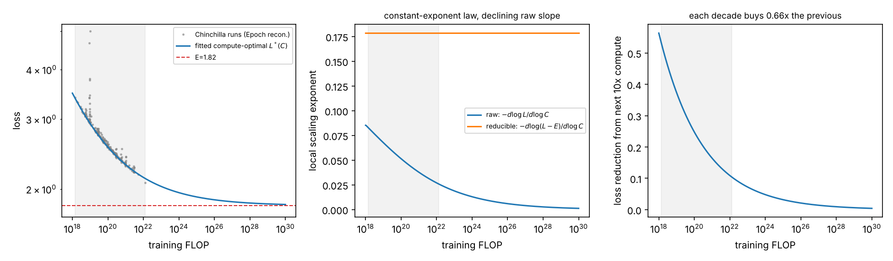
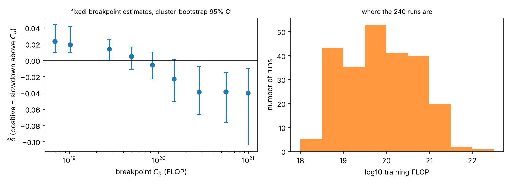
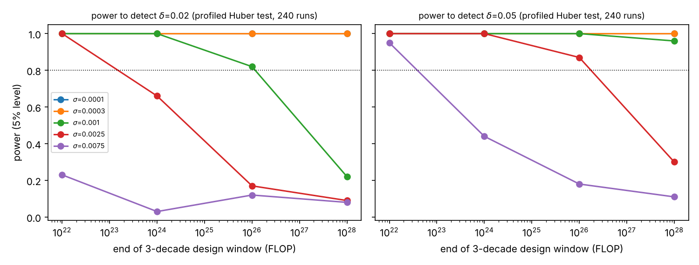

# Is Pretraining Scaling Slowing Down? Mechanical Deceleration, Noise-Limited Detectability, and How to Tell a Data Wall from Other Breaks

**Target venue:** NeurIPS (main track). Fallback: TMLR.

**Revision 1.** This version answers the round-1 review. The main changes are these. The real-data analysis now uses a wider breakpoint grid, calibrated tests and cluster bootstraps, and the earlier claim of "no slowdown, $\delta\le0.02$ up to $10^{22}$ FLOP" is withdrawn. The detectability study now uses the exact procedure applied to the real data, at per-run noise from $10^{-4}$ to $7.5\times10^{-3}$, and the claim that "loss curves cannot settle the debate" is withdrawn. The data-wall constants are no longer called universal: we generalise self-similarity to $\alpha\neq\beta$ and recompute the milestones under the 2026 functional forms of Lovelace et al. We also model two competing break mechanisms. Point-by-point changes are listed in `reviews/response_r1.md`.

---

## Abstract

People often ask whether the scaling laws for pretraining are "slowing down", but the question is usually left undefined. We make it precise, test it on public data, and ask what kind of evidence could settle it.

1. **Definitions (standard facts, collected).** Under a saturating law $L^*(C)=E+GC^{-\gamma}$, the raw log–log slope falls as $\gamma(1-E/L^*)$ and each decade of compute buys $10^{-\gamma}$ times the loss reduction of the previous one. These are textbook consequences of the irreducible term $E$, and we use them only to fix terms. A *genuine* slowdown is a fall in the exponent of the reducible loss, $\delta>0$ in the nested model $L=E+(AN^{-\alpha}+BD^{-\beta})\max(1,C/C_b)^{\delta}$.
2. **The Chinchilla runs reject the constant-exponent law, but not in the way a slowdown would.** We use Epoch AI's reconstruction of 240 Hoffmann et al. runs, whose support is effectively $10^{18.8}$–$10^{21}$ FLOP (only 23 runs at or above $10^{21}$ and 4 at or above $3\times10^{21}$). A profiled break test calibrated by parametric and wild-cluster bootstraps rejects $\delta=0$ ($p\le0.003$, the smallest attainable with 300 replicates). The departure is non-monotone. The fitted $\hat\delta$ is positive for breakpoints below about $5\times10^{19}$ FLOP and negative above about $10^{20}$. A two-break fit gives local exponents of 0.187, 0.166 and 0.175 over the three segments. For the top segment ($\ge2.8\times10^{20}$ FLOP, 72 runs), the change in exponent has a 95% cluster-bootstrap interval of $[-0.075,0.015]$. The data therefore show a misspecified curve, not a slowdown that grows with scale. They cannot bound a top-end slowdown more tightly than about 8% of $\gamma=0.178$.
3. **Whether loss curves can detect a slowdown at frontier scale depends on the noise, mostly on the correlated part.** We simulate the exact real-data procedure (Huber loss, profiled breakpoint, bootstrap-calibrated sup statistic) on 240 runs spread over 3 decades. With independent per-run noise $\sigma\le3\times10^{-4}$ in log-loss, a break of $\delta=0.02$ (11% of $\gamma$) is detected with power 1.00 even for a window ending at $10^{28}$ FLOP. For that window the power falls to 0.22 at $\sigma=10^{-3}$ and to 0.09 at $\sigma=2.5\times10^{-3}$. A shared offset of only $10^{-3}$ per compute budget, for example from re-tuning the recipe, cuts the power at $\delta=0.02$ to 0.10–0.13, even when the per-run noise is $10^{-4}$. Labs with careful, matched sweeps can therefore detect small breaks in loss; public, heterogeneous loss data cannot. The reducible fraction $\rho=(L^*-E)/L^*$ falls from 0.15 at $10^{22}$ to 0.015 at $10^{28}$ FLOP, which is why the noise requirement tightens with scale.
4. **"Where is the next growth point?" depends on which break occurs, and a cheap matched experiment can tell.** We compare three break mechanisms with the same onset: a cap on unique data (Muennighoff et al., 2023), a falling quality of the marginal token, and a break in the exponent that has nothing to do with data. A frontier loss-curve test detects the non-data break readily, the data cap only at low noise, and the quality decline poorly. A rejection does not say which mechanism caused it. Matched data-doubling runs can tell the three apart. Their loss gap grows without bound for the cap, saturates near $5\times10^{-4}$ for quality decline, and is exactly zero for the non-data break. The compute-equivalent value of doubling the data lever is likewise unbounded, about $1.5\times$, or $1\times$.
5. **The data wall is self-similar, but its constants depend on the functional form.** Under the Muennighoff et al. law, every milestone scales as $U^{(\alpha+\beta)/\alpha}$ in compute, where $U$ is the number of unique tokens. This holds for $\alpha\neq\beta$ once the excess-parameter threshold is defined consistently (Prop. 3′). With the Muennighoff et al. constants, compute efficiency falls to 50% at about $70$–$75\times$ the onset of repetition. Under the 2026 additive-penalty laws of Lovelace et al., which fit repeated-data runs better in their range, the same milestone lies at $28$–$33\times$ for $U\ge10^{10}$. Their effective-data refit puts it at $1{,}000$–$7{,}800\times$. The wall's timing is therefore model-dependent by more than two orders of magnitude in compute.

We state five revised, falsifiable predictions and a small-scale protocol. All numbers are computed by our CPU code from public data or simulation, or quoted from cited sources.

## 中文摘要

"预训练扩展定律是否正在放缓"常被提出，却很少被精确定义。本文给出定义、在公开数据上检验，并分析什么样的证据才能回答这一问题。（1）在饱和幂律 $L^*=E+GC^{-\gamma}$ 下，原始对数斜率按 $\gamma(1-E/L^*)$ 下降、每个数量级的收益按 $10^{-\gamma}$ 递减——这是不可约项的教科书推论，我们只用它统一术语；真正的放缓定义为可约损失指数下降，即嵌套模型中 $\delta>0$。（2）在 Epoch AI 重建的 240 个 Chinchilla 训练点上（有效覆盖约 $10^{18.8}$–$10^{21}$ FLOP，$\ge10^{21}$ 仅 23 个点），经参数自助法与簇野自助法校准的断点检验拒绝了"指数恒定"（$p\le0.003$），但偏离是非单调的：两断点拟合的三段局部指数为 0.187、0.166、0.175；高算力段（$\ge2.8\times10^{20}$）指数变化的 95% 簇自助区间为 $[-0.075,0.015]$。因此数据显示的是函数形式的误设，而不是随规模加剧的放缓；我们撤回了初稿中"$10^{22}$ FLOP 以内无放缓、$\delta\le0.02$"的说法。（3）用与真实数据完全相同的检验流程做模拟：若每次训练的独立噪声 $\sigma\le3\times10^{-4}$，即使窗口止于 $10^{28}$ FLOP，也能以 1.00 的功效检出 $\delta=0.02$；$\sigma=10^{-3}$ 时降至 0.22；而每个算力预算仅 $10^{-3}$ 的共享偏移（如重新调参）就把功效压到 0.10–0.13。结论是：精心匹配的实验室扫描可以从损失曲线中检出小的断点，异质的公开数据则不能；我们撤回了"损失曲线无法回答放缓之争"的说法。（4）"下一个增长点"取决于发生哪种断点：唯一数据上限、边际数据质量下降、与数据无关的指数断点三者在前沿损失曲线上难以区分，但配对的"数据翻倍"实验可以区分——三者的损失差分别无界增长、饱和于约 $5\times10^{-4}$、恒为零。（5）数据墙在 $C\propto U^{(\alpha+\beta)/\alpha}$ 意义下自相似（推广到 $\alpha\neq\beta$），但里程碑常数依赖函数形式：Muennighoff 形式下 50% 算力效率点约在 70–75 倍墙点算力处，Lovelace 等（2026）的加性惩罚形式下为 28–33 倍，其有效数据重拟合下为 1000–7800 倍。所有数字均来自本文 CPU 代码或所引文献。

---

## 1 Introduction

Since 2024, practitioners and commentators have repeatedly claimed that "pretraining scaling is hitting a wall". The claims rest on a mix of benchmark plateaus, reports of disappointing large runs, and the observation that labs are moving compute into reinforcement learning and inference-time scaling (Snell et al., 2024; DeepSeek-AI, 2025). The empirical literature describes pretraining loss with saturating power laws whose exponents do not change (Kaplan et al., 2020; Hoffmann et al., 2022; Besiroglu et al., 2024; Porian et al., 2024). The two views are hard to reconcile, partly because "slowing down" is rarely defined and partly because it is unclear what data could tell them apart.

This paper is a measurement paper. Its theory is elementary and we say so. Its contribution is to make the slowdown question testable, to show what the best public data do and do not support, to quantify what kind of loss data could answer the question at frontier scale, and to show which experiment would identify the next growth lever. We ask four questions:

- **(Q1) Definition.** What is a genuine slowdown, as opposed to the diminishing returns built into a saturating law?
- **(Q2) Evidence.** What does the best public suite of runs say about genuine deceleration, once the test is calibrated and the clustered structure of the data is respected?
- **(Q3) Detectability.** Under which noise conditions can a frontier loss curve detect a break of a given size?
- **(Q4) Mechanism.** If a break occurs, how can we tell whether data, data quality or something else causes it? And what does each mechanism imply about the next lever?

**Contributions.**

1. **A testable definition** (§3). We collect the standard facts about saturating laws (Prop. 1, Lemma 1) only to separate *mechanical* deceleration from a *genuine* fall in the reducible-loss exponent, $\delta>0$ in the nested model (2). Prop. 2 (signal shrinkage) is a first-order expansion that explains why detection becomes harder near the irreducible loss.
2. **A calibrated re-analysis of the Chinchilla runs** (§5.2). We use a profiled break test calibrated by parametric and wild-cluster bootstraps, cluster bootstraps over compute bins and size groups, a two-break model and a noise decomposition. The constant-exponent law is rejected, but the departure is non-monotone and located mainly at the low-compute end. The data support neither a slowdown at the top of their range nor a tight bound against one. This corrects our earlier claim.
3. **A noise-resolved detectability map** (§5.3). We give the size and power of the exact real-data procedure across per-run noise from $10^{-4}$ to $7.5\times10^{-3}$, windows ending from $10^{22}$ to $10^{28}$ FLOP, correlated per-budget noise and a small design, all with Monte Carlo intervals. The finding is conditional: independent evaluation noise at frontier levels is not the binding constraint, but correlated per-budget noise is.
4. **Discriminating break mechanisms** (§5.6). We model three mechanisms (unique-data cap, falling marginal-token quality, non-data exponent break). A frontier loss-curve test does not tell them apart; matched data-doubling comparisons do.
5. **A robustness audit of the data-wall model** (§5.5). Self-similarity generalises to $\alpha\neq\beta$ (Prop. 3′). The milestone constants change by more than two orders of magnitude across published functional forms, including the 2026 additive-penalty laws.

We trained no neural networks. Every number below is either computed by our code from public data or simulation (**[computed]**) or quoted from a cited source (**[cited]**).

## 2 Related Work

**Scaling laws for pretraining.** Hestness et al. (2017) documented power-law generalisation across domains. Kaplan et al. (2020) fitted power laws in parameters, data and compute for language models. Hoffmann et al. (2022) proposed the parametric form $L(N,D)=E+AN^{-\alpha}+BD^{-\beta}$ and the "Chinchilla" policy. Two papers reconcile Kaplan and Chinchilla: Pearce & Song (2024), through embedding-parameter accounting at small scale, and Porian et al. (2024), through last-layer compute, warmup and optimiser tuning. Besiroglu et al. (2024) reconstructed the Chinchilla data from the original figure and showed that the original Approach-3 fit and its confidence intervals were unreliable. Their refit is $E=1.8172$, $A=482.01$, $B=2085.43$, $\alpha=0.3478$, $\beta=0.3658$ **[cited]**. We build on their released data.

**Reliability of scaling-law estimation.** Choshen et al. (2025) analyse nearly 500 models and show that scaling-law estimates are noisy and sensitive to single badly behaved runs. This is consistent with the fragility we find when the five excluded Chinchilla runs are added back (§5.2). Ruan et al. (2024) build observational scaling laws from about 100 public models rather than from controlled sweeps. Our detectability results (§5.3) suggest why heterogeneous collections of this kind have little power to detect a small change in the pretraining-loss exponent, even when they predict capabilities well. van der Wal et al. (2025) find that pretraining is largely stable across seeds in the Pythia suite up to 410M parameters. We do not use their numbers, because seed variance at frontier scale is not public; we treat noise as a parameter instead.

**Breaks and functional forms.** Caballero et al. (2023) introduced broken neural scaling laws (BNSL) for extrapolating across regimes. Our break model is a minimal nested special case, built for *testing* $\delta=0$ rather than for flexible extrapolation. Lu (2026) argues that diminishing returns under a constant exponent imply that continued scaling requires repeated efficiency doublings. This is the economic counterpart of the mechanical deceleration we use to fix terms.

**Data constraints.** Hernandez et al. (2022) show that repeating a small fraction of the data many times can badly degrade a model. Xue et al. (2023) study multi-epoch degradation under a "token crisis". Muennighoff et al. (2023) trained about 400 models (up to 9B parameters and 900B tokens) and fitted a law in which repeated tokens and excess parameters decay in value, with half-lives $R_D^*=15.4$ and $R_N^*=5.3$ **[cited]**. Several 2025–26 papers revise that form:

- Lovelace et al. (2026) replace effective data with an *additive overfitting penalty* fitted to runs of 15M–1B parameters on 50M–6B unique tokens. They find that strong weight decay cuts the penalty coefficient by about 70%, and they release their fitted parameters, which we use in §5.5.
- Bryant & Liu (2026) study how to convert compute into performance when data must be repeated.
- Qin et al. (2026) introduce a token-effectiveness function for repeated and paraphrased tokens and report that it depends on model size and tokens per parameter.
- Kim et al. (2025) study pretraining with fixed data and unbounded compute, and find large gains from much stronger regularisation and from ensembling.

These works mean that the form of the repetition penalty at frontier scale is unsettled. We therefore report the data-wall milestones as conditional on the functional form (§5.5).

**Data stock and feasibility.** Villalobos et al. (2024) estimate the effective stock of public human text at about 300T tokens (90% CI 100T–1000T), with exhaustion projected between 2026 and 2032 **[cited]**. Sevilla et al. (2024) conclude that runs of $2\times10^{29}$ FLOP are likely feasible by 2030, with data as one of four constraints **[cited]**. Sorscher et al. (2022) show that data pruning can beat power-law scaling in data. Shumailov et al. (2024) document model collapse under recursive training on synthetic data.

**Beyond pretraining loss.** Sardana & Frankle (2024) show that inference cost justifies over-training. Snell et al. (2024) and DeepSeek-AI (2025) show large gains from test-time compute and reinforcement learning. We do not model these axes quantitatively (§7).

**What is new here.** Each ingredient above is known. What we add is:

- a calibrated, cluster-robust re-analysis of the public Chinchilla runs for a change in the reducible-loss exponent;
- a noise-resolved size and power map for the exact procedure, which separates independent from correlated noise;
- a comparison of break mechanisms by their observable signatures;
- an audit of how far the data-wall milestones move across published functional forms.

## 3 Theory

### 3.1 Setup

We use $L(N,D)=E+AN^{-\alpha}+BD^{-\beta}$ with $C=6ND$. Minimising over $N$ at fixed $C$ gives

$$L^*(C)=E+G\,C^{-\gamma},\qquad \gamma=\frac{\alpha\beta}{\alpha+\beta}, \tag{1}$$

with $N^*\propto C^{\beta/(\alpha+\beta)}$ and $D^*\propto C^{\alpha/(\alpha+\beta)}$. We write $R(C)=L^*(C)-E$ for the reducible loss and $\rho(C)=R/L^*$ for the reducible fraction.

### 3.2 Mechanical deceleration (standard facts)

The following facts are elementary consequences of including $E$ and are the reason $E$ is in the Chinchilla form. We state them only to fix terminology.

**Proposition 1.** Under (1) with $E>0$:

- (a) $s(C):=-d\ln L^*/d\ln C=\gamma\rho(C)$, which decreases strictly to 0;
- (b) $\Delta_{10}(10C)/\Delta_{10}(C)=10^{-\gamma}$, where $\Delta_{10}(C)=L^*(C)-L^*(10C)$;
- (c) a fixed absolute gain $\epsilon<R(C)$ costs a compute multiplier of $(1-\epsilon/R(C))^{-1/\gamma}$.

**Lemma 1.** $\ell(x)=\ln L^*(e^x)$ has $\ell''(x)=\gamma^2EGe^{-\gamma x}/(E+Ge^{-\gamma x})^2>0$.

*Proofs* are by direct substitution. A test that declares a slowdown when $\ln L$ is convex in $\ln C$ therefore rejects with probability tending to one under the unchanged law. We know of no peer-reviewed scaling-law paper that uses such a test. We include one in simulation (§5.4) only to show the size of the effect for informal "the curve is bending" arguments, and we make no claim about published practice.

**Definition (genuine deceleration).** We embed the law in

$$L(N,D,C)=E+\big(AN^{-\alpha}+BD^{-\beta}\big)\max(1,C/C_b)^{\delta}. \tag{2}$$

Along the frontier the reducible loss scales as $C^{-\gamma}$ below $C_b$ and as $C^{-(\gamma-\delta)}$ above it. The multiplier depends only on $C$, so $N^*(C)$ is unchanged.

### 3.3 Signal shrinkage

**Proposition 2.** For $C>C_b$ along the frontier,

$$\ln L_{\delta}(C)-\ln L_0(C)=\ln\big(1+\rho(C)[(C/C_b)^{\delta}-1]\big)\approx\rho(C)\,\delta\,\ln(C/C_b).$$

This identity is exact. The heuristic consequence (not a theorem) is that, for a fixed design and $\delta$, the signal-to-noise ratio of a test on log-loss scales roughly as $\rho\sqrt{n}/\sigma_{\rm eff}$, where $\sigma_{\rm eff}$ is the effective per-run noise. Correlated noise inflates $\sigma_{\rm eff}$ well above the per-run $\sigma$. Because $\rho\propto C^{-\gamma}$ asymptotically, keeping power fixed requires $\sigma_{\rm eff}$ to fall by about $10^{\gamma}\approx1.5\times$ per decade. §5.3 measures how far this heuristic holds.

### 3.4 Self-similarity of the data wall, generalised to $\alpha\neq\beta$

We take the data-constrained law of Muennighoff et al. (2023) **[cited]**:

$$L=E+\frac{A}{N'^{\alpha}}+\frac{B}{D'^{\beta}},\quad D'=U_D\big(1+R_D^*(1-e^{-R_D/R_D^*})\big),\quad N'=U_N\big(1+R_N^*(1-e^{-R_N/R_N^*})\big),$$

with $U_D=\min(D,U)$ and $R_D=D/U_D-1$. In their paper, $U_N$ is the compute-optimal model size for $U_D$ unique tokens, capped at $N$: $U_N=\min(N,\,c\,U_D^{\beta/\alpha})$ with $c=(\alpha A/\beta B)^{1/\alpha}$, and $R_N=N/U_N-1$. When $\alpha=\beta$, this reduces to $U_N=\min(N,k_NU_D)$ with a constant $k_N$. Our v0 analysis used this linear rule even when $\alpha\neq\beta$, which the reviewer correctly identified as inconsistent.

**Proposition 3′ (self-similarity).** Let $\tau=(\alpha+\beta)/\alpha$. Then $L^*_U(C)-E=U^{-\beta}\,\Psi(C/U^{\tau})$ for a function $\Psi$ that does not depend on $U$. Compute efficiency $\eta$, the effective exponent $\gamma_{\rm eff}$ and the shadow price of data $\kappa$ (defined below) therefore depend on $(C,U)$ only through $C/U^{\tau}$. Every milestone has the form $C_x=c_x\,U^{\tau}$. For $\alpha=\beta$, $\tau=2$ (Prop. 3 of v0).

*Proof.* Write $N=U^{\beta/\alpha}n$ and $D=Ud$. Then:

- $U_D/U=\min(d,1)$ and $R_D=d/\min(d,1)-1$, so $D'=U\phi_D(d)$;
- $U_N=U^{\beta/\alpha}\min(n,c\min(d,1)^{\beta/\alpha})$ and $R_N$ depends only on $(n,d)$, so $N'=U^{\beta/\alpha}\phi_N(n,d)$.

Hence $A N'^{-\alpha}+BD'^{-\beta}=U^{-\beta}[A\phi_N^{-\alpha}+B\phi_D^{-\beta}]$. The budget is $C=6U^{\tau}nd$. Minimising over $n$ at fixed $nd=C/(6U^\tau)$ gives $U^{-\beta}\Psi(C/U^\tau)$. The uncapped frontier is $GC^{-\alpha\beta/(\alpha+\beta)}=U^{-\beta}G\,(C/U^{\tau})^{-\alpha\beta/(\alpha+\beta)}$, which has the same form. Each diagnostic equates or differentiates functions of the form $U^{-\beta}f(C/U^\tau)$, and $U\mapsto2U$ changes only constants. ∎

The diagnostics are defined as follows:

- $\eta$ is defined by $L^*_\infty(\eta C)=L^*_U(C)$;
- $\gamma_{\rm eff}=-d\ln(L^*_U-E)/d\ln C$;
- $\kappa$ is defined by $L^*_U(\kappa C)=L^*_{2U}(C)$, with $\kappa=\infty$ if no amount of compute suffices.

The onset of repetition is $C_{\rm wall}$, where $D^*(C)=U$.

**Corollary 1.**

- (i) A factor $k$ in effective unique data postpones every milestone by $k^{\tau}$ in compute. That is $k^2$ when $\alpha=\beta$, and $k^{2.06}$ for our refit.
- (ii) Over-training at $r$ tokens per parameter moves the onset to $C=6U^2/r$ (for $\alpha=\beta$), earlier by $r/r^*$.

**What Prop. 3′ does not give.** It does not cover penalty forms that are not homogeneous under this rescaling. The additive penalty $P\,R_D\,N/U_D$ of Lovelace et al. (2026) is an example: it is not invariant when $N$ scales as $U^{\beta/\alpha}$ with $\beta\neq\alpha$. Such forms are self-similar only asymptotically, if at all (§5.5). The transfer exponent $\tau$ must also be known. Its uncertainty enters any small-to-large transfer as a factor of $10^{\Delta\tau\cdot\Delta\log_{10}U}$.

## 4 Data and Methods

**Data.** We use Epoch AI's reconstruction of the 245 Hoffmann et al. (2022, Fig. 4) runs **[cited]** (`svg_extracted_data.csv` from the `analyzing-chinchilla` repository). Following Epoch, we drop the five highest-loss runs, leaving 240. The nominal span is $1.4\times10^{18}$–$1.3\times10^{22}$ FLOP, but the effective support is much narrower. The 10th, 50th and 90th compute percentiles are $10^{18.83}$, $10^{19.92}$ and $10^{21.00}$. There are 104 runs at or above $10^{20}$, 23 at or above $10^{21}$, 4 at or above $3\times10^{21}$, and 1 at or above $10^{22}$ **[computed]**.

**Base fit.** We minimise the summed Huber loss ($\delta_H=10^{-3}$) on log-loss in the log-sum-exp parametrisation, using BFGS with an analytic gradient from the 4,500-point grid of Hoffmann et al. The objective is multiplied by $10^6$ and BFGS is run with gtol $10^{-7}$. Revision 1 added this scaling so that convergence is not declared prematurely at small noise. It changes the real-data estimates only in the sixth significant figure. The fit uses 300 nonparametric bootstrap resamples.

**The break test (used identically on real and simulated data; `code/breaktest.py`).**

1. Fit the base law and, for each $C_b$ on a grid of 9 compute quantiles (10th–90th percentile), fit (2).
2. The one-sided statistic is $T_1=\max_{C_b:\hat\delta(C_b)>0}[f_0-f_1(C_b)]$, where $f$ is the summed Huber loss; $T_1=0$ if no grid point has $\hat\delta>0$. The two-sided statistic $T_2$ maximises over all grid points.
3. Calibrate by parametric bootstrap from the null at the same design. On real data the null is the fitted base law, and the noise is either (i) Gaussian with the residual SD, (ii) a wild cluster bootstrap of residuals with Rademacher signs shared within 0.1-dex compute bins, or (iii) the same with clusters defined by model-size groups. We use 300 null replicates.
4. Get confidence intervals for $\hat\delta$ from a cluster (pairs) bootstrap over 0.1-dex compute bins (36 clusters) or size groups (36 clusters), with 200 resamples.

The v0 analysis profiled $C_b$ over the 30th–70th percentiles only, used an iid bootstrap and read percentile bounds as confidence bounds. We report it for comparison (Exp. 2) but no longer rely on it.

**Detectability simulations (Exp. 8).**

- *Truth:* the refit law with a break $\delta\in\{0,0.02,0.05,0.10\}$ at the geometric midpoint of the window.
- *Design:* 12 iso-FLOP budgets over 3 decades ending at $C_{\rm end}\in\{10^{22},10^{24},10^{26},10^{28}\}$, with 20 model sizes per budget at tokens-per-parameter ratios log-uniform in $[2,200]$ (240 runs). A small design uses 6 budgets of 8 runs.
- *Noise:* independent Gaussian on log-loss with $\sigma_w\in\{10^{-4},3\times10^{-4},10^{-3},2.5\times10^{-3},7.5\times10^{-3}\}$, plus optionally a shared offset per budget with SD $\sigma_b\in\{10^{-3},3\times10^{-3}\}$.
- *Test:* the procedure above. The critical value is the 95th percentile of $T_1$ over 200 null replicates at the same design and noise (oracle calibration). Power is estimated from 100 replicates per $\delta$. We report Wilson 95% Monte Carlo intervals.
- *Fitted-null check:* in two cells we also calibrate each dataset by simulating from its own fitted null (60 replicates each, 20 datasets).

**Earlier simulations, kept for reference.** Exp. 3 compares a naive curvature test with a least-squares break test with $C_b$ fixed at the truth, using 100 replicates. Exp. 6a measures absorption of breaks into $\hat E$. Exp. 7 is the v0 version of the detectability table (fixed $C_b$, 60 replicates). Exp. 3 and Exp. 7 use a test that is more powerful than the one applied to real data (M2). Exp. 8 supersedes them.

**Data-wall model (Exps. 4, 5, 10).** For each $C$ we compute $L^*_U(C)$ by grid search over $\ln N$ (3,000–6,000 points). Exp. 10 imposes free disposal, $\tilde L_U(C)=\min_{C'\le C}L^*_U(C')$, which matters only for forms that can predict rising loss with more compute. We consider these laws:

- (a) Muennighoff et al. with their constants, with $\beta=0.35$ or their reported 0.353;
- (b) Muennighoff-style repetition on our refit base law ($\alpha\neq\beta$), with the linear $k_N$ rule (v0) or the consistent rule;
- (c) the Lovelace et al. (2026) laws (effective-data "Muennighoff-D", additive 1-parameter, additive 4-parameter) for their standard arm and their weight-decay-1.0 arm. The parameters are taken from their public repository (`dcscaling/data/fits/{standard,wd_sweep/wd1.0}`), and we checked our implementation of the forms against their `laws.py`.

**Competing mechanisms (Exp. 11).** All three mechanisms share the Muennighoff base law and the onset $C_x=C_{\rm wall}(U=10^{14})$. M1 is the unique-data cap with $U=10^{14}$. In M2, the $q$-th token beyond the best $Q=10^{14}$ has value $(q/Q)^{-\theta}$ with $\theta=0.5$, so that $D_{\rm eff}=Q[1+((D/Q)^{1-\theta}-1)/(1-\theta)]$ for $D>Q$. M3 is a non-data exponent break, $\max(1,C/C_x)^{0.05}$. For each mechanism we compute $\eta$, the compute value of doubling its data lever, the log-loss excess and the matched data-doubling gap. We also compute the power of the break test on a 240-run, 3-decade window ending at $10$ or $100\,C_x$, with $\sigma_w\in\{3\times10^{-4},10^{-3}\}$, 150 null and 100 alternative replicates.

**Reproducibility.** The code is in `code/`, with the run order in `code/README.md`. All seeds are fixed, and the raw outputs are in `results/`. The full revision-1 rerun took about 95 minutes of wall-clock time on 4 CPU cores (`results/run_logs/timing.txt`).

## 5 Results

### 5.1 Refit and mechanical deceleration (Exp. 1)

The 240-run fit gives $E=1.8172$, $A=477.8$, $B=2143.4$, $\alpha=0.3473$ and $\beta=0.3672$ **[computed]**. This matches Epoch's refit to three significant figures in $E$, $\alpha$ and $\beta$ **[cited above]**. The 80% bootstrap intervals are $E\in[1.788,1.853]$, $\alpha\in[0.326,0.364]$, $\beta\in[0.348,0.399]$ and $\gamma\in[0.173,0.186]$, with $\gamma=0.1785$. The residual SD is 0.0075 in log-loss. Fitting all 245 runs moves the estimates to $E=1.891$ and $\beta=0.453$.

**Table 1.** Frontier implied by the refit law **[computed]**. Rows at $10^{23}$ FLOP and above are extrapolations.

| $C$ (FLOP) | $L^*$ | $R=L^*-E$ | $s$ [80% CI] | gain from next $10\times$ |
|---|---|---|---|---|
| $10^{21}$ | 2.304 | 0.487 | 0.0377 [0.0366, 0.0386] | 0.164 |
| $10^{23}$ | 2.031 | 0.214 | 0.0188 [0.0176, 0.0198] | 0.072 |
| $10^{25}$ | 1.911 | 0.094 | 0.0088 [0.0079, 0.0095] | 0.032 |
| $10^{27}$ | 1.859 | 0.041 | 0.0040 [0.0034, 0.0044] | 0.014 |
| $10^{29}$ | 1.835 | 0.018 | 0.0018 [0.0015, 0.0020] | 0.006 |

Each decade returns $10^{-0.178}=0.663$ times the loss reduction of the previous one, so the same absolute gain costs $1.51\times$ more compute per decade (Fig. 1). This is the "trivial" slowdown. We include it only because informal slowdown arguments often describe exactly this.

*Figure 1. Left: Chinchilla runs and the fitted frontier. Middle: the raw exponent declines while the reducible-loss exponent is constant. Right: the absolute gain per additional decade.*

### 5.2 What the Chinchilla runs say (Exps. 2, 9, 9b)

**The v0 analysis and its problems.** With $C_b$ profiled over the 30th–70th percentiles ($2.8\times10^{19}$–$2.8\times10^{20}$), the fit selects the *upper edge*, $C_b=2.8\times10^{20}$, with $\hat\delta=-0.039$. The iid-bootstrap 95% percentile interval is $[-0.072,0.020]$ **[computed, Exp. 2]**. The reviewer correctly pointed out three problems. A percentile bound is not a valid confidence bound when the profiled nuisance parameter sits at a grid edge. The iid bootstrap ignores clustering. And the fixed-$C_b$ intervals exclude zero in opposite directions. We no longer use this analysis to bound $\delta$. (The v0 statement that "17% of bootstrap replicates have $\hat\delta>0$" was not a p-value and has been removed.)

**Wide grid and calibrated tests.** Over the 10th–90th percentile grid ($6.8\times10^{18}$–$9.9\times10^{20}$), $\hat\delta(C_b)$ falls steadily from $+0.024$ at the lower edge to $-0.040$ at the upper edge, crossing zero between $5\times10^{19}$ and $8\times10^{19}$ (Fig. 7, left). The profiled optimum is now at the *lower* edge, with $\hat\delta=+0.024$. Table 6 reports the calibrated tests.

**Table 6.** Calibrated tests of the constant-exponent law on the 240 runs, 300 null replicates each **[computed, Exp. 9]**.

| null noise model | one-sided $p$ | two-sided $p$ | null 95% range of $\hat\delta$ |
|---|---|---|---|
| Gaussian, $\sigma=$ residual SD | 0.0033 | 0.0033 | $[-0.037,0.026]$ |
| wild cluster, compute bins | 0.0033 | 0.0033 | $[-0.034,0.030]$ |
| wild cluster, size groups | 0.0033 | 0.0033 | $[-0.038,0.033]$ |

($p=1/301$ is the smallest value attainable with 300 replicates.)

The constant-exponent law is therefore rejected. Formally, the one-sided test "detects a deceleration" above about $7\times10^{18}$ FLOP. But the departure is not a slowdown that grows with scale:

- **Fixed-breakpoint cluster-bootstrap intervals** (compute bins) are $[0.010,0.044]$ at $C_b=6.8\times10^{18}$, $[0.0005,0.026]$ at $2.8\times10^{19}$, $[-0.023,0.010]$ at $8.4\times10^{19}$, $[-0.067,-0.008]$ at $2.8\times10^{20}$ and $[-0.104,-0.010]$ at $9.9\times10^{20}$. Size-group clusters give similar intervals. The profiled $\hat\delta$ has cluster-bootstrap 95% intervals of $[-0.076,0.044]$ (compute bins) and $[-0.084,0.043]$ (size groups), so its sign is not identified.
- **Two-break model (Exp. 9b).** With breaks at the 10th and 70th percentiles ($6.8\times10^{18}$ and $2.8\times10^{20}$), we get $\hat\delta_1=0.021$ (95% cluster CI $[-0.008,0.044]$) and $\hat\delta_2=-0.009$ ($[-0.075,0.015]$). The pointwise local exponents of the reducible loss are 0.187, 0.166 and 0.175 over the three segments. In 66% of resamples $\hat\delta_2<0$, that is, the exponent recovers in the top segment.
- **Noise decomposition.** The loss values in the reconstruction take only 94 distinct levels, with a median spacing of 0.0045 in log-loss. That corresponds to a quantisation SD of 0.0017. Nearest neighbours in $(\log N,\log C)$ give a run-level ("rough") SD of 0.0039, or 0.0035 after removing quantisation, against a total residual SD of 0.0075. About 73% of the residual variance is therefore *smooth* structure that the five-parameter law does not capture. This is misspecification, not noise.
- **All 245 runs.** Adding back the five excluded runs moves the profile to $\hat\delta=-0.096$ at $2.8\times10^{20}$, with $\hat\delta(C_b)$ ranging from $+0.040$ to $-0.104$. The sign pattern is the same, but the magnitude is roughly doubled, so $\hat\delta$ is not robust to this choice (M4).
- **Power on the actual design.** With wild-cluster noise, the calibrated test detects a true break at $8.4\times10^{19}$ with power 0.25, 0.63, 0.99 and 1.00 for $\delta=0.01$, 0.02, 0.04 and 0.08. At $2.8\times10^{20}$ the corresponding powers are 0.16, 0.46, 0.95 and 1.00 (Wilson intervals in `results/exp9_real_inference.json`).

**Interpretation.** The public Chinchilla data reject the constant-exponent law. The departure is concentrated at the low-compute end: the local exponent is higher below about $10^{19}$ FLOP than above it. It does not grow at the top of the range. This pattern is what one would expect from small-scale effects such as embedding-parameter accounting (Pearce & Song, 2024) or warmup and tuning choices (Porian et al., 2024), or from digitisation artefacts, rather than from a slowdown. We have not tested these explanations. For the question that matters for forecasting, a slowdown at the top, the best statement is this: relative to the middle segment, the exponent change above $2.8\times10^{20}$ FLOP, supported mainly by runs up to about $3\times10^{21}$ FLOP, lies in $[-0.075,0.015]$ at 95%. A slowdown of up to about 8% of $\gamma$ is not excluded, and nothing beyond about $3\times10^{21}$ FLOP is informative. This replaces our v0 claim of "no slowdown, $\delta\le0.02$, up to $10^{22}$ FLOP".

**Backtest (Exp. 2, unchanged).** Fitting on low-compute runs and forecasting higher-compute runs gives mean log-residuals of $-0.0020$, $-0.0030$, $-0.0073$ and $-0.0031$ for splits at the 50th–80th percentiles. High-compute runs did as well as or slightly better than forecast. The bands ignore test-set noise and clustering and are too narrow. This backtest is consistent with the two-break picture.

*Figure 7. Left: $\hat\delta$ against the assumed breakpoint, with compute-bin cluster-bootstrap 95% intervals. Right: the distribution of the 240 runs in compute.*

### 5.3 Detectability depends on noise, mainly correlated noise (Exp. 8)

**Table 3 (revised).** Power of the exact real-data procedure (Huber loss, profiled $C_b$, calibrated $T_1$), 240 runs over 3 decades, at the 5% level. Each cell uses 200 null and 100 alternative replicates **[computed]**. Wilson 95% MC intervals are about ±0.1 at power 0.5 and $[0.96,1]$ at power 1.00.

| $\sigma_w$ | window ends at | $\delta=0.02$ | 0.05 | 0.10 |
|---|---|---|---|---|
| $10^{-4}$ | $10^{22}$ / $10^{24}$ / $10^{26}$ / $10^{28}$ | 1.00 / 1.00 / 1.00 / 1.00 | 1.00 (all) | 1.00 (all) |
| $3\times10^{-4}$ | $10^{22}$ / $10^{24}$ / $10^{26}$ / $10^{28}$ | 1.00 / 1.00 / 1.00 / 1.00 | 1.00 (all) | 1.00 (all) |
| $10^{-3}$ | $10^{22}$ / $10^{24}$ / $10^{26}$ / $10^{28}$ | 1.00 / 1.00 / 0.82 / 0.22 | 1.00 / 1.00 / 1.00 / 0.96 | 1.00 (all) |
| $2.5\times10^{-3}$ | $10^{22}$ / $10^{24}$ / $10^{26}$ / $10^{28}$ | 1.00 / 0.66 / 0.17 / 0.09 | 1.00 / 1.00 / 0.87 / 0.30 | 1.00 / 1.00 / 1.00 / 0.87 |
| $7.5\times10^{-3}$ | $10^{22}$ / $10^{24}$ / $10^{26}$ / $10^{28}$ | 0.23 / 0.03 / 0.12 / 0.08 | 0.95 / 0.44 / 0.18 / 0.11 | 1.00 / 1.00 / 0.67 / 0.16 |
| $10^{-4}$ + per-budget $\sigma_b=10^{-3}$ | $10^{26}$ / $10^{28}$ | 0.13 / 0.10 | 0.69 / 0.17 | 1.00 / 0.71 |
| $10^{-4}$ + per-budget $\sigma_b=3\times10^{-3}$ | $10^{26}$ / $10^{28}$ | 0.06 / 0.05 | 0.16 / 0.11 | 0.36 / 0.13 |
| small design (48 runs), $3\times10^{-4}$ | $10^{26}$ / $10^{28}$ | 1.00 / 0.70 | 1.00 / 1.00 | 1.00 / 1.00 |
| small design (48 runs), $10^{-3}$ | $10^{26}$ / $10^{28}$ | 0.34 / 0.12 | 0.97 / 0.47 | 1.00 / 1.00 |

**Size.** Under the oracle calibration the size is 5% by construction. When each dataset is calibrated from its own fitted null, the test rejected 0 of 20 null datasets in each of two cells ($\sigma_w=3\times10^{-4}$ and $2.5\times10^{-3}$ at $10^{26}$; Wilson 95% interval $[0,0.16]$). The fitted-null test is therefore not anti-conservative at this resolution, but we cannot claim that its size is exactly nominal.

**What this changes.** The reviewer's re-run, with fixed $C_b$ and least squares, found power 1.00 at $\sigma\le3\times10^{-4}$ and 0.63 at $\sigma=10^{-3}$ for $\delta=0.02$ at $10^{28}$. Our exact procedure gives 1.00 and 0.22. At $\sigma=10^{-3}$ profiling costs power relative to the reviewer's fixed-$C_b$ test, but the reversal is confirmed. *If* a lab's per-run noise is independent and below about $3\times10^{-4}$ in log-loss, a 240-run, 3-decade sweep can detect an exponent loss of 11% of $\gamma$ even at $10^{28}$ FLOP. Above about $10^{-3}$, detection of $\delta=0.02$ at $10^{28}$ fails, while $\delta=0.05$ is still detected (0.96). One cell is mildly non-monotone in $C_{\rm end}$ ($\sigma_w=7.5\times10^{-3}$, $\delta=0.02$: 0.03 at $10^{24}$ against 0.12 at $10^{26}$), which is within MC error of the low-power regime.

**A numerical correction to v0.** In v0 the objectives were unscaled (of order $10^{-6}$–$10^{-3}$) and BFGS used its default tolerance. Near the irreducible loss, where the break signal is tiny, BFGS could stop before the fit had converged. Revision 1 scales the objectives by $10^6$ and tightens the tolerance (§4). This changed the high-compute simulation cells materially, in both directions. In the v0 fixed-$C_b$ table (Exp. 7), the power at $10^{28}$ and $\sigma=2.5\times10^{-3}$ rises from 0.10 to 0.20 ($\delta=0.02$) and from 0.40 to 0.62 ($\delta=0.05$). In a preliminary Exp. 8 run with the unscaled objective (archived in `results/v0_unscaled_optimizer/`), individual cells differed by up to 0.27: 0.76 against 1.00 at $\sigma=3\times10^{-4}$, $10^{28}$; 0.55 against 0.82 at $10^{-3}$, $10^{26}$; and 0.39 against 0.22 at $10^{-3}$, $10^{28}$. Only the corrected numbers are reported here. The real-data estimates were unaffected: they changed only in the sixth significant figure.

**Which noise is realistic?** Evaluation noise is not the limit. Under stated assumptions (per-token loss SD of 2–3 nats, a within-document design effect of 1–10, mean loss of about 2 nats), the standard error of held-out log-loss is $3\times10^{-5}$–$1.5\times10^{-4}$ for $10^9$ evaluation tokens and $1$–$4.7\times10^{-4}$ for $10^8$ **[computed, Exp. 12; assumption-driven]**. The binding terms are run-to-run (seed and data-order) variation and recipe variation shared across a budget. Our grouped-noise rows show that a per-budget offset of $10^{-3}$, small by the standards of separately tuned runs, cuts the power at $\delta=0.02$ from 1.00 to 0.13 at $10^{26}$. Labs that run matched sweeps, with one recipe and matched seeds and data order, can therefore detect small breaks in loss. Public data assembled from different papers, recipes and tokenisers, as in observational analyses, cannot. Frontier-scale seed and recipe variance is not public, so we do not claim which regime frontier labs are in.

**Revised claim (replaces v0's "loss curves cannot settle the debate").** Whether loss curves can settle the slowdown question is an empirical question about the correlated part of the noise. Holding the design fixed, the noise requirement tightens by roughly $1.5\times$ per decade (Prop. 2). Public loss data do not meet it; matched internal sweeps may.

*Figure 6. Power of the profiled break test against the end of the 3-decade window, for five levels of independent per-run noise.*

### 5.4 Two supporting simulations (Exps. 3, 6a)

**Raw-curvature arguments (Exp. 3).** As Lemma 1 implies, a quadratic-curvature test on per-budget minimum log-loss, without $E$, rejects in 81%–100% of datasets drawn from the unchanged law. We report this only to quantify informal "the curve is bending" arguments, not as a baseline from the literature. Under the same design, the fixed-$C_b$ least-squares break test has rejection rates of 0.02–0.09 at $\delta=0$ over 8 cells of 100 replicates. Pooling these cells gives 44/800 = 0.055 (Wilson 95% interval [0.041, 0.073]). Its power at $\delta=0.02$ and $\sigma_0=0.0075$ is 0.74–0.87 in designs that start at $10^{18}$. This is the source of the v0 abstract's "about 0.8". The profiled test applied to real data has lower power: 0.23 for a window ending at $10^{22}$ at the same $\sigma$ (Table 3).

**An unmodelled break raises $\hat E$ (Exp. 6a).** Fitting the no-break law to data with a break gives mean $\hat E$ of 1.816, 1.860, 1.905 and 1.988 for $\delta=0$, 0.01, 0.02 and 0.04 (truth 1.817; 60 replicates; $W=4$, $\sigma_0$). Two decades beyond the design, the mean log-errors of the frontier forecast are -0.0002, +0.0071, +0.0144 and +0.0253 **[computed]**. A genuine slowdown can therefore appear as a "higher entropy floor".

### 5.5 The data wall: what is robust and what is not (Exps. 4, 5, 10)

**Muennighoff et al. law, as in v0 (Table 4).** With $\alpha=\beta=0.35$, thresholds in multiples of $C_{\rm wall}$ agree to grid precision across $U\in\{3\times10^{13},\dots,10^{15}\}$, and $C_{\rm wall}/U^2=0.299$. The multiples are 64 for $\kappa>2$, 75 for $\eta<0.5$, 128 for $\gamma_{\rm eff}<\gamma/2$, 161 for $\kappa=\infty$ and 942 for $\eta<0.1$ **[computed, Exp. 4]**. Exp. 10, with a different grid and free disposal, reproduces these as 65, 74, 128, 158 and 912. The two differ by grid resolution only.

**Self-similarity with $\alpha\neq\beta$ (Prop. 3′, Exp. 10a).** On our refit base law, the v0 linear rule makes the 50%-efficiency multiple drift from 124 at $U=10^8$ to 36 at $U=10^{15}$. That is a factor of 3.4 over 7 decades, confirming the reviewer's concern about transfer. With the consistent rule, every milestone multiple is *identical* across $U=10^8$–$10^{15}$: $\eta<0.5$ at 69, $\kappa>2$ at 59, $\kappa=\infty$ at 149, $\gamma_{\rm eff}<\gamma/2$ at 124 and $\eta<0.1$ at 884 times $C_{\rm wall}$ **[computed]**. Using Muennighoff et al.'s reported $\beta=0.353$ instead of the rounded 0.35, the linear rule drifts from 63 to 52 between $U=10^8$ and $10^{14}$, while the consistent rule gives 71 at both. The v0 rounding of $\beta$ to 0.35 is what made the v0 self-similarity exact (M9); the consistent rule makes rounding unnecessary.

**Transfer exponent.** Small-to-large transfer requires $\tau=(\alpha+\beta)/\alpha$. Its point estimate is 2.06 (80% bootstrap interval $[1.98,2.18]$). Over a 6-decade transfer in $U$ (from $10^8$ to $10^{14}$), this uncertainty alone corresponds to a factor of 0.32–5.2 in the predicted compute of any milestone **[computed]**. P1 must therefore estimate $\tau$ from the same sweep. The v0 claim that $\alpha\neq\beta$ effects are bounded by $1.4\times$ was valid only over the 1.5 decades actually tested and has been withdrawn.

**Functional form (Exp. 10c).** Table 7 recomputes the milestones under the Lovelace et al. (2026) laws.

**Table 7.** Multiples of $C_{\rm wall}$ for selected milestones under alternative data-constrained laws **[computed]**. The Lovelace parameters come from their repository; their fits cover 50M–6B unique tokens, so $U\ge10^{10}$ is extrapolation.

| law (arm) | $U$ | $\eta<0.5$ | $\kappa>2$ | $\kappa=\infty$ | $\eta$ at $10\,C_{\rm wall}$ | $\eta$ at $100\,C_{\rm wall}$ |
|---|---|---|---|---|---|---|
| Muennighoff et al. (consistent $U_N$) | any | 71 | 63 | 154 | — | — |
| refit base + Muennighoff repetition (consistent) | any | 69 | 59 | 149 | — | — |
| Lovelace Muennighoff-D (standard) | any | 1,000 | 2,222 | 19,055 | 0.95 | 0.78 |
| Lovelace Muennighoff-D (wd 1.0) | any | 7,822 | 21,544 | 41,052 | 0.98 | 0.89 |
| Lovelace additive 1p (standard) | $10^8$ / $10^9$ / $\ge10^{10}$ | 437 / 91 / 28 | 244 / 48 / 16–17 | 244 / 163 / 352 | 0.99 / 0.96 / 0.72–0.77 | 0.89 / 0.45 / 0.27 |
| Lovelace additive 4p (standard) | $10^8$ / $10^9$ / $\ge10^{10}$ | 651 / 100 / 28–30 | 341 / 52 / 17 | 341 / 149 / 352 | 1.00 / 0.99 / 0.72–0.80 | 0.97 / 0.49 / 0.27 |
| Lovelace additive 1p (wd 1.0) | $10^8$ / $10^9$ / $\ge10^{10}$ | 970 / 91 / 33 | 525 / 48 / 19 | 525 / 321 / 423 | 1.00 / 0.96 / 0.74 | 0.96 / 0.45 / 0.30 |
| Lovelace additive 4p (wd 1.0) | $10^8$ / $10^9$ / $\ge10^{10}$ | 970 / 132 / 33–36 | 494 / 67 / 19 | 494 / 179 / 411–423 | 1.00 / 0.99 / 0.74–0.84 | 0.98 / 0.63 / 0.30 |

There are three findings:

- **The 50%-efficiency milestone spans more than two orders of magnitude across forms**, from 28 to 7,822 times $C_{\rm wall}$. The forms that differ most here, effective-data versus additive penalty, fit the same 2026 runs. The v0 description of "$75\times$" as a universal constant overstated what is known. It is a property of one functional form.
- **The additive forms are not self-similar at small $U$.** Their milestones move by more than $10\times$ between $U=10^8$ and $10^{10}$ before settling. At large $U$ the penalty $P\,R_D\,N/U_D$ grows with $N/U_D$, so the optimal policy stops repeating altogether: the wall becomes "hard", and the milestones settle at the hard-wall values. A small-scale P1 experiment in the regime of Lovelace et al. therefore cannot validate frontier constants without a model of how the penalty scales.
- **Weight decay matters.** Strong weight decay (the wd 1.0 arm) moves the effective-data milestones about $8\times$ later. This is consistent with Lovelace et al.'s finding that weight decay cuts the overfitting coefficient, and with Kim et al. (2025). Regularisation is itself a lever on the wall.

**Sensitivity to half-lives (Table 5, unchanged).** Under the Muennighoff form, the 50%-efficiency point ranges from $20\times$ ($R_D^*=5$, $R_N^*=2$) to $246\times$ ($R_D^*=40$, $R_N^*=10$) at $U=10^{14}$ **[computed]**.

| $R_D^*$ \ $R_N^*$ | 2 | 5.3 | 10 |
|---|---|---|---|
| 5 | 20 | 36 | 55 |
| 10 | 28 | 57 | 94 |
| 15.4 | 33 | 75 | 133 |
| 25 | 41 | 98 | 181 |
| 40 | 47 | 119 | 246 |

**Is the efficiency loss "large"? (W7).** Under the Muennighoff form with $U=10^{14}$, $\eta=0.96$ at $10^{28}$ FLOP, 0.65 at $10^{29}$ and 0.22 at $10^{30}$. The corresponding compute penalties are $1.04\times$, $1.53\times$ and $4.5\times$. At 4–5× annual compute growth, these equal 0.3–0.4, 3.2–3.7 and 11–13 months of growth **[computed]**. Near $10^{29}$ FLOP the penalty is a few months of growth, not a crisis. It becomes about a year's growth only around $10^{30}$ FLOP. In v0 we called the $10^{29}$ figure "large" without this framing; we have removed the word.

**Calendar illustration (not a forecast; M8).** Epoch AI estimates Grok-3 at about $4.6\times10^{26}$ FLOP and identifies it as the first model above $10^{26}$ **[cited]**. Taking $C_0=4.6\times10^{26}$ in 2025 and growth of $3$–$5\times$ per year (Epoch: 4–5× per year through May 2024 **[cited]**), the Muennighoff-form wall for $U=10^{14}$ arrives in 2026.2–2026.7 and 50% efficiency in 2028.8–2030.6. For $U=3\times10^{14}$ the dates are 2027.5–2028.7 and 2030.2–2032.6 **[computed]**. At this anchor the onset of repetition for $U=10^{14}$ is already in the past. These dates are about a year earlier than v0's, which anchored at $10^{26}$. Under the additive-penalty forms, 50% efficiency arrives about $\log_g(75/30)\approx0.6$–$0.8$ years earlier still. Under the Lovelace effective-data refits it arrives roughly 1.6–4.2 years later (a rough comparison, because the base laws, and hence $C_{\rm wall}$, differ). The spread across functional forms is larger than the spread across growth rates.

### 5.6 Which mechanism? Discriminating breaks (Exp. 11)

**Table 8.** Three break mechanisms with the same onset $C_x$ (Muennighoff base law) **[computed]**. $\eta$ is compute efficiency relative to the no-break law. "Value of 2× lever" is the compute multiple that matches doubling $U$ (M1, M3) or $Q$ (M2); ∞ means no amount of compute suffices. The gap is the matched data-doubling log-loss gap at the compute-optimal $(N,D)$.

| $C/C_x$ | M1 cap: $\eta$ / value / gap | M2 quality: $\eta$ / value / gap | M3 non-data: $\eta$ / value / gap |
|---|---|---|---|
| 3 | 0.97 / 1.04 / $9.4\times10^{-5}$ | 0.96 / 1.05 / $8.1\times10^{-5}$ | 0.73 / 1.00 / 0 |
| 10 | 0.85 / 1.18 / $3.2\times10^{-4}$ | 0.84 / 1.18 / $3.0\times10^{-4}$ | 0.52 / 1.00 / 0 |
| 30 | 0.67 / 1.48 / $5.4\times10^{-4}$ | 0.70 / 1.32 / $4.4\times10^{-4}$ | 0.38 / 1.00 / 0 |
| 100 | 0.44 / 2.96 / $8.2\times10^{-4}$ | 0.54 / 1.46 / $4.9\times10^{-4}$ | 0.27 / 1.00 / 0 |
| 1000 | 0.09 / ∞ / $1.5\times10^{-3}$ | 0.30 / 1.69 / $4.6\times10^{-4}$ | 0.14 / 1.00 / 0 |

**Loss-curve test.** For a window ending at $10\,C_x$, the break test's power is 1.00, 0.76 and 1.00 for M1, M2 and M3 at $\sigma_w=3\times10^{-4}$, and 0.61, 0.09 and 0.85 at $10^{-3}$. For a window ending at $100\,C_x$ it is 0.92, 0.23 and 1.00 at $3\times10^{-4}$, and 0.18, 0.06 and 0.75 at $10^{-3}$ **[computed; Wilson intervals in `results/exp11_competing_mechanisms.json`]**. The test is built for M3, which is exactly model (2), so it detects M3 best. The data mechanisms bend the frontier in ways the compute-only break model fits poorly. The quality decline in particular is mostly absorbed into the base law: all three mechanisms raise the median $\hat E$ above the null (1.870), to 1.873–1.876 for M2, 1.875–1.880 for M1 and 1.880–1.882 for M3. A loss-curve test can therefore indicate, given low noise, that *something* broke, but not *what*. A data-type break may also be missed even when it is costly: under M2 at $100\,C_x$, $\eta=0.54$ while the power is 0.23 at $\sigma_w=3\times10^{-4}$.

**Matched data-doubling separates them.** The gap grows without bound under M1, saturates at about $5\times10^{-4}$ under M2, and is exactly zero under M3. For M1 versus M2 the curves part only beyond about $30\,C_x$. With matched seeds and data order, the per-pair noise that matters is the *difference* noise, which can be much smaller than the per-run noise. The v0 pair counts (1,428, 120, 44 and 19 pairs at $C/C_{\rm wall}=3$, 10, 30 and 100) assumed independent noise of $10^{-3}$ per run and are conservative for matched pairs (M6).

**Consequence for the "next growth point".** The answer is not fixed by our model; it depends on which mechanism holds:

- Under M1 the lever is new unique data or repetition tolerance, and its value rises without bound.
- Under M2 the lever is quality (filtering and better sources), with a bounded value of about 1.2–1.7× compute per doubling of $Q$.
- Under M3 data is worth nothing at the margin and the lever is algorithmic.

The v0 statement that "the next growth point is data" was true by construction and has been withdrawn. Matched data-doubling experiments are the cheapest way to decide between these. By Prop. 3′ they can be run at reduced $U$ for the Muennighoff-type forms. For additive-penalty forms they must be run near the target $U$.

## 6 Discussion

**Is pretraining scaling slowing down?** In the trivial sense, yes, and it always has been: each decade buys 0.66× the previous one at the Chinchilla exponent. In the sense that matters, the best public data do not settle it. The constant-exponent law is rejected on the Chinchilla reconstruction, but the misfit is non-monotone and sits at the low-compute end, and the data cannot bound a slowdown at the top of their range more tightly than about 8% of $\gamma$. We find no public evidence of a genuine slowdown. We also find that public data could not show one if it were small.

**Can loss curves settle it?** They can under some conditions. With independent per-run noise of about $3\times10^{-4}$ or less, and matched recipes, a 240-run sweep detects an 11% exponent loss even at $10^{28}$ FLOP. Correlated per-budget noise of $10^{-3}$ destroys that power. The practical question is therefore how much the recipe varies across budgets in a sweep, and labs can measure that internally.

**Where is the next growth point?** Our models do not answer this by assumption any more. A loss-curve break can come from a unique-data cap, a decline in data quality or a non-data limit, and the next lever is different in each case. Matched data-doubling experiments discriminate between them. Among data-cap models, the timing of the wall depends on the functional form by more than two orders of magnitude in compute, and regularisation (weight decay, ensembling) shifts it substantially. Outside pretraining, the shift of compute toward RL and inference (Snell et al., 2024; DeepSeek-AI, 2025) is compatible with any of the three mechanisms. We make no quantitative claim about those axes.

**Recommendations for people who measure scaling.**

- (1) Test slowdown on the reducible-loss exponent with a calibrated, cluster-robust nested test, and report power. Do not read a non-rejection as evidence against data-type breaks, to which compute-only break tests have low power (Exp. 11).
- (2) Report the support of the data, not its nominal range.
- (3) Treat a rising $\hat E$ as a possible symptom of a break.
- (4) Control and report per-budget recipe variation; it, not evaluation noise, sets detectability.
- (5) Use matched data-doubling runs to identify the mechanism.

### 6.1 Falsifiable predictions (revised)

- **P1 (data collapse with $\tau$).** In a Muennighoff-type sweep, $\eta$, $\gamma_{\rm eff}$ and $\kappa$ plotted against $C/U^{\tau}$, with $\tau=(\alpha+\beta)/\alpha$ estimated from the same sweep, coincide across $U$. *Protocol:* $U\in\{10^8,10^9,10^{10}\}$; $C/U^\tau$ at 6–8 values spanning 3 decades; 5 sizes per budget; 2 seeds. *Falsified* if the milestones differ by more than $2\times$ across $U$ after rescaling by the fitted $\tau$. A drift that settles at large $U$, as in the additive forms (Table 7), would support additive-penalty forms over effective-data forms.
- **P2 (form discrimination).** In the same sweep, the 50%-efficiency multiple lies near 30× (additive penalty) or above 1,000× (effective-data form with strong weight decay), and not in both regimes. *Falsified* if it lies outside $[20,10^4]\times C_{\rm wall}$. (This range is deliberately wide; it is set by Table 7.)
- **P3 (mechanism signature).** Matched data-doubling gaps are zero within noise below $C_{\rm wall}$. Above it they grow monotonically (cap), plateau (quality) or stay at zero (non-data break). *Falsified* by a significant gap below $C_{\rm wall}$ with a quality-matched distribution.
- **P4 (absorption).** Refitting the no-break law to suites with more repeated data gives higher $\hat E$ than suites with fresh data at the same compute.
- **P5 (detectability, revised).** For a 240-run, 3-decade sweep ending at $10^{26}$ FLOP, the profiled test detects $\delta=0.02$ with power at least 0.8 if the independent per-run noise is at most $3\times10^{-4}$ and the per-budget noise is negligible. It detects it with power at most 0.2 if the per-budget offsets are at least $10^{-3}$. *Falsified* by a powered study that finds otherwise at the stated noise levels.

## 7 Limitations

- **Data provenance and support.** The Chinchilla runs were digitised from a figure with 94 colour levels. The effective support ends near $3\times10^{21}$ FLOP. Results depend on the five excluded runs ($\hat\delta$ roughly doubles in magnitude with them). Our rejection of the constant-exponent law could reflect digitisation or small-model effects rather than training dynamics; we did not test these explanations.
- **Break model.** Model (2) is compute-only and multiplicative. Breaks that depend on $N$ or $D$ separately are detected with lower power. The oracle critical values in Exp. 8 assume a known null; the fitted-null check covers only 2 cells with 20 datasets each.
- **Noise model.** The simulations use Gaussian noise with independent and per-budget components. Real seed and recipe variance at frontier scale is not public. The evaluation-noise budget (Exp. 12) rests on assumed per-token loss variability.
- **Extrapolating data-constrained laws.** The Muennighoff law was fitted up to 9B parameters and the Lovelace laws up to 1B parameters and 6B unique tokens. Our milestones at $U\ge10^{10}$ are extrapolations. Table 7 shows that the extrapolations disagree by more than two orders of magnitude. The mechanism models M2 and M3 are stylised: $\theta=0.5$ and $\delta=0.05$ were chosen for illustration and are not estimated.
- **What "unique tokens" means.** The mapping from Villalobos et al.'s effective stock to $U$ is uncertain by at least $3\times$, and synthetic or multimodal data change $U$ in ways that we model only through the $k^{\tau}$ rule. The calendar is an illustration.
- **Scope.** We study pretraining cross-entropy only. Capabilities, RL and inference-time scaling are outside our quantitative scope.
- **No new training runs.** P1–P5 are pre-registered predictions, not results.

## 8 Conclusion

"Is pretraining scaling slowing down?" has a trivial answer and a hard one. The trivial answer is that diminishing absolute returns are built into saturating laws. On the hard question, a change in the reducible-loss exponent, the best public data reject a constant exponent but show no slowdown at the top of their range, and they cannot exclude a small one. Whether loss curves can answer the question at frontier scale depends on correlated per-budget noise more than on evaluation noise. Matched sweeps could answer it, but public data cannot. What the next growth lever is depends on why a break happens. A unique-data cap, a decline in data quality and a non-data limit look alike in loss curves but differ sharply in matched data-doubling experiments, which can be run cheaply. For data caps, the timing of the wall depends on the functional form by more than two orders of magnitude, and resolving that is a concrete, small-scale research target.

## References

All entries were checked to exist via web search in November 2026. Parameter values attributed to Lovelace et al. were read from their public repository.

1. Besiroglu, T., Erdil, E., Barnett, M., & You, J. (2024). *Chinchilla Scaling: A replication attempt.* arXiv:2404.10102. Data: github.com/epoch-research/analyzing-chinchilla.
2. Bryant, C. M., & Liu, H. (2026). *Practical Scaling Laws: Converting Compute into Performance in a Data-Constrained World.* arXiv:2605.09189.
3. Caballero, E., Gupta, K., Rish, I., & Krueger, D. (2023). *Broken Neural Scaling Laws.* ICLR 2023. arXiv:2210.14891.
4. Choshen, L., Zhang, Y., & Andreas, J. (2025). *A Hitchhiker's Guide to Scaling Law Estimation.* ICML 2025 (PMLR 267). arXiv:2410.11840.
5. DeepSeek-AI (2025). *DeepSeek-R1 incentivizes reasoning in LLMs through reinforcement learning.* Nature. doi:10.1038/s41586-025-09422-z. (arXiv:2501.12948.)
6. Epoch AI (2024). *Training compute of frontier AI models grows by 4–5x per year.* epoch.ai/publications/training-compute-of-frontier-ai-models-grows-by-4-5x-per-year.
7. Epoch AI (2025). *How many AI models will exceed compute thresholds?* epoch.ai/publications/model-counts-compute-thresholds; and Epoch AI, *Models over 1e25 FLOP* (data insight), epoch.ai/data-insights/models-over-1e25-flop (Grok-3 at about 4.6e26 FLOP).
8. Hernandez, D., et al. (2022). *Scaling Laws and Interpretability of Learning from Repeated Data.* arXiv:2205.10487.
9. Hestness, J., Narang, S., Ardalani, N., et al. (2017). *Deep Learning Scaling is Predictable, Empirically.* arXiv:1712.00409.
10. Hoffmann, J., Borgeaud, S., Mensch, A., et al. (2022). *Training Compute-Optimal Large Language Models.* NeurIPS 2022. arXiv:2203.15556.
11. Kaplan, J., McCandlish, S., Henighan, T., et al. (2020). *Scaling Laws for Neural Language Models.* arXiv:2001.08361.
12. Kim, K., Kotha, S., Liang, P., & Hashimoto, T. (2025). *Pre-training under infinite compute.* arXiv:2509.14786 (ICLR 2026).
13. Lovelace, J., Belardi, C., Kundurthy, S., Sudhakar, S., & Weinberger, K. Q. (2026). *Prescriptive Scaling Laws for Data Constrained Training.* arXiv:2605.01640 (COLM 2026). Code and fits: github.com/justinlovelace/data-constrained-scaling.
14. Lu, C.-P. (2026). *Continued AI Scaling Requires Repeated Efficiency Doublings* (v1 title: *The Unreasonable Effectiveness of Scaling Laws in AI*). arXiv:2603.28507.
15. Muennighoff, N., Rush, A. M., Barak, B., et al. (2023). *Scaling Data-Constrained Language Models.* NeurIPS 2023. arXiv:2305.16264.
16. Pearce, T., & Song, J. (2024). *Reconciling Kaplan and Chinchilla Scaling Laws.* arXiv:2406.12907.
17. Porian, T., Wortsman, M., Jitsev, J., Schmidt, L., & Carmon, Y. (2024). *Resolving Discrepancies in Compute-Optimal Scaling of Language Models.* NeurIPS 2024. arXiv:2406.19146.
18. Qin, T., Hamidieh, K., & Alvarez-Melis, D. (2026). *Bridging Compute- and Data-Optimal Pretraining.* arXiv:2607.25271 (NeurIPS 2026).
19. Ruan, Y., Maddison, C. J., & Hashimoto, T. (2024). *Observational Scaling Laws and the Predictability of Language Model Performance.* NeurIPS 2024. arXiv:2405.10938.
20. Sardana, N., & Frankle, J. (2024). *Beyond Chinchilla-Optimal: Accounting for Inference in Language Model Scaling Laws.* arXiv:2401.00448.
21. Sevilla, J., Besiroglu, T., Cottier, B., et al. (2024). *Can AI Scaling Continue Through 2030?* Epoch AI.
22. Shumailov, I., Shumaylov, Z., Zhao, Y., Papernot, N., Anderson, R., & Gal, Y. (2024). *AI models collapse when trained on recursively generated data.* Nature 631, 755–759.
23. Snell, C., Lee, J., Xu, K., & Kumar, A. (2024). *Scaling LLM Test-Time Compute Optimally can be More Effective than Scaling Model Parameters.* arXiv:2408.03314.
24. Sorscher, B., Geirhos, R., Shekhar, S., Ganguli, S., & Morcos, A. S. (2022). *Beyond neural scaling laws: beating power law scaling via data pruning.* NeurIPS 2022. arXiv:2206.14486.
25. van der Wal, O., Lesci, P., Müller-Eberstein, M., et al. (2025). *PolyPythias: Stability and Outliers across Fifty Language Model Pre-Training Runs.* ICLR 2025. arXiv:2503.09543.
26. Villalobos, P., Ho, A., Sevilla, J., Besiroglu, T., Heim, L., & Hobbhahn, M. (2024). *Will we run out of data? Limits of LLM scaling based on human-generated data.* arXiv:2211.04325.
27. Xue, F., Fu, Y., Zhou, W., Zheng, Z., & You, Y. (2023). *To Repeat or Not To Repeat: Insights from Scaling LLM under Token-Crisis.* NeurIPS 2023. arXiv:2305.13230.
