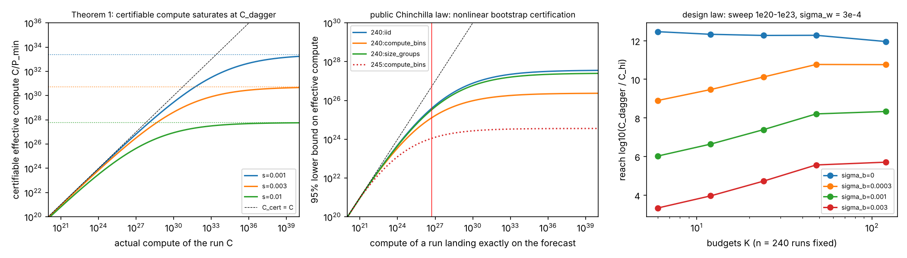

# How Much Slowdown Can a Loss Curve Hide? A Compute-Equivalent Audit Ceiling for Pretraining Scaling Laws

**Target venue:** NeurIPS (main track). Fallback: TMLR.

**Revision 2.** This version answers the round-2 review (`reviews/review_r2.md`; point-by-point in `reviews/response_r2.md`). The paper is re-scoped. Its central object is now the *compute-equivalent resolution* of a loss-based scaling claim. That gives a closed-form theorem (Theorem 1), which we validate by Monte Carlo and apply to two public run suites. It also gives a design law for sweeps, empirical anchors for the correlated-noise level, and a second, $E$-free test (Proposition 4) that runs on frontier-scale model ladders. The round-1 material (the calibrated Chinchilla break analysis and the data-wall audit) is shortened and moved after the new results.

---

## Abstract

Whether pretraining scaling is "slowing down" is usually argued from loss curves: a frontier model's loss is compared with a law fitted to smaller runs. We ask how large a slowdown such a comparison can detect, and give a closed-form answer.

**Theory.** Express any deviation from the law (a data wall, falling data quality, an exponent break, a worse recipe) as a compute penalty $P$: the run at compute $C$ reaches the loss the law assigns to $C/P$. Suppose a loss comparison has total log-scale uncertainty $s$, made up of forecast and measurement error. **Theorem 1** shows that the effective compute it can certify is $C_{\rm cert}(C)=\big(G/((1+k)R(C)+kE)\big)^{1/\gamma}$, with $k=e^{zs}-1$. This is strictly bounded by an *audit ceiling* $C^\dagger=(G/kE)^{1/\gamma}$, the compute at which the reducible loss equals $kE$. Beyond $C^\dagger$, the undetectable penalty grows in proportion to $C$. For forecast-based comparisons, $s$ cannot fall below the sweep's standard error of $\ln\hat E$, however precisely the frontier run is measured. The ceiling moves by a factor $10^{1/\gamma}$ (about $4\times10^5$ at the Chinchilla exponent) for each 10× change in $s$. Monte Carlo replications confirm the closed form wherever the noise is independent, and they show where it fails, namely when the correlated noise is estimated from few budgets.

**Public data.**
- For the law fitted to the 240 public Chinchilla runs, $\mathrm{sd}(\ln\hat E)$ is 0.014–0.020 depending on how the bootstrap resamples. The resulting audit ceiling at 50% power is $1.3\times10^{26}$–$7.6\times10^{26}$ FLOP, which spans the largest known training runs.
- Suppose a $5\times10^{26}$ FLOP run lands *exactly* on this law's forecast. A nonparametric bootstrap then certifies only $1.3\times10^{25}$–$3.8\times10^{25}$ FLOP of effective compute at 95% confidence, so a 13–40× compute shortfall would go unseen.
- On a second public suite (Gadre et al., 2024), Chinchilla-form fits to runs of at most 412M parameters miss the held-out 6.9B runs by up to 8% in loss. That error amounts to compute-equivalent factors of 0.47–4.5 with the default fit. Across five reasonable fitting choices, the factors run from "below the fitted irreducible loss" up to 6.3.

**Design and an alternative test.**
- In a sweep, $\mathrm{sd}(\ln\hat E)$ scales as $\sigma_b^{1.00}K^{-0.38}$, where $\sigma_b$ is the per-budget correlated noise and $K$ the number of budgets. The *reach* of the ceiling beyond the top of the sweep is exactly $\gamma^{-1}\log_{10}(R(C_{\rm hi})/kE)$ decades.
- Public anchors put $\sigma_b$ between about $4\times10^{-4}$ (Chinchilla, between compute bins) and $2$–$8\times10^{-3}$ (Gadre et al., re-tuning warm-up or head count).
- At a fixed 240 runs, spreading them over 48 budgets rather than 12 raises the power of the in-sweep break test at $\delta=0.02$ from 0.09 to 0.43.
- Proposition 4 gives an $E$-free alternative. Three runs at $C_0$, $10C_0$ and $100C_0$ share one recipe. The test is the gap statistic $g_2-10^{-\hat\gamma}g_1$, which is invariant to $E$ and to any constant penalty. At the top of a $5\times10^{24}$–$5\times10^{26}$ ladder it resolves an exponent loss of $\delta=0.017$ (50% power) when the per-run noise is $10^{-4}$. It resolves only $\delta=0.043$ at $3\times10^{-4}$ and nothing below $\gamma/2$ at $10^{-3}$.

**Answer to the research question.** Public loss data cannot answer whether pretraining scaling has slowed at the frontier. This is not because the data show no slowdown. It is because, against the best public law, slowdowns worth tens of times in compute are invisible at $5\times10^{26}$ FLOP. Matched contrasts that cancel $E$ (A/B runs at one scale, or one-recipe ladders) avoid the ceiling, but they need per-run noise near $10^{-4}$. The same arithmetic governs the "next growth point": the levers people debate are compute multipliers, and a 2× lever moves frontier log-loss by only 0.0033. The growth points can therefore be measured only by matched contrasts, not by comparing frontier loss with a law. All numbers come from our CPU code or from cited sources.

## 中文摘要

"预训练扩展是否在放缓"通常靠损失曲线来论证：把前沿模型的损失与小规模拟合的定律作比较。本文问：这样的比较究竟能检测多大的放缓？我们给出闭式答案。**理论**：把任何偏离（数据墙、数据质量下降、指数断点、配方变差）统一表示为"算力惩罚" $P$，即在算力 $C$ 下只达到定律在 $C/P$ 处的损失。若一次损失比较的总对数不确定度为 $s$（预测误差加测量误差），定理 1 给出其可认证的有效算力 $C_{\rm cert}(C)=\big(G/((1+k)R(C)+kE)\big)^{1/\gamma}$（$k=e^{zs}-1$），它严格小于"审计上限" $C^\dagger=(G/kE)^{1/\gamma}$，即可约损失降到 $kE$ 时的算力。超过 $C^\dagger$ 后，不可检测的惩罚与 $C$ 成正比增长。对基于预测的比较，$s$ 不可能低于扫描实验对 $\ln\hat E$ 的标准误，前沿测量再精确也无济于事；$s$ 每变化 10 倍，上限移动 $10^{1/\gamma}$ 倍（Chinchilla 指数下约 $4\times10^5$ 倍）。蒙特卡洛验证了独立噪声下的闭式结果，并指出了它失效的情形（只用少数预算估计相关噪声时）。**公开数据**：对 240 个公开 Chinchilla 训练点拟合的定律，$\mathrm{sd}(\ln\hat E)=0.014$–$0.020$（取决于自助法的重抽样方式），50% 功效的审计上限为 $1.3\times10^{26}$–$7.6\times10^{26}$ FLOP，恰好覆盖当前最大的训练规模。一个 $5\times10^{26}$ FLOP 的训练即使损失恰好落在预测值上，非参数自助法在 95% 置信度下也只能认证 $1.3\times10^{25}$–$3.8\times10^{25}$ FLOP 的有效算力，即 13–40 倍的算力亏损都看不出来。在第二个公开实验集（Gadre 等，2024）上，用不超过 412M 参数的训练点拟合 Chinchilla 形式，对留出的 6.9B 模型损失的预测误差最高达 8%，默认拟合下相当于 0.47–4.5 倍的算力当量；在五种合理的拟合选择下，从"低于拟合的不可约损失"一直到 6.3 倍。**设计与替代检验**：扫描实验中 $\mathrm{sd}(\ln\hat E)\propto\sigma_b^{1.00}K^{-0.38}$（$\sigma_b$ 为每个预算的相关噪声，$K$ 为预算数）；上限超出扫描顶端的"射程"恰为 $\gamma^{-1}\log_{10}(R(C_{\rm hi})/kE)$ 个数量级。公开数据给出的 $\sigma_b$ 锚点约为 $4\times10^{-4}$（Chinchilla 计算区间之间）到 $2$–$8\times10^{-3}$（Gadre 等，重调 warm-up 或注意力头数）。在固定 240 个训练点时，把预算数从 12 增加到 48，可把扫描内断点检验对 $\delta=0.02$ 的功效从 0.09 提高到 0.43。命题 4 给出与 $E$ 无关的"阶梯检验"：用同一配方在 $C_0$、$10C_0$、$100C_0$ 训练三个模型，统计量 $g_2-10^{-\hat\gamma}g_1$ 对 $E$ 和任何常数惩罚不变。在 $5\times10^{24}$–$5\times10^{26}$ 的阶梯顶端，单次训练噪声为 $10^{-4}$ 时可分辨（50% 功效）$\delta=0.017$ 的指数损失；噪声为 $3\times10^{-4}$ 时只能分辨 $\delta=0.043$；噪声为 $10^{-3}$ 时在 $\gamma/2$ 以下什么也分辨不了。**对研究问题的回答**：公开损失数据无法回答前沿的预训练扩展是否放缓。原因不是数据显示没有放缓，而是相对于最好的公开定律，价值数十倍算力的放缓在 $5\times10^{26}$ FLOP 处根本不可见。抵消 $E$ 的配对对比（同规模 A/B 实验或同配方阶梯）可以绕过这一上限，但需要约 $10^{-4}$ 的单次训练噪声。同样的算术也决定了"下一个增长点"：人们争论的各种杠杆都是算力乘数，而一个 2 倍的杠杆只让前沿对数损失变化 0.0033。因此增长点只能靠配对对比来测量，而不能靠把前沿损失与定律比较。文中所有数字均来自本文 CPU 代码或所引文献。

---

## 1 Introduction

Since 2024, claims that "pretraining scaling is hitting a wall" have rested on benchmark plateaus, reports of disappointing large runs, and the shift of compute toward reinforcement learning and inference-time scaling (Snell et al., 2024; DeepSeek-AI, 2025). The measurement literature, meanwhile, describes pretraining loss with saturating power laws whose exponents do not change (Kaplan et al., 2020; Hoffmann et al., 2022; Besiroglu et al., 2024; Porian et al., 2024). The usual way to settle the disagreement is a forecast check: fit a law on small runs, extrapolate, and ask whether the big run lands on the curve (for example Gadre et al., 2024). A run that lands on the curve is read as "scaling continues", and one that lands above it as "scaling is slowing".

This paper asks a simple question about that check: **how large a slowdown can it see?** The answer is less reassuring than the practice suggests, and it has a clean form.

Near the irreducible loss $E$, a large loss in *compute* produces only a tiny change in *loss*. At the Chinchilla exponent, a run that wastes half its compute at $5\times10^{26}$ FLOP has a log-loss 0.0033 higher than forecast **[computed, Exp. 20]**. The forecast, however, has an uncertainty of its own, and as $C\to\infty$ that uncertainty tends to the uncertainty of $\ln\hat E$. Neither more frontier compute nor more precise frontier evaluation removes it. The two facts combine into a hard ceiling on the effective compute that any forecast check can certify.

**Contributions.**

1. **Compute-equivalent resolution and the audit ceiling (§3, Theorem 1).** Every deviation from the law can be written as a compute penalty $P(C)$. We give the minimum detectable penalty in closed form, prove that the certifiable effective compute is bounded by $C^\dagger$ (where $R(C^\dagger)=kE$), and show that the undetectable penalty grows in proportion to $C$ beyond $C^\dagger$. The ceiling has elasticity $-1/\gamma\approx-5.6$ in $s$. For forecast checks, $s$ is bounded below by $\mathrm{sd}(\ln\hat E)$. As a corollary, at matched compute efficiency every break mechanism is *exactly* equally detectable by a residual check. Monte Carlo replications validate the closed form and show where it breaks down (§5.1).
2. **The audit ceiling of public scaling laws (§5.2–5.3).** For the public Chinchilla law, $C^\dagger$ is $1.3$–$7.6\times10^{26}$ FLOP. A nonparametric certification bound shows that a $5\times10^{26}$ FLOP run landing on the forecast certifies only 1/13 to 1/40 of its compute. Real out-of-sample forecasts on the Gadre et al. (2024) suite show that loss errors of a few per cent at about one decade of extrapolation are multi-× errors in compute.
3. **A design law with empirical noise anchors (§5.4).** We derive how $\mathrm{sd}(\ln\hat E)$, and hence the reach of the ceiling, depends on the number of budgets, the correlated per-budget noise and the independent noise. We anchor the correlated noise using public data. We also confirm and extend the reviewer's finding that, for the in-sweep test, the number of budgets matters more than the runs per budget.
4. **An $E$-free ladder test (§3.4, §5.5).** We give a three-run statistic that is invariant to $E$ and to constant penalties and has a closed-form resolution, validated by Monte Carlo. It moves the bottleneck from the sweep's knowledge of $E$ to frontier per-run noise.
5. **Retained, condensed results.** These are the calibrated, cluster-robust re-analysis of the Chinchilla runs (§5.6) and the audit of data-wall milestones across 2023–2026 functional forms (§5.7).

We trained no neural networks. Every number is either computed by our code from public data or simulation (**[computed]**, with the experiment number) or quoted from a cited source (**[cited]**).

## 2 Related Work

**Scaling laws.** Kaplan et al. (2020) and Hoffmann et al. (2022) established power laws in parameters, data and compute, and Hoffmann et al. introduced the form $L=E+AN^{-\alpha}+BD^{-\beta}$. Besiroglu et al. (2024) reconstructed the Chinchilla data from the published figure and showed that the original confidence intervals were implausibly narrow; we use their released data. Pearce & Song (2024) and Porian et al. (2024) reconcile Kaplan and Chinchilla through accounting and tuning choices at small scale. Caballero et al. (2023) propose broken power laws for extrapolating across regimes.

**Forecasting large runs from small ones.** Gadre et al. (2024) build a 104-model testbed (0.011B–6.9B parameters) and predict the loss of over-trained and larger runs from experiments that use about 300× less compute, with their own scaling-law form; their models and losses are public, and we reuse them (§5.3). Choshen et al. (2025) analyse nearly 500 models and show that scaling-law estimates are noisy and sensitive to individual runs. Ruan et al. (2024) fit observational laws across public model families. None of these works expresses forecast uncertainty in compute-equivalent terms, or derives the ceiling that the uncertainty of $E$ imposes. Our Theorem 1 is elementary, but we have not found it, or the audit-ceiling consequence, stated in the scaling-law literature.

**Compute-equivalent accounting.** It is common to measure algorithmic and data improvements as "effective compute" multipliers, as in the economic argument of Lu (2026) that sustained progress requires repeated efficiency doublings. We turn the multiplier view into a statement about *measurability*: how large a multiplier a given loss comparison can resolve.

**Data constraints.** Muennighoff et al. (2023) fitted a law for repeated data, with decaying value of repeated tokens and excess parameters. Hernandez et al. (2022) and Xue et al. (2023) document the costs of repetition. Several 2025–26 papers revise that law:

- Lovelace et al. (2026) propose additive overfitting penalties and release their fits.
- Xu et al. (2026) argue that additive Chinchilla-style laws are misspecified in the data-constrained regime and propose a coupled law, SoftQ.
- Bryant & Liu (2026) study compute-to-performance conversion under data constraints.
- Qin et al. (2026) introduce a token-effectiveness function.
- Kim et al. (2025) and *Improving Data-Constrained Scaling with Hyperparameter Transfer and Ensembling* (arXiv:2610.37842) find large gains from regularisation, ensembling and hyperparameter transfer.

Villalobos et al. (2024) estimate the stock of public text, and Sevilla et al. (2024) assess whether runs of $2\times10^{29}$ FLOP are feasible by 2030.

**Noise in training runs.** van der Wal et al. (2025) find pretraining largely stable across seeds up to 410M parameters in PolyPythias. Seed variance at frontier scale is not public, so we treat noise as a parameter and anchor its correlated part with public sweeps (§5.4).

## 3 Theory

### 3.1 Setup and definitions

We use $L(N,D)=E+AN^{-\alpha}+BD^{-\beta}$ with $C=6ND$. The compute-optimal frontier is $L^*(C)=E+R(C)$ with $R(C)=GC^{-\gamma}$ and $\gamma=\alpha\beta/(\alpha+\beta)$. We write $\rho(C)=R/L^*$ for the reducible fraction.

That each decade of compute buys $10^{-\gamma}$ times the previous decade's absolute loss reduction is a textbook consequence of $E>0$. We call it *mechanical deceleration* and do not treat it as a finding. It is $0.663\times$ per decade on the Chinchilla refit (Exp. 1; Table A1 in the appendix). A *genuine* slowdown is any departure of the realised frontier from $L^*$. Our earlier versions defined it through an exponent break, $L=E+(AN^{-\alpha}+BD^{-\beta})\max(1,C/C_b)^{\delta}$ (model (2)). Here we use a more general currency.

**Definition 1 (compute penalty).** A run at compute $C$ with loss $L_{\rm obs}$ has compute penalty $P$, defined by $L^*(C/P)=L_{\rm obs}$. Its effective compute is $C/P$ and its compute efficiency is $\eta=1/P$.

Every mechanism we consider maps into $P(C)$. An exponent break from $C_b$ gives $P=(C/C_b)^{\delta/\gamma}$. For example, $\delta=0.02$ over two decades gives $P=1.68$, and $\delta=\gamma/2$ over two decades gives $P=10$ **[computed, Exp. 20]**. A unique-data cap or a decline in data quality gives $P=1/\eta(C)$ from the data-constrained law (§5.7). A worse recipe gives a constant $P$.

**Lemma 1 (signal of a penalty; exact).** $\ln L^*(C/P)-\ln L^*(C)=\ln\big(1+\rho(C)(P^{\gamma}-1)\big)$.

*Proof.* $R(C/P)=P^\gamma R(C)$, so $L^*(C/P)/L^*(C)=(E+P^\gamma R)/(E+R)=1+\rho(P^\gamma-1)$. ∎

### 3.2 Resolution of a loss comparison

A *loss comparison* at compute $C$ is a one-sided test of $P=1$ against $P>1$. It is based on the difference $\Delta=\ln L_{\rm obs}-\ln\hat L(C)$ between an observed and a reference log-loss, with total standard deviation $s$ under the null. Write $z=z_{1-a}+z_{\pi}$ for level $a$ and power $\pi$ (Gaussian approximation; $z=1.645$ for 5% and 50%), and set $k=e^{zs}-1$. Three cases matter:

- In a **forecast check**, the reference is a law fitted to a sweep, and $s^2(C)=\mathrm{Var}[\ln\hat L^*(C)]+\sigma_f^2$, where $\sigma_f$ is the frontier run's own noise (its seed, evaluation and recipe offset).
- In a **matched A/B contrast** at one scale, the reference is a sibling run, and $s$ is the difference noise.
- In a **ladder** (§3.4), the reference is the run's own smaller siblings.

**Theorem 1 (compute-equivalent resolution and audit ceiling).** Assume the frontier form $L^*=E+GC^{-\gamma}$ with $E,G>0$ and the Gaussian test above.

- **(i) Minimum detectable penalty.** $P_{\min}(C)=\big[1+k/\rho(C)\big]^{1/\gamma}$.
- **(ii) Certifiable effective compute.** $C_{\rm cert}(C):=C/P_{\min}(C)=\Big(\dfrac{G}{(1+k)R(C)+kE}\Big)^{1/\gamma}$. It is strictly increasing in $C$, and $C_{\rm cert}(C)<C^\dagger:=\big(G/(kE)\big)^{1/\gamma}$, with $C_{\rm cert}\to C^\dagger$ as $C\to\infty$.
- **(iii) Characterisation.** $R(C^\dagger)=kE$. For any reference compute $C_0$, $\log_{10}(C^\dagger/C_0)=\gamma^{-1}\log_{10}\big(R(C_0)/(kE)\big)$.
- **(iv) Linear growth.** $P_{\min}(C)/C\to1/C^\dagger$ as $C\to\infty$.
- **(v) Elasticity.** $\dfrac{d\ln C^\dagger}{d\ln s}=-\dfrac{1}{\gamma}\cdot\dfrac{zs\,e^{zs}}{e^{zs}-1}\to-\dfrac1\gamma$ as $s\to0$.

*Proof.*

- (i) By Lemma 1, detection at power $\pi$ requires $\ln(1+\rho(P^\gamma-1))\ge zs$, that is, $P^\gamma\ge1+k/\rho$.
- (ii) Using $\rho=R/(E+R)$, $1+k/\rho=(R+kE+kR)/R$. Since $CR(C)^{1/\gamma}=G^{1/\gamma}$, we get $C/P_{\min}=CR^{1/\gamma}/((1+k)R+kE)^{1/\gamma}=(G/((1+k)R+kE))^{1/\gamma}$. This increases in $C$ because $R$ decreases, and it tends to $(G/kE)^{1/\gamma}$ as $R\to0$.
- (iii) Substitute $C^\dagger$ into $R=GC^{-\gamma}$, and divide $C^\dagger$ by $C_0=(G/R(C_0))^{1/\gamma}$.
- (iv) Follows from (ii).
- (v) Follows from $\ln C^\dagger=\gamma^{-1}(\ln G-\ln E-\ln k)$. ∎

**Corollary 1 (the sweep sets the ceiling of a forecast check).** As $C\to\infty$, $\ln\hat L^*(C)\to\ln\hat E$, so $s(C)\to s_\infty=\sqrt{\mathrm{Var}(\ln\hat E)+\sigma_f^2}$. No reduction of the frontier noise $\sigma_f$ lowers $s_\infty$ below $\mathrm{sd}(\ln\hat E)$. A forecast check therefore cannot certify more than $C^\dagger(s_\infty)$ of effective compute, however large or carefully measured the run. (At finite $C$, $s(C)$ can be somewhat below $s_\infty$, because forecast errors in $\hat E$ and $\hat G$ partly cancel. We use the full $s(C)$ for finite-$C$ statements.)

**Corollary 2 (mechanism-agnostic detectability).** For any mechanism whose effect at $C$ is a compute efficiency $\eta(C)$, the signal in a single-run loss comparison is $\ln(1+\rho(C)(\eta^{-\gamma}-1))$. At matched $\eta$ and $C$, a unique-data cap, a decline in data quality and a non-data exponent break are therefore *exactly* equally detectable by a residual check. This answers the reviewer's matched-$\eta$ question for the forecast design. Differences between mechanisms appear only in tests that use the *shape* of $P(C)$ across several budgets, such as the in-sweep test of §5.6, or that vary the data, such as matched data-doubling (§5.7).

**Corollary 3 (matched contrasts).** In an A/B contrast at one scale, $E$ cancels and $s$ is the difference noise. At $5\times10^{26}$ FLOP on the Chinchilla refit, a difference noise of $10^{-3}$ resolves $P_{\min}=1.43$ at 50% power (1.70 at 80%), and $3\times10^{-3}$ resolves 2.74 (4.31) **[computed, Exp. 20]**. Matched contrasts are therefore the natural instrument for measuring growth levers; forecast checks are not.

### 3.3 Where the theorem is approximate

The theorem uses a Gaussian approximation for $\Delta$ and a known $s$. In practice $s$ is estimated: by bootstrap or the delta method for the sweep part, and from replicate runs for the frontier part. §5.1 measures the consequences. When the correlated per-budget noise is estimated from only 12 budgets, the plug-in test is anti-conservative.

### 3.4 An $E$-free ladder test

**Proposition 4.** Consider three compute-optimal runs with one recipe at $C_0$, $10C_0$ and $100C_0$, with gaps $g_1=L_1-L_2$ and $g_2=L_2-L_3$, and let $r=10^{-\gamma}$.

- **(a) Invariance.** Under the constant-exponent law, $g_2=r\,g_1$ for every value of $E$ and for every constant penalty $P$ shared by the three runs.
- **(b) Signal.** If the exponent falls by $\delta$ from $C_0$ on, then $g_2-rg_1=R(C_0)\,r\,(1-r10^{\delta})(10^{\delta}-1)$, up to the common factor $P^\gamma$. This is positive for $0<\delta<\gamma$. It vanishes again as $\delta\to\gamma$, because the gaps themselves vanish, so we search $\delta\le\gamma/2$.
- **(c) Statistic and variance.** We use $T=g_2-10^{-\hat\gamma}g_1$, with $\hat\gamma$ from the sweep (standard deviation $\mathrm{sd}_\gamma$). With independent log-scale noise $\sigma$ per run, the delta-method variance of $T$ is $\sigma^2\big[L_2^2(1+r)^2+L_1^2r^2+L_3^2\big]+(g_1r\ln10\,\mathrm{sd}_\gamma)^2$.

*Proof.* With $P$ shared, $g_i=P^\gamma G C_i^{-\gamma}(1-r)$, so $g_2/g_1=r$. Part (b) follows by substituting $R(C)(C/C_0)^\delta$. Part (c) is the delta method. ∎

The ladder test does not need $\hat E$. Its resolution is limited by frontier per-run noise and by $\mathrm{sd}_\gamma$. Rungs that do not share a recipe add their offsets to $\sigma$.

### 3.5 Self-similarity of the data wall (retained)

Under the repeated-data law of Muennighoff et al. (2023), with the excess-parameter threshold defined consistently ($U_N=\min(N,cU_D^{\beta/\alpha})$, $c=(\alpha A/\beta B)^{1/\alpha}$), $L^*_U(C)-E=U^{-\beta}\Psi(C/U^{\tau})$ with $\tau=(\alpha+\beta)/\alpha$ (**Proposition 3′**; the proof is unchanged from revision 1 and was checked line by line by the reviewer). Every milestone of compute efficiency therefore scales as $U^{\tau}$. Additive-penalty forms (Lovelace et al., 2026) are not homogeneous under this rescaling.

## 4 Data and Methods

**Chinchilla runs.** We use Epoch AI's reconstruction of the 245 runs in Hoffmann et al. (2022, Fig. 4) **[cited]** and drop the five highest-loss runs, as Epoch does, leaving 240. Their effective support is $10^{18.8}$–$10^{21}$ FLOP: 23 runs at or above $10^{21}$, and 4 at or above $3\times10^{21}$ **[computed, Exp. 9]**. The fit minimises a Huber loss ($\delta_H=10^{-3}$) on log-loss with BFGS from the 4,500-point grid of Hoffmann et al. The objective is scaled by $10^6$ (Exp. 1).

**Gadre et al. (2024) suite.** We take the models and evaluation losses from the authors' repository (github.com/mlfoundations/scaling, `exp_data/models`; extracted to `data/gadre2024/models.csv`, 104 models). For each of three training distributions (C4, RedPajama, RefinedWeb), we evaluate in distribution (`c4_val`, `paloma_redpajama`, `paloma_falcon-refinedweb`). We fit on the 31–32 small runs (10.6M–412M parameters, token multipliers $M=0.25$–$32$, $C\le6.5\times10^{20}$ FLOP). We forecast the held-out 1.4B runs (at $M=1$, plus one over-trained run per dataset) and the 6.9B run at $M=1$ ($C=5.7\times10^{21}$). The 6.9B runs use a different learning rate and weight decay ($3\times10^{-4}$ and 0.33) from the small runs ($3\times10^{-3}$ and 0.033), according to `models.csv`. We fit the five-parameter Chinchilla form, *not* the law of Gadre et al., so our residuals do not assess their forecasts. The grid file `grid.json` provides the warm-up and head-count sweeps that we use as correlated-noise anchors.

**Forecast uncertainty (Exps. 13, 16).** For the forecast standard deviation $s(C)$ and $\mathrm{sd}(\ln\hat E)$ we use 300 pairs bootstraps, resampling runs (iid), 0.1-dex compute bins (36 clusters) or model-size groups, on 240 and 245 runs. The *nonlinear certification bound* uses no Gaussian or delta approximation. For a run that lands exactly on the point forecast $\hat L^*(C)$, we compute under each bootstrap law $b$ the effective compute $C_b=L_b^{*-1}(\hat L^*(C))$ (infinite when $\hat L^*(C)\le E_b$), and report its 5% quantile.

**Design law (Exp. 16c).** For 3-decade iso-FLOP sweeps of $n=240$ runs ($K$ budgets of $M=240/K$ sizes, tokens per parameter log-uniform in $[2,200]$), we compute the covariance of the estimator: the OLS sandwich and the GLS (Cramér–Rao) bound under independent noise $\sigma_w$ plus a per-budget offset $\sigma_b$. The frontier run carries its own $\sigma_b$ and $\sigma_w$.

**Monte Carlo validation (Exps. 14, 18).**
- Exp. 14 draws a sweep over $10^{20}$–$10^{23}$ FLOP ($K=12$, $M=20$) and fits it by least squares, with a plug-in delta-method $s$ and the noise components estimated by one-way random-effects moments. One or three frontier runs at $10^{25}$, $10^{26}$ or $10^{27}$ FLOP carry a penalty $P\in\{1,2,5,10\}$ or a break $\delta\in\{0.02,0.05\}$ from $10^{23}$. There are 400 replicates per cell.
- Exp. 18 uses 20,000 replicates per ladder cell.

**In-sweep break test (Exps. 8, 9, 17).** This is unchanged from revision 1: a profiled breakpoint over the 10th–90th compute percentiles, a one-sided sup statistic, and parametric or wild-cluster bootstrap calibration (`code/breaktest.py`). Exp. 17 adds three things: power as a function of $K$ at fixed $n$, fitted-null calibration, and a scaled Huber threshold.

**Reproducibility.** The code is in `code/` with its run order (`code/README.md`). Seeds are fixed, raw outputs are in `results/`, and all experiments run on 4 CPU cores. The new revision-2 experiments (13–20) take about 85 minutes in total.

## 5 Results

### 5.1 Theorem 1 holds numerically and in Monte Carlo, except when correlated noise is estimated from few budgets (Exps. 14, 16a)

**Identity and bound.** On the Chinchilla refit and for $s\in\{10^{-3},3\times10^{-3},10^{-2},2\times10^{-2}\}$, the closed form (ii) agrees with $C/P_{\min}(C)$ computed from (i) to a relative error below $10^{-14}$ over $10^{18}$–$10^{45}$ FLOP. The curve is monotone, and its supremum on the grid reaches 95–99.8% of $C^\dagger$ (the grid ends at $10^{45}$). At $C=10^{40}$, $P_{\min}C^\dagger/C$ equals 1.02–1.43, approaching 1 as (iv) predicts. The numerical elasticity of $C^\dagger$ is $-5.60$, $-5.61$ and $-5.67$ at $s=10^{-4}$, $10^{-3}$ and $10^{-2}$, against $-1/\gamma=-5.60$ **[computed, Exp. 16a]**.

**Table 2.** Ceiling and resolution for selected $s$ (50% power, 5% one-sided) **[computed, Exp. 16a]**.

| $s$ | $C^\dagger$ (FLOP) | $C_{\rm cert}(5\times10^{26})$ | $P_{\min}(5\times10^{26})$ |
|---|---|---|---|
| $10^{-3}$ | $2.5\times10^{33}$ | $3.5\times10^{26}$ | 1.43 |
| $3\times10^{-3}$ | $5.2\times10^{30}$ | $1.8\times10^{26}$ | 2.74 |
| $10^{-2}$ | $5.9\times10^{27}$ | $2.9\times10^{25}$ | 17.1 |
| $2\times10^{-2}$ | $1.2\times10^{26}$ | $4.4\times10^{24}$ | 115 |

**Monte Carlo (forecast check).** We fit sweeps over $10^{20}$–$10^{23}$ FLOP and test frontier runs, with 30 cells of 400 replicates each. When the per-budget noise is zero ($\sigma_w\in\{3\times10^{-4},10^{-3},3\times10^{-3}\}$, 18 cells), three checks pass:
- the empirical standard deviation of the forecast error matches the delta method within 5%;
- the size of the plug-in test lies between 0.033 and 0.068;
- the empirical power matches the closed-form power, with a median absolute difference of 0.003 over all 180 test cells.

When $\sigma_b=10^{-3}$ is estimated from 12 budgets, the test is anti-conservative. Its size is 0.06–0.105, and its power exceeds the prediction by up to 0.12 **[computed, Exp. 14]**. The reason is that the random-effects estimate of $\sigma_b$ from 12 budgets is noisy and biased low. Practitioners should calibrate with a cluster bootstrap or use many budgets (§5.4). The closed form is correct when $s$ is correct; the hard part in practice is estimating $s$.

*Figure 10. Left: certifiable effective compute $C/P_{\min}$ against actual compute; it saturates at $C^\dagger$ (dotted). Middle: nonlinear 95% certification bound for a run landing exactly on the public Chinchilla forecast. Right: design law, reach $\log_{10}(C^\dagger/C_{\rm hi})$ against the number of budgets at fixed $n=240$.*

### 5.2 The audit ceiling of the public Chinchilla law (Exps. 13, 16b)

**Table 3.** Audit of the law fitted to the public Chinchilla runs **[computed, Exp. 16b]**. $P_{\min}$ uses the bootstrap $s(C)$ at $5\times10^{26}$ FLOP. The certification bound is the nonparametric 95% lower bound on the effective compute of a $5\times10^{26}$ FLOP run whose loss equals the point forecast. The limit is that bound as $C\to\infty$.

| runs: resampling | $\mathrm{sd}(\ln\hat E)$ | $C^\dagger$ 50% / 80% power | $P_{\min}(5\times10^{26})$ 50% / 80% | certified at $5\times10^{26}$ | certification limit |
|---|---|---|---|---|---|
| 240: runs (iid) | 0.0144 | $7.6\times10^{26}$ / $7.3\times10^{25}$ | 21 / 64 | $3.8\times10^{25}$ | $3.7\times10^{27}$ |
| 240: compute bins | 0.0197 | $1.3\times10^{26}$ / $1.2\times10^{25}$ | 40 / 142 | $1.3\times10^{25}$ | $2.4\times10^{26}$ |
| 240: size groups | 0.0151 | $5.8\times10^{26}$ / $5.5\times10^{25}$ | 25 / 79 | $3.2\times10^{25}$ | $2.6\times10^{27}$ |
| 245: runs (iid) | 0.0232 | $6.6\times10^{24}$ / $7.8\times10^{23}$ | 224 / 1,000 | $4.3\times10^{24}$ | $2.7\times10^{25}$ |
| 245: compute bins | 0.0391 | $4.4\times10^{23}$ / $4.9\times10^{22}$ | 1,270 / 7,000 | $1.1\times10^{24}$ | $3.6\times10^{24}$ |
| 245: size groups | 0.0185 | $2.1\times10^{25}$ / $2.5\times10^{24}$ | 113 / 455 | $9.0\times10^{24}$ | $1.0\times10^{26}$ |

**Reading Table 3.** Epoch AI estimates the largest known runs at about $4.6\times10^{26}$ FLOP (Grok-3) and lists Grok 4 at about $5\times10^{26}$ **[cited]**. The public Chinchilla law's audit ceiling at 50% power, $1.3$–$7.6\times10^{26}$, sits on top of that scale. At 80% power it lies one order of magnitude lower.

The nonparametric statement needs no Gaussian approximation. A $5\times10^{26}$ FLOP run that lands exactly on the forecast certifies at 95% confidence only $1.3$–$3.8\times10^{25}$ FLOP of effective compute, so a slowdown worth 13–40× in compute is consistent with "landing on the curve". By Corollary 2, that statement holds for every mechanism. Through the mapping $P=(C/C_b)^{\delta/\gamma}$ it also bounds what can be said about exponent breaks: a 40× penalty over two decades corresponds to $\delta\approx0.14$, which is 80% of $\gamma$.

No run, however large, certifies more than $2.4\times10^{26}$–$3.7\times10^{27}$ FLOP against this law. Restoring the five excluded runs, which is a defensible choice, lowers every ceiling by one to three orders of magnitude. That gap measures how fragile the irreducible-loss estimate is to single runs, in line with Choshen et al. (2025).

**What would raise the ceiling.** By Theorem 1(v), halving $\mathrm{sd}(\ln\hat E)$ raises $C^\dagger$ by $2^{5.6}\approx49\times$. Better frontier evaluation does not help, because the frontier noise ($\le10^{-3}$) is already an order of magnitude below $\mathrm{sd}(\ln\hat E)$. Adding a frontier evaluation noise of $10^{-3}$ to the compute-bin bootstrap moves the horizon $C_H$ of Exp. 13 (defined there by $P_{\min}=2^{1/\gamma}$) from $7.07\times10^{26}$ to $6.99\times10^{26}$ (Exp. 13). The ceiling is a property of the sweep.

### 5.3 Real out-of-sample forecasts in compute-equivalent units (Exps. 15, 19)

**Table 4.** Held-out large runs of the Gadre et al. (2024) suite, forecast by a Chinchilla-form fit to the small runs **[computed]**. "Default" fits all 31–32 small runs (Exp. 15). The bootstrap $z$ uses 300 pairs replicates. "Spec. range" is the range over five selection rules (all runs; $M\ge0.5$; $M\ge1$; without the 11M model; $M\ge1$ and without the 11M model) (Exp. 19).

| dataset: held-out run | $C$ (FLOP) | default log-residual | bootstrap $z$ | default $\hat P$ | spec. range of log-residual | spec. range of $\hat P$ |
|---|---|---|---|---|---|---|
| C4: 1.4B, $M=1$ | $2.5\times10^{20}$ | $+0.021$ | 0.94 | 1.41 | $[-0.043,+0.038]$ | 0.11–1.85 |
| C4: 1.4B, $M=4$ | $1.0\times10^{21}$ | $+0.004$ | 0.17 | 1.07 | $[-0.081,+0.017]$ | floor–1.34 |
| C4: 6.9B, $M=1$ | $5.7\times10^{21}$ | $+0.082$ | 1.68 | 4.53 | $[-0.103,+0.100]$ | floor–6.3 |
| RedPajama: 1.4B, $M=1$ | $2.5\times10^{20}$ | $+0.001$ | 0.01 | 1.01 | $[-0.036,+0.023]$ | 0.28–1.48 |
| RedPajama: 1.4B, $M=32$ | $8.0\times10^{21}$ | $-0.095$ | $-1.61$ | 0.06 | $[-0.158,-0.092]$ | floor–0.10 |
| RedPajama: 6.9B, $M=1$ | $5.7\times10^{21}$ | $-0.025$ | $-0.29$ | 0.47 | $[-0.127,+0.003]$ | floor–1.08 |
| RefinedWeb: 1.4B, $M=1$ | $2.5\times10^{20}$ | $+0.008$ | 0.57 | 1.14 | $[-0.048,+0.013]$ | 0.06–1.24 |
| RefinedWeb: 1.4B, $M=16$ | $4.0\times10^{21}$ | $+0.036$ | 2.19 | 1.84 | $[-0.055,+0.036]$ | floor–1.84 |
| RefinedWeb: 6.9B, $M=1$ | $5.7\times10^{21}$ | $+0.061$ | 1.90 | 2.92 | $[-0.115,+0.061]$ | floor–2.99 |

"floor" means that under at least one specification the observed loss lies *below* the fitted irreducible loss $\hat E$, so no finite effective compute reproduces it.

Three findings follow.

1. **Errors of a few per cent in loss are multi-× errors in compute.** For the 6.9B runs, which lie about one decade beyond the largest fitted run, default log-residuals of $+0.082$ (C4), $-0.025$ (RedPajama) and $+0.061$ (RefinedWeb) correspond to compute-equivalent factors of 4.5, 0.47 and 2.9 **[computed, Exp. 15]**.
2. **Specification, not sampling, dominates.** The bootstrap standard deviations of the forecast are 0.03–0.09. Leaving one model size out moves the 6.9B residuals over ranges about 0.2–0.3 wide, for example $[-0.10,+0.19]$ on C4 **[computed, Exp. 15]**. Across the five selection rules, the 6.9B residuals span about 0.13–0.20 in log-loss. The implied factors run from "below the fitted floor" to 6.3 on C4, to 1.08 on RedPajama and to 2.99 on RefinedWeb (Exp. 19). The irreducible loss is not identified by this four-size sweep. Across specifications $\hat E$ ranges over 1.14–2.54 (C4), 1.44–2.03 (RedPajama) and 0.97–2.76 (RefinedWeb). In pairs bootstraps, $\mathrm{sd}(\ln\hat E)$ exceeds 4, because $\hat E$ is driven toward zero or toward the observed losses. In the language of Theorem 1, the audit ceiling of this sweep lies at or below its own compute range: the reach is zero.
3. **The frontier run's recipe differs.** The 6.9B runs were trained with a 10× smaller learning rate and 10× larger weight decay than the sweep. This is a real instance of the frontier offset $\sigma_f$ in Corollary 1, and a residual check cannot separate it from a slowdown.

We do not claim that these runs show a slowdown: the signs differ across datasets. We claim that this suite, analysed with the standard functional form, cannot resolve compute penalties smaller than several times at about one decade of extrapolation.

### 5.4 Design law and empirical anchors for correlated noise (Exps. 16c, 15, 17a)

**Reach is exact given $\mathrm{sd}(\ln\hat E)$.** By Theorem 1(iii), the reach of a forecast check, $\log_{10}(C^\dagger/C_{\rm hi})$, equals $\gamma^{-1}\log_{10}(R(C_{\rm hi})/kE)$. The design-law computation reproduces this identity to two decimals in every row (Exp. 16c). The only design-dependent quantity is therefore $s_\infty$.

**Table 5.** Reach $\log_{10}(C^\dagger/C_{\rm hi})$ in decades, for a sweep over $10^{20}$–$10^{23}$ FLOP with $n=240$ runs, $\sigma_w=3\times10^{-4}$, OLS fit, one frontier run with its own offset **[computed, Exp. 16c]**.

| $\sigma_b$ \ $K\times M$ | 6×40 | 12×20 | 24×10 | 48×5 | 120×2 |
|---|---|---|---|---|---|
| 0 | 12.5 | 12.3 | 12.3 | 12.3 | 12.0 |
| $3\times10^{-4}$ | 8.9 | 9.5 | 10.1 | 10.8 | 10.8 |
| $10^{-3}$ | 6.0 | 6.6 | 7.4 | 8.2 | 8.3 |
| $3\times10^{-3}$ | 3.3 | 4.0 | 4.7 | 5.6 | 5.7 |

Across the OLS rows at $\sigma_w=10^{-4}$ and $C_{\rm hi}=10^{23}$, $\mathrm{sd}(\ln\hat E)\propto\sigma_b^{1.00}K^{-0.38}$ **[computed, Exp. 16c]**. Correlated noise therefore enters one-for-one. Splitting the same runs over more budgets helps up to about 48 budgets and then saturates.

**Empirical anchors for $\sigma_b$** **[computed, Exp. 15]**:

- *Chinchilla, between compute bins.* A one-way random-effects decomposition of the 240 residuals over 0.1-dex compute bins gives a between-bin SD of $3.9\times10^{-4}$ and a within-bin SD of $7.5\times10^{-3}$. These runs share one training setup within a paper, so this is our anchor for a fixed-recipe sweep. The data are digitised, so it is approximate.
- *Gadre et al., warm-up.* For 126 configurations of architecture and tokens, the log-loss gap between the best and the second-best warm-up setting has median $2.4\times10^{-3}$ (IQR $1.2$–$4.3\times10^{-3}$).
- *Gadre et al., head count.* At fixed width, depth and tokens, the SD across attention-head counts (each at its best warm-up) has median $8.1\times10^{-3}$ (IQR $3.4\times10^{-3}$–$1.3\times10^{-2}$; 45 groups).
- *Gadre et al., shared misfit.* Per-configuration residuals of the three datasets' fits correlate at 0.87, with a shared SD of 0.030. Most of the misfit is therefore structural and common to the configuration, not noise.

These anchors suggest $\sigma_b$ of a few $10^{-4}$ for a fixed recipe and $10^{-3}$–$10^{-2}$ if the recipe is re-tuned per budget. In Table 5, that is the difference between a reach of 9–11 decades and one of 3–7 decades.

**The in-sweep test depends on $K$ too (reviewer's experiment, extended).** For the profiled in-sweep break test with $\sigma_w=10^{-4}$, $\sigma_b=10^{-3}$, a window ending at $10^{26}$ and $n=240$, Table 6 gives the power **[computed, Exp. 17a; 150 null and 100 alternative replicates]**.

**Table 6.** Power of the in-sweep test against the number of budgets.

| $K\times M$ | 6×40 | 12×20 | 24×10 | 48×5 | 120×2 |
|---|---|---|---|---|---|
| $\delta=0.02$ | 0.09 | 0.09 | 0.17 | 0.43 | 0.20 |
| $\delta=0.05$ | 0.35 | 0.54 | 0.88 | 1.00 | 0.96 |

This reproduces the reviewer's numbers (0.075 at 12×20 and 0.43 at 48×5) within Monte Carlo error. At 120×2 we obtain 0.20, against the reviewer's 0.38; the two Wilson intervals, $[0.13,0.29]$ and $[0.28,0.48]$, barely overlap. Power peaks near 48 budgets. We have not established why it falls at 120×2. One possibility is that with two runs per budget the fit locates each budget's optimum poorly. Revision 1 attributed the loss of power to correlated noise "as such"; that was wrong. Under model (2), a per-budget offset is a function of $C$ alone, as the break is, so the test has effectively $K$ observations of the break signal. The correct recommendation is to measure $\sigma_b$ and to use many budgets.

### 5.5 The ladder test moves the bottleneck to per-run noise (Exp. 18)

The compute-bin bootstrap gives $\mathrm{sd}_\gamma=0.0073$. Across 80 cells, the closed-form power of Proposition 4 agrees with Monte Carlo (20,000 replicates per cell) to within 0.005, and the size is 0.045–0.052 **[computed, Exp. 18]**.

**Table 7.** Smallest exponent loss $\delta$ resolved at 50% (80%) power by the ladder test at the top rung $C_{\rm top}$ (rungs at $C_{\rm top}/100$, $C_{\rm top}/10$ and $C_{\rm top}$), using the sweep's $\mathrm{sd}_\gamma$; "–" means not resolved for $\delta\le\gamma/2$ **[computed, Exp. 18]**.

| $\sigma$ per run \ $C_{\rm top}$ | $10^{25}$ | $10^{26}$ | $5\times10^{26}$ | $10^{27}$ | $10^{28}$ |
|---|---|---|---|---|---|
| $3\times10^{-5}$ | 0.012 (0.018) | 0.012 (0.018) | 0.012 (0.019) | 0.013 (0.019) | 0.013 (0.020) |
| $10^{-4}$ | 0.013 (0.020) | 0.015 (0.023) | 0.017 (0.026) | 0.018 (0.028) | 0.024 (0.039) |
| $3\times10^{-4}$ | 0.023 (0.036) | 0.032 (0.054) | 0.043 (0.086) | 0.050 (–) | – |
| $10^{-3}$ | – | – | – | – | – |

Three points stand out.

- **The floor is set by $\gamma$.** With noiseless runs, uncertainty in the sweep's $\hat\gamma$ alone limits resolution to about $\delta=0.012$. With $\gamma$ known, $\sigma=3\times10^{-5}$ resolves $\delta=0.002$–$0.006$.
- **Invariance holds.** A constant penalty $P=5$ on all rungs leaves the size at 0.051–0.053. Independent per-rung recipe offsets of $10^{-3}$, however, inflate the size to 0.31–0.41. The rungs must therefore share one recipe.
- **The comparison with the forecast check favours the ladder.** At $5\times10^{26}$ FLOP, the forecast check with the public Chinchilla $s(C)$ has power 0.07–0.08 against $\delta=0.02$ and 0.27–0.38 against $\delta=0.1$ (break at $5\times10^{24}$). A ladder with $\sigma=10^{-4}$ has power 0.61 and 1.00 against $\delta=0.02$ and $0.1$.

The ladder costs about 1.11 times the top run. It is the decisive test for an exponent slowdown, *if* per-run noise at frontier scale is about $10^{-4}$. Whether it is, is not public. Evaluation noise alone is $3\times10^{-5}$–$1.5\times10^{-4}$ for $10^9$ evaluation tokens under our assumptions (Exp. 12); seed and data-order variance must be added to that.

### 5.6 What the Chinchilla runs say inside their range (Exps. 2, 8, 9, 9b, 17; condensed from revision 1)

The calibrated in-sweep test rejects the five-parameter constant-exponent form on the 240 runs ($p=1/301$ under Gaussian and wild-cluster nulls; Exp. 9). About 73% of the residual variance is smooth structure that the form does not capture, so the rejection concerns the functional form as a whole, not specifically the exponent. The departure is non-monotone. A two-break fit, with breakpoints at the 10th and 70th compute percentiles *chosen after inspecting the one-break profile*, gives local reducible-loss exponents of 0.187, 0.166 and 0.175. The top-segment change ($\ge2.8\times10^{20}$ FLOP) is $\hat\delta_2=-0.009$, with a 95% compute-bin cluster CI of $[-0.075,0.015]$ (Exp. 9b; this CI does not account for the breakpoint selection).

At the fixed breakpoint $9.9\times10^{20}$, the compute-bin interval excludes zero ($[-0.104,-0.010]$) but the size-group interval does not ($[-0.077,0.015]$). The data therefore show no slowdown at the top of their range and cannot bound one below about 8% of $\gamma$.

In simulation, the profiled test detects $\delta=0.02$ at a $10^{28}$ window end with power 1.00 when $\sigma_w\le3\times10^{-4}$ and 0.22 when $\sigma_w=10^{-3}$ (Exp. 8, oracle calibration). Exp. 17 adds two checks:

- **Fitted-null calibration.** This is the procedure used on the real data. At $\sigma_w=10^{-3}$ and a $10^{26}$ window end it rejects 2 of 40 null datasets (0.05, Wilson $[0.01,0.17]$) and detects $\delta=0.02$ in 39 of 40 (0.975, $[0.87,1.00]$), against an oracle power of 0.82. We therefore find no evidence that the oracle-calibrated powers overstate the power of the procedure used on real data.
- **Huber threshold.** Scaling $\delta_H$ with the noise at $\sigma_w=2.5\times10^{-3}$ changes the power at $\delta=0.02$ / $0.05$ from 0.12 / 0.81 ($\delta_H=10^{-3}$; Exp. 8 gave 0.17 / 0.87 for this cell with other seeds) to 0.23 / 0.86 ($2.5\times10^{-3}$) and 0.22 / 0.93 ($5\times10^{-3}$).

### 5.7 Data-wall milestones and mechanisms (Exps. 4, 10, 11; condensed)

**The form matters more than the constants.** Under the Muennighoff et al. law with consistent $U_N$, compute efficiency falls to 50% at $71\times C_{\rm wall}$ (where repetition starts), identically for every $U$ (Prop. 3′). In revision 1, Table 4 / Exp. 4 gave 74–75×. That figure used the linear threshold $k_N=0.051$, rounded, whereas the consistent constant is $c=(\alpha A/\beta B)^{1/\alpha}=0.050$; the two agree once the rounding is removed.

Under the additive-penalty laws of Lovelace et al. (2026), computed from their released fits, the same milestone settles at 28–36× for $U\ge10^{10}$. Their effective-data refit puts it at 1,000× (standard arm) or 7,822× (weight decay 1.0) **[computed, Exp. 10]**.

All values at $U\ge10^{10}$ extrapolate fits made on 50M–6B unique tokens by 2–6 decades. The "hard-wall" values of the additive forms are a consequence of extrapolating a penalty that is linear in $N/U_D$; they are not established properties at scale.

Xu et al. (2026) argue that additive Chinchilla-style forms are misspecified in exactly this compute-rich, data-constrained regime and propose a coupled law, SoftQ. We have not implemented SoftQ, because it would require its fitted parameters and a check of our implementation against theirs. Its milestones are therefore not in our table. Its existence widens, rather than narrows, the model uncertainty we report.

**Mechanisms.** By Corollary 2, a unique-data cap, a decline in data quality and a non-data exponent break are equally detectable by a residual check at matched efficiency. Revision 1's comparison of in-sweep power across the three mechanisms did not match their magnitudes ($\eta=0.73$ for the exponent break against 0.97 and 0.96 for the data mechanisms at $3C_x$), so it is withdrawn. What separates them is the response to the data lever itself. The matched data-doubling gap grows without bound under a cap, saturates near $5\times10^{-4}$ under quality decline, and is zero under a non-data break (Exp. 11). This experiment is what Muennighoff et al. (2023), Lovelace et al. (2026) and Kim et al. (2025) already run in other forms; we claim no novelty for it.

## 6 Discussion

**Is pretraining scaling slowing down?** In the mechanical sense, yes, by construction, at 0.66× per decade. In the genuine sense, the public evidence is uninformative at the frontier, and Theorem 1 says how uninformative. Against the best public law, a $5\times10^{26}$ FLOP run that lands on the curve certifies at most 1/13 to 1/40 of its compute (Table 3).

"Frontier models land on the scaling curve" is therefore weak evidence that scaling continues, and "frontier models land somewhat above the curve" is weak evidence that it is slowing. Neither statement can be made at a resolution better than an order of magnitude in compute, unless the sweep pins down $E$ far better than any public sweep does.

**Why this matters beyond our data.** The ceiling is structural. It exists because loss saturates at $E$, and its location depends only on how well $E$ is known. With $\gamma\approx0.18$, every 10× improvement in $\mathrm{sd}(\ln\hat E)$ moves the ceiling by 5.6 decades. Conversely, a lab whose internal sweep has $\mathrm{sd}(\ln\hat E)\approx10^{-3}$, which needs a fixed recipe and many budgets (Table 5), can audit far beyond today's frontier. This is a concrete, measurable target. We recommend that forecast checks report $C^\dagger$, or the certification bound, alongside the residual.

**Where is the next growth point?** The levers debated as successors to pretraining scale (data quality, repetition and regularisation, synthetic data, algorithmic efficiency, RL and inference-time compute) are compute multipliers. At $5\times10^{26}$ FLOP a 2× multiplier moves pretraining log-loss by 0.0033, and its signal shrinks by about $10^{-\gamma}$ per decade (0.0020 at $10^{28}$; Exp. 20).

Two consequences follow:

- Frontier pretraining loss compared with a law cannot rank these levers, because they lie below its resolution.
- Matched contrasts, such as A/B runs at one scale, data-doubling pairs and one-recipe ladders, can rank them, because they cancel $E$ (Corollary 3, Proposition 4).

Our analysis does not say which lever wins. It says how the question has to be measured, and that conclusions drawn from frontier loss alone, in either direction, are at present below the resolution of the available public data. For data-constrained levers, the timing of the wall differs by more than two orders of magnitude across published functional forms (§5.7). Resolving that is a small-scale research target.

**Recommendations.**

- (1) Report the compute-equivalent resolution ($P_{\min}$ or the certification bound) of every forecast check, not only the loss residual.
- (2) Treat $\mathrm{sd}(\ln\hat E)$ as the key output of a sweep. Use a fixed recipe and many budgets, and calibrate with cluster bootstraps.
- (3) For exponent slowdowns at the frontier, use one-recipe ladders and measure per-run noise.
- (4) For growth levers, use matched contrasts at the target scale.
- (5) Report the support of the data and the sensitivity to excluded runs.

### 6.1 Falsifiable predictions

- **P1 (ceiling scaling).** In any controlled sweep, the empirical forecast error at $C\gg C_{\rm hi}$ approaches $\mathrm{sd}(\ln\hat E)$, and the reach follows Theorem 1(iii). *Falsified* if held-out runs far beyond the sweep consistently show forecast errors much smaller than $\mathrm{sd}(\ln\hat E)$, which would indicate that the bootstrap overstates $E$-uncertainty.
- **P2 (budget allocation).** At fixed run count, $\mathrm{sd}(\ln\hat E)$ falls roughly as $K^{-0.38}$ up to about 48 budgets when per-budget offsets dominate. *Falsified* by a re-split of a public sweep, or a new one, that shows no gain.
- **P3 (ladder invariance).** For one-recipe ladders, $g_2/g_1$ is independent of recipe quality (constant penalties) to within noise. A sustained $g_2/g_1>10^{-\gamma}$ across generations would be direct evidence of an exponent slowdown.
- **P4 (absorption).** Refitting the no-break law to data with a break raises $\hat E$ (Exp. 6a). Suites with more repeated data therefore give higher $\hat E$ at equal compute.
- **P5 (data-wall self-similarity).** Under Muennighoff-type laws, efficiency milestones collapse against $C/U^{\tau}$ with $\tau$ estimated in the sweep. Additive forms drift at small $U$.

## 7 Limitations

- **Functional form.** Theorem 1 assumes the frontier is $E+GC^{-\gamma}$. If the true curve does not saturate at a constant $E$ (for example, if the law changes form), the ceiling is a statement about the fitted law, not about nature. That is exactly the situation a forecast check is used in, but it is still an assumption.
- **Gaussian approximation and estimated $s$.** The closed form is validated under independent noise. With per-budget noise estimated from 12 budgets, plug-in tests over-reject (size up to 0.105). Our nonparametric certification bounds avoid the Gaussian approximation, but they inherit the bootstrap's assumptions, including exchangeability of runs or clusters.
- **Public data.** The Chinchilla runs are digitised from a figure with 94 colour levels, and their ceiling moves by up to three orders of magnitude when five runs are restored. The Gadre suite has only four small model sizes, and its 6.9B runs used a different recipe. We fit the Chinchilla form to it, not the authors' law. Neither suite reaches $10^{22}$ FLOP.
- **Noise anchors.** The correlated-noise anchors come from hyper-parameter sweeps and residual decompositions at small scale. They indicate magnitudes but are not frontier measurements. Frontier seed and recipe variance is not public, so the ladder test's feasibility is conditional on it.
- **Ladder test.** Proposition 4 assumes compute-optimal rungs with a shared recipe. Over-trained ladders follow the compute-optimal form only approximately, and per-rung recipe changes inflate the size sharply (0.31–0.41 at offsets of $10^{-3}$).
- **Scope.** We study pretraining cross-entropy on a fixed evaluation distribution. Downstream capabilities, RL and inference-time scaling are outside our quantitative scope. Our statement about them is only that loss-based measurement of their compute-equivalent value is limited in the way described.
- **No new training runs.** P1–P5 are predictions, not results.

## 8 Conclusion

A loss curve can hide a large slowdown. The amount follows from a short theorem. The certifiable effective compute of a loss comparison saturates at the compute where the reducible loss equals $(e^{zs}-1)E$. For forecast checks, $s$ cannot fall below the sweep's uncertainty in $\ln\hat E$. For the best public scaling law, this ceiling lies at about $10^{26}$–$10^{27}$ FLOP, right at today's frontier, and a run landing on the forecast there certifies only 1/13 to 1/40 of its compute. Public data therefore cannot say whether pretraining scaling has slowed. Matched contrasts that cancel $E$ can, given per-run noise near $10^{-4}$, and the same contrasts are the right instrument for measuring the next growth levers.

## Appendix A: Retained details

**Table A1.** Frontier implied by the refit law **[computed, Exp. 1]**. The fit is $E=1.8172$, $A=477.8$, $B=2143.4$, $\alpha=0.3473$, $\beta=0.3672$ and $\gamma=0.1785$. The 80% bootstrap interval for $\gamma$ is $[0.173,0.186]$. Rows at $10^{23}$ FLOP and above are extrapolations.

| $C$ (FLOP) | $L^*$ | $R=L^*-E$ | $\rho$ | gain from next 10× |
|---|---|---|---|---|
| $10^{21}$ | 2.304 | 0.487 | 0.211 | 0.164 |
| $10^{23}$ | 2.031 | 0.214 | 0.105 | 0.072 |
| $10^{25}$ | 1.911 | 0.094 | 0.049 | 0.032 |
| $10^{27}$ | 1.859 | 0.041 | 0.022 | 0.014 |

**Detectability of the in-sweep test (Exp. 8, revision 1).** These are powers at $\delta=0.02$ for a 240-run, 12-budget, 3-decade window ending at $10^{22}$ / $10^{24}$ / $10^{26}$ / $10^{28}$ FLOP:

| $\sigma_w$ | power at $\delta=0.02$ |
|---|---|
| $\le3\times10^{-4}$ | 1.00 / 1.00 / 1.00 / 1.00 |
| $10^{-3}$ | 1.00 / 1.00 / 0.82 / 0.22 |
| $2.5\times10^{-3}$ | 1.00 / 0.66 / 0.17 / 0.09 |
| $7.5\times10^{-3}$ | 0.23 / 0.03 / 0.12 / 0.08 |

A per-budget offset of $10^{-3}$ gives 0.13 / 0.10 at $10^{26}$ / $10^{28}$ with 12 budgets. Table 6 shows that this is largely a design effect.

**Calendar illustration (not a forecast).** Revision 1 converted data-wall milestones into calendar years. It took the Grok-3 anchor ($4.6\times10^{26}$ FLOP in 2025) and assumed 3–5× annual growth. That gave 50% efficiency under the Muennighoff form at $U=10^{14}$ in 2028.8–2030.6. The functional-form spread (§5.7) shifts this by years in either direction, and sustained growth from the anchor is an assumption. We keep the numbers only for traceability (`results/exp10_log.txt`).

**Corrections relative to revision 1.**
- (a) The claim that "correlated noise destroys power" is replaced by the design statement of §5.4.
- (b) The mechanism power comparison is withdrawn (§5.7).
- (c) 71× versus 74–75× is explained (§5.7).
- (d) The two-break breakpoints are identified as post hoc.
- (e) The abstract no longer says "rejects $\delta=0$"; it now says the five-parameter form is rejected.

## References

All entries were checked to exist by web search in November 2026.

1. Besiroglu, T., Erdil, E., Barnett, M., & You, J. (2024). *Chinchilla Scaling: A replication attempt.* arXiv:2404.10102. Data: github.com/epoch-research/analyzing-chinchilla.
2. Bryant, C. M., & Liu, H. (2026). *Practical Scaling Laws: Converting Compute into Performance in a Data-Constrained World.* arXiv:2605.09189.
3. Caballero, E., Gupta, K., Rish, I., & Krueger, D. (2023). *Broken Neural Scaling Laws.* ICLR 2023. arXiv:2210.14891.
4. Choshen, L., Zhang, Y., & Andreas, J. (2025). *A Hitchhiker's Guide to Scaling Law Estimation.* ICML 2025 (PMLR 267). arXiv:2410.11840.
5. DeepSeek-AI (2025). *DeepSeek-R1 incentivizes reasoning in LLMs through reinforcement learning.* Nature. doi:10.1038/s41586-025-09422-z. (arXiv:2501.12948.)
6. Epoch AI (2025). *Models over 1e25 FLOP* (data insight), epoch.ai/data-insights/models-over-1e25-flop (Grok-3 at about 4.6e26 FLOP; Grok 4 at about 5e26 FLOP).
7. Gadre, S. Y., Smyrnis, G., Shankar, V., et al. (2025). *Language models scale reliably with over-training and on downstream tasks.* ICLR 2025. arXiv:2403.08540. Data: github.com/mlfoundations/scaling.
8. Hernandez, D., et al. (2022). *Scaling Laws and Interpretability of Learning from Repeated Data.* arXiv:2205.10487.
9. Hoffmann, J., Borgeaud, S., Mensch, A., et al. (2022). *Training Compute-Optimal Large Language Models.* NeurIPS 2022. arXiv:2203.15556.
10. *Improving Data-Constrained Scaling with Hyperparameter Transfer and Ensembling* (2026). arXiv:2610.37842.
11. Kaplan, J., McCandlish, S., Henighan, T., et al. (2020). *Scaling Laws for Neural Language Models.* arXiv:2001.08361.
12. Kim, K., Kotha, S., Liang, P., & Hashimoto, T. (2025). *Pre-training under infinite compute.* arXiv:2509.14786 (ICLR 2026).
13. Lovelace, J., Belardi, C., Kundurthy, S., Sudhakar, S., & Weinberger, K. Q. (2026). *Prescriptive Scaling Laws for Data Constrained Training.* arXiv:2605.01640. Code and fits: github.com/justinlovelace/data-constrained-scaling.
14. Lu, C.-P. (2026). *Continued AI Scaling Requires Repeated Efficiency Doublings.* arXiv:2603.28507.
15. Muennighoff, N., Rush, A. M., Barak, B., et al. (2023). *Scaling Data-Constrained Language Models.* NeurIPS 2023. arXiv:2305.16264.
16. Pearce, T., & Song, J. (2024). *Reconciling Kaplan and Chinchilla Scaling Laws.* arXiv:2406.12907.
17. Porian, T., Wortsman, M., Jitsev, J., Schmidt, L., & Carmon, Y. (2024). *Resolving Discrepancies in Compute-Optimal Scaling of Language Models.* NeurIPS 2024. arXiv:2406.19146.
18. Qin, T., Hamidieh, K., & Alvarez-Melis, D. (2026). *Bridging Compute- and Data-Optimal Pretraining.* arXiv:2607.25271.
19. Ruan, Y., Maddison, C. J., & Hashimoto, T. (2024). *Observational Scaling Laws and the Predictability of Language Model Performance.* NeurIPS 2024. arXiv:2405.10938.
20. Sevilla, J., Besiroglu, T., Cottier, B., et al. (2024). *Can AI Scaling Continue Through 2030?* Epoch AI.
21. Snell, C., Lee, J., Xu, K., & Kumar, A. (2024). *Scaling LLM Test-Time Compute Optimally can be More Effective than Scaling Model Parameters.* arXiv:2408.03314.
22. van der Wal, O., Lesci, P., Müller-Eberstein, M., et al. (2025). *PolyPythias: Stability and Outliers across Fifty Language Model Pre-Training Runs.* ICLR 2025. arXiv:2503.09543.
23. Villalobos, P., Ho, A., Sevilla, J., Besiroglu, T., Heim, L., & Hobbhahn, M. (2024). *Will we run out of data? Limits of LLM scaling based on human-generated data.* arXiv:2211.04325.
24. Xu, Z., Wu, S., Cho, H., Hu, W., & Wang, Y. (2026). *Data-Constrained Language Model Pretraining: Improved Regularization and Scaling Laws.* arXiv:2606.06888.
25. Xue, F., Fu, Y., Zhou, W., Zheng, Z., & You, Y. (2023). *To Repeat or Not To Repeat: Insights from Scaling LLM under Token-Crisis.* NeurIPS 2023. arXiv:2305.13230.
