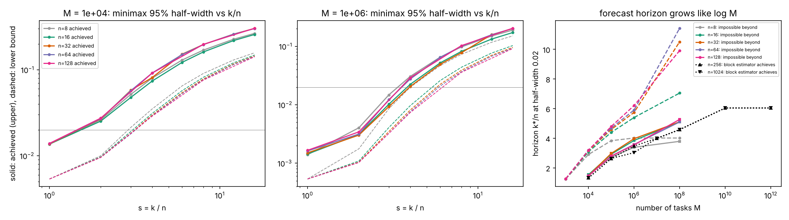
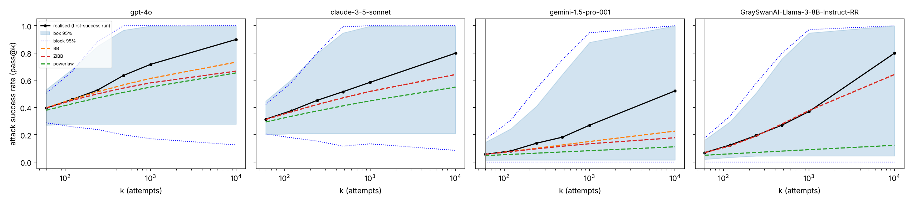

# Depth Is Linear, Breadth Is Logarithmic: How Far Can a Test-Time-Compute Evaluation See?

**Target venue:** NeurIPS 2027 (main track; theory + evaluation methodology)

**Code and data:** `code/` (run instructions in `README.md`). Every number below that is not attributed to a cited source was produced by that code and is stored under `results/`. Real data are public: per-problem counts from the Large Language Monkeys release [Brown et al., 2024] and attempt-level Best-of-N jailbreaking logs [Hughes et al., 2024], both taken from the public code release of Schaeffer et al. [2025]; provenance is in Section 6.

**Revision note (r2).** This version adds a new main result, Theorem 5: the forecast horizon is k* = Θ(n·min{log M, n}). It adds the block estimator, the connection to unseen-species extrapolation, a 222-cell computation that confirms the predicted scale collapse and log M growth, frontier-model data (Best-of-N jailbreaking, nine models, first-success ground truth to 10⁴ attempts), instance-dependent lower bounds on real data, and problem-level bootstraps. The previous finite-task bracket (Proposition 4) is now credited to Donoho–Liu / Donoho / Juditsky–Nemirovski modulus theory. All reviewer-identified mismatches are corrected. A point-by-point response is in `reviews/response_r2.md`.

---

## Abstract

How much more can test-time compute buy? In practice this is answered by extrapolation: draw n rollouts on each of M tasks, fit pass@k for k ≤ n, and read off k ≫ n. We ask how far such an evaluation can see when nothing is assumed about the distribution F of per-task success probabilities. Our main result is that the farthest budget k at which any 95% procedure can certify pass@k to a fixed precision is **k* = Θ(n·min{log M, n})**. The horizon grows linearly in the depth n and only logarithmically in the number of tasks M, until it saturates at the population limit Θ(n²). The upper bound is attained by a closed-form *block estimator*. The lower bound is a moment-matching construction. The result makes precise a correspondence between pass@k extrapolation and the classical unseen-species problem, where the analogous limit is the "log n" barrier of Orlitsky, Suresh and Wu.

We compute sharp constants with a modulus-of-continuity bracket (an instance of Donoho–Liu theory) over 552 (n, k, M) cells, n ≤ 128 and M ≤ 10⁸. Two regularities appear. (i) For n ≥ 16 the minimax half-width depends on (n, k) almost only through s = k/n; at M = 10⁴ the lower bound at fixed s varies by at most 8% across n = 16–128. (ii) Each tenfold increase in M extends the ±0.02 horizon by only 1.2–2.4 multiples of n. Uniformly over F, at M = 10⁶ tasks ±0.02 is impossible beyond k ≈ 5.4n–6.2n, and at benchmark scale (M ≈ 128–240) ±0.05 is impossible beyond k ≈ 1.1n. The practical rule is to *deepen, not widen*. When a target budget D is known, a capped first-success design certifies every k ≤ D at once. At the same per-task budget, its band is 2.1–12.4× narrower than our best certified fixed-n interval for a single k.

On public frontier-model data, Best-of-N jailbreaking of nine models including GPT-4o, Claude 3.5 Sonnet and Gemini 1.5 Pro (159 prompts, first-success runs up to 10⁴ attempts), 49–100% of prompts with no success in 60 attempts were broken later. Beta-binomial forecasts from 60 attempts understated the attack success rate at 10⁴ attempts for all nine models, significantly for seven, by up to 0.33. Power-law forecasts understated it for all nine, by up to 0.68. Instance-dependent lower bounds show that no valid procedure could have certified that rate from those data to better than about ±0.13 (median over models). On Pythia/MATH (Large Language Monkeys) the error sign varies across models and, with 128 problems, is statistically resolved for only one model. The population results include an n² horizon, a √(t/q) depth law for verifier-limited ceilings, and non-certifiability of pass@∞; they rest on known approximation theory and are stated as such.

## 中文摘要

"推理时计算还能带来多大提升"在实践中靠外推回答：在 M 个任务上每题采样 n 次，拟合 k ≤ n 的 pass@k，再读出 k ≫ n 处的值。本文研究在不对任务成功概率分布 F 作任何假设时，这种评测最远能"看"到哪里。主要结果是：任何 95% 置信方法能以固定精度认证 pass@k 的最远预算为 **k* = Θ(n·min{log M, n})**。视界随每题采样深度 n 线性增长，却只随任务数 M 对数增长，直到饱和于总体极限 Θ(n²)。上界由一个闭式的"分块估计量"达到，下界来自矩匹配构造。这一结果严格刻画了 pass@k 外推与经典"未见物种"外推问题之间的对应，后者中的相应极限是 Orlitsky、Suresh 与 Wu 的"log n"障碍。

我们用连续模区间（Donoho–Liu 理论的一个实例）在 552 个 (n, k, M) 格点上（n ≤ 128，M ≤ 10⁸）计算了精确常数，发现两条规律。(i) 当 n ≥ 16 时，极小极大半宽几乎只通过 s = k/n 依赖于 (n, k)；在 M = 10⁴ 时，固定 s 下的下界在 n = 16–128 之间变化不超过 8%。(ii) M 每增大十倍，±0.02 的视界只延长 1.2–2.4 个 n。在对 F 一致成立的意义下，即使有 10⁶ 个任务，超过 k ≈ 5.4n–6.2n 后 ±0.02 也不可能达到；在基准规模（M ≈ 128–240）下，超过 k ≈ 1.1n 后连 ±0.05 都不可能。实践上的结论是"加深而非加宽"。当目标预算 D 已知时，"采样直到首次成功、上限为 D"的设计可以同时认证所有 k ≤ D；在每题预算相同时，它的置信带比我们对单个 k 能给出的最好的固定 n 认证区间窄 2.1–12.4 倍。

在公开的前沿模型数据上（对 GPT-4o、Claude 3.5 Sonnet、Gemini 1.5 Pro 等九个模型的 Best-of-N 越狱，159 个提示，首次成功运行最多 10⁴ 次尝试），前 60 次尝试中无一成功的提示有 49–100% 后来被攻破。基于前 60 次尝试的 beta-二项预测对全部九个模型都低估了 10⁴ 次尝试时的攻击成功率，其中七个显著，最多低估 0.33；幂律预测对全部九个模型都低估，最多 0.68。实例相关下界表明，任何有效方法都无法根据这些数据把该成功率认证到优于约 ±0.13（各模型中位数）。在 Pythia/MATH（Large Language Monkeys）数据上，误差方向随模型而变，且在 128 道题的规模下仅对一个模型在统计上可分辨。总体层面的结果包括 pass@k 的 n² 视界、验证器受限上限的 √(t/q) 深度律以及 pass@∞ 不可认证；这些结果基于已知的逼近论，文中如实注明。

---
## 1 Introduction

Test-time compute (TTC) means spending more inference computation per query: many samples plus a verifier, majority voting, or longer reasoning. Repeated sampling lifts SWE-bench Lite solve rates from 15.9% with one sample to 56% with 250 samples, and coverage keeps rising over four orders of magnitude of samples [Brown et al., 2024]. Compute-optimal allocation of test-time compute can beat a 14× larger model on prompts of moderate difficulty [Snell et al., 2024]. Best-of-N jailbreaking reaches attack success rates of 89% on GPT-4o and 78% on Claude 3.5 Sonnet with 10,000 augmented prompts [Hughes et al., 2024]. The question this project asks is *how much more improvement test-time compute can still deliver.*

In practice that question is answered by **extrapolating a measured scaling curve**. An evaluation draws n rollouts on each of M tasks, estimates pass@k for k ≤ n with the unbiased estimator of Chen et al. [2021], fits a functional form, and reads off performance at k ≫ n. Brown et al. [2024] and Hughes et al. [2024] fit power laws; Schaeffer et al. [2025] explain aggregate power laws through heavy-tailed per-task difficulty; Kazdan et al. [2025] fit a beta-binomial model with dynamic sampling to predict pass@k up to k = 10⁴ from small budgets; Levi [2024] gives a Beta-distribution model of inference scaling. Singh & Singh [2026] showed that such extrapolations are not identified without assumptions: n rollouts per task reveal only n moments of the distribution F of per-task success probabilities.

Non-identification says that a forecast *can* be wrong. It does not say how far an evaluation *can* see, or what a lab should change to see farther. This paper answers that question for pass@k, with no assumption on F.

**Main result (Theorem 5).** Let k*_δ(n, M) be the largest budget k at which *any* 95% procedure, valid for every F, can certify pass@k to ±δ from n rollouts on each of M tasks. For fixed δ,

  **k*_δ(n, M) = Θ(n · min{log M, n}).**

The forecast horizon grows **linearly in the depth n** and only **logarithmically in the breadth M**, until log M ≈ n, where it saturates at the population horizon Θ(n²). The upper bound is attained, up to constants, by an explicit closed-form estimator (the *block estimator*, a binomial analogue of the smoothed Good–Toulmin estimator for unseen species). The converse is a moment-matching construction. Pass@k extrapolation is, we show, the evaluation counterpart of the classical unseen-species extrapolation problem, where Orlitsky, Suresh and Wu [2016] found the analogous "log n" limit.

**Sharp constants.** Theorem 5 fixes the rate; a minimax bracket computed by convex programming (Proposition 4, an instance of Donoho's modulus-of-continuity theory) fixes the constants. Over n ∈ {8, …, 128} and M ∈ {128, …, 10⁸}, the bracket depends on (n, k) almost only through the ratio s = k/n (at M = 10⁴ the computed lower bound at fixed s varies by at most 8% across n = 16–128), and at half-width ±0.02 every 10× increase in M extends the impossibility horizon by only 1.2–2.4 multiples of n. At M = 10⁶ tasks, no procedure can guarantee ±0.02 for pass@k uniformly over F beyond k ≈ 5.4n–6.2n for n = 16–128. These are worst-case statements; Section 6.4 gives instance-dependent versions computed at the observed data.

**Consequences.**
1. *Deepen, don't widen.* Doubling n doubles the horizon; doubling M adds a constant. A lab that wants to forecast pass@10⁴ should spend its budget on rollouts per task, not on more tasks, once M is large enough for ordinary sampling error.
2. *Practical forecasts are mostly prior.* Typical reports extrapolate by k/n = 10–1000; the computed horizon at M = 10³–10⁶ is k/n ≈ 1–10.
3. *Instance-dependent limits on real data.* On public frontier-model data (Best-of-N jailbreaking of GPT-4o, Claude 3.5 Sonnet, Gemini 1.5 Pro and six other models; 159 prompts; first-success runs up to 10⁴ attempts), a local version of the lower bound shows that *no* valid procedure can certify the attack success rate at k = 10⁴ from the first 60 attempts to better than about ±0.13 (median over models), and the realised rates bear this out: parametric forecasts from n = 60 miss the k = 10⁴ value by up to 0.33 (beta-binomial) and 0.68 (power law), in every model in the direction of understating the gain.
4. *Verifier ceilings and pass@∞* (population results, Section 4): certifying a resampling ceiling with verifier rates (t, q) needs n ≈ ½√(t/q)·ln(1/δ) rollouts per task, and pass@∞ is never certifiable.

**What is new and what is known.** Lemma 1 (moment-matching/best-approximation duality) is classical [Wu & Yang 2016, 2019]; Corollary 2 and Proposition 3 are applications of known approximation-theory results; Proposition 4 instantiates the modulus theory of Donoho [1994], Donoho & Liu [1991] and Juditsky & Nemirovski [2009] with computable constants. The new results are Theorem 5 (the n·min{log M, n} horizon law, with the block estimator and the unseen-species connection), the sharp numerical constants and the scale-collapse in s = k/n, the instance-dependent lower bounds on real data, and the empirical study on frontier-model data with first-success ground truth.

## 2 Related Work

**Inference-time scaling laws.** Brown et al. [2024] showed that coverage grows log-linearly in the number of samples over four orders of magnitude. Snell et al. [2024] studied compute-optimal test-time allocation. Wu et al. [2024] and Chen et al. [2024] studied voting; Chen et al. found non-monotone accuracy driven by heterogeneous query difficulty. Schaeffer et al. [2025] derived aggregate power laws from per-task exponential decay and a heavy-tailed distribution of single-attempt success probabilities. Levi [2024] derived power laws from a Beta difficulty model. Kazdan et al. [2025] fit a beta-binomial model with dynamic sample allocation. Hughes et al. [2024] forecast Best-of-N jailbreaking success with power laws. All of these impose a parametric or tail-regularity assumption; our results quantify how far the data alone reach.

**Identification and finite-sample inference for pass@k.** Singh & Singh [2026] proved that fixed-n counts identify only n free moments, computed sharp population identified intervals, and reported large ambiguity at k = 1000 from n = 16 on the Large Language Monkeys release. Ye [2026] (concurrent) builds variance-adaptive confidence regions for fixed-benchmark binomial mixtures that hold simultaneously for all bounded functionals, and notes that for k ≫ n only lower bounds are supported. Neither work gives the *rate* at which the certifiable horizon grows with n and M, which is our main result. Because our lower bounds bind every procedure with uniform coverage, they also bind Ye's regions when used for pass@k (Section 5.3); we could not obtain the full text of Ye [2026] in our environment and therefore make no numerical width comparison beyond this.

**Modulus of continuity and minimax confidence intervals.** For linear functionals over convex classes, minimax estimation and confidence-interval length are governed by a modulus of continuity, and affine procedures are near-optimal: Donoho & Liu [1991] (Hellinger modulus for i.i.d. data), Donoho [1994] (fixed-length affine intervals within a small constant of the optimal expected length), Cai & Low [2004] (expected length of adaptive intervals via a between-class modulus), Juditsky & Nemirovski [2009] (computable near-optimal affine estimators), and Polyanskiy & Wu [2019] (dualizing Le Cam's method, with applications to estimating unseens). Proposition 4 is an instance of this theory with constants we compute. Our instance-dependent lower bounds (Section 6.4) follow the between-class-modulus idea of Cai & Low. Pratt's [1961] identity gives the expected length of confidence intervals.

**Unseen species and polynomial approximation.** Good & Toulmin [1956] proposed predicting the number of new species found when a sample is enlarged by a factor t; the estimator fails beyond t = 1 because its terms grow exponentially. Orlitsky, Suresh & Wu [2016] showed that smoothed versions predict up to t ∝ log n and that this is optimal. Wu & Yang [2016, 2019] used moment matching and best polynomial approximation for entropy and support size; Tian, Kong & Valiant [2017] estimate the distribution of coin biases from t flips each. Theorem 5 transfers the "log n" phenomenon to TTC evaluation, where the extrapolation ratio is k/n and the sample size is the number of tasks M. We use Newman & Rivlin [1976] (restated by Saibaba [2021]), Sachdeva & Vishnoi [2014], and Chebyshev's best approximation of 1/(x−a) [Meinardus 1967; Kraus, Vassilevski & Zikatanov 2012].

**Imperfect verifiers.** Stroebl, Kapoor & Narayanan [2024] showed that verifier false positives impose a resampling ceiling. Proposition 3 says how well a fixed-n evaluation can certify that ceiling.

## 3 Setup

Tasks i = 1, …, M have latent per-rollout success probabilities p_i drawn i.i.d. from an unknown distribution F on [0,1] (random-task model; we note which results also hold for fixed tasks). An evaluation draws n i.i.d. rollouts per task and records X_i ~ Binomial(n, p_i). The **count law** is π_F(x) = ∫ b_{n,x}(p) dF(p), x = 0, …, n, with b_{n,x}(p) = C(n,x) p^x (1−p)^{n−x}. A **TTC functional** is θ_g(F) = E_F[g(p)]. Our main target is pass@k, g(p) = 1 − (1−p)^k. Section 4 also treats pass@∞ (g = 1{p > 0}), the resample-until-accept ceiling with verifier true-/false-positive rates (t, q), g = tp/(tp + q(1−p)), best-of-k with a verifier, and binary majority@k. The **identified set** is I_n(g; π) = {θ_g(F) : π_F = π}; 𝒫_n is the space of polynomials of degree ≤ n and E_n(g) = inf_{P∈𝒫_n} sup_{[0,1]} |g − P|.

**Finite-task minimax half-width.** R*(n, k, M) is the smallest worst-case (over F) expected half-width of any confidence procedure whose coverage of θ = E_F[1 − (1−p)^k] is at least 1 − ε = 0.95 for **every** F. The **forecast horizon** is k*_δ(n, M) = max{k : R*(n, k, M) ≤ δ}, and s = k/n is the **extrapolation ratio**.

**Conventions.** Width means interval length, half-width half of it. All finite-task quantities are half-widths of 95% intervals. Population (M = ∞) worst-case half-width is E_n(g).

## 4 Population Limits (known tools applied to TTC functionals)

**Lemma 1 (worst-case width = 2E_n; classical [Wu & Yang 2016, 2019]).** For every continuous g and every count law π, diam I_n(g; π) ≤ 2E_n(g), and sup_π diam I_n(g; π) = 2E_n(g).

*Proof sketch.* b_{n,0}, …, b_{n,n} span 𝒫_n, so π fixes ∫P dF for every P ∈ 𝒫_n; the best approximant P* gives |θ_g(F) − ∫P* dF| ≤ E_n(g) for all F in the identified set. Sharpness: by Hahn–Banach, a measure σ ⊥ 𝒫_n with ‖σ‖_TV = 2 and ∫g dσ → 2E_n(g) exists; σ has zero mass, so σ± are probability measures with equal count laws. ∎ The LP values agree with 2E_n to 5 digits (`results/theory_duality_check.json`).

**Corollary 1 (pass@∞ is never certifiable).** E_n(1{p>0}) = 1/2. More strongly, for any F and ε > 0 there is G with TV(π_F, π_G) ≤ ε and θ(G) = 1 (move F's atom at 0 to a small η > 0). No finite-sample procedure can certify an upper bound below 1 on pass@∞ (population non-identification is also in Singh & Singh [2026]).

**Corollary 2 (n² population horizon for pass@k; via Newman–Rivlin).** With ρ_{N,m} = P(|S_N| > m) for a simple random walk S_N, for k > n,

  ρ_{2k,2n}/(4e) ≤ E_n(1−(1−p)^k) ≤ min{ρ_{2k,2n}, 2e^{−n²/k}}.

*Proof.* p → 1−p and y = z² give E_n^{[0,1]}(y^k) = E_{2n}^{[−1,1]}(z^{2k}); apply Newman–Rivlin [1976, Thm 2] (as restated by Saibaba [2021]) and Sachdeva–Vishnoi [2014, Thm 3.2]. ∎ Numerically (`results/theory_checks.json`, 73 cells, n ∈ {4, …, 128}, E_n > 10⁻⁵), E_n/ρ_{2k,2n} ∈ [0.521, 1.00004]; the one value above 1 is within the LP's 10⁻⁴ relative tolerance. The rule *worst-case width ≈ erfc(n/√k)* holds within a factor 0.63–1.09 for n ≥ 16 and E_n > 10⁻⁵ (0.94–1.09 where 2E_n ≥ 10⁻³; maximal absolute deviation 0.069 at n = 128, k = 453,259); it is a numerical approximation, not a theorem. Rigorously, the population width is ≤ δ whenever k ≤ n²/ln(4/δ); the exact LP horizons at width 0.01 satisfy k/n² ∈ [0.15, 0.28] for n = 16–128.

**Proposition 3 (verifier-limited ceiling; via Chebyshev's 1/(x−c)).** For 0 < q < t ≤ 1, E_n(tp/(tp + q(1−p))) = ½ r^n with r = (√t − √q)/(√t + √q).

*Proof.* With a = q/(t−q), g = (t/(t−q))(1 − a/(p+a)); with x = 2p−1 and c = 1 + 2a, Chebyshev's best approximation [Meinardus 1967; Kraus et al. 2012, Thm A.1] gives E_n(1/(x+c)) = (c − √(c²−1))^n/(c²−1), and c − √(c²−1) = r. ∎ LP values agree within 0.33% wherever E_n > 10⁻⁵.

**Corollary 3 (predictability–ceiling trade-off).** The worst-case ceiling width is ≤ δ iff n ≥ ln(1/δ)/ln(1/r) ≈ ½√(t/q)·ln(1/δ). For t = 0.9 and δ = 0.01, q = 0.1, 0.01, 0.001 need n ≈ 7, 22, 70. **Halving the false-positive rate raises the resampling ceiling but multiplies the depth needed to certify it by √2.**

For best-of-k with q > 0 (n = 16, t = 0.9, q = 0.01), E_n follows the pass@k law and then saturates at ½r^n = 1.69×10⁻² once k ≫ 1/q (`results/theory_En.csv`). The majority@k limit 1{p > 1/2} has E_n = 1/2. (We drop the approximate majority-vote "collapse" of our previous version, which rested on five points.)

*Figure 1. Population worst-case width 2E_n(g). Left: pass@k against n²/k; dashed erfc(n/√k) (factor 0.63–1.09 for n ≥ 16, E_n > 10⁻⁵); dotted the rigorous 4e^{−n²/k}. Middle: binary majority@k. Right: verifier ceiling at t = 0.9; markers LP, lines r^n. Values below ~10⁻⁷ reflect the LP tolerance floor.*

## 5 Finite-Task Theory: How Far Can M Tasks × n Rollouts See?

### 5.1 A modulus bracket (an instance of Donoho–Liu / Juditsky–Nemirovski theory)

Let BC(P, Q) = Σ_x √(P(x)Q(x)) and define the Hellinger modulus

  ω(η) = sup { θ(G) − θ(F) : 1 − BC(π_F, π_G) ≤ η },

over all laws F, G on [0,1]. ω is concave and nondecreasing (1 − BC is jointly convex), and ω(0) = 2E_n.

**Proposition 4 (minimax bracket).** Let ε = 0.05.
(a) *Achievability.* For h ∈ ℝ^{n+1}, α > 0, the interval [θ̂ − t₊, θ̂ + t₋], θ̂ = M⁻¹Σ_i h[X_i], with t₊ = sup_F[α ln E_F e^{h[X]/α} − θ(F)] + α ln(2/ε)/M and t₋ defined symmetrically, has coverage ≥ 1 − ε for every F and for fixed non-identical tasks. The infimum of t₊ + t₋ over (h, α) equals ω(η_up), η_up = 1 − (ε/2)^{1/M}. Hence R* ≤ ω(η_up)/2.
(b) *Converse.* For every η and every procedure with coverage ≥ 1 − ε for all F, R* ≥ ½ω(η)(1 − ε − √(1 − (1−η/2)^{2M})); the computed bound uses a sharper Pratt-integrated form.

This is the modulus theory of Donoho & Liu [1991], Donoho [1994] and Juditsky & Nemirovski [2009], specialised to our model; we claim only the instantiation and the computation. *Proof.* (a) Chernoff's bound gives each tail ≤ ε/2, uniformly over point masses, hence also for fixed tasks. By Sion's theorem and Cauchy–Schwarz, inf_h[ln E_F e^{h/α} + ln E_G e^{−h/α}] = 2 ln BC(π_F, π_G), so minimizing over α leaves θ(G) − θ(F) when BC ≥ (ε/2)^{1/M}. (b) For a pair (F, G) at level η, put mid = (F+G)/2 and F_λ^± = mid ± λ(G−F)/2. Pratt's identity E_mid[length] = ∫P_mid(θ′ ∈ CI)dθ′, coverage under F_λ^±, TV ≤ √(1 − BC^{2M}) and joint convexity (1 − BC(mid, F_λ) ≤ λη/2) give the bound after integrating over λ. ∎

*Computation (`exp_minimax.py`).* W(η) = sup{θ(G) − θ(F) : Σ_x d_x²/(4m_x) ≤ η} (d = π_G − π_F, m = (π_F+π_G)/2) satisfies W(η) ≤ ω(η) ≤ W(2η) and is a second-order-cone program over pairs of laws on a 700-point grid. **R_lo** evaluates the Pratt integral exactly (right-endpoint Riemann sum of a non-increasing integrand) for the W-optimal pair at η ∈ {1, 4, 16, 64}/M after recomputing 1 − BC exactly; grid laws are genuine laws, so R_lo is rigorous. We also apply the free strengthening R_lo ← max(R_lo, (1−2ε)E_n) (reviewer's suggestion): any valid interval must cover both members of a population-indistinguishable pair. **R_up** is the minimum of two rigorous achievable bounds: the Chernoff interval of (a), searched over candidate directions h and re-evaluated on a 280,000-point grid with an explicit Lipschitz slack, and the block estimator of Theorem 5(a) with its exact range. (In the previous version R_up used only the Chernoff search; at M = 10⁸ the block estimator is tighter in some cells, see Section 5.3.)

### 5.2 The horizon law: depth is linear, breadth is logarithmic

Define the **forecast horizon** k*_δ(n, M) as the largest k with R*(n, k, M) ≤ δ: the farthest budget at which *some* 95% procedure, valid for every F, certifies pass@k to ±δ.

**Theorem 5 (forecast horizon).** Let ε = 0.05.

(a) *Achievability (block estimator).* For an integer 0 ≤ L ≤ n − 1 let b = ⌊n/(L+1)⌋ and write k = qb + r with 0 ≤ r < b. Let Q(w) = Σ_{j≤L} c_j w^j be the best uniform degree-L approximation of w^q on [0,1], with error E = E_L(w^q), and put

  Z(X) = 1 − Σ_{j=0}^{L} c_j U_{r+jb}(X),  U_m(X) = C(n−X, m)/C(n, m).

Then the interval M⁻¹Σ_i Z(X_i) ± (E + S·√(2 ln(2/ε)/M)), with S = Σ_j |c_j|, has coverage ≥ 1 − ε for every F and also for fixed, non-identical tasks. Moreover E ≤ 2e^{−L²/q} and S ≤ 2.42 (1+E)(3+2√2)^L. Consequently, if L_δ(M) := ⌊ln(δ√M/19.7)/ln(3+2√2)⌋ ≥ 1 and L := min(L_δ(M), n−1), then

  k*_δ(n, M) ≥ ⌊n/(L+1)⌋·⌊L²/ln(4/δ)⌋.

(b) *Converse.* Let μ > 0 with η_μ := max_{c>0} (1 − e^{−c} − 2c/μ)/(2 + 2c/μ) > 0 (η_6 = 0.128, η_4 = 0.066). For any integers L ≥ 1 and k ≥ μL²,

  R*(n, k, M) ≥ η_μ · (1 − 2ε − M·τ),  τ = Σ_{m=L+1}^{n} C(n,m)(2μL²/k)^m

(τ = 0 if L ≥ n). In particular, with μ = 6 and γ = 120: whenever k ≥ 120·n·L with L + 1 ≥ ln(4M)/1.2 (or k ≥ 6n² with L = n), every 95% procedure has worst-case expected half-width ≥ 0.083.

(c) *Rate.* For fixed δ ≤ 0.08, k*_δ(n, M) = Θ(n·min{log M, n}) as n, M → ∞, with constants depending only on δ. For log M ≲ n the horizon is linear in the number of rollouts per task and only logarithmic in the number of tasks; for log M ≳ n it saturates at the population horizon Θ(n²) of Corollary 2.

*Proof.* (a) For m ≤ n, U_m is the unbiased estimator of (1−p)^m from X ~ Bin(n, p) [the U-statistic of "no success among m chosen rollouts"], and 0 ≤ U_m ≤ 1. All indices r + jb ≤ r + Lb < (L+1)b ≤ n. With w = (1−p)^b, E_p Z = 1 − (1−p)^r Q(w) and pass@k(p) = 1 − (1−p)^r w^q, so |E_p Z − pass@k(p)| ≤ (1−p)^r E ≤ E for every p; averaging over F (or over fixed p_i) preserves this. Z takes values in [1 − S, 1 + S], so Hoeffding's inequality gives the deviation term, and adding the bias bound E gives coverage. The bound E ≤ 2e^{−L²/q} is the y = z² reduction of Corollary 2 applied to Sachdeva–Vishnoi [2014, Thm 3.2]: E_L^{[0,1]}(w^q) = E_{2L}^{[−1,1]}(z^{2q}) ≤ 2e^{−(2L)²/(2·2q)}. For S: write Q(w) = Σ_j a_j T_j(2w−1); Chebyshev coefficients satisfy |a_j| ≤ 2‖Q‖_{[0,1]} ≤ 2(1+E); the monomial coefficients of T_j(2w−1) alternate in sign, so their absolute sum is |T_j(−3)| = T_j(3) ≤ (3+2√2)^j (exact check for j ≤ 40 in `exp_theorem5.py`); summing the geometric series gives S ≤ 2(1+E)·(3+2√2)^L/(1 − (3+2√2)^{−1}) ≤ 2.42(1+E)(3+2√2)^L. The horizon statement follows by requiring E ≤ δ/2 (i.e. q ≤ L²/ln(4/δ)) and 2.42·1.5·(3+2√2)^L √(2 ln 40/M) ≤ δ/2.

(b) Let f(t) = (1 − λt/k)^k on [0,1] with λ = μL². By the duality of Lemma 1 (applied with degree L on [0,1]) there are probability measures σ⁺, σ⁻ on [0,1] with equal moments of order ≤ L and ∫f dσ⁺ − ∫f dσ⁻ = 2E_L(f). Push both forward by t ↦ p = at, a = λ/k ≤ 1, to get laws F, G on [0, a] with equal moments of order ≤ L and |θ_k(F) − θ_k(G)| = 2E_L(f). Expanding b_{n,x}(p) = Σ_{m ≥ x} C(n,m)C(m,x)(−1)^{m−x} p^m and using that σ = σ⁺ − σ⁻ annihilates p^m for m ≤ L and |∫p^m dσ| ≤ 2a^m,

  TV(π_F, π_G) = ½Σ_x|π_F(x) − π_G(x)| ≤ ½ Σ_{m>L} C(n,m) 2^m · 2a^m = τ.

Then TV(π_F^{⊗M}, π_G^{⊗M}) ≤ Mτ. For any procedure with coverage ≥ 1 − ε under both F and G, P_F(θ_k(F), θ_k(G) ∈ CI) ≥ 1 − 2ε − Mτ, so E_F[length] ≥ 2E_L(f)(1 − 2ε − Mτ). It remains to show E_L(f) ≥ η_μ (Lemma 5.1): if ‖P − f‖ ≤ η for a degree-L polynomial P, then ‖P‖ ≤ 1 + η, and Markov's inequality on [0,1] gives ‖P′‖ ≤ 2L²(1+η). Since f(0) = 1 and f(t₁) ≤ e^{−λt₁} = e^{−c} at t₁ = c/λ, 1 − e^{−c} − 2η ≤ P(0) − P(t₁) ≤ t₁·2L²(1+η) = 2c(1+η)/μ, i.e. η ≥ (1 − e^{−c} − 2c/μ)/(2 + 2c/μ). For the explicit corollary: if k ≥ γnL then 2an ≤ 2μL/γ =: A and τ ≤ Σ_{m>L} A^m/m! ≤ (eA/(L+1))^{L+1}e^{A} ≤ κ^{L+1}, κ = (2eμ/γ)e^{2μ/γ}; for μ = 6, γ = 120, κ = 0.300 = e^{−1.20}, so Mτ ≤ 1/4 once L+1 ≥ ln(4M)/1.2, and then R* ≥ 0.128·(0.9 − 0.25) = 0.083. With L = n, τ = 0 and k ≥ 6n² suffices (the population regime).

(c) From (a), L_δ(M) ≍ log M (for M ≥ M₀(δ)), so k*_δ ≥ ⌊n/(L+1)⌋⌊L²/ln(4/δ)⌋ ≳ n·min{log M, n}/ln(4/δ). From (b) with μ = 6, k*_δ < 120·n·min{⌈ln(4M)/1.2⌉, n} for δ < 0.083. ∎

**Remarks.** (i) *Connection to the unseen-species problem.* Write pass@k = M⁻¹Σ_i P(task i solved within k rollouts). This is the binomial analogue of the Good–Toulmin problem: predict how many "species" (tasks) will have been "seen" (solved) after extending a sample by a factor t = k/n [Good & Toulmin 1956]. Orlitsky, Suresh and Wu [2016] showed that, in the multinomial species model, the number of unseen species can be predicted only up to extrapolation ratios t ∝ log n. Theorem 5 is the evaluation counterpart: the ratio k/n is limited to ∝ log M, where M plays the role of the sample size. Our block estimator plays the role of their smoothed Good–Toulmin estimator; the proofs differ (binomial instead of Poissonized multinomial sampling; finite n, which produces the n² saturation). To our knowledge this connection has not been made in the LLM-evaluation literature. (ii) The constants in (a)–(b) are loose by one to two orders of magnitude; the numerical bracket below supplies sharp constants.

### 5.3 Sharp constants: the computed bracket

We computed [R_lo, R_up] on two grids. (i) The grid of our previous version: n ∈ {16, 32, 64}, 22 log-spaced k ∈ [n, 4n²], M ∈ {240, 10³, 10⁴, 10⁵, 10⁶} (330 cells; `results/minimax_bounds_r2.csv`). (ii) A new grid built to test Theorem 5: k = s·n with s ∈ {1, 2, 3, 4, 6, 8, 12, 16} for n ∈ {8, 16, 32, 64}, s ∈ {1, 2, 4, 8, 16} for n = 128 (reduced for CPU budget), and M ∈ {128, 10³, 10⁴, 10⁵, 10⁶, 10⁸} (222 cells; `exp_horizon_law.py`, `results/horizon_law_bounds_merged.csv`). Grid (i) gives R_up/R_lo ∈ [1.46, 3.81] (median 2.10). The block estimator never beats the Chernoff search there, and the strengthening max(R_lo, 0.9E_n) binds in one cell: (16, 1024, 10⁶), where R_lo rises from 0.226 to 0.231. On grid (ii) the ratio is [1.14, 9.65] (median 2.51). Ratios above 4 occur only at M = 10⁸, where the Chernoff direction search is weakest and the block estimator wins in 9% of cells (by up to a factor 1.6).

*Table 1. Selected values of [R_lo, R_up] on grid (i).*

| n | k | population E_n | M = 240 | M = 10⁴ | M = 10⁶ |
|---|---|---|---|---|---|
| 16 | 16 | ≈0 | [0.035, 0.087] | [0.0054, 0.014] | [0.0005, 0.0014] |
| 16 | 95 | 0.010 | [0.126, 0.291] | [0.056, 0.121] | [0.025, 0.051] |
| 16 | 1024 | 0.257 | [0.310, 0.488] | [0.264, 0.405] | [0.231, 0.346] |
| 32 | 203 | 7.3×10⁻⁴ | [0.131, 0.339] | [0.059, 0.160] | [0.025, 0.054] |
| 64 | 184 | 2.3×10⁻⁹ | [0.073, 0.215] | [0.017, 0.052] | [0.0028, 0.011] |
| 64 | 689 | 2.8×10⁻⁴ | [0.183, 0.404] | [0.104, 0.242] | [0.058, 0.141] |

**Finding 1: scale collapse in s = k/n.** At fixed (s, M), the bracket barely depends on n once n ≥ 16 (Fig. 2, left and middle). At M = 10⁴ the lower bound at s = 2, 4, 8, 16 varies by at most 8% across n = 16–128 (e.g. s = 4: 0.031, 0.030, 0.029, 0.029). At M = 10⁶ it varies by at most 11% across n = 32–128 (s = 4: 0.0081, 0.0076, 0.0073). Over all (s, M) with n ≥ 16 the median max/min ratio across n is 1.06. This is what Theorem 5 predicts: in the regime log M ≲ n, only the extrapolation ratio matters. The exception is n = 8 (and n = 16 at M = 10⁸). There log M is no longer small compared with n and the horizon saturates at the population value, the "min{log M, n}" of Theorem 5(c), visible as the flat n = 8 curve in Fig. 2 (right).

**Finding 2: the horizon grows like log M.** Table 2 gives the horizon in units of n. At ±0.02 the impossible-beyond ratio k/n is 1.25 at M = 10³, 3.1–3.2 at 10⁴, 4.4–4.8 at 10⁵, 5.4–6.2 at 10⁶ and 7–11 at 10⁸. Each tenfold increase in M adds 1.2–2.4 multiples of n (least-squares slope 1.7–2.0 per decade for n ≥ 32). The achievable ratio grows from 1.5 (M = 10⁴) to 5.1–5.3 (M = 10⁸). The block estimator alone (`exp_block_law.py`, n up to 1,024, M up to 10¹²) achieves ±0.02 out to k/n = 1.3, 2.3–2.6, 3.0–3.5, 4.0, 4.6 and 5.3–6.1 at M = 10⁴, 10⁵, 10⁶, 10⁷, 10⁸ and 10¹⁰–10¹², with nearly the same value for every n from 16 to 1,024 (`results/block_horizon_table.csv`).

*Table 2. Forecast horizon k*/n at 95% half-width δ: achieved (R_up ≤ δ) / impossible beyond (R_lo > δ), log-interpolated (`results/horizon_law_table.csv`; grid values in the same file). For n = 128 the s-grid is coarser.*

| δ | M | n = 16 | n = 32 | n = 64 | n = 128 |
|---|---|---|---|---|---|
| 0.02 | 10⁴ | 1.5 / 3.1 | 1.5 / 3.2 | 1.5 / 3.2 | 1.5 / 3.2 |
| 0.02 | 10⁵ | 2.9 / 4.4 | 3.0 / 4.6 | 2.8 / 4.7 | 2.8 / 4.8 |
| 0.02 | 10⁶ | 3.8 / 5.4 | 4.0 / 5.7 | 3.6 / 5.9 | 3.5 / 6.2 |
| 0.02 | 10⁸ | 5.1 / 7.1 | 5.1 / 10.5 | 5.1 / 11.4 | 5.3 / 9.9 |
| 0.05 | 10³ | 1.2 / 3.3 | 1.2 / 3.4 | 1.2 / 3.4 | 1.2 / 3.4 |
| 0.05 | 10⁴ | 3.1 / 5.5 | 2.8 / 5.7 | 2.8 / 5.8 | 2.8 / 5.9 |
| 0.05 | 10⁶ | 5.9 / 8.8 | 6.1 / 9.5 | 5.3 / 9.8 | 5.4 / 10.2 |

For comparison, the population horizons (E_n ≤ δ) at δ = 0.02 are k/n = 7.6, 15.1, 30.1 for n = 16, 32, 64. At M = 10⁶ the finite-task impossibility horizon is 1.4 (n = 16) to 5.1 (n = 64) times shorter than the population one, and the gap grows with n.

**Finding 3: at benchmark scale the horizon is about one n.** At M = 128–240, no procedure achieves ±0.05 uniformly over F beyond k ≈ 1.1n (Table 2), and ±0.02 is impossible even at k = n for n = 16 (R_lo(16, 16, 240) = 0.035).

*Figure 2. Left, middle: computed minimax 95% half-width bracket against s = k/n at M = 10⁴ and 10⁶ for n = 8–128. Solid lines are achieved (upper) bounds and dashed lines rigorous lower bounds; the curves for n ≥ 16 nearly coincide. Right: horizon k*/n at ±0.02 against M, impossible-beyond (dashed) and achieved (solid), plus the block estimator's achieved horizon for n = 256 and 1,024 up to M = 10¹². The n = 8 curve saturates at the population horizon.*

**Relation to Ye [2026].** Our lower bounds apply to every procedure whose coverage holds for all F, so they bind Ye's simultaneous regions when those are used for pass@k. No such region can have worst-case expected half-width below R_lo, and the horizon law applies to it. Ye's regions target the fixed-benchmark functional M⁻¹Σ g(p_i), while R_lo is derived for the random-task model. The two targets differ by O(M^{−1/2}) sampling fluctuation, which is small compared with R_lo once k ≳ 2n. We could not access the full text of Ye [2026] and therefore do not compare widths numerically.

## 6 Experiments

### 6.1 Controlled test beds: synthetic laws and WalkSAT with exactly known ceilings

These experiments are retained from our previous version (code `exp_synthetic.py`, `exp_walksat.py`, `exp_baselines.py`, `exp_efficiency.py`); we summarise them and correct two counting errors noted by the reviewer.

*Synthetic laws.* We draw p_i from Beta(0.3,3); 0.3δ₀ + 0.7·Beta(0.5,2) (30% unsolvable); 0.3δ_{10⁻³} + 0.7·Beta(0.5,2) (30% "hidden solvable"); and LogitNormal(−3, 2.5). The second and third laws are nearly indistinguishable at n = 16 but differ by 0.19 in pass@1024; their population identified intervals for pass@1024 at n = 16 are [0.603, 0.958] and [0.633, 0.981]. With 20 replications per law at n = 16, M = 5,000, BIC selects the zero-inflated beta-binomial (ZIBB) in all 20 fits under the unsolvable law (pass@1024 bias +0.002) and in 19 of 20 fits under the hidden-solvable law, where it is wrong (bias −0.167 at pass@1024, −0.262 on the ceiling). (Our previous version reported these as "100/100" and "95/100", counting the 5 targets of each fit separately.) No model in the family is right on both laws, as Lemma 1 predicts. Under the well-specified Beta law, the beta-binomial parametric-bootstrap interval covers only 84–88% at M = 5,000. The minimax-Hoeffding certified interval covered in 7,198/7,200 cells but is heavily conservative (median half-width 11× the population identified half-width).

*WalkSAT.* WalkSAT [Selman, Kautz & Cohen 1994] has positive per-run success probability exactly on satisfiable instances, and MiniSat (via PySAT) decides satisfiability, so pass@∞ is known. Three configurations × 240 random 3-SAT instances × 10,000 runs; 15–45% of the mass of F is at p = 0, so this is a stress test for models without a zero atom, not a neutral benchmark. From n = 16, the beta-binomial overestimates pass@1000 by +0.287/+0.135/+0.111 (configurations A/B/C) and predicts a ceiling of 1; ZIBB reduces this to +0.055/+0.002/+0.016, but BIC chose plain BB over ZIBB in 14 of 30 fits (BIC-selected bias up to +0.13). The box interval (Bonferroni Clopper–Pearson box on the count histogram, then optimisation over grid laws) covered in all 720 two-sided cells and its lower end covered the ceiling in 120/120 pass@∞ cells; at M = 240 it is 1.80× (1.63–2.74×) wider than a CLT interval where k ≤ n.

*Capped first-success design, budget-matched (reviewer W5).* Running each task until its first success, capped at D, gives unbiased indicators 1{T_i ≤ k} for every k ≤ D and a Dvoretzky–Kiefer–Wolfowitz band (with Massart's [1990] constant) valid simultaneously for all k ≤ D with half-width √(ln(2/ε)/(2M)) (0.088 at M = 240, 0.0136 at M = 10⁴). On WalkSAT with D = 1,000 its expected cost is 413/451/162 rollouts per task (A/B/C). Our previous version compared this with fixed n = 64, which was not budget-matched. Giving the fixed-n design the same per-task budget (n = 413/451/162) and certifying pass@1000 with the block estimator (Theorem 5a) yields half-widths 0.201/0.186/0.361 at M = 240 and 0.040/0.034/0.169 at M = 10⁴ (`exp_capped_fair.py`, `results/capped_fair.csv`), i.e. 2.1–12.4× wider than the DKW band, for a single k instead of all k ≤ D. The block estimator is an upper bound on R*, so the comparison favours the capped design only up to the gap between R_up and R* (the computed bracket ratio is at most 3.8 for n ≤ 64 and M ≤ 10⁶). The recommendation survives the budget-matched comparison. Section 6.2 shows the design in use on real data.

### 6.2 Frontier-model data with first-success ground truth: Best-of-N jailbreaking

*Data and provenance.* Hughes et al. [2024] ran Best-of-N (BoN) jailbreaking on 159 HarmBench prompts against nine text models: GPT-4o, GPT-4o-mini, Claude 3.5 Sonnet, Claude 3 Opus, Gemini 1.5 Flash and Pro, Llama-3-8B-Instruct, and two defended models (Llama-3-8B-Instruct with circuit breakers, "GraySwanAI-…-RR", and Cygnet). The attempt-level logs are redistributed in the public code release of Schaeffer et al. [2025] (`data/raw_data/best_of_n_jailbreaking/*_text_t1.0_n10000.jsonl`, commit cd078ae). `build_bon.py` rebuilds our table from these logs and checks the design. Attempts were made in batches of 60 until a batch contained a success, capped at 10,020 attempts (6,000 for Cygnet). Hence (i) the first 60 attempts are recorded for every prompt, so the success counts among the first n ≤ 60 attempts are genuine fixed-n Binomial counts, and (ii) the index T of the first success gives the unbiased indicator 1{T ≤ k} of each prompt's pass@k for every k up to the cap. The BoN runs are thus a **capped first-success design** (Section 6.1) on frontier models. Every unsuccessful prompt reached the cap (checked); in 6 Gemini-1.5-Pro prompts a logged success precedes the stopping batch, which does not affect (i) or (ii). The realised attack success rate (ASR) at the cap ranges from 5% (Cygnet) and 52% (Gemini 1.5 Pro) to 100% (Llama-3-8B-Instruct, all prompts broken within 4,200 attempts). Truth for pass@k is the realised fraction 1{T_i ≤ k}. It is one realisation per prompt, so it carries sampling noise (standard deviation ≤ 0.04 at M = 159).

*Protocol (`exp_realdata.py`, `exp_bon_boot.py`).* From the first n ∈ {15, 30, 60} attempts we forecast pass@k for k ∈ {n, 2n, 4n, 8n, 16n, 1000, cap}. Methods: beta-binomial (BB), ZIBB, 2- and 3-component Beta mixtures, the BIC choice, and the log-log power-law fit used in the TTC literature. Intervals: the box interval and the block-estimator interval (Theorem 5a; degree chosen from (n, k, M) only). We also compute the instance-dependent lower bound of Section 6.4.

*Results (`results/realdata_bon_scored.csv`, `results/bon_boot.csv`, Fig. 3).*
- **Most of the eventual gain comes from prompts that look unbreakable at n = 60.** Among prompts with zero successes in the first 60 attempts, the fraction later broken within the cap is 49% (Gemini 1.5 Pro), 63% (Flash), 71% (Claude 3.5 Sonnet), 78% (Llama-3-8B-RR), 83% (GPT-4o), 87% (Claude 3 Opus), 91% (GPT-4o-mini) and 100% (Llama-3-8B-Instruct); it is 5% for Cygnet. This is the "hidden-solvable" law of Section 6.1, and it is exactly the mass that fixed-n data cannot see (Theorem 5).
- **Parametric extrapolation understates how much more compute buys on this data.** From n = 60, the BB forecast of the ASR at the cap is below the realised value for all nine models. The prompt-level bootstrap 95% interval for the error excludes zero for seven of the nine models (all except Claude 3 Opus and Llama-3-8B-RR). Examples: Gemini 1.5 Flash 0.323 vs 0.654 (error −0.33, interval [−0.49, −0.09]); Gemini 1.5 Pro 0.227 vs 0.522 (−0.30); GPT-4o 0.733 vs 0.899 (−0.17, [−0.28, −0.08]); Claude 3.5 Sonnet 0.642 vs 0.799 (−0.16, [−0.27, −0.03]). The power law underestimates for all nine models, with all bootstrap intervals below zero, by up to 0.68 (Llama-3-8B-RR: 0.123 vs 0.799). ZIBB is worse than BB (it puts the unseen mass at p = 0). The Beta mixture overshoots where BB undershoots (Gemini 1.5 Pro 0.731, Llama-3-8B-RR 0.997). Over all cells with k ≥ 1000 the BB error is negative in 91% of cells (mean |error| 0.133). The exceptions are the defended Llama-3-8B-RR model at n = 15 and 30, where only 1–6% of prompts have any success and the fit overshoots by up to +0.46.
- **Validity.** Both the box and the block intervals covered the realised value in all 189 cells. They are wide: at the cap, the median half-widths are 0.40 (box) and 0.55 (block), and the lower ends stay near the n = 60 ASR. A fixed-n evaluation of 60 attempts per prompt cannot certify the large gains that 10⁴ attempts actually deliver.
- **The first-success design is what made the ground truth possible.** At M = 159 its DKW band is ±0.108 simultaneously for all k up to the cap. Its realised cost was 188 (Llama-3-8B-Instruct) to 6,074 (Gemini 1.5 Pro) attempts per prompt on average, against a cap of 10⁴. The ±0.108 band is wide at this M, but it is honest about every k ≤ 10⁴. No fixed-n design at comparable cost can do this (Theorem 5, Section 6.1).

*Figure 3. Best-of-N jailbreaking, forecasts from the first n = 60 attempts for four of the nine models. Black: realised attack success rate of the first-success runs. Blue band: 95% box interval; dotted: 95% block interval. Dashed: beta-binomial, zero-inflated beta-binomial and power-law forecasts. Vertical line: k = n.*

### 6.3 Large Language Monkeys: MATH, Pythia models

*Data.* Per-problem correct-sample counts (out of 10,000) for 128 MATH problems and 7 Pythia models (70M–12B) from the Large Language Monkeys release [Brown et al., 2024], taken from the public code release of Schaeffer et al. [2025] (file `data/processed_data/large_language_monkeys_original_pass_at_k.parquet`, commit cd078ae). Stored pass@9000 values match the unbiased estimator from the counts within 0.0019. The fraction of problems never solved in 10⁴ samples is 12.5% (12B) to 73% (70M). For n ∈ {16, 32, 64, 128}, 10 disjoint counterfactual evaluations are formed per model by drawing n of the 10,000 samples per problem without replacement (`exp_llm.py`).

*Results (`results/llm_summary.csv`, `results/llm_prereg.json`, `results/llm_boot.csv`).*
- **Error sign is model-dependent, and at M = 128 mostly not resolved.** From n = 16, the mean BB error of pass@10⁴ over 10 subsets is +0.317 (70M), +0.179 (160M), +0.095 (410M), −0.143 (1B), −0.038 (2.8B), −0.093 (6.9B) and −0.002 (12B). A problem-level bootstrap (200 replicates, all 10 subsets refitted) gives 95% intervals that exclude zero only for 160M ([+0.05, +0.39]). Thus, as the reviewer suspected, the cross-model sign pattern on MATH is suggestive but not statistically established at M = 128. The power-law underestimation is established for all seven models (all intervals below zero, from [−0.31, −0.17] for 70M to [−0.58, −0.39] for 1B). ZIBB underestimates by up to 0.46. The BIC choice picked BB in 279 of 280 fits.
- **Pre-registered predictions (corrected).** *P3* (BB forecasts at k = 4n² lie above the truth) held in 57 of 140 cells (41%) and is not supported. By model and depth: 60% (n = 16) / 60% (n = 32) for 70M, 60/70% for 160M, 60/70% for 410M, 20/20% for 1B, 40/0% for 2.8B, 20/20% for 6.9B and 70/0% for 12B. (Our previous text omitted the 12B value at n = 16.) *P2* (oracle width at k = n²/4 ≤ 2E_n, a theorem) could be checked numerically in **6 of 7** cells at n = 16; the 12B cell failed in the LP (missing value) and we no longer count it. At n = 32 the LP with 10⁻⁸ slack gives widths above 2E_n in two cells (0.0078 and 0.0086 vs 0.0047), and two cells failed. This is a numerical artefact of the ill-conditioning (Lemma 1 cannot be violated), and we now report oracle intervals **only at n = 16**. A Chebyshev-moment reformulation of the LP (`oracle_cheb.py`) still returned infeasible in the one failing cell we tested (12B, n = 16, k = 64) and was not pursued further.
- **Oracle intervals at n = 16.** These are sharp identified intervals for the plug-in law. For Pythia 12B: pass@256 ∈ [0.571, 0.644] (truth 0.605), pass@1024 ∈ [0.582, 0.931] (0.725), pass@10⁴ ∈ [0.582, 1.000] (0.875). Even with the exact count law of 128 problems, n = 16 cannot distinguish a pass@10⁴ of 0.58 from 1.0, as Singh & Singh [2026] found on the same release.
- **Validity.** The box interval covered in all 1,120 (model, n, subset, k) cells of `exp_llm.py`. The box and block intervals both covered in all 168 cells of `exp_realdata.py` (first subset).

### 6.4 Instance-dependent limits: how far can *this* evaluation see?

The minimax bracket is a worst case over F, and its extremal laws are the "unsolvable vs hidden-solvable" pair (the reviewer's W3). For a practitioner the relevant question is local: given the counts I observed, how short can any valid interval be? Following the between-class-modulus idea of Cai & Low [2004], we fit the grid NPMLE F̂ of the observed counts and lower-bound the expected half-width, **under F̂**, of any procedure whose 95% coverage holds for every F. For each direction we solve the SOCP max ±θ(G) subject to Σ_x(π_G − π_F̂)_x²/(π_G + π_F̂)_x ≤ 2η. We then recompute 1 − BC exactly and integrate Pratt's identity along the segment from F̂ to G (`exp_local.py`). This bound is rigorous for the law F̂, which reproduces the data as well as any law can. It is not a statement about the unknown true F.

*Results (`results/realdata_math.csv`, `results/realdata_bon_scored.csv`).*
- **MATH (M = 128).** The median local lower bound (over 7 models) depends on (n, k) mostly through s = k/n, even though it is computed at data-fitted laws. At s = 1, 2, 4, 8, 16 it is 0.026–0.043, 0.041–0.060, 0.072–0.099, 0.12–0.15 and 0.15–0.19 for n = 16–128. At k = 10⁴ it is 0.10–0.25 (median 0.16–0.18). With 128 problems, no valid procedure can pin pass@10⁴ down to better than about ±0.17, whatever the depth n ≤ 128. The box interval is within a median factor of 3.0 (range 2.0–6.6) of this local limit.
- **BoN (M = 159, n = 60).** The median local lower bound is 0.039 at k = 60, 0.072 at k = 240, 0.15 at k = 1000, and 0.073–0.24 at the cap (median over the nine models 0.133). No valid procedure could have certified, from the first 60 attempts, the ASR at 10⁴ attempts to better than about ±0.13 for a typical model in this set. For Gemini 1.5 Flash/Pro and Llama-3-8B-RR the bound is ±0.23–0.24.

The local bounds are smaller than the worst-case R_lo at the same (n, k, M) (e.g. MATH, n = 16, s = 4: 0.072 vs the worst-case R_lo = 0.118 at M = 128), as they should be. At benchmark scale they remain large well before k reaches 10n.

## 7 Discussion: what this says about "how much more can TTC give?"

**An evaluation's reach is set by its depth.** Theorem 5 and the computed constants give a simple rule. From n rollouts on M tasks, pass@k can be certified to a few percentage points only up to k ≈ c·n, where c grows by roughly one to two units per tenfold increase in M (about 3 at M = 10⁴ and 5–6 at M = 10⁶ for ±0.02). The population horizon n²/ln(4/δ) is reached only when log M is comparable to n. Typical TTC reports extrapolate from n = 16–200 to k = 10³–10⁴, i.e. k/n = 10–600. Beyond the horizon, the reported curve is chosen by the functional form, not by the data.

**Deepen, don't widen.** At fixed total budget B = nM, the horizon c(M)·n is maximised by making n as large as the required sampling precision at k ≈ n allows. In our bracket (`results/minimax_horizon_r2.csv`), n = 64 with M = 10⁵ (6.4×10⁶ rollouts) certifies ±0.02 out to k ≈ 175 and rules it out beyond k ≈ 300. n = 16 with M = 10⁶ (1.6×10⁷ rollouts, 2.5× the budget) gets only to k ≈ 61 and is ruled out beyond k ≈ 85. The capped first-success design goes further: it certifies every k up to the cap D simultaneously at the DKW rate, with a cost that is data-dependent and at most D per task.

**The sign of extrapolation error is data-dependent, and on frontier jailbreaking data it is negative.** On WalkSAT, models without a zero atom overestimate further gains. On Pythia/MATH the sign varies by model and is mostly not resolved at M = 128. On BoN jailbreaking of nine frontier and defended models, fixed-n forecasts from 60 attempts *underestimated* the gain from 10⁴ attempts for every model (beta-binomial, significantly for 7 of 9; power law, significantly for all 9). The reason is visible in the data: 49–100% of prompts with no success in 60 attempts were broken later. For the question "how much more can TTC give?", this means that fixed-n evaluations are blind exactly to the part of the gain that comes from rare successes. Depending on the task population, that part can be large (jailbreaking) or small (WalkSAT, where it is zero by construction). Which case applies cannot be read off fixed-n data (Theorem 5), but it can be measured with a first-success design.

**Better verifiers make the ceiling higher but harder to certify** (Corollary 3): a 10× reduction in false-positive rate should be paired with a √10 ≈ 3.2× deeper evaluation.

**Reporting protocol.** For any TTC forecast, report: (1) n, M and the extrapolation ratio k/n, together with the horizon from Table 2 (or `exp_minimax.py` / `block.py` for other (n, M)); (2) an assumption-free interval (box or block interval) next to any parametric forecast, and the local lower bound of Section 6.4; (3) for verifier-based ceilings, estimates of (t, q) and n·√(q/t); (4) never an upper bound on pass@∞ from fixed-n data; (5) when a target budget D is known in advance, a capped first-success run instead of a fixed-n run.

## 8 Limitations

- **Model.** Exchangeable i.i.d. rollouts with a scalar latent p per task. Rollout correlations, sequential TTC (longer chains, revisions), plurality voting over many answers, and per-task verifier rates (Proposition 3 assumes homogeneous (t, q)) are not covered.
- **Theorem 5 is a rate result with loose constants.** The explicit constants in (a)–(b) are one to two orders of magnitude from the computed bracket; for example, the explicit converse gives impossibility of ±0.083 beyond k/n ≈ 960 at n = 256, M = 10⁶ (`results/theorem5_converse_horizon.csv`), while the computed bound gives ±0.02 impossible beyond k/n ≈ 6. The δ-dependence is shown only in the achievability direction; the converse is stated at a fixed precision level. Sharp constants come from numerical bounds, not from formulas.
- **The minimax bracket is numerical and not fully tight.** R_up/R_lo ≤ 3.8 on the r1 grid (n ≤ 64, M ≤ 10⁶) but up to 9.6 on the extended grid, mainly at M = 10⁸, where our upper-bound search is weakest. Horizons are log-interpolated between grid points and assume local monotonicity of R_lo, which can fail by small dips (we report grid values alongside). The scale collapse in s = k/n is a numerical regularity on n ∈ {16, …, 128}, explained but not proved by Theorem 5 (n = 8 is in the saturated regime).
- **Instance-dependent bounds** are computed at the NPMLE F̂ on a grid. They bound what any valid procedure achieves *if* F = F̂, not under the unknown true law.
- **Real data.** BoN: one benchmark (159 HarmBench prompts), text modality, a single realised first-success run per prompt (truth is noisy, SD ≤ 0.04), and jailbreak success is graded by an automatic classifier. Pythia/MATH: one benchmark, one weak model family, M = 128. We did not obtain the Llama-3 / Gemma and CodeContests / MiniF2F subsets of Large Language Monkeys from this environment (Hugging Face is not reachable); the BoN data partly fill the "modern models" gap but with a different task. No reasoning-model (long chain-of-thought) data are analysed.
- **Grid restriction** in the box and oracle LPs can make computed intervals slightly too narrow (numerical notes in Section 6); oracle intervals are reported only at n = 16.
- **Benchmark vs random-task estimands.** The Chernoff, Hoeffding and block certificates hold for fixed, non-identical tasks; the box interval is calibrated for i.i.d. tasks; lower bounds are for the random-task model.
- **Related work.** We could not access the full text of Ye [2026] and make no numerical width comparison with it; our lower bounds apply to any procedure with uniform coverage, including theirs.
- **Parametric baselines** do not include Kazdan et al.'s exact dynamic-sampling algorithm or hierarchical Bayesian models.

## 9 Conclusion

How much more test-time compute can buy is usually read off an extrapolated curve. We asked how far such a curve can be trusted without assumptions, and found a simple answer. The certifiable horizon grows linearly in the number of rollouts per task and only logarithmically in the number of tasks, k* = Θ(n·min{log M, n}). This is the evaluation counterpart of the classical limit on predicting unseen species. Computed constants put the horizon at a few multiples of n for any realistic benchmark. On frontier-model jailbreaking data, forecasts from 60 attempts understated the gain from 10⁴ attempts for every model, and instance-dependent bounds show that no valid method could have done much better from those data. Evaluations that want to say how much more compute helps should go deeper rather than wider, and when the target budget is known, they should sample until first success.

## References

(Every entry was checked to exist by web search during this work.)

- Brown, B., Juravsky, J., Ehrlich, R., Clark, R., Le, Q. V., Ré, C., & Mirhoseini, A. (2024). Large Language Monkeys: Scaling Inference Compute with Repeated Sampling. arXiv:2407.21787.
- Cai, T. T., & Low, M. G. (2004). An adaptation theory for nonparametric confidence intervals. *Annals of Statistics*, 32(5), 1805–1840.
- Chen, L., Davis, J. Q., Hanin, B., Bailis, P., Stoica, I., Zaharia, M., & Zou, J. (2024). Are More LLM Calls All You Need? Towards the Scaling Properties of Compound AI Systems. NeurIPS 2024. arXiv:2403.02419.
- Chen, M., et al. (2021). Evaluating Large Language Models Trained on Code. arXiv:2107.03374.
- Clopper, C. J., & Pearson, E. S. (1934). The use of confidence or fiducial limits illustrated in the case of the binomial. *Biometrika*, 26(4), 404–413.
- Donoho, D. L. (1994). Statistical estimation and optimal recovery. *Annals of Statistics*, 22(1), 238–270.
- Donoho, D. L., & Liu, R. C. (1991). Geometrizing rates of convergence, II and III. *Annals of Statistics*, 19(2), 633–667 and 668–701.
- Good, I. J., & Toulmin, G. H. (1956). The number of new species, and the increase in population coverage, when a sample is increased. *Biometrika*, 43(1–2), 45–63.
- Hoeffding, W. (1963). Probability inequalities for sums of bounded random variables. *JASA*, 58(301), 13–30.
- Hughes, J., Price, S., Lynch, A., Schaeffer, R., Barez, F., Koyejo, S., Sleight, H., Jones, E., Perez, E., & Sharma, M. (2024). Best-of-N Jailbreaking. arXiv:2412.03556 (NeurIPS 2025).
- Juditsky, A. B., & Nemirovski, A. S. (2009). Nonparametric estimation by convex programming. *Annals of Statistics*, 37(5A), 2278–2300.
- Kazdan, J., Schaeffer, R., Allouah, Y., Sullivan, C., Yu, K., Levi, N., & Koyejo, S. (2025). Efficient Prediction of Pass@k Scaling in Large Language Models. arXiv:2510.05197.
- Kraus, J., Vassilevski, P., & Zikatanov, L. (2012). Polynomial of best uniform approximation to 1/x and smoothing in two-level methods. *Computational Methods in Applied Mathematics*, 12(4), 448–468.
- Levi, N. (2024). A Simple Model of Inference Scaling Laws. arXiv:2410.16377.
- Massart, P. (1990). The tight constant in the Dvoretzky–Kiefer–Wolfowitz inequality. *Annals of Probability*, 18(3), 1269–1283.
- Meinardus, G. (1967). *Approximation of Functions: Theory and Numerical Methods.* Springer.
- Newman, D. J., & Rivlin, T. J. (1976). Approximation of monomials by lower degree polynomials. *Aequationes Mathematicae*, 14, 451–455.
- Orlitsky, A., Suresh, A. T., & Wu, Y. (2016). Optimal prediction of the number of unseen species. *PNAS*, 113(47), 13283–13288.
- Polyanskiy, Y., & Wu, Y. (2019). Dualizing Le Cam's method for functional estimation, with applications to estimating the unseens. arXiv:1902.05616.
- Pratt, J. W. (1961). Length of confidence intervals. *JASA*, 56(295), 549–567.
- Sachdeva, S., & Vishnoi, N. K. (2014). Faster Algorithms via Approximation Theory. *Foundations and Trends in TCS*, 9(2), 125–210.
- Saibaba, A. K. (2021). Approximating monomials using Chebyshev polynomials. arXiv:2101.06818.
- Schaeffer, R., Kazdan, J., Hughes, J., Juravsky, J., Price, S., Lynch, A., Jones, E., Kirk, R., Mirhoseini, A., & Koyejo, S. (2025). How Do Large Language Monkeys Get Their Power (Laws)? ICML 2025. arXiv:2502.17578. Code and data: github.com/RylanSchaeffer/KoyejoLab-Large-How-Do-Language-Monkey-Power-Get-Their-Power.
- Selman, B., Kautz, H. A., & Cohen, B. (1994). Noise Strategies for Improving Local Search. *Proceedings of AAAI-94*, 337–343.
- Singh, P., & Singh, P. (2026). What Fixed-Rollout pass@k Evaluations Can Identify. arXiv:2609.09245.
- Snell, C., Lee, J., Xu, K., & Kumar, A. (2024). Scaling LLM Test-Time Compute Optimally can be More Effective than Scaling Model Parameters. arXiv:2408.03314.
- Stroebl, B., Kapoor, S., & Narayanan, A. (2024). Inference Scaling fLaws: The Limits of LLM Resampling with Imperfect Verifiers. arXiv:2411.17501.
- Tian, K., Kong, W., & Valiant, G. (2017). Learning Populations of Parameters. NeurIPS 2017. arXiv:1709.02707.
- Wu, Y., & Yang, P. (2016). Minimax rates of entropy estimation on large alphabets via best polynomial approximation. *IEEE Trans. Inf. Theory*, 62(6), 3702–3720.
- Wu, Y., & Yang, P. (2019). Chebyshev polynomials, moment matching, and optimal estimation of the unseen. *Annals of Statistics*, 47(2), 857–883.
- Wu, Y., Sun, Z., Li, S., Welleck, S., & Yang, Y. (2024). Inference Scaling Laws: An Empirical Analysis of Compute-Optimal Inference for Problem-Solving with Language Models. arXiv:2408.00724.
- Ye, K. (2026). Variance-adaptive confidence regions for fixed-benchmark binomial mixtures, with application to LLM evaluation. arXiv:2611.21266.
