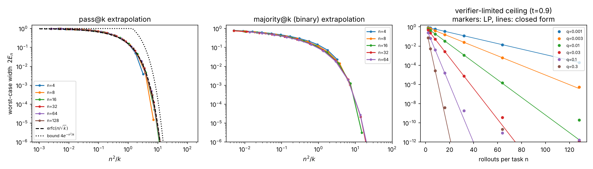
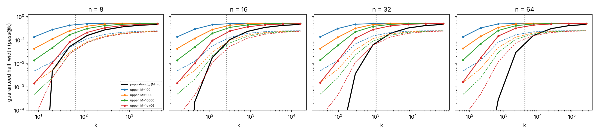

# How Far Can a Fixed-Rollout Evaluation See? Polynomial-Approximation Limits on Forecasting Test-Time-Compute Gains

**Target venue:** NeurIPS 2027 (main track; theory + evaluation methodology)

**Code and data:** `code/` (run instructions in `README.md`); every number below that is not attributed to a cited source was produced by that code and is stored under `results/`.

---

## Abstract

"How much more can test-time compute buy?" is usually answered by extrapolation. One draws *n* rollouts per task, fits a curve to pass@k, best-of-k or majority-vote accuracy for k ≤ n, and reads off the value at k ≫ n, or at k = ∞. We ask how far such an extrapolation can be trusted when the distribution F of per-task success probabilities is left unrestricted. We reduce the question to polynomial approximation. A fixed-n evaluation reveals F only through n moments. For any test-time-compute (TTC) functional θ = E_F[g(p)], the worst case over count laws of the identified-set width is therefore exactly 2E_n(g), where E_n is the error of the best uniform degree-n approximation to g on [0,1] (Theorem 1). This identity yields three quantitative laws. (i) **An n² horizon for pass@k.** The worst-case width for pass@k is pinned between Newman–Rivlin random-walk tail probabilities. It is at most 4e^{-n²/k}, and numerically it follows erfc(n/√k) (Theorem 2). Pass@k can thus be forecast without assumptions up to k ≈ n²/ln(4/δ), and no further than k = O(n²). Binary majority voting shows the same n²/k collapse numerically. (ii) **A closed form for verifier-limited ceilings.** If one resamples until a verifier with true-/false-positive rates (t, q) accepts, the worst-case width is exactly ((√t−√q)/(√t+√q))^n (Theorem 3). The number of rollouts needed to certify the ceiling therefore grows as √(t/q). Better verifiers raise the ceiling but make it harder to certify, and the perfect-verifier ceiling pass@∞ cannot be identified at all. (iii) **A finite-task gap.** With M tasks instead of the exact count law, rigorous Le Cam lower bounds show that the usable horizon is far shorter than the population n² law. At n = 64 and k = 689, the population worst-case half-width is 2.8×10⁻⁴, yet with M = 10⁶ tasks some count law forces any 95% interval to have expected half-width ≳ 10⁻². We provide two assumption-free finite-task procedures: a certified linear estimator and a simultaneous Clopper–Pearson "box" interval. On a CPU test bed with exactly known ceilings (WalkSAT on random 3-SAT, 240 instances × 3 configurations × 10,000 runs, ceiling = satisfiable fraction), beta-binomial and power-law extrapolations from n = 16 overestimate pass@1000 by 0.07–0.28 (mean over subsets). The beta-binomial model implies a ceiling of 1.0 and the power-law fit implies 0.86–1.00, against true ceilings of 0.55–0.85. The nonparametric intervals covered the truth in every one of the 840 evaluated (configuration, n, subset, target) cells.

## 中文摘要

"推理时计算还能带来多大提升"这一问题通常靠外推来回答：每个任务采样 n 次，用 k ≤ n 的 pass@k、best-of-k 或多数投票曲线拟合一条曲线，再读出 k ≫ n 乃至 k = ∞ 时的数值。本文研究的是：在不对任务成功概率分布 F 作任何参数假设时，这类外推最远能延伸到哪里。我们把这个问题化归为多项式逼近问题。固定 n 的评测只能通过 F 的前 n 阶矩来观察 F，因此对任意推理时计算泛函 θ = E_F[g(p)]，识别集宽度在所有计数分布上的最坏值恰好是 2E_n(g)，其中 E_n(g) 为 g 在 [0,1] 上的最佳 n 次一致逼近误差（定理 1）。由此得到三条定量规律。(i) pass@k 的 n² 视界：最坏情形宽度被 Newman–Rivlin 随机游走尾概率上下夹住，不超过 4e^{-n²/k}，数值上很接近 erfc(n/√k)（定理 2）。因此无需假设即可预测到 k ≈ n²/ln(4/δ)，而 k 一旦超过 O(n²) 就无法预测；二元多数投票在数值上呈现同样的 n²/k 坍缩。(ii) 验证器受限上限的闭式解：若反复采样直到真/假阳性率为 (t, q) 的验证器接受，最坏宽度恰为 ((√t−√q)/(√t+√q))^n（定理 3）。所需采样数随 √(t/q) 增长：验证器越好，上限越高，却越难认证；完美验证器下的上限 pass@∞ 完全不可识别。(iii) 有限任务数的落差：只有 M 个任务、不知道精确计数分布时，严格的 Le Cam 下界表明可用视界远短于总体的 n² 规律。例如 n = 64、k = 689 时，总体最坏半宽仅为 2.8×10⁻⁴；而即使有 M = 10⁶ 个任务，也存在某个计数分布，使任何 95% 区间的期望半宽都不低于约 10⁻²。我们给出两种无假设的有限样本方法：认证线性估计量与同时 Clopper–Pearson"盒"区间。我们在一个上限精确已知的 CPU 测试平台上作了检验（随机 3-SAT 上的 WalkSAT，3 种配置，各 240 个实例 × 10,000 次运行，上限即可满足实例的比例）。在该平台上，从 n = 16 出发的 beta-二项和幂律外推将 pass@1000 高估 0.07–0.28（子集平均）；beta-二项模型隐含的上限为 1.0，幂律拟合给出 0.86–1.00，而真实上限只有 0.55–0.85；非参数区间在全部 840 个（配置、n、子集、目标）评测单元中都覆盖了真值。

---

## 1 Introduction

Test-time compute (TTC) means spending more inference computation per query: many samples plus a verifier, majority voting, or longer reasoning. It has become a main axis of capability scaling. Repeated sampling lifts SWE-bench Lite solve rates from 15.9% with one sample to 56% with 250 samples, and coverage keeps rising over four orders of magnitude of samples [Brown et al., 2024]. Compute-optimal allocation of test-time compute can beat a 14× larger model on prompts of moderate difficulty [Snell et al., 2024]. Reinforcement-learned reasoners make long chains of thought a standard product feature [DeepSeek-AI, 2025]. The natural follow-up question, and the one this project series asks, is *how much more improvement test-time compute can still deliver.*

In practice that question is answered by **extrapolating a measured scaling curve**. An evaluation draws n rollouts per task, typically 16 to a few hundred. It estimates pass@k or majority-vote accuracy for k ≤ n with the unbiased estimator of Chen et al. [2021], then fits a functional form and reads off performance at much larger k, or the ceiling k → ∞. Brown et al. [2024] fit exponentiated power laws. Schaeffer et al. [2025] explain aggregate power laws through heavy-tailed per-task difficulty. Kazdan et al. [2025] fit a beta-binomial model to predict pass@k at k up to 10⁴ from small budgets. Levi [2024] gives a Beta-distribution model of inference scaling. These forecasts carry real stakes, because they inform whether to buy more inference or train a better model.

A September 2026 preprint [arXiv:2609.09245] showed that such extrapolations are **not identified** without assumptions. Fixed-n success counts reveal only n moments of F, so pass@k for k > n is only partially identified. That paper computed sharp population identified sets and left a tight finite-sample treatment as an open extension. Non-identification alone does not say *how fast* the identified set opens up as k grows past n, *which* TTC functionals stay predictable, or *how many tasks* a usable forecast requires. Those quantitative questions are what an evaluation designer needs, and they are what we answer.

**Sub-question.** Given n rollouts per task on M tasks and no parametric assumption on F, what is the largest TTC budget k, and which ceilings, for which a test-time-compute gain can be certified to within ±δ?

**Contributions.**

1. **An exact worst-case characterization (Theorem 1).** For every continuous TTC functional g, the largest identified-set width over all count laws equals 2E_n(g), the best uniform polynomial approximation error of degree n on [0,1]. The functional g can be pass@k, best-of-k with an imperfect verifier, majority@k, or a verifier-limited ceiling. Linear programs confirm the identity numerically to 6 digits in four cases.
2. **An n² horizon law for pass@k (Theorem 2).** By an even-polynomial reduction to the Newman–Rivlin theorem, the worst-case width of pass@k lies within constant factors of a random-walk tail probability. It is at most 4e^{-n²/k}, and it numerically equals erfc(n/√k) to within 0.035 (n ≥ 16). Without assumptions, pass@k can be forecast to ±δ up to k ≈ n²/ln(4/δ) (rigorous) or n²/[erfc⁻¹(δ)]² (empirical rule), and not beyond k = Θ(n²). Binary majority-vote accuracy shows the same n²/k data collapse numerically.
3. **A closed form for verifier-limited ceilings (Theorem 3).** Resample until a verifier with true-positive rate t and false-positive rate q accepts. The worst-case width of the ceiling is exactly r^n with r = (√t−√q)/(√t+√q). Certifying the ceiling to ±δ therefore takes n ≈ ½√(t/q)·ln(1/δ) rollouts, which gives a precise **predictability–ceiling trade-off**. Lowering q raises the attainable ceiling [Stroebl et al., 2024] but makes it harder to forecast, and at q = 0 (pass@∞) it cannot be forecast at all.
4. **A finite-task analysis.** We give (a) a certified linear estimator, with distribution-free Hoeffding guarantees, obtained by an LP that trades approximation bias against coefficient range, and (b) a simultaneous Clopper–Pearson box interval that adapts to the observed count law. We prove Le Cam χ² lower bounds by convex programming. They show that at realistic M the certifiable horizon is far shorter than the population n² law, and that the extrapolation problem is severely ill-conditioned.
5. **A test bed with exactly known ceilings.** On WalkSAT applied to random 3-SAT, every satisfiable instance has positive per-run success probability and every unsatisfiable one has zero. The true ceiling is therefore the satisfiable fraction, which we certify with an exact solver. On this test bed, standard parametric extrapolations badly overestimate further TTC gains, while the nonparametric intervals are valid but, at benchmark scale (M = 240), wide.

The substantive answer to "how much more can TTC give?" that follows from our results is a methodological one. **A fixed-n evaluation can speak, without assumptions, only about budgets up to roughly n² and about verifier ceilings with false-positive rate q ≳ 1/n². Claims beyond that range are claims about the prior on task difficulty, not about the data.** We give a reporting protocol (Section 7) and a pre-registered test for LLM data that we could not run here.

## 2 Related Work

**Inference-time scaling laws.** Brown et al. [2024] showed that coverage grows log-linearly with the number of samples across four orders of magnitude, and that majority voting and reward models plateau without an oracle verifier. Snell et al. [2024] studied compute-optimal allocation between search against process verifiers and sequential revision. Wu et al. [2024] and Chen et al. [2024] studied voting systems; Chen et al. found non-monotone accuracy in the number of calls, driven by heterogeneity of query difficulty. Schaeffer et al. [2025] showed that per-task exponential failure decay plus a heavy-tailed distribution of single-attempt success probabilities produces aggregate power laws, and proposed a forecasting method based on that tail. Levi [2024] derived power laws from a Beta-distributed difficulty model. Kazdan et al. [2025] fit a beta-binomial model with dynamic sample allocation to forecast pass@k up to 10⁴. These works all impose a parametric or tail-regularity assumption. Our results quantify how much of each forecast is assumption and how much is data.

**Imperfect verifiers.** Stroebl, Kapoor and Narayanan [2024] showed that when verifiers have false positives, resampling has an accuracy ceiling that no compute budget removes, and that weaker models cannot close the gap to stronger ones by resampling. We take their ceiling as a TTC functional and ask how well a fixed-n evaluation can certify it. The answer has a closed form (Theorem 3).

**Identification of pass@k.** The closest work is arXiv:2609.09245 ("What Fixed-Rollout pass@k Evaluations Can Identify", September 2026). It proves that fixed-n counts identify only n free moments, computes sharp population identified intervals through Hausdorff principal representations, and reports large ambiguity at k = 1000 from n = 16 on the public 10,000-sample release of Brown et al. It also gives a conservative one-coordinate finite-sample certificate and names full finite-sample treatment as an open extension. Our work is complementary and quantitative. We give the exact worst-case width for every TTC functional (Theorem 1), its rate in k and n (Theorem 2), a closed form for verifier ceilings (Theorem 3), finite-task upper and lower bounds, and a test bed with a known ceiling.

**Estimating populations of parameters and polynomial approximation in statistics.** Estimating the distribution of coin biases from t flips each is studied by Tian, Kong and Valiant [2017], who obtain O(1/t) Wasserstein error with method-of-moments LPs. Best polynomial approximation drives minimax rates for entropy estimation [Wu & Yang, 2016] and support-size estimation [Wu & Yang, 2019]. In both, the usable polynomial degree is limited by a variance–bias trade-off in the coefficients, which is the same mechanism behind our finite-task gap. The extrapolation side of our problem resembles unseen-species prediction, where Orlitsky, Suresh and Wu [2016] showed extrapolation is possible up to a logarithmic factor of the sample size. Our setting differs because each task gives a fixed-depth Binomial observation. For confidence statements under partial identification we adopt the coverage-of-the-parameter target of Imbens and Manski [2004].

**Approximation theory.** We use the Newman–Rivlin theorem on approximating monomials [Newman & Rivlin, 1976], its quantitative restatement by Saibaba [2021], the Chernoff-based construction of Sachdeva and Vishnoi [2014], and Chebyshev's explicit best approximation of 1/(x−a) as stated by Meinardus [1967] and Kraus, Vassilevski and Zikatanov [2012].

## 3 Setup

Tasks i = 1, …, M have latent per-rollout success probabilities p_i drawn i.i.d. from an unknown distribution F on [0,1]. This is the random-task model; Section 5 also covers fixed tasks. An evaluation draws n i.i.d. rollouts per task and records X_i ~ Binomial(n, p_i). The **count law** is π_F(x) = ∫ b_{n,x}(p) dF(p), x = 0, …, n, with b_{n,x}(p) = C(n,x) p^x (1−p)^{n−x}. A **TTC functional** is θ_g(F) = E_F[g(p)] for a known g: [0,1] → [0,1]. Our targets are:

| target | g(p) |
|---|---|
| pass@k (oracle verifier) | 1 − (1−p)^k |
| pass@∞ (perfect-verifier ceiling) | 1{p > 0} |
| verifier ceiling (resample until accept; TPR t, FPR q) | t p / (t p + q(1−p)) |
| best-of-k with verifier (uniform choice among accepted, fail if none) | [1 − (1−r)^k]·t p / r, with r = t p + q(1−p) |
| binary majority@k (k odd) | P(Binomial(k,p) > k/2) |

The verifier model treats each task's correctness as one Bernoulli(p) per rollout, with an independent verifier coin that accepts correct outputs with probability t and incorrect ones with probability q. The model is homogeneous in (t, q); Section 8 discusses heterogeneous verifiers. The **identified set** for θ_g at count law π is I_n(g; π) = {θ_g(F) : π_F = π}. Let 𝒫_n denote polynomials of degree ≤ n, and let E_n(g) = inf_{P∈𝒫_n} sup_{p∈[0,1]} |g(p) − P(p)|.

## 4 Population Theory

**Lemma 0 (moment structure).** The functions b_{n,0}, …, b_{n,n} form a basis of 𝒫_n (the Bernstein basis). Hence the count law π_F determines ∫P dF for every P ∈ 𝒫_n, and conversely.

**Theorem 1 (worst-case width equals twice the best-approximation error).** For every continuous g on [0,1] and every count law π, diam I_n(g; π) ≤ 2E_n(g), and

  sup_π diam I_n(g; π) = 2E_n(g).

*Proof.* Upper bound: let P = Σ_x h_x b_{n,x} attain E_n(g). For any F with π_F = π, θ_g(F) lies within E_n(g) of ∫P dF = Σ_x h_x π(x), which is the same for every F in the identified set. Sharpness: C[0,1] has dual space the signed Radon measures with total-variation norm. For the closed subspace 𝒫_n, the Hahn–Banach duality formula gives dist(g, 𝒫_n) = sup{∫g dσ : ‖σ‖_TV ≤ 1, σ ⊥ 𝒫_n}. Take a near-optimal σ and scale it so that ‖σ‖_TV = 2. Because 1 ∈ 𝒫_n, σ has zero total mass, so σ⁺ and σ⁻ have equal mass a ≤ 1. Set μ = σ⁺ + (1−a)δ₀ and ν = σ⁻ + (1−a)δ₀. These are probability measures with μ − ν ⊥ 𝒫_n, so by Lemma 0 they have the same count law, and ∫g dμ − ∫g dν = ∫g dσ → 2E_n(g). ∎

*Numerical check (code: `exp_theory.py`).* We solved the worst-case LP max_{μ,ν} ∫g d(μ−ν) subject to equal count laws, on a 1,900-point grid, and computed 2E_n by a Chebyshev-basis LP. For pass@64 at n = 8 the two values were 0.16216 and 0.16216; for pass@256 at n = 16, 0.16387 and 0.16388; for the verifier ceiling at q = 0.01, t = 0.9, n = 8, 0.18400 and 0.18400; for majority@65 at n = 8, 0.11691 and 0.11692 (`results/theory_duality_check.json`).

**Corollary 1 (the perfect-verifier ceiling is never identified).** For g = 1{p>0}, E_n(g) = 1/2 for every n, so the worst-case width is 1. More strongly, for any F and any ε > 0 there is a G with TV(π_F, π_G) ≤ ε and θ(G) = 1. To build G, move F's atom at 0 to a point η with nη·F({0}) ≤ ε, using TV(b_n(0), b_n(η)) = 1−(1−η)^n ≤ nη. No finite-sample procedure can therefore certify an upper bound below 1 on pass@∞. (Population non-identification of pass@∞ also follows from arXiv:2609.09245; the finite-sample form is the point here.)

**Theorem 2 (n² horizon for pass@k).** Let ρ_{N,m} = P(|S_N| > m), where S_N is the difference between heads and tails in N fair coin tosses. For k > n,

  ρ_{2k,2n}/(4e) ≤ E_n(1−(1−p)^k) ≤ min{ρ_{2k,2n}, 2e^{−n²/k}}.

*Proof.* Substituting p → 1−p preserves 𝒫_n, so E_n(1−(1−p)^k) = E_n(y^k) on y ∈ [0,1]. Put y = z² with z ∈ [−1,1]. A degree-n polynomial Q(y) corresponds to the even degree-2n polynomial Q(z²). Conversely, the best degree-2n approximation to the even function z^{2k} on [−1,1] can be taken even, because symmetrizing P(z) ↦ (P(z)+P(−z))/2 does not increase the error. Hence E_n^{[0,1]}(y^k) = E_{2n}^{[−1,1]}(z^{2k}). Newman and Rivlin [1976, Thm. 2], as restated by Saibaba [2021], bound the best degree-m approximation error of x^N on [−1,1] between ρ_{N,m}/(4e) and ρ_{N,m}. Apply this with N = 2k and m = 2n. The exponential bound is Sachdeva–Vishnoi [2014, Thm. 3.2] with s = 2k and d = 2n: 2e^{−(2n)²/(2·2k)} = 2e^{−n²/k}. ∎

By the de Moivre–Laplace approximation, ρ_{2k,2n} ≈ erfc(n/√k), so the width depends on (n, k) essentially only through n²/k. Numerically (Fig. 1, left; `results/theory_passk_with_rho.csv`), E_n/ρ_{2k,2n} ∈ [0.52, 1.00] over all 73 computed cells with n ∈ {4, …, 128}, k up to 2×10⁶ and E_n > 10⁻⁵. Also, 2E_n is within 0.035 (absolute) of erfc(n/√k) for n ≥ 16, so **worst-case width ≈ erfc(n/√k)**.

**Corollary 2 (forecast horizon).** The worst-case pass@k width is at most δ whenever k ≤ n²/ln(4/δ), which is rigorous. Under the empirical erfc law it is at most δ up to k ≈ n²/[erfc⁻¹(δ)]². For δ = 0.01 these give k ≤ 42 (rigorous) and 77 (erfc rule) at n = 16, 683 and 1,234 at n = 64, and 10,938 and 19,754 at n = 256 (`results/theory_horizon.csv`). Conversely, by the lower bound, at k = n² the worst-case width is still at least 2ρ_{2k,2n}/(4e) ≈ 2·0.157/10.9 ≈ 0.029.

The bound gives a concrete reading of a known observation. In arXiv:2609.09245, n = 16 left failure at k = 1000 ambiguous by large factors. Here n²/k = 0.256, which is deep in the regime where Theorem 2 says no assumption-free forecast exists.

**Theorem 3 (verifier-limited ceiling, closed form).** For 0 < q < t ≤ 1 and g_{t,q}(p) = tp/(tp + q(1−p)),

  E_n(g_{t,q}) = ½ r^n,  r = (√t − √q)/(√t + √q),

so the worst-case width is r^n.

*Proof.* Write a = q/(t−q). Then g = (t/(t−q))(1 − a/(p+a)). With x = 2p−1 ∈ [−1,1], 1/(p+a) = 2/(x+c) with c = 1+2a > 1. Chebyshev's explicit best approximation of 1/(x−c) [Meinardus, 1967; restated as Thm. A.1 in Kraus et al., 2012], together with the reflection x → −x, gives E_n(1/(x+c)) = (c−√(c²−1))^n/(c²−1). Since c² − 1 = 4a(1+a) and 1+a = t/(t−q), we get E_n(g) = (t/(t−q))·a·2·(c−√(c²−1))^n/(4a(1+a)) = ½(c−√(c²−1))^n. Finally c − √(c²−1) = (t+q−2√(tq))/(t−q) = (√t−√q)/(√t+√q). ∎

*Numerical check.* LP values of E_n agree with the closed form to relative error < 0.33% wherever E_n > 10⁻⁵ (q ∈ {0.001, …, 0.3}, n ≤ 128; Fig. 1 right; `results/theory_checks.json`). Below 10⁻⁵ the LP solver's tolerance dominates.

**Corollary 3 (predictability–ceiling trade-off).** The worst-case ceiling width is at most δ iff n ≥ ln(1/δ)/ln(1/r). Since ln(1/r) = 2√(q/t) + O((q/t)^{3/2}), this is n ≈ ½√(t/q) ln(1/δ). For t = 0.9 and δ = 0.01: q = 0.1 needs n ≈ 7 rollouts per task, q = 0.01 needs ≈ 22, and q = 0.001 needs ≈ 70. As q → 0, r → 1, and we recover Corollary 1. **Halving a verifier's false-positive rate raises the resampling ceiling but multiplies the evaluation depth needed to certify it by √2.**

**Best-of-k with a verifier.** For finite k with q > 0, the computed E_n (n = 16, t = 0.9; `results/theory_En.csv`) first grows like the pass@k law and then saturates at the closed-form ceiling value ½r^n once k ≫ 1/q. For q = 0.01, E_16 = 7.7×10⁻⁴ at k = 64, 1.5×10⁻² at k = 256, and 1.69×10⁻² for all k ≥ 1024 (closed form: 1.69×10⁻²). For q = 0 it keeps growing (0.46 at k = 16,384). Imperfect verifiers thus *cap the unpredictability* as well as the accuracy.

**Majority voting.** For binary majority@k, the computed worst-case widths for n ∈ {4, …, 64} collapse onto one curve in n²/k (Fig. 1, middle); for example, E_n = 0.058 (n = 8, n²/k = 0.98) and 0.063 (n = 16, n²/k = 0.82), versus 0.036 (n = 32) and 0.033 (n = 64) at n²/k ≈ 1.3–1.4 (`results/theory_En.csv`). Its k → ∞ limit 1{p > 1/2} has an interior discontinuity, so E_n = 1/2 and the worst case is again unidentified. We state the majority-vote collapse as an empirical finding; we do not prove it. It restricts to the binary case (one wrong answer). Multi-answer plurality voting depends on a multivariate latent and is outside our scope.

*Figure 1. Worst-case identified-set width 2E_n(g). Left: pass@k collapses onto erfc(n/√k) (dashed), below the rigorous bound 4e^{−n²/k} (dotted). Middle: binary majority@k shows the same n²/k collapse. Right: verifier-limited ceiling at t = 0.9; markers are LP values, lines are the closed form r^n of Theorem 3. Computed values below about 10⁻⁷ reflect the LP solver's tolerance floor.*

## 5 Finite-Task Inference

Real evaluations observe M tasks, not π. Each procedure below is valid without assumptions on F. Validity is stated for the random-task estimand E_F[g]. Because Hoeffding's inequality applies to independent, non-identical variables, procedure 5.1 is also valid for the benchmark-specific estimand M⁻¹Σ_i g(p_i).

**5.1 Certified linear estimator.** For Bernstein coefficients h ∈ ℝ^{n+1}, let θ̂_h = M⁻¹Σ_i h[X_i]. Then E[h[X_i] | p_i] = P_h(p_i) with P_h = Σ_x h_x b_{n,x}, and with probability ≥ 1 − α,

  |θ̂_h − θ| ≤ bias(h) + range(h)·√(ln(2/α)/(2M)),  bias(h) = sup_{[0,1]} |g − P_h|.

We choose h by an LP that minimizes the right-hand side on a grid of 1,900–3,400 points clustered at the endpoints. We then re-verify bias(h) on a 260,000-point grid (uniform, Chebyshev and log-spaced down to 10⁻¹²). Finally we add a rigorous between-grid-point slack: ½·gap·(|g′| + n·max|Δh|), using the Bernstein derivative formula and the fact that |g′| is non-increasing for pass@k, the ceiling, and best-of-k. The minimized bound R_up(n, k, M) depends only on (n, k, M), which makes it a **design tool**: it says before any data are collected what guarantee a planned evaluation can deliver.

**5.2 Simultaneous box interval.** Form Bonferroni-corrected Clopper–Pearson intervals [l_x, u_x] for all n+1 cells of the empirical count histogram, each at level α/(n+1). Then optimize θ_g(F) over distributions F on a grid of p-values whose count law lies in the box. The simultaneous box contains π with probability ≥ 1 − α, so the resulting interval contains θ with probability ≥ 1 − α. One caveat applies: F is restricted to a grid that includes log-spaced points down to 10⁻⁹, which can make the computed interval slightly narrower than the exact one (see Limitations). Unlike 5.1, the box interval adapts to the observed count law.

**5.3 Lower bounds.** For a reference law F₀ with count law Q, we solve the convex program

  Δ = max_F |θ_g(F) − θ_g(F₀)|  s.t.  χ²(π_F ‖ Q) ≤ 1/(8M).

Then H²(π_F^{⊗M}, Q^{⊗M}) ≤ M·χ² ≤ 1/8 and TV ≤ 0.354. Any procedure with 95% coverage under both laws must contain both values of θ with probability ≥ 0.95 − 0.354 − 0.05 = 0.546 under F, so its expected half-width is at least R_lo = 0.273Δ. Numerical solutions are repaired a posteriori to stay rigorous. If a returned solution violates the χ² constraint by a factor ρ > 1, we replace F by the mixture (1−λ)F₀ + λF with λ = ρ^{−1/2}; its count law and θ move linearly in λ, so the repaired pair is feasible. We take the maximum over three reference laws (uniform, Beta(0.3,3), and 0.3δ₀ + 0.7·Beta(0.5,2)). An independent and cruder LP bound, using the TV modulus with TV ≤ 1/(2M), agrees in order of magnitude (`results/design_bounds.csv`).

**Result: a large finite-task gap (Fig. 2, `results/design_bounds.csv`, `results/design_horizon.csv`).** Selected values (half-widths for pass@k, α = 0.05):

| n | k | n²/k | population E_n (M = ∞) | R_lo, M = 10⁴ | R_up, M = 10⁴ | R_lo, M = 10⁶ | R_up, M = 10⁶ |
|---|---|---|---|---|---|---|---|
| 16 | 43 | 6.0 | 2.3×10⁻⁴ | 0.0021 | 0.050 | 0.00044 | 0.010 |
| 16 | 116 | 2.2 | 1.8×10⁻² | 0.021 | 0.192 | 0.011 | 0.095 |
| 32 | 283 | 3.6 | 3.6×10⁻³ | 0.023 | 0.222 | 0.011 | 0.119 |
| 64 | 210 | 19.5 | 2.9×10⁻⁸ | 0.0024 | 0.069 | 0.00049 | 0.017 |
| 64 | 689 | 5.9 | 2.8×10⁻⁴ | 0.029 | 0.254 | 0.0117 | 0.147 |

Three things stand out. First, **at fixed M, the guaranteed half-width depends far more on k than on n.** With M = 10⁴, R_up ≈ 0.05–0.07 at k ≈ 3n for n = 16 through 64 (Fig. 2). At M = 10⁶ and δ = 0.02, the largest certified k on our grid is 43, 95 and 210 for n = 16, 32 and 64, which is 2.7n–3.3n. The next grid points (116, 283, 689) are not certified. The population law admits k ≈ 0.3n², that is 77, 308 and 1,234 (`results/design_horizon.csv`). Second, the rigorous lower bounds exceed the population width by large factors. At n = 64 and k = 689, there is a pair of laws for which any procedure with 95% coverage, using M = 10⁶ tasks, has expected half-width ≥ 0.0117, about 41× the population worst-case half-width of 2.8×10⁻⁴. At n = 64 and k = 210, the population half-width is 3×10⁻⁸, yet the lower bound at M = 10⁶ is 4.9×10⁻⁴. Third, the identified set is extremely ill-conditioned. At n = 64, perturbing the count law by a χ² distance of only 1/(8M) = 1.25×10⁻⁷ moves the extrapolated pass@689 by Δ = R_lo/0.273 ≈ 0.043. The mechanism is the one known from polynomial-approximation estimators of entropy and support size [Wu & Yang, 2016; 2019]. Degree-n approximants of (1−p)^k with small bias have Bernstein coefficients with ranges of roughly 5 to 25 (`range` column of `results/design_bounds.csv`), so their linear estimators have large variance, and nonlinear procedures cannot escape this by the lower bound. **The n² law is the population horizon; at benchmark scale the usable horizon is a small multiple of n.** Upper and lower bounds differ by a factor of about 5–35 across the table, and closing that gap remains open.

*Figure 2. Guaranteed half-width for pass@k as a function of k. Black: population E_n (M = ∞). Solid colored: certified linear estimator R_up (upper bound on what is achievable). Dashed: χ²/Le Cam lower bound R_lo for M ∈ {10², 10³, 10⁴, 10⁶}. Dotted vertical line: k = n².*

## 6 Experiments

### 6.1 Synthetic misspecification study

We draw p_i from four mixing laws (code: `exp_synthetic.py`): Beta(0.3,3) (heavy mass near 0); 0.3δ₀ + 0.7·Beta(0.5,2) (30% unsolvable); 0.3δ_{10⁻³} + 0.7·Beta(0.5,2) (30% "hidden solvable"); and LogitNormal(−3, 2.5). The second and third laws are nearly indistinguishable at n = 16 but differ by 0.19 in pass@1024. For n = 16 we use M ∈ {500, 5,000}, and for n = 64 we use M = 5,000. Each configuration has 100 replications (box intervals: 100 for n = 16, 25 for n = 64). We compare: the certified linear estimator (5.1); the box interval (5.2); the beta-binomial MLE extrapolation in the style of Kazdan et al. [2025], with a 30-draw parametric-bootstrap 95% interval in the first 50 replications at n = 16; and a power-law fit of log(1−pass@k) against log k over k ≤ n in the style of Brown et al. [2024] and Schaeffer et al. [2025]. Targets are pass@k for k ∈ {2n, 8n, n²/4, n², 4n²} and the verifier ceiling (t = 0.9, q = 0.01). The "population identified interval" uses the exact count law.

*Results (`results/synthetic_summary.csv`).*

- **Validity.** The certified linear estimator covered the true value in 7,198 of 7,200 (replication, target) cells (99.97%; nominal 95%). The box interval covered it in all 5,400 cells where it was computed.
- **Width.** Both intervals are wide wherever Theorem 2 and Section 5 predict. At n = 16 and M = 5,000, the certified half-width is 0.039 at k = 32, 0.115 at k = 64, 0.231 at k = 128 and 0.468 at k = 1024. The box half-width adapts to F and is often smaller: for example, 0.17–0.20 at k = 128 versus 0.231 for the certified estimator.
- **Parametric extrapolation is accurate only when its model is true.** Under the well-specified Beta(0.3,3), the beta-binomial bias is ≤ 0.002 and its bootstrap interval covers 91% of the time. Under the three misspecified laws, coverage drops to 32% (hidden-solvable), 16% (30% unsolvable) and 9% (logit-normal). The direction of the bias depends on the law. At n = 16, M = 5,000 and k = 1024, the bias is +0.148 with unsolvable mass and −0.112 for the logit-normal. At n = 64, M = 5,000 and k = 16,384, it is +0.196 with unsolvable mass. The power-law fit is biased even under the Beta law (−0.105 at k = 1024) because the Beta tail is not a pure power law at finite k. The bias does not shrink with M, so more tasks make these forecasts *more* confidently wrong.
- **Two nearly indistinguishable laws.** The 30%-unsolvable and 30%-hidden-solvable laws have population identified intervals for pass@1024 at n = 16 of [0.603, 0.958] and [0.633, 0.981]. These overlap almost entirely, while the true values are 0.671 and 0.863. Any method that returns a point forecast here is choosing between them by assumption.
- **Verifier ceiling (t = 0.9, q = 0.01).** Theorem 3 gives a worst-case width of r^n = 0.034 at n = 16 and 1.3×10⁻⁶ at n = 64. Accordingly, the certified half-width falls from 0.130 (n = 16) to 0.029 (n = 64) at M = 5,000, and the population identified intervals at n = 64 have width ≤ 0.001.

### 6.2 WalkSAT test bed with exactly known ceilings

*Why this test bed.* Evaluating ceiling forecasts needs ground truth at k = ∞, which LLM benchmarks do not provide. WalkSAT [Selman, Kautz & Cohen, 1994] is a stochastic local-search "generator" whose per-run success probability is positive on every satisfiable instance and zero on every unsatisfiable one. Satisfiability is decided exactly by a complete solver (MiniSat 2.2 via PySAT). The ceiling pass@∞ is therefore the satisfiable fraction, a known number.

*Setup (code: `run_walksat.py`, `walksat.c`, `exp_walksat.py`).* We used three configurations of 240 uniformly random 3-SAT instances each, at noise 0.5, with 10,000 independent WalkSAT runs per instance (7.2 million runs in total):

- A: 75 variables, clause ratio 4.26, 300 flips per run;
- B: 75 variables, ratio 4.26, 3,000 flips;
- C: 150 variables, ratio 4.10, 1,000 flips.

The satisfiable fractions are 0.592, 0.550 and 0.854. In all three configurations, every satisfiable instance had at least one success in 10,000 runs and no unsatisfiable instance had any (`results/walksat_check_*.json`). The smallest per-instance success rates among satisfiable instances were 0.0094 (A), 0.0898 (B) and 0.0017 (C). Ground-truth pass@k for k ≤ 2000 uses the unbiased estimator on all 10,000 runs.

*Protocol.* For n ∈ {8, 16, 32, 64} we form 10 disjoint counterfactual evaluations of n runs per instance. We report: the box interval (95%); the beta-binomial and power-law extrapolations; and an **oracle identified interval**, which is the sharp population interval for the benchmark's own count law (computed from the 10,000-run p̂_i) and isolates identification from sampling error.

*Results (`results/walksat_summary.csv`, Fig. 3).*

- **Parametric extrapolation overestimates further TTC gains.** From n = 16, the beta-binomial forecast of pass@1000 exceeds the truth by +0.281 (A), +0.131 (B) and +0.105 (C), averaged over 10 subsets. The power-law forecast exceeds it by +0.213, +0.086 and +0.068. The beta-binomial model implies a ceiling of exactly 1.0. The power-law fit at n = 16, evaluated at k = 10¹², gives 0.998 (A), 0.858 (B) and 1.000 (C). The true ceilings are 0.592, 0.550 and 0.854. They therefore predict substantial further gains from more sampling where none exist: in configuration A the true pass@k is flat at 0.59 beyond k ≈ 300. The misspecification error does not vanish with depth. At n = 64 the beta-binomial still overestimates pass@1000 by +0.228 (A).
- **The oracle identified intervals behave as Theorem 2 predicts.** They are tight well beyond n and open up near k ≈ n². In A at n = 16: pass@100 lies in [0.588, 0.594], pass@300 in [0.588, 0.628], pass@1000 in [0.588, 0.726] and pass@2000 in [0.588, 0.823]. In A at n = 64: pass@2000 lies in [0.592, 0.600]. The pass@∞ upper end is 1.0 in every case (Corollary 1). The oracle lower end, however, is informative, because the data rule out a ceiling below the already-observed coverage.
- **The finite-sample box intervals covered the truth in all 840 (configuration, n, subset, target) cells** but are wide at M = 240. In A at n = 64, pass@100 lies in [0.478, 0.725]; the verifier ceiling lies in [0.426, 0.697] (truth 0.555). This is the finite-task gap of Section 5 at benchmark scale.

*Figure 3. WalkSAT test bed, counterfactual n = 16 evaluation (first subset). Black: truth from 10,000 runs. Dotted: true ceiling (satisfiable fraction). Orange and green: beta-binomial and power-law extrapolations. Blue band: 95% nonparametric box interval. Vertical lines: k = n and k = n².*

## 7 Discussion: what this says about "how much more can TTC give?"

**A forecast is mostly prior beyond k ≈ n².** Typical reports use n = 16 to 200 rollouts and extrapolate to 10³–10⁴. Theorem 2 implies that for n = 16 and k = 1000 the data constrain pass@k only up to a worst-case width of about erfc(0.51) ≈ 0.47. A specific curve inside that range is selected by the parametric family. On our test bed, the families now in use (beta-binomial, power law) always selected the optimistic end, because they place no mass at p = 0 and impose smooth tails. Optimism follows whenever a benchmark has a non-trivial fraction of tasks that the generator cannot solve, as with unsatisfiable instances here or tasks beyond a model's knowledge for LLMs. The forecasts are biased toward "more compute will keep helping."

**Better verifiers make the ceiling higher but harder to certify.** Theorem 3 makes the relationship exact. The number of rollouts needed to certify the resampling ceiling scales as √(t/q). Investing in verifiers [Stroebl et al., 2024] should therefore be paired with deeper evaluations, by a factor of √10 ≈ 3.2 for every 10× reduction in false-positive rate.

**Benchmark size matters more than rollout depth for extrapolation.** Section 5 shows that, at M ≤ 10⁶, the certifiable horizon grows slowly with n. For forecasting, the binding resource is the number and composition of tasks. Adaptive designs that concentrate rollouts on unsolved tasks, as in the dynamic sampling of Kazdan et al. [2025], change the observation model and are a promising escape. A direct one: running each task until its first success, capped at D rollouts, identifies pass@k for all k ≤ D exactly, at an expected cost of Σ_{j<D}(1 − pass@j) rollouts per task.

**Reporting protocol.** For any TTC forecast we suggest reporting:

1. n, M and n²/k for each extrapolated k;
2. the assumption-free interval (the box interval, or the population identified interval if M is large) next to any parametric forecast;
3. for verifier-based ceilings, (t, q) estimates and n·√(q/t);
4. never an upper bound on pass@∞ from fixed-n data.

**Pre-registered test on LLM data (not run here).** We had no network access to model-sample releases and no GPU or API access. We pre-register the following protocol for the public 10,000-sample-per-problem release of Brown et al. [2024]:

- (P1) for each configuration, subsample n ∈ {16, 32, 64, 128} and compute the box interval and the oracle identified interval for pass@k, k ∈ {n, 4n, n²/4, n², 4n²};
- (P2) check implied by the theorems: the oracle identified width at k = n²/4 can never exceed the worst-case value 2E_n ≈ erfc(2) ≈ 0.005. We further predict it will be far below that value on configurations whose solved tasks have per-sample success rates well above 1/n;
- (P3) prediction: beta-binomial forecasts at k = 4n² lie above the 10,000-sample truth on configurations with an unsolved fraction > 5%.

P2 is a theorem (the oracle width cannot exceed 2E_n), so a violation would indicate a bug or a failure of the i.i.d. rollout model. P3 is an empirical prediction that can fail.

## 8 Limitations

- **The model is exchangeable i.i.d. rollouts with a scalar latent p per task.** Rollout correlations, such as shared seeds or temperature schedules, and sequential TTC (longer chains, revisions) are not covered. Neither is plurality voting over many answers, which needs a multivariate latent.
- **The verifier model is homogeneous: one (t, q) for all tasks, independent of the rollout.** Stroebl et al. [2024] found that false-positive rates correlate with model strength and task, and per-task verifier rates make the ceiling a functional of a two-dimensional latent. Theorem 3 does not cover that case.
- **Theorem 2's two-sided bound has a constant-factor gap (1/(4e) versus 1).** The erfc law is an empirical fit, accurate to 0.035 for n ≥ 16 on our grid, not a theorem. The majority-vote collapse is numerical only.
- **The finite-task bounds are not tight.** Upper and lower bounds differ by up to about an order of magnitude. The lower bounds are worst-case over a neighborhood of three reference laws and use conservative Le Cam constants. The linear estimator is minimax-style and can be much more conservative than necessary for benign F. Sharper adaptive procedures, such as a full simultaneous count-law region with a tighter divergence, are an open problem.
- **The box interval and the LPs restrict F to a finite grid of p-values.** The grid includes points down to 10⁻⁹ but can still make computed intervals slightly too narrow. The certified linear estimator does not have this issue because it uses explicit a-posteriori grid slack. Two of the 144 oracle LP solves on the WalkSAT test bed failed numerically and are reported as missing.
- **The test bed is not an LLM.** WalkSAT on random 3-SAT gives a heterogeneous generator with exact ceilings, but its difficulty distribution (a point mass at 0 plus a bounded-away-from-0 continuous part for satisfiable instances) need not resemble LLM benchmarks. The direction of the parametric bias we observed is tied to the presence of unsolvable tasks. We have not shown it on LLM data, and Section 7 gives the protocol for doing so.
- **Parametric bias is shown only on synthetic laws and one non-LLM test bed.** The synthetic results show the sign of the bias depends on the law.
- **No evaluation of the more expressive parametric models in recent literature.** Beta mixtures and hierarchical priors may be less biased than the single Beta. Theorems 1–3 still bound what any of them can *learn from data*, as opposed to assume.

## 9 Conclusion

Asking how much more test-time compute can deliver amounts, in practice, to extrapolating a scaling curve, so the question splits into what the data identify and what the assumptions add. For any test-time-compute functional, a fixed-n evaluation's worst-case ambiguity is exactly twice a best polynomial-approximation error. This yields an n² horizon for pass@k, a closed-form √(t/q) depth requirement for verifier-limited ceilings, and the non-identifiability of the perfect-verifier ceiling. With finitely many tasks the usable horizon shrinks much further. On a test bed where the ceiling is known exactly, popular parametric forecasts predicted large further gains that did not exist, while assumption-free intervals remained valid. Answers to "how much more" should come with the evaluation depth that supports them.

## References

(Every entry below was checked to exist via web search during this work; arXiv identifiers or DOIs are given where available.)

- [arXiv:2609.09245] *What Fixed-Rollout pass@k Evaluations Can Identify.* arXiv:2609.09245, September 2026. (Author list not retrieved: arxiv.org was not reachable from this environment. Title, abstract and date were verified through a web-extraction service.)
- Brown, B., Juravsky, J., Ehrlich, R., Clark, R., Le, Q. V., Ré, C., & Mirhoseini, A. (2024). Large Language Monkeys: Scaling Inference Compute with Repeated Sampling. arXiv:2407.21787.
- Chen, L., Davis, J. Q., Hanin, B., Bailis, P., Stoica, I., Zaharia, M., & Zou, J. (2024). Are More LLM Calls All You Need? Towards the Scaling Properties of Compound AI Systems. NeurIPS 2024. arXiv:2403.02419.
- Chen, M., et al. (2021). Evaluating Large Language Models Trained on Code. arXiv:2107.03374.
- Clopper, C. J., & Pearson, E. S. (1934). The use of confidence or fiducial limits illustrated in the case of the binomial. *Biometrika*, 26(4), 404–413.
- Cobbe, K., et al. (2021). Training Verifiers to Solve Math Word Problems. arXiv:2110.14168.
- DeepSeek-AI (Guo, D., Yang, D., Zhang, H., et al.) (2025). DeepSeek-R1 incentivizes reasoning in LLMs through reinforcement learning. *Nature*, 645, 633–638. arXiv:2501.12948.
- Hoeffding, W. (1963). Probability inequalities for sums of bounded random variables. *Journal of the American Statistical Association*, 58(301), 13–30.
- Imbens, G. W., & Manski, C. F. (2004). Confidence Intervals for Partially Identified Parameters. *Econometrica*, 72(6), 1845–1857.
- Kazdan, J., Schaeffer, R., Allouah, Y., Sullivan, C., Yu, K., Levi, N., & Koyejo, S. (2025). Efficient Prediction of Pass@k Scaling in Large Language Models. arXiv:2510.05197.
- Kraus, J., Vassilevski, P., & Zikatanov, L. (2012). Polynomial of best uniform approximation to 1/x and smoothing in two-level methods. *Computational Methods in Applied Mathematics*, 12(4), 448–468. arXiv:1002.1859.
- Levi, N. (2024). A Simple Model of Inference Scaling Laws. arXiv:2410.16377 (ICML 2025).
- Meinardus, G. (1967). *Approximation of Functions: Theory and Numerical Methods.* Springer Tracts in Natural Philosophy, vol. 13. Springer.
- Newman, D. J., & Rivlin, T. J. (1976). Approximation of monomials by lower degree polynomials. *Aequationes Mathematicae*, 14, 451–455.
- Orlitsky, A., Suresh, A. T., & Wu, Y. (2016). Optimal prediction of the number of unseen species. *PNAS*, 113(47), 13283–13288.
- Sachdeva, S., & Vishnoi, N. K. (2014). Faster Algorithms via Approximation Theory. *Foundations and Trends in Theoretical Computer Science*, 9(2), 125–210. arXiv:1309.4882.
- Saibaba, A. K. (2021). Approximating monomials using Chebyshev polynomials. arXiv:2101.06818.
- Schaeffer, R., Kazdan, J., Hughes, J., Juravsky, J., Price, S., Lynch, A., Jones, E., Kirk, R., Mirhoseini, A., & Koyejo, S. (2025). How Do Large Language Monkeys Get Their Power (Laws)? ICML 2025. arXiv:2502.17578.
- Selman, B., Kautz, H. A., & Cohen, B. (1994). Noise Strategies for Improving Local Search. *Proceedings of AAAI-94*, 337–343.
- Snell, C., Lee, J., Xu, K., & Kumar, A. (2024). Scaling LLM Test-Time Compute Optimally can be More Effective than Scaling Model Parameters. arXiv:2408.03314 (ICLR 2025).
- Stroebl, B., Kapoor, S., & Narayanan, A. (2024). Inference Scaling fLaws: The Limits of LLM Resampling with Imperfect Verifiers. arXiv:2411.17501 (later titled "The Limits of Inference Scaling Through Resampling", ICLR 2026).
- Tian, K., Kong, W., & Valiant, G. (2017). Learning Populations of Parameters. NeurIPS 2017. arXiv:1709.02707.
- Wang, X., Wei, J., Schuurmans, D., Le, Q., Chi, E., & Zhou, D. (2022). Self-Consistency Improves Chain of Thought Reasoning in Language Models. arXiv:2203.11171 (ICLR 2023).
- Wu, Y., & Yang, P. (2016). Minimax rates of entropy estimation on large alphabets via best polynomial approximation. *IEEE Transactions on Information Theory*, 62(6), 3702–3720.
- Wu, Y., & Yang, P. (2019). Chebyshev polynomials, moment matching, and optimal estimation of the unseen. *Annals of Statistics*, 47(2), 857–883.
- Wu, Y., Sun, Z., Li, S., Welleck, S., & Yang, Y. (2024). Inference Scaling Laws: An Empirical Analysis of Compute-Optimal Inference for Problem-Solving with Language Models. arXiv:2408.00724.
