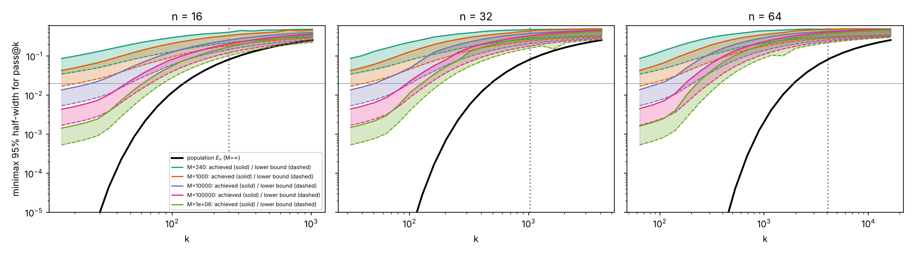
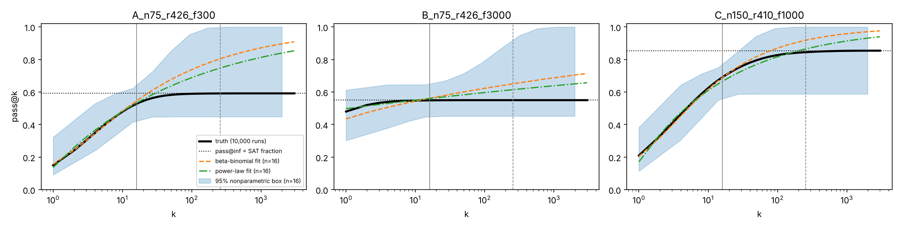
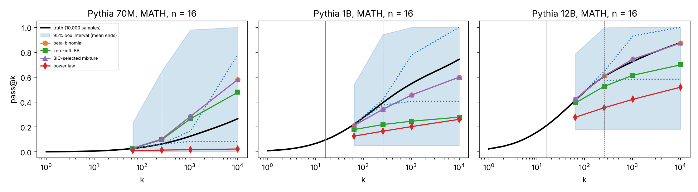

# How Far Can a Fixed-Rollout Evaluation See? Polynomial-Approximation and Minimax Limits on Forecasting Test-Time-Compute Gains

**Target venue:** NeurIPS 2027 (main track; theory + evaluation methodology)

**Code and data:** `code/` (run instructions in `README.md`). Every number below that is not attributed to a cited source was produced by that code and is stored under `results/`. The LLM data (Section 6.3) are public per-problem success counts from the Large Language Monkeys release [Brown et al., 2024], obtained from the public code release of Schaeffer et al. [2025]; provenance is in Section 6.3.

**Revision note (r1).** This version replaces the finite-task section with a two-sided minimax analysis, corrects the erfc-fit statement, adds stronger parametric baselines and an analysis of public LLM data, and re-labels Theorems 1–3 as applications of known approximation-theory results. A point-by-point response is in `reviews/response_r1.md`.

---

## Abstract

"How much more can test-time compute buy?" is usually answered by extrapolation. One draws *n* rollouts per task on *M* tasks, fits pass@k (or best-of-k, or majority-vote accuracy) for k ≤ n, and reads off the value at k ≫ n or at k = ∞. We ask how far such a forecast can be trusted when the distribution F of per-task success probabilities is left unrestricted, and we answer at two levels.

*Population level (M = ∞).* A fixed-n evaluation reveals F only through n moments. By the classical duality between moment matching and best polynomial approximation (used by Wu & Yang for entropy and support-size estimation), the worst-case identified-set width of any functional E_F[g(p)] is 2E_n(g), the best uniform degree-n approximation error. Applying known results gives three explicit laws. (i) For pass@k, the Newman–Rivlin theorem pins the worst-case width between random-walk tail probabilities. The width is at most 4e^{−n²/k}, and on our grid (n ≥ 16) it equals erfc(n/√k) times a factor between 0.63 and 1.09. (ii) For the resample-until-accept ceiling with a verifier of true-/false-positive rates (t, q), Chebyshev's best approximation of 1/(x−c) gives the width exactly as ((√t−√q)/(√t+√q))^n. Certifying the ceiling therefore needs n ≈ ½√(t/q)·ln(1/δ) rollouts per task: a better verifier raises the ceiling but makes it harder to certify. (iii) The perfect-verifier ceiling pass@∞ is not identified, even approximately.

*Finite-task level.* We bracket the minimax 95% half-width R*(n, k, M) for pass@k to within a factor of 1.5–3.8 over n ∈ {16, 32, 64}, k ∈ [n, 4n²] and M ∈ [240, 10⁶]. The upper end is achieved by a Chernoff-certified linear estimator whose length equals a Hellinger modulus of continuity. The lower end is a Pratt/Le Cam bound on that same modulus. The finite-task horizon is far shorter than the population one. At M = 10⁶ tasks and half-width 0.02, no 95% procedure can forecast pass@k beyond k ≈ 85, 184 and 379 for n = 16, 32 and 64, while the population horizon is k ≈ 121, 483 and 1,924. A simple adaptive design (sample until first success, capped at D) avoids the limit at an expected cost of 162–451 rollouts per task for D = 1,000 on our test bed.

*Empirics.* On a CPU test bed with exactly known ceilings (WalkSAT on random 3-SAT, 3 configurations × 240 instances × 10,000 runs), single-Beta and power-law extrapolations overestimate pass@1000 by up to 0.29, because 15–45% of the instances are unsatisfiable. A zero-inflated beta-binomial removes most of this bias (≤ 0.06 at n = 16). On the public Large Language Monkeys data (7 Pythia models on MATH, 128 problems × 10,000 samples), the forecast error from n = 16 has *no consistent sign*. At k = 10⁴, the beta-binomial error ranges from −0.14 to +0.32 across models. The zero-inflated model, which fixed WalkSAT, underestimates by up to 0.46, because problems unsolved at n = 16 are often solved at 10⁴. The power law underestimates by 0.24–0.48. Our pre-registered prediction that beta-binomial forecasts would overshoot held in only 41% of cells and is not supported. Our nonparametric intervals covered the truth in every evaluated cell, but at benchmark scale they are 1.6–2.7× wider than a CLT interval where the target is exactly estimable.

## 中文摘要

"推理时计算还能带来多大提升"通常靠外推回答：在 M 个任务上每题采样 n 次，用 k ≤ n 的 pass@k（或 best-of-k、多数投票）拟合曲线，再读出 k ≫ n 乃至 k = ∞ 处的值。本文研究在不对任务成功概率分布 F 作任何假设时，这种预测最远可信到哪里，并在两个层面给出回答。

总体层面（M = ∞）。固定 n 的评测只能通过 F 的 n 阶矩观察 F。由矩匹配与最佳多项式逼近之间的经典对偶（Wu 与 Yang 在熵估计和支撑集大小估计中使用过），任意泛函 E_F[g(p)] 识别集的最坏宽度等于 2E_n(g)。套用已知结果，可得三条显式规律。(i) pass@k 的最坏宽度被 Newman–Rivlin 随机游走尾概率上下夹住，不超过 4e^{−n²/k}；在我们的网格上（n ≥ 16），它等于 erfc(n/√k) 乘以 0.63 到 1.09 之间的因子。(ii) 对于"反复采样直到验证器接受"的上限，若验证器的真/假阳性率为 (t, q)，由 Chebyshev 对 1/(x−c) 的最佳逼近，宽度恰为 ((√t−√q)/(√t+√q))^n。因此认证该上限约需每题 n ≈ ½√(t/q)·ln(1/δ) 次采样：验证器越好，上限越高，却越难认证。(iii) 完美验证器下的上限 pass@∞ 不可识别，近似意义下也不行。

有限任务层面。我们把 pass@k 的极小极大 95% 半宽 R*(n, k, M) 夹在 1.5–3.8 倍的范围内，覆盖 n ∈ {16, 32, 64}、k ∈ [n, 4n²] 和 M ∈ [240, 10⁶]。上界由一个 Chernoff 认证的线性估计量达到，其区间长度等于一个 Hellinger 连续模；下界是同一连续模上的 Pratt/Le Cam 界。有限任务下的视界远短于总体视界：即使有 M = 10⁶ 个任务、半宽 0.02，n = 16、32、64 时任何 95% 方法也无法把 pass@k 预测到 k ≈ 85、184、379 以外，而总体视界为 k ≈ 121、483、1,924。一种简单的自适应设计（采样直到首次成功，上限 D 次）可以避开这一限制；在我们的测试平台上，取 D = 1,000 时期望成本为每题 162–451 次采样。

实证。我们在一个上限精确已知的 CPU 测试平台上作了检验（随机 3-SAT 上的 WalkSAT，3 种配置 × 240 个实例 × 10,000 次运行）。由于 15–45% 的实例不可满足，单 Beta 和幂律外推对 pass@1000 的高估最多达 0.29；零膨胀 beta-二项模型消除了大部分偏差（n = 16 时不超过 0.06）。在公开的 Large Language Monkeys 数据上（7 个 Pythia 模型、MATH、128 题 × 10,000 个样本），从 n = 16 出发的预测误差*没有一致的方向*。在 k = 10⁴ 处，beta-二项模型的误差在不同模型间从 −0.14 到 +0.32 不等。在 WalkSAT 上有效的零膨胀模型在这里最多低估 0.46，因为 n = 16 时未解出的题目在 10⁴ 次采样内往往能被解出；幂律则低估 0.24–0.48。我们预注册的预测（beta-二项预测会偏高）只在 41% 的单元中成立，未获支持。 我们的非参数区间在全部评测单元中都覆盖了真值；但在基准规模下，对于本可精确估计的目标，它们比 CLT 区间宽 1.6–2.7 倍。

---

## 1 Introduction

Test-time compute (TTC) means spending more inference computation per query: many samples plus a verifier, majority voting, or longer reasoning. It has become a main axis of capability scaling. Repeated sampling lifts SWE-bench Lite solve rates from 15.9% with one sample to 56% with 250 samples, and coverage keeps rising over four orders of magnitude of samples [Brown et al., 2024]. Compute-optimal allocation of test-time compute can beat a 14× larger model on prompts of moderate difficulty [Snell et al., 2024]. Reinforcement-learned reasoners make long chains of thought a standard product feature [DeepSeek-AI, 2025]. The natural follow-up question, and the one this project asks, is *how much more improvement test-time compute can still deliver.*

In practice that question is answered by **extrapolating a measured scaling curve**. An evaluation draws n rollouts per task, typically 16 to a few hundred. It estimates pass@k for k ≤ n with the unbiased estimator of Chen et al. [2021], then fits a functional form and reads off performance at much larger k, or the ceiling k → ∞. Brown et al. [2024] fit exponentiated power laws. Schaeffer et al. [2025] explain aggregate power laws through heavy-tailed per-task difficulty. Kazdan et al. [2025] fit a beta-binomial model, with dynamic sampling, to predict pass@k up to k = 10⁴ from small budgets. Levi [2024] gives a Beta-distribution model of inference scaling.

Singh & Singh [2026] showed that such extrapolations are **not identified** without assumptions. Fixed-n counts reveal only n moments of F, so pass@k for k > n is only partially identified. They computed sharp population identified sets and left a full finite-sample treatment open. Ye [2026] (concurrent) gives variance-adaptive finite-sample confidence regions for the same binomial-mixture model. Neither work says *how fast* the identified set opens up as k grows, *which* TTC functionals stay predictable, or what the best achievable finite-task precision is as a function of (n, k, M). Those are the questions we answer.

**Sub-question.** Given n rollouts per task on M tasks and no parametric assumption on F, what is the largest TTC budget k, and which ceilings, for which a test-time-compute gain can be certified to within ±δ?

**Contributions.** We state plainly what is new and what is known.

1. **Population rates from known approximation theory (Section 4).** The identity "worst-case width = 2E_n(g)" (Lemma 1) is the classical moment-matching / best-approximation duality [Wu & Yang, 2016; 2019], applied here to TTC functionals. From it we derive explicit rates by applying known results. For pass@k, an n² horizon follows via a y = z² reduction to Newman–Rivlin [1976] and Sachdeva–Vishnoi [2014] (Corollary 2). For the resample-until-accept ceiling, a closed form follows via Chebyshev's best approximation of 1/(x−c) (Proposition 3). The new content here is the identification of these rates for TTC targets and the resulting **predictability–ceiling trade-off**: certifying a verifier-limited ceiling takes ≈ ½√(t/q)·ln(1/δ) rollouts per task.
2. **A finite-task minimax bracket (Section 5, the main new technical result).** We characterize R*(n, k, M) by a Hellinger modulus of continuity ω. A Chernoff-certified linear estimator attains length ω(1 − (ε/2)^{1/M}) exactly (Proposition 4a, by convex duality). Any procedure has expected length at least a Pratt-integrated Le Cam bound on the same modulus (Proposition 4b). Both sides are computed by convex programs. The resulting bracket is tight to a factor of 1.5–3.8 over the whole computed range. It replaces the 5–35× gap of our first version, and it turns the claim "the finite-task horizon is much shorter than n²" into a statement backed by lower bounds.
3. **Empirical checks against stronger baselines and real LLM data (Section 6).** We use a test bed with exactly known ceilings (WalkSAT on random 3-SAT) and the public Large Language Monkeys per-problem counts (7 Pythia models on MATH, 128 problems, 10,000 samples each). We compare zero-inflated and mixture beta-binomial models and a budget-matched dynamic-sampling design, and we run the protocol that our first version had only pre-registered.

## 2 Related Work

**Inference-time scaling laws.** Brown et al. [2024] showed that coverage grows log-linearly with the number of samples over four orders of magnitude. Snell et al. [2024] studied compute-optimal allocation of test-time compute. Wu et al. [2024] and Chen et al. [2024] studied voting systems; Chen et al. found non-monotone accuracy driven by heterogeneous query difficulty. Schaeffer et al. [2025] derived aggregate power laws from per-task exponential decay plus a heavy-tailed distribution of single-attempt success probabilities. Levi [2024] derived power laws from a Beta difficulty model. Kazdan et al. [2025] fit a beta-binomial model with dynamic sample allocation. All of these impose a parametric or tail-regularity assumption. Our results quantify how much of a forecast is assumption.

**Imperfect verifiers.** Stroebl, Kapoor and Narayanan [2024] showed that verifier false positives impose a resampling ceiling. We ask how well a fixed-n evaluation can certify that ceiling.

**Identification and finite-sample inference for pass@k.** Singh & Singh [2026] proved that fixed-n counts identify only n free moments, computed sharp population identified intervals through Hausdorff principal representations, and reported large ambiguity at k = 1000 from n = 16 on the Brown et al. release. They also gave a conservative one-coordinate finite-sample certificate. Ye [2026], concurrent with this work, builds variance-adaptive confidence regions for fixed-benchmark binomial mixtures that are valid simultaneously for all bounded functionals. It states that its identification results use the Wu–Yang moment-matching duality. Our work is complementary. We give rates (Corollary 2, Proposition 3) instead of identified sets, and a *minimax* bracket for each target (Proposition 4) instead of a simultaneous region. We have not compared widths with Ye's regions; that comparison is future work.

**Polynomial approximation and functional estimation.** The moment-matching / best-approximation duality and the resulting bias–variance trade-off drive minimax rates for entropy [Wu & Yang, 2016] and support size [Wu & Yang, 2019]. Tian, Kong and Valiant [2017] estimate the distribution of coin biases from t flips each. For linear functionals of a convex family, the minimax risk is governed by a modulus of continuity, and affine estimators are near-optimal [Juditsky & Nemirovski, 2009; Polyanskiy & Wu, 2019]. Proposition 4 instantiates this theory for our problem with explicit constants that we can compute. Its lower bound uses Pratt's [1961] identity for the expected length of confidence intervals. For confidence statements under partial identification we adopt the coverage-of-the-parameter target of Imbens and Manski [2004].

**Approximation theory.** We use Newman and Rivlin [1976], its restatement by Saibaba [2021], Sachdeva and Vishnoi [2014], and Chebyshev's best approximation of 1/(x−a) as stated by Meinardus [1967] and Kraus, Vassilevski and Zikatanov [2012].

## 3 Setup

Tasks i = 1, …, M have latent per-rollout success probabilities p_i drawn i.i.d. from an unknown distribution F on [0,1] (random-task model; Section 5 notes which results also hold for fixed tasks). An evaluation draws n i.i.d. rollouts per task and records X_i ~ Binomial(n, p_i). The **count law** is π_F(x) = ∫ b_{n,x}(p) dF(p), x = 0, …, n, with b_{n,x}(p) = C(n,x) p^x (1−p)^{n−x}. A **TTC functional** is θ_g(F) = E_F[g(p)] for a known g: [0,1] → [0,1]. Our targets:

| target | g(p) |
|---|---|
| pass@k (oracle verifier) | 1 − (1−p)^k |
| pass@∞ (perfect-verifier ceiling) | 1{p > 0} |
| verifier ceiling (resample until accept; TPR t, FPR q) | t p / (t p + q(1−p)) |
| best-of-k with verifier (uniform choice among accepted, fail if none) | [1 − (1−r)^k]·t p / r, with r = t p + q(1−p) |
| binary majority@k (k odd) | P(Binomial(k,p) > k/2) |

The verifier model treats each rollout's correctness as Bernoulli(p), with an independent verifier coin that accepts correct outputs with probability t and incorrect ones with probability q. It is homogeneous in (t, q). The **identified set** is I_n(g; π) = {θ_g(F) : π_F = π}. 𝒫_n denotes polynomials of degree ≤ n and E_n(g) = inf_{P∈𝒫_n} sup_{[0,1]} |g − P|.

**Conventions.** *Width* means the length of an interval; *half-width* means half of it. For the population identified set, the worst-case width is 2E_n(g) and the worst-case half-width is E_n(g). All finite-task quantities in Section 5 are half-widths of 95% intervals (ε = 0.05).

## 4 Population Theory (known tools, applied to TTC functionals)

**Lemma 0 (moment structure).** b_{n,0}, …, b_{n,n} form a basis of 𝒫_n, so π_F determines ∫P dF for every P ∈ 𝒫_n, and conversely.

**Lemma 1 (worst-case width = 2E_n; classical).** For every continuous g on [0,1] and every count law π, diam I_n(g; π) ≤ 2E_n(g), and sup_π diam I_n(g; π) = 2E_n(g).

This is the moment-matching / best-approximation duality used by Wu & Yang [2016, 2019] (see also Ye [2026]). We include a short proof for completeness. *Proof.* Upper bound: let P = Σ_x h_x b_{n,x} attain E_n(g). Every F in the identified set has θ_g(F) within E_n(g) of ∫P dF = Σ_x h_x π(x), which is common to all such F. Sharpness: by Hahn–Banach, dist(g, 𝒫_n) = sup{∫g dσ : ‖σ‖_TV ≤ 1, σ ⊥ 𝒫_n}. Scale a near-optimal σ to ‖σ‖_TV = 2. Since 1 ∈ 𝒫_n, σ has zero total mass, so σ⁺ and σ⁻ are probability measures. They have equal count laws by Lemma 0, and ∫g dσ⁺ − ∫g dσ⁻ → 2E_n(g). ∎ *Numerical check (`exp_theory.py`, `results/theory_duality_check.json`):* worst-case LP versus 2E_n gives 0.16216 vs 0.16216 (pass@64, n = 8), 0.16387 vs 0.16388 (pass@256, n = 16), 0.18400 vs 0.18400 (verifier ceiling, q = 0.01, t = 0.9, n = 8), and 0.11691 vs 0.11692 (majority@65, n = 8).

**Corollary 1 (pass@∞ is never identified, even approximately).** For g = 1{p>0}, E_n(g) = 1/2, so the worst-case width is 1. More strongly, for any F and ε > 0 there is G with TV(π_F, π_G) ≤ ε and θ(G) = 1. To build G, move F's atom at 0 to a point η with nη·F({0}) ≤ ε. Hence no finite-sample procedure can certify an upper bound below 1 on pass@∞. (Population non-identification is also in Singh & Singh [2026].)

**Corollary 2 (n² horizon for pass@k; via Newman–Rivlin).** Let ρ_{N,m} = P(|S_N| > m), where S_N is heads minus tails in N fair coin tosses. For k > n,

  ρ_{2k,2n}/(4e) ≤ E_n(1−(1−p)^k) ≤ min{ρ_{2k,2n}, 2e^{−n²/k}}.

*Proof.* Substituting p → 1−p gives E_n(y^k) on [0,1]. With y = z², even symmetrization shows E_n^{[0,1]}(y^k) = E_{2n}^{[−1,1]}(z^{2k}). Newman–Rivlin [1976, Thm. 2], as restated by Saibaba [2021], bounds this between ρ_{2k,2n}/(4e) and ρ_{2k,2n}. Sachdeva–Vishnoi [2014, Thm. 3.2] with s = 2k, d = 2n gives 2e^{−n²/k}. ∎

*Numerics (`exp_theory_check.py`, `results/theory_checks.json`, `results/theory_passk_with_rho.csv`).* Over the 73 computed cells with n ∈ {4, …, 128}, k ≤ 2×10⁶ and E_n > 10⁻⁵, the ratio E_n/ρ_{2k,2n} lies in [0.521, 1.00004]. The single value above 1 exceeds it by 4×10⁻⁵ (relative), within the LP solver's relative tolerance of 10⁻⁴; the stored check therefore reports `sandwich_holds_exactly = false` and `sandwich_holds_within_lp_tol = true`. The de Moivre–Laplace approximation ρ_{2k,2n} ≈ erfc(n/√k) suggests the rule **worst-case width ≈ erfc(n/√k)**. Its accuracy on our grid (n ≥ 16) is as follows. The ratio 2E_n/erfc(n/√k) lies in [0.63, 1.09]. It lies in [0.94, 1.09] wherever 2E_n ≥ 10⁻³. The maximum absolute deviation |2E_n − erfc(n/√k)| is 0.069, at n = 128, k = 453,259. (Our first version stated 0.035. That number was the deviation of E_n from ½erfc, a factor of 2 too small for the width.) The rule is a numerical approximation, not a theorem.

**Forecast horizon.** The rigorous statement is: worst-case width ≤ δ whenever k ≤ n²/ln(4/δ). For δ = 0.01 this gives k ≤ 42, 170, 683 and 10,938 at n = 16, 32, 64 and 256 (`results/theory_horizon.csv`). The exact LP widths (`results/theory_horizon_grid.csv`) show that the largest grid k with width ≤ 0.01 satisfies k/n² ∈ [0.15, 0.28] for n = 16–128. Conversely, at k = n² the worst-case width is at least 2ρ_{2n²,2n}/(4e) ≈ 0.029. For the setting of Singh & Singh (n = 16, k = 1000), n²/k = 0.256 and the worst-case width is about erfc(0.51) ≈ 0.47.

**Proposition 3 (verifier-limited ceiling; via Chebyshev's 1/(x−c)).** For 0 < q < t ≤ 1 and g_{t,q}(p) = tp/(tp + q(1−p)),

  E_n(g_{t,q}) = ½ r^n,  r = (√t − √q)/(√t + √q),

so the worst-case width is r^n.

*Proof.* With a = q/(t−q), g = (t/(t−q))(1 − a/(p+a)). With x = 2p−1, 1/(p+a) = 2/(x+c) where c = 1+2a > 1. Chebyshev's best approximation [Meinardus, 1967; Thm. A.1 in Kraus et al., 2012] gives E_n(1/(x+c)) = (c−√(c²−1))^n/(c²−1). Since c² − 1 = 4a(1+a) and 1+a = t/(t−q), E_n(g) = ½(c−√(c²−1))^n, and c − √(c²−1) = (√t−√q)/(√t+√q). ∎ LP values agree with the closed form to relative error < 0.33% wherever E_n > 10⁻⁵ (`results/theory_checks.json`).

**Corollary 3 (predictability–ceiling trade-off).** The worst-case ceiling width is ≤ δ iff n ≥ ln(1/δ)/ln(1/r). Since ln(1/r) = 2 artanh√(q/t) = 2√(q/t) + O((q/t)^{3/2}), this is n ≈ ½√(t/q)·ln(1/δ). For t = 0.9 and δ = 0.01, q = 0.1, 0.01 and 0.001 need n ≈ 7, 22 and 70. As q → 0 we recover Corollary 1. **Halving the false-positive rate raises the resampling ceiling but multiplies the evaluation depth needed to certify it by √2.**

**Best-of-k and majority voting.** For best-of-k with q > 0 (n = 16, t = 0.9; `results/theory_En.csv`), E_n first grows like the pass@k law and then saturates at ½r^n once k ≫ 1/q. For q = 0.01: 7.7×10⁻⁴ at k = 64, 1.5×10⁻² at k = 256, and 1.69×10⁻² for all k ≥ 1024 (closed form 1.69×10⁻²). For binary majority@k, the computed widths for n ∈ {4, …, 64} roughly follow a single curve in n²/k (Fig. 1, middle). The agreement is loose: E_n = 0.072, 0.058 and 0.063 at n²/k ≈ 0.94, 0.98 and 0.82 for n = 4, 8 and 16, a spread of about ±11% around 0.064. It rests on 5 values of n. We report it as an approximate numerical regularity, not a law. The k → ∞ limit 1{p > 1/2} has an interior discontinuity, so E_n = 1/2.

*Figure 1. Worst-case identified-set width 2E_n(g). Left: pass@k against n²/k. Dashed: erfc(n/√k), which tracks the LP values within a factor of 0.63–1.09 for n ≥ 16. Dotted: the rigorous bound 4e^{−n²/k}. Middle: binary majority@k (approximate collapse). Right: verifier-limited ceiling at t = 0.9; markers are LP values and lines are r^n (Proposition 3). Values below about 10⁻⁷ reflect the LP tolerance floor.*

## 5 Finite-Task Minimax Analysis

Real evaluations observe M tasks, not π. Let R*(n, k, M) be the smallest worst-case expected half-width achievable by any procedure whose 95% coverage of θ = E_F[1−(1−p)^k] holds for **every** F. Unlike our first version, which compared one achievable estimator with lower bounds around three fixed reference laws (a gap of 5–35×), we now characterize R* through one geometric object.

**Hellinger modulus.** Let BC(P, Q) = Σ_x √(P(x)Q(x)) and

  ω(η) = sup { θ(G) − θ(F) : 1 − BC(π_F, π_G) ≤ η },

where F and G range over all laws on [0,1]. ω is concave and nondecreasing, because 1 − BC is jointly convex. Population identification corresponds to ω(0) = 2E_n.

**Proposition 4 (finite-task minimax bracket).** Let ε = 0.05.

(a) *Achievability.* For coefficients h ∈ ℝ^{n+1} and temperature α > 0, consider θ̂ = M⁻¹Σ_i h[X_i] with

  t₊ = sup_F [α ln E_F e^{h[X]/α} − θ(F)] + α ln(2/ε)/M,  t₋ = sup_F [α ln E_F e^{−h[X]/α} + θ(F)] + α ln(2/ε)/M.

Then [θ̂ − t₊, θ̂ + t₋] has coverage ≥ 1−ε for every F, and also for fixed, non-identical tasks. Moreover, the infimum of t₊ + t₋ over h and a common temperature α equals ω(η_up) with η_up = 1 − (ε/2)^{1/M} ≈ ln(2/ε)/M. Hence R* ≤ ω(η_up)/2.

(b) *Converse.* For every η and every procedure with coverage ≥ 1−ε for all F,

  R* ≥ ½ ω(η)·(1 − ε − √(1 − (1−η/2)^{2M})).

The computed bound uses the sharper integrated form below.

*Proof.* (a) Chernoff's bound applied to Σ_i(h[X_i] − θ)/α gives P(θ̂ − θ ≥ t₊) ≤ ε/2. The sup over F covers every point mass, so the bound also holds for fixed p_i. Summing the two tails and minimizing over h is a convex–concave saddle problem. By Sion's theorem and Cauchy–Schwarz, inf_h [ln E_F e^{h/α} + ln E_G e^{−h/α}] = 2 ln BC(π_F, π_G), attained at h = (α/2) ln(π_G/π_F). Minimizing the resulting expression θ(G) − θ(F) + 2α[ln BC + ln(2/ε)/M] over α ≥ 0 gives θ(G) − θ(F) when BC ≥ (ε/2)^{1/M}, and −∞ otherwise. Taking the sup over (F, G) gives ω(η_up). The mechanism is the one in Juditsky & Nemirovski [2009]. (b) Take a pair (F, G) at level η and set mid = (F+G)/2 and F_λ^± = mid ± λ(G−F)/2 for λ ∈ [0,1]. Pratt's identity gives E_mid[length] = ∫ P_mid(θ′ ∈ CI) dθ′. For θ′ = θ(F_λ^±), coverage under F_λ^± gives P_mid(θ′ ∈ CI) ≥ 1 − ε − TV(π_mid^{⊗M}, π_{F_λ}^{⊗M}), and TV ≤ √(1 − BC^{2M}). Joint convexity gives 1 − BC(mid, F_λ) ≤ λη/2. Integrating over θ′ ∈ [θ(F), θ(G)] yields the bound. ∎

**Computation (`exp_minimax.py`).** Termwise, d²/(8m) ≤ ½(√P − √Q)² ≤ d²/(4m), with d = π_G − π_F and m = (π_F + π_G)/2. So W(η) := sup{θ(G) − θ(F) : Σ_x d_x²/(4m_x) ≤ η} satisfies W(η) ≤ ω(η) ≤ W(2η). W is a well-scaled second-order-cone program over pairs of laws on a 700-point grid with log-spaced points down to 10⁻⁹.

- *Lower bound R_lo.* We take the W-optimal pair at η = a/M, a ∈ {1, 4, 16, 64}. We recompute 1 − BC exactly and shrink the pair toward its midpoint if needed. We then evaluate the Pratt integral ∫(1 − ε − TV_λ)₊ dλ along both half-paths by a right-endpoint Riemann sum, which is valid because the integrand is non-increasing. Grid laws are genuine laws, so R_lo is a rigorous lower bound. It is a median 6.8× larger than the two-point Le Cam bound from the same pair.
- *Upper bound R_up.* We search the Chernoff estimator over candidate directions h: the modulus pair's likelihood-ratio direction, the minimax-Hoeffding polynomial of our first version, and, for k ≤ n, the unbiased estimator. We then **re-evaluate t₊ + t₋ rigorously**. The dual form sup_F[α ln Σ_j w_jA_j − w·g] = min_s max_p [α(e^s − 1 − s + e^s a(p)) − g(p)] holds for *any* s by weak duality. We evaluate the max over p on a 280,000-point grid and add a Lipschitz slack between grid points. R_up is within a median factor of 1.06 (range 0.99–1.56) of W(2η_up)/2, which is an upper bound on the best Chernoff-linear half-width. The search over h is therefore essentially optimal within this estimator class.

**Result (`results/minimax_bounds.csv`, `results/minimax_horizon.csv`, Fig. 2).** Over n ∈ {16, 32, 64}, 22 log-spaced k ∈ [n, 4n²] and M ∈ {240, 10³, 10⁴, 10⁵, 10⁶} (330 cells), R_up/R_lo lies in **[1.46, 3.81]** (median 2.1). Selected values of [R_lo, R_up]:

| n | k | population E_n | M = 240 | M = 10⁴ | M = 10⁶ |
|---|---|---|---|---|---|
| 16 | 16 | ≈0 | [0.035, 0.087] | [0.0054, 0.014] | [0.0005, 0.0014] |
| 16 | 95 | 0.010 | [0.126, 0.291] | [0.056, 0.121] | [0.025, 0.051] |
| 16 | 1024 | 0.257 | [0.310, 0.488] | [0.264, 0.405] | [0.226, 0.346] |
| 32 | 203 | 7.3×10⁻⁴ | [0.131, 0.339] | [0.059, 0.160] | [0.025, 0.054] |
| 64 | 184 | 2.3×10⁻⁹ | [0.073, 0.215] | [0.017, 0.052] | [0.0028, 0.011] |
| 64 | 689 | 2.8×10⁻⁴ | [0.183, 0.404] | [0.104, 0.242] | [0.058, 0.141] |
| 64 | 1522 | 0.010 | [0.252, 0.465] | [0.181, 0.353] | [0.102, 0.259] |

**Horizons at half-width δ = 0.02** (log-interpolated between grid points; grid values in the CSV):

| n | population (E_n ≤ δ) | M = 10⁴: achieved / impossible beyond | M = 10⁶: achieved / impossible beyond |
|---|---|---|---|
| 16 | 121 | 26 / 49 | 61 / 85 |
| 32 | 483 | 51 / 101 | 127 / 184 |
| 64 | 1,924 | 99 / 205 | 227 / 379 |

Four conclusions follow.

1. **The finite-task horizon is much shorter than the population horizon, and the lower bounds prove it.** At M = 10⁶ and δ = 0.02, no procedure can forecast pass@k beyond k ≈ 85, 184 and 379 for n = 16, 32 and 64. The population horizons are 121, 483 and 1,924. The shortfall grows with n: within our range, the finite-M horizon at δ = 0.02 is roughly 4–6n (achievable 3.5–4n, impossible beyond 5.3–5.9n at M = 10⁶), against roughly n²/2 in the population. This corrects our first version in two ways. It compared population horizons for width 0.01 with finite horizons for half-width 0.02, and its "small multiple of n" came from one estimator's guarantee. Both sides now come from bounds on the same quantity at the same δ.
2. **Ill-conditioning, not sampling noise at k ≤ n, is the mechanism.** At k = n, R_lo ∝ M^{−1/2} (for example 5×10⁻⁴ at M = 10⁶), which is ordinary sampling error. As k grows, R_lo grows much faster than the population width. At n = 64 and M = 10⁶, R_lo rises from 5×10⁻⁴ (k = 64) to 0.058 (k = 689), a factor of about 120, while E_n is still only 2.8×10⁻⁴. (Our first version quoted a ratio to the population half-width of "41×". As the reviewer noted, that ratio is infinite at k = n and is not the informative quantity.)
3. **More tasks help only slowly.** At n = 64, the impossible-beyond horizon at δ = 0.02 is 82, 205, 300 and 379 for M = 10³, 10⁴, 10⁵ and 10⁶. Each 10× increase in M buys a 1.3–2.5× longer horizon.
4. **Benchmark scale (M ≈ 240).** At M = 240 no procedure achieves ±0.02 even at k = n (R_lo(16,16,240) = 0.035). At k = 4n the bracket is [0.097, 0.233] (n = 16) and [0.096, 0.264] (n = 32); at k = 2n² it is 0.3–0.5.

*Figure 2. Minimax 95% half-width bracket for pass@k. Shaded band between the rigorous lower bound R_lo (dashed) and the achieved Chernoff-certified upper bound R_up (solid), for M ∈ {240, 10³, 10⁴, 10⁵, 10⁶}. Black: population worst-case half-width E_n. Dotted: k = n². Horizontal line: δ = 0.02.*

**Two adaptive (non-minimax) procedures** are used in Section 6 alongside the minimax bracket. (i) The **simultaneous box interval**: Bonferroni-corrected Clopper–Pearson intervals for all n+1 cells of the count histogram, then optimization of θ over grid laws whose count law lies in the box. It is valid with probability ≥ 1−α for the random-task estimand, up to grid discretization of F (see Limitations), and it adapts to the observed counts. (ii) The minimax-Hoeffding certified estimator of our first version (`ttc.LinearCertificate`). Its R_up (`results/design_bounds.csv`) is only 1.0–1.4× the new Chernoff R_up on the 27 cells where both were computed. The main change from the first version is therefore the lower bound, which rose by a factor of 2–6 (e.g. 0.0117 → 0.058 at n = 64, k = 689, M = 10⁶), not the achievable side.

## 6 Experiments

### 6.1 Synthetic misspecification study

We draw p_i from four mixing laws (`exp_synthetic.py`): Beta(0.3,3); 0.3δ₀ + 0.7·Beta(0.5,2) (30% unsolvable); 0.3δ_{10⁻³} + 0.7·Beta(0.5,2) (30% "hidden solvable"); and LogitNormal(−3, 2.5). The second and third laws are nearly indistinguishable at n = 16 but differ by 0.19 in pass@1024. Settings: n = 16 with M ∈ {500, 5,000}, and n = 64 with M = 5,000, 100 replications each.

- **Validity and efficiency.** The minimax-Hoeffding estimator covered in 7,198/7,200 cells (99.97% vs nominal 95%). That is heavily conservative: its median half-width is 11× the population identified half-width (`results/efficiency_summary.json`). The box interval covered in all 5,400 cells where it was computed. At n = 16, M = 5,000, its half-width is 0.045–0.049 at k = 32 and 0.19–0.25 at k = 1024.
- **Single-model parametric extrapolation is accurate only when its model is true** (`results/synthetic_summary.csv`). Under the well-specified Beta(0.3,3), the beta-binomial bias is ≤ 0.002. Its 30-draw parametric-bootstrap interval nonetheless covers only **84–88% at M = 5,000** (94–96% at M = 500); the 91% of our first version averaged over M and hid this. Under the misspecified laws, coverage is 0–26% at M = 5,000. The bias changes sign with the law: at n = 16, M = 5,000, k = 1024 it is +0.148 with 30% unsolvable mass and −0.112 for the logit-normal law. The power-law fit is biased even under the Beta law (−0.105 at k = 1024).
- **Stronger parametric models** (`exp_baselines.py`, `results/baselines_summary.csv`; 20 replications per law at n = 16, M = 5,000): BIC selects the zero-inflated model in 100/100 fits under the 30%-unsolvable law, and its pass@1024 bias is then +0.002. It selects the same model in 95/100 fits under the 30%-hidden-solvable law, where it is wrong: bias −0.167 at pass@1024 and −0.262 on the ceiling. The plain beta-binomial has the opposite profile (+0.149 and −0.039). For the logit-normal law, BIC picks a 2-component Beta mixture (bias −0.051), and under Beta(0.3,3) it correctly picks BB (−0.001). Budget-matched dynamic sampling changes the BIC-selected biases by at most 0.006. **No model in this family is right on both of the two nearly indistinguishable laws**, which is what Lemma 1 predicts: the data cannot tell them apart, so the model choice decides the forecast.
- **Two nearly indistinguishable laws.** The 30%-unsolvable and 30%-hidden-solvable laws have population identified intervals for pass@1024 at n = 16 of [0.603, 0.958] and [0.633, 0.981], against true values 0.671 and 0.863. Any point forecast here is a choice between them made by assumption.
- **Numerical note.** For the synthetic laws, the "truth" uses 2×10⁶ Monte Carlo draws and the identified intervals use a 2×10⁵-draw count law plus LP slack. A few intervals therefore miss the Monte Carlo truth by up to 8×10⁻⁴ (e.g. Beta(0.3,3), pass@32: 0.5370 vs [0.5362, 0.5363]). With the exact beta-binomial count law, the interval is [0.536819, 0.536829] and contains the exact value 0.536824. We call these intervals "sharp up to Monte Carlo and LP error ≈ 10⁻³", not "exact".

### 6.2 WalkSAT test bed with exactly known ceilings

*Why this test bed.* Evaluating ceiling forecasts needs ground truth at k = ∞, which LLM benchmarks do not provide. WalkSAT [Selman, Kautz & Cohen, 1994] has positive per-run success probability on every satisfiable instance and zero on every unsatisfiable one. Satisfiability is decided exactly by MiniSat 2.2 via PySAT, so pass@∞ is the satisfiable fraction.

*Setup (`run_walksat.py`, `walksat.c`, `exp_walksat.py`).* Three configurations of 240 uniformly random 3-SAT instances, noise 0.5, 10,000 runs per instance: A (75 variables, ratio 4.26, 300 flips), B (75, 4.26, 3,000 flips), C (150, 4.10, 1,000 flips). The satisfiable fractions are 0.592, 0.550 and 0.854. Every satisfiable instance had ≥ 1 success in 10,000 runs and no unsatisfiable instance had any (`results/walksat_check_*.json`). By construction, 15–45% of the mass of F sits exactly at p = 0. Any model that assigns no mass to p = 0 is misspecified here, so this test bed is a stress test for that particular failure, not a neutral benchmark. For n ∈ {8, 16, 32, 64} we form 10 disjoint counterfactual evaluations of n runs per instance.

*Results (`results/walksat_summary.csv`, `results/baselines_summary.csv`, `results/efficiency_*.{csv,json}`, Fig. 3).*

- **Models without a zero atom overestimate, and a zero-inflated model largely fixes this.** From n = 16 (fixed design, mean over 10 subsets; `exp_baselines.py` draws its subsets with a different permutation than `exp_walksat.py`, which gives +0.281/+0.131/+0.105 for the same comparison), the beta-binomial overestimates pass@1000 by +0.287 (A), +0.135 (B) and +0.111 (C), and predicts a ceiling of 1.0. The power law overestimates by +0.213, +0.086 and +0.068. Beta mixtures without a zero atom (2 or 3 components) reduce the pass@1000 bias to 0.02–0.11 but still predict a ceiling of 1.0. **The zero-inflated beta-binomial reduces the pass@1000 bias to +0.055, +0.002 and +0.016, and the ceiling bias to +0.060, +0.002 and +0.027.** At n = 64, ZIBB is within 0.02 of the truth in A and B but overestimates the C ceiling by 0.058. The 2-component zero-inflated mixture is within ±0.07 everywhere. **Model selection does not reliably find the zero atom at n = 16.** BIC chose plain BB over ZIBB in 14 of 30 fixed-design fits, and the BIC-selected forecast overestimated pass@1000 by +0.132 (A) and +0.111 (C).
- **Budget-matched dynamic sampling** (n/2 rollouts on every task, the remaining budget on zero-success tasks; a simplified variant in the spirit of Kazdan et al. [2025]) changes little at n = 16 and helps BIC at n = 64. For example, the BIC-selected bias on the C ceiling falls from +0.108 to +0.015.
- **The oracle identified intervals behave as Corollary 2 predicts.** They are tight well beyond n and open up near k ≈ n². In A at n = 16: pass@100 lies in [0.588, 0.594], pass@1000 in [0.588, 0.726], pass@2000 in [0.588, 0.823]. In A at n = 64, pass@2000 lies in [0.592, 0.600]. These intervals are sharp for the *plug-in* law of the 10,000-run p̂_i. The reported truth uses the unbiased estimator, which differs from the plug-in value by ≈ 10⁻⁴. This explains why, e.g., C pass@32 has truth 0.76322 but interval [0.76307, 0.76310], which does contain the plug-in value 0.76308.
- **Box-interval coverage and efficiency.** The box intervals covered the truth in all **720/720 two-sided cells** (configurations × n × subsets × k ∈ {32, …, 2000}). Their lower ends covered the ceiling in 120/120 pass@∞ cells, whose upper ends are 1 by Corollary 1. We now report these separately. Efficiency is poor at M = 240. Where k ≤ n, the box half-width is a median 1.80× (range 1.63–2.74×) the half-width of a CLT interval around the unbiased estimator (median 0.113 vs 0.062). The CLT interval covered in all 60 such cells but has no finite-sample guarantee. Where k > n, the box half-width exceeds the oracle half-width by 0.13–0.26. For comparison, the minimax bracket at M = 240 is [0.035, 0.087] at k = n = 16. No fixed-n procedure can do much better than ±0.1–0.2 beyond k ≈ n at this scale (Section 5).

*Figure 3. WalkSAT, counterfactual n = 16 evaluation (first subset). Black: truth from 10,000 runs. Dotted: true ceiling. Orange/green: beta-binomial and power-law extrapolations. Blue band: 95% box interval. Vertical lines: k = n and k = n².*

### 6.3 LLM data: Large Language Monkeys, MATH, Pythia models

*Data and provenance.* The Large Language Monkeys release [Brown et al., 2024] contains 10,000 samples per problem for 128 MATH problems for Pythia models from 70M to 12B parameters. Hugging Face was not reachable from our environment. We therefore used the per-problem counts of correct samples (out of 10,000) stored in the public code release of Schaeffer et al. [2025] (file `data/processed_data/large_language_monkeys_original_pass_at_k.parquet`, commit cd078ae of github.com/RylanSchaeffer/KoyejoLab-Large-How-Do-Language-Monkey-Power-Get-Their-Power). That release built the file from the `ScalingIntelligence/monkey_business` subsets `MATH_Pythia-*`. We extracted the 7 × 128 counts to `results/llm_monkeys_math_pythia_counts.csv`. As a consistency check, the pass@9000 values stored in that file match the unbiased estimator computed from the counts to within 0.0019. The fraction of problems with no correct sample in 10,000 ranges from 12.5% (Pythia 12B) to 73% (Pythia 70M). The true ceiling is unknown. The farthest point with ground truth is pass@10,000.

*Protocol (`exp_llm.py`; the protocol pre-registered in our first version).* For n ∈ {16, 32, 64, 128}, we form 10 disjoint counterfactual evaluations per model by drawing n of the 10,000 stored samples per problem without replacement. Targets are pass@k for k ∈ {4n, n²/4, n², 4n²} ∩ [1, 10⁴] and k = 10⁴. Truth is the unbiased estimate from all 10,000 samples. Methods: the box interval; the oracle identified interval (for the plug-in law of p̂_i); BB, ZIBB, 2- and 3-component Beta mixtures, ZI 2-mixture, and the BIC choice; and the power law. M = 128.

*Results (`results/llm_summary.csv`, `results/llm_prereg.json`, Fig. 4).*

- **Validity.** The box interval covered the 10,000-sample truth in all 1,120 (model, n, subset, k) cells. Its half-width at M = 128 is large: 0.12–0.31 at k = 64 from n = 16, and 0.41–0.50 at k = 10⁴.
- **Parametric forecast errors have no consistent sign on LLM data.** From n = 16, the error of the beta-binomial forecast of pass@10⁴ (mean over 10 subsets) is +0.315 (70M), +0.179 (160M), +0.095 (410M), −0.143 (1B), −0.038 (2.8B), −0.093 (6.9B) and −0.002 (12B). Across models it ranges from −0.143 to +0.315 (mean |error| 0.124). The zero-inflated beta-binomial, which repaired WalkSAT, is *worse* here: −0.464 to +0.212 (mean |error| 0.232). It underestimates every model from 410M upward, because many problems with zero successes in 16 samples are solved within 10⁴ samples. This is the "hidden-solvable" law of Section 6.1, observed in real data. The 2- and 3-component Beta mixtures (mean |error| 0.116 and 0.130) and the BIC choice (0.131; BIC picked plain BB in 279 of 280 fits) are no better. The power law underestimates everywhere, by 0.24–0.48. Errors shrink with depth but remain material. At n = 128, the beta-binomial error at k = 10⁴ ranges from −0.097 to +0.074, and the power law's from −0.30 to −0.16 (`results/llm_summary.csv`).
- **Pre-registered predictions.** *P1* (report the intervals) is done above. *P3* predicted that beta-binomial forecasts at k = 4n² would lie above the truth on models with more than 5% unsolved problems; all 7 models qualify. It held in only 57 of 140 cells (41%). It held in 60–70% of cells for 70M, 160M and 410M and in 0–40% for 1B–12B, with mean error +0.021. **P3 is not supported**, and with it our first version's claim that such forecasts are biased toward "more compute will keep helping". *P2* (oracle width at k = n²/4 ≤ 2E_n) is a theorem. Numerically it held in all 7 cells at n = 16 (widths ≤ 3×10⁻⁴ vs 2E_n = 4.4×10⁻³). We could not check it at n ≥ 32. The exact-equality LPs are reported infeasible by the solver, and with an L1 slack of only 10⁻⁸ on the count law the computed widths at n = 64 and 128 (0.010–0.163) exceed 2E_n ≈ 0.0048. This is a numerical artefact of the ill-conditioning of Section 5, not a violation of Lemma 1. Accordingly, we report oracle intervals for LLM data only at n ≤ 32.
- **Oracle identified intervals (n = 16, slack 10⁻⁸).** They are informative up to k ≈ n² and nearly vacuous beyond, as Corollary 2 predicts. For Pythia 12B: pass@256 ∈ [0.571, 0.644] (truth 0.605), pass@1024 ∈ [0.582, 0.931] (0.725), pass@10⁴ ∈ [0.582, 1.000] (0.875). Even with the exact count law of 128 problems, the data from n = 16 cannot distinguish a pass@10⁴ of 0.58 from one of 1.0. This matches the qualitative finding of Singh & Singh [2026] on the same release.

*Figure 4. Large Language Monkeys (MATH), counterfactual n = 16 evaluations (means over 10 subsets) for three Pythia models. Black: truth from 10,000 samples. Blue band: 95% box interval (mean endpoints); dotted: oracle identified interval. Markers: parametric forecasts. Vertical lines: k = n and k = n².*

## 7 Discussion: what this says about "how much more can TTC give?"

**Beyond k ≈ n², and at realistic M well before that, a forecast is mostly prior.** In the population, the data constrain pass@k up to k ≈ 0.15–0.3·n² at width 0.01. With M ≤ 10⁶ tasks, the minimax bracket shows that ±0.02 is impossible beyond about 5–6n for n ≤ 64. Typical reports extrapolate from n = 16–200 to k = 10³–10⁴. That is far outside both horizons, so the reported curve is selected by the parametric family.

**The direction of the resulting error is not universal.** On WalkSAT, models without a zero atom overestimated further gains, and a zero-inflated model largely corrected this. In our synthetic study the sign depended on the law (+0.148 vs −0.112). On the Large Language Monkeys data the error had no consistent sign: the beta-binomial overestimated for the three smallest Pythia models and underestimated for the larger ones. The zero-inflated model that fixed WalkSAT underestimated by up to 0.46, and the pre-registered overshoot prediction P3 failed (41% of cells). Our first version said such forecasts are "biased toward more compute will keep helping". The evidence does not support that as a general statement, and we withdraw it.

**Better verifiers make the ceiling higher but harder to certify.** The depth needed to certify the resampling ceiling scales as √(t/q) (Corollary 3). A 10× reduction in false-positive rate should be paired with a √10 ≈ 3.2× deeper evaluation.

**Adaptive designs escape the fixed-n limit, at a known cost.** Running each task until its first success, capped at D rollouts, observes T_i = min(first-success time, D). Then 1{T_i ≤ k} is an unbiased indicator of pass@k for every k ≤ D. By the Dvoretzky–Kiefer–Wolfowitz inequality with Massart's constant, the empirical CDF of T gives a band that holds *simultaneously for all k ≤ D* with half-width √(ln(2/ε)/(2M)): 0.088 at M = 240 and 0.0136 at M = 10⁴. Compare fixed n = 64 at M = 10⁴, where *no* procedure can beat ±0.13 at k = 897 (Section 5). The expected cost is Σ_{j<D}(1 − pass@j) rollouts per task, and the worst case is D. On WalkSAT with D = 1,000, the cost is 413 (A), 451 (B) and 162 (C) rollouts per task (`results/capped_design_cost.csv`), that is 2.5–7× the cost of n = 64. For forecasting pass@k up to a known horizon D, we therefore recommend this design over fixed-n extrapolation. It does not help with pass@∞ (Corollary 1), and its cost is dominated by unsolvable tasks.

**Reporting protocol.** For any TTC forecast, report:
1. n, M and n²/k for each extrapolated k, together with the minimax bracket R_lo/R_up from `exp_minimax.py`;
2. an assumption-free interval (the box interval, or the population identified interval if M is large) next to any parametric forecast;
3. for verifier-based ceilings, estimates of (t, q) and n·√(q/t);
4. never an upper bound on pass@∞ from fixed-n data.

## 8 Limitations

- **The model is exchangeable i.i.d. rollouts with a scalar latent p per task.** It does not cover rollout correlations, sequential TTC (longer chains, revisions), or plurality voting over many answers.
- **The verifier model is homogeneous in (t, q).** Per-task verifier rates make the ceiling a functional of a two-dimensional latent, which Proposition 3 does not cover.
- **Approximations.** Corollary 2 has a constant-factor gap (1/(4e) vs 1). The erfc rule is a numerical fit (ratio 0.63–1.09 on our grid), not a theorem. The majority-vote collapse is approximate (±11% spread over 5 values of n).
- **The minimax bracket is numerical and not fully tight.** It is computed for pass@k only, for n ≤ 64, on a 22-point k grid. The remaining factor of 1.5–3.8 comes from (i) the loss in TV ≤ √(1 − BC²) and in the one-dimensional Pratt path, and (ii) the Chernoff estimator being optimal only within linear estimators with exponential-moment certificates. We have no closed-form rate in (n, k, M). The horizons are log-interpolated between grid points. Lower bounds use laws on a finite grid, which can only make them smaller, so they remain valid. Upper bounds use a fine-grid evaluation with explicit slack.
- **Grid restriction in the box interval and oracle LPs** can make computed intervals slightly too narrow (see the numerical notes in 6.1–6.2). Two of the 144 oracle LP solves on WalkSAT failed numerically and are reported as missing.
- **Benchmark-specific vs random-task estimands.** The Chernoff and Hoeffding certificates hold for fixed, non-identical tasks. The box interval's Clopper–Pearson box is calibrated for i.i.d. tasks. In Sections 6.2–6.3 we compare it with a benchmark-specific truth.
- **Test beds.** WalkSAT has a point mass at p = 0 by construction. The LLM data cover one benchmark (MATH), one model family (Pythia), and only M = 128 problems. The LLM ceiling is unknown; we evaluate only up to k = 10⁴. We could not download the remaining Large Language Monkeys subsets (Llama-3, Gemma; CodeContests, MiniF2F) from this environment.
- **Parametric baselines.** We implemented zero-inflation, mixtures and a simplified budget-matched dynamic-sampling design. We did not reproduce Kazdan et al.'s exact dynamic-sampling algorithm or hierarchical Bayesian models.
- **No width comparison with Ye [2026].** Their regions are valid simultaneously for all bounded functionals, while ours target one functional at a time.

## 9 Conclusion

Asking how much more test-time compute can deliver amounts, in practice, to extrapolating a scaling curve, so the question splits into what the data identify and what the assumptions add. In the population, classical approximation theory gives the answer in closed or near-closed form: an n² horizon for pass@k, a √(t/q) depth law for verifier-limited ceilings, and non-identifiability of pass@∞. With finitely many tasks, a Hellinger-modulus analysis brackets the achievable precision to within a factor of 1.5–3.8. It shows that even 10⁶ tasks support assumption-free forecasts at ±0.02 only up to about 5–6n. Parametric forecasts fill the gap with assumptions whose errors can go in either direction. Answers to "how much more" should state the evaluation depth and design that support them. When a target horizon D is known, a first-success design with cap D is a simple way to make that horizon assumption-free, at a cost we report.

## References

(Every entry was checked to exist via web search during this work.)

- Brown, B., Juravsky, J., Ehrlich, R., Clark, R., Le, Q. V., Ré, C., & Mirhoseini, A. (2024). Large Language Monkeys: Scaling Inference Compute with Repeated Sampling. arXiv:2407.21787. (Data: Hugging Face dataset `ScalingIntelligence/monkey_business`.)
- Chen, L., Davis, J. Q., Hanin, B., Bailis, P., Stoica, I., Zaharia, M., & Zou, J. (2024). Are More LLM Calls All You Need? Towards the Scaling Properties of Compound AI Systems. NeurIPS 2024. arXiv:2403.02419.
- Chen, M., et al. (2021). Evaluating Large Language Models Trained on Code. arXiv:2107.03374.
- Clopper, C. J., & Pearson, E. S. (1934). The use of confidence or fiducial limits illustrated in the case of the binomial. *Biometrika*, 26(4), 404–413.
- DeepSeek-AI (Guo, D., Yang, D., Zhang, H., et al.) (2025). DeepSeek-R1 incentivizes reasoning in LLMs through reinforcement learning. *Nature*, 645, 633–638. arXiv:2501.12948.
- Hoeffding, W. (1963). Probability inequalities for sums of bounded random variables. *JASA*, 58(301), 13–30.
- Imbens, G. W., & Manski, C. F. (2004). Confidence Intervals for Partially Identified Parameters. *Econometrica*, 72(6), 1845–1857.
- Juditsky, A. B., & Nemirovski, A. S. (2009). Nonparametric estimation by convex programming. *Annals of Statistics*, 37(5A), 2278–2300. arXiv:0908.3108.
- Kazdan, J., Schaeffer, R., Allouah, Y., Sullivan, C., Yu, K., Levi, N., & Koyejo, S. (2025). Efficient Prediction of Pass@k Scaling in Large Language Models. arXiv:2510.05197.
- Kraus, J., Vassilevski, P., & Zikatanov, L. (2012). Polynomial of best uniform approximation to 1/x and smoothing in two-level methods. *Computational Methods in Applied Mathematics*, 12(4), 448–468. arXiv:1002.1859.
- Levi, N. (2024). A Simple Model of Inference Scaling Laws. arXiv:2410.16377.
- Massart, P. (1990). The tight constant in the Dvoretzky–Kiefer–Wolfowitz inequality. *Annals of Probability*, 18(3), 1269–1283.
- Meinardus, G. (1967). *Approximation of Functions: Theory and Numerical Methods.* Springer Tracts in Natural Philosophy, vol. 13.
- Newman, D. J., & Rivlin, T. J. (1976). Approximation of monomials by lower degree polynomials. *Aequationes Mathematicae*, 14, 451–455.
- Polyanskiy, Y., & Wu, Y. (2019). Dualizing Le Cam's method for functional estimation, with applications to estimating the unseens. arXiv:1902.05616.
- Pratt, J. W. (1961). Length of confidence intervals. *JASA*, 56(295), 549–567.
- Sachdeva, S., & Vishnoi, N. K. (2014). Faster Algorithms via Approximation Theory. *Foundations and Trends in TCS*, 9(2), 125–210. arXiv:1309.4882.
- Saibaba, A. K. (2021). Approximating monomials using Chebyshev polynomials. arXiv:2101.06818.
- Schaeffer, R., Kazdan, J., Hughes, J., Juravsky, J., Price, S., Lynch, A., Jones, E., Kirk, R., Mirhoseini, A., & Koyejo, S. (2025). How Do Large Language Monkeys Get Their Power (Laws)? ICML 2025. arXiv:2502.17578. Code and processed data: github.com/RylanSchaeffer/KoyejoLab-Large-How-Do-Language-Monkey-Power-Get-Their-Power.
- Selman, B., Kautz, H. A., & Cohen, B. (1994). Noise Strategies for Improving Local Search. *Proceedings of AAAI-94*, 337–343.
- Singh, P., & Singh, P. (2026). What Fixed-Rollout pass@k Evaluations Can Identify. arXiv:2609.09245. (Authors: Pranav Singh and Prashant Singh.)
- Snell, C., Lee, J., Xu, K., & Kumar, A. (2024). Scaling LLM Test-Time Compute Optimally can be More Effective than Scaling Model Parameters. arXiv:2408.03314.
- Stroebl, B., Kapoor, S., & Narayanan, A. (2024). Inference Scaling fLaws: The Limits of LLM Resampling with Imperfect Verifiers. arXiv:2411.17501 (later titled "The Limits of Inference Scaling Through Resampling").
- Tian, K., Kong, W., & Valiant, G. (2017). Learning Populations of Parameters. NeurIPS 2017. arXiv:1709.02707.
- Wu, Y., & Yang, P. (2016). Minimax rates of entropy estimation on large alphabets via best polynomial approximation. *IEEE Trans. Inf. Theory*, 62(6), 3702–3720.
- Wu, Y., & Yang, P. (2019). Chebyshev polynomials, moment matching, and optimal estimation of the unseen. *Annals of Statistics*, 47(2), 857–883.
- Wu, Y., Sun, Z., Li, S., Welleck, S., & Yang, Y. (2024). Inference Scaling Laws: An Empirical Analysis of Compute-Optimal Inference for Problem-Solving with Language Models. arXiv:2408.00724.
- Ye, K. (2026). Variance-adaptive confidence regions for fixed-benchmark binomial mixtures, with application to LLM evaluation. arXiv:2611.21266.
