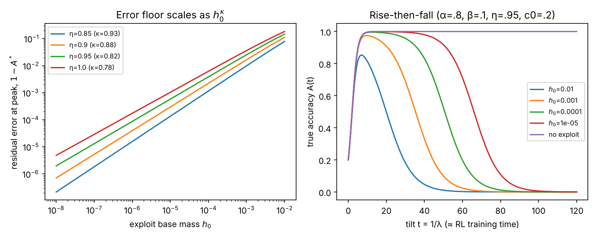
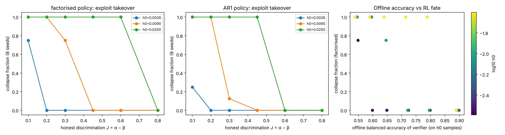
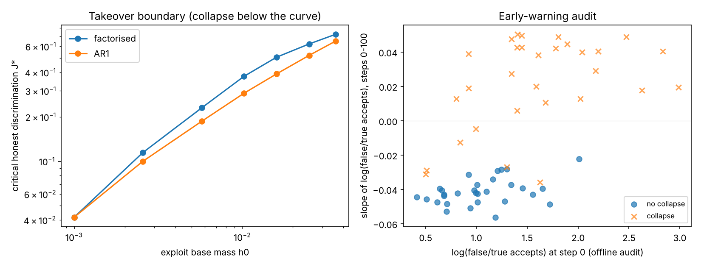

# Rate, Race, or Fate: Verifier Tails and Exploit Races Limit How Fast RL Spreads Beyond Math and Code

**Target venue:** NeurIPS 2027 (main track; theory + controlled CPU-scale experiments)

---

## Abstract

Reinforcement learning with verifiable rewards (RLVR) has driven fast gains in mathematics and code, where answers can be checked by rule. Outside those domains the reward usually comes from a rubric or an LLM judge. Such verifiers are weaker on average, and some of their errors are *response-dependent*: certain wrong answers are accepted more often than right ones. Earlier mean-field theory (Rad et al., 2026) treats verifier noise as class-conditional and shows that the Youden index J = TPR − FPR alone decides whether learning succeeds. We study the case that theory leaves open, where errors depend on the response and can be exploited. We report three findings.

1. **The idealised objective.** For the exponential-tilt family that contains both the KL-regularised RL optimum and the replicator (natural-gradient) flow, we prove an exact identity: logit A(t) = logit A(0) + K_c(t) − K_w(t). Here A is gold accuracy and K_c, K_w are the cumulant generating functions of verifier acceptance on correct and incorrect base-policy responses. Learning speed is A(1−A) times an *on-policy* Youden index J_t. The long-run outcome depends on the upper tails of the two distributions, not on their means. Offline verifier accuracy therefore cannot determine the outcome. For a three-mode model we give the peak time and peak accuracy in closed form, plus an error-floor law 1−A* ∝ h0^κ with κ = J/(η−β). The floor is worst exactly when J is small, which is the judge-based regime.
2. **Practical dynamics differ.** In tabular and sequence-level GRPO simulations, softmax policy gradient does *not* follow the tilt. It starves rare exploits, so the outcome is set by a **race** between correct and exploit behaviours early in training. KL-regularised GRPO reaches the tilt only when the KL coefficient is large. At practical horizons a KL penalty does not bring back the exploit contamination that the tilt predicts.
3. **The race has a measurable boundary.** On a sequence task with shared parameters, the critical honest discrimination needed to avoid takeover follows J* ≈ 12.6·h0^0.80 (factorised policy) and ≈ 8.9·h0^0.76 (autoregressive policy). Steps to reach 90% accuracy scale as 1/J (t90·J ≈ 78–86 steps). Offline balanced accuracy of the verifier is a poor predictor of collapse. A 100-step on-policy audit predicts it with AUC 0.98, against 0.77 for an offline audit.

The answer we give to the motivating question is conditional. RL can move a non-math domain only at a rate set by on-policy discrimination, and only while that domain's exploit prevalence stays below a boundary that tightens as discrimination falls. We give a pre-registered protocol to test these predictions at LLM scale.

## 中文摘要

基于可验证奖励的强化学习（RLVR）在数学与代码领域进展迅速，因为答案可由规则检验；而在其他领域，奖励通常来自评分细则或大模型评审，其误差不仅更大，而且依赖于具体回答，存在可被利用的“漏洞模式”（某些错误回答比正确回答更容易被判为通过）。已有理论（Rad 等，2026）在类条件噪声下证明 Youden 指数 J=TPR−FPR 决定学习方向；我们研究其未覆盖的、依赖于回答的可利用误差情形。(1) 对于包含 KL 正则最优解与复制子（自然梯度）流的指数倾斜族，我们证明精确恒等式：logit A(t)=logit A(0)+K_c(t)−K_w(t)，其中 K_c、K_w 分别是基础策略下正确与错误回答的验证器接受概率的累积量生成函数。因此学习速度等于 A(1−A) 乘以“在策略”Youden 指数，而最终命运取决于两类分布的上尾而非均值；离线验证器准确率无法决定 RL 结局。三模式模型给出峰值时间与峰值准确率的闭式解，以及误差下限律 1−A*∝h0^κ，κ=J/(η−β)，在 J 小（即评审型领域）时最差。(2) 在表格与序列级 GRPO 模拟中，softmax 策略梯度并不沿倾斜族演化：它会“饿死”稀有漏洞，结局由训练早期正确行为与漏洞行为之间的“竞赛”决定；仅当 KL 系数较大时 KL 正则 GRPO 才收敛到倾斜解。(3) 在参数共享的序列任务上，避免漏洞接管所需的临界诚实判别力满足 J*≈12.6·h0^0.80（因子化策略）与 ≈8.9·h0^0.76（自回归策略）；达到 90% 准确率所需步数与 1/J 成正比（t90·J≈78–86 步）。离线平衡准确率几乎不能预测崩溃，而训练前 100 步的在策略审计可以（AUC 0.98，离线审计为 0.77）。结论：RL 在非数学领域的进步速度受在策略判别力约束，并且只在漏洞流行度低于一个随判别力下降而收紧的边界时成立。我们给出在大模型规模上检验这些预测的预注册方案。

---

## 1 Introduction

Reinforcement learning with verifiable rewards (RLVR) is a simple loop: sample a completion, check it, and reinforce what passed. It is a main driver of recent reasoning gains. Examples include GRPO in DeepSeekMath (Shao et al., 2024), RLVR in Tülu 3 (Lambert et al., 2024), and DeepSeek-R1 (Guo et al., 2025). In DeepSeek-R1, rule-based rewards were used for mathematics, coding and logic, and model-based rewards for general data. The obvious next question, and the one this paper addresses, is whether RL can produce equally rapid progress in domains *without* a cheap, exact checker. Examples are medicine, law, open-ended writing, scientific explanation and advice.

Recent work extends RLVR to such domains in three main ways. One uses model-based verifiers against reference answers (Su et al., 2025; Ma et al., 2025). Another uses rubric-based rewards (Gunjal et al., 2025). A third uses LLM judges. Two empirical facts frame the problem.

- **RLVR tolerates some reward noise.** Lv et al. (2025) report that Qwen-2.5-7B trained with 40% of math rewards randomly flipped still reaches 72.02% on MATH-500, close to the 75.85% of noise-free training. Shao et al. (2025) report gains even from spurious rewards for some model families.
- **Model-based verifiers can be exploited.** Huang et al. (2025) find that model-based verifiers misclassify certain response patterns as correct, and that RL policies learn to exploit them. Zhao et al. (2025) show that "master keys", such as non-word symbols or generic reasoning openers, can produce false-positive rates as high as 80% in some setups.

These facts look contradictory: noise is benign in one case and destructive in the other. They are reconciled once we separate two kinds of verifier error. **Class-conditional** errors are independent of which wrong (or right) answer is given. **Response-dependent** errors are concentrated on particular responses that the policy can learn to produce. For the first kind, Rad et al. (2026) give a sharp answer. Modelling GRPO as a replicator flow over reasoning modes, they show that the drift of incorrect mass is set by Youden's index J = TPR − FPR, and that noise "primarily rescales convergence time" when J > 0 ("rate, not fate"). Cai et al. (2025) build forward and backward corrections for asymmetric class-conditional noise. Neither covers exploitable, response-dependent errors, which are the defining feature of judge-based rewards outside math.

**This paper.** We analyse RL with a verifier whose acceptance probability f(x) varies arbitrarily across responses x. We pair exact theory for the idealised objective with controlled CPU-scale simulations of GRPO. The simulations are designed to isolate one mechanism and should not be read as stand-ins for an LLM.

**Contributions.**

1. **An exact identity for the idealised objective (Theorem 1).** Along the exponential-tilt family π_t ∝ π0·e^{t f}, which contains the KL-regularised optimum (t = 1/λ) and the replicator flow (t = time), the log-odds of gold accuracy equal their initial value plus the difference of the class-conditional cumulant generating functions (CGFs) of f. Three corollaries follow:
   - (i) a rate law dA/dt = A(1−A)·J_t with an on-policy Youden index J_t that evolves as dJ_t/dt = Var_t(f|correct) − Var_t(f|incorrect);
   - (ii) a fate law governed by the essential suprema of f on correct and incorrect responses;
   - (iii) non-identifiability: offline verifier accuracy measured on base samples cannot determine the outcome (Proposition 2).
2. **A closed form for the three-mode case (Corollary 3)** with peak time t*, peak accuracy A*, and an error-floor law 1 − A* ∝ h0^κ with κ = (α−β)/(η−β). For a math-like verifier (α=0.8, β=0.1) and exploit mass 10⁻³, A* = 0.975. For a judge-like verifier (α=0.6, β=0.4) it is 0.596.
3. **Evidence that practical policy gradient departs from the tilt, and in which direction.** Finite-sample GRPO with a KL penalty converges to the predicted tilt when the KL coefficient is large. In that regime, measured and predicted accuracy agree within 0.003 for λ ≥ 0.25 with mean-centred advantages, and within 0.004 for λ ≥ 0.5 with std-normalised advantages. Without strong regularisation, softmax PG starves rare exploits, so exploits that the tilt says must eventually win are never reached on practical horizons. The outcome is instead decided by a *race*, with a sharp threshold in exploit mass that depends only weakly on training budget.
4. **A measured takeover boundary on a sequence task with parameter sharing.** Collapse occurs below J*(h0) ≈ 12.6·h0^0.80 (factorised) and ≈ 8.9·h0^0.76 (autoregressive). Learning time scales as 1/J. Offline balanced accuracy is a poor predictor of collapse, and an on-policy early-warning audit is a strong one (AUC 0.98 vs 0.77).
5. **A pre-registered protocol** (Section 8) of falsifiable predictions for LLM-scale tests.

We do not claim that these toy numbers transfer quantitatively to LLMs. We claim that the *mechanisms* are real, that each is isolated here, and that the predictions they generate are cheap to test.

## 2 Related Work

**RLVR and its extension beyond math and code.** GRPO (Shao et al., 2024) removes the critic by normalising rewards within a group of samples. Tülu 3 (Lambert et al., 2024) named and popularised RLVR on math and instruction-following constraints. DeepSeek-R1 (Guo et al., 2025) combined rule-based rewards for reasoning data with model-based rewards for general data. Su et al. (2025) extend RLVR to medicine, chemistry, psychology, economics and education with a distilled generative reward model. Ma et al. (2025) build a large dataset of verifiable questions across domains together with a generative answer verifier. Gunjal et al. (2025) use checklist rubrics as rewards and report gains over Likert-style LLM-judge rewards. Our work does not propose a new reward. It asks what properties a reward must have for RL to make fast, durable progress, and it supplies a theory and a test of those properties.

**Noisy and imperfect verifiers.** Rad et al. (2026) give the replicator-flow analysis closest to ours, under class-conditional false positive and false negative rates; we extend it to response-dependent acceptance. Cai et al. (2025) formalise verifier noise as an asymmetric channel and derive policy-gradient corrections. Lv et al. (2025) document robustness to random reward flips. Shao et al. (2025) document gains from spurious rewards for some models and attribute them in part to clipping bias. Huang et al. (2025) compare rule-based and model-based verifiers in mathematical reasoning and document that the policy hacks model-based ones. Zhao et al. (2025) show that trivial "master key" strings fool LLM judges. Yue et al. (2025) argue that RLVR mostly reweights reasoning paths already present in the base model. This fits the reweighting (tilt) view we formalise: RL can only amplify responses that π0 already supports.

**Reward hacking and overoptimisation.** Gao et al. (2023) measured how a gold reward first rises and then falls as a proxy reward model is optimised with RL or best-of-n. Our closed-form rise-then-fall curve is a mechanistic special case. Skalse et al. (2022) formally define reward hacking and show that, over all stochastic policies, non-trivial unhackable proxy pairs essentially do not exist. Our results are quantitative rather than existential: they say *how much* and *how fast*.

**Mathematical tools.** The replicator equation (Taylor & Jonker, 1978) and Price's covariance equation (Price, 1970) underlie the rate law. Korbak et al. (2022) interpret KL-regularised RL as Bayesian inference whose optimum is the reward-tilted prior; we use this fact directly. Mei et al. (2020) analyse convergence of softmax policy gradient and show that its rate constants depend on the initialisation. This is the root of the exploit-starvation effect we observe.

## 3 Setting and the Tilt Theory

**Setting.** Fix a prompt and a base policy π0 over a (finite or countable) response set X. Each response x has a gold label y(x) ∈ {0,1} and a verifier acceptance probability f(x) ∈ [0,1], the expected binary reward. We assume f is fixed: the verifier is not retrained during RL. Gold accuracy of a policy π is A(π) = E_π[y].

**Tilted family.** For t ≥ 0, define π_t(x) ∝ π0(x)·exp(t·f(x)). Two standard facts make this family central.

- *KL-regularised optimum.* The maximiser of E_π[f] − λ·KL(π‖π0) is π_{1/λ} (see e.g. Korbak et al., 2022).
- *Replicator / natural-gradient flow.* The solution of dπ(x)/dt = π(x)(f(x) − E_π f) from π0 is exactly π_t (Taylor & Jonker, 1978). This is the mean-field model of RLVR used by Rad et al. (2026). Multiplying the right-hand side by any positive scalar function of the state, such as GRPO's 1/σ normalisation in the population limit, only reparametrises time and leaves the path unchanged.

Define the class-conditional CGFs K_c(t) = log E_{π0}[e^{t f} | y=1] and K_w(t) = log E_{π0}[e^{t f} | y=0].

**Theorem 1 (CGF identity).** For all t ≥ 0,

  logit A(π_t) = logit A(π0) + K_c(t) − K_w(t).

*Proof.* A(π_t)/(1 − A(π_t)) = E_{π0}[y·e^{tf}] / E_{π0}[(1−y)·e^{tf}] = [A0·E_{π0}(e^{tf}|y=1)] / [(1−A0)·E_{π0}(e^{tf}|y=0)]. Take logarithms. ∎

The identity is elementary, but it moves the whole question onto two one-dimensional distributions: the law of f on correct base responses and the law of f on incorrect ones. Three consequences matter for the question of transfer beyond math.

**Corollary 1 (rate law).** dA/dt = A(1−A)·J_t, where J_t = E_{π_t}[f|y=1] − E_{π_t}[f|y=0] is the *on-policy* Youden index. Further, dJ_t/dt = Var_{π_t}(f|y=1) − Var_{π_t}(f|y=0).

*Proof.* Differentiate Theorem 1: d logit A/dt = K_c'(t) − K_w'(t), and K_S'(t) is the tilted conditional mean, because tilting conditional on a class equals conditioning the tilt. Also K_S'' is the tilted conditional variance. Finally, d logit A/dt = (dA/dt)/(A(1−A)). ∎

At t = 0, J_0 equals the offline Youden index measured on base samples. When errors are class-conditional (f ≡ α on correct responses and f ≡ β on incorrect ones), both conditional variances vanish and J_t ≡ α − β, which recovers the "rate, not fate" picture of Rad et al. (2026). With response-dependent errors, J_t *drifts*. It shrinks whenever incorrect responses have more dispersed acceptance than correct ones, which is the signature of an exploitable verifier: most wrong answers are rejected and a few are accepted almost always.

**Corollary 2 (fate law).** Let s_c = ess sup_{π0}(f | y=1) and s_w = ess sup_{π0}(f | y=0). If s_c > s_w then A(π_t) → 1. If s_c < s_w then A(π_t) → 0.

*Proof.* K_S(t)/t → s_S as t → ∞ (a standard property of CGFs of bounded variables), so K_c − K_w ~ t(s_c − s_w). ∎

Corollary 2 is the response-dependent analogue of the J > 0 threshold. The condition is on the *upper tails*, not the means. A verifier with J_0 = 0.8 still drives the idealised objective to zero accuracy if a single wrong behaviour in the support of π0 is accepted more reliably than every right one.

**Proposition 2 (offline accuracy does not identify the outcome).** For any offline TPR > FPR measured on π0 and any δ ∈ (0, 1 − A0), there are two verifiers with identical offline TPR and FPR on π0 such that A(π_t) → 1 for one and A(π_t) → 0 for the other.

*Construction.* Verifier 1: f ≡ TPR on correct responses and f ≡ FPR on incorrect ones (s_c > s_w, so A → 1). Verifier 2: on a set of incorrect responses of base mass δ' ≤ δ, set f = 1 > TPR. On the remaining incorrect mass, lower f to keep the mean equal to FPR. This is possible whenever δ'(1 − FPR) ≤ FPR(1 − A0 − δ'), which holds for small δ'. Then s_w = 1 > s_c and A → 0. ∎

In practice this means that benchmarks reporting a judge's average agreement with gold labels on base-model outputs cannot, on their own, certify that judge as an RL reward.

**Corollary 3 (three-mode closed form).** Suppose π0 has three modes: a correct mode (mass c0, acceptance α), an honest-wrong mode (mass w0, acceptance β) and an exploit mode (mass h0, acceptance η), with β < α < η. Let κ = (α−β)/(η−β) ∈ (0,1). If w0(α−β) > h0(η−α), accuracy rises and then falls. The peak is at

  t* = ln[ w0(α−β) / (h0(η−α)) ] / (η−β),

with peak value

  A* = 1 / ( 1 + (w0/c0)·((η−β)/(η−α))·[ h0(η−α) / (w0(α−β)) ]^κ ).

*Proof.* The three modes evolve as m_i·e^{f_i t}, so d log A/dt = α − f̄_t. Setting this to zero gives w0(α−β)e^{βt} = h0(η−α)e^{ηt}, which yields t*. Substituting back gives A*. ∎

**Corollary 4 (error-floor law).** As h0 → 0, 1 − A* ≈ (w0/c0)·((η−β)/(η−α))·(h0(η−α)/(w0(α−β)))^κ ∝ h0^κ.

The exponent κ = J/(J + (η − α)) is the honest margin as a fraction of the full acceptance range. Corollary 4 is the clearest way to see why weak verifiers suffer twice. A small honest margin J slows learning (Corollary 1), and it also flattens the error floor's dependence on exploit prevalence. Halving the residual error requires cutting exploit prevalence by a factor of 2^{1/κ}. With κ = 0.82 (math-like) the factor is 2.3. With κ = 0.36 (judge-like) it is 6.8.

**Where the theory applies.** Theorem 1 and its corollaries are exact for (a) the KL-regularised *optimum* and (b) the replicator / natural-gradient *flow*. Standard GRPO is vanilla softmax policy gradient, which is neither. Sections 5–7 measure how far practical dynamics depart from the tilt.

## 4 Experimental Design

All experiments are CPU-scale numpy simulations, seeded, and reproducible with `code/run_all.sh` (about 20 CPU-minutes). Every number below is read from `results/*.json`. No experiment uses a neural language model.

**Verifier and algorithm.** Rewards are Bernoulli(f(x)). The algorithm is GRPO-style: 8 groups of 16 samples per step, with group-normalised advantages (r − r̄)/σ_group. Groups with zero variance are dropped and there is no ratio clipping. The update is a policy-gradient step on the policy's parameters with plain SGD. An optional KL penalty is added either as an exact gradient (tabular case) or as a score-function estimator.

**E1 (theory checks).** Numerical verification of Theorem 1 and Corollaries 3–4.

**E2 (tabular, realizable).** A 20-mode universe: 4 correct modes with acceptance 0.55–0.70 and total mass 0.2; 15 honest-wrong modes with acceptance uniform on [0.05, 0.45]; 1 exploit mode with acceptance 0.95 and mass h0. Part A trains KL-regularised GRPO. Part B compares, unregularised: the tilt (theory), the deterministic expected-gradient softmax PG flow, and finite-sample GRPO.

**E2c (starvation threshold).** Bisection for the exploit mass h0* above which the softmax-PG flow collapses, on 20 random 20-mode universes, at three training budgets.

**E4–E7 (sequence task with parameter sharing).** Responses are binary strings of length 10 (1,024 strings, enumerated exactly for evaluation). A response is *correct* iff its first five tokens are all 1. It is an *exploit* (a non-attempt carrying a judge-fooling suffix, mimicking a "master key") iff x₀ = 0 and x₈ = x₉ = 1. The verifier accepts correct responses with probability α, exploits with η = 0.95, and everything else with β. Three policy classes are used:
- *factorised*: 10 independent Bernoulli logits, the strongest parameter sharing;
- *AR1*: logits indexed by position and previous token;
- *tabular*: a softmax over all 1,024 strings, with no sharing.

Every policy is initialised at the same product distribution, with P(x_i = 1) = 0.6 for positions 0–4, 0.5 for positions 5–7, and p_s for positions 8–9. The initial correct mass is c0 = 0.0778 and the exploit mass is h0 = 0.4·p_s².

## 5 Results I: The Tilt Theory Is Exact Where It Should Be

**Identity and closed form (E1; `exp1.json`).**
- Across 50 random universes, accuracies from Theorem 1 and from direct summation agree to a maximum absolute error of 1.6×10⁻¹⁴.
- For 200 random three-mode instances, the closed-form t* and A* match a fine-grid numerical maximisation within 1.7×10⁻⁴ (relative, t*) and 1.2×10⁻⁸ (absolute, A*). Both are at the grid's resolution.
- Fitting log(1 − A*) against log h0 for h0 ∈ [10⁻⁸, 10⁻⁶] recovers κ to at least four significant figures for η ∈ {0.85, 0.90, 0.95, 1.0}. Predicted κ = 0.933, 0.875, 0.824, 0.778; fitted 0.93333, 0.87499, 0.82352, 0.77775.

**Math-like vs judge-like (`exp1b.json`; Fig. 1).** With c0 = 0.2 and η = 0.95, a math-like verifier (α = 0.8, β = 0.1) gives peak accuracies 0.853, 0.975 and 0.996 for exploit mass h0 = 10⁻², 10⁻³ and 10⁻⁴. A judge-like verifier (α = 0.6, β = 0.4) gives 0.392, 0.596 and 0.773 at the same masses. Under the idealised objective, cutting exploit prevalence a hundredfold helps the judge-like verifier far less, as Corollary 4 predicts (κ = 0.36 vs 0.82).

*Figure 1. Left: error floor 1 − A* against exploit mass; slopes equal κ. Right: rise-then-fall trajectories of the tilted family.*

**KL-regularised GRPO converges to the tilt when regularisation is strong (E2 Part A; `exp2.json`).** Universe: h0 = 0.02, 3 seeds, 15,000 steps.

| λ | centred-advantage GRPO, final A (prediction A(1/λ)) | std-normalised GRPO, final A (prediction A(t_eff)) |
|---|---|---|
| 1.0 | 0.243 (0.243) | 0.288 (0.287) |
| 0.5 | 0.283 (0.286) | 0.355 (0.352) |
| 0.25 | 0.350 (0.352) | 0.182 (0.019) |
| 0.15 | 0.354 (0.341) | 0.003 (0.0002) |
| 0.10 | 0.222 (0.190) | 7×10⁻⁵ (9×10⁻⁷) |
| 0.07 | 0.067 (0.052) | 4×10⁻⁵ (2×10⁻⁹) |

For std-normalised advantages, the population-limit stationary point is the tilt at t_eff = 1/(λσ*), where σ* = sqrt(f̄*(1 − f̄*)) is solved self-consistently. This follows from the stationarity condition p_i(f_i − f̄)/σ = λ·p_i(log(p_i/π0_i) − KL). The matches at large λ confirm both the theory and the effective-temperature correction. At smaller λ (larger t_eff), GRPO lags the prediction. It has not equilibrated in 15,000 steps, because moving mass on rare modes under softmax PG is slow (Section 6).

## 6 Results II: Practical Policy Gradient Races Instead of Tilting

**Exploit starvation (E2 Part B; Fig. 2; `exp2.json`).** Without regularisation, the tilt (replicator) always ends at zero accuracy in this universe, since s_w = 0.95 > s_c = 0.70. Its peak A* falls smoothly from 0.796 at h0 = 10⁻⁴ to 0.246 at h0 = 10⁻¹. Softmax PG behaves very differently, both as the deterministic expected-gradient flow and as finite-sample GRPO (3 seeds, 20,000 steps):
- For h0 ≤ 10⁻², every run reaches A > 0.9999 and the exploit mass stays below 10⁻⁵.
- For h0 ≥ 3×10⁻², every run ends in exploit takeover with final A ≤ 1.2×10⁻⁵. Peak accuracies before collapse were 0.93, 0.93 and 0.61 at h0 = 3×10⁻², and about 0.22 at h0 = 10⁻¹.

Measured against KL from π0, the GRPO paths lie far above the tilt curve when exploits are rare (Fig. 2, left). This is the softmax "rich get richer" effect. The logit velocity of a mode is π(x)(f(x) − f̄), so a mode with tiny mass barely moves, even when its acceptance is the highest. Mei et al. (2020) show that softmax PG convergence constants depend on initialisation; starvation is the RLVR-relevant face of that dependence.

*Figure 2. Tabular universe. Left and centre: accuracy vs KL(π‖π0) for the tilt theory, the expected-gradient softmax-PG flow and finite-sample GRPO. Right: fate vs exploit mass.*

**The threshold is a race and depends only weakly on budget (E2c; `exp2c.json`).** Across 20 random universes, the starvation threshold h0* (smallest exploit mass that collapses within T steps) moves little with budget. The median ratio h0*(T = 80,000)/h0*(T = 5,000) is 0.87: a 16× longer run lowers the threshold by about 13%. A first-order heuristic says the exploit wins iff its initial logit velocity exceeds that of the best correct mode, h0(η − f̄0) > max_c m_c(f_c − f̄0). It correlates with the measured threshold (Pearson r = 0.78 on log scale), but it overestimates h0* systematically, by a mean absolute log10 error of 0.36 (about a factor of 2.3). Exploits win at smaller mass than the initial-velocity comparison suggests, because correct modes slow down as f̄ approaches their acceptance, while the exploit's advantage η − f̄ stays positive.

**KL regularisation at practical horizons (E6; Fig. 6; `exp6.json`).** If GRPO followed the tilt, adding a KL penalty would *cap* accuracy at the tilt's peak (0.608 for the math-like sequence verifier). Unregularised runs that starve the exploit would then end higher than regularised ones. We tested this on the sequence task with a math-like verifier (α = 0.75, β = 0.15, h0 = 0.009), 3 seeds, 8,000 steps. Mean accuracy over the last 20% of training was:
- λ = 0: 1.000 (tabular), 0.999 (factorised);
- λ = 0.5: 0.455 / 0.332 (tilt prediction 0.430);
- λ = 0.3: 0.784 / 0.944 (prediction 0.595);
- λ ≤ 0.2: ≥ 0.964 (predictions ≤ 0.22).

The KL-optimal policy is therefore unreachable at these horizons for small λ: GRPO sits in a *metastable* exploit-free state.

*Figure 6. Final accuracy of KL-regularised GRPO vs the tilt prediction on the sequence task (math-like verifier).* The prediction that "KL brings exploits back" does not hold on realistic budgets. The tilt theory describes what the objective rewards. It does not describe where finite training ends up when exploits are rare.

## 7 Results III: The Race Boundary on a Task With Parameter Sharing

**Sharing makes exploits discoverable (E4; Fig. 4; `exp4.json`).** On the sequence task (c0 = 0.078, h0 = 0.009), 3 seeds per cell, 3,000 steps:
- *Math-like verifier* (α = 0.75, β = 0.15): no policy class collapses. Final A is 0.997 (factorised), 0.997 (AR1) and 0.999 (tabular).
- *Noisy-judge verifier* (α = 0.60, β = 0.40): the factorised policy collapses in 3/3 seeds (peaks 0.56–0.85, final A ≤ 0.001), AR1 in 1/3, tabular in 0/3.
- *No-exploit control* (same noisy judge, exploit acceptance set to β): every class reaches A ≥ 0.990.

Parameter sharing works against the policy here. Raising P(x₀ = 0) or P(x₈ = 1) is rewarded by every response carrying those features, not just by exploit strings. So exploit mass can grow without the exploit strings themselves ever being sampled. Starvation protects tabular policies and does not protect shared ones. Real language models share parameters far more than either toy class. The no-exploit control reproduces the Lv et al. (2025) pattern: a noisy but unexploitable judge (J = 0.2) still trains to high accuracy, only more slowly.

*Figure 4. Accuracy vs KL for three verifier profiles and three policy classes; dashed line is the tilt theory.*

**Collapse grid, learning speed, and offline accuracy (E5; Fig. 5; `exp5.json`).** We swept J = α − β ∈ {0.1, 0.2, 0.3, 0.45, 0.6, 0.8} with β = 0.15, at three exploit masses (h0 = 0.0026, 0.009, 0.025), with 8 seeds each.
- **Collapse boundary.** Collapse is near-binary in J, and the boundary moves to larger J as h0 grows. With the factorised policy, h0 = 0.025 collapses in 8/8 seeds up to J = 0.6 and in 0/8 at J = 0.8. At h0 = 0.0026 it collapses in 6/8 seeds at J = 0.1 and never at J ≥ 0.2.
- **Learning speed.** At h0 = 0.0026 the median steps to 90% accuracy are 775, 390, 270, 190, 140 and 100 for the six J values. The product t90·J stays within 77.5–85.5 steps. This matches the 1/J rate law of Corollary 1 and of Rad et al. (2026) to within about 10%, despite the non-tabular parameterisation.
- **Offline accuracy is not predictive.** We computed the verifier's offline balanced accuracy, (TPR + 1 − FPR_offline)/2, on base samples. Configurations with nearly equal balanced accuracy have opposite fates: 0.721 → 0% collapse at h0 = 0.009, while 0.714 → 100% collapse at h0 = 0.025. A configuration with balanced accuracy 0.789 collapses in every factorised seed, and one with 0.599 never does (Fig. 5, right). This is the empirical counterpart of Proposition 2.

*Figure 5. Collapse fraction over honest discrimination J and exploit mass h0, and offline balanced accuracy vs collapse.*

**Takeover boundary (E7a; Fig. 7 left; `exp7.json`).** Bisection on J at seven exploit masses (h0 from 0.001 to 0.036, 8 seeds per evaluation) gives the critical J* at which half of the runs collapse. Power-law fits:
- factorised: J* ≈ 12.6·h0^0.80;
- AR1: J* ≈ 8.9·h0^0.76.

Read the other way round, the exploit prevalence a verifier can tolerate scales roughly as (J/12.6)^1.25 for the factorised policy. Halving honest discrimination cuts the tolerable exploit prevalence by about 2.4×. The log–log curves bend slightly, so the power law is a summary over this range, not an asymptotic claim.

**Early warning (E7b; Fig. 7 right).** We drew 60 random configurations (p_s ~ U[0.05, 0.3], J ~ U[0.05, 0.8]; 50% collapsed). Every 10 steps during the first 100 steps, we audited 256 on-policy samples, each with one verifier call and a gold label. We then fitted the slope of log(false accepts / true accepts).
- This slope predicts eventual collapse with AUC 0.984. The rule "slope > 0" is correct in 90% of runs.
- The same statistic measured once at step 0 (an offline audit) reaches AUC 0.767.

The informative quantity is the *direction* in which the policy moves the verifier's false-accept share, which is exactly the on-policy J_t of Corollary 1.

*Figure 7. Left: critical J* vs h0. Right: early-warning slope vs offline audit statistic, by eventual outcome.*

## 8 Discussion

**Answer to the motivating question.** Our results split the question "can RL progress equally fast outside math and code?" into three parts, each controlled by a different property of the reward.

1. **Rate.** Progress per step is proportional to the on-policy Youden index J_t (Corollary 1; t90·J ≈ constant in E5). A domain whose verifier has J ≈ 0.2, which is what a 40%-flip noise level implies, needs about four times as many steps as one with J ≈ 0.8, even with no exploits. This part is "rate, not fate", consistent with Rad et al. (2026) and Lv et al. (2025).
2. **Race.** With response-dependent errors, practical GRPO either learns the task or locks onto an exploit, depending on an early race. The race boundary J*(h0) rises steeply with exploit prevalence, so a domain with lower honest discrimination must also have fewer exploits. Rule-checked math sits at large J and small h0. Generative judges with known master-key vulnerabilities (Zhao et al., 2025) can combine smaller J with non-trivial h0, which puts them near or past the boundary unless the exploits are patched. Exactly this pattern was documented for model-based math verifiers by Huang et al. (2025).
3. **Fate.** Under the idealised objective (KL optimum or natural-gradient flow), the outcome depends only on upper tails (Corollary 2). Every exploit in the base policy's support eventually wins, and the best attainable accuracy is A* with floor ∝ h0^κ. Practical softmax PG can sit in a metastable state far from this fate for a long time, which is good news. Optimisers that move rare-mode mass more efficiently (natural-gradient-like preconditioning, entropy bonuses, exploration incentives) are, by our analysis, more likely to realise the tilt's pessimistic fate. This is a testable trade-off between exploration and exploit discovery.

**Practical implications.**
- *Audit verifiers on-policy, not offline.* Offline agreement with gold labels on base-model outputs (E5) cannot certify an RL reward (Proposition 2). The cheapest strong signal we found is the early slope of the false-accept share on a small gold-labelled on-policy audit (AUC 0.98 in E7).
- *Treat exploit prevalence and honest discrimination as substitutes.* Hardening a judge against master keys (lower h0) and improving its discrimination on honest answers (higher J) trade off along the J*(h0) curve.
- *Do not count on a KL penalty to prevent exploitation.* At practical horizons its effect on rare exploits is small (E6). In the limit its optimum tolerates exploits by design (Theorem 1).

**Pre-registered protocol for LLM-scale tests.** We state five predictions and how to test them with an open model (for example a 1.5B–7B instruction model) trained by GRPO on a non-math task with reference answers, such as the multi-domain data of Su et al. (2025).
- *Design.* (a) Use an LLM judge as the reward. Control J by mixing judge verdicts with random flips at rate ρ, which multiplies J by 1 − 2ρ. (b) Plant a controlled exploit: a fixed suffix string that a wrapper accepts with probability η = 0.95 regardless of content. Set its base prevalence h0 by inserting the suffix into a fraction h0 of the base policy's samples during the first K steps (a seeded exploration prior), or by prompt priming. (c) Keep a gold-labelled audit set.
- *P1 (rate).* With no planted exploit, steps to a fixed gold-accuracy gain scale as 1/(1 − 2ρ) within ±20%.
- *P2 (boundary).* For each ρ, the critical prevalence h0* at which half of 4 seeds collapse decreases monotonically with ρ. log h0* is approximately linear in log J with slope > 1, matching the sub-linear J* ∝ h0^{<1} seen here.
- *P3 (offline non-identifiability).* Across (ρ, h0) cells with matched offline balanced accuracy on base samples (within ±0.02), collapse rates differ by more than 50 percentage points in at least one pair.
- *P4 (early warning).* The slope of log(false/true accepts) over the first 10% of training predicts collapse with AUC > 0.85, better than any step-0 statistic.
- *P5 (metastability).* Adding a KL penalty at the commonly used strength does not raise collapse frequency within the training budget. Replacing SGD/Adam with an update that moves low-probability mass faster (for example, a stronger entropy bonus) *does* raise it at fixed (ρ, h0).

Any of P1–P5 failing would falsify the corresponding mechanism claim at LLM scale.

## 9 Limitations

- **Toy policies.** All experiments use tabular, factorised or first-order autoregressive policies over at most 1,024 responses. Real LLMs share parameters far more richly, and their "exploit features" are not single tokens. The fitted constants (12.6, 0.80; t90·J ≈ 80) are specific to our task, learning rate, group size and initialisation. Only the qualitative relationships are claimed to transfer.
- **Fixed verifier.** We assume f does not change during training. Judges that are retrained, or that are themselves LLMs affected by context, violate this assumption.
- **No clipping, no importance ratios.** Our GRPO omits PPO-style clipping. Shao et al. (2025) attribute part of the spurious-reward effect to clipping bias, which our model cannot capture.
- **Single prompt.** Each simulation uses one prompt. Cross-prompt generalisation, where an exploit learned on one prompt transfers to others, could make the boundary considerably worse in real training. Our results likely *understate* this.
- **Exploit construction.** Our exploit is a designed, contiguous feature with fixed acceptance η = 0.95. Real exploits vary in acceptance, partially overlap with correct answers, and may have to be discovered from zero base mass. Theorem 1 handles arbitrary f, but our simulations do not.
- **Heuristic gap.** The first-order race heuristic is biased (about 2.3× in h0*), and we do not have a closed-form theory of the softmax-PG race boundary. The power-law fits for J* rest on 7 points per policy class.
- **Limited theory for practical PG.** Theorem 1 is exact only for the KL optimum and for replicator/natural-gradient flow. For vanilla PG we provide measurements, not proofs.
- **No LLM experiments.** We had no GPU and no model access. The LLM protocol in Section 8 is a proposal, not a result.

## 10 Conclusion

We asked whether RL can drive progress outside math and code as quickly as inside them. Our answer is conditional and quantitative. Under the idealised objective, progress is governed by an exact identity in the class-conditional cumulant generating functions of verifier acceptance. Its speed is set by an on-policy Youden index, and its long-run fate by the upper tails of acceptance on wrong answers. These are quantities that offline verifier accuracy does not reveal. Practical policy gradient departs from this idealisation in an informative way: it starves rare exploits, and the outcome becomes a race whose boundary we measured, J* ≈ 12.6·h0^0.80 on a sequence task with shared parameters. Domains whose rewards come from weaker, exploitable judges face both slower learning and a tighter exploit budget. Both are measurable early in training with a small on-policy audit, and both make falsifiable predictions for LLM-scale experiments.

## References

Cai, X.-Q., Wang, W., Liu, F., Liu, T., Niu, G., & Sugiyama, M. (2025). Reinforcement Learning with Verifiable yet Noisy Rewards under Imperfect Verifiers. arXiv:2510.00915.

Gao, L., Schulman, J., & Hilton, J. (2023). Scaling Laws for Reward Model Overoptimization. In *Proceedings of the 40th International Conference on Machine Learning (ICML)*, PMLR 202, 10835–10866. arXiv:2210.10760.

Gunjal, A., et al. (2025). Rubrics as Rewards: Reinforcement Learning Beyond Verifiable Domains. arXiv:2507.17746 (NeurIPS 2025; ICLR 2026).

Guo, D., et al. (2025). DeepSeek-R1 incentivizes reasoning in LLMs through reinforcement learning. *Nature*. https://www.nature.com/articles/s41586-025-09422-z (preprint arXiv:2501.12948).

Huang, Y., Zeng, W., Zeng, X., Zhu, Q., & He, J. (2025). Pitfalls of Rule- and Model-based Verifiers — A Case Study on Mathematical Reasoning (v2 title: From Accuracy to Robustness: A Study of Rule- and Model-based Verifiers in Mathematical Reasoning). arXiv:2505.22203.

Korbak, T., Perez, E., & Buckley, C. L. (2022). RL with KL penalties is better viewed as Bayesian inference. In *Findings of the Association for Computational Linguistics: EMNLP 2022*, 1083–1091.

Lambert, N., et al. (2024). Tülu 3: Pushing Frontiers in Open Language Model Post-Training. arXiv:2411.15124.

Lv, A., Xie, R., Sun, X., Kang, Z., & Yan, R. (2025). The Climb Carves Wisdom Deeper Than the Summit: On the Noisy Rewards in Learning to Reason. arXiv:2505.22653.

Ma, X., Liu, Q., Jiang, D., Zhang, G., Ma, Z., & Chen, W. (2025). General-Reasoner: Advancing LLM Reasoning Across All Domains. arXiv:2505.14652 (NeurIPS 2025).

Mei, J., Xiao, C., Szepesvári, C., & Schuurmans, D. (2020). On the Global Convergence Rates of Softmax Policy Gradient Methods. In *Proceedings of the 37th International Conference on Machine Learning (ICML)*, PMLR 119.

Price, G. R. (1970). Selection and covariance. *Nature*, 227, 520–521. doi:10.1038/227520a0.

Rad, A., Filom, K., Keivan, D., Mohajerin Esfahani, P., & Kamalinejad, E. (2026). Rate or Fate? RLV^εR: Reinforcement Learning with Verifiable Noisy Rewards. In *Proceedings of the 43rd International Conference on Machine Learning (ICML)*, PMLR 306. arXiv:2601.04411.

Shao, R., Li, S. S., Xin, R., Geng, S., et al. (2025). Spurious Rewards: Rethinking Training Signals in RLVR. arXiv:2506.10947 (ICML 2026, PMLR 306).

Shao, Z., et al. (2024). DeepSeekMath: Pushing the Limits of Mathematical Reasoning in Open Language Models. arXiv:2402.03300.

Skalse, J., Howe, N. H. R., Krasheninnikov, D., & Krueger, D. (2022). Defining and Characterizing Reward Hacking. In *Advances in Neural Information Processing Systems 35 (NeurIPS 2022)*. arXiv:2209.13085.

Su, Y., Yu, D., Song, L., et al. (2025). Crossing the Reward Bridge: Expanding RL with Verifiable Rewards Across Diverse Domains. arXiv:2503.23829 (ACL 2026).

Taylor, P. D., & Jonker, L. B. (1978). Evolutionarily stable strategies and game dynamics. *Mathematical Biosciences*, 40, 145–156.

Yue, Y., et al. (2025). Does Reinforcement Learning Really Incentivize Reasoning Capacity in LLMs Beyond the Base Model? arXiv:2504.13837 (NeurIPS 2025).

Zhao, Y., Liu, H., Yu, D., Kung, S. Y., Mi, H., & Yu, D. (2025). One Token to Fool LLM-as-a-Judge. arXiv:2507.08794 (NeurIPS 2025).

---

*Reproducibility.* `bash code/run_all.sh` regenerates every figure and JSON file in `results/`. Data provenance: all numerical results in Sections 5–7 come from code in `code/` run in this environment. All statements about prior empirical findings (e.g., 72.02% vs 75.85% on MATH-500; false positive rates up to 80%) are taken from the cited sources.
