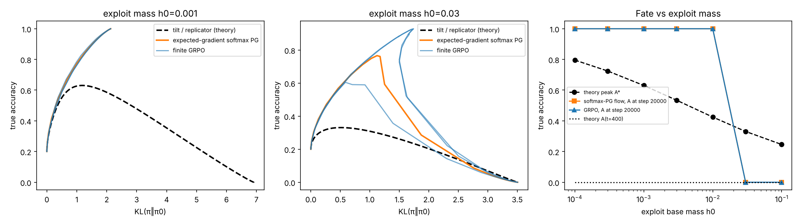
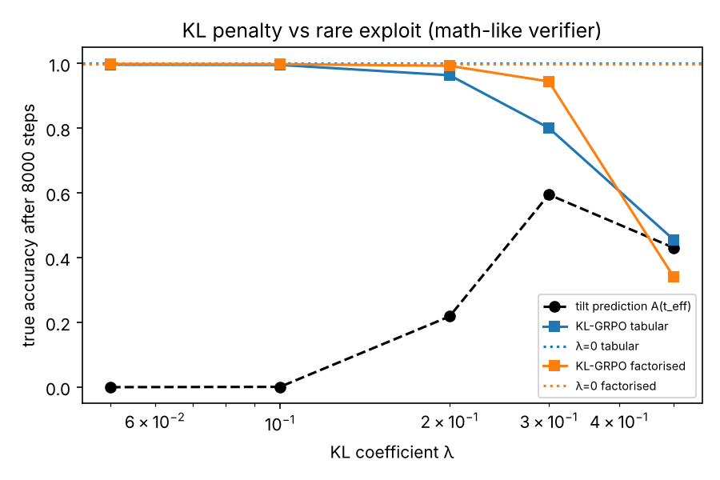
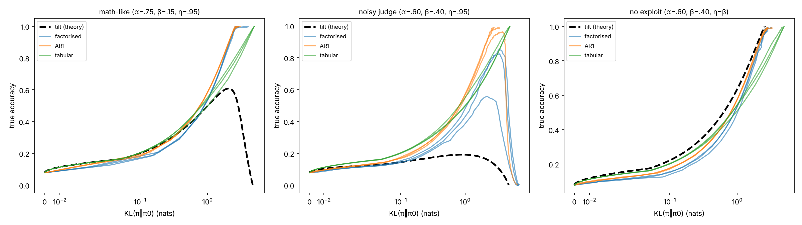
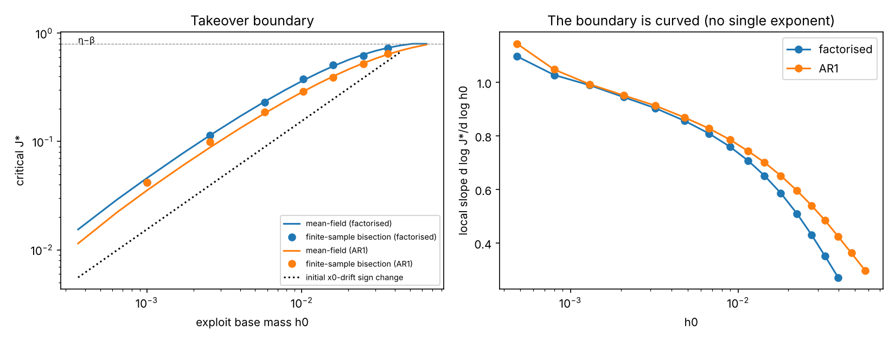
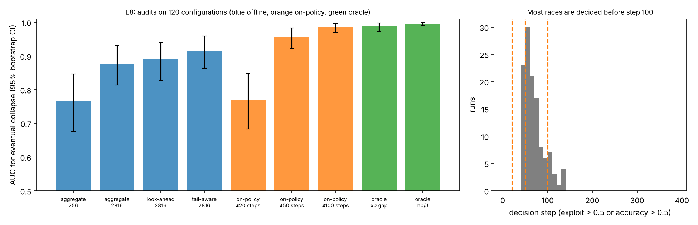
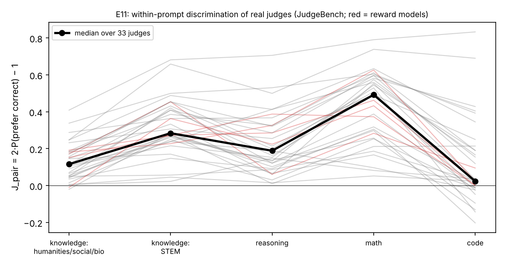

# Rate, Race, or Fate: Verifier Discrimination, Exploit Prevalence, and the Limits of RL Beyond Math and Code

**Target venue:** NeurIPS 2027 (main track; theory + controlled CPU-scale experiments + analysis of public judge data)

**Revision 1.** Changes relative to the submitted version are listed point by point in `reviews/response_r1.md`. In short:
- The related-work positioning now covers Egashira et al. (2026), Moya et al. (2026), Sparse Reward Auditing (NeurIPS 2026), Kwa et al. (2024) and a 2026 survey, and the novelty claims are narrowed.
- The claim that on-policy audits beat offline audits is withdrawn and replaced by a matched-budget comparison with confidence intervals (E8).
- The power-law boundary is replaced by a boundary derived from the mean-field dynamics (E9).
- A real-verifier anchor is added: 33 published judges on JudgeBench, broken down by domain (E11).
- Robustness checks are added (E10, E12), Proposition 2 is corrected, and confidence intervals are reported throughout.

---

## Abstract

Reinforcement learning with verifiable rewards (RLVR) has made fast progress in mathematics and code, where a rule can check the answer. In other domains the reward comes from an LLM judge or a reward model. We ask what properties of such a verifier limit how fast, and how durably, RL can improve a policy. We study a binary-label setting in which the verifier's acceptance probability f(x) can vary arbitrarily across responses. We combine elementary theory, controlled CPU-scale simulations, and measurements on published judge outputs.

1. **Theory for the idealised objective.** This covers the KL-regularised optimum and replicator / natural-gradient flow. Gold log-odds equal their initial value plus the difference of the class-conditional cumulant generating functions of f. This is a bookkeeping identity for standard Gibbs-measure facts.
   - Learning speed is A(1−A) times an on-policy Youden index J_t, which drifts by the difference of the class-conditional variances.
   - The long-run outcome is set by the upper tails of f on correct and on wrong responses. This is a bounded-reward, binary-label instance of the tail phenomenon of Kwa et al. (2024).
   - For a three-mode model we give the peak accuracy in closed form, with error floor 1−A* ∝ h0^κ, where κ = J/(η−β).
2. **Practical policy gradient races rather than tilts.** Softmax policy gradient starves rare exploits, so the outcome is decided by an early race between correct and exploit behaviour.
   - On a sequence task with shared parameters, we *derive* the race boundary J*(h0) from the population (mean-field) dynamics. It matches the finite-sample boundary to a mean absolute error of 0.007 in J. J* is the critical honest discrimination and h0 the exploit's base prevalence.
   - The boundary is curved and saturating: local log–log slopes fall from 1.10 to 0.27. It is not a power law.
   - Exploits that share features with correct answers ("near misses"), entropy bonuses and Adam all make takeover more likely.
3. **Which audits predict takeover.** We compared audits at matched label budgets of 2,816 samples, with bootstrap CIs, on 120 configurations.
   - An aggregate offline false-accept ratio is weak (AUC 0.88 [0.81, 0.93]).
   - A feature-blind, tail-aware offline audit, which judges each base sample repeatedly, does better (0.91 [0.86, 0.96]).
   - An offline audit that knows the exploit feature is near-perfect (0.99–1.00).
   - The on-policy audit reaches AUC 0.99 only over a 100-step window. By then 93% of the races have already been decided. Over a 20-step window, when no race has been decided, it reaches 0.77.
4. **A real-verifier anchor.** We analysed 33 published judges on JudgeBench, both reward models and LLM judges. Their within-prompt discrimination J_pair = 2·P(prefer the correct response) − 1 has a median of 0.12 on humanities/social-science/biology knowledge questions and 0.49 on math. All 33 judges discriminate better on math (sign test p = 2×10⁻¹⁰). For a class-conditional binary verifier, J_pair equals α − β exactly.

Our answer to the motivating question is conditional. On these data, judge-based rewards outside math sit in the low-discrimination regime. In that regime learning under SGD is slower (t90 ∝ J^−0.97 in our toy). In the toy model, the tolerable exploit prevalence there is roughly six times smaller than at math-like discrimination. Whether the toy's quantitative boundary transfers to LLMs is untested. We give a pre-registered protocol for testing it.

## 中文摘要

在数学与代码之外，强化学习的奖励通常来自大模型评审或奖励模型。我们研究验证器的哪些性质限制了 RL 的进步速度与持久性。(1) 对理想化目标（KL 正则最优解与复制子/自然梯度流），真实准确率的对数几率等于初值加上两类条件累积量生成函数之差（这是标准 Gibbs 测度事实的记账式表述）：速度等于 A(1−A) 乘在策略 Youden 指数，长期结局由上尾决定（Kwa 等 2024 尾部现象在有界奖励二元标签下的特例）；三模式模型给出峰值准确率闭式解与误差下限 1−A*∝h0^κ。(2) 实际 softmax 策略梯度会“饿死”稀有漏洞，结局由早期“竞赛”决定；我们由平均场动力学**推导**出竞赛边界 J*(h0)，与有限样本二分结果的平均绝对误差为 0.007；该边界弯曲且饱和（局部斜率由 1.10 降至 0.27），并非幂律。与正确答案共享特征的“近似错误”型漏洞、熵奖励与 Adam 都会提高被漏洞接管的概率。(3) 在 120 个配置、相同标注预算（2,816 个样本）与自助法置信区间下：聚合型离线审计较弱（AUC 0.88），对基础样本重复评审的尾部感知离线审计更好（0.91），已知漏洞特征的离线统计近乎完美（0.99–1.00）；在策略审计只有在 100 步窗口下才达到 0.99，而此时 93% 的竞赛已经分出胜负；在无一分出胜负的 20 步窗口内仅为 0.77。(4) 真实验证器锚点：JudgeBench 上 33 个公开评审（奖励模型与大模型评审）的提示内判别力 J_pair 中位数在人文/社科/生物知识题上为 0.12，在数学题上为 0.49，33 个评审全部在数学上更好（符号检验 p=2×10⁻¹⁰）。结论是有条件的：这些数据表明非数学领域的评审型奖励处于低判别力区间，在该区间 SGD 学习更慢，且在玩具模型中可容忍的漏洞流行度约为数学级判别力下的六分之一；玩具边界能否定量迁移到大模型尚未检验，我们给出预注册检验方案。

---

## 1 Introduction

RLVR is a simple loop: sample a completion, check it, and reinforce what passed. It drives recent reasoning gains, including GRPO in DeepSeekMath (Shao et al., 2024), RLVR in Tülu 3 (Lambert et al., 2024) and DeepSeek-R1 (Guo et al., 2025). The open question is whether RL can produce equally rapid progress where no cheap, exact checker exists, as in medicine, law, writing, scientific explanation and advice.

Two empirical facts frame the problem.

- **Noise can be benign.** Lv et al. (2025) report that Qwen-2.5-7B trained with 40% of math rewards flipped still reaches 72.02% on MATH-500, against 75.85% without noise, and converges rapidly.
- **Verifiers can be exploited.** Model-based verifiers can be exploited by the policy (Huang et al., 2025), and "master key" responses fool LLM judges at false-positive rates up to about 80% (Zhao et al., 2025).

Recent work agrees on what separates the two cases: the *structure* of the error matters, not its rate.
- Rad et al. (2026) show that with class-conditional noise the Youden index J = TPR − FPR decides the outcome, and noise mainly rescales time.
- Egashira et al. (2026) show on real LMs that systematic false positives cause delay, plateau or collapse depending on the error pattern, which aggregate measures such as J do not capture.
- Moya, Thornley & Lin (2026) analyse a fixed verifier under gradient flow, show that RLVR observations alone cannot identify accepted errors, and correct them with audits.
- Sparse Reward Auditing (NeurIPS 2026) shows that a small budget of trusted labels can counter policy-dependent verification error.

**What this paper adds.** We do not claim to discover that error structure matters. Our contribution is quantitative and has four parts.
1. A compact theory for the idealised objective that separates rate (an on-policy J_t) from fate (upper tails), with a closed-form peak and error floor for a three-mode model.
2. A demonstration that practical softmax policy gradient departs from this theory in a specific way: a race. We also give a boundary for that race, derived from population dynamics and stated in two measurable quantities, honest discrimination J and exploit prevalence h0.
3. A matched-budget comparison of audits that can forecast which side of the boundary a run is on.
4. A measurement of J for 33 real judges by domain, which places non-math judge rewards on that axis.

All simulations are deliberately small (at most 1,024 responses, one prompt). They isolate mechanisms and should not be read as stand-ins for an LLM.

## 2 Related Work

**RLVR beyond math and code.** Several papers extend RLVR outside math and code:
- Su et al. (2025) extend RLVR to medicine, chemistry, psychology, economics and education with a generative reward model.
- Ma et al. (2025) build cross-domain verifiable data with a generative verifier.
- Gunjal et al. (2025) use rubrics as rewards.

We propose no reward. We ask which reward properties govern speed and durability.

**Verifier error in RLVR (closest work).**
- *Class-conditional noise.* Rad et al. (2026) analyse GRPO as a replicator flow under class-conditional noise ("rate, not fate"). Cai et al. (2025) derive corrections for asymmetric class-conditional noise.
- *Egashira et al. (2026), "Delay, Plateau, or Collapse."* This paper is the closest empirical work. In controlled experiments with real LMs, systematic false positives produce delay, plateau or collapse depending on the error pattern, and systematic false negatives behave like random noise. Our Proposition 2 and E5 are the theoretical and toy counterparts of their finding that aggregate error rates do not predict the outcome. What we add is a parametrisation of *which* patterns collapse under softmax PG: the boundary J*(h0) in honest discrimination and exploit prevalence, derived in E9. We also add audits that forecast it.
- *Moya, Thornley & Lin (2026).* They use gradient flow with a fixed verifier to characterise when reward rises while correctness falls. They show that RLVR observations alone cannot identify accepted errors, and they build an audit-based correction ("selective control"). Our Corollary 1 and Proposition 2 overlap with their characterisation. Our differences are three:
  - (i) We separate the idealised tilt from softmax PG and show that the latter races.
  - (ii) We quantify the race boundary.
  - (iii) We use audits as *forecasts*, not corrections.

  Our E8 finding agrees with their non-identifiability result: audits without gold labels or without tail information are weak.
- *Sparse Reward Auditing for RLVR under Policy-Dependent Verification Error (NeurIPS 2026).* It shows that trusted labels on about 1% of responses can drive effective RLVR when policy optimisation amplifies verifier errors. Our audit budgets are of comparable size, but we use them to predict collapse rather than to correct the reward.
- *Surveys and other work.* A 2026 survey, "Checking the Checkers" (arXiv:2610.17824), synthesises this literature and concludes that error structure matters more than error rate. Lv et al. (2025) document robustness to random flips. Shao et al. (2025) report gains from spurious rewards and attribute them partly to clipping bias. Chen et al. (2025) dispute that clipping bias alone supplies a learning signal. Huang et al. (2025) and Zhao et al. (2025) document exploitable model-based verifiers and judges. Yue et al. (2025) argue that RLVR mostly reweights reasoning paths that the base model already has, which fits the reweighting view used here.

**Reward hacking and tails.** Gao et al. (2023) measured overoptimisation curves. Skalse et al. (2022) define reward hacking and show that unhackable proxies essentially do not exist. Kwa, Thomas & Garriga-Alonso (2024) show that under KL regularisation heavy-tailed reward error can yield arbitrarily high proxy reward with no gain in utility ("catastrophic Goodhart"). Our Corollary 2 is a bounded-reward, binary-label instance of the same tail principle. With f ∈ [0,1], the relevant "tail" is the essential supremum of f on each class. Corollary 3 adds what that principle does not give: the finite-time peak and how the floor scales with exploit prevalence.

**Judge benchmarks.** JudgeBench (Tan et al., 2025) pairs a correct and an incorrect response to the same hard question, in knowledge, reasoning, math and coding. It reports that strong judges are often near chance. We reuse its published judgment files to measure J by domain (E11).

**Tools.** We use the replicator equation (Taylor & Jonker, 1978) and Price's equation (Price, 1970), the reading of KL-regularised RL as Bayesian inference (Korbak et al., 2022), and convergence of softmax PG (Mei et al., 2020).

## 3 Setting and the Tilt Theory

**Setting.** Fix a prompt and a base policy π0 over a response set X. Each response x has a gold label y(x) ∈ {0,1} and a verifier acceptance probability f(x) ∈ [0,1]. The verifier is fixed during training. Gold accuracy is A(π) = E_π[y].

**Tilted family.** Define π_t(x) ∝ π0(x)·exp(t·f(x)). Two standard facts make this family central:
- The maximiser of E_π[f] − λ·KL(π‖π0) is π_{1/λ} (Korbak et al., 2022).
- The replicator flow dπ/dt = π(f − E_π f) from π0 is exactly π_t (Taylor & Jonker, 1978). Multiplying its right-hand side by a positive scalar function of the state, such as a population-level 1/σ, only reparametrises time.

Define the class-conditional CGFs K_c(t) = log E_{π0}[e^{tf} | y=1] and K_w(t) = log E_{π0}[e^{tf} | y=0].

**Theorem 1 (CGF identity).** For all t ≥ 0, logit A(π_t) = logit A(π0) + K_c(t) − K_w(t).

*Proof.* A(π_t)/(1−A(π_t)) = A0·E_{π0}(e^{tf}|y=1) / [(1−A0)·E_{π0}(e^{tf}|y=0)]. Take logarithms. ∎

Theorem 1 is elementary bookkeeping. Its use is that it reduces the question to two one-dimensional laws: f on correct base responses and f on wrong ones.

**Corollary 1 (rate law).** dA/dt = A(1−A)·J_t, where J_t = E_{π_t}[f|y=1] − E_{π_t}[f|y=0] is the on-policy Youden index, and dJ_t/dt = Var_{π_t}(f|y=1) − Var_{π_t}(f|y=0).

*Proof.* K_S′(t) is the tilted conditional mean and K_S″(t) the tilted conditional variance. Also, d logit A/dt = (dA/dt)/(A(1−A)). ∎

At t = 0, J_0 is the offline Youden index. Under class-conditional error both variances vanish and J_t ≡ α − β, which recovers Rad et al. (2026). Under response-dependent error J_t drifts. It shrinks when acceptance on wrong responses is more dispersed than on correct ones, which is the signature of an exploitable verifier.

**Corollary 2 (fate law).** Let s_c = ess sup_{π0}(f|y=1) and s_w = ess sup_{π0}(f|y=0). If s_c > s_w then A(π_t) → 1. If s_c < s_w then A(π_t) → 0.

*Proof.* K_S(t)/t → s_S. ∎

This is the textbook concentration of a Gibbs measure on the argmax of f, and a bounded, binary-label instance of the tail principle of Kwa et al. (2024). We state it because it makes the contrast with practical PG (Section 6) precise.

**Proposition 2 (offline accuracy does not identify the outcome; corrected).** Let A0 ∈ (0,1) and let offline rates satisfy 0 < FPR < TPR < 1 on π0. Assume π0 restricted to incorrect responses has no atom larger than FPR(1−A0). Then there exist two verifiers with identical offline TPR and FPR such that A(π_t) → 1 under one and A(π_t) → 0 under the other.

*Construction.*
- Verifier 1: f ≡ TPR on correct responses and f ≡ FPR on wrong ones. Then s_c = TPR > FPR = s_w, so A → 1.
- Verifier 2: f ≡ TPR on correct responses. Choose a set S of wrong responses with base mass δ′ ∈ (0, FPR(1−A0)), possible by the no-large-atom assumption, and set f = 1 on S. On the remaining wrong mass (1−A0−δ′), set the constant f = [FPR(1−A0) − δ′]/(1−A0−δ′) ∈ [0, FPR). The mean on wrong responses is then FPR, and s_w = 1 > TPR = s_c, so A → 0. ∎

The conditions are needed.
- If TPR = 1, then s_c = 1 = s_w, and A_t → A0/(A0 + δ′) rather than 0.
- If FPR = 0, no wrong mass can be raised while the mean is held.

(The round-1 statement omitted these conditions and carried an unused parameter δ.)

**Corollary 3 (three-mode closed form).** Suppose π0 has three modes:
- a correct mode with mass c0 and acceptance α;
- an honest-wrong mode with mass w0 and acceptance β;
- an exploit mode with mass h0 and acceptance η;

with β < α < η. Let κ = (α−β)/(η−β). If w0(α−β) > h0(η−α), then A rises and then falls. The peak is at t* = ln[w0(α−β)/(h0(η−α))]/(η−β), with

  A* = 1 / (1 + (w0/c0)·((η−β)/(η−α))·[h0(η−α)/(w0(α−β))]^κ).

*Proof.* Mode masses evolve as m_i·e^{f_i t}, and d log A/dt = α − f̄_t. Setting this to zero gives t*, and substituting back gives A*. ∎

**Corollary 4 (error floor).** As h0 → 0, 1 − A* ∝ h0^κ, where κ = J/(J + (η−α)). Halving the residual error requires cutting exploit prevalence by a factor of 2^{1/κ}: 2.3 for κ = 0.82 (math-like) and 6.8 for κ = 0.36 (judge-like).

**Scope.** Theorem 1 and the corollaries are exact for the KL optimum and the replicator / natural-gradient flow. They do not describe vanilla softmax PG, which is what GRPO implements. Sections 5–7 measure the gap.

## 4 Experimental Design

All simulations are seeded numpy code (`code/`). `bash code/run_all.sh` reproduces every number. The original experiments (E1–E7) take about 20 CPU-minutes, and the revision experiments (E2b, E8–E12) about 25 more on 3–4 cores. No neural language model is trained. E11 analyses published judge outputs and runs no model. Every number in Sections 5–8 comes from `results/*.json`. Statements about other papers' results come from those papers.

**Algorithm.** GRPO-style updates use 8 groups of 16 samples per step. Advantages are normalised within each group as (r − r̄)/σ_group, groups with zero variance are dropped, and there is no ratio clipping. Unless stated otherwise the optimiser is plain SGD with learning rate 0.5. E10 adds Adam, a diagonal natural gradient and entropy bonuses. Rewards are Bernoulli(f(x)).

**Tabular universe (E2).** There are 20 modes: 4 correct modes (acceptance 0.55–0.70, total mass 0.2), 15 honest-wrong modes (acceptance in [0.05, 0.45]) and one exploit mode (acceptance 0.95, mass h0).

**Sequence task (E4–E10, E12).** Responses are binary strings of length 10 (1,024 strings, enumerated exactly).
- *Correct:* x₀..x₄ are all 1.
- *Exploit:* x₀ = 0 and x₈ = x₉ = 1, mimicking a non-attempt with a judge-fooling suffix. E10 adds three other encodings.
- *Verifier:* acceptance α on correct strings, η = 0.95 on exploits, β otherwise.
- *Policies:* factorised (10 Bernoulli logits), AR1 (logits by position and previous token), or tabular (a softmax over all strings).
- *Initialisation:* P(x_i=1) = 0.6 for positions 0–4, 0.5 for 5–7 and p_s for 8–9, so that c0 = 0.078 and h0 = 0.4·p_s².

**Statistics.**
- Collapse is defined as exploit mass > 0.5 at step 3,000.
- Collapse fractions carry Wilson 95% intervals.
- AUCs and medians carry 2,000-sample bootstrap 95% intervals.

## 5 Results I: The Tilt Theory Is Exact Where It Should Be

**Identity and closed form (E1; `exp1.json`).**
- Theorem 1 matches direct summation to 1.6×10⁻¹⁴ across 50 random universes.
- The closed-form t* and A* match a numerical search within 1.7×10⁻⁴ (relative) and 1.2×10⁻⁸ (absolute) on 200 three-mode instances.
- Fitted error-floor exponents are 0.93333, 0.87499, 0.82352 and 0.77775, against predicted κ = 0.933, 0.875, 0.824 and 0.778.

**Math-like vs judge-like (`exp1b.json`; Fig. 1).** Take c0 = 0.2 and η = 0.95, and exploit masses h0 = 10⁻², 10⁻³ and 10⁻⁴.
- A math-like verifier (α = 0.8, β = 0.1) gives peak accuracies of 0.853, 0.975 and 0.996.
- A judge-like verifier (α = 0.6, β = 0.4) gives 0.392, 0.596 and 0.773.

*Figure 1. Left: the error floor 1 − A* against exploit mass, with slopes equal to κ. Right: rise-then-fall trajectories of the tilted family.*

**KL-regularised GRPO reaches the tilt, after a finite-group correction (E2 Part A; `exp2.json`, `exp2b.json`).** This experiment uses h0 = 0.02, 3 seeds and 15,000 steps.
- With centred advantages r_i − r̄, the group mean includes r_i. The expected update is therefore (G−1)/G = 15/16 of the population gradient, and the fixed point is the tilt at t = (G−1)/(Gλ), not 1/λ.
- With this correction, final accuracy matches the prediction within 0.0042 at all six λ.
- Without the correction, the error reaches 0.032 at λ = 0.1. The round-1 text had attributed this small-λ gap to slow equilibration.

| λ | centred GRPO A | prediction, t = 1/λ | prediction, t = (G−1)/(Gλ) | std-normalised GRPO A | prediction, t_eff |
|---|---|---|---|---|---|
| 1.0 | 0.243 | 0.243 | 0.241 | 0.288 | 0.287 |
| 0.5 | 0.283 | 0.286 | 0.281 | 0.355 | 0.352 |
| 0.25 | 0.350 | 0.352 | 0.346 | 0.182 | 0.019 |
| 0.15 | 0.354 | 0.341 | 0.352 | 0.003 | 0.0002 |
| 0.10 | 0.222 | 0.190 | 0.221 | 7×10⁻⁵ | 9×10⁻⁷ |
| 0.07 | 0.067 | 0.052 | 0.069 | 4×10⁻⁵ | 2×10⁻⁹ |

For std-normalised advantages, the population fixed point is the tilt at t_eff = 1/(λσ*), with σ* solved self-consistently. It matches at λ ≥ 0.5. At smaller λ, GRPO has not equilibrated in 15,000 steps, because moving mass onto a rare mode under softmax PG is slow (Section 6). The (G−1)/G correction does not close this gap (`exp2b.json`).

## 6 Results II: Practical Policy Gradient Races Instead of Tilting

**Exploit starvation (E2 Part B; Fig. 2).** Without regularisation the tilt always ends at zero accuracy here, because s_w = 0.95 > s_c = 0.70. Softmax PG does not, either as the expected-gradient flow or as finite GRPO (3 seeds, 20,000 steps):
- For h0 ≤ 10⁻², every run reaches A > 0.9999 with exploit mass < 10⁻⁵.
- For h0 ≥ 3×10⁻², every run is taken over (final A ≤ 1.2×10⁻⁵).

The reason is that a mode's logit velocity is π(x)(f(x) − f̄), so a rare mode barely moves even when its acceptance is the highest. This is the initialisation dependence of softmax PG (Mei et al., 2020) in RLVR form.

*Figure 2. Tabular universe. Accuracy vs KL(π‖π0) for the tilt, the expected-gradient softmax-PG flow and finite GRPO, and the final state vs exploit mass.*

**The threshold depends weakly on budget (E2c).** Across 20 random universes, the median ratio h0*(T = 80,000)/h0*(T = 5,000) is 0.87. A first-order heuristic, which compares the exploit's initial logit velocity with that of the best correct mode, correlates with h0* (r = 0.78 on log scale). It is biased by a factor of about 2.3.

**KL regularisation at practical horizons (E6, E12; Fig. 6).** This uses the sequence task with a math-like verifier (α = 0.75, β = 0.15, h0 = 0.009), 3 seeds per cell. After 8,000 steps, mean accuracy over the last 20% of training was:

| λ | tabular | factorised | tilt prediction |
|---|---|---|---|
| 0 | 1.000 | 0.999 | n/a |
| 0.5 | 0.455 | 0.332 | 0.430 |
| 0.3 | 0.784 | 0.944 | 0.595 |
| ≤ 0.2 | ≥ 0.964 | ≥ 0.964 | ≤ 0.22 |

The tilt is the KL-*optimal* policy, not a ceiling on accuracy. GRPO's accuracy exceeds it at λ ≤ 0.3 because GRPO has not reached the optimum: it carries far less exploit mass than the optimum does.

E12 quantifies this metastability over 32,000 steps, four times the E6 horizon.
- *Tabular, λ = 0.3.* Exploit mass grows from 0.0030 at step 8,000 to 0.0077 at step 32,000, at about 0.02 decades per 1,000 steps. The tilt's exploit mass is 0.354. Extrapolating this rate, the run would need about 80,000 more steps to reach it.
- *Tabular, λ = 0.5.* Exploit mass rises from 0.0096 to 0.064 (tilt 0.111), and accuracy falls to 0.43, essentially the tilt's 0.430. This run converges.
- *Factorised policy.* Exploit mass is flat: 2–3×10⁻⁴ at λ = 0.3 and 2–4×10⁻⁵ at λ = 0.2. Note that the tilt lies *outside* the factorised policy class. For this class, the "tilt prediction" is not the in-class KL optimum, and the factorised columns should not be read as tests of the tilt.

*Figure 6. Accuracy of KL-regularised GRPO after 8,000 steps against the tilt prediction (math-like verifier). The tilt is the KL optimum within the tabular class only.*

## 7 Results III: The Race on a Task With Parameter Sharing

**Sharing makes exploits reachable (E4, E10a; Fig. 4; `exp4.json`, `exp10.json`).** This setting uses the noisy-judge verifier (α = 0.60, β = 0.40, J = 0.2), h0 = 0.009, 8 seeds and 3,000 steps.

| exploit encoding | h0 | factorised collapse | AR1 collapse | tabular collapse |
|---|---|---|---|---|
| base: x₀=0 ∧ x₈=x₉=1 | 0.009 | 5/8 [0.31, 0.86] | 1/8 | 0/8 |
| near miss: x₀..x₃=1 ∧ x₄=0 ∧ x₉=1 | 0.0078 | 8/8 [0.68, 1] | 8/8 | 0/8 |
| anti-correlated: x₁=x₂=0 ∧ x₈=x₉=1 | 0.0036 | 0/8 | 0/8 | 0/8 |
| base, heterogeneous η ~ U[0.6, 1] | 0.009 | 1/8 | 0/8 | 0/8 |

- **Math-like verifier.** With α = 0.75 and β = 0.15, no encoding collapses in any class except the near-miss exploit: factorised 5/8, AR1 1/8.
- **No-exploit control (E4).** Every class reaches A ≥ 0.990.
- **The direction is robust.** The tabular policy, which has no sharing, never collapses (0 of 64 runs in this table). Shared parameterisations do.
- **The magnitude depends on the exploit.**
  - Exploits that share features with correct answers (near misses) are the most dangerous. They collapse even under the math-like verifier.
  - The anti-correlated exploit never collapses, but it also has 2.5× smaller h0, so the two effects are confounded.
  - Heterogeneous η (mean 0.8) mostly removes takeover.
- **Not sensitive to group size or learning rate (E10d).** Across lr ∈ {0.25, 0.5, 1.0} and G ∈ {8, 16, 32}, the factorised policy collapses in 4–7 of 8 runs in every cell. AR1 collapses in 0–4 of 8 runs.

*Figure 4. Accuracy vs KL for three verifier profiles and three policy classes (base encoding, 3 seeds). The dashed line is the tilt.*

**Collapse grid and learning speed (E5, E10c, E10e; Fig. 5).** The grid sweeps J = α − β with β = 0.15, over three exploit masses, with 8 seeds per cell.
- **Collapse is near-binary in J, and the threshold J moves up with h0.** For the factorised policy:
  - At h0 = 0.025, collapse occurs in 8/8 seeds up to J = 0.6.
  - At h0 = 0.0026, it occurs in 6/8 at J = 0.1 [0.41, 0.93] and never for J ≥ 0.2.
- **The J = 0.8 column is degenerate.** In round 1 that column set α = η = 0.95, so the "exploit" was no exploit. Its 0/8 collapse is uninformative and has been replaced by a J = 0.75 column (α = 0.90 < η, E10e). That column gives 0/8 collapse at every h0, including 0.025 [0, 0.32]. This agrees with the derived boundary below (J*(0.025) = 0.64).
- **Learning speed under SGD (E10c, 16 seeds per J).** At h0 = 0.0026, median t90 is 760, 385, 270, 182.5, 135 and 105 steps for J = 0.1, 0.2, 0.3, 0.45, 0.6 and 0.75. The log–log slope of t90 against J is −0.97 [−0.99, −0.95], so t90·J ∈ [76, 82]. The J = 0.1 point rests on the 4 seeds that did not collapse.
- **Why the rate scales as 1/J here.** Corollary 1 is a statement about the tilt, not about softmax PG, so this scaling is an empirical observation. With std-normalised advantages, the expected step scales with J/σ. In this setting the initial reward standard deviation σ0 varies only from 0.366 to 0.408 across J, because c0 is small. So J/σ ≈ J/0.39, which explains the near-1/J scaling.
- **Under Adam the J-dependence weakens sharply (E10c).** The slope is −0.38 [−0.41, −0.36], with t90 from 245 to 85 steps. Adam's per-coordinate normalisation largely cancels the signal scale set by J.

  This offers one reconciliation of our 1/J rate under SGD with the rapid convergence that Lv et al. (2025) report at 40% flips (J ≈ 0.2). LLM training uses Adam. We have not tested this explanation at LLM scale.

  Adam also raises collapse risk at low J. At J = 0.1, 13 of 16 runs collapse, against 12 of 16 under SGD. At J = 0.2, 7 of 16 collapse, against 0 of 16 under SGD.
- **Offline balanced accuracy is not predictive (E5).** Cells with nearly equal balanced accuracy have opposite fates: 0.721 gives 0/8 collapse, while 0.714 gives 8/8. This is the empirical counterpart of Proposition 2, and the toy analogue of Egashira et al. (2026).

*Figure 5. Collapse fraction over J and h0 (round-1 grid), and offline balanced accuracy vs collapse.*

**Optimisers that move rare mass faster raise exploit risk (E10b; prediction P5 tested in the toy).** This uses the factorised policy, 16 seeds per cell and β = 0.15. Values are collapse counts.

| (h0, J) | SGD | entropy 0.01 | entropy 0.05 | diag. natural gradient | Adam |
|---|---|---|---|---|---|
| (0.0026, 0.20) | 0/16 | 10/16 | 16/16 | 3/16 | 5/16 |
| (0.0026, 0.45) | 0/16 | 0/16 | 0/16 | 0/16 | 1/16 |
| (0.009, 0.20) | 16/16 | 16/16 | 16/16 | 16/16 | 16/16 |
| (0.009, 0.45) | 0/16 | 0/16 | 16/16 | 0/16 | 7/16 |
| (0.009, 0.60) | 0/16 | 0/16 | 0/16 | 0/16 | 4/16 |

Entropy bonuses and Adam shift the boundary upward. The diagonal natural gradient learns about 2.5× faster (median t90 70 vs 190 at (0.0026, 0.45)) and raises collapse only in the lowest-J cell. The round-1 discussion predicted that exploration-enhancing updates raise exploit risk. That prediction holds for entropy bonuses and Adam, and holds only weakly for our diagonal natural gradient.

**The takeover boundary is derived, not fitted (E9; Fig. 9; `exp9.json`).** Round 1 fitted J* ≈ 12.6·h0^0.80 to bisection points from 8 seeds. We now compute J*(h0) from the population dynamics: θ ← θ + 0.5·E_π[(f − f̄)/σ·∇log π] over all 1,024 strings, for 3,000 steps, with bisection on J to 10⁻⁴.
- **Agreement with finite-sample GRPO.** At the seven round-1 points, the mean absolute difference between the mean-field and finite-sample boundaries is 0.007 (factorised) and 0.008 (AR1). This is within the round-1 bisection resolution of about 0.015.
- **Curvature and saturation.** Local log–log slopes fall smoothly from 1.10 (h0 ≈ 4×10⁻⁴) to 0.27 (h0 ≈ 0.04) for the factorised policy, and from 1.14 to 0.30 for AR1. The factorised J* reaches the ceiling η − β = 0.8 at h0 ≈ 0.05; above that ceiling the exploit no longer out-scores correct answers. No single exponent describes this boundary, so the power law is withdrawn.
- **Low-prevalence regime.** At small h0 the boundary is close to linear: J*/h0 ≈ 43–46 for h0 ∈ [3.6×10⁻⁴, 10⁻³].
- **Why the race is not decided at initialisation.** The sign change of the initial drift of the shared x₀ logit lies at J ≈ 15.4·h0, the reviewer's estimate. It underestimates J* by a factor of about 3 at small h0, and by less (about 1.3×) near saturation (Fig. 9). The race is decided along the trajectory, because the exploit's advantage η − f̄ stays positive while correct modes slow down as f̄ approaches α. A closed form for this trajectory-level boundary remains open.

*Figure 9. Left: mean-field boundary J*(h0) (lines) against finite-sample bisection (points), and the initial-drift estimate (dotted). Right: local log–log slope of the boundary.*

**Which audits forecast takeover? (E8; Fig. 8; `exp8.json`).** We ran 120 random configurations with p_s ~ U[0.05, 0.3] and J ~ U[0.05, 0.8]. These are the 60 round-1 configurations plus 60 new ones; 52 collapsed. We compared audits that each use gold labels.

The *budget* is the number of verifier calls with gold labels. Offline audits use base-policy samples only.

| audit | type | budget | AUC [95% CI] |
|---|---|---|---|
| aggregate log(FA/TA), round-1 "offline audit" | offline, feature-blind | 256 | 0.766 [0.675, 0.846] |
| aggregate log(FA/TA) | offline, feature-blind | 2,816 | 0.877 [0.814, 0.932] |
| one-step look-ahead ⟨∇log(FA/TA), ĝ⟩ (needs the score function) | offline, feature-blind | 2,816 | 0.891 [0.827, 0.941] |
| tail-aware: 352 samples × 8 judge calls; ĥ_tail / Ĵ | offline, feature-blind | 2,816 | 0.914 [0.864, 0.959] |
| on-policy slope of log(FA/TA), steps 0–20 | on-policy | 768 | 0.771 [0.684, 0.848] |
| on-policy slope, steps 0–50 | on-policy | 1,536 | 0.957 [0.922, 0.984] |
| on-policy slope, steps 0–100 (round 1) | on-policy | 2,816 | 0.987 [0.970, 0.998] |
| E_π0[f \| x₀=0] − E_π0[f \| x₀=1] (reviewer) | offline, exploit feature known | exact | 0.988 [0.973, 0.998] |
| h0/J, or margin J*(h0) − J | offline, exploit set known | exact | 0.997 [0.990, 1.000] |

The tail-aware statistic works as follows. ĥ_tail is the share of samples that are wrong *and* whose per-response acceptance estimate exceeds the mean acceptance of correct samples. Ĵ is the gap between correct acceptance and the remaining wrong acceptance. The statistic needs no knowledge of the exploit.

**Timing.**
- Races are decided early. The decision step, the first step at which exploit mass or accuracy exceeds 0.5, has median 60 and range 40–130.
- No run is decided by step 20, 44% by step 50, and 93% by step 100.
- So the round-1 100-step on-policy statistic mostly *observes* the outcome. The exact exploit mass at step 100 alone has AUC 1.000.
- Among the 67 runs still undecided at step 50, the 50-step on-policy slope reaches 0.89 [0.81, 0.96], against 0.80 [0.68, 0.89] for the tail-aware offline audit and 0.69 for the aggregate audit.

**Conclusion of E8.** The reviewer's point holds. The informative distinction is *aggregate vs tail-aware*, and knowing the exploit's feature makes offline prediction essentially perfect. Among audits that do not know the exploit, a tail-aware offline audit at a matched budget beats aggregate offline audits and a genuinely early (20-step) on-policy audit. An on-policy audit becomes the strongest feature-blind signal only once the race is under way. It is then a monitor that catches takeover early, not a forecast made before training. We withdraw the round-1 claim "audit on-policy, not offline".

*Figure 8. Left: AUC with 95% bootstrap CIs (blue: offline, feature-blind; orange: on-policy; green: offline with oracle exploit knowledge). Right: distribution of decision times, with audit windows marked.*

## 8 Results IV: Where Real Judges Sit (E11; Fig. 11; `exp11.json`)

**Data.** JudgeBench (Tan et al., 2025) released judgment files for 33 judges on 350 GPT-4o response pairs. Each pair holds one correct and one incorrect answer to the same question, labelled against the source dataset's gold answer. The judges are 5 scalar reward models plus pairwise LLM judges, including GPT-4o, Claude-3.5-Sonnet, o1, Llama-3.1, Prometheus-2 and others. We grouped the questions into five domains:
- knowledge, humanities/social/biology: 9 MMLU-Pro subjects (99 pairs);
- knowledge, STEM: physics, chemistry, engineering and CS (44 pairs);
- reasoning: LiveBench (98 pairs);
- math: LiveBench plus MMLU-Pro math (67 pairs);
- code: LiveCodeBench (42 pairs).

We ran no model; we only analysed the released files. Order effects are averaged over the two presentation orders.

**Metric.** J_pair = 2·P(judge prefers the correct response) − 1, with ties counted as ½. For a binary verifier with class-conditional rates α on correct and β on wrong responses, with independent verdicts, 2P − 1 = α(1−β) − β(1−α) = α − β exactly. J_pair is therefore the within-prompt analogue of the J used in Sections 3–7, and it is the quantity that a group-normalised update sees.

**Findings.**

| domain | median J_pair over 33 judges | range | median over the 5 reward models |
|---|---|---|---|
| knowledge: humanities/social/bio | 0.12 | −0.02 to 0.41 | 0.17 |
| knowledge: STEM | 0.28 | 0.02 to 0.68 | 0.27 |
| reasoning | 0.19 | 0.01 to 0.71 | 0.29 |
| math | 0.49 | 0.05 to 0.79 | 0.43 |
| code | 0.02 | −0.20 to 0.83 | 0.02 |

- **Every judge discriminates better on math.** All 33 judges have higher J_pair on math than on humanities/social/biology knowledge: median difference 0.32, sign test p = 2.3×10⁻¹⁰. 32 of 33 are better on math than on all non-math knowledge (p = 7.9×10⁻⁹).
- **Confident inversions (reward models).** We counted pairs in which the wrong answer out-scores the correct one by more than one standard deviation of the score difference. On non-math knowledge these are 6.3–11.2% of pairs, against 1.5–6.0% on math.
- **Upper-tail inversion is similar across domains (reward models).** The share of wrong answers scoring above the 90th percentile of correct answers is 5.6–9.1% on non-math knowledge and 3.0–9.0% on math.

**Caveats.** JudgeBench pairs are deliberately hard and come from a single strong model. They are not the base-policy distribution of an RL run, so these numbers measure J on hard, contested items. Inversion shares are not exploit prevalence h0.

The code row does not mean that code is hard to verify. Code has executable tests, and these judges simply judge code poorly. That supports the paper's framing: what matters is the checker, not the domain.

**Placing judges on the toy boundary (illustration only).** On the factorised boundary of E9:
- a verifier with J ≈ 0.12, the non-math median, tolerates exploit prevalence up to h0 ≈ 0.27%;
- a verifier with J ≈ 0.49, the math median, tolerates up to h0 ≈ 1.6%. That is about six times more.

Measured confident-inversion shares on hard non-math pairs (6–11%) are far above both numbers. They are not h0, however, and the toy's constants are specific to the toy. The transferable statement is ordinal: non-math judge rewards have markedly lower J, and in every model studied here lower J means both slower SGD learning and a smaller exploit budget.

*Figure 11. J_pair by domain for 33 JudgeBench judges (grey: LLM judges; red: reward models; black: median).*

## 9 Discussion

**Answer to the motivating question.** The question "can RL progress equally fast outside math and code?" splits into three parts, each controlled by a different property of the reward.

1. **Rate.** Under the idealised objective, progress per unit time is A(1−A)·J_t (Corollary 1).
   - In our softmax-PG toy with SGD, t90 ∝ J^−0.97, because σ barely changes with J. With Adam the dependence is much weaker (J^−0.38).
   - Real judges outside math have J_pair around 0.1–0.2, against about 0.5 on math (E11).
   - So under SGD-like dynamics non-math judge rewards would learn 2–4× slower. Under Adam, rate is a weaker constraint than race.
2. **Race.** With response-dependent errors, practical PG either learns or locks onto an exploit. Which happens depends on an early race whose boundary J*(h0) we derived for the toy (E9).
   - Lower J tightens the tolerable exploit prevalence roughly in proportion at small h0.
   - Near-miss exploits, entropy bonuses and Adam make takeover easier (E10).
   - Generative judges combine low J with known exploitable inputs (Zhao et al., 2025; Huang et al., 2025; Egashira et al., 2026), so they are the regime where the race is most fragile.
3. **Fate.** Under the idealised objective every exploit in the support eventually wins (Corollary 2; cf. Kwa et al., 2024). Practical PG can sit far from this fate for a long time (E12).

**Practical implications (revised).**
- *Do not certify a reward by aggregate offline agreement* (Proposition 2; E5; E8, aggregate AUC 0.77–0.88). Egashira et al. (2026) reach the same conclusion empirically with LMs.
- *Audit for tails, not means.* Repeated judging of base samples, which estimates the per-response acceptance distribution, is a cheap feature-blind forecast (AUC 0.91). Where a candidate exploit feature is known, such as a master-key string, measuring its prevalence and acceptance offline is nearly decisive (AUC ≥ 0.99).
- *Monitor on-policy.* The false-accept slope is a strong early alarm once training is under way (AUC 0.96 by step 50). This is complementary to audit-based correction (Moya et al., 2026; Sparse Reward Auditing, 2026).
- *Treat discrimination and exploit prevalence as substitutes,* along a boundary that is concave in log–log coordinates and saturating.
- *Do not rely on a KL penalty.* At practical horizons it has little effect on rare exploits, and its optimum tolerates them by design.

**Pre-registered protocol for LLM-scale tests (revised).** The setting is an open 1.5B–7B model trained by GRPO on non-math questions with reference answers, for example Su et al. (2025).

*Design.*
- (a) Use an LLM judge as the reward. Lower J by mixing in random verdict flips at rate ρ, which gives J → (1−2ρ)J.
- (b) Plant an exploit: a fixed suffix that a wrapper accepts with probability 0.95. Set its base prevalence h0 by seeded insertion.
- (c) Keep a gold-labelled audit set.

*Predictions.*
- *P1 (rate).* With SGD and no planted exploit, steps to a fixed gain scale as 1/(1−2ρ) within ±20%. With Adam the exponent is smaller in magnitude, below 0.7.
- *P2 (boundary).* For each ρ, the critical h0* at which half of 4 seeds collapse increases monotonically with J. Its log–log slope is at most about 1.1 and decreases as h0 grows. Prediction P2 replaces the round-1 claim "slope > 1", which assumed a power law.
- *P3 (offline non-identifiability).* Across cells with matched offline balanced accuracy (±0.02), collapse rates differ by more than 50 points in at least one pair.
- *P4 (audits).* A tail-aware offline audit (repeated judging of base samples) predicts collapse better than the aggregate offline false-accept ratio at an equal label budget. The on-policy slope over the first 10% of training reaches AUC > 0.85.
- *P5 (optimisers).* Increasing the entropy bonus raises collapse frequency at fixed (ρ, h0).
- *P6 (near misses).* A planted exploit that is a near-correct answer (for example, the correct format with a wrong final value) collapses at lower h0 than an unrelated suffix of equal prevalence.

## 10 Limitations

- **Toy policies.** Every simulation uses tabular, factorised or AR1 policies over at most 1,024 responses, with a single prompt and hand-built exploits. The derived boundary, the t90 constants and the audit AUCs are specific to this task, its initialisation and its optimiser settings. E10 shows that the *size* of the sharing effect depends strongly on the exploit's encoding (near miss 8/8 vs anti-correlated 0/8), so only directions are claimed to transfer.
- **No LLM training.** We had no GPU and no model access. The real-verifier anchor (E11) measures judges on fixed, deliberately hard response pairs. It does not measure J or h0 along an RL trajectory, and it does not tell us any domain's exploit prevalence. The placement of real judges on the toy boundary is illustrative.
- **E11 coverage.** JudgeBench's domains are multiple-choice knowledge (MMLU-Pro), reasoning puzzles, math and code. Open-ended writing, advice and medicine with free-form answers are not covered, and judges may behave differently there. Some domain cells have only 42–67 pairs, so per-judge CIs are wide (about ±0.2 in J_pair). The cross-judge comparison is the robust result.
- **Fixed verifier; no clipping or importance ratios.** Our GRPO omits PPO clipping, which Shao et al. (2025) and Chen et al. (2025) discuss as relevant to spurious-reward effects.
- **Audit realism.** The tail-aware offline audit needs repeated stochastic verdicts per response. A deterministic judge (temperature 0) would need paraphrase or sampling noise instead. The oracle audits assume the exploit's features are known.
- **Theory.** Theorem 1 and Corollary 2 are elementary and closely related to known Gibbs-measure and tail results. The race boundary is computed numerically from the mean-field dynamics. We have no closed form for it, and the initial-drift approximation is off by up to a factor of about 3.
- **Seeds.** Collapse fractions rest on 8–16 seeds per cell, with Wilson intervals as wide as ±0.3 at 8 seeds.

## 11 Conclusion

The limit on RL outside math and code is less "noise" than the conjunction of low honest discrimination with exploitable, response-dependent error. Under the idealised objective, speed is governed by an on-policy Youden index and fate by acceptance tails. Practical policy gradient turns fate into an early race. On a toy task we derived the boundary of that race from population dynamics and showed which audits forecast it: tail-aware audits do, aggregate ones do not. Published judge outputs show that judges discriminate far less well on non-math knowledge questions than on math (median J_pair 0.12 vs 0.49), which places judge-based rewards in the regime where the race is tightest. Whether the toy's quantitative boundary carries over to LLM training is the main open question, and Section 9 gives a protocol for testing it.

## References

Cai, X.-Q., Wang, W., Liu, F., Liu, T., Niu, G., & Sugiyama, M. (2025). Reinforcement Learning with Verifiable yet Noisy Rewards under Imperfect Verifiers. arXiv:2510.00915.

Chen, P., Li, X., Li, Z., Yin, W., Chen, X., & Lin, T. (2025). Exploration vs Exploitation: Rethinking RLVR through Clipping, Entropy, and Spurious Reward. arXiv:2512.16912 (ICLR 2026).

Checking the Checkers: A Synthesis of Verifier Noise and Robustness in RLVR (2026). arXiv:2610.17824. (Survey; author list not retrieved during verification.)

Egashira, K., Vero, M., et al. (2026). Delay, Plateau, or Collapse: Evaluating the Impact of Systematic Verification Error on RLVR. arXiv:2605.02909 (COLM 2026).

Gao, L., Schulman, J., & Hilton, J. (2023). Scaling Laws for Reward Model Overoptimization. ICML 2023, PMLR 202. arXiv:2210.10760.

Gunjal, A., et al. (2025). Rubrics as Rewards: Reinforcement Learning Beyond Verifiable Domains. arXiv:2507.17746.

Guo, D., et al. (2025). DeepSeek-R1 incentivizes reasoning in LLMs through reinforcement learning. *Nature*. arXiv:2501.12948.

Huang, Y., Zeng, W., Zeng, X., Zhu, Q., & He, J. (2025). Pitfalls of Rule- and Model-based Verifiers — A Case Study on Mathematical Reasoning (v2: From Accuracy to Robustness: A Study of Rule- and Model-based Verifiers in Mathematical Reasoning). arXiv:2505.22203.

Korbak, T., Perez, E., & Buckley, C. L. (2022). RL with KL penalties is better viewed as Bayesian inference. Findings of EMNLP 2022, 1083–1091.

Kwa, T., Thomas, D., & Garriga-Alonso, A. (2024). Catastrophic Goodhart: regularizing RLHF with KL divergence does not mitigate heavy-tailed reward misspecification. NeurIPS 2024. arXiv:2407.14503.

Lambert, N., et al. (2024). Tülu 3: Pushing Frontiers in Open Language Model Post-Training. arXiv:2411.15124.

Lv, A., Xie, R., Sun, X., Kang, Z., & Yan, R. (2025). The Climb Carves Wisdom Deeper Than the Summit: On the Noisy Rewards in Learning to Reason. arXiv:2505.22653.

Ma, X., Liu, Q., Jiang, D., Zhang, G., Ma, Z., & Chen, W. (2025). General-Reasoner: Advancing LLM Reasoning Across All Domains. arXiv:2505.14652.

Mei, J., Xiao, C., Szepesvári, C., & Schuurmans, D. (2020). On the Global Convergence Rates of Softmax Policy Gradient Methods. ICML 2020, PMLR 119.

Moya, C., Thornley, E., & Lin, G. (2026). Verifier Errors in RLVR: Reward Hacking, Limits of Feedback, and Selective Control. arXiv:2609.35677.

Price, G. R. (1970). Selection and covariance. *Nature*, 227, 520–521.

Rad, A., Filom, K., Keivan, D., Mohajerin Esfahani, P., & Kamalinejad, E. (2026). Rate or Fate? RLV^εR: Reinforcement Learning with Verifiable Noisy Rewards. ICML 2026, PMLR 306. arXiv:2601.04411.

Shao, R., Li, S. S., Xin, R., Geng, S., et al. (2025). Spurious Rewards: Rethinking Training Signals in RLVR. arXiv:2506.10947 (ICML 2026).

Shao, Z., et al. (2024). DeepSeekMath: Pushing the Limits of Mathematical Reasoning in Open Language Models. arXiv:2402.03300.

Skalse, J., Howe, N. H. R., Krasheninnikov, D., & Krueger, D. (2022). Defining and Characterizing Reward Hacking. NeurIPS 2022. arXiv:2209.13085.

Sparse Reward Auditing for RLVR under Policy-Dependent Verification Error (2026). NeurIPS 2026, https://neurips.cc/virtual/2026/164475. (Author list not retrieved during verification.)

Su, Y., Yu, D., Song, L., et al. (2025). Crossing the Reward Bridge: Expanding RL with Verifiable Rewards Across Diverse Domains. arXiv:2503.23829.

Tan, S., et al. (2025). JudgeBench: A Benchmark for Evaluating LLM-Based Judges. ICLR 2025. arXiv:2410.12784. Data and judgment files: github.com/ScalerLab/JudgeBench.

Taylor, P. D., & Jonker, L. B. (1978). Evolutionarily stable strategies and game dynamics. *Mathematical Biosciences*, 40, 145–156.

Yue, Y., et al. (2025). Does Reinforcement Learning Really Incentivize Reasoning Capacity in LLMs Beyond the Base Model? arXiv:2504.13837.

Zhao, Y., Liu, H., Yu, D., Kung, S. Y., Mi, H., & Yu, D. (2025). One Token to Fool LLM-as-a-Judge. arXiv:2507.08794.

---

*Reproducibility and provenance.*
- `bash code/run_all.sh` regenerates every figure and JSON in `results/`. E11 additionally needs a clone of the public JudgeBench repository at commit e2c52c28; its data are not redistributed here.
- All numbers in Sections 5–8 come from code in `code/` run in this environment.
- Statements about other papers' findings (for example 72.02% vs 75.85% on MATH-500, master-key FPRs up to about 80%, and the outcomes reported by Egashira et al. and by Sparse Reward Auditing) are taken from the cited sources.
- Round-1 E7 results (`exp7.json`, Fig. 7) are retained for reference. Its boundary points are reused in E9, and its early-warning analysis is superseded by E8.
